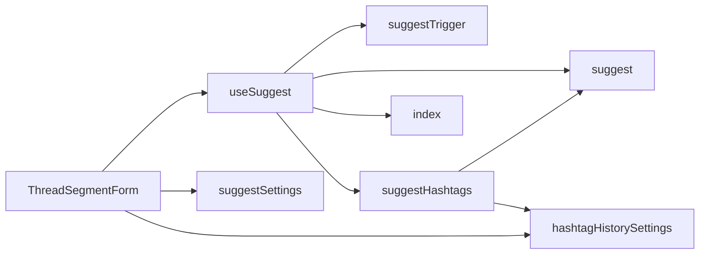
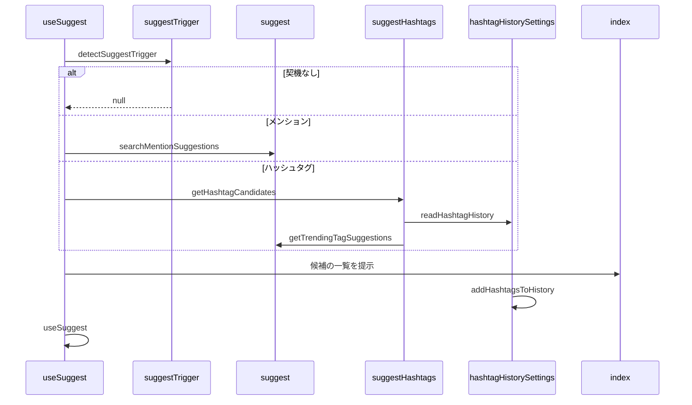

# Design Document

## Overview

**Purpose**: 投稿の本文の入力中に、メンションとハッシュタグの候補を提示し、利用者が正確な文字列を打たずに入力できるようにする。
**Users**: 投稿の本文を入力する利用者
**Impact**: 入力中にメンションとハッシュタグの候補を提示し、正確な文字列を打たずに入力できるようにする。

### Goals

- 本文のカーソル直前の入力からの、候補を出す契機の判定。
- メンションの候補とハッシュタグの候補の取得。
- 自分が使ったハッシュタグの履歴の保持。
- 候補の提示と選択、および候補機能の有効と無効の設定。

### Non-Goals

- 本文の強調表示。
- メンション先のDIDの解決。

## Boundary Commitments

### This Spec Owns

- 本文のカーソル直前の入力からの、候補を出す契機の判定。
- メンションの候補とハッシュタグの候補の取得。
- 自分が使ったハッシュタグの履歴の保持。
- 候補の提示と選択、および候補機能の有効と無効の設定。

### Out of Boundary

- 本文の強調表示。
- メンション先のDIDの解決。

### Allowed Dependencies

- 公開の AppView（メンションの検索とトレンドの取得）
- ブラウザの保存領域（履歴と設定）
- 選択肢行（listbox-option）

### Revalidation Triggers

- 候補を出す契機の判定規則を変えるとき（post-body-editor の色付けの開始条件と整合が要る）
- 候補の取得の待ち時間・打ち切り時間・件数を変えるとき
- 履歴の保存形式と上限を変えるとき

## Architecture

### Architecture Pattern & Boundary Map

候補機能の構成要素の依存方向を示す。



## File Structure Plan

| パス                                                    | 責務                                       |
| ------------------------------------------------------- | ------------------------------------------ |
| `src/util/textarea/suggestTrigger.ts`                   | カーソル直前の入力からの契機の判定         |
| `src/lib/atproto/suggest.ts`                            | メンションの検索とトレンドの取得           |
| `src/components/post/ThreadComposer/suggestHashtags.ts` | ハッシュタグの候補の合成                   |
| `src/lib/settings/hashtagHistorySettings.ts`            | ハッシュタグの履歴の保存                   |
| `src/lib/settings/suggestSettings.ts`                   | 候補機能の有効と無効の保存                 |
| `src/components/post/ThreadComposer/useSuggest.ts`      | 契機の評価・取得・キー操作・確定の状態管理 |
| `src/components/post/SuggestPopover/index.tsx`          | 候補の一覧の描画                           |

## System Flows

入力から候補の提示までの流れと、契機の種類による分岐を示す。



## Requirements Traceability

| Requirement                  | Summary        | Components |
| ---------------------------- | -------------- | ---------- |
| 1.1, 1.2, 1.3, 1.4           | 候補を出す契機 | D-1        |
| 2.1, 2.2, 2.3, 2.4, 2.5, 2.6 | 候補の取得     | D-2        |
| 3.1, 3.2, 3.3, 3.4           | 履歴と設定     | D-3        |
| 4.1, 4.2                     | 候補の一覧     | D-4        |

## Components and Interfaces

#### D-1: 契機の判定

**Requirements**: 1.1, 1.2, 1.3, 1.4

```ts
export type SuggestTrigger = { kind: "mention" | "hashtag"; startIndex: number; query: string }
// メンション: トークン文字は a-z A-Z 0-9 . -。ハッシュタグ: \p{L} \p{N} \p{M} _。
// 記号の直前は文字列の先頭か空白でなければならず、記号以降のクエリは 40 文字以内
export const detectSuggestTrigger = (text: string, caretIndex: number): SuggestTrigger | null
```

#### D-2: 候補の取得

**Requirements**: 2.1, 2.2, 2.3, 2.4, 2.5, 2.6

```ts
export const searchMentionSuggestions = async (query: string, opts?: { signal?: AbortSignal }): Promise<MentionSuggestion[]>
export const getTrendingTagSuggestions = async (opts?: { signal?: AbortSignal }): Promise<TrendingTagSuggestion[]>
export const getHashtagCandidates = async (params: { prefix: string; signal?: AbortSignal; accountDid?: string | null }): Promise<HashtagCandidate[]>
```

| 処理                 | 内容                                                                                                  |
| -------------------- | ----------------------------------------------------------------------------------------------------- |
| メンションの検索     | `searchActorsTypeahead` を `limit: 5` で呼ぶ。空のクエリは呼ばずに空配列。中断以外の失敗は空配列      |
| トレンドの取得       | `getTrendingTopics` を `limit: 25` で呼び、先頭の記号を除く。1〜64文字で空白を含まないものだけ残す    |
| トレンドの保持       | 結果を 5 分間保持する。取得に失敗したときは保持中の結果を返す                                         |
| ハッシュタグの候補   | 履歴を先、トレンドを後に並べ、前置一致（大文字小文字を区別しない）で選び、履歴と重なるものを除いて5件 |
| 取得の契機と打ち切り | 入力から 200 ミリ秒後に開始し、`AbortSignal.timeout(5000)` で打ち切る。IME の変換中は評価しない       |

#### D-3: 履歴と設定

**Requirements**: 3.1, 3.2, 3.3, 3.4

```ts
export type HashtagHistoryEntry = { tag: string; lastUsedAt: number }
export const readHashtagHistory = (accountDid: string | null | undefined): HashtagHistoryEntry[] // 新しい順
export const addHashtagsToHistory = (tags: string[], accountDid: string | null | undefined): void
// 履歴が空のときだけ、使用数順のタグを履歴の初期値として書き込む
export const seedHashtagHistoryFromRankedTags = (tags: string[], accountDid: string | null | undefined): void
```

- 保存先は `localStorage` の `hashtagHistory:<did>` とする。DID が未解決の間は読み書きしない。
- 上限は `PUBLIC_HASHTAG_HISTORY_MAX`（正の整数。不正なら 100）とする。
- 設定は `hashtagSuggestEnabled` と `mentionSuggestEnabled` の2つのキーに文字列の真偽値で保存し、読み取りは `readHashtagSuggestEnabledSetting`・`readMentionSuggestEnabledSetting`、書き込みは `writeHashtagSuggestEnabledSetting`・`writeMentionSuggestEnabledSetting` で行う。読み取れないときは既定値を返す。

#### D-4: 候補の一覧

**Requirements**: 4.1, 4.2

```tsx
type Props = {
  candidates: SuggestCandidate[]
  activeIndex: number
  position: { top: number; left: number } | null
  listboxId: string
  onHoverIndex: (index: number) => void
  onSelect: (index: number) => void // mousedown で確定する。入力欄のフォーカスを奪わない
  onDismiss: () => void
}
```

- 行は共通の `ListboxOption` で描画し、選択中の行に `aria-selected` を付ける。
- 矢印キーで `activeIndex` を移し、Enter または Tab で確定し、Esc で閉じる。

## Error Handling

| 事象                     | 処理                                 |
| ------------------------ | ------------------------------------ |
| メンションの検索の失敗   | 警告を記録して空の候補を返す         |
| トレンドの取得の失敗     | 保持中の結果、無ければ空の候補を返す |
| 保存領域の読み書きの例外 | 既定値を返すか、書き込みを諦める     |

## Testing Strategy

- Unit / Build Tests:
  - `npx vitest run tests/util/textarea/suggestTrigger.test.ts`
  - `npx vitest run tests/lib/atproto/suggest.test.ts tests/components/post/ThreadComposer/suggestHashtags.test.ts`
  - `npx vitest run tests/lib/settings/hashtagHistorySettings.test.ts tests/lib/settings/suggestSettings.test.ts`
  - `npx tsc --noEmit`
- E2E/UI Tests:
  - `tests/e2e/suggestPopover.spec.ts` 本文へ「#al」を入力する → 候補が表示され、矢印キーで選択が移り、クリックで挿入され、Esc で閉じる
- テストの名前には、対応する基準 ID を `[post-suggest/<ID>]` の形で付ける（例: `[post-suggest/1.1]`）
