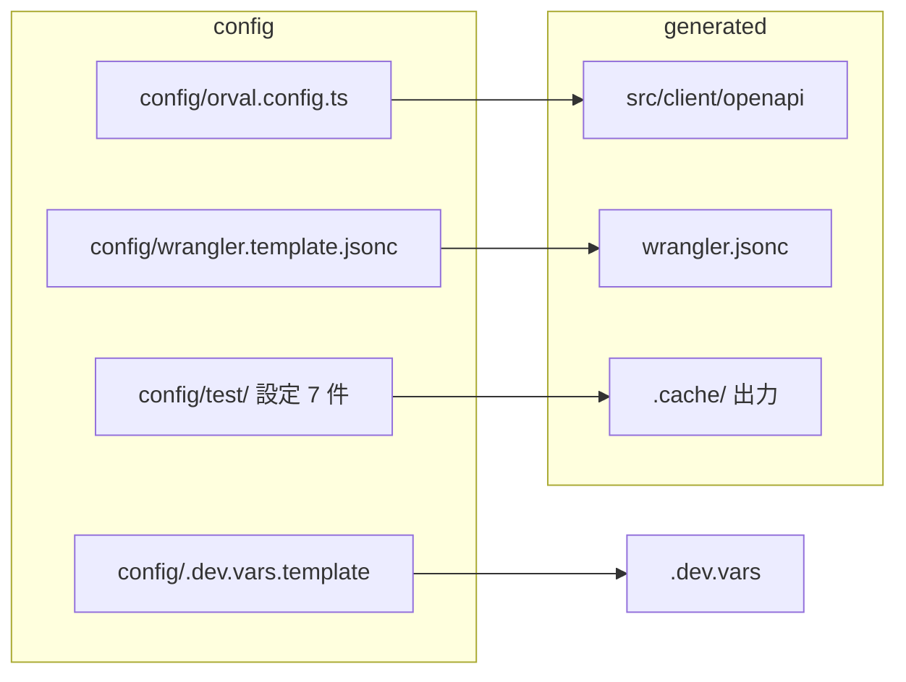

# Design Document

## Overview

**Purpose**: ルート直下に並ぶ設定・文書・生成物を役割ごとのフォルダへ移し、移動に伴う参照を更新する。開発者と運用者が、必要なファイルを役割から探せるようにする。

**Users**: 利用者本人とエージェント（設定・テスト・文書を探す）、運用者（生成の入力と雛形を探す）。

**Impact**: 根から 16 項目（設定 10・文書 3・生成物と認証 3）を移す。参照は約 30 ファイルで直す。振る舞いは変えない（パスだけを変える）。

### Goals

- 根に残るのは、ツールの規約で根に必要なものだけにする（要件 1）。
- テスト設定を `config/test/`、文書を `docs/`、生成物を `.cache/` にまとめる（要件 2・4）。
- 移動の後も、各コマンド・CI・hooks・生成の結果が移動の前と同じに動く（要件 2・3・5）。

### Non-Goals

- `_legacy/`・`lexicons/`・`atproto/`・`migrations/` の移動（要件 6.2）。
- `scripts/` の内部の配置（`ops-tooling-layout` で済み）。`.memo` の扱い（現状のまま）。
- 設定の中身の変更（パスの解決の基準を直す以外の変更はしない）。

## Boundary Commitments

### This Spec Owns

- 移動対象の配置（移動先のパス）と、移動に伴う参照（コード・設定・CI・hooks・テスト・文書）の更新。
- 生成物の出力先の定義（`.cache/`）と、`.gitignore` の除外の規則。
- 現行の仕様を説明する文書（`.kiro/steering/`・`CLAUDE.md`・`AGENTS.md`）の、パスの記述。
- 根に残すものの一覧（要件 1.1）。

### Out of Boundary

- 大きい移動（`_legacy/` など）と、それに伴う参照（別の spec で扱う）。
- `scripts/` の内部の配置と命名（`ops-tooling-layout`）。
- 完了済みの spec（`.kiro/specs/<完了済み>/`）の本文。これらは当時の決定の記録として残す。
- `.memo`・`.dev.vars`（秘密情報）の内容。`playwright/.auth/` の中身は読まず、移動のみ行う。

### Allowed Dependencies

- `ops-tooling-layout` が配置した `scripts/` の現在のパス（変更しない）。
- 各ツールの設定の読み込みの仕様（vitest の `-c`、Playwright の `testDir`・`outputDir`、Stryker の設定の引数、orval の `--config`、Astro の `getViteConfig`）。
- `wrangler.jsonc` の生成（`scripts/config/render-wrangler.mjs`）は、テンプレートの場所だけを変える。

### Revalidation Triggers

- キャッシュ用フォルダ（`.cache/`）の名前の変更。`.gitignore` と CI に影響する。
- 根に新しいファイルを置く判断。根の一覧（要件 1.1）を改める必要がある。
- ツールの版の更新で、設定の読み込みの基準が変わったとき（vitest・Playwright・Stryker・orval）。
- `scripts/config/render-wrangler.mjs` や `scripts/e2e/run-e2e.mjs` のパスの変更。

## Architecture

### Existing Architecture Analysis

- 設定の相対パス解決は、ツールごとに基準が違う。vitest の `rootDir` は設定ファイルの場所から求め、Playwright の `testDir` は設定ファイルからの相対、Stryker は作業ディレクトリの設定を既定で読み、orval は `output.target` を作業ディレクトリ基準で解決すると見られる（移動の後に確かめる）。
- `wrangler.jsonc` は `config/<名前>.json` と `wrangler.template.jsonc` から `scripts/config/render-wrangler.mjs` が生成する（根に生成する）。
- 生成の入力と出力の関係は、移動の前後で変えない。

### Architecture Pattern & Boundary Map



**Architecture Integration**:

- 選んだ方式: パスの移動と参照の更新（コードの構造は変えない）。
- 境界: 設定は `config/`、文書は `docs/`、生成物は `.cache/`。根は規約のファイルだけを持つ。
- 既存の規則を保つ: 秘密情報は `.dev.vars` に置き、`config/*.json` は Git 管理外（`.gitignore`）のまま。
- 新しい依存は追加しない。

### Path Resolution Rules

- 移動した設定は、プロジェクトの根を `path.resolve(設定の場所, "../..")` で求める（`import.meta.url` または `import.meta.dirname` から）。
- vitest は `root`（vitest のトップレベル） にプロジェクトの根を明示する（作業ディレクトリに依存させない）。
- Playwright の `testDir`・`outputDir` は設定ファイルからの相対で書く（`../../tests/e2e/flows`、`../../.cache/test-results`）。
- 起動の引数で設定を指定する: `vitest run -c config/test/<名前>.config.ts`、`stryker run config/test/stryker.config.mjs`、`orval --config config/orval.config.ts`、`playwright test -c config/test/playwright.config.ts`。

## File Structure Plan

### Directory Structure（移動の後）

```
(root)
├── package.json, package-lock.json, tsconfig.json, astro.config.mjs
├── .gitignore, .gitmodules, .prettierrc, .prettierignore
├── README.md, LICENSE, CLAUDE.md, AGENTS.md
├── .branch-release-workflow.json, .branch-release-workflow-source.json
├── wrangler.jsonc（生成）, .dev.vars（秘密情報・Git 管理外）
├── src/, public/, scripts/, hack/, tests/, lexicons/, migrations/, atproto/, _legacy/
├── config/
│   ├── test/            # vitest.{unit,component,route,astro,live}.config.ts, playwright.config.ts, stryker.config.mjs
│   ├── orval.config.ts
│   ├── wrangler.template.jsonc
│   └── .dev.vars.template
├── docs/
│   ├── DEVELOP.md
│   ├── README-jp.md
│   ├── openapi.md       # 旧 openapi/README.md（OpenAPI の設計説明）
│   └── promotion/skyshare-logo-typewriter.html
├── .cache/              # 生成物（Git 管理外）: coverage/, test-results/, stryker-tmp/
└── tests/e2e/.auth/     # Git 管理外: pds.json, live.json, peer.json
```

### Moved Files（`git mv` で移動。要件 6.1）

| 移動元                                                                                                                             | 移動先                           |
| ---------------------------------------------------------------------------------------------------------------------------------- | -------------------------------- |
| `vitest.unit.config.ts`・`vitest.component.config.ts`・`vitest.route.config.ts`・`vitest.astro.config.ts`・`vitest.live.config.ts` | `config/test/`                   |
| `playwright.config.ts`・`stryker.config.mjs`                                                                                       | `config/test/`                   |
| `orval.config.ts`                                                                                                                  | `config/orval.config.ts`         |
| `wrangler.template.jsonc`                                                                                                          | `config/wrangler.template.jsonc` |
| `.dev.vars.template`                                                                                                               | `config/.dev.vars.template`      |
| `DEVELOP.md`・`README-jp.md`                                                                                                       | `docs/`                          |
| `promotion/`                                                                                                                       | `docs/promotion/`                |
| `openapi/README.md`                                                                                                                | `docs/openapi.md`                |
| `openapi/generated.json`（Git 管理外。書き出しを止めて削除。移動はしない）                                                         | —                                |
| `playwright/.auth/`（Git 管理外。`mv`）                                                                                            | `tests/e2e/.auth/`               |
| `coverage/`・`test-results/`（生成物。移動せず削除し、次回の実行で `.cache/` に作られる）                                          | —                                |

### Modified Files（参照と設定の中身）

- `config/test/vitest.unit.config.ts` — `rootDir` を `../..` で求める。`root`（vitest のトップレベル） を明示。`coverage.reportsDirectory` を `.cache/coverage`。
- `config/test/vitest.component.config.ts` — 同上。
- `config/test/vitest.route.config.ts` — `rootDir` を `../..`。`fakeOutbound` の import を `../../tests/support/fakeOutbound` に。`wrangler.template.jsonc` の読み込みを `config/` の下に。coverage の出力先。
- `config/test/vitest.astro.config.ts` — alias の `./src` を `../../src`。`getViteConfig` の基準（移動の後に確かめ、必要なら `root` を渡す）。
- `config/test/vitest.live.config.ts` — 起動の基準が変わらないことを確かめる（`config/live.json` は `rootDir` 基準で読んでいる場合のみ修正）。
- `config/test/playwright.config.ts` — `testDir` を `../../tests/e2e/flows`、`outputDir` を `../../.cache/test-results`。
- `config/test/stryker.config.mjs` — `vitest.configFile` を `config/test/vitest.unit.config.ts`、`tempDirName` を `.cache/stryker-tmp`。
- `config/orval.config.ts` — `./scripts/build/build-openapi-document` の import を `../scripts/build/build-openapi-document` に。
- `config/.dev.vars.template` — 先頭コメントの「リポジトリ直下」を `config/` の記述に直す。
- `docs/README-jp.md` — 画像 `./public/...` を `../public/...` に。
- `docs/DEVELOP.md` — 本文のパス（`wrangler.template.jsonc`・`.dev.vars.template`・`playwright.config.ts` など）を新しい位置に。
- `package.json` — `test:unit`・`test:render`・`test:component`・`test:route`・`test:live` の `-c` の引数。`test:mutation` は `stryker run config/test/stryker.config.mjs`。`apigen:client` は `orval --config config/orval.config.ts`。
- `tsconfig.json` — include の root 直下の設定の一覧を `config/` の下に。
- `scripts/e2e/run-e2e.mjs` — Playwright の起動に `-c config/test/playwright.config.ts` を加える。
- `scripts/config/render-wrangler.mjs` — `TEMPLATE` を `config/wrangler.template.jsonc` に。
- `scripts/secrets/sync-github-variables.mjs` — テンプレートの読み込みを `config/` に。
- `scripts/secrets/prepare-local-env.mjs` — `.dev.vars.template` の場所を `config/` に。
- `scripts/build/build-openapi-document.ts` — コメントの `orval.config.ts` の場所。CLI の `openapi/generated.json` への書き出しを止め、組み立ての検証だけにする。
- `scripts/config/render-deploy-config.mjs`・`scripts/secrets/ensure-worker-secrets.mjs`・`scripts/lib/jsonc.mjs`・`scripts/lib/wrangler.mjs` — コメントの `DEVELOP.md` と `wrangler.template.jsonc` の場所。
- `hack/survey-cli/remote.ts` — `DATABASE_CONFIG` を `config/wrangler.template.jsonc` に。
- `tests/unit/scripts/renderWrangler.test.ts` — テンプレートの相対パスを `../../../config/wrangler.template.jsonc` に。
- `.claude/hooks/session-start.sh` — `cp config/.dev.vars.template .dev.vars`。
- `.githooks/pre-push` — コメントの `DEVELOP.md`。
- `.github/workflows/deploy.yaml`・`preview.yaml` — コメントの `DEVELOP.md` を `docs/DEVELOP.md` に。
- `.github/workflows/e2e.yaml` — アーティファクトの `path` を `.cache/test-results/`。コメントの `DEVELOP.md`。
- `astro.config.mjs` — コメントの `DEVELOP.md` を `docs/DEVELOP.md` に。
- `src/components/README.md` — `DEVELOP.md` の参照。
- `src/lib/feedback/env.ts` — コメントの `wrangler.template.jsonc` の場所。
- `docs/openapi.md`（旧 `openapi/README.md`）— 移動の後、`generated.json` の記述を消し、`src/` の参照を新しい場所に合わせる（実装済み）。
- `.gitignore` — `/coverage/`・`/test-results`・`/playwright/.cache`・`/playwright/.auth`・`/.stryker-tmp/` を `/.cache/` と `/tests/e2e/.auth/` に置き換える。`/openapi/generated.json` は削除する（ファイルを作らなくなったため）。
- `.kiro/steering/tech.md`・`.kiro/steering/testing.md` — パスの記述（現行を説明する部分）。
- `CLAUDE.md`・`AGENTS.md` — 現行のパスの記述があれば直す（導入物のため、導入の仕組みを壊さないことを確かめる）。

## Requirements Traceability

| Requirement | Summary                                                    | Components（変更単位）                                                    | Verification                                                      |
| ----------- | ---------------------------------------------------------- | ------------------------------------------------------------------------- | ----------------------------------------------------------------- |
| 1.1         | 根に残すものを限定                                         | 移動対象の一覧（File Structure Plan）                                     | 根の一覧と要件 1.1 の照合                                         |
| 1.2         | 文書を `docs/` へ                                          | `docs/DEVELOP.md`・`docs/README-jp.md`・`docs/promotion/`                 | 移動の確認と、`README-jp.md` の画像表示                           |
| 1.3         | `coverage/`・`test-results/`・`playwright/` を根に置かない | `.cache/`・`tests/e2e/.auth/`                                             | 根の一覧                                                          |
| 2.1         | テスト設定の対象は移動の前と同じ                           | `config/test/*`（rootDir・`root`（vitest のトップレベル）・`testDir`）    | 各層の実行で対象ファイル数を比べる                                |
| 2.2         | `test:unit` 等が同じ結果                                   | `package.json`・`config/test/vitest.*`                                    | `test:unit`・`test:component`・`test:route`・`test:render` を実行 |
| 2.3         | `test:e2e` が同じ設定で動く                                | `scripts/e2e/run-e2e.mjs`・`config/test/playwright.config.ts`             | `test:e2e` を実行（ローカルの環境が要る）                         |
| 2.4         | `.vscode` が新しい位置を参照                               | `.vscode/`（参照が無いことを確認）                                        | 検索                                                              |
| 3.1         | orval の生成が同じ                                         | `config/orval.config.ts`・`package.json`                                  | 移動の前後で `src/client/openapi` のハッシュを比べる              |
| 3.2         | `wrangler.jsonc` の生成が同じ                              | `scripts/config/render-wrangler.mjs`                                      | 生成の前後で `wrangler.jsonc` を比べる                            |
| 3.3         | `.dev.vars.template` の参照                                | `scripts/secrets/prepare-local-env.mjs`・`.claude/hooks/session-start.sh` | `setup:local` の実行                                              |
| 3.4         | `wrangler.jsonc`・`.dev.vars` は根                         | 根の一覧                                                                  | 根の一覧                                                          |
| 4.1〜4.2    | 生成物を `.cache/` に                                      | vitest・Playwright・Stryker の設定                                        | 実行の後に `.cache/` が作られ、根が増えないこと                   |
| 4.3         | `.cache/` は除外                                           | `.gitignore`                                                              | `git status` で出ないこと                                         |
| 4.4         | `playwright/` は `tests/` の下                             | `tests/e2e/.auth/`・`.gitignore`                                          | `.gitignore` の確認                                               |
| 5.1         | 旧パスを残さない                                           | 全参照（Modified Files）                                                  | 旧パスの検索（完了済み spec を除く）                              |
| 5.2         | dev・build・test:all が同じ                                | `package.json`・全設定                                                    | `npm run build`・`npm run test:all`                               |
| 5.3         | CI のパス                                                  | `.github/workflows/e2e.yaml` ほか                                         | 検索と目視                                                        |
| 5.4         | hooks のパス                                               | `.githooks/pre-push`・`.claude/hooks/session-start.sh`                    | 検索と hook の実行                                                |
| 5.5         | 文書のリンクが開く                                         | `docs/README-jp.md`                                                       | 画像パスの確認                                                    |
| 6.1         | `git mv` で移動                                            | 移動の手順                                                                | `git log --follow`                                                |
| 6.2         | 除外の対象は動かさない                                     | 移動しないもの                                                            | 根と `scripts/` の一覧                                            |
| 6.3         | 規約のファイルは根に残す                                   | `CLAUDE.md`・`AGENTS.md`・`.branch-release-workflow.json`                 | 根の一覧                                                          |

## Components and Interfaces

ファイル移動と参照の更新は、次の 4 つの変更単位に分ける。各単位は独立に検証できる。

| 変更単位        | 内容                                                                                                       | 対象の要件                   | 依存   |
| --------------- | ---------------------------------------------------------------------------------------------------------- | ---------------------------- | ------ |
| U1 テスト設定   | `config/test/` への移動、`rootDir`・`testDir`・出力先の修正、起動の引数                                    | 2.1〜2.4・4.1〜4.2           | なし   |
| U2 生成の設定   | `config/orval.config.ts`・`config/wrangler.template.jsonc`・`config/.dev.vars.template` の移動と参照の更新 | 3.1〜3.4                     | なし   |
| U3 文書と生成物 | `docs/` への移動、`.cache/` と `tests/e2e/.auth/`、`.gitignore`、CI のパス                                 | 1.2・1.3・4.3・4.4・5.3・5.5 | U1     |
| U4 参照の一掃   | コメント・文書・steering・hooks の旧パス                                                                   | 5.1・5.4・6.3                | U1〜U3 |

### 変更単位の依存

- U1 と U2 は並行できる（対象のファイルが重ならない）。
- U3 は U1 の出力先（`.cache/`）を前提にする。
- U4 は最後に行い、旧パスの検索で残りを確かめる。

## Testing Strategy

このスペックは振る舞いを変えないため、新しいテストは追加しない。既存のテストと次の確認で検証する。

**Structural checks（移動の前後）**

- 移動の前に、`npm run codegen` の出力（`src/client/openapi/`）のハッシュを取る。移動の後に同じ値になることを確かめる（要件 3.1）。
- `scripts/config/render-wrangler.mjs` の生成結果（`wrangler.jsonc`）を移動の前後で比べる（要件 3.2）。
- 各 vitest 層の対象ファイル数（`--reporter` の出力）を移動の前後で比べる（要件 2.1）。

**Command checks**

- `npm run test:type`・`npm run test:lexicon`・`npm run test:unit`・`npm run test:component`・`npm run test:route`・`npm run test:render`（要件 2.2）。
- `npm run test:e2e`（ローカルの `.dev.vars` と開発の設定が要る。要件 2.3）。
- `npm run build`（要件 5.2）。
- `npm run test:mutation` は時間がかかるため、起動の引数が通ることだけ確かめる（要件 2.2・4.2）。

**Reference checks**

- 旧パスの検索（`vitest.*.config.ts`・`playwright.config.ts`・`stryker.config.mjs`・`orval.config.ts`・`wrangler.template.jsonc`・`.dev.vars.template`・`DEVELOP.md`・`README-jp.md`・`promotion/`・`coverage/`・`test-results/`・`playwright/`）。`.kiro/specs/` の完了済みの spec を除く。
- 根の一覧の確認（要件 1.1）。`git status` で `.cache/` と `tests/e2e/.auth/` が出ないこと（要件 4.3・4.4）。

## Error Handling

- 移動の途中で失敗したら、`git mv` の単位で戻す（`git reset` と `git checkout` で元に戻せる）。
- 生成の出力が変わったら（codegen のハッシュや `wrangler.jsonc` の差分）、移動を止めて原因を直してから進める。

## Migration Strategy

1. 移動の前の確認: `src/client/openapi` のハッシュと `wrangler.jsonc` を控える。`npm run test:unit` などの基準の結果を控える。
2. U1・U2 を並行して行う（`git mv` と設定の修正）。
3. 各単位の検証（構造の確認とコマンドの確認）。
4. U3（文書・`.cache/`・`.gitignore`・CI）と U4（参照の一掃）。
5. 旧パスの検索と根の一覧の確認。
6. `playwright/.auth/` の移動（中身は読まない）。古い `coverage/`・`test-results/`・`playwright/` の残りを消す（生成物のため）。

## Open Items（実装の前に利用者が決める）

- `playwright/.auth/`（`pds.json`・`live.json`・`peer.json`）は、読むコードが無い。移動するか、削除するかを利用者が決める。design は移動を前提にしている。
- 完了済みの spec の旧パスは残す（現行の文書ではないため）。この解釈で要件 5.1 を満たすとする。
