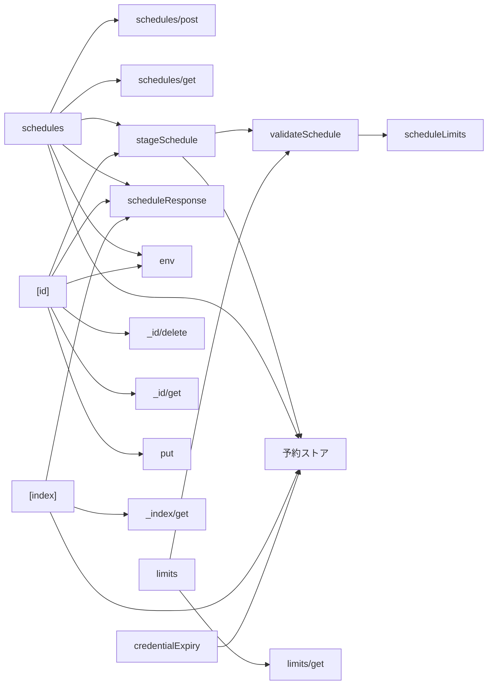
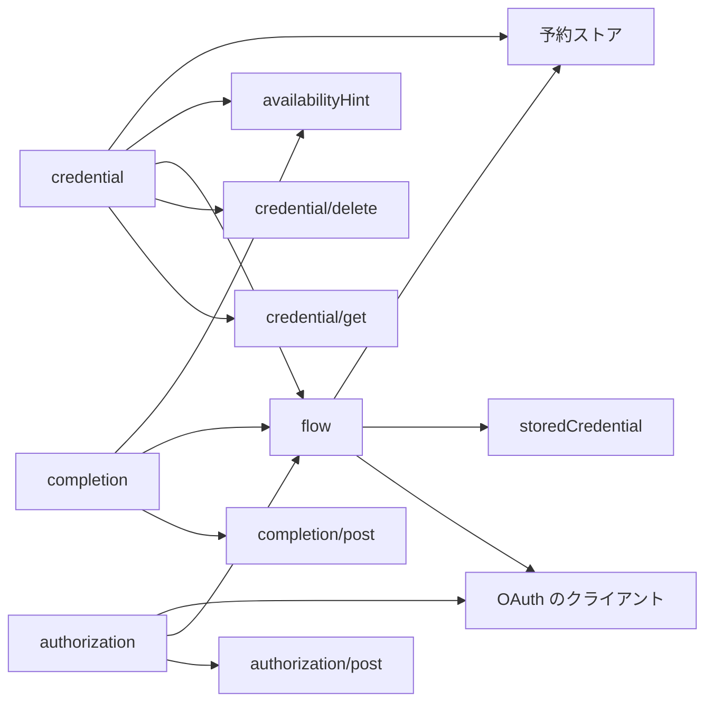
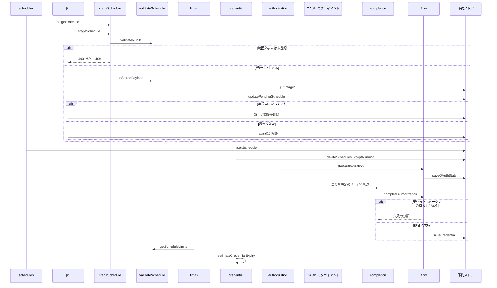

# Design Document

## Overview

**Purpose**: 利用者が自分の Bluesky アカウントの予約投稿を、作成・一覧・編集・取消できるようにする。投稿時刻に利用者がブラウザを閉じていても投稿できるよう、Bluesky の OAuth で予約に必要な権限だけを許可させ、その認可の登録と削除も扱う。パスワードは受け取らない。
**Users**: 自分の Bluesky アカウントの投稿を、時刻を指定して予約する利用者の画面
**Impact**: 投稿時刻に利用者がブラウザを閉じていても投稿できるよう、予約の作成・一覧・編集・取消と、予約に必要な権限だけを OAuth で許可させる認証情報の登録・削除を提供する。パスワードは受け取らない。

### Goals

- 予約の作成・一覧・内容の取得・置き換え・取消と、失敗した予約の履歴の削除。
- 予約用の認証情報の OAuth による登録・状態確認・削除と、削除に伴う待機中の予約の取消。
- 実行時刻の範囲と、アカウントごとの予約件数の検証。
- 検証に使う制限値の提供。

### Non-Goals

- 予約の実行と PDS への投稿。
- 動画を含む予約。

## Boundary Commitments

### This Spec Owns

- 予約の作成・一覧・内容の取得・置き換え・取消と、失敗した予約の履歴の削除。
- 予約用の認証情報の OAuth による登録・状態確認・削除と、削除に伴う待機中の予約の取消。
- 実行時刻の範囲と、アカウントごとの予約件数の検証。
- 検証に使う制限値の提供。

### Out of Boundary

- 予約の実行と PDS への投稿。
- 動画を含む予約。

### Allowed Dependencies

- 予約と認証情報の保管と取り出し（schedule-store。D1・R2・暗号鍵）
- OAuth のクライアント処理（oauth-client）
- API の認証の再開（account-session）
- 予約の実行（schedule-runner。この仕様の対象外）

### Revalidation Triggers

- 制限値（実行時刻の範囲・待機中の予約の上限・画像の合計容量・投稿の件数）を変えるとき（schedule-form の検証と一致が要る）
- 認証情報の保管内容と暗号化の方式を変えるとき（privacy-policy の記載も更新する）
- ヒント cookie の形式と失効の契機を変えるとき（schedule-form が参照する）
- エラーの識別子つきの409の種類を変えるとき
- 予約の API の経路で atproto のライブラリを静的に読み込まない制約（Workers の CPU 制約）

## Architecture

### Architecture Pattern & Boundary Map

予約を扱うハンドラがスキーマと検証処理に依存する方向を示す。



## File Structure Plan

| パス                                                                          | 責務                                             |
| ----------------------------------------------------------------------------- | ------------------------------------------------ |
| `src/pages/v2/schedules.ts`                                                   | 予約の作成と一覧のハンドラ                       |
| `src/pages/v2/schedules/[id].ts`                                              | 予約の内容の取得・置き換え・取消・削除のハンドラ |
| `src/pages/v2/schedules/[id]/images/[index].ts`                               | 予約の画像の取得のハンドラ                       |
| `src/pages/v2/schedules/limits.ts`                                            | 制限値の取得のハンドラ                           |
| `src/pages/v2/schedules/credential.ts`                                        | 予約用認証情報の取得・削除のハンドラ             |
| `src/pages/v2/schedules/credential/authorization.ts`                          | OAuth の認可の開始のハンドラ                     |
| `src/pages/v2/schedules/credential/authorization/completion.ts`               | OAuth の認可の完了のハンドラ                     |
| `src/lib/api/schema/v2/schedules/post.ts`                                     | 予約の作成の入力スキーマ                         |
| `src/lib/api/schema/v2/schedules/get.ts`                                      | 予約の一覧のクエリと応答のスキーマ               |
| `src/lib/api/schema/v2/schedules/limits/get.ts`                               | 制限値の応答のスキーマ                           |
| `src/lib/api/schema/v2/schedules/_id/delete.ts`                               | 予約の取消のパスのスキーマ                       |
| `src/lib/api/schema/v2/schedules/_id/get.ts`                                  | 予約の内容の応答のスキーマ                       |
| `src/lib/api/schema/v2/schedules/_id/put.ts`                                  | 予約の置き換えの入力スキーマ                     |
| `src/lib/api/schema/v2/schedules/_id/images/_index/get.ts`                    | 予約の画像の取得のパスと応答のスキーマ           |
| `src/lib/api/schema/v2/schedules/credential/get.ts`                           | 認証情報の登録状態のスキーマ                     |
| `src/lib/api/schema/v2/schedules/credential/authorization/post.ts`            | 認可の開始の応答のスキーマ                       |
| `src/lib/api/schema/v2/schedules/credential/authorization/completion/post.ts` | 認可の完了の入力と応答のスキーマ                 |
| `src/lib/api/schema/v2/schedules/credential/delete.ts`                        | 認証情報の削除の応答のスキーマ                   |
| `src/lib/schedule/validateSchedule.ts`                                        | 実行時刻の範囲と件数の検証、保管形式への変換     |
| `src/lib/schedule/stageSchedule.ts`                                           | 作成と置き換えに共通の検証と画像の保管           |
| `src/lib/schedule/scheduleLimits.ts`                                          | 実行時刻の範囲と各上限の定数、制限値の組み立て   |
| `src/lib/schedule/scheduleResponse.ts`                                        | 識別子つきのエラー応答と JSON 応答の組み立て     |
| `src/lib/schedule/env.ts`                                                     | D1・R2・暗号鍵のバインディングの取得             |
| `src/lib/schedule/oauth/flow.ts`                                              | 認可の開始・完了、トークンの更新・取消           |
| `src/lib/schedule/oauth/storedCredential.ts`                                  | 保管する認可の情報の形                           |
| `src/lib/schedule/credentialExpiry.ts`                                        | 許可の有効期限の目安の計算                       |
| `src/lib/schedule/availabilityHint.ts`                                        | 登録状態のヒント cookie の組み立てと解釈         |

## System Flows

認証情報と OAuth の認可のハンドラ・戻り先が、スキーマと認可の処理に依存する方向を示す（応答の組み立てと環境の取得は上の図と同じ）。



作成と置き換えの検証順序と、置き換えの競合と認証情報の削除を示す。



## Requirements Traceability

| Requirement                                       | Summary                    | Components     |
| ------------------------------------------------- | -------------------------- | -------------- |
| 1.1, 1.2, 1.3, 1.4, 1.5, 1.6                      | 予約の作成                 | D-2, D-3       |
| 2.1, 2.2, 2.3, 2.4, 2.5, 2.6, 2.7                 | 予約の一覧・取得・置き換え | D-4, D-9, D-10 |
| 3.1, 3.2, 3.3                                     | 取消と履歴の削除           | D-5            |
| 4.1, 4.2, 4.3, 4.4, 4.5, 4.6, 4.7, 4.8, 4.9, 4.10 | 予約用の認証情報           | D-6, D-7       |
| 5.1, 5.2                                          | 制限値                     | D-8            |
| 6.1, 6.2, 6.3, 6.4                                | 共通の検証・応答・安全性   | D-1            |

## Components and Interfaces

#### D-1: 共通の検証とエラー

**Requirements**: 6.1, 6.2, 6.3, 6.4

| 段階                                         | 失敗時 |
| -------------------------------------------- | ------ |
| `Common.CommonCookieSchema` によるヘッダ検証 | 400    |
| `locals.session` の存在                      | 401    |
| 入力の解析と `safeParse()`                   | 400    |
| 予約の所有者の一致（取得・置き換え・取消）   | 404    |
| 状態や件数の競合                             | 409    |
| 予約件数の上限                               | 429    |
| 想定外の例外                                 | 500    |

- すべての応答に `cache-control: no-store` を付け、エラーの本文は `{ error: string }` とする。
- `error` の値は機械可読の識別子とし、409 は `ScheduleCredentialRequired`・`ScheduleRunning` の2種を返し分ける。
- 入力スキーマは `src/lib/api/schema/v2/schedules/` 配下に定義し、ハンドラはそのスキーマを `safeParse()` に直接渡す。OpenAPI 文書は同じスキーマから生成する。
- ハンドラが静的に読み込むのは Zod・予約ストア・`fetch` のみとし、`@atproto/*` は静的にも動的にも読み込まない。ログには予約の識別子と分類コードだけを出力し、トークン・認可コード・鍵を含む値を出力しない。

#### D-2: 予約の作成

**Requirements**: 1.1, 1.2, 1.3

```ts
// POST /v2/schedules（multipart/form-data）
const RequestBodySchema = z
  .object({
    posts: z.array(SchedulePostItemSchema).min(1).max(MAX_THREAD_POST_COUNT),
    runAt: z.iso.datetime({ offset: true }),
    reply: Common.CommonReplyRefSchema.optional(),
    createEntry: z.boolean().optional(),
    visual: imageField.optional(),
    heading: headingField.optional(),
    caption: captionField.optional(),
  })
  .strict()

// 投稿の作成の入力から、動画の分岐を除いた3分岐
const SchedulePostItemSchema = z.union(EntryPostItemSchema.options.slice(0, 3))
```

- 画像・リンクカードの画像・代表画像の `Blob` は、`images` `ogImage` `visual` の順に番号を振って取り出す。
- 保管用の本文 `payload` は、`Blob` を `{ imageIndex: number }` に置き換えた JSON とする。
- 検証と画像の保管は `stageSchedule` に任せ、返った `payload` と画像のキーで `insertSchedule` を呼ぶ。

| 応答 | 本文                            |
| ---- | ------------------------------- |
| 200  | `{ id: string, runAt: string }` |

#### D-3: 実行時刻と件数の検証

**Requirements**: 1.4, 1.5, 1.6

```ts
// scheduleLimits.ts
const MIN_LEAD_SECONDS = 5 * 60
const MAX_LEAD_SECONDS = 14 * 24 * 60 * 60
const MAX_PENDING_PER_ACCOUNT = 5 // スレッドも1件と数える

export const validateRunAt = (runAt: string, nowSeconds: number): { ok: true; epoch: number } | { ok: false }
export const toStoredPayload = async (
    body: ScheduleRequestBody,
): Promise<{ payload: StoredPayload; images: { bytes: ArrayBuffer; mime: string }[] }>

// stageSchedule.ts
export const stageSchedule = async (
    env: ScheduleEnv,
    did: string,
    id: string,
    body: ScheduleRequestBody,
    nowSeconds: number,
    opts: { countPending: boolean }, // 作成は真、置き換えは偽
): Promise<{ ok: true; runAt: number; payload: string; imageKeys: string[] } | { ok: false; status: 400 | 409 | 429 | 500; error?: string }>
```

- `validateRunAt` は ISO 8601 の日時を UNIX 秒に変換し、`now + MIN_LEAD_SECONDS` 以上かつ `now + MAX_LEAD_SECONDS` 以下を許可する。
- multipart の解析と投稿内容の検証は、作成と置き換えで共通の `parseScheduleBody(request, did)` が行い、不正な入力は null を返して 400 にする。
- `stageSchedule` の順序は、実行時刻 → 認証情報の登録（`getCredentialStatus`、未登録は `ScheduleCredentialRequired`）→ 待機中の件数（作成のときだけ）→ 画像の保管 → `touchCredential` とする。
- 待機中の件数は `countPending` が返す予約の行数で数え、投稿の件数を数えない。
- 画像は `putImages` に世代 `Date.now().toString(36)` を渡して保管する。呼び出し側の保存が失敗したときは、保管した画像を削除する。

#### D-4: 予約の一覧

**Requirements**: 2.1

```ts
// GET /v2/schedules?status=pending&limit=20&cursor=...
const QuerySchema = z.object({
  status: z.enum(["pending", "running", "failed"]).optional(),
  limit: z.coerce.number().int().min(1).max(50).default(20),
  cursor: z.string().min(1).optional(),
})

type ScheduleListItem = {
  id: string
  runAt: string
  status: "pending" | "running" | "failed"
  postCount: number
  preview: string // 先頭の投稿の本文の先頭100文字
  lastError: string | null
}
```

- 応答は `{ items: ScheduleListItem[], cursor?: string }` とし、`runAt` の昇順に並べる。
- 取得は `listSchedules` に常に認証済みアカウントの DID を渡して行う。

#### D-5: 予約の取消と履歴の削除

**Requirements**: 3.1, 3.2, 3.3

| 予約の状態       | 処理                                                           | 応答 |
| ---------------- | -------------------------------------------------------------- | ---- |
| 待機中           | `deleteSchedule` で行を削除し、`removeImages` で画像を削除する | 200  |
| 失敗             | `deleteSchedule` で行と画像を削除する                          | 200  |
| 実行中           | 何も変更せず `ScheduleRunning` を返す                          | 409  |
| 存在しない・他人 | 何も変更しない                                                 | 404  |

状態の確認と削除の間に実行が始まる競合を避けるため、削除は `status` が待機中・失敗の行に限定した条件つきの文で行う。

#### D-6: 予約用認証情報の OAuth による登録

**Requirements**: 4.1, 4.2, 4.3, 4.4, 4.5
予約の実行はブラウザが無い時刻に行うため、confidential client（クライアントの秘密鍵を持ち、`private_key_jwt` でトークンを得る）として認可を受ける。更新用トークンは長く有効で、回転するたびに保管し直す。

```ts
// POST /v2/schedules/credential/authorization { returnTo? } -> { url }（認可の画面）。returnTo は cookie に入れる
// GET  /oauth/callback?code&state&iss -> 303 /settings/#oauthReturn=schedule&code&state&iss（OAuth のクライアントの戻り先）
// POST /v2/schedules/credential/authorization/completion { code?, state?, iss?, error? } -> { result: "ok" | CompleteFailure }
export const startAuthorization = (env, input: { origin: string; did: string; now: number }): Promise<{ ok: true; url: string } | { ok: false; status: 500 | 502 }>
export const completeAuthorization = (env, input: { origin: string; did: string; now: number; query: { code?; state?; iss?; error? } }): Promise<{ ok: true } | { ok: false; code: CompleteFailure }>
type CompleteFailure = "Denied" | "StateInvalid" | "IssuerMismatch" | "AccountMismatch" | "TokenFailed" | "NotConfigured"
```

| 手順 | 開始（POST）                                                                                                                                       |
| ---- | -------------------------------------------------------------------------------------------------------------------------------------------------- |
| 1    | ログイン中のアカウントの DID を、PLC ディレクトリ（`did:web` は自身の `did.json`）で解決し、実際の PDS を得る                                      |
| 2    | PDS の `/.well-known/oauth-protected-resource` から認可サーバーを選び、そのメタデータの `issuer`・PAR・DPoP の ES256・`private_key_jwt` を確かめる |
| 3    | DPoP の鍵（P-256）・`state`・PKCE の verifier を作り、`login_hint` にログイン中の DID を入れて PAR を送る                                          |
| 4    | verifier・DPoP の鍵・端点・クライアントの識別子を `saveOAuthState` で暗号化して10分保つ。認可の画面の URL を返す                                   |

| 手順 | 完了（POST）                                                                                                   | 失敗の分類        |
| ---- | -------------------------------------------------------------------------------------------------------------- | ----------------- |
| 1    | `takeOAuthState` で `state` を取り出して消す。ログイン中のアカウントのものでなければ無効                       | `StateInvalid`    |
| 2    | `error` が付いていれば、保管せずに終える                                                                       | `Denied`          |
| 3    | `iss` が開始時の認可サーバーと一致することを確かめる                                                           | `IssuerMismatch`  |
| 4    | 認可コードと verifier を、開始時と同じ DPoP の鍵とクライアントの証明を添えてトークンに替える                   | `TokenFailed`     |
| 5    | トークンの `sub` がログイン中のアカウントと一致することを確かめる                                              | `AccountMismatch` |
| 6    | 更新用トークン・DPoP の鍵・端点・クライアントの識別子を1つの JSON にして `saveCredential` で暗号化して保管する | -                 |

- クライアントの識別子と戻り先は配信元のオリジンから決まり、プレビューと develop と本番がそれぞれ別のクライアントになる。手元の開発環境では開発用の公開クライアントになり、クライアントの証明を付けない。Cron の更新ではオリジンが無いため、保管した識別子を使う。
- 戻りは別のサイトからの遷移で、`SameSite=Strict` のセッションの cookie が届かない。戻り先はセッションを使わず、既知の項目だけを設定のページのフラグメントへ移して転送する。フラグメントはサーバーにもアクセス解析にも送られない。完了は設定のページが同じサイトから呼ぶ。
- 開始の `returnTo` は、用途 `schedule` とともに戻り先だけに送る10分の cookie に入れる。戻り先はこの cookie のページ（無い・不正なら `/settings/`）へ転送し、cookie を消す。
- 作成と置き換えは、未登録なら `ScheduleCredentialRequired`、再度の許可が必要なら `ScheduleReauthRequired` の409にする。
- 要求する権限は `SCHEDULE_SCOPE`（`atproto`・投稿・返信と引用の制限・entry の各コレクションの作成と上書き（`repo:<collection>?action=create&action=update`）・画像（`blob:image/*`））に限る。
- クライアントの秘密鍵は Worker のシークレット `OAUTH_CLIENT_KEY`（`kid` を含む P-256 の JWK）に置く。開発用の公開クライアントでなく未設定なら、開始は 500 になる。
- WebCrypto と `fetch` だけで実装し、atproto のライブラリを使わない（予約の実行と共有するため）。ログには端点の応答のステータスだけを出す。

#### D-7: 認証情報の状態確認と削除

**Requirements**: 4.6, 4.7, 4.8, 4.9, 4.10

```ts
// GET /v2/schedules/credential -> { registered, reauthRequired, updatedAt?, expiresAt? }
// DELETE /v2/schedules/credential -> 200 { cancelled: number, deletedHistory: number } | 409
const CredentialStatusSchema = z.object({
  registered: z.boolean(), // 再度の許可が必要な印だけのときも true
  reauthRequired: z.boolean(),
  updatedAt: z.iso.datetime().optional(),
  expiresAt: z.iso.datetime().optional(), // 再度の許可が必要なときは付けない
})
export const estimateCredentialExpiry = (s: { authorizedAt: number; updatedAt: number; latestRunAt: number | null }): number
const DeleteResponseSchema = z.object({
  cancelled: z.number().int(), // 取り消した待機中の件数
  deletedHistory: z.number().int(), // 削除した失敗の件数
})
```

| 手順 | 処理                                                                                            |
| ---- | ----------------------------------------------------------------------------------------------- |
| 1    | `listSchedules` に `status: "running"` を渡し、1件以上なら `ScheduleRunning` の 409             |
| 2    | `deleteSchedulesExceptRunning` で待機中と失敗の予約を削除し、各行の画像を `removeImages` で削除 |
| 3    | 保管した更新用トークンを、認可サーバーの取消の端点で取り消す（失敗しても続ける）                |
| 4    | `deleteCredential` で認証情報を削除し、件数を `cancelled` と `deletedHistory` で返す            |

- 登録状態の取得の応答は、同じ内容（`registered`・`reauthRequired`・`expiresAt`）を登録状態のヒント cookie `skyshare_schedule` に保存する。削除と認可の完了の応答は、このヒント cookie を失効させる。アカウントが変わる操作（追加ログイン・切り替え・アクティブなアカウントのログアウト・OAuth のログインの完了）の応答も、同じ `makeScheduleHintClearCookie` で失効させる。ヒント cookie はアカウントに結び付かないため、別のアカウントの状態を新しいアカウントの表示に使わないようにするためである。プール中のアカウントのログアウトはアクティブなアカウントを変えないので失効させない。
- ヒント cookie は表示の初期値であり、権限を与えない。クライアントが読むため `HttpOnly` を付けず、署名もしない（改ざんされても、予約の作成と置き換えがサーバーで認証情報を再検証して拒否する）。アカウントには結び付けず、寿命は7日とする。クライアントが予約の UI を開くたびに取り直すため、寿命を長くしても表示が古いままにならない。
- 有効期限の目安は、本サービスが未使用の許可を印に替える時点（最後の使用か最も遅い待機中の実行時刻から30日）と、Bluesky の認可サーバーが confidential client の許可を失効させる時点（許可から2年）の早い方とする。最後の更新から3か月の失効は30日より後のため考えない。
- 認可サーバーはトークンの応答で更新用トークンの期限を返さないため、atproto の参照実装の定数から見積もる。Bluesky の設定での取消は含まない。

#### D-8: 制限値の提供

**Requirements**: 5.1, 5.2

```ts
// GET /v2/schedules/limits
type ScheduleLimits = {
    minLeadSeconds: number // MIN_LEAD_SECONDS
    maxLeadSeconds: number // MAX_LEAD_SECONDS
    maxPending: number // MAX_PENDING_PER_ACCOUNT
    maxImageBytes: number // 保管の上限の定数
    maxPosts: number // スレッドの投稿数の上限の定数
}
export const getScheduleLimits = (): ScheduleLimits
```

- 返す値は、作成の検証が参照する定数そのものとし、別の値を持たない。
- 値は実行環境が変わらない限り変化しないため、応答は認証を要する以外に状態を持たない。

#### D-9: 予約の内容と画像の取得

**Requirements**: 2.2, 2.3, 2.4

```ts
// GET /v2/schedules/{id}
type ScheduleDetail = {
  id: string
  status: "pending" | "failed" // 待機中は編集して置き換え、失敗は書き戻して新規に送る
  runAt: string
  posts: {
    text?: string
    langs?: string[]
    selfLabels?: string
    gate?: CommonGateSettingsType
    ogMeta?: CommonOgMetaType
    imagesMeta?: CommonImagesMetaType
    images?: number[] // 画像の番号
    ogImage?: number
  }[]
  reply?: CommonReplyRefType
  createEntry?: boolean
  visual?: number
  heading?: string
  caption?: string
}
// GET /v2/schedules/{id}/images/{index} -> 画像のバイト列（content-type は保管時の値）
```

| 予約の状態       | 内容と画像の応答         |
| ---------------- | ------------------------ |
| 待機中・失敗     | 200                      |
| 実行中           | `ScheduleRunning` の 409 |
| 上記以外         | 404                      |
| 存在しない・他人 | 404                      |

- 内容は保管した `payload` をそのまま返し、`facets` は含めない。画像は `getImage` に行の `imageKeys` を渡して読む。

#### D-10: 予約の置き換え

**Requirements**: 2.5, 2.6, 2.7

```ts
// PUT /v2/schedules/{id}（multipart/form-data）。入力は作成と同じ RequestBodySchema
const RequestBodySchema = CreateScheduleRequestBodySchema
// 200 { id: string, runAt: string }
```

| 手順 | 処理                                                    | 失敗時                |
| ---- | ------------------------------------------------------- | --------------------- |
| 1    | `getSchedule` で所有と状態を確かめる                    | 404・409              |
| 2    | `stageSchedule` を `countPending: false` で呼ぶ         | 400・409・500         |
| 3    | `updatePendingSchedule` で置き換える                    | 新しい画像を消して409 |
| 4    | 返った `previousImageKeys` を `removeImages` で削除する | 記録だけする          |

- 置き換えは進捗と再試行の回数を初期値へ戻す。

## Error Handling

| 事象                                       | 処理                                                       |
| ------------------------------------------ | ---------------------------------------------------------- |
| 画像の保管に失敗                           | 保管済みの画像を削除して 500 を返す                        |
| 予約の保存に失敗                           | 保管した画像を削除して 500 を返す                          |
| 暗号鍵が未設定                             | 認証情報の登録と予約の作成を 500 で拒否する                |
| 登録時のログイン先が応答しない             | 500 を返し、何も保存しない                                 |
| 認証情報の行が予約の作成の直後に削除された | 実行側が失敗として記録し、一覧に失敗の分類コードを表示する |
| 置き換え前の画像の削除に失敗               | 記録だけし、ライフサイクルの削除に任せる                   |

## Testing Strategy

- Unit / Build Tests:
  - `npx vitest run tests/lib/schedule/validateSchedule.test.ts`
  - `npx vitest run tests/pages/v2/schedules.test.ts`
  - `npx vitest run tests/pages/v2/schedules.test.ts tests/pages/v2/schedulesId.test.ts`
  - `npx vitest run tests/lib/schedule/oauthFlow.test.ts tests/lib/schedule/availabilityHint.test.ts tests/pages/v2/scheduleCredential.test.ts tests/pages/v2/scheduleAuthorization.test.ts tests/pages/v2/bsky/session.test.ts`
  - `npm run test:unit`
- テストの名前には、対応する基準 ID を `[schedule-api/<ID>]` の形で付ける（例: `[schedule-api/1.1]`）
