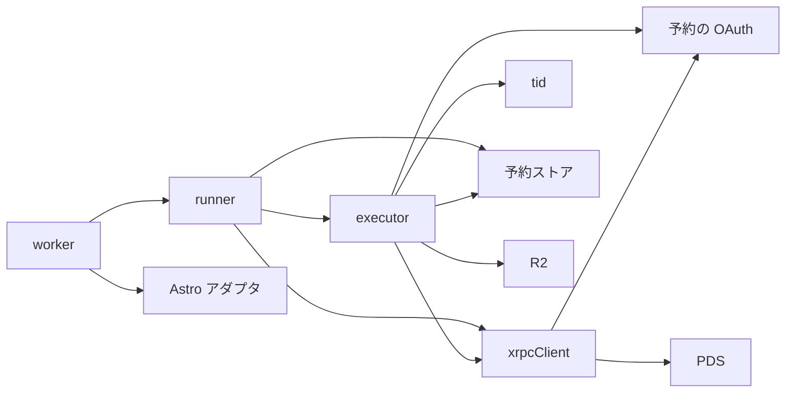
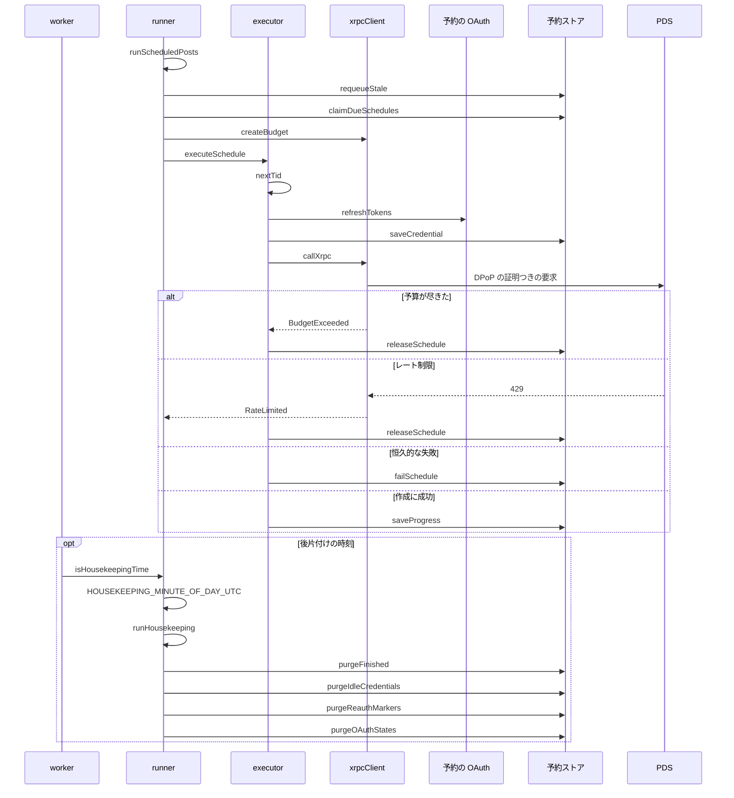
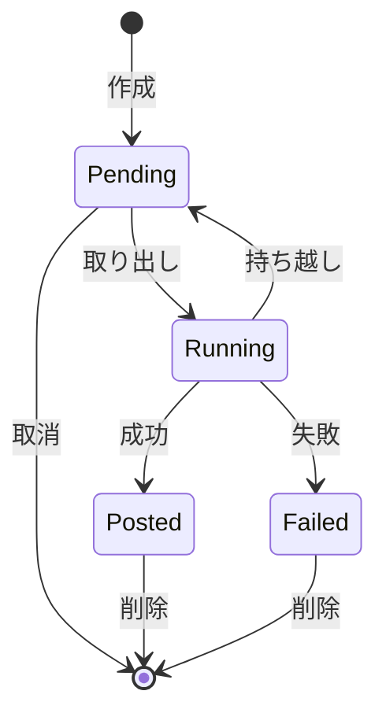

# Design Document

## Overview

**Purpose**: 実行時刻の到来した予約を、利用者のブラウザが閉じていても自動的に利用者の Bluesky へ投稿する。実行は利用料金の発生しない無料枠の実行制限の中で行い、制限で中断しても重複して投稿せずに続きから完了させる。
**Users**: 予約投稿を使う利用者（実行はブラウザが閉じていても行われる）と、運用者
**Impact**: 実行時刻の到来した予約を毎分の定期実行で自動的に Bluesky へ投稿する。無料枠の実行制限の中で、中断しても重複せず続きから完了する。

### Goals

- 実行時刻が到来した予約の定期的な取り出しと実行。
- 画像・スレッド・返信と引用の制限・entry の作成。
- 失敗の分類と再試行、中断した実行の再開と回収。
- 終了した予約の履歴と不要な認証情報の削除。

### Non-Goals

- 予約の作成・取消を受ける API と画面。
- 動画を含む予約の実行。
- 投稿の失敗を利用者へ通知する仕組み。

## Boundary Commitments

### This Spec Owns

- 実行時刻が到来した予約の定期的な取り出しと実行。
- 画像・スレッド・返信と引用の制限・entry の作成。
- 失敗の分類と再試行、中断した実行の再開と回収。
- 終了した予約の履歴と不要な認証情報の削除。

### Out of Boundary

- 予約の作成・取消を受ける API と画面。
- 動画を含む予約の実行。
- 投稿の失敗を利用者へ通知する仕組み。

### Allowed Dependencies

- 予約・進捗・認証情報・画像の保管（schedule-store。D1・R2・暗号鍵）
- Cloudflare Workers の定期実行（Cron）と無料枠の実行制限
- Bluesky の PDS（DPoP つきの要求）と認可サーバー（トークンの更新）

### Revalidation Triggers

- 1回の実行の通信の上限（40回）や取り出す件数（5件）を変えるとき（予約の最大件数の上限と実行の遅延に影響する）
- 失敗の分類と再試行の回数を変えるとき
- 後片付けの保持期間（失敗の予約7日・認証情報30日と180日）を変えるとき（privacy-policy の記載と一致が要る）
- 実行の経路への atproto のライブラリの読み込み（Workers の CPU 制約により0件を保つ）

## Architecture

### Architecture Pattern & Boundary Map

エントリから実行処理と通信クライアントへの依存方向を示す。



## File Structure Plan

| パス                             | 責務                                                             |
| -------------------------------- | ---------------------------------------------------------------- |
| `src/worker.ts`                  | Worker のエントリ。画面と API は Astro に任せ、定期実行を受ける  |
| `src/lib/schedule/runner.ts`     | 毎分の定期実行の流れ（復帰・取り出し・実行）と、1日1回の後片付け |
| `src/lib/schedule/executor.ts`   | 1件の予約を進捗に従って段階的に実行する                          |
| `src/lib/schedule/xrpcClient.ts` | 通信回数の予算つきの XRPC クライアント（DPoP の証明を付ける）    |
| `src/lib/schedule/tid.ts`        | レコードキーに使う TID の採番                                    |

## System Flows

1件の予約の実行における、通信の予算と失敗の分岐を示す。



予約の状態の遷移を示す。



## Requirements Traceability

| Requirement             | Summary                  | Components         |
| ----------------------- | ------------------------ | ------------------ |
| 1.1, 1.2, 1.3           | 定期的な取り出しと実行   | D-1, D-2, D-3      |
| 2.1, 2.2, 2.3, 2.4      | 認証と投稿の作成         | D-4                |
| 3.1, 3.2, 3.3, 3.4, 3.5 | 実行制限と中断からの再開 | D-2, D-3, D-4, D-5 |
| 4.1, 4.2, 4.3, 4.4, 4.5 | 失敗の分類と履歴         | D-5                |
| 5.1, 5.2, 5.3           | 後片付け                 | D-6                |
| 6.1, 6.2                | 実行の経路の安全性       | D-3                |

## Components and Interfaces

#### D-1: エントリと起動設定

**Requirements**: 1.1, 1.2

```ts
// src/worker.ts
import { handle } from "@astrojs/cloudflare/handler"

export default {
  fetch: handle,
  async scheduled(
    event: { scheduledTime: number },
    env: ScheduleEnv,
    ctx: { waitUntil: (promise: Promise<unknown>) => void },
  ) {
    const now = Math.floor(Date.now() / 1000)
    ctx.waitUntil(runScheduledPosts(env, now))
    if (isHousekeepingTime(Math.floor(event.scheduledTime / 1000))) {
      ctx.waitUntil(runHousekeeping(env, now))
    }
  },
}
```

| 設定             | 値                                                                    |
| ---------------- | --------------------------------------------------------------------- |
| `main`           | `src/worker.ts`（アダプタの既定のエントリの代わりに指定する）         |
| `triggers.crons` | `["* * * * *"]`（無料枠で使える最短の1分間隔。トリガーは1つだけ使う） |
| `d1_databases`   | バインディング名 `DB`                                                 |
| `r2_buckets`     | バインディング名 `SCHEDULE_IMAGES`                                    |
| シークレット     | `SCHEDULE_ENC_KEY`                                                    |

#### D-2: 1回の定期実行の流れ

**Requirements**: 1.1, 1.2, 3.5

```ts
export const runScheduledPosts = async (
    env: ScheduleEnv,
    now: number,
    fetchImpl?: typeof fetch,
): Promise<void>

const MAX_EXTERNAL_CALLS = 40
```

| 順序 | 処理                                                                                                                                     |
| ---- | ---------------------------------------------------------------------------------------------------------------------------------------- |
| 1    | `requeueStale` で停止した予約を待機中へ戻す                                                                                              |
| 2    | `claimDueSchedules` で到来した予約を最大5件取り出す                                                                                      |
| 3    | 取り出した順に `executeSchedule` を呼ぶ。通信の予算が尽きるかレート制限を受けたら、以降の予約は実行せず `releaseSchedule` で待機中へ戻す |

- 1回の実行で使う予算は、取り出した予約の全体で共有する。
- 例外が実行全体を中断させないよう、予約ごとに `try` で囲み、分類できない例外は一時的な失敗として扱う。
- 削除を伴う後片付けは、この流れに含めない（後片付けの項に分ける）。毎分の問い合わせは、停止した予約の回収と到来した予約の取り出しの2つだけで、どちらも `scheduled_posts_due`（`status`・`run_at`）で検索する。

#### D-3: 予算つきの通信クライアント

**Requirements**: 1.3, 3.1, 3.2, 6.1, 6.2

```ts
type Budget = { remaining: number; rateLimited: boolean }

export const createBudget = (limit: number): Budget
export const callXrpc = async (
    budget: Budget,
    req: {
        service: string
        nsid: string
        method: "GET" | "POST"
        params?: Record<string, string>
        token?: string
        dpop?: { session: DpopSession; accessToken: string } // 指定すると DPoP の方式で送る
        body?: unknown | Uint8Array
        contentType?: string
    },
): Promise<{ ok: true; json: any } | { ok: false; kind: "BudgetExceeded" | "RateLimited" | "Auth" | "Invalid" | "Transient" }>
```

| PDS の応答                          | `kind`           |
| ----------------------------------- | ---------------- |
| 予算が 0 のとき（通信しない）       | `BudgetExceeded` |
| 429                                 | `RateLimited`    |
| 401、`ExpiredToken`、`InvalidToken` | `Auth`           |
| 400（`InvalidRequest`）             | `Invalid`        |
| 5xx、ネットワークエラー             | `Transient`      |

- 通信のたびに `budget.remaining` を1減らし、`fetch` の URL は `${service}/xrpc/${nsid}` とする。
- `dpop` があれば `Authorization: DPoP <token>` と、`htm`・`htu`・`ath`（アクセストークンの SHA-256）と覚えている nonce を入れた DPoP の証明を付ける。401 の `use_dpop_nonce` には、応答の `DPoP-Nonce` を覚えて1回だけやり直し、やり直しも予算から1減らす。
- ライブラリは使わず、標準の `fetch` だけで通信する。ログには `nsid` と `kind` だけを出力する。

#### D-4: 1件の予約の段階実行

**Requirements**: 2.1, 2.2, 2.3, 2.4, 3.3, 3.4

```ts
export const executeSchedule = async (
    env: ScheduleEnv,
    budget: Budget,
    row: ScheduleRow,
    now: number,
    fetchImpl?: typeof fetch,
): Promise<"posted" | "released" | "failed">

export const nextTid = (prev?: string): string
```

| 段階 | 処理                                                                                                                                                                               | 進捗への反映 |
| ---- | ---------------------------------------------------------------------------------------------------------------------------------------------------------------------------------- | ------------ |
| 1    | `loadCredential` で復号し、`refreshTokens` で OAuth の更新用トークンからアクセストークンを得る（予算を消費する）。回転した更新用トークンを `saveCredential` で保管してから先へ進む | なし         |
| 2    | `rkeys` が空なら、投稿数と entry の1件分だけ `nextTid` で採番して保存する                                                                                                          | `rkeys`      |
| 3    | `blobs` に無い画像を、R2 から読み `com.atproto.repo.uploadBlob` で送る                                                                                                             | `blobs`      |
| 4    | `created` の次の投稿から、`buildBskyPostRecord` で組み立て `com.atproto.repo.putRecord` を `rkey` 指定で呼ぶ。`createdAt` は `now` とする                                          | `created`    |
| 5    | `gates` の次の投稿から、`buildThreadgateRecord` と `buildPostgateRecord` で組み立てた記録を、投稿と同じ `rkey` で作成する                                                          | `gates`      |
| 6    | 作成指定があり `entryDone` が偽なら、`buildSkyshareEntryRecord` で先頭の投稿を派生元にした記録を作成する                                                                           | `entryDone`  |
| 7    | `completeSchedule` で行を削除し、`removeImages` を呼ぶ                                                                                                                             | -            |

- 投稿の返信先は、先頭は指定された既存の投稿、2件目以降は先頭の投稿を `root`、直前の投稿を `parent` とする。
- すべてのレコードは `putRecord` で書き込む。進捗の保存前に中断して同じキーへ再び書き込んでも、レコードは上書きされるだけで1件のままである。
- 各段階の進捗は、通信が1回成功するたびに `saveProgress` で保存する。
- 投稿は 1 件ずつ `putRecord` で作成し、投稿全体の原子性は持たない。途中で失敗した予約は、進捗に従って再開する。
- `tid.ts` の `nextTid` は、マイクロ秒の時刻とisolate ごとにランダムに決めたクロック識別子（最初の採番で生成）から 13 文字の Base32 ソート可能な文字列を作り、`prev` 以下の値を返さない。

#### D-5: 失敗の分類と再試行

**Requirements**: 3.2, 4.1, 4.2, 4.3, 4.4, 4.5

```ts
type FailureCode =
  | "CredentialMissing"
  | "CredentialInvalid"
  | "CredentialExpired"
  | "InvalidRecord"
  | "ImageMissing"
  | "RetryExceeded"

const MAX_ATTEMPTS = 5
```

| 事象                            | 処理                                                                                               |
| ------------------------------- | -------------------------------------------------------------------------------------------------- |
| 認証情報の行が無い              | `CredentialMissing` で失敗                                                                         |
| 復号に失敗・旧形式の認証情報    | `CredentialInvalid` で失敗                                                                         |
| 更新時に `invalid_grant`        | `CredentialExpired` で失敗し、`markCredentialReauth` で認証情報を印に替える                        |
| 認証情報が印だけ                | 通信せずに `CredentialExpired` で失敗する                                                          |
| 更新の応答の `sub` が違う       | `CredentialInvalid` で失敗                                                                         |
| 更新以外の通信で `Auth`         | `attempts` に1を加えて待機中へ戻す（`Transient` と同じ扱い）                                       |
| 作成時に `Invalid`              | `InvalidRecord` で失敗                                                                             |
| 画像が R2 に無い                | `ImageMissing` で失敗                                                                              |
| `Transient`                     | `attempts` に1を加えて待機中へ戻す。`attempts` が `MAX_ATTEMPTS` に達したら `RetryExceeded` で失敗 |
| `BudgetExceeded`、`RateLimited` | `attempts` を変えずに待機中へ戻す                                                                  |
| すべての段階が成功              | 行を削除する（成功した予約は履歴に残さない）                                                       |

- 失敗の記録には分類コードだけを保存し、応答の本文を保存しない。`failSchedule` は画像を削除せず、フォームへの書き戻しに使えるよう残す（履歴の削除で行と画像を消す）。

#### D-6: 後片付け

**Requirements**: 5.1, 5.2, 5.3

```ts
export const HOUSEKEEPING_MINUTE_OF_DAY_UTC = 18 * 60 // 日本時間の午前 3 時
export const isHousekeepingTime = (now: number): boolean // now は UNIX 秒。UTC の 0 時からの分が上の値と等しいとき真
export const runHousekeeping = async (env: ScheduleEnv, now: number): Promise<void>
```

| 順序 | 処理                                                                                                                  |
| ---- | --------------------------------------------------------------------------------------------------------------------- |
| 1    | `purgeFinished` で終了から7日を過ぎた予約を削除し、返った行の残りの画像を `removeImages` で削除する                   |
| 2    | `purgeIdleCredentials` で予約がなく30日使われない認証情報を印に替え、`purgeReauthMarkers` で180日を過ぎた印を削除する |
| 3    | `purgeOAuthStates` で期限を過ぎた認可の途中の状態を削除する                                                           |

- 認証情報と認可の途中の状態の削除は表の全件を走査するため、毎分行うと利用者数に比例して D1 の無料枠の行の読み取りを消費する。保持期間は日単位で、削除が最大1日遅れても結果は変わらないので、1日1回に下げる。
- 状態を持たず、`worker.ts` が `scheduledTime` の分で判定する。その分の起動が失敗しても、削除はすべて期限での絞り込みなので、翌日の同じ分が回収する。
- 1つの失敗で残りを止めず、失敗は記録だけして次の日に任せる。

## Error Handling

| 事象                         | 処理                                                                    |
| ---------------------------- | ----------------------------------------------------------------------- |
| 暗号鍵が未設定               | 全予約を `CredentialInvalid` で失敗にせず、実行を中止してログに記録する |
| D1 の取り出しに失敗          | 実行を中止し、次の定期実行で再試行する                                  |
| 進捗の保存で更新0件          | 別の実行が回収した予約として扱い、その予約の実行を中止する              |
| 定期実行が実行制限で強制終了 | 実行中のまま残った予約を、次の定期実行の `requeueStale` が回収する      |

## Testing Strategy

- Unit / Build Tests:
  - `npx vitest run tests/lib/schedule/xrpcClient.test.ts tests/lib/schedule/tid.test.ts`
  - `npx vitest run tests/lib/schedule/executor.test.ts`
  - `npx vitest run tests/lib/schedule/runner.test.ts && npm run build`
- テストの名前には、対応する基準 ID を `[schedule-runner/<ID>]` の形で付ける（例: `[schedule-runner/1.1]`）
