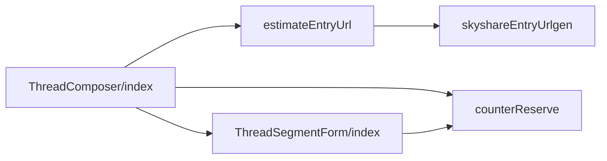
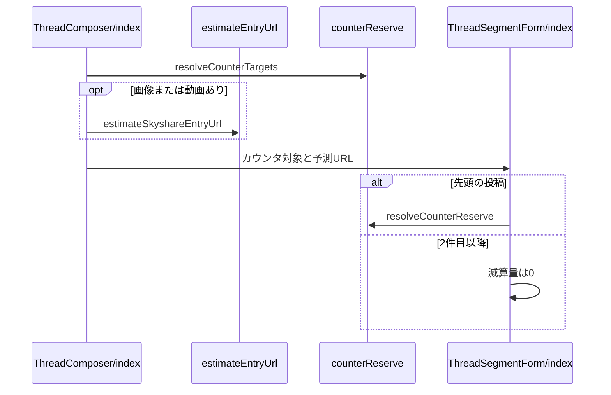

# Design Document

## Overview

**Purpose**: 投稿フォームの文字数カウンタで、共有先SNSの上限から共有文の末尾に付くURLの分を差し引き、上限超過を投稿前に知らせる。
**Users**: 他 SNS への共有を前提に投稿を書く利用者
**Impact**: 投稿フォームの文字数カウンタで、共有先の上限から共有文の末尾に付く URL の分を差し引き、上限超過を投稿前に知らせる。

### Goals

- 投稿フォームの先頭の投稿に表示するX・タイッツーの文字数カウンタの上限。
- 自動ポップアップするSNSに応じたカウンタの表示切り替え。

### Non-Goals

- Blueskyの文字数カウンタの上限。
- 共有文そのものの省略。

## Boundary Commitments

### This Spec Owns

- 投稿フォームの先頭の投稿に表示するX・タイッツーの文字数カウンタの上限。
- 自動ポップアップするSNSに応じたカウンタの表示切り替え。

### Out of Boundary

- Blueskyの文字数カウンタの上限。
- 共有文そのものの省略。

### Allowed Dependencies

- 文字数の数え方（counted-text-input）と共有文の組み立て（share-text）
- 共有設定（share-settings）
- skyshare entry の URL の形式（entry-url）

### Revalidation Triggers

- 共有文の末尾に付く文字列（URL・改行）の規則を変えるとき（share-text・link-card-priority と整合が要る）
- 共有先の上限（X の140・タイッツーなど）を変えるとき
- 共有先の SNS を増やすとき（auto-popup・intent-share-dialog の選択肢と一致が要る）

## Architecture

### Architecture Pattern & Boundary Map

カウンタの算出に関わる依存方向を示す。



## File Structure Plan

| パス                                                             | 責務                                 |
| ---------------------------------------------------------------- | ------------------------------------ |
| `src/lib/share/counterReserve.ts`                                | 表示するカウンタと減算量の決定       |
| `src/lib/entry/estimateEntryUrl.ts`                              | skyshare entryのURLの長さの予測      |
| `src/components/post/ThreadComposer/index.tsx`                   | 表示するカウンタと予測URLの算出      |
| `src/components/post/ThreadComposer/ThreadSegmentForm/index.tsx` | 先頭の投稿のカウンタへの減算量の適用 |

## System Flows

予測URLと減算量の決定の流れを示す。



## Requirements Traceability

| Requirement                       | Summary                | Components |
| --------------------------------- | ---------------------- | ---------- |
| 1.1, 1.2, 1.3, 1.4, 1.5, 1.6, 1.7 | 上限の補正             | D-1, D-2   |
| 2.1, 2.2, 2.3, 2.4                | カウンタの表示切り替え | D-2        |

## Components and Interfaces

#### D-1: URLの長さの予測

**Requirements**: 1.2, 1.3, 1.4

```ts
const FALLBACK_DID = `did:plc:${"a".repeat(24)}`
const dummyRkey = (): string => "a".repeat(TID.nextStr().length)
export const estimateSkyshareEntryUrl = (
  did: string | null | undefined,
): string => skyshareEntryUrlgen(did || FALLBACK_DID, dummyRkey())
```

`ThreadComposer` は、`!manualImageAttach` かつ画像または動画を含む投稿がある場合のみ `estimateSkyshareEntryUrl(accountDid)` を予測URLとし、それ以外は `null` とする。

#### D-2: 表示するカウンタと減算量

**Requirements**: 1.1, 1.5, 1.6, 1.7, 2.1, 2.2, 2.3, 2.4

```ts
export type CounterTarget = "x" | "taittsuu"
export const resolveCounterTargets = (
  autoPopupTarget: AutoPopupTarget,
  popupIntentInsteadOfWebshare: boolean,
): CounterTarget[] => {
  if (!popupIntentInsteadOfWebshare) return ["x"]
  switch (autoPopupTarget) {
    case "x":
      return ["x"]
    case "taittsuu":
      return ["taittsuu"]
    case "mastodon":
    case "misskey":
      return []
    case "ask":
      return ["x", "taittsuu"]
  }
}
export const resolveCounterReserve = (params: {
  target: CounterTarget
  body: string
  entryUrl: string | null
  linkCardUrl: string
}): number => {
  const suffix = buildIntentSuffix(
    params.body.trim(),
    params.entryUrl ?? "",
    params.linkCardUrl,
  )
  if (suffix.length === 0) return 0
  return Math.ceil(resolveIntentMeasure(params.target)(`\n${suffix}`) / 2)
}
```

`ThreadSegmentForm` は、`index === 0` のときだけ `resolveCounterReserve` の結果を減算量とし、X・タイッツーのカウンタの上限と警告閾値を `140 - 減算量` にする。Blueskyのカウンタ（上限300）は共有先カウンタの後ろに置き、減算しない。

## Error Handling

- なし

## Testing Strategy

- Unit / Build Tests:
  - `npx vitest run tests/lib/share/counterReserve.test.ts`
  - `npx vitest run tests/lib/share/counterReserve.test.ts -t resolveCounter`
- E2E/UI Tests:
  - `tests/e2e/intentShare.spec.ts` 自動ポップアップするSNSを切り替えて投稿フォームを開く → 選択に応じたX・タイッツーのカウンタと、上限300のBlueskyのカウンタが表示される
- テストの名前には、対応する基準 ID を `[share-counter/<ID>]` の形で付ける（例: `[share-counter/1.1]`）
