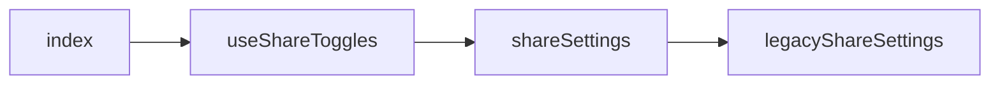
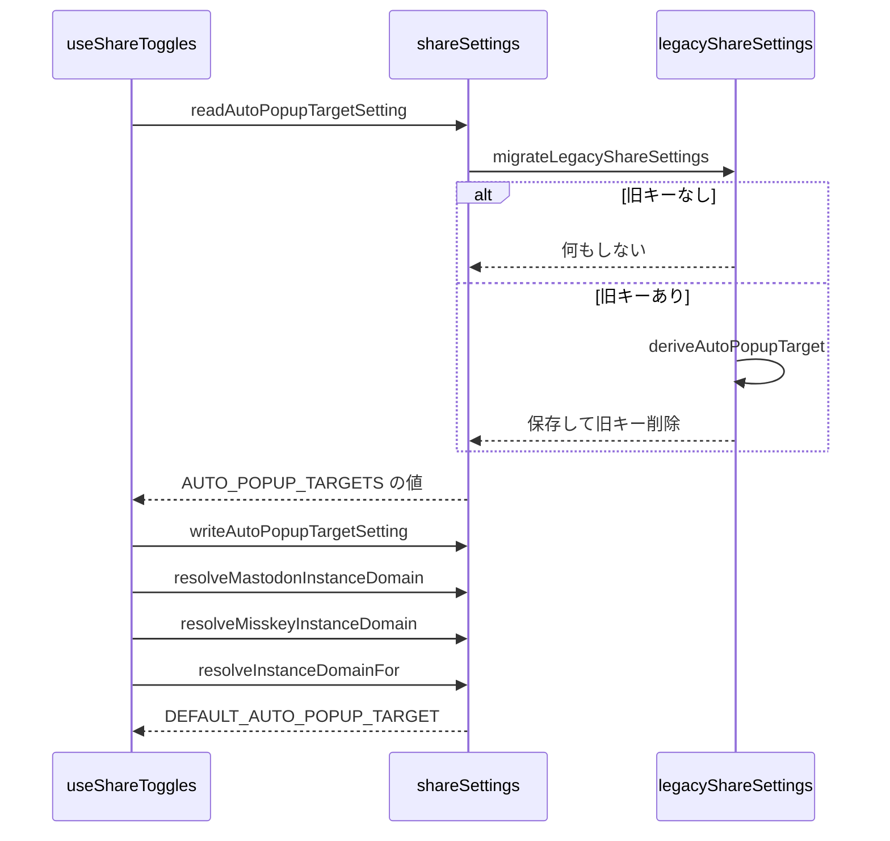

# Design Document

## Overview

**Purpose**: 他SNSへの共有に関わる設定をブラウザ内に保持し、投稿フォームと設定ページから同じ値を操作できるようにする。
**Users**: 他 SNS への共有の設定を操作する利用者
**Impact**: 共有設定をブラウザ内に保持し、投稿フォームと設定ページから同じ値を操作できるようにする。旧共有設定は新しい形へ引き継ぎ、旧キーを削除する。

### Goals

- 共有設定6項目（ポップアップを開く・自動ポップアップするSNS・画像を自分で添付・長文を省略して共有・Mastodonのインスタンスドメイン・Misskeyのインスタンスドメイン）の保持。
- 設定ページでの共有設定の表示と変更。
- 旧共有設定（自動ポップアップをOFFにする・タイッツーにクロスポスト・Mastodonにクロスポスト・X投稿ボタンを表示）の引き継ぎ。

### Non-Goals

- 共有設定に基づく共有処理そのもの。
- 投稿フォームでの共有設定の配置。

## Boundary Commitments

### This Spec Owns

- 共有設定6項目（ポップアップを開く・自動ポップアップするSNS・画像を自分で添付・長文を省略して共有・Mastodonのインスタンスドメイン・Misskeyのインスタンスドメイン）の保持。
- 設定ページでの共有設定の表示と変更。
- 旧共有設定（自動ポップアップをOFFにする・タイッツーにクロスポスト・Mastodonにクロスポスト・X投稿ボタンを表示）の引き継ぎ。

### Out of Boundary

- 共有設定に基づく共有処理そのもの。
- 投稿フォームでの共有設定の配置。

### Allowed Dependencies

- ブラウザの保存領域
- 共有の経路（auto-popup、intent-share-dialog、link-card-priority）
- 設定の一覧の部品（app-settings）

### Revalidation Triggers

- 設定の項目・保存キー・既定値を変えるとき（共有の各経路と設定ページが影響を受ける）
- 旧共有設定の引き継ぎ（削除前提の一時機能）を廃止するとき
- インスタンスドメインの検証規則を変えるとき

## Architecture

### Architecture Pattern & Boundary Map

設定の保存と画面の依存方向を示す。



## File Structure Plan

| パス                                         | 責務                                                |
| -------------------------------------------- | --------------------------------------------------- |
| `src/lib/settings/shareSettings.ts`          | 共有設定の読み書きとMastodon・Misskeyドメインの解決 |
| `src/lib/settings/legacyShareSettings.ts`    | 旧共有設定の引き継ぎ（削除前提の一時機能）          |
| `src/lib/settings/useShareToggles.ts`        | 共有設定のstateと保存を束ねるフック                 |
| `src/components/settings/Settings/index.tsx` | 設定ページの共有設定の行                            |

## System Flows

保存値の読み取りと旧設定の引き継ぎの流れを示す。



## Requirements Traceability

| Requirement        | Summary                      | Components |
| ------------------ | ---------------------------- | ---------- |
| 1.1, 1.2, 1.3, 1.4 | 設定の保持                   | D-1, D-3   |
| 2.1, 2.2, 2.3      | 画像を自分で添付と長文の省略 | D-3        |
| 3.1, 3.2           | 設定ページ                   | D-1, D-4   |
| 4.1, 4.2           | 旧共有設定の引き継ぎ         | D-2        |

## Components and Interfaces

#### D-1: 設定の読み書き

**Requirements**: 1.1, 1.2, 1.3, 3.1

```ts
export const AUTO_POPUP_TARGETS = ["ask", "x", "taittsuu", "mastodon", "misskey"] as const
export type AutoPopupTarget = (typeof AUTO_POPUP_TARGETS)[number]
export const DEFAULT_AUTO_POPUP_TARGET: AutoPopupTarget = "x"
const DEFAULT_MASTODON_INSTANCE_DOMAIN = "mastodon.social"
export { DEFAULT_MASTODON_INSTANCE_DOMAIN }
const DEFAULT_MISSKEY_INSTANCE_DOMAIN = "misskey.io"

// 保存キー: autoPopupTarget / popupIntentInsteadOfWebshare / manualImageAttach /
//           truncateIntentText / mastodonInstanceDomain / misskeyInstanceDomain
export const readAutoPopupTargetSetting = (defaultValue: AutoPopupTarget): AutoPopupTarget
export const writeAutoPopupTargetSetting = (value: AutoPopupTarget): void
// 真偽値の設定は read<Name>Setting(defaultValue) / write<Name>Setting(value) の対で持つ

/** 空白のみなら既定ドメイン、妥当な形式ならそのドメイン、不正な形式なら null */
export const resolveMastodonInstanceDomain = (rawDomain: string): string | null
export const resolveMisskeyInstanceDomain = (rawDomain: string): string | null
/** mastodon/misskey は保存値から解決したドメイン（不正は null）、他の共有先は undefined */
export const resolveInstanceDomainFor = (target: AutoPopupTarget, saved): string | null | undefined
```

- 読み取りは、`window` が無い・保存領域が例外を投げる・保存値が不正な場合に `defaultValue` を返す。書き込みの例外は握りつぶす。
- ドメイン形式の判定は `isValidInstanceDomain`（`src/util/share/intent.ts`）を使う。

#### D-2: 旧設定の引き継ぎ

**Requirements**: 4.1, 4.2

```ts
export const deriveAutoPopupTarget = (legacy: LegacyShareSettings): AutoPopupTarget => {
  const enabledCount = [legacy.crosspostToTaittsuu, legacy.crosspostToMastodon, legacy.showCrosspostXButton]
    .filter(enabled => enabled).length
  if (enabledCount >= 2) return "ask"
  if (legacy.crosspostToTaittsuu) return "taittsuu"
  if (legacy.crosspostToMastodon) return "mastodon"
  return "x"
}
export const migrateLegacyShareSettings = (): void
```

`migrateLegacyShareSettings` の手順:

1. `window` が無い、または旧キー4つがいずれも未保存なら何もしない。
2. `autoPopupTarget` が未保存の場合のみ、`deriveAutoPopupTarget` の結果を保存する。
3. 保存に成功した場合（または保存済みだった場合）に旧キー4つを削除する。失敗時は旧キーを残し、次回に再試行する。
4. 旧キーの値は `"true"` のみをONとみなす。

呼び出し元は `readAutoPopupTargetSetting` の先頭1か所のみとする。引き継ぎ機能を除去するときは、このモジュールとそのテスト、および呼び出し1行を削除する。

#### D-3: 共有設定フック

**Requirements**: 1.4, 2.1, 2.2, 2.3

```ts
export type UseShareTogglesResult = {
  popupIntentInsteadOfWebshare: boolean
  autoPopupTarget: AutoPopupTarget
  manualImageAttach: boolean
  truncateIntentText: boolean // manualImageAttach が true の間は常に false
  mastodonInstanceDomain: string
  misskeyInstanceDomain: string
  onPopupIntentInsteadOfWebshareChange: (next: boolean) => void
  onAutoPopupTargetChange: (next: AutoPopupTarget) => void
  onManualImageAttachChange: (next: boolean) => void
  onTruncateIntentTextChange: (next: boolean) => void
  onMastodonInstanceDomainChange: (next: string) => void
  onMisskeyInstanceDomainChange: (next: string) => void
  reload: () => void
}
```

- 初期値は固定値とし、マウント後の `reload()` で保存値を反映する。これによりサーバー描画と初回描画を一致させる。
- `onManualImageAttachChange(true)` は `truncateIntentText` を false にし、保存値も false にする。
- `onTruncateIntentTextChange` は `manualImageAttach` が true の間は何もしない。
- `reload()` は、`manualImageAttach` が true で `truncateIntentText` の保存値が true の場合、保存値を false に補正する。
- `onMastodonInstanceDomainChange`・`onMisskeyInstanceDomainChange` は表示を常に更新し、保存は形式が妥当な場合のみ行う。空文字なら保存値を削除する。

#### D-4: 設定ページの行

**Requirements**: 3.1, 3.2
共有設定の行は、設定ページのクロスポストのグループに次の順で置く。

| 順  | 行                                                                    | 表示条件                               |
| --- | --------------------------------------------------------------------- | -------------------------------------- |
| 1   | WebShareの代わりにポップアップを開く                                  | 常時                                   |
| 2   | 自動ポップアップするSNS（`AutoPopupTargetSelect`）                    | `popupIntentInsteadOfWebshare` が true |
| 3   | 画像を自分で添付する                                                  | 常時                                   |
| 4   | Skyshareのリンクカードを優先表示（`disabled: manualImageAttach`）     | 常時                                   |
| 5   | 長文を省略して共有する（`disabled: manualImageAttach`）               | 常時                                   |
| 6   | Mastodonのインスタンス（`textInput`、検証は `isValidInstanceDomain`） | 常時                                   |
| 7   | Misskeyのインスタンス（`textInput`、検証は `isValidInstanceDomain`）  | 常時                                   |

投稿フォームを固定表示しないは表示のグループ、ハッシュタグ候補・メンション候補は投稿のグループに置く（これらの行はそれぞれの機能の仕様で定める）。

## Error Handling

| 事象                                  | 処理                                     |
| ------------------------------------- | ---------------------------------------- |
| 保存領域の読み取り例外                | 既定値を返す                             |
| 保存領域の書き込み例外                | 握りつぶし、表示中のstateは維持する      |
| 引き継ぎ時の保存失敗                  | 旧キーを残し、次回の読み取りで再試行する |
| 不正なMastodon・Misskeyドメインの入力 | 入力欄にエラー文言を表示し、保存しない   |

## Testing Strategy

- Unit / Build Tests:
  - `npx vitest run tests/lib/settings/shareSettings.test.ts tests/lib/settings/legacyShareSettings.test.ts`
  - `npm run build`
- E2E/UI Tests:
  - `tests/e2e/intentShare.spec.ts` 設定ページでポップアップを開く設定をONにする → 自動ポップアップするSNSのプルダウンが現れ、Mastodonの入力欄は常に表示される
- テストの名前には、対応する基準 ID を `[share-settings/<ID>]` の形で付ける（例: `[share-settings/1.1]`）
