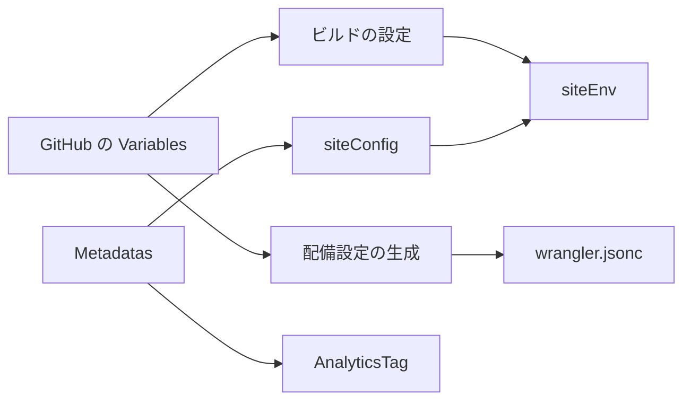
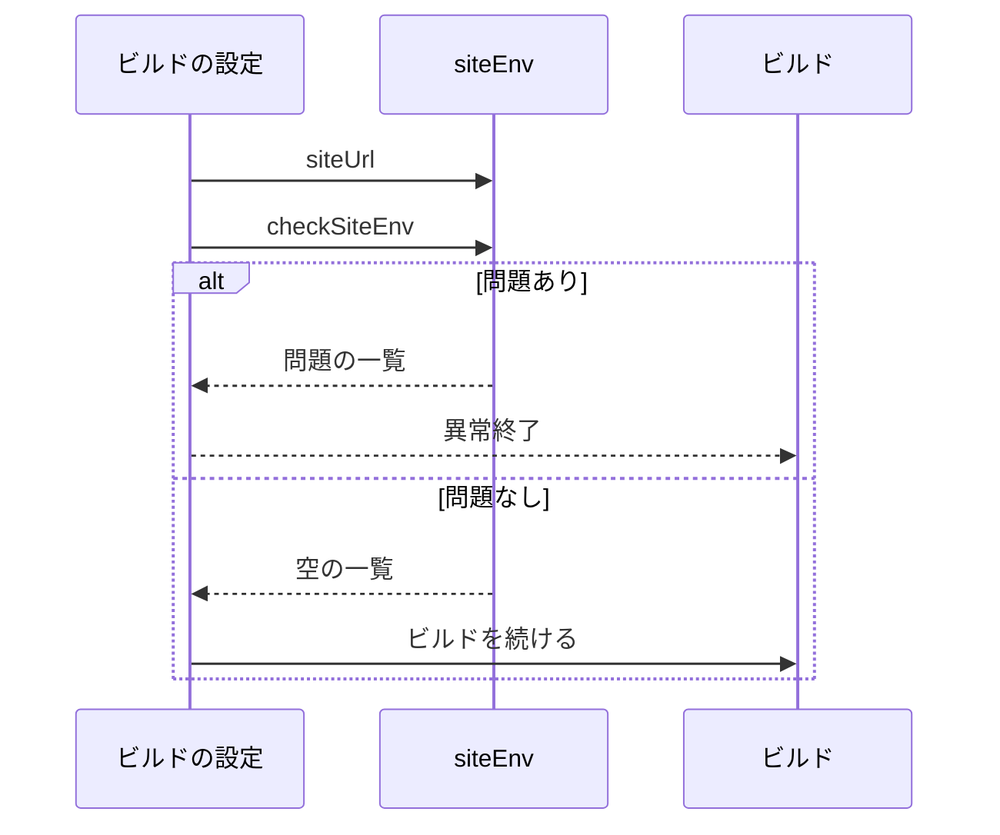
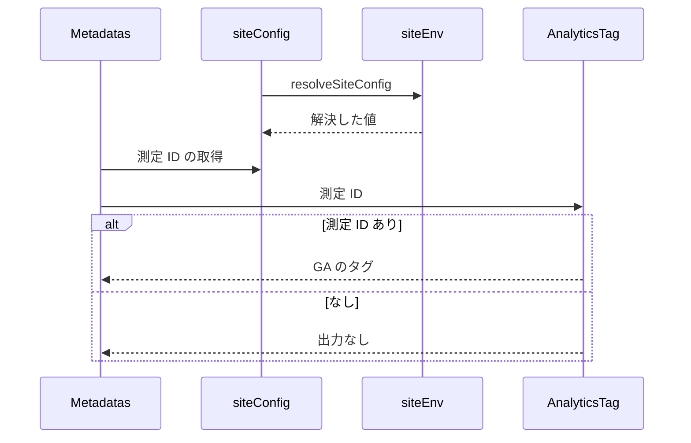

# Design Document

## Overview

**Purpose**: Skyshare は OSS であり、別の運用者がフォークして同じコードを配備できるようにする。運用者ごとに変わる値（公開するドメイン・運営者情報・アクセス解析）をコードに書かず、環境変数で受け取る。Cloudflare の資源の名前はアカウントごとのため固定とし、develop 環境とプレビューのドメインも公開するドメインから決めて、受け取る値を最小にする。
**Users**: skyshare をフォークして自分のドメインで配備する運用者
**Impact**: 運用者ごとに変わる値（公開するドメイン・運営者情報・アクセス解析）をコードに書かず環境変数で受け取る。Cloudflare の資源の名前はアカウントごとのため固定とし、develop 環境とプレビューのドメインも公開するドメインから決める。

### Goals

- 運営者情報とアクセス解析の測定 ID の受け取り・検査・解決。
- サイトの URL と、Cloudflare の配備先のドメインの受け取り。
- CI のワークフローへの値の受け渡し。

### Non-Goals

- lexicon の NSID の変更。運用者が違っても Entry を相互に読めるよう固定する。
- プライバシーポリシーの本文の書き換え。本文は実装に合わせて書き、値だけを差し込む。
- 旧 UI の設定。
- AI エージェント向けのブランチ運用の宣言。

## Boundary Commitments

### This Spec Owns

- 運営者情報とアクセス解析の測定 ID の受け取り・検査・解決。
- サイトの URL と、Cloudflare の配備先のドメインの受け取り。
- CI のワークフローへの値の受け渡し。

### Out of Boundary

- lexicon の NSID の変更。運用者が違っても Entry を相互に読めるよう固定する。
- プライバシーポリシーの本文の書き換え。本文は実装に合わせて書き、値だけを差し込む。
- 旧 UI の設定。
- AI エージェント向けのブランチ運用の宣言。

### Allowed Dependencies

- 環境変数と GitHub の Variables（運用者ごとの値）
- Cloudflare の Worker・D1・R2 と配備の設定（wrangler の設定、テンプレートの置き換え）
- CI のワークフロー（配備・マイグレーション）

### Revalidation Triggers

- 運営者情報や測定 ID の項目を変えるとき（privacy-policy が値を差し込む）
- 配備先（本番・develop・プレビュー）の名前の導出規則を変えるとき
- CI のワークフローの Variables の名前を変えるとき
- lexicon の NSID は運用者が違っても Entry を相互に読めるよう固定する（変更は lexicon の仕様で扱う）

## Architecture

### Architecture Pattern & Boundary Map

値の流れを示す。



## File Structure Plan

| パス                                       | 責務                                                       |
| ------------------------------------------ | ---------------------------------------------------------- |
| `src/lib/site/siteEnv.ts`                  | 環境変数の検査と、サイトの URL・運営者情報・測定 ID の解決 |
| `src/lib/site/siteConfig.ts`               | ビルドに埋め込まれた値を解決した、アプリ全体が参照する設定 |
| `src/components/layout/AnalyticsTag.astro` | 測定 ID があるときだけ GA のタグを出す                     |
| `src/components/layout/Metadatas.astro`    | ページ共通のメタタグに GA のタグを加える                   |

## System Flows

本番ビルドの前の検査と、サイトの URL の決定を示す。



ページの描画での測定 ID の受け渡しを示す。



## Requirements Traceability

| Requirement                       | Summary                        | Components |
| --------------------------------- | ------------------------------ | ---------- |
| 1.1, 1.2, 1.3, 1.4, 1.5, 1.6, 1.7 | 運営者情報と測定 ID の受け取り | D-1        |
| 2.1, 2.2                          | サイトの URL                   | D-2        |
| 3.1, 3.2, 3.3, 3.4                | 配備設定                       | D-2        |
| 4.1                               | 運用者固有の値の非混入         | D-1        |

## Components and Interfaces

#### D-1: 運営者情報と測定 ID

**Requirements**: 1.1, 1.2, 1.3, 1.4, 1.5, 1.6, 1.7, 4.1

```ts
export type SiteConfig = {
  operator: { name: string; email: string; blueskyHandle: string | null }
  privacy: { enactedAt: string; revisedAt: string }
  analyticsId: string | null
}
export const checkSiteEnv = (env: Env): string[]
export const resolveSiteConfig = (env: Env, dev: boolean): SiteConfig
export const siteUrl = (env: Env): string
export const siteConfig: SiteConfig
```

| 変数                             | 必須 | 形式           |
| -------------------------------- | ---- | -------------- |
| `SITE_HOST`                      | 必須 | ドメイン名     |
| `PUBLIC_OPERATOR_NAME`           | 必須 | 任意の文字列   |
| `PUBLIC_OPERATOR_EMAIL`          | 必須 | メールアドレス |
| `PUBLIC_OPERATOR_BLUESKY_HANDLE` | 任意 | ドメイン形式   |
| `PUBLIC_PRIVACY_ENACTED_AT`      | 必須 | `YYYY-MM-DD`   |
| `PUBLIC_PRIVACY_REVISED_AT`      | 必須 | `YYYY-MM-DD`   |
| `PUBLIC_GA_MEASUREMENT_ID`       | 任意 | `G-` と英数字  |

- `siteEnv.ts` は `import.meta.env` に依存せず、`astro.config.mjs` から読み込める。
- 測定 ID は形式を検査した値だけを使うため、`AnalyticsTag` は GA の初期化スクリプトにそのまま埋め込める。
- コード・テンプレート・ワークフローに運用者固有の値を書かない。直書きの検出をテストで行う（lexicon の NSID は対象外）。

#### D-2: サイトの URL と配備設定

**Requirements**: 2.1, 2.2, 3.1, 3.2, 3.3, 3.4

- `astro.config.mjs` の検査は `astro build` のときだけ行い、開発サーバーでは行わない。
- `hack/render-deploy-config.mjs` は、配備先ごとにテンプレートを次のように置き換える。運用者ごとの値は `SITE_HOST` だけである。

| 配備先                 | Worker             | ドメイン              | D1・R2                                                          | プレビュー |
| ---------------------- | ------------------ | --------------------- | --------------------------------------------------------------- | ---------- |
| 本番（既定、main）     | `skyshare`         | `<SITE_HOST>`         | `skyshare-schedule`・`skyshare-schedule-images`                 | 無効       |
| develop（`--develop`） | `skyshare-develop` | `develop.<SITE_HOST>` | `skyshare-schedule-develop`・`skyshare-schedule-images-develop` | 有効       |

- D1 は `database_id` を書かない。`wrangler deploy` が同じ名前の D1 を探してつなぎ、マイグレーションも名前で解決する。
- 独自ドメインの routes に `zone_name` を書かない（ドメインからゾーンが決まる）。
- `--develop` では、テンプレートにある D1・R2 の名前の末尾に `-develop` を付け、D1 の一覧から名前で develop 用 D1 の ID を引いて `previews` の D1・R2 に入れる（`wrangler preview` は `database_id` のない D1 を使えないため）。
- dev/\* のプレビューは develop の Worker に作り、名前はブランチ名から `dev/` を除いたもの（46文字以内）にする。
- 暗号鍵は、develop とそのプレビューで同じ値にする（D1 を共用するため）。

## Error Handling

| 事象                               | 処理                                           |
| ---------------------------------- | ---------------------------------------------- |
| 本番ビルドで必須の値が欠ける       | 欠けた変数名と形式の違いを挙げてビルドを止める |
| 配備設定の必須の値が欠ける         | 変数名を示して異常終了する                     |
| ドメインにスキームやパスが含まれる | 異常終了する                                   |

## Testing Strategy

- Unit / Build Tests:
  - `npx vitest run tests/lib/site tests/hack` と `npx vitest run -c vitest.astro.config.ts`
  - `npx vitest run tests/hack`
- E2E/UI Tests:
  - `tests/e2e/privacyPage.spec.ts` 設定なしの開発サーバーでプライバシーポリシーを開く → ダミーの窓口のメールアドレスが表示される
- テストの名前には、対応する基準 ID を `[site-config/<ID>]` の形で付ける（例: `[site-config/1.1]`）
