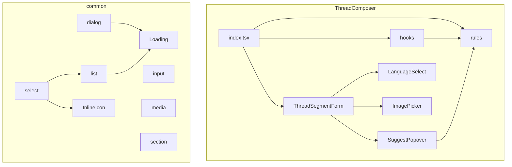

# Design Document

## Overview

**Purpose**: 開発者とコントリビュータが、`src/components/` の部品の利用関係をフォルダ構成から読めるようにする。部品の配置の規則（利用元の内側に置く）と、`common/` の分類の規則を定め、その規則に従って部品を配置し直す。

**Users**: 部品を追加・変更する開発者と、構造を読んで変更の影響を判断するコントリビュータ。

**Impact**: 利用者（エンドユーザー）に見える振る舞いは変えない。`src/components/` の配置、import の指定子、steering の規則、一部の README を変える。部品 `Spinner` と `settings/SettingsDialog` を削除し、型 `SuggestCandidate` の置き場所を変える。

**Status**: 実装は 2026-11-03 に済んでいる（未コミット）。本設計は、その変更を仕様として確定するための記述である。

### Goals

- 部品 P の利用元がすべて部品 H の中にあるとき、P が H の子フォルダにあること（37 件）。
- `common/` が、汎用の部品だけを持ち、役割で分類されていること。
- 既存の検査（import・循環・部品フォルダの外のファイル・領域の一覧）と、全テストが通ること。

### Non-Goals

- 部品の振る舞い・見た目・文言の変更。
- 投稿言語の設定機能、テーマ切替ボタン、ラベルの呼び出し側への移動。
- `hooks/`・`rules/` の子フォルダを件数によらず作る規約（既存の steering のまま）。

## Boundary Commitments

### This Spec Owns

- `structure.md` の、入れ子の規則・基盤の定義・分類フォルダの規則・領域の一覧。
- `src/components/` の配置（37 件の入れ子、21 件の common の分類）と、それに伴う import の指定子。
- 部品の統合（`Spinner` → `Loading`）と削除（`settings/SettingsDialog`）。
- 型 `SuggestCandidate` の置き場所（`composer/ThreadComposer/rules/suggestCandidate.ts`）。
- 変更した領域の README の、配置の説明。

### Out of Boundary

- 部品の表示・操作・文言（利用者に見える振る舞い）。
- `LanguageSelect` を設定から使えるようにする機能（新機能。別の spec）。
- `ThemeModeSelect` のラベルを呼び出し側から渡す形への変更（汎用化の時点で扱う）。
- `ThreadComposer/rules/segments.ts`・`shareDispatch.ts` が画像部品の型を import している件（判断の層から UI の型への依存）。
- `src-folder-layout` の 1.3（部品フォルダの外のファイルの例外の一覧）。本 spec は、その一覧を変えない。
- `lib/` の業務の判断の配置、`pages/` の責務、生成物（`src/client/openapi/`）。
- 過去の spec（`settings`・`post-composition`・`surveys`）の本文。履歴として残す。

### Allowed Dependencies

- import 検査（`scripts/architecture/`）の規則: 領域をまたぐ相対 import と、3 段以上の `../` を禁止（src-import-style）。
- 部品フォルダの検査（`tests/unit/scripts/componentLayout.test.ts`）と領域の検査（`steeringRegions.test.ts`）。
- 循環の検査（強連結成分）。
- 既存の部品の公開の型（`ComponentList` の `CursorPaginationViewModel` など）を、移動後のパスで参照すること。

### Revalidation Triggers

- 入れ子の規則の変更（件数の上限を置く、基盤の定義を変える）。
- `common/` の分類の変更（分類フォルダの追加・改名、部品の移動）。
- 投稿言語の設定機能（`LanguageSelect` を `common/select/` へ移す。その spec が決める）。
- `ThemeModeSelect` の汎用化（ラベルの渡し方を変える）。
- `componentLayout` の例外の一覧の変更（`src-folder-layout` 1.3）。
- `structure.md` の領域の一覧に、領域を追加・削除したとき（`steeringRegions` が確かめる）。

## Architecture

### Existing Architecture Analysis

- `src/components/` は、領域（機能の単位。`composer`・`timeline` など）の直下に部品フォルダが並ぶ。部品フォルダは `index.tsx`（または `index.astro`）と `index.module.css` を持つ。
- 既存の子フォルダは、`composer/ThreadComposer/` の子（`ComposerDialogs`・`ComposerOptions`・`ThreadSegmentForm`・`PostBodyEditor`）だけだった。
- 既存の判断の層は、`ThreadComposer/rules/`（React に依存しない `.ts`）と `hooks/`（フック）。
- 既存の検査は、部品フォルダの外のソースファイルと、領域の一覧を見る。入れ子の子フォルダは、これらの検査を変えずに通る。

### Architecture Pattern & Boundary Map

部品の配置は、利用関係の木で決まる。親（H）の中の子（P）は、H を import しない（循環を作らない）。



**依存の方向**:

- 子の部品は、親の判断（`rules/`）と、根の基盤（`common/Loading`・`common/InlineIcon`）に依存してよい。
- `common/` の分類は、役割で分ける。`select` は `list` と根の `InlineIcon` に依存する。`dialog` は根の `Loading` に依存する。`input`・`media`・`section` は、他の分類に依存しない。
- 循環は作らない（循環検査で確認）。

### Technology Stack

| Layer        | Choice / Version                              | Role in Feature           | Notes          |
| ------------ | --------------------------------------------- | ------------------------- | -------------- |
| Build / Test | 既存（TypeScript・Vitest・Playwright・Astro） | 配置の変更の検証          | 新しい依存なし |
| Static check | `scripts/architecture/check-imports.ts`       | import の規則と循環の検査 | 規則の変更なし |

## File Structure Plan

### Directory Structure

**入れ子（37 件）**: 親の子フォルダに移す（`git mv`）。移動の計画は、移動元と移動先の対応表とする。

| 移動先の親                                             | 子（移動元 → 移動先）                                                                                                                                                                                                                                                                                                                                                                                                  |
| ------------------------------------------------------ | ---------------------------------------------------------------------------------------------------------------------------------------------------------------------------------------------------------------------------------------------------------------------------------------------------------------------------------------------------------------------------------------------------------------------- |
| `composer/ThreadComposer/`                             | `composer/DraftListPanel` → `DraftListPanel`、`composer/DraftSaveConfirmDialog` → `DraftSaveConfirmDialog`、`composer/SelfLabelsSelect` → `SelfLabelsSelect`、`image/ImagePicker` → `ImagePicker`、`image/ImageAltDialog` → `ImageAltDialog`、`image/ImageCropDialog` → `ImageCropDialog`、`image/OgpFetchButton` → `OgpFetchButton`、`schedule/RunAtPicker` → `RunAtPicker`、`schedule/ScheduleList` → `ScheduleList` |
| `composer/ThreadComposer/ImageCropDialog/`             | `image/CropSlot` → `CropSlot`                                                                                                                                                                                                                                                                                                                                                                                          |
| `composer/ThreadComposer/ThreadSegmentForm/`           | `common/LanguageSelect` → `LanguageSelect`、`composer/SuggestPopover` → `SuggestPopover`、`composer/ThreadComposer/PostBodyEditor` → `PostBodyEditor`、`image/OgpPreview` → `OgpPreview`、`image/ThumbnailAdjustButton` → `ThumbnailAdjustButton`、`video/VideoPicker` → `VideoPicker`                                                                                                                                 |
| `timeline/Timeline/`                                   | `composer/PostLauncher` → `PostLauncher`、`survey/SurveyGate` → `SurveyGate`、`timeline/ThreadCard` → `ThreadCard`                                                                                                                                                                                                                                                                                                     |
| `timeline/Timeline/SurveyGate/`                        | `survey/SurveyDialog` → `SurveyDialog`                                                                                                                                                                                                                                                                                                                                                                                 |
| `timeline/Timeline/ThreadCard/`                        | `timeline/PostCard` → `PostCard`                                                                                                                                                                                                                                                                                                                                                                                       |
| `timeline/Timeline/ThreadCard/PostCard/`               | `entry/PostCardEntryActions` → `PostCardEntryActions`                                                                                                                                                                                                                                                                                                                                                                  |
| `timeline/PostBody/`                                   | `timeline/PostEngagementStats` → `PostEngagementStats`、`timeline/PostLinkCard` → `PostLinkCard`、`timeline/PostQuote` → `PostQuote`、`video/VideoPlayButton` → `VideoPlayButton`、`video/VideoPlayer` → `VideoPlayer`、`video/VideoThumbnail` → `VideoThumbnail`、`video/VideoUnavailable` → `VideoUnavailable`                                                                                                       |
| `entry/EntryList/`                                     | `entry/EntryCard` → `EntryCard`                                                                                                                                                                                                                                                                                                                                                                                        |
| `entry/EntryList/EntryCard/`                           | `entry/EntryEditForm` → `EntryEditForm`                                                                                                                                                                                                                                                                                                                                                                                |
| `entry/EntryDetailView/`                               | `entry/EntryPostedAt` → `EntryPostedAt`                                                                                                                                                                                                                                                                                                                                                                                |
| `entry/EntryDeleteConfirmDialog/`                      | `entry/DeletePostListDialog` → `DeletePostListDialog`                                                                                                                                                                                                                                                                                                                                                                  |
| `entry/EntryDeleteConfirmDialog/DeletePostListDialog/` | `entry/DeletePostListItem` → `DeletePostListItem`                                                                                                                                                                                                                                                                                                                                                                      |
| `help/Help/`                                           | `help/HelpItem` → `HelpItem`                                                                                                                                                                                                                                                                                                                                                                                           |
| `image/ImageGallery/`                                  | `image/ImageLightbox` → `ImageLightbox`                                                                                                                                                                                                                                                                                                                                                                                |
| `account/AccountSwitchPanel/`                          | `account/AccountSwitcher` → `AccountSwitcher`                                                                                                                                                                                                                                                                                                                                                                          |

**common の分類（21 件）**: 分類フォルダへ移す。根に残すのは `Loading`・`InlineIcon`。

| 分類              | 部品                                                                                          |
| ----------------- | --------------------------------------------------------------------------------------------- |
| `common/dialog/`  | Overlay・FloatingBox・ChoiceDialog・ConfirmDialog                                             |
| `common/select/`  | Dropdown・ListboxOption・LocaleSelect・ThemeModeSelect・AutoPopupTargetSelect・ChoiceQuestion |
| `common/list/`    | ComponentList・NavigationBar・InfiniteScrollSentinel                                          |
| `common/input/`   | CountedTextInput・ToggleSwitch・Checkbox・RadioButton                                         |
| `common/media/`   | Avatar・MediaThumb                                                                            |
| `common/section/` | Collapsible・TabButtons                                                                       |

### Modified Files

- `src/components/composer/ThreadComposer/rules/suggestCandidate.ts`（新規）— 型 `SuggestCandidate`。`@/lib/atproto/suggest` の `MentionSuggestion` と、`./suggestHashtags` の `HashtagCandidate` を型として import する。
- `src/components/composer/ThreadComposer/hooks/useSuggest.ts` — 型の定義を削除し、`../rules/suggestCandidate` から import する。
- `src/components/common/Loading/index.tsx`・`index.module.css` — スピナーのマークアップ（`span`）と CSS（`.spinner`・`@keyframes spin`）を持つ。
- `src/components/common/Spinner/`（削除）・`src/components/settings/SettingsDialog/`（削除）。
- `.kiro/steering/structure.md` — 規則の追記、領域の一覧の更新（`video`・`survey` の削除）。
- README: `src/components/README.md`・`common/README.md`・`entry/README.md`・`image/README.md`・`settings/README.md`。
- 移動した部品の import 指定子（src 全体と tests）。書き換えは計画から機械的に行い、規則は src-import-style に従う。
- `tests/unit/components/composer/ThreadComposer/ImagePicker/croppedImageStyle.test.ts`（移動）。

## System Flows

本変更は配置の変更であり、実行時の処理の流れは変えない。フローの図は省略する。

## Requirements Traceability

| Requirement | Summary                                      | Components                                 | Interfaces                  | Flows |
| ----------- | -------------------------------------------- | ------------------------------------------ | --------------------------- | ----- |
| 1.1         | 利用元がすべて親の中なら子                   | 規則（structure.md）                       | 規則の文書                  | —     |
| 1.2         | 利用元が一つでも外なら領域の直下             | 規則（structure.md）                       | 規則の文書                  | —     |
| 1.3         | 子の子も同じ規則                             | 規則（structure.md）                       | 規則の文書                  | —     |
| 1.4         | 基盤（common・layout）は対象外               | 規則（structure.md）                       | 規則の文書                  | —     |
| 1.5         | 規則の例を含む                               | 規則（structure.md）                       | 規則の文書                  | —     |
| 2.1         | 37 件を子フォルダに置く                      | 入れ子の移動（B2）                         | 移動の対応表                | —     |
| 2.2         | 外から使われる部品は領域の直下               | 入れ子の移動（B2）                         | 移動の対応表                | —     |
| 2.3         | common・layout の位置を変えない              | 分類の移動（B3）                           | 移動の対応表                | —     |
| 2.4         | 移動先で部品のファイルを保つ                 | 入れ子の移動（B2）・分類の移動（B3）       | 移動（`git mv`）            | —     |
| 2.5         | 子フォルダの直下に無関係なファイルを置かない | 入れ子の移動（B2）                         | 部品フォルダの検査          | —     |
| 3.1         | common の基盤の定義                          | 規則（structure.md）                       | 規則の文書                  | —     |
| 3.2         | 業務に固有の部品は親の子                     | 規則（structure.md）・LanguageSelect（B2） | 規則の文書                  | —     |
| 3.3         | common に LanguageSelect を含まない          | 分類の移動（B3）                           | 移動の対応表                | —     |
| 3.4         | LanguageSelect は ThreadSegmentForm の子     | 入れ子の移動（B2）                         | 移動の対応表                | —     |
| 4.1         | 根は Loading と InlineIcon                   | 分類の移動（B3）                           | 移動の対応表                | —     |
| 4.2         | dialog の部品                                | 分類の移動（B3）                           | 移動の対応表                | —     |
| 4.3         | select の部品（ChoiceQuestion を含む）       | 分類の移動（B3）                           | 移動の対応表                | —     |
| 4.4         | list の部品                                  | 分類の移動（B3）                           | 移動の対応表                | —     |
| 4.5         | input の部品                                 | 分類の移動（B3）                           | 移動の対応表                | —     |
| 4.6         | media と section の部品                      | 分類の移動（B3）                           | 移動の対応表                | —     |
| 4.7         | 分類フォルダに部品を直接置かない             | 分類の移動（B3）                           | 部品フォルダの検査          | —     |
| 4.8         | 分類をまたぐ依存は循環を作らない             | 分類の移動（B3）                           | 循環の検査                  | —     |
| 5.1         | Spinner を持たない                           | 統合（B4）                                 | —                           | —     |
| 5.2         | Loading は同じ見た目のスピナー               | 統合（B4）                                 | Loading の CSS              | —     |
| 5.3         | SettingsDialog を持たない                    | 削除（B4）                                 | —                           | —     |
| 5.4         | 設定画面は同じ内容                           | 削除（B4）・Settings                       | —                           | —     |
| 5.5         | SuggestPopover は rules の型を import        | 型の移動（B4）                             | `rules/suggestCandidate.ts` | —     |
| 5.6         | hooks は SuggestCandidate を定義しない       | 型の移動（B4）                             | `hooks/useSuggest.ts`       | —     |
| 6.1         | e2e 7 件が通る                               | 検証（B6）                                 | Playwright                  | —     |
| 6.2         | 単体・コンポーネント・ルート・描画が通る     | 検証（B6）                                 | Vitest                      | —     |
| 6.3         | OpenAPI の内容は変わらない                   | 検証（B6）                                 | `buildOpenApiDocument`      | —     |
| 6.4         | API クライアントの内容は変わらない           | 検証（B6）                                 | `npm run apigen:client`     | —     |
| 7.1         | import 違反 0 件                             | 検証（B5・B6）                             | import 検査                 | —     |
| 7.2         | 循環 0 件                                    | 検証（B6）                                 | 循環の検査                  | —     |
| 7.3         | 部品フォルダの外の例外の一覧と一致           | 検証（B6）                                 | componentLayout             | —     |
| 7.4         | 領域の一覧が直下の領域を含む                 | 説明（B1）・検証（B6）                     | steeringRegions             | —     |
| 7.5         | 書き換えは src-import-style の規則に従う     | 書き換え（B5）                             | 書き換えの規則              | —     |
| 8.1         | structure.md が規則を含む                    | 説明（B1）                                 | —                           | —     |
| 8.2         | 領域の一覧が現存する領域だけ                 | 説明（B1）                                 | —                           | —     |
| 8.3         | README が現在の配置を説明する                | 説明（B1）                                 | README                      | —     |
| 8.4         | README の旧い部品名を直す                    | 説明（B1）                                 | README                      | —     |

## Components and Interfaces

### 変更単位（境界）

| 単位          | 所有するもの                                                                      | 依存           | 要件                        |
| ------------- | --------------------------------------------------------------------------------- | -------------- | --------------------------- |
| B1 説明       | `structure.md`・変更した領域の README                                             | —              | 1, 3, 8                     |
| B2 入れ子     | 上の対応表の 37 件の移動                                                          | B5（書き換え） | 2.1, 2.2, 2.4, 2.5, 3.2–3.4 |
| B3 分類       | 上の対応表の 21 件の移動、根の `Loading`・`InlineIcon`                            | B5             | 2.3, 2.4, 4                 |
| B4 統合と削除 | `Spinner`・`SettingsDialog` の削除、`Loading` のスピナー、`SuggestCandidate` の型 | B2・B3         | 5                           |
| B5 書き換え   | 移動に伴う import の指定子（src・tests）                                          | —              | 7.5                         |
| B6 検証       | 検査とテストの実行の結果                                                          | B1–B5          | 6, 7                        |

### B2・B3 移動の手順（機械的に行う）

1. 移動の対応表を、移動元と移動先の組として作る。移動先の親が先に移動するよう、移動先の深さの順に並べる。
2. 移動先の親のフォルダを作り、`git mv` で移動する。移動元の存在と、移動先の不在を確かめる。
3. 移動に伴う import の指定子を、移動の対応表から書き換える（B5）。
4. 空になったフォルダ（`video/`・`survey/` など）を削除する。

### B5 書き換えの規則

- 移動の対応表で、旧パスを解決し、新パスへ写す。移動も対象も変わらない指定子は書き換えない。
- 元が `@/` の指定子は、`@/` のまま書く。
- 元が相対の指定子は、同じ領域の中で `../` が 2 段以内なら相対のまま、それ以外は `@/` にする。
- `index.tsx`・`index.ts` の対象はフォルダ形式、`.ts`・`.tsx` は拡張子を外す。`.astro` と `.css` は拡張子を残す。

### 型の置き場所（B4）

```ts
// composer/ThreadComposer/rules/suggestCandidate.ts
export type SuggestCandidate =
  | { kind: "mention"; item: MentionSuggestion }
  | { kind: "hashtag"; item: HashtagCandidate }
```

- `hooks/useSuggest.ts` は、この型を import する。`SuggestPopover` も、この型を import する。hooks を import しない。
- 型は値を持たず、React に依存しない。

### Loading（B4）

- `Loading` は、スピナーの `span`（`aria-hidden="true"`）を、インラインと全画面の両方の表示で描く。
- スピナーの CSS は `Loading/index.module.css` に移す（`.spinner` と `@keyframes spin`）。色と寸法は、移動の前と同じ値を使う。

## Testing Strategy

### 検査（既存）

- `tests/unit/scripts/componentLayout.test.ts`: 部品フォルダの外のソースファイルが、例外の一覧に載ること（要件 7.3）。
- `tests/unit/scripts/steeringRegions.test.ts`: `src/components/` の直下の領域が、`structure.md` の一覧に現れること（要件 7.4）。
- `npm run test:imports`: import 違反 0 件（要件 7.1）。循環 0 件（要件 7.2）。

### 型と単体

- `npm run test:type`: 移動と書き換えの後も、型の誤りがないこと（要件 6.2）。
- `npm run test:unit`: 移動したテスト（`croppedImageStyle.test.ts`）を含む全件が通ること（要件 6.2）。
- `npm run test:unit` の `composerSplit.test.ts`: `rules/` の判断のファイルが React に依存しないこと（要件 5.5）。

### コンポーネント・ルート・描画

- `npm run test:component`・`test:route`・`test:render`: 全件が通ること（要件 6.2）。

### e2e（利用者の振る舞い）

既存の 7 件（要件 6.1）:

- `entry.spec.ts`（画像つき Entry の作成と表示）— `EntryCard`・`ImageGallery` の移動を含む。
- `feedback.spec.ts`（不具合報告の送信）。
- `login.spec.ts`（アプリパスワードと OAuth のログイン）— `AccountSwitcher` の移動を含む。
- `schedule.spec.ts`（予約投稿の設定と一覧）— `ScheduleList`・`RunAtPicker` の移動を含む。
- `survey.spec.ts`（投稿フォームからのアンケートへの回答）— `SurveyDialog`・`ChoiceQuestion`（common）を含む。
- `thread-posting.spec.ts`（投稿フォームからの投稿）— `ThreadComposer` の子の移動を含む。

### 生成物（要件 6.3・6.4）

- `npm run apigen`（`apigen:doc` と `apigen:client`）の後、`src/client/openapi/` と OpenAPI の JSON に差分がないこと。部品の配置は生成物の入力ではないため、差分は出ない。

## Migration Strategy

1. `structure.md` の規則を先に確定する（B1）。
2. 移動の対応表（上の 2 表）から、B2・B3 の移動と B5 の書き換えを行う。
3. B4 の統合・削除・型の移動を行う。
4. README を更新する（B1）。
5. 検証（B6）: 型 → import → 単体 → コンポーネント → ルート → 描画 → e2e → 生成物の順に実行する。
6. 検証が通った後で、変更を一つのまとまりとして見直す（コミットは、ユーザーの指示があるまで行わない）。
