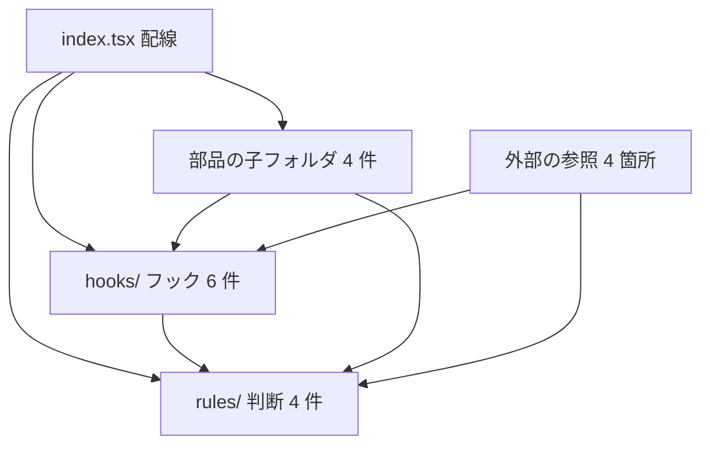

# 設計書

## Overview

`components/composer/ThreadComposer/` の直下に混ざったフック 6 件と判断の `.ts` 4 件を、`hooks/` と `rules/` の子フォルダに移す。直下は配線（`index.tsx` と CSS）と、子フォルダだけにする。部品の子フォルダ（`ComposerOptions`・`ComposerDialogs`・`PostBodyEditor`・`ThreadSegmentForm`）は、1 部品 1 フォルダのまま保つ。

**Purpose**: 投稿フォームの読み手が、フックと判断をフォルダ名で見分けられるようにする。

**Users**: 投稿フォームを読む開発者。投稿フォームを使う利用者には、変化はない（振る舞いの不変）。

**Impact**: `ThreadComposer/` の配置と、その参照（import）が変わる。外部からの参照 4 箇所と、テスト 4 ファイル、構造の検査の対象パスが変わる。`structure.md` の部品の規約に、子フォルダの規則を加える。公開の関数・型・`Props` の形は変えない。

### Goals

- 直下を配線（`index.tsx`・`index.module.css`）と子フォルダだけにする（要件 1.1）
- フック 6 件を `hooks/`、判断 4 件を `rules/` に置く（要件 1.2・1.3）
- 部品の子フォルダの形を保つ（要件 1.4）
- 規約（steering）と検査を、配置に合わせる（要件 3.1〜3.3）

### Non-Goals

- 部品の内部（`ComposerOptions`・`ComposerDialogs`・`PostBodyEditor`・`ThreadSegmentForm`）の変更
- 関数・型の名前、引数、戻り値の変更（移動だけを行う）
- `composer/` の他の部品の配置（`PostLauncher`・`PostPage`・`SuggestPopover` の内部）
- リポジトリ全体の部品フォルダの原則（`src-folder-layout` が扱う）

## Boundary Commitments

### This Spec Owns

- `components/composer/ThreadComposer/` の内部の配置（`hooks/`・`rules/` の作成と、10 ファイルの移動）
- 移動に伴う import の書き換え（部品の内部と、外部の 4 箇所、テスト 4 ファイル）
- 構造の検査（`tests/unit/scripts/composerSplit.test.ts`）の対象パスの更新と、直下の残りの検出
- `structure.md` の部品の規約のうち、子フォルダ（`hooks/`・`rules/`）の規則

### Out of Boundary

- 部品の内部（`ComposerOptions`・`ComposerDialogs`・`PostBodyEditor`・`ThreadSegmentForm`）の中身と配置
- 判断・フックの振る舞い（区切り、提出、共有先、候補、下書き、予約）
- `composer/` の他の部品の配置と内部
- リポジトリ全体の部品フォルダの原則（`src-folder-layout`）
- テストファイルの置き場所（`tests/unit/components/composer/ThreadComposer/` は、そのまま）

### Allowed Dependencies

- 配線（`index.tsx`）→ `hooks/`・`rules/`・部品の子フォルダ・`ThreadSegmentForm`（既存の依存を保つ）
- `hooks/` → `rules/`（判断の関数の利用）、`hooks/` 内の別のフック（`useDraftFlow`）、`lib/*`・`components/*`（既存の import のまま）
- `rules/` → `lib/*`・`components/image`/`components/video` の型（既存のまま）・`rules/` 内の別の判断（`./segments`）
- 外部（`SuggestPopover`・`VideoPicker`・`ThreadSegmentForm`・テスト）→ `@/components/composer/ThreadComposer/{hooks,rules}/x`（絶対パス）

**禁止**:

- `rules/` が `react` を import すること（要件 3.x の既存の規則）。
- `hooks/`・`rules/`・部品の子フォルダが、配線（`index.tsx`）を import すること（循環になる）。
- `rules/` が `hooks/` を import すること（判断は手順に依存しない）。

### Revalidation Triggers

- 移動したファイルの公開の名前（関数・型）の変更（外部の参照 4 箇所の再確認）
- `Props` または `ThreadComposerHandle` の形の変更（参照元 `PostLauncher`・`PostPage`・`Timeline` の再確認）
- `structure.md` の子フォルダの規則の変更（`src-folder-layout` の再確認）

## Architecture

### Architecture Pattern & Boundary Map



**Architecture Integration**:

- Selected pattern: 配線 → フック（手順）→ 判断（純粋な関数）の一方向の依存。移動だけで依存の向きは変えない。
- Domain/feature boundaries: 直下は配線だけ。フックと判断は子フォルダで役割ごとに分かれる。
- Existing patterns preserved: フックは `useX.ts`、判断は `camelCase.ts`、部品は `Name/index.tsx` と `index.module.css`。
- New components rationale: なし（既存のファイルの移動だけ）。
- Steering compliance: 循環なし、領域をまたぐ相対 import なし（外部は `@/`）。規則の改訂は、同じ変更で行う。

## File Structure Plan

### Directory Structure

```
src/components/composer/ThreadComposer/
├── index.tsx                      # 配線（変更: import パスのみ）
├── index.module.css               # 配線の CSS（変更なし）
├── hooks/                         # NEW: フック 6 件（移動）
│   ├── useDraftFlow.ts            # 下書きの手順（移動）
│   ├── useScheduleFlow.ts         # 予約の状態と手順（移動）
│   ├── useScheduleEdit.ts         # 予約の取り消しと適用（移動）
│   ├── useThreadSubmit.ts         # 投稿と予約の送信（移動）
│   ├── useSuggest.ts              # ハッシュタグとメンションの候補（移動）
│   └── useKeyboardRows.ts         # 候補のキー操作（移動）
├── rules/                         # NEW: 判断 4 件（移動）
│   ├── segments.ts                # 区切りの追加・削除・投稿可否（移動）
│   ├── submitThread.ts            # 提出の内容の組み立て（移動）
│   ├── shareDispatch.ts           # 共有先の振り分け（移動）
│   └── suggestHashtags.ts         # 候補の計算（移動）
├── ComposerOptions/               # 変更なし（部品）
├── ComposerDialogs/               # 変更なし（部品）
├── PostBodyEditor/                # 変更なし（部品）
└── ThreadSegmentForm/             # 変更なし（部品）
```

### Modified Files

- `ThreadComposer/index.tsx` — `./useDraftFlow` 等をフックの新しい場所（`./hooks/…`）に、`./segments` 等を `./rules/…` に変える。
- `ThreadComposer/hooks/useDraftFlow.ts`・`hooks/useScheduleEdit.ts`・`hooks/useThreadSubmit.ts` — 判断の import を `../rules/…` に変える。同じフォルダのフックの import は変えない（`./useDraftFlow`）。
- `ThreadComposer/hooks/useSuggest.ts` — `./suggestHashtags` を `../rules/suggestHashtags` に変える。
- `ThreadComposer/ComposerDialogs/index.tsx` — `../useDraftFlow`・`../useScheduleFlow` を `../hooks/…` に変える。
- `ThreadComposer/ThreadSegmentForm/index.tsx` — `@/…/segments`・`@/…/useKeyboardRows`・`@/…/useSuggest` を `rules/`・`hooks/` の新しいパスに変える。
- `composer/SuggestPopover/index.tsx` — `@/…/useSuggest`（型）を `hooks/useSuggest` に変える。
- `video/VideoPicker/index.tsx` — `@/…/segments`（型）を `rules/segments` に変える。
- `tests/unit/components/composer/ThreadComposer/{segments,submitThread,shareDispatch,suggestHashtags}.test.ts` — import パスを `rules/` に変える（期待値は変えない）。
- `tests/unit/scripts/composerSplit.test.ts` — `PURE_JUDGMENT_FILES`・`NON_INDEX_FILES` のパスを `rules/`・`hooks/` に変える。直下の残りの検出を追加する（要件 3.3）。
- `.kiro/steering/structure.md` — 部品の規約に子フォルダの規則を追加し、例（`ThreadComposer/segments.ts`）を `ThreadComposer/rules/segments.ts` に直す。

### 移動の対応表（`git mv` で行い、履歴を残す）

| 移動前                              | 移動後                                    |
| ----------------------------------- | ----------------------------------------- |
| `ThreadComposer/useDraftFlow.ts`    | `ThreadComposer/hooks/useDraftFlow.ts`    |
| `ThreadComposer/useScheduleFlow.ts` | `ThreadComposer/hooks/useScheduleFlow.ts` |
| `ThreadComposer/useScheduleEdit.ts` | `ThreadComposer/hooks/useScheduleEdit.ts` |
| `ThreadComposer/useThreadSubmit.ts` | `ThreadComposer/hooks/useThreadSubmit.ts` |
| `ThreadComposer/useSuggest.ts`      | `ThreadComposer/hooks/useSuggest.ts`      |
| `ThreadComposer/useKeyboardRows.ts` | `ThreadComposer/hooks/useKeyboardRows.ts` |
| `ThreadComposer/segments.ts`        | `ThreadComposer/rules/segments.ts`        |
| `ThreadComposer/submitThread.ts`    | `ThreadComposer/rules/submitThread.ts`    |
| `ThreadComposer/shareDispatch.ts`   | `ThreadComposer/rules/shareDispatch.ts`   |
| `ThreadComposer/suggestHashtags.ts` | `ThreadComposer/rules/suggestHashtags.ts` |

## Requirements Traceability

| Requirement | Summary                                      | Components                                                          | Interfaces           | Flows                           |
| ----------- | -------------------------------------------- | ------------------------------------------------------------------- | -------------------- | ------------------------------- |
| 1.1         | 直下は配線と子フォルダだけ                   | index.tsx・index.module.css                                         | —                    | 構造の検査（直下の検出）        |
| 1.2         | フック 6 件は `hooks/`                       | hooks/ の 6 件                                                      | 既存の関数の形のまま | 構造の検査                      |
| 1.3         | 判断 4 件は `rules/`                         | rules/ の 4 件                                                      | 既存の関数の形のまま | 構造の検査・単体テスト          |
| 1.4         | 部品の子フォルダの形を保つ                   | ComposerOptions・ComposerDialogs・PostBodyEditor・ThreadSegmentForm | —                    | 検査（配置）                    |
| 2.1         | 投稿フォームの操作の結果が変わらない         | 全体                                                                | —                    | component テスト・e2e           |
| 2.2         | 予約・下書き・共有の結果が変わらない         | 全体                                                                | —                    | 単体テスト・e2e（schedule）     |
| 3.1         | steering に子フォルダの規則を記載            | structure.md                                                        | —                    | 目視（文書）                    |
| 3.2         | 規則の変更は同じ変更で行う                   | structure.md と本 spec                                              | —                    | 運用                            |
| 3.3         | 規則と配置がずれたら検査が違反を報告         | composerSplit.test.ts                                               | —                    | 構造の検査                      |
| 4.1         | 既存のテストの期待値を変えない               | テスト 4 ファイル（import のみ）                                    | —                    | テストの差分                    |
| 4.2         | `test:all` が件数の基準以上で通過            | 全体                                                                | —                    | `npm run test:all`              |
| 4.3         | `test:imports` が違反 0 件、許容は増やさない | 全体                                                                | —                    | `npm run test:imports`          |
| 4.4         | e2e の投稿フローが通る                       | 全体                                                                | —                    | e2e（thread-posting・schedule） |

## Components and Interfaces

このスペックは、ファイルの移動と import の書き換えだけを行う。公開の関数・型・フックの戻り値の形は変えない。

| Component      | Layer  | Intent                      | Req Coverage | Key Dependencies     | Contracts                              |
| -------------- | ------ | --------------------------- | ------------ | -------------------- | -------------------------------------- |
| hooks/（6 件） | フック | 手順と状態（移動のみ）      | 1.2          | rules/（P0）         | 既存の戻り値の形のまま                 |
| rules/（4 件） | 判断   | 純粋な関数（移動のみ）      | 1.3          | lib/*（P1）          | 既存の関数の形のまま                   |
| index.tsx      | 配線   | 組み立て（import パスのみ） | 1.1          | hooks/・rules/（P0） | `Props`・`ThreadComposerHandle` は不変 |

## Testing Strategy

- **型検査**: `npm run test:type`（`tsc --noEmit`）。移動の各段階で実行し、取りこぼした import を検出する。
- **構造の検査（composerSplit）**: 対象パスを `rules/`・`hooks/` に更新する。直下に `.ts` が index のみであること（要件 1.1・3.3）を追加して確かめる。負例（直下にフックがあると違反になる）を含める。
- **単体テスト**: `tests/unit/components/composer/ThreadComposer/{segments,submitThread,shareDispatch,suggestHashtags}.test.ts`（import のみ変更）。期待値は変えない（要件 4.1）。
- **component テスト**: `tests/component/composer/ThreadComposer.test.tsx`（変更なし。配線の描画と操作が変わらないことを確かめる。要件 2.1）。
- **e2e**: `thread-posting.spec.ts`・`schedule.spec.ts`（要件 2.2・4.4）。
- **循環と層**: `npm run test:imports`（違反 0 件、許容 70 件のまま。要件 4.3）。
- **全体**: `npm run test:all`（件数の基準: unit 257・component 13・route 200・render 2・e2e 7 以上。要件 4.2）。

## Migration Order

1. `git mv` で判断 4 件を `rules/` へ移し、判断の import を直す（`rules/` 内は同じフォルダの相対 import のまま）。型検査で確かめる。
2. `git mv` でフック 6 件を `hooks/` へ移し、それぞれの import を直す。型検査で確かめる。
3. 外部の参照（`SuggestPopover`・`VideoPicker`・`ThreadSegmentForm`）とテスト 4 ファイルの import を直す。型検査と単体テストで確かめる。
4. 構造の検査（`composerSplit.test.ts`）の対象パスを更新し、直下の検出を追加する。
5. `structure.md` の規則と例を改訂する（同じ変更）。
6. `npm run test:all` と `npm run test:imports` で、件数と違反を確かめる。

各段階は、移動と import の書き換えを同じ段階で行う（移動だけの段階を残さない）。

## Risks & Mitigations

- **import の取りこぼし**: 段階ごとに `tsc` を実行する。`grep` で旧パス（`ThreadComposer/useX`・`ThreadComposer/segments` など）が残っていないことを確かめる。
- **規則と配置のずれ**: 構造の検査で、直下のフック・判断の検出を追加する（要件 3.3）。
- **`VideoPicker` の依存（既存）**: 部品の型を `components/video` が参照する既存の依存は、移動後も同じ。依存の向きは変えない。
- **子フォルダの名前の規約**: `hooks`・`rules` は小文字（部品フォルダの PascalCase とは別）。steering の規則に、これを明記する。
