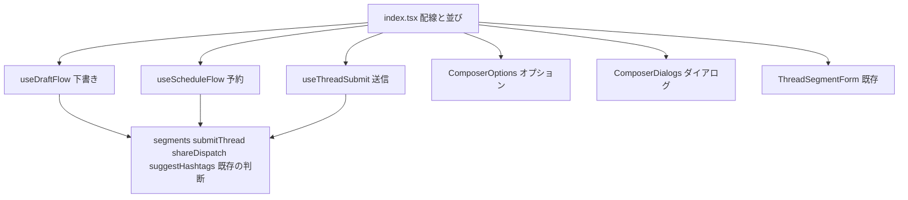

# 設計書

## Overview

`components/composer/ThreadComposer/index.tsx`（1,511 行）を、配線と並びだけを持つ 750 行以下の部品にする。下書き・予約・送信の責務は、役割ごとのフックに移す。オプションとダイアログの描画は、部品に移す。判断の `.ts`（区切り・提出の組み立て・共有の分岐・候補）は、既存のものをそのまま使う。

**Purpose**: 投稿フォームの読み手が、下書き・予約・送信のどの流れを読んでいるかを、ファイルの名前で追えるようにする。利用者に見える投稿フォームの振る舞い（入力・候補・提出の結果）は変えない。

**Users**: 投稿フォームを読む開発者と、投稿フォームを使う利用者（振る舞いの不変）。

**Impact**: `ThreadComposer/` の内部構造が変わる。`index.tsx` は 1,511 行から 750 行以下になる。`Props` と `ThreadComposerHandle` は変えない。参照元（`PostLauncher`・`PostPage`・`Timeline`）の変更は要らない。

### Goals

- `index.tsx` を、配線と並びだけにする（750 行以下。要件 3.1）
- 下書き・予約・送信の責務を、フックに分ける（要件 3.2・3.3）
- 投稿フォームの振る舞いを変えない（要件 1.1〜1.5・2.1〜2.3）
- 分割の前に、特性化テストで振る舞いを固定する（要件 4.1）

### Non-Goals

- `ThreadSegmentForm`（688 行）と `PostBodyEditor`（379 行）の分割（別の論点）
- `useSuggest`・`useKeyboardRows` の変更（フックとして既に独立している）
- 投稿の仕様（文字数・検証の規則。`post-composition`）と、共有の仕様（`external-sharing`）
- 状態の集約（`useReducer` 化）。振る舞いの変化の危険が大きいため採らない

## Boundary Commitments

### This Spec Owns

- `components/composer/ThreadComposer/` の内部構造（`index.tsx` の配線、下書き・予約・送信のフック、オプションとダイアログの部品）
- 上の部品の state の所有者（下の「Components and Interfaces」の表）
- 分割の前の特性化テスト（判断の `.ts` の単体テスト、`ThreadComposer` の component テスト）
- 行数と依存の規則の検査（`tests/unit/scripts/composerSplit.test.ts`）

### Out of Boundary

- 判断の `.ts` の振る舞い（`segments.ts`・`submitThread.ts`・`shareDispatch.ts`・`suggestHashtags.ts`）。このスペックは、ファイルの位置と import だけを変える（この spec では変えない）
- `ThreadSegmentForm`・`PostBodyEditor`・`useSuggest`・`useKeyboardRows`（内部は変えない）
- `PostLauncher`・`PostPage`・`SuggestPopover`・`DraftListPanel` など、`composer/` の他の部品（import の変更は要らない）
- `lib/` の判断と、設定の保存（`settings`・`post-composition` の振る舞い）

### Allowed Dependencies

- `index.tsx` → 3 つのフック・2 つの部品・`ThreadSegmentForm`・既存の判断の `.ts`
- 3 つのフック → 判断の `.ts`・`lib/*`・`components/schedule/*`・`components/settings/*`（既存の import のまま）
- 2 つの部品 → `components/common/*`・`components/schedule/*`・`components/share/*`（既存の import のまま）
- 判断の `.ts` → `lib/*`・`util/*`・`components/image/*`・`components/video/*`（型のみ。既存のまま）
- **禁止**: 判断の `.ts` が `react` を import すること。フックと部品が `index.tsx` を import すること（循環になる）。

### Revalidation Triggers

- `Props` または `ThreadComposerHandle` の形の変更（参照元 `PostLauncher`・`PostPage`・`Timeline` の再確認）
- 判断の `.ts` の公開の関数の形の変更（`segments.ts`・`submitThread.ts`・`shareDispatch.ts`・`suggestHashtags.ts`）
- `components/schedule/useScheduleAvailability`・`components/settings/useShareToggles` の戻り値の形の変更（`src-lib-ui-boundary` の移動先）

## Architecture

### Architecture Pattern & Boundary Map



**Architecture Integration**:

- Selected pattern: 配線（`index.tsx`）→ フック（状態と手順）→ 判断（純粋な関数）の一方向の依存。描画の塊は部品に分ける。
- Domain/feature boundaries: 下書き・予約・送信のそれぞれが、状態と手順を 1 つのフックに持つ。判断は `.ts` に残す。
- Existing patterns preserved: フックは `useX.ts`、判断は `camelCase.ts`、部品は `Name/index.tsx` と `index.module.css`。
- New components rationale: 3 つのフックは、`index.tsx` の 660 行の手順を責務ごとに分けるため。2 つの部品は、状態を持たない描画の塊を分けるため。
- Steering compliance: `structure.md` の部品の規約と、依存の規則（循環なし、領域をまたぐ相対 import なし）に従う。

## File Structure Plan

### Directory Structure

```
src/components/composer/ThreadComposer/
├── index.tsx                    # 配線と並び（750 行以下）。Props・ThreadComposerHandle は変えない
├── index.module.css             # index 固有のクラス（auto-popup-target-row は ComposerOptions へ移す）
├── useDraftFlow.ts              # NEW: 下書きの一覧・読み込み・保存・破棄・離脱の確認
├── useScheduleFlow.ts           # NEW: 予約の状態・日時・編集の選択・取り消し・適用
├── useThreadSubmit.ts           # NEW: 投稿と予約の送信（送信中の印を含む）
├── useScheduleEdit.ts              # NEW: 予約の取り消し・予約の内容のフォームへの適用（下書きのフックの後に呼ぶ）
├── ComposerOptions/
│   ├── index.tsx                # NEW: 投稿オプションのトグル群（描画のみ）
│   └── index.module.css         # NEW: auto-popup-target-row を移す
├── ComposerDialogs/
│   └── index.tsx                # NEW: 下書き・予約一覧・確認・認証・共有のダイアログ（描画のみ）
├── segments.ts                  # 既存（判断）。変更なし
├── submitThread.ts              # 既存（判断）。変更なし
├── shareDispatch.ts             # 既存（判断）。変更なし
├── suggestHashtags.ts           # 既存（判断）。変更なし
├── useSuggest.ts                # 既存（フック）。変更なし
├── useKeyboardRows.ts           # 既存（フック）。変更なし
├── PostBodyEditor/              # 既存（部品）。変更なし
└── ThreadSegmentForm/           # 既存（部品）。変更なし
```

### Modified Files

- `ThreadComposer/index.tsx` — 下書き・予約・送信の手順と、オプションとダイアログの描画を取り出し、配線と並びだけにする。`LoadedDraft` は `useDraftFlow.ts` へ、`recordUsedHashtagsToHistory` は `useThreadSubmit.ts` へ移す（投稿と予約の送信だけが使うため）。
- `ThreadComposer/index.module.css` — `auto-popup-target-row` の規則を `ComposerOptions/index.module.css` へ移す。
- `tests/unit/scripts/composerSplit.test.ts` — NEW（検査）。`index.tsx` の行数と、判断の `.ts` の React の import の無さを確かめる（`pagesThin.test.ts` と同じ形式）。

## Requirements Traceability

| Requirement | Summary                                                 | Components                                           | Interfaces                               | Flows                             |
| ----------- | ------------------------------------------------------- | ---------------------------------------------------- | ---------------------------------------- | --------------------------------- |
| 1.1         | 入力・区切りの追加と削除の表示                          | index, ThreadSegmentForm（不変）                     | 既存                                     | 特性化テスト（component）         |
| 1.2         | 先頭の区切りを削除できない                              | segments.canRemoveSegment, index                     | `canRemoveSegment`                       | 単体テスト                        |
| 1.3         | 提出の内容と順序                                        | submitThread.buildThreadRequestBody, useThreadSubmit | `buildThreadRequestBody`・`submitThread` | 単体テスト・e2e（thread-posting） |
| 1.4         | 失敗時の表示と入力の保持                                | useThreadSubmit                                      | `setStatus`・`setStatusColor`            | 特性化テスト（component）         |
| 1.5         | 共有先への送信の分岐                                    | shareDispatch.runShareDispatch, useThreadSubmit      | `runShareDispatch`                       | 単体テスト                        |
| 2.1         | ハッシュタグとメンションの候補                          | useSuggest（不変）, suggestHashtags                  | `getHashtagCandidates`                   | 単体テスト                        |
| 2.2         | 候補のキー操作                                          | useKeyboardRows, useSuggest（不変）                  | 既存                                     | 既存の操作（変更なし）            |
| 2.3         | ハッシュタグ候補の順序と出所                            | suggestHashtags.getHashtagCandidates                 | `HashtagCandidate`                       | 単体テスト                        |
| 3.1         | index は 750 行以下                                     | index                                                | —                                        | 検査（composerSplit）             |
| 3.2         | 判断の `.ts` は React を import しない                  | 判断の `.ts` 4 件（＋新規の判断はなし）              | —                                        | 検査（composerSplit）             |
| 3.3         | 判断は同じフォルダの `camelCase.ts`、フックは `useX.ts` | useDraftFlow・useScheduleFlow・useThreadSubmit       | —                                        | 検査（ファイル名）                |
| 3.4         | 描画の部品は部品の規約に従う                            | ComposerOptions・ComposerDialogs                     | —                                        | 検査（ファイル配置）              |
| 4.1         | 既存のテストの件数と期待値                              | 全体                                                 | —                                        | `npm run test:all`                |
| 4.2         | テストの import の変更は意味を変えない                  | 特性化テスト                                         | —                                        | テストの差分                      |
| 4.3         | `test:imports` が違反 0 件                              | 全体                                                 | —                                        | `npm run test:imports`            |
| 4.4         | 許容リストの項目を増やさない                            | 全体                                                 | —                                        | `npm run test:imports`            |
| 4.5         | 利用者に見える振る舞いの不変                            | 全体                                                 | —                                        | e2e（thread-posting・schedule）   |

## Components and Interfaces

| Component       | Domain/Layer   | Intent                                         | Req Coverage  | Key Dependencies (P0/P1)                                         | Contracts     |
| --------------- | -------------- | ---------------------------------------------- | ------------- | ---------------------------------------------------------------- | ------------- |
| index.tsx       | UI 配線        | 状態の所有、フックの配線、並び                 | 1.1, 3.1      | useDraftFlow・useScheduleFlow・useThreadSubmit (P0)              | Props（不変） |
| useDraftFlow    | フック（手順） | 下書きの一覧・読み込み・保存・破棄・離脱の確認 | 1.1           | lib/draft/draftList (P1), 下書きの API (P0)                      | State         |
| useScheduleFlow | フック（手順） | 予約の日時・編集・取り消し・適用               | 1.3           | lib/schedule/submitSchedule (P0)                                 | State         |
| useThreadSubmit | フック（手順） | 投稿と予約の送信、送信の表示                   | 1.3, 1.4, 1.5 | submitThread (P0), shareDispatch (P0)                            | Service       |
| useScheduleEdit | フック（手順） | 予約の取り消し・予約の適用                     | 1.3           | useDraftFlow の閉じる処理 (P0), lib/schedule/submitSchedule (P0) | State         |
| ComposerOptions | 部品（描画）   | 投稿オプションのトグル                         | 1.1           | components/common/ToggleSwitch (P1)                              | —             |
| ComposerDialogs | 部品（描画）   | 一覧・確認・認証・共有のダイアログ             | 1.1, 1.5      | components/share/IntentShareDialog (P1)                          | —             |

### useDraftFlow（`useDraftFlow.ts`）

**Responsibilities & Constraints**

- 下書きの一覧（開く・読み込み・失敗の表示）、読み込んだ下書きの適用、保存（確認つき）、破棄、離脱の確認（`requestNavigation`）を持つ。
- 送信と予約とは、`index.tsx` の `setStatus` を介してだけ関わる。

**Contracts**: State [x]

```typescript
type UseDraftFlowParams = {
  segments: SegmentState[]
  setSegments: Dispatch<SetStateAction<SegmentState[]>>
  languageCode: string
  setStatus: (message: DeferredMessage | null) => void
  // 他: 送信の判断に必要な値は、params の型に列挙して渡す（any は使わない）
}
type UseDraftFlowResult = {
  draftModalOpen: boolean
  setDraftModalOpen: (open: boolean) => void
  draftItems: DraftItem[]
  loadedDraft: LoadedDraft | null
  requestNavigation: (to: string) => void
  requestClose: () => void
  // 他: 描画に必要なハンドラー
}
export const useDraftFlow: (params: UseDraftFlowParams) => UseDraftFlowResult
```

- Preconditions: `params` の setter は `index.tsx` の state の setter である。
- Postconditions: 戻り値のハンドラーは、移動の前と同じ順序で state を変える。
- Invariants: 離脱の確認は、最新の `hasUnsavedDraftChanges` を読む（`hasUnsavedRef`）。

### useScheduleFlow（`useScheduleFlow.ts`）

**Responsibilities & Constraints**

- 予約の状態（`scheduleMode`・`runAtPickerOpen`・`pendingCount`・`scheduleLoading`）、編集の選択、再認証、取り消し、適用を持つ。
- 予約の送信は `useThreadSubmit` が行い、予約の状態の更新（`scheduleMode`）は `setScheduleMode` で受け取る。

**Contracts**: State [x]

```typescript
type UseScheduleFlowParams = {
  setStatus: (message: DeferredMessage | null) => void
  setSegments: Dispatch<SetStateAction<SegmentState[]>>
  // 他: 予約の判断に必要な値
}
type UseScheduleFlowResult = {
  scheduleMode: ScheduleMode
  setScheduleMode: (next: ScheduleMode) => void
  runAtPickerOpen: boolean
  // 他: 描画とハンドラー
}
export const useScheduleFlow: (
  params: UseScheduleFlowParams,
) => UseScheduleFlowResult
```

### useThreadSubmit（`useThreadSubmit.ts`）

**Responsibilities & Constraints**

- 投稿（`handleSubmit`）と予約（`handleScheduleSubmit`）の送信、送信中の印（`isSubmitting`・`submittingRef`）、結果の表示（`setStatus`・`setStatusColor`）を持つ。
- 判断は `submitThread.ts`（組み立て）と `shareDispatch.ts`（共有の分岐）に委ねる。

**Contracts**: Service [x]

```typescript
type UseThreadSubmitParams = {
  segments: SegmentState[]
  setStatus: (message: DeferredMessage | null) => void
  setStatusColor: (color: string | undefined) => void
  // 他: 送信の判断に必要な値（shareToggles・accountDid・予約の状態など）
}
type UseThreadSubmitResult = {
  isSubmitting: boolean
  handleSubmit: (e: React.SubmitEvent<HTMLFormElement>) => Promise<void>
  handleScheduleSubmit: (
    target: Exclude<ScheduleSubmitTarget, { kind: "post" }>,
  ) => Promise<void>
}
export const useThreadSubmit: (
  params: UseThreadSubmitParams,
) => UseThreadSubmitResult
```

- Preconditions: `canSubmitNow` の判定は `index.tsx` が行い、`handleSubmit` の前で条件を満たしている。
- Postconditions: 送信の結果（成功・失敗）の表示は、移動の前と同じ文言と色を使う。

### ComposerOptions（`ComposerOptions/index.tsx`）

**Responsibilities & Constraints**: 投稿オプションのトグル群（ハッシュタグ候補・メンション候補・既定の投稿の設定・自動ポップアップの選択）を描画する。状態は props で受け取り、更新はコールバックで返す。

**Contracts**: —（props の型は `ComposerOptions/index.tsx` で定義する）

### ComposerDialogs（`ComposerDialogs/index.tsx`）

**Responsibilities & Constraints**: 下書き一覧（`Overlay`・`DraftListPanel`）、予約一覧（`ScheduleList`）、確認（`ChoiceDialog`×2・`DraftSaveConfirmDialog`）、認証（`CredentialDialog`）、共有（`IntentShareDialog`）を描画する。開閉の状態は props で受け取る。

**Contracts**: —（props の型は `ComposerDialogs/index.tsx` で定義する）

## Testing Strategy

分割の前に、特性化テストを通す（要件 4.1 と、移動の前の振る舞いの固定）。

### Unit Tests（判断の `.ts`、分割の前に追加）

1. `segments.ts`: 先頭の区切りを削除できない（`canRemoveSegment(0) === false`）、区切りの追加と削除の順序、`areAllSegmentsPostable` の判定（要件 1.2・1.3）
2. `submitThread.ts`（`buildThreadRequestBody`）: 文字だけの複数の区切りが、同じ順序の本文の配列になる（要件 1.3）
3. `shareDispatch.ts`（`runShareDispatch`）: 共有の設定に応じて、分岐の結果（ポップアップ・Web Share・なし）が変わらない（要件 1.5）
4. `suggestHashtags.ts`（`getHashtagCandidates`）: 履歴とトレンドの順序と、出所の表示（要件 2.1・2.3）

### Component Tests（`ThreadComposer`、分割の前に追加。`tests/component/composer/ThreadComposer.test.tsx`）

1. 初期表示: 入力欄が 1 つあり、区切りの追加の操作がある。送信の操作は、本文が空のとき無効（要件 1.1）
2. 区切りの追加と削除: 追加で入力欄が増え、先頭の区切りには削除の操作が出ない（要件 1.1・1.2）
3. 提出の失敗: 送信の失敗時に、失敗の文言が表示され、入力が残る（要件 1.4）

- 外部の依存（`astro:transitions/client`・`@/client/openapi/client`・設定の読み書き）は、`vi.mock` で置き換える。

### Structural Tests（分割の後に追加。`tests/unit/scripts/composerSplit.test.ts`）

1. `index.tsx` が 750 行以下である（要件 3.1）
2. 判断の `.ts`（`segments.ts`・`submitThread.ts`・`shareDispatch.ts`・`suggestHashtags.ts`）が `react` を import しない（要件 3.2）
3. フック（`useDraftFlow.ts`・`useScheduleFlow.ts`・`useThreadSubmit.ts`）と判断が、`index.tsx` を import しない（循環の防止）

### E2E Tests（既存のまま）

- `thread-posting.spec.ts`: 単一の投稿が PDS に届く（要件 1.3・4.5）
- `schedule.spec.ts`: 予約の作成と一覧（要件 4.5）
- 複数区切りの提出と候補の操作は e2e に無い。単体テストと component テストで固定する。

## Migration Order（タスクの順序の方針）

1. 特性化テストを足す（判断の単体テスト → component テスト）。既存のコードのまま全件通過する。
2. 下書きのフック（`useDraftFlow.ts`）を移す。`index.tsx` の配線を変える。通過を確かめる。
3. 予約のフック（`useScheduleFlow.ts`）を移す。通過を確かめる。
4. 送信のフック（`useThreadSubmit.ts`）を移す。通過を確かめる。
5. オプションの部品（`ComposerOptions`）を移す。CSS の規則を移す。
6. ダイアログの部品（`ComposerDialogs`）を移す。
7. 構造の検査（`composerSplit.test.ts`）を足す。`test:all` で全件通過を確かめる。

各段階で、`index.tsx` の行数は減る。移動の段階は、直列に行う（同じ `index.tsx` を変えるため、`(P)` は付けない）。

## Risks & Mitigations

- **stale closure**: 離脱の確認は ref で最新の関数を読む。ref の読み書きの順序は変えない。
- **effect の順序**: 同じ effect を同じ順序で移す。component テストで、初期表示の状態を確かめる。
- **テストの空白**: 分割の前に、特性化テストを足す（上の Testing Strategy）。
- **行数の見積もりの超過**: 上限 750 行に対して、見積もりは約 750 行（改定後）。超えるときは、JSX の並びを `ComposerToolbar` として切り出す（`tasks.md` の段階で判断する）。
- **循環 import**: フックと部品は `index.tsx` を import しない（検査 3 で確かめる）。
