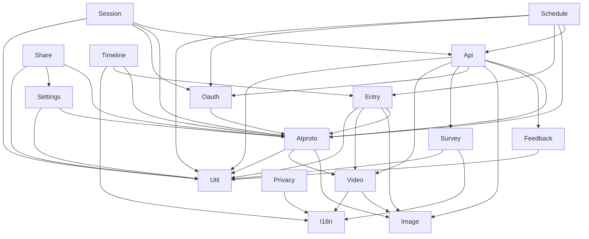

# Design Document

## Overview

**Purpose**: `lib` 内の循環 import（ファイル単位の 2 件・18 ファイル）と、領域どうしの双方向の依存（7 組）を解消する。共有の型・定数・スキーマを参照される側（下位）へ移し、上位は再エクスポートで既存の参照を保つ。

**Users**: 開発者（`lib` の依存を読む人）と、検査（`npm run test:imports`）の運用者。

**Impact**: `lib` の定義の所在が変わる。利用者に見える振る舞い（翻訳の文言と言語判定、旧形式の共有設定の移行、Bluesky レコードの形、Entry の表示）は変えない。

### Goals

- ファイル単位の循環を 0 件にする（型だけの循環を含む）
- `lib` 内の 7 組の双方向の依存を一方向にする
- 依存の向きを steering の規約に書く（要件 5.2）
- 検査の許容リストから循環の項目 32 件を消す（要件 5.1）
- 振る舞いの不変を、特性化テストで先に固定する

### Non-Goals

- 翻訳の文言、設定の保存形式、Bluesky レコードの形、Entry の表示の変更
- `components` の循環（2 組）と `src/` 直下のファイルとの依存（3 組）
- `lib` の UI 依存（`src-lib-ui-boundary` が行う）
- 検査の規則の追加（ディレクトリ単位の検出は `src-import-rules` の改訂が必要で、この spec の範囲外）

## Boundary Commitments

### This Spec Owns

- 循環と双方向の依存の解消に伴う、型・定数・スキーマ・関数の所在の変更（下の File Structure Plan）
- 再エクスポートの配置（元の場所に残す橋）
- 依存の向きの規約（`structure.md` の「lib の領域の依存の向き」）
- 特性化テストと、双方向の依存を確かめるテスト（`tests/unit/scripts/libRegionPairs.test.ts`）
- 許容リストの循環の項目の削除

### Out of Boundary

- 翻訳の文言と言語判定、旧形式の共有設定の移行ロジックの変更（移動のみ。振る舞いは変えない）
- 設定の保存形式（キー名と値の形）、Bluesky レコードの形、Entry の表示
- `lib/i18n/react.ts`・`rich.tsx` の移動（`src-lib-ui-boundary` が行う。順序は本 spec の後）
- `components` の 2 組と、`src/` 直下（`env.ts`・`vars.ts`）との依存
- 検査の規則そのもの（`src-import-rules` が所有する）

### Allowed Dependencies（完了後の `lib` の依存の向き）

2026-11-01 の実測（型のみの辺を含む。`scripts/architecture` の走査）。`lib` の領域どうしは閉路を持たない（長さ 2 以上も含む）。閉路の確認は `tests/unit/scripts/libRegionPairs.test.ts` が行う。

- `lib/api` → `lib/atproto`・`lib/feedback`（型）・`lib/image`・`lib/oauth`・`lib/survey`・`lib/video`・`util`
- `lib/atproto` → `lib/image`・`lib/video`・`util`・`util/emoji`・`src/` 直下（`@/env`・`@/vars`）
- `lib/codegen`・`lib/i18n`・`lib/oauth`・`lib/session` → `src/` 直下（`@/env`・`@/vars`）。`lib/oauth` → `lib/atproto`
- `lib/entry` → `lib/atproto`・`lib/image`・`lib/video`・`util`・`src/` 直下（`lib/timeline` に依存しない）
- `lib/feedback` → `util`（型）
- `lib/privacy` → `lib/i18n`（型）・`lib/site`
- `lib/schedule` → `lib/api`・`lib/atproto`・`lib/entry`・`lib/i18n`（型）・`lib/oauth`・`lib/platform`（型）・`util`
- `lib/session` → `lib/api`・`lib/atproto`・`lib/oauth`・`util`
- `lib/settings` → `lib/atproto`・`util/share`
- `lib/share` → `lib/atproto`・`lib/settings`（型）・`util/share`
- `lib/survey` → `lib/i18n`（型）・`lib/platform`（型）・`util`・`lib` 直下のファイル（`lib/api` に依存しない）
- `lib/timeline` → `lib/atproto`・`lib/entry`・`lib/i18n`（型）
- `lib/video` → `lib/image`・`lib/i18n`（型）

`src/` 直下の `env.ts`・`middleware.ts`・`worker.ts` は組み立ての層で、`lib` を参照する。`lib` からは `@/env`・`@/vars`（設定の層）だけを参照する。



### Revalidation Triggers

- `lib/i18n/translate.ts` の公開の型（52 箇所から利用）の名前と形
- `lib/atproto` の Bluesky レコードの型（`BskyFacets` など）と、`lib/api/schema/common.ts` の推論結果の代入可能性
- `lib/feedback/submission.ts` の型と、`lib/api/schema/v2/feedback/post.ts` の推論結果
- `util/http.ts` の `errorResponseFromStatus` の位置（API と survey の応答）
- `lib/timeline/resolveEntryDeleteScope.ts` の位置（`components/entry` の利用側）
- `structure.md` の依存の向きの規約（検査と特性化テストの前提）

## Architecture

### Existing Architecture Analysis

- 循環は 2 つ。`lib/i18n`（`translate.ts` と英語辞書の 15 ファイル。型だけの循環）と `lib/settings`（移行処理と共有設定。型と値の循環）。
- 双方向の 7 組は、型や定数が逆向きに使われていることが原因（`research.md` の各項を参照）。
- 既存のテストは、翻訳の出力・旧形式の移行・レコードの形を直接は守っていない。移動の前に特性化テストを足す。

### Architecture Pattern & Boundary Map

- 選んだパターン: 定義を下位へ移し、上位は再エクスポートする（`research.md` の Design Decision）。
- 図は上の「Allowed Dependencies」の向き。ノード名は領域を表す。

### Technology Stack

| Layer    | Choice / Version                | Role in Feature                          | Notes                   |
| -------- | ------------------------------- | ---------------------------------------- | ----------------------- |
| Language | TypeScript（strict）            | 型の移動と構造型                         | `any` を使わない        |
| Schema   | zod（既存）                     | 動画 blob の移動（`video/videoBlob.ts`） | `.meta` は api 側に残す |
| Test     | vitest（既存）                  | 特性化テストと双方向の依存のテスト       | `tests/unit/` に置く    |
| Check    | `scripts/architecture/`（既存） | 循環の検出と許容リスト                   | 新しい規則は追加しない  |

新しい依存は追加しない。

## File Structure Plan

### Directory Structure（新設）

```
src/lib/
├── i18n/
│   ├── messageEntries.ts          # MessageEntries（依存なし。辞書の型）
│   └── messageKeys.ts             # MessageKey・PlainMessageKey・PluralBase・EnglishMessages（typeof ja のみ）
├── settings/
│   └── autoPopupTarget.ts         # AUTO_POPUP_TARGETS・AutoPopupTarget（移行処理と共有設定の双方が使う）
├── video/
│   └── videoBlob.ts               # CommonVideoBlobSchema・CommonVideoBlobType（素の zod スキーマ）
├── atproto/
│   ├── recordTypes.ts             # BskyFacets・BskyImagesMeta・BskyOgMeta・BskyReplyRef・BskyVideoBlob・BskyVideoMeta（型のみ）
│   └── atUri.ts                   # parseAtUri・parseOwnedAtUri
├── survey/
│   └── pathParams.ts              # PathParamsSchema・PathParamsType
├── feedback/
│   └── submission.ts              # FeedbackSubmission（bug・enhancement の判別共用体）
├── image/
│   └── sourceImage.ts             # SourceImage（型のみ）
└── timeline/
    └── resolveEntryDeleteScope.ts # 移動（旧 lib/entry/resolveEntryDeleteScope.ts）
```

### Modified Files

- `src/lib/i18n/translate.ts` — 移した型を `messageKeys`・`messageEntries` から再エクスポートする。値（`createTranslator` など）は変えない
- `src/lib/i18n/messages/en/*.ts`（15 件）と `en/index.ts` — 型の import 先を `messageEntries`・`messageKeys` にする
- `src/lib/settings/legacyShareSettings.ts` — 型の import 先を `autoPopupTarget.ts` にする
- `src/lib/settings/shareSettings.ts` — `AUTO_POPUP_TARGETS`・`AutoPopupTarget` を `autoPopupTarget.ts` から再エクスポートする
- `src/lib/api/schema/common.ts` — 動画 blob を `video/videoBlob.ts` から再エクスポートする。`atproto/recordTypes.ts` の型に対する代入可能性を型検査で確かめる（`api → atproto`）
- `src/lib/video/videoUploader.ts` — `CommonVideoBlobSchema` の import 先を `video/videoBlob.ts` にする
- `src/lib/atproto/{embed,facet,post,richtext}.ts` — `Components.*` の型を `recordTypes.ts` の型にする。`post.ts` の `parseOwnedAtUri` は `atUri.ts` から import する
- `src/lib/entry/url.ts` — AT URI の解析を削除する（組み立ての関数だけを残す）
- `src/lib/entry/entry.ts` — `SourceImage` を `image/sourceImage.ts` から再エクスポートする。AT URI の解析は `atproto/atUri.ts` から import する
- `src/lib/entry/createPostVisual.ts` — `TimelinePost` の型を使わず、`{ images: SourceImage[]; video?: SourceVideo }` の構造型を使う
- `src/lib/entry/resolveEntryDeleteScope.ts` — 削除（`lib/timeline/` へ移動）
- `src/lib/timeline/posts.ts` と `timeline/guestDummyPosts.ts` — import 先を更新する。`guestDummyPosts` は `EntryDeleteScope` を timeline の型から使う
- `src/lib/image/galleryLayout.ts` — `SourceImage` の import 先を `image/sourceImage.ts` にする
- `src/util/http.ts` — `errorResponseFromStatus` を追加する（`lib/api/response.ts` から移す）。`util/http.ts` は `lib` を import しない
- `src/lib/api/response.ts` — `errorResponseFromStatus` を削除し、残りは `resolveXrpcStatus` のみ。利用側（API 応答の各ファイル）の import を `util/http` にする
- `src/lib/survey/request.ts` — `PathParamsSchema` を `survey/pathParams.ts` から、`errorResponseFromStatus` を `util/http` から import する
- `src/lib/api/schema/v2/surveys/_surveyId/path.ts` — `PathParamsSchema` を `survey/pathParams.ts` から再エクスポートする
- `src/lib/api/schema/v2/feedback/post.ts` — 推論結果が `feedback/submission.ts` の型に代入可能であることを型検査で確かめる
- `src/lib/feedback/issueContent.ts` — `RequestBodyType` の代わりに `feedback/submission.ts` の `FeedbackSubmission` を使う
- `src/components/entry/EntryCard/index.tsx`・`EntryDeleteConfirmDialog/index.tsx`・`PostCardEntryActions/useSkyshareEntryStatus.ts` — `resolveEntryDeleteScope` の import 先を `lib/timeline/resolveEntryDeleteScope` にする
- `.kiro/steering/structure.md` — 「lib の領域の依存の向き」の節を追加する（要件 5.2）
- `config/architecture/import-allowlist.json` — 循環（`cycle`）の項目 32 件を削除する（要件 5.1）
- `tests/unit/lib/entry/resolveEntryDeleteScope.test.ts` — import 先を `lib/timeline/resolveEntryDeleteScope` にする（テストの意味は変えない）
- `tests/route/survey/request.test.ts` — import 先を更新する（必要な場合のみ）

## Requirements Traceability

| Requirement | Summary                                                       | Components                                          | Interfaces                                            | Flows             |
| ----------- | ------------------------------------------------------------- | --------------------------------------------------- | ----------------------------------------------------- | ----------------- |
| 1.1         | `lib/i18n` に型だけの循環を含め循環がない                     | MessageTypes、Translator（再エクスポート）          | `MessageKey`・`EnglishMessages`                       | 移動フェーズ A    |
| 1.2         | 翻訳の文言と言語判定の結果が変わらない                        | 特性化テスト（翻訳）                                | `createTranslator`                                    | 特性化テスト      |
| 2.1         | `lib/settings` に循環がない                                   | AutoPopupTargetModel、LegacyShareMigration          | `AutoPopupTarget`                                     | 移動フェーズ A    |
| 2.2         | 旧形式の共有設定の移行結果が変わらない                        | 特性化テスト（移行）                                | `deriveAutoPopupTarget`・`migrateLegacyShareSettings` | 特性化テスト      |
| 3.1         | `lib` の領域が双方向の依存を持たない                          | 各移動（上の表）、双方向のテスト                    | `libRegionPairs` テスト                               | 移動フェーズ B・C |
| 3.2         | 依存の向きを変えても、レコードの形と Entry の表示が変わらない | AtprotoRecordTypes、AtUri、特性化テスト（レコード） | `BskyFacets` 他・`buildBskyPostRecord`                | 特性化テスト      |
| 4.1         | 画面と API の振る舞いが変わらない                             | 全部品（E2E・route の既存テスト）                   | —                                                     | 既存の E2E・route |
| 4.2         | 既存のテストが全件通過する                                    | 全体                                                | `npm run test:all`                                    | 最終確認          |
| 5.1         | 循環の許容リスト項目が 0 件になる                             | 許容リスト（検査）                                  | `import-allowlist.json`                               | 最終確認          |
| 5.2         | steering に依存の向きの規約を書く                             | `structure.md`                                      | —                                                     | 最終確認          |

## Components and Interfaces

### Summary

| Component            | 領域     | 目的                                | 対応要件 | 主な依存                          | 契約                |
| -------------------- | -------- | ----------------------------------- | -------- | --------------------------------- | ------------------- |
| MessageTypes         | i18n     | 辞書の型を依存なしに分ける          | 1.1      | `ja` 辞書（`typeof` のみ）        | Service（型）       |
| AutoPopupTargetModel | settings | 自動ポップアップの値と型を分ける    | 2.1      | なし                              | Service（型・定数） |
| AtprotoRecordTypes   | atproto  | Bluesky レコードの形の型            | 3.1・3.2 | なし                              | Service（型）       |
| AtUri                | atproto  | AT URI の解析                       | 3.1      | なし                              | Service             |
| VideoBlob            | video    | 動画 blob の素のスキーマ            | 3.1      | zod                               | Service             |
| SurveyPathParams     | survey   | 回答 API の経路パラメータのスキーマ | 3.1      | `survey/definition`（`idSchema`） | Service             |
| FeedbackSubmission   | feedback | 送信内容の型                        | 3.1      | なし                              | Service（型）       |
| SourceImage          | image    | 画像の素材の型                      | 3.1      | なし                              | Service（型）       |
| ErrorResponse        | util     | 標準エラー応答の生成                | 3.1      | なし                              | Service             |

### i18n

#### MessageTypes（`messageEntries.ts`・`messageKeys.ts`）

| Field        | Detail                                               |
| ------------ | ---------------------------------------------------- |
| Intent       | 辞書の型を、翻訳の実行（`translate.ts`）から切り離す |
| Requirements | 1.1, 1.2                                             |

**Responsibilities & Constraints**

- `messageEntries.ts`: `export type MessageEntries = Record<string, string>` のみ。import を持たない。
- `messageKeys.ts`: `MessageKey`・`PlainMessageKey`・`PluralBase`・`EnglishMessages` を定義する。日本語辞書の型を `typeof ja` で参照するため、`import type { ja }` だけを持つ。
- 英語辞書の各ファイルは `messageEntries.ts` を、`en/index.ts` は `messageKeys.ts` を型として import する。
- `translate.ts` は値の import（`en`・`ja`）と、移した型の再エクスポートだけを持つ。

**Contracts**: Service [x]（型）

```typescript
// messageEntries.ts
export type MessageEntries = Record<string, string>

// messageKeys.ts（ja は型参照のみ）
import type { ja } from "./messages/ja"
export type MessageKey = keyof typeof ja
export type PlainMessageKey = {
  [K in MessageKey]: /* プレースホルダを持たないキー */ K | never
}[MessageKey]
export type PluralBase = {
  [K in MessageKey]: K extends `${infer B}_other` ? B : never
}[MessageKey]
export type EnglishMessages = Record<MessageKey, string> &
  Record<`${PluralBase}_one`, string>
```

- Invariants: `translate.ts` の公開の型（`MessageKey` など）の名前と形は変えない（52 箇所の利用側を変えないため）
- 型の循環の検査: `translate.ts → en/index → messageKeys → ja/index → ja/*` が一方向になる

### settings

#### AutoPopupTargetModel（`autoPopupTarget.ts`）

| Field        | Detail                                                                                        |
| ------------ | --------------------------------------------------------------------------------------------- |
| Intent       | 自動ポップアップの値（`AUTO_POPUP_TARGETS`・`AutoPopupTarget`）を、設定の読み書きから切り離す |
| Requirements | 2.1, 2.2                                                                                      |

**Responsibilities & Constraints**

- `AUTO_POPUP_TARGETS`（`"ask"`・`"x"`・`"taittsuu"`・`"mastodon"`・`"misskey"`）と `AutoPopupTarget` を定義する。import を持たない。
- `shareSettings.ts` は両方を再エクスポートする。値は変えない。

**Contracts**: Service [x]（定数・型）

#### LegacyShareMigration（`legacyShareSettings.ts`）

- `AutoPopupTarget` の型の import を `autoPopupTarget.ts` にする。`shareSettings.ts` を import しない。
- 処理の本体（`deriveAutoPopupTarget`・`migrateLegacyShareSettings`）は変えない。
- 循環の解消: `shareSettings → legacyShareSettings → autoPopupTarget` の一方向。

### atproto

#### AtprotoRecordTypes（`recordTypes.ts`）

| Field        | Detail                                                                                                                                 |
| ------------ | -------------------------------------------------------------------------------------------------------------------------------------- |
| Intent       | Bluesky レコードの形（facet・画像のメタ・OG・返信参照・動画の blob とメタ）を、`lib/api` の OpenAPI 用スキーマから独立した型として持つ |
| Requirements | 3.1, 3.2                                                                                                                               |

**Responsibilities & Constraints**

- 型のみ。`api/schema/common.ts` の `Common*Type` と同じ形にする（実装の形を変えない）。
- `api/schema/common.ts` 側で、推論結果がこれらの型に代入可能であることを型検査で確かめる（`api → atproto` の一方向）。

**Contracts**: Service [x]（型）

```typescript
export type BskyFacets = /* 既存の CommonFacetsType と同じ形 */
export type BskyImagesMeta = /* 既存の CommonImagesMetaType と同じ形 */
export type BskyOgMeta = /* 既存の CommonOgMetaType と同じ形 */
export type BskyReplyRef = /* 既存の CommonReplyRefType と同じ形 */
export type BskyVideoBlob = /* 既存の CommonVideoBlobType と同じ形 */
export type BskyVideoMeta = /* 既存の CommonVideoMetaType と同じ形 */
```

#### AtUri（`atUri.ts`）

**Contracts**: Service [x]

```typescript
export const parseAtUri: (
  uri: string,
) => { repo: string; collection: string; rkey: string } | undefined
export const parseOwnedAtUri: (
  uri: string,
  expectedCollection: string,
  expectedRepo: string,
) => { repo: string; collection: string; rkey: string } | undefined
```

- 既存の `entry/url.ts` の関数と同じ振る舞い（移動のみ）。`entry/url.ts` は組み立ての関数だけを持つ。

### video

#### VideoBlob（`videoBlob.ts`）

- `CommonVideoBlobSchema`（素の zod スキーマ。`.meta` を持たない）と `CommonVideoBlobType` を定義する。`video/postVideoLimits` の定数を使う（video → video）。
- `api/schema/common.ts` は `CommonVideoBlobSchema` を再エクスポートし、`.meta` を付ける場合は api 側で付ける。
- `videoUploader.ts` は `video/videoBlob.ts` から import する（video → api の向きが消える）。

### survey

#### SurveyPathParams（`pathParams.ts`）

- `PathParamsSchema`（`{ surveyId: idSchema }` の strict）と `PathParamsType` を定義する。`idSchema` は `survey/definition` から import する。
- `api/schema/v2/surveys/_surveyId/path.ts` は再エクスポートする。
- `survey/request.ts` は `pathParams.ts` と `util/http` を import する（api を import しない）。

### feedback

#### FeedbackSubmission（`submission.ts`）

- 型のみ。現行の `RequestBodySchema` の推論結果と同じ形を持つ判別共用体にする。
  - `kind: "bug"`: 件名（`title`）・環境（`environment`）・`steps`・`reproducibility`
  - `kind: "enhancement"`: 件名（`title`）・環境（`environment`）・`description`・`technicalNotes`（省略可）
- `issueContent.ts` の入力型として使う。`api/schema/v2/feedback/post.ts` は推論結果の代入可能性を型検査で確かめる（`api → feedback`）。

### image

#### SourceImage（`sourceImage.ts`）

- `SourceImage`（`url`・`alt`・`cid`・`aspectRatio?`）の型だけを持つ。
- `entry/entry.ts` は再エクスポートする。`image/galleryLayout.ts` は `sourceImage.ts` から import する（image → entry の向きが消える）。

### entry

#### PostVisualSource（`createPostVisual.ts` 内の型）

- `createPostVisual` が必要とする項目だけの構造型 `{ images: SourceImage[]; video?: SourceVideo }` を持つ。`TimelinePost` は import しない。
- 既存の呼び出し側は、`TimelinePost` が構造型として代入可能なので変えない。

### timeline

#### resolveEntryDeleteScope（`lib/timeline/resolveEntryDeleteScope.ts`）

- `lib/entry/resolveEntryDeleteScope.ts` の移動。振る舞いは変えない。
- `timeline/posts.ts` の `normalizePostViewToTimelinePost` と `TimelinePost` を使う（timeline 内）。`entry/url` の代わりに `atproto/atUri` を使う。
- 利用側（`components/entry` の 2 部品、`guestDummyPosts.ts`、テスト）の import 先を変える。

### util

#### ErrorResponse（`util/http.ts`）

- `errorResponseFromStatus(status: number): Response` を移す。import を持たない（`util` の制約）。
- `lib/api/response.ts` は `resolveXrpcStatus` を残す。利用側の import を `util/http` にする。

## Data Models

本 spec は新しいデータを持たない。型の所在を変えるのみ。Bluesky レコードの形（`BskyFacets` など）と送信内容（`FeedbackSubmission`）の形は、現行のスキーマと同じにする。

## Error Handling

- 振る舞いは変えない。移行処理の失敗時（`localStorage` の例外）は、現行どおり旧キーを残して終了する（特性化テストで確かめる）。
- 型の不一致（構造型の代入可能性）は、型検査（`test:type`）で失敗させる。実行時には検出しない。

## Testing Strategy

### 特性化テスト（移動の前に書き、現行コードで通す）

- **翻訳（要件 1.2）**: `tests/unit/lib/i18n/translate.test.ts`。日本語と英語で、代表的な文言（プレースホルダあり・なし）と、複数形（`tn`）の単数・複数の出力を固定する。キーは現行の辞書から選ぶ。
- **旧形式の移行（要件 2.2）**: `tests/unit/lib/settings/legacyShareSettings.test.ts`。`deriveAutoPopupTarget` の組み合わせ表（ON の数が 0・1・2 以上）と、`migrateLegacyShareSettings`（`window.localStorage` を差し替えて、旧キーのみ・新キーが既にある・書き込み失敗の 3 場合）を固定する。
- **Bluesky レコード（要件 3.2）**: `tests/unit/lib/atproto/post.test.ts`。`buildBskyPostRecord` の出力（代表的な入力）と、`parseOwnedAtUri`・`parseAtUri` の代表的な入力と出力（`tests/unit/lib/atproto/atUri.test.ts`）を固定する。

### 双方向の依存のテスト（要件 3.1）

- `tests/unit/scripts/libRegionPairs.test.ts`: `scanModules` でリポジトリ全体を走査し、`lib` の領域について、双方向の組が 0 件であることを確かめる。長さ 3 以上を含む閉路が 0 件であることも確かめる（`src/` 直下は対象外）。`regionOf` を使う。検査の規則（`src-import-rules`）は変えない。

### 規則と循環の検査（要件 5.1）

- `npm run test:imports` が、許容リストの循環の項目を stale にせず、違反 0 件で通る。許容リストから循環の項目 32 件を消した状態で、終了コード 0 になる。

### 型の検査（要件 3.2・型の代入可能性）

- `npm run test:type`（`tsc --noEmit`）が通る。`api/schema/common.ts`・`api/schema/v2/feedback/post.ts` の代入可能性の検査を含む。

### 既存の検証（要件 4.1・4.2）

- `npm run test:all`（type・lexicon・imports・unit・component・route・render・e2e）の件数と結果が、変更の前と同じ（既存の件数に、追加の特性化テストと双方向のテストが加わる）。
- 既存の route（`tests/route/survey/request.test.ts`）と E2E（7 件）で、API と画面の振る舞いを確かめる。

## Migration Strategy

1. **フェーズ A（特性化テスト）**: 上の特性化テストを、現行コードに対して書いて通す。
2. **フェーズ B（i18n と settings）**: `messageEntries`・`messageKeys`・`autoPopupTarget` を作り、利用側を変える。循環 2 件が消えることを `npm run test:imports` で確かめる（許容リストの循環項目は、stale の警告として残る）。
3. **フェーズ C（atproto・api・video・feedback・survey）**: `recordTypes`・`atUri`・`videoBlob`・`pathParams`・`submission`・`util/http` を作る。`api` と `survey` の双方向の組、`atproto` と `api` の組、`video` と `api` の組、`feedback` と `api` の組を解消する。
4. **フェーズ D（entry・timeline・image）**: `sourceImage`・`resolveEntryDeleteScope`（timeline への移動）・`PostVisualSource` を作る。`entry ↔ timeline`・`entry ↔ image`・`atproto ↔ entry` の組を解消する。
5. **フェーズ E（規約と許容リスト）**: `structure.md` に依存の向きを書く。許容リストから循環の 32 件を消す。双方向のテストを通す。
6. **最終確認**: `npm run test:all`。

各フェーズの終わりに `npm run test:type` と `npm run test:unit` を通す。

## Open Questions / Risks

- **再エクスポートの残し方**: 元の場所の再エクスポート（`translate.ts`・`shareSettings.ts`・`entry/entry.ts`・`api/schema/common.ts`・`path.ts`）は、利用側の変更を減らすための橋。後続の `src-import-style` の作業で減らしてよい。新しい再エクスポートを増やさないことを、タスクの完了条件に含める。
- **`api/response.ts` の利用側の数**: `errorResponseFromStatus` の利用側（API 応答）の import 変更の件数は、タスクの作成時に数える。
- **構造型の代入可能性**: `atproto/recordTypes.ts` と `api/schema/common.ts` の形が崩れると、型検査で止まる。その場合は、形を実装に合わせて直す（変えてはいけないのは実装の形）。
- **`src-lib-ui-boundary` との順序**: `lib/i18n` の型の移動は、`react.ts`・`rich.tsx` の移動より先に行う（roadmap の順序）。
- **双方向のテストの範囲**: テストは `lib` の領域のみを確かめる。`components` の 2 組と `src/` 直下の 3 組は、要件の対象外として残る。
