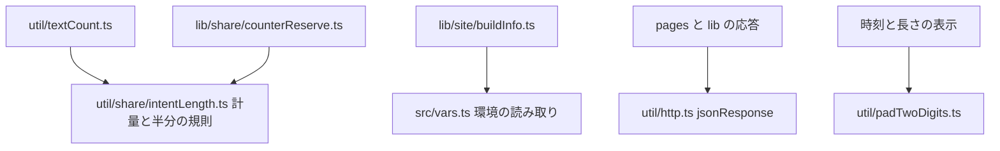

# 設計書

## Overview

同じ概念の実装が複数の場所にある箇所を、1 箇所に寄せる。対象は 4 つ（X の文字数の計量、JSON 応答の組み立て、2 桁のゼロ埋め、環境変数の直接の読み取り）と、用済みの旧共有設定の移行モジュールの削除である。呼び出し側は、新しい共通の関数を使うように書き換える。利用者に見える振る舞い（文字数、応答の形とヘッダー、共有の結果、環境変数の値）は変えない。

**Purpose**: 読む人が、同じ規則を探さずに済むようにする。片方を直して、もう片方が残る危険を取り除く。

**Users**: 開発者（規則の所在が 1 箇所になる）。利用者（振る舞いの変化はない）。

**Impact**: `util/share/intentLength.ts`・`util/http.ts`・`util/padTwoDigits.ts`（新規）・`src/vars.ts` に共通の関数を置き、呼び出しを移す。`lib/schedule/scheduleResponse.ts` の `jsonResponse`、`pages/v2/entry.ts` の `json200`、`completion.ts` の `respond` を取り除く。`lib/settings/legacyShareSettings.ts` とそのテストを削除する。

### Goals

- X の「2 で割って切り上げる」規則を 1 箇所にする（要件 1.1〜1.3）
- JSON 応答の組み立てを 1 関数にし、ヘッダーは呼び出し側が渡す（要件 2.1〜2.3）
- 2 桁のゼロ埋めを 1 関数にする（要件 3.1・3.2）
- 旧共有設定の移行モジュールを削除する（要件 4.1〜4.3）
- 同じ環境変数を読む箇所を、`src/vars.ts` の 1 箇所にする（要件 5.1・5.2）

### Non-Goals

- 共有の 5 フォルダの統合（役割が違うため重複ではない）
- `env` 系の 8 モジュールの統合（領域ごとの役割が違う）
- 応答の形・状態コード・ヘッダーの値の変更、文字数の上限の変更、環境変数の値の変更

## Boundary Commitments

### This Spec Owns

- X の文字数の「2 で割って切り上げる」規則の所在（`util/share/intentLength.ts`）
- JSON 応答の組み立ての関数（`util/http.ts` の `jsonResponse`）と、その呼び出しの移行
- 2 桁のゼロ埋めの関数（`util/padTwoDigits.ts`）と、その呼び出しの移行
- `PUBLIC_VERSION`・`SITE` の直接の読み取り（`src/vars.ts` に 1 箇所）
- 旧共有設定の移行モジュール（`legacyShareSettings.ts`）とテストの削除、その呼び出しの削除

### Out of Boundary

- 文字数の計量の式（`xIntentMeasure`・`taittsuuIntentMeasure` の中身）と、文字数の上限
- 応答の形・状態コード・ヘッダーの値（各エンドポイントの仕様）
- 共有の振る舞い（`external-sharing`）と、共有の 5 フォルダの役割
- `env` 系の 8 モジュール（`cloudflare:workers` の動的な取得、`lib/site/*`・`util/clientEnvironment.ts`・`src/env.ts`）
- 環境変数の名前と値（`platform-runtime`・`ops-config-secrets`）

### Allowed Dependencies

- `util/textCount.ts` → `util/share/intentLength.ts`（既存の依存を保つ）
- `lib/share/counterReserve.ts` → `util/share/intentLength.ts`（既存）
- `util/http.ts` → なし（`util` の下位のみ。`Response`・`Headers` の標準の API）
- `lib/*` と `pages/*` → `util/http.ts`・`util/padTwoDigits.ts`・`src/vars.ts`（`util` と `src/vars.ts` は下位の層として使ってよい）
- `lib/site/buildInfo.ts` → `src/vars.ts`（`vars` は `lib` を import しない）

**禁止**:

- `src/vars.ts` が `lib` を import すること（循環の防止）。
- `util/*` が `lib`・`pages`・`components` を import すること（steering の依存の向き）。

### Revalidation Triggers

- `jsonResponse` の引数の形の変更（呼び出し 11 箇所（7 ファイル）と、`json200`・`respond` の 3 箇所の再確認）
- `util/share/intentLength.ts` の計量の関数の名前の変更（`textCount`・`counterReserve` の再確認）
- `src/vars.ts` の公開の名前の変更（`serviceVersion`・`siteOrigin` の利用箇所の再確認）
- 旧共有設定の移行モジュールの削除（`shareSettings.ts` の読み取りの経路の再確認）

## Architecture

### Architecture Pattern & Boundary Map



**Architecture Integration**:

- Selected pattern: 共通の規則を、下位の層（`util`・`src/vars.ts`）に 1 箇所ずつ置き、上位（`lib`・`pages`・`components`）が使う。依存の向きは変えない。
- Existing patterns preserved: `util/` は領域に依存しない小さな関数（steering）。`src/vars.ts` は設定の値（`lib` から使える）。
- New components rationale: `padTwoDigits.ts` は、`util/` に数値の共通関数がないため新規にする。それ以外は既存のファイルに関数を足す。
- Steering compliance: 循環なし。`util` は上位層を import しない。

## File Structure Plan

### Directory Structure

```
src/
├── vars.ts                              # 変更: buildVersion・siteOrigin を読む唯一の場所
├── util/
│   ├── http.ts                          # 変更: jsonResponse を追加し、errorResponseFromStatus が使う
│   ├── padTwoDigits.ts                  # 新規: 2 桁のゼロ埋め
│   ├── share/textCount.ts               # 変更: countWeightedTweetLength・countTaittsuuLength が半分の規則を使う
│   └── share/
│       └── intentLength.ts              # 移動後の配置は lib/share/intentLength.ts
├── lib/
│   ├── share/counterReserve.ts          # 変更: halfUnitLength を使う
│   ├── schedule/
│   │   ├── scheduleResponse.ts          # 変更: jsonResponse を削除（呼び出しは util/http へ）
│   │   └── runAtInput.ts                # 変更: pad を padTwoDigits に置き換える
│   ├── video/formatVideoDuration.ts     # 変更: padStart を padTwoDigits に置き換える
│   ├── site/buildInfo.ts                # 変更: 環境の直接の読み取りを vars から得る
│   ├── settings/
│   │   ├── shareSettings/               # 分割後の設定モジュール
│   │   ├── autoPopupTarget.ts           # 移動後の配置は lib/share/autoPopupTarget.ts
│   │   └── legacyShareSettings.ts       # 削除
│   ├── entry/url.ts                     # 変更: SITE を siteOrigin から得る
│   └── timeline/guestDummyPosts.ts      # 変更: SITE を siteOrigin から得る
├── pages/v2/
│   ├── entry.ts                         # 変更: json200 を jsonResponse に置き換える
│   └── bsky/session/authorization/completion.ts  # 変更: respond を jsonResponse に置き換える
tests/unit/
├── util/…                               # 新規: halfUnitLength・padTwoDigits・jsonResponse の特性化（配置は tasks で決める）
└── lib/settings/legacyShareSettings.test.ts  # 削除
```

### Modified Files

- `lib/share/intentLength.ts` — `halfUnitLength(measure, text)` を追加（`Math.ceil(measure(text) / 2)`）。
- `lib/share/textCount.ts` — `countWeightedTweetLength` と `countTaittsuuLength` を `halfUnitLength` で書き直す（名前と引数は変えない）。
- `lib/share/counterReserve.ts` — `resolveCounterReserve` の `Math.ceil(…/2)` を `halfUnitLength` に置き換える。
- `util/http.ts` — `jsonResponse(body, init?)` を追加し、`errorResponseFromStatus` の `new Response(…)` を `jsonResponse` に置き換える（ヘッダーは `no-store` と `content-type` を保つ）。
- `lib/schedule/scheduleResponse.ts` — `jsonResponse` を削除する（11 箇所の呼び出しを `util/http` の `jsonResponse` に移す。一覧は下の「jsonResponse の呼び出しの移行」を参照。`setCookies` は `headers` に展開する）。
- `pages/v2/entry.ts` — `json200` を `jsonResponse(body, { headers: { "Content-Type": … } })` に置き換える（`no-store` は付けない）。
- `pages/v2/bsky/session/authorization/completion.ts` — `respond` を `jsonResponse` に置き換え、`no-store` と `set-cookie` を `headers` で渡す。
- `util/padTwoDigits.ts` — 新規。`lib/schedule/runAtInput.ts` の `pad` と `lib/video/formatVideoDuration.ts` の 2 箇所の `padStart(2, "0")` を置き換える。
- `src/vars.ts` — `buildVersion`（`import.meta.env.PUBLIC_VERSION`）と `siteOrigin`（`import.meta.env.SITE`）を追加する。`serviceVersion` は `${buildVersion}`（従来と同じ文字列）。
- `lib/site/buildInfo.ts` — `version` を `buildVersion || "unknown"` にする（`import.meta.env` の直接の読み取りを除く）。
- `lib/entry/url.ts`・`lib/timeline/guestDummyPosts.ts` — `${import.meta.env.SITE}` を `${siteOrigin}` にする。
- `lib/settings/shareSettings.ts` — `migrateLegacyShareSettings` の import と呼び出し（`readAutoPopupTargetSetting` の先頭）を削除し、注釈（2 箇所）を直す。
- `lib/share/autoPopupTarget.ts` — 注釈の移行の言及を削除する。
- `lib/settings/legacyShareSettings.ts`・`tests/unit/lib/settings/legacyShareSettings.test.ts` — 削除する。

### jsonResponse の呼び出しの移行（件数の根拠）

`scheduleResponse.jsonResponse` の呼び出しは 11 箇所（7 ファイル）。同名のローカル関数（`tests/unit/lib/feedback/githubIssue.test.ts`）は対象外。

| ファイル                                                    | 呼び出し |
| ----------------------------------------------------------- | -------- |
| `lib/schedule/scheduleResponse.ts`（同ファイル内）          | 1        |
| `pages/v2/schedules.ts`                                     | 2        |
| `pages/v2/schedules/[id].ts`                                | 3        |
| `pages/v2/schedules/credential.ts`                          | 2        |
| `pages/v2/schedules/credential/authorization.ts`            | 1        |
| `pages/v2/schedules/credential/authorization/completion.ts` | 1        |
| `pages/v2/schedules/limits.ts`                              | 1        |

加えて、`pages/v2/entry.ts` の `json200`（1 箇所）と、`pages/v2/bsky/session/authorization/completion.ts` の `respond`（2 箇所）を移す。

### 数値の関数の対応（同じ値になる根拠）

- `halfUnitLength(xIntentMeasure, t)` と従来の `countWeightedTweetLength(t)`: 計量が例外のときは `t.length * 2`（`xIntentMeasure`）と `t.length`（従来）の 2 で割った値が一致する。
- `resolveCounterReserve` は、従来どおり `suffix.length === 0` のとき `0` を返す。

## Requirements Traceability

| Requirement | Summary                                     | Components                                        | Interfaces                 | Flows                              |
| ----------- | ------------------------------------------- | ------------------------------------------------- | -------------------------- | ---------------------------------- |
| 1.1         | 投稿の文字数の表示が変わらない              | util/textCount（countWeightedTweetLength）        | halfUnitLength             | 特性化テスト（単体）               |
| 1.2         | 共有の切り詰めの長さが変わらない            | lib/share/counterReserve・util/share/intentLength | halfUnitLength             | 特性化テスト（単体）・e2e          |
| 1.3         | X の計量の規則が 1 箇所                     | util/share/intentLength                           | halfUnitLength             | 検査（規則の所在）                 |
| 2.1         | JSON 応答の状態・本文・ヘッダーが変わらない | util/http（jsonResponse）・pages/v2 の呼び出し    | jsonResponse(body, init)   | 特性化テスト（単体）・route テスト |
| 2.2         | 組み立ては 1 関数、ヘッダーは引数           | util/http                                         | jsonResponse               | 検査（定義の所在）                 |
| 2.3         | エラー応答の状態と本文が変わらない          | util/http（errorResponseFromStatus）              | jsonResponse               | route テスト                       |
| 3.1         | 2 桁のゼロ埋めは 1 関数                     | util/padTwoDigits                                 | padTwoDigits(n)            | 検査（定義の所在）                 |
| 3.2         | 0〜99 の表示が変わらない                    | util/padTwoDigits                                 | padTwoDigits(n)            | 特性化テスト（単体）               |
| 4.1         | 移行モジュールとテストと呼び出しを削除      | lib/settings/shareSettings                        | —                          | 検査（import の残り）              |
| 4.2         | 旧キーのみの利用者は既定値                  | lib/settings/shareSettings                        | readAutoPopupTargetSetting | 単体テスト（既定値）               |
| 4.3         | 移行済みの値は変わらない                    | lib/settings/shareSettings                        | readAutoPopupTargetSetting | 既存の単体テスト                   |
| 5.1         | 同じ変数を読むモジュールは 1 つ             | src/vars.ts                                       | buildVersion・siteOrigin   | 検査（読み取りの所在）             |
| 5.2         | 読み取った値が変わらない                    | src/vars.ts・lib/site/buildInfo                   | buildVersion               | 単体テスト（既定値の表示）         |
| 6.1         | 既存のテストの期待値を変えない              | テストの全体                                      | —                          | テストの差分                       |
| 6.2         | `test:all` の件数が基準以上                 | 全体                                              | —                          | `npm run test:all`                 |
| 6.3         | 利用者に見える画面と操作が変わらない        | 全体                                              | —                          | e2e 7 件                           |

### 現況との対応（2026-11-10 追補）

| 設計時のパス                          | 現在のパス                         | 変えた spec       |
| ------------------------------------- | ---------------------------------- | ----------------- |
| `src/util/textCount.ts`               | `src/lib/share/textCount.ts`       | `util-placement`  |
| `src/util/share/intentLength.ts`      | `src/lib/share/intentLength.ts`    | `util-placement`  |
| `src/lib/settings/shareSettings.ts`   | `src/lib/settings/shareSettings/`  | `lib-large-files` |
| `src/lib/settings/autoPopupTarget.ts` | `src/lib/share/autoPopupTarget.ts` | `util-placement`  |

## Components and Interfaces

| Component          | Layer | Intent                                  | Req Coverage | Key Dependencies                            | Contracts |
| ------------------ | ----- | --------------------------------------- | ------------ | ------------------------------------------- | --------- |
| halfUnitLength     | util  | 計量を半分の単位へ換算する              | 1.1〜1.3     | xIntentMeasure・taittsuuIntentMeasure（P0） | Service   |
| jsonResponse       | util  | JSON 応答を組み立てる（ヘッダーは引数） | 2.1〜2.3     | Response・Headers（P0）                     | Service   |
| padTwoDigits       | util  | 2 桁のゼロ埋めの数値を文字列にする      | 3.1・3.2     | —                                           | Service   |
| src/vars（追加分） | 設定  | 環境の値を読む唯一の場所                | 5.1・5.2     | import.meta.env（P0）                       | State     |

### halfUnitLength（`lib/share/intentLength.ts`）

```typescript
export const halfUnitLength = (measure: IntentMeasure, text: string): number =>
  Math.ceil(measure(text) / 2)
```

- Preconditions: `measure` は、文字列を受けて数値を返す計量（`IntentMeasure`）。
- Postconditions: 戻り値は `Math.ceil(measure(text) / 2)` と等しい。

### jsonResponse（`util/http.ts`）

```typescript
export type JsonResponseInit = { status?: number; headers?: HeadersInit }
export const jsonResponse = (body: unknown, init: JsonResponseInit = {}): Response
```

- Preconditions: なし。`body === undefined` のとき本文は付けない。
- Postconditions: 状態は `init.status`（既定 200）。ヘッダーは `Content-Type: application/json` を既定とし、`init.headers` で指定したものが優先される。`init.headers` は、呼び出し側が `cache-control: no-store`・`set-cookie` を指定できる。
- Invariants: 応答の本文は、従来の `JSON.stringify(body)` と同じ。

### padTwoDigits（`util/padTwoDigits.ts`）

```typescript
export const padTwoDigits = (n: number): string => String(n).padStart(2, "0")
```

### src/vars.ts（追加分）

```typescript
export const buildVersion = import.meta.env.PUBLIC_VERSION
export const siteOrigin = import.meta.env.SITE
export const serviceVersion = `${buildVersion}`
```

- `serviceVersion` の値は従来の `` `${import.meta.env.PUBLIC_VERSION}` `` と同じ（未設定でも同じ文字列）。

## Testing Strategy

変更の前に、移すものの振る舞いを固定する（特性化テスト）。移行の後も期待値は変えない。

### Unit Tests（特性化）

1. `halfUnitLength` と従来の 3 関数（`countWeightedTweetLength`・`countTaittsuuLength`・`resolveCounterReserve`）の値: 日本語・英語・URL を含む本文、空の本文、計量が例外になる入力で、移行の前後の値が一致する（要件 1.1・1.2）。
2. `jsonResponse` の単体テスト: `scheduleResponse` 由来の形（`no-store`・`set-cookie` の配列）と、`errorResponseFromStatus`（`no-store`）のヘッダーと本文を、移行の前に固定する（要件 2.1・2.3）。`json200` と `respond` は非公開の関数のため、単体テストでは扱わない（下の Route Tests で扱う）。
3. `padTwoDigits`: 0〜99 の表示（`0`→`00`、`5`→`05`、`59`→`59`）と、`formatVideoDuration` の既存の期待値（要件 3.2）。
4. 旧共有設定の移行の削除: 旧キーのみの保存値は既定値（`readAutoPopupTargetSetting`）、新しいキーの値は変わらない（要件 4.2・4.3）。
5. `serviceVersion`・`buildVersion`・`siteOrigin`: 従来の式と同じ値（要件 5.2）。

### Route Tests

- `json200`（`pages/v2/entry.ts` の投稿の応答）: 既存の `tests/route/pages/entryApi.test.ts` が、移行の前後で状態・本文・ヘッダーを守る。移行の前に、`content-type` と `cache-control` が無いことを、このテストに 1 件追加して固定する。
- `respond`（`pages/v2/bsky/session/authorization/completion.ts` の応答）: 対応する route テストが無いため、**移行の前に新規の route テストを追加する**。状態・本文（ありとなし）・`cache-control: no-store`・`set-cookie`（`clearPendingCookie` の値）を固定する。
- 上記の既存テスト（`tests/route/pages/*`）が、移行の後も通過する（要件 2.1・2.3）。

### Structural Checks

- `util/share/intentLength.ts` 以外に `Math.ceil(` と `/ 2` の組み合わせがないことを、grep の検査で確かめる（要件 1.3）。
- `jsonResponse` の定義が 1 つだけで、`new Response(JSON.stringify(` の直接の組み立てが、`util/http.ts` 以外にないこと（要件 2.2）。
- `import.meta.env.PUBLIC_VERSION` と `import.meta.env.SITE` が `src/vars.ts` だけにあること（要件 5.1）。

### E2E（既存のまま）

- `thread-posting.spec.ts`・`schedule.spec.ts` などの 7 件（要件 6.3）。

### 全体

- `npm run test:all`: 件数（unit 257・component 13・route 200・render 2・e2e 7）以上（要件 6.2）。
- `npm run test:imports`: 違反 0 件、許容 70 件のまま。

## Migration Order

1. 特性化テストを追加する（計量・応答・ゼロ埋め・既定値）。既存のコードのまま全件通過する。
2. X の計量: `halfUnitLength` を追加し、3 箇所を書き換える。単体テストで確かめる。
3. ゼロ埋め: `padTwoDigits` を追加し、3 箇所を書き換える。
4. JSON 応答: `jsonResponse` を追加し、`errorResponseFromStatus` を書き換え、呼び出し（11 + 1 + 2 箇所）を移す。route テストで確かめる。`jsonResponse`（scheduleResponse）と `json200`・`respond` を削除する。
5. 環境の読み取り: `src/vars.ts` に `buildVersion`・`siteOrigin` を置き、3 箇所（`SITE`）と `buildInfo` を移す。
6. 旧共有設定: 呼び出し・注釈を消し、モジュールとテストを削除する。
7. 検査: grep の検査と `npm run test:all`・`npm run test:imports` で確かめる。

各段階で型検査（`npm run test:type`）を実行する。

## Risks & Mitigations

- **応答のヘッダーの取りこぼし** — 特性化テストで 4 形を固定してから移す。route テストで確かめる。
- **`errorResponseFromStatus` の本文の変化** — 本文は `JSON.stringify(message)` のまま（`{ error: … }`）。単体テストで確かめる。
- **`serviceVersion` の未設定時の値** — 従来の式と同じ文字列（`${…}`）を保つため、変化しない。
- **旧共有設定の削除** — 利用者の決定。移行済みの利用者は影響がない（要件 4.3）。旧キーのみの利用者は既定値になる（要件 4.2）。
- **循環 import** — `src/vars.ts` は `lib` を import しない。`npm run test:imports` の循環の規則で確かめる。
