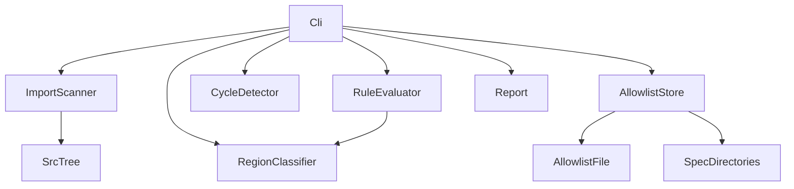

# Design Document

## Overview

**Purpose**: `src/` の依存規約（層の向き・`lib` の UI 非依存・循環・領域をまたぐ import の表記・`../` の段数・`.js` の方式）を、`npm run test:imports` の 1 つの入口で機械的に検査する。既存の違反は許容リストに所有 spec 付きで記録し、新しい違反だけを失敗にする。

**Users**: 開発者（import を書く人）と、デプロイ前の test ジョブ（CI）を運用する人が使う。

**Impact**: 新しい検査を追加する。`src/` の振る舞いは変えない。`package.json` に入口を 1 つ、`deploy.yaml` の test ジョブに 1 手順、`structure.md` に規則の記述を加える。

### Goals

- 要件 1〜5 の規則を、`.ts`・`.tsx`・`.astro`（フロントマター）と型だけの import について検査する
- 既存の違反（約 120 件）を、所有 spec 付きの許容リストに記録する
- 許容リストに無い違反だけを失敗にする。許容リストの項目が消えたら stale として報告する
- 新しい依存を追加しない（`typescript`・`tsx`・`vitest` は既存）

### Non-Goals

- 既存の違反の修正（`src-cycles`・`src-lib-ui-boundary`・`src-import-style` などが行う）
- PR の段階で動く検査の追加（既存に PR 単位の test ワークフローがないため、未決定事項とする）
- 実行時の動的 import（引数が文字列リテラルでない `import()`）の追跡
- CSS・JSON・画像などの資産の import の検査

## Boundary Commitments

### This Spec Owns

- 依存規則の検査の仕組み一式（走査・領域の判定・規則・循環・許容リスト・CLI）
- 許容リストの形式と内容（初期の内容は、この spec の実装で生成する）
- 検査の入口（`test:imports` の npm スクリプト）と、`deploy.yaml` の test ジョブへの組み込み
- `structure.md` の規則の記述（要件 8.1）

### Out of Boundary

- `src/` の違反の修正（許容リストの項目は、所有 spec が消す）
- 生成物（`src/client/openapi/`）の内容と生成規則（`apigen`）
- テストの方針（`testing.md`）。この検査のテストは既存の単体テストの層に置く
- 運用ツールの配置の全体（`ops-tooling-layout`）。本 spec は `scripts/architecture/` を新設するだけ
- 想定の構成（「検査後の src 配下の想定構成」の節）は検査の根拠にしない（要件 10）。想定は完了の目安であり、規則は steering の規約だけから導く

### Allowed Dependencies

- `typescript`（既存の devDependency）: `createSourceFile` による解析。型チェックのプログラムは作らない
- `tsx`（既存）: スクリプトの実行
- `vitest`（既存）: 単体テスト
- Node.js の `node:fs`・`node:path`
- 読み取りのみ: `src/`（対象）、`.kiro/specs/`（所有 spec の存在確認）、`config/architecture/import-allowlist.json`（許容リスト）
- 依存の向き: `scripts/architecture/` は `src/` の実装コードに import されない。`src/` の振る舞いは変わらない

### Revalidation Triggers

- `@/` エイリアスの対応先の変更（`src/` 以外への移動）
- `src/` の直下の構成の変更（`lib`・`components`・`pages`・`util` の名前）
- 領域の定義（`regionOf` の規則）の変更
- 許容リストの形式（キー、項目の必須フィールド）の変更
- `src/client/openapi/` の位置の変更（除外の対象）
- `structure.md` の規則の変更（検査の規則と一致させる）
- Node.js・TypeScript の版の変更（CI の版と解析結果）

## Architecture

### Existing Architecture Analysis

- `src/` は三層（`pages` → `lib` → `util`）と、部品（`components`）で構成される。`lib` が `components` を import する箇所は 0 件で、この依存の向きは既に守られている。
- 規約は `structure.md` に書かれているが、検査はない。違反は、循環（18 ファイル）・`lib` の react 系 import（7 件）・領域をまたぐ相対 import（17 件）・`../` の段数（39 件）・`.js` の混在（27 件）として残っている。
- test ジョブ（`deploy.yaml`）は `push`（`develop`・`release/**`）でだけ動く。デプロイの前提として、ここに検査を加える。

### Architecture Pattern & Boundary Map

検査は「走査 → 規則の適用 → 許容リストの照合 → 報告」の一方向の流れにする。各部品は 1 つの責務だけを持ち、`src/` には依存しない。



**Architecture Integration**:

- 選んだパターン: 一方向のパイプライン。走査（副作用はファイルの読み取りだけ）と規則（純粋な関数）を分ける。
- 境界: 走査は `scanModules` だけが `fs` を読む。規則・循環・許容は、入力を受けて結果を返す純粋な関数にする。
- 既存のパターンの維持: `scripts/` の領域別フォルダ（`scripts/<領域>/`）と、`tsx` による TypeScript スクリプトの実行（`survey` の入口と同じ）。
- 新しい部品の理由: 規則・循環・許容を別々にテストできるように分ける。

### Technology Stack

| Layer    | Choice / Version                 | Role in Feature                     | Notes                                          |
| -------- | -------------------------------- | ----------------------------------- | ---------------------------------------------- |
| Language | TypeScript（strict）             | 検査の全部品                        | `noImplicitAny` は無効のまま。`any` は使わない |
| Parser   | `typescript` 5.9.3（既存）       | import の抽出（`createSourceFile`） | 型のプログラムは作らない                       |
| Runner   | `tsx`（既存）                    | `npm run test:imports` の実行       | `survey` の入口と同じ方式                      |
| Test     | `vitest`（既存）                 | 規則・循環・許容の単体テスト        | `tests/unit/scripts/` に置く                   |
| CI       | Node.js 22.16.0（`deploy.yaml`） | test ジョブでの実行                 | 版は既存のまま                                 |

新しい依存は追加しない。外部ツールの比較は `research.md` に記録した。

## File Structure Plan

### Directory Structure

```
scripts/
└── architecture/                  # 依存規則の検査（本 spec の所有）
    ├── check-imports.ts           # CLI の入口。結果の表示と終了コード。--emit-allowlist を持つ
    ├── importGraph.ts             # 走査。ファイルの列挙、import の抽出、解決
    ├── regions.ts                 # 領域の判定（regionOf）
    ├── rules.ts                   # 規則 R1・R2・R4a・R4b・R4c（純粋な関数）
    ├── cycles.ts                  # 循環（強連結成分）。規則 R3
    └── allowlist.ts               # 許容リストの読み込みと検証、照合、stale の抽出
config/
└── architecture/
    └── import-allowlist.json      # 許容リスト（初期内容は --emit-allowlist で生成し、レビューして確定）
tests/
├── unit/scripts/
│   └── importRules.test.ts        # 規則・循環・許容・走査・CLI の単体テスト
└── fixtures/import-rules/         # 小さな src 風の木（規則ごとの違反と正しい例）
```

### Modified Files

- `package.json` — `test:imports` を追加（`tsx scripts/architecture/check-imports.ts`）。`test:all` にも加える。
- `tsconfig.json` — `exclude` に `tests/fixtures/import-rules` を加える（実装で追加。違反を含む fixture を型検査の対象から外すため）。
- `.github/workflows/deploy.yaml` — test ジョブに `npm run test:imports` の手順を追加する（`test:lexicon` の前）。
- `.kiro/steering/structure.md` — 「依存の向き」と「Import Organization」の節に、検査の規則を明記する（要件 8.1）。`.js` を付ける例（`@/lib/api/response.js`）を、付けない方式に直す。

## 検査後の src 配下の想定構成

本 spec は検査の仕組みだけを作り、`src/` の構成は変えない。 以下の想定は完了の目安であり、検査の規則の根拠にはしない（要件 10）。想定の構成は、許容リストの項目を後続の spec（Phase 3 の `src-cycles`・`src-lib-ui-boundary`・`src-composer-split`・`src-duplicates`・`src-folder-layout`・`src-import-style`・`src-pages-thin`）が消した結果として現れる。許容リストが空になり（stale も 0 件）、検査が通ることを、想定の構成の完了条件とする。

### 想定の構成（[新設]・[変更]・[移動]・[削除]・[未決定] で示す）

```
src/
├── pages/                          入口だけを持つ（業務の判断は lib へ）
│   ├── v2/entry.ts                 [変更] serialize と組み立てを lib/entry へ移す。入口と応答だけ残す
│   ├── v2/schedules*.ts            [変更] env.DB・R2 の操作を lib/schedule の関数へ移す
│   ├── v2/feedback.ts              [変更] GitHub トークンとレート制限を lib/feedback へ移す
│   ├── samples/                    [削除] choice-question.astro
│   └── entries/sample.astro        [残す] ゲストモードの「Entryを開く」の遷移先
├── lib/                            業務の判断。react・react-easy-crop に依存しない
│   ├── guestMode.ts                [変更] 判断の関数（resolveGuestDeleteScope など）を移す
│   ├── timeline/guest/             [新設] ゲストのダミーのデータ（guestDummyPosts.ts から分離）
│   ├── i18n/                       [変更] 翻訳の型を辞書と別のファイルへ。react.ts・rich.tsx は移動（[未決定] 移動先）
│   ├── image/                      [変更] 切り抜きの計算だけを残す。描画は components/image へ
│   ├── settings/                   [変更] 旧形式の移行処理を型に依存しない別モジュールへ。useShareToggles は移動
│   ├── schedule/                   [変更] useScheduleAvailability は移動
│   ├── entry/・atproto/            [変更] 双方向の依存を解消（entry → atproto の一方向）
│   └── api/schema/                 [変更] フォルダ名を [param] 形式へ（[id]・[did]・[surveyId]・[index]・[dbIndex]・[dbKey]）。深い相対 import は @/ へ
├── components/                     部品。1 部品 1 フォルダ（index.tsx・index.module.css・判断は camelCase.ts）
│   ├── composer/ThreadComposer/    [変更] index.tsx（1,511 行）を分割し、描画の部品は下位の部品フォルダへ
│   ├── common/ChoiceQuestionSample/ [削除]
│   ├── common/PaginationModeSelect/ [削除] 参照がない（デッドコード）
│   ├── common/ComponentList/       [変更なし] 汎用のリスト部品。分割の要否は後続の design で決める
│   ├── timeline/PostCard/          [移動] useWebShareCrosspost.ts を所有する部品フォルダへ
│   ├── help/Help/                  [移動] helpEntries.tsx（Help と HelpItem が使う）
│   ├── privacy/PolicyCards/        [移動] PolicyCards.tsx を部品フォルダ（index.tsx）にする
│   ├── layout/Metadatas/           [移動] Metadatas.astro と AnalyticsTag.astro を部品フォルダにまとめる
│   ├── layout/nav/                 [未決定] navItems.ts・sync*.ts・NavIcon.astro は FooterNav と Sidebar が共有する（G1）
│   └── dead.md                     [削除] デッドコードのメモ（経緯は git 履歴に残す）
├── util/                           領域に依存しない小さな関数
│   └── textCount.ts・share/intentLength.ts  [統合] X の文字数換算は 1 実装にする（用途ごとに名前で区別する場合を除く）
├── layout/Baselayout.astro         [未決定] components/layout との関係（G2）
├── styles/・images/                [未決定] steering に記載がない（G2）
├── client/openapi/                 生成物（手で編集しない。検査の対象外）
└── env.ts・vars.ts・middleware.ts・worker.ts・global.d.ts   [未決定] 直下のファイルの扱い（G2）
```

### 検査の規則から導かれる構成の性質

- `lib` は `components`・`pages` を import しない。`lib` は `react` で始まるパッケージを import しない（翻訳の描画・フック・切り抜きの描画は、`lib` の外に出す）。
- `util` は `lib`・`components`・`pages` を import しない。
- 領域をまたぐ import はすべて `@/`。同じ部品フォルダの中と、同じ領域の中だけが相対 import になる（`../` は 3 段以上にならない）。
- 循環 import はない。`lib/i18n`・`lib/settings`・`lib/atproto` と `lib/entry` の双方向の依存は解消されている。
- 拡張子は付けない（`@/lib/api/response` の形）。

### 規約に決めがない箇所（要件・steering の不足）

これらは検査の規則では決まらない。想定の構成を完成させるには、steering の規約を追加する必要がある。

- **G1: React に依存する共有の補助の置き場所**。`lib/i18n/react.ts`・`rich.tsx`、`layout/nav/` の共有ファイルなどは、`lib` にも置けない（要件 2.1）。部品フォルダにも置けない（複数の部品が使い、1 部品 1 フォルダの規約に合わない）。候補は次のとおり。
  1. steering に、共有の UI 補助の置き場所（例: `src/components/shared/`）を追加する。
  2. 利用の中心になる部品の所有として、その部品フォルダに置く。
  3. 翻訳の描画は `components/common/` の部品（`Trans` 相当）として公開する。
- **G2: steering が触れていない直下の要素**。`src/layout/`・`src/images/`・`src/styles/`・`src/` 直下のファイル（`env.ts`・`vars.ts`・`middleware.ts`・`worker.ts`・`global.d.ts`）は、steering の「Directory Patterns」に記載がない。
- **G3: ゲストモードの置き場所**。`guestMode.ts` と `timeline/guest/` の関係が steering にない。想定では、データを `lib/timeline/guest/`、判断を `lib/guestMode.ts` に置く。

**要件との関係**: 本 spec の要件 1〜9 は規則の検査だけを扱う。想定の構成そのものは、この spec の要件に含まれていない。G1〜G3 は、親の計画（roadmap の Phase 3）と `src-folder-layout` の要件に、steering の規約として決めるべき項目である。承認済みの要件 1〜9 は変更しない。G1〜G3 の決定を受けて、`src-folder-layout` の要件を作り直すことを推奨する。

## Requirements Traceability

| Requirement | Summary                                                | Components                                  | Interfaces            | Flows      |
| ----------- | ------------------------------------------------------ | ------------------------------------------- | --------------------- | ---------- |
| 1.1         | `lib` → `components` を違反にする                      | RuleEvaluator（R1）                         | `evaluateImportRules` | 検査の流れ |
| 1.2         | `lib` → `pages` を違反にする                           | RuleEvaluator（R1）                         | `evaluateImportRules` | 検査の流れ |
| 1.3         | `util` → 上位層を違反にする                            | RuleEvaluator（R1）                         | `evaluateImportRules` | 検査の流れ |
| 2.1         | `lib` の `react` 系 import を違反にする                | RuleEvaluator（R2）                         | `evaluateImportRules` | 検査の流れ |
| 3.1         | 循環 import を違反にする                               | CycleDetector（R3）                         | `findCycleViolations` | 検査の流れ |
| 3.2         | 許容された循環を新しい違反にしない                     | AllowlistStore                              | `checkAllowlist`      | 検査の流れ |
| 4.1         | 領域をまたぐ相対 import を違反にする                   | RuleEvaluator（R4a）、RegionClassifier      | `regionOf`            | 検査の流れ |
| 4.2         | 同じ領域内の相対 import を許容する                     | RegionClassifier                            | `regionOf`            | —          |
| 4.3         | `../` が 3 段以上の import を違反にする                | RuleEvaluator（R4b）                        | `evaluateImportRules` | 検査の流れ |
| 4.4         | `.js` の方式と異なる import を報告する                 | RuleEvaluator（R4c）                        | `evaluateImportRules` | 検査の流れ |
| 5.1         | 型だけの import にも同じ規則を適用する                 | ImportScanner（`typeOnly`）                 | `ImportEdge`          | 検査の流れ |
| 6.1         | 許容された違反を失敗にしない                           | AllowlistStore                              | `checkAllowlist`      | 検査の流れ |
| 6.2         | 許容されていない違反を失敗にする                       | AllowlistStore、Cli                         | `checkAllowlist`      | 検査の流れ |
| 6.3         | 各項目に所有 spec の ID を持たせる                     | AllowlistStore                              | `loadAllowlist`       | —          |
| 6.4         | 消えた項目を stale として報告する                      | AllowlistStore                              | `checkAllowlist`      | —          |
| 7.1         | 検査の npm スクリプトを 1 つ提供する                   | Cli                                         | `test:imports`        | —          |
| 7.2         | 許容されていない違反で終了コードを失敗にする           | Cli                                         | 終了コード            | —          |
| 7.3         | CI で検査を実行し、失敗でビルドを止める                | Cli（`deploy.yaml`）                        | 手順                  | —          |
| 7.4         | `src/` のファイルを変更しない                          | ImportScanner（読み取りのみ）               | `scanModules`         | —          |
| 8.1         | 規則を steering に明記する                             | `structure.md`（変更）                      | —                     | —          |
| 9.1         | 画面と API の振る舞いを変えない                        | 全部品（`src/` を読むだけ）                 | —                     | —          |
| 9.2         | 既存のテストの結果を変えない                           | 単体テストの追加のみ                        | —                     | —          |
| 10.1        | 規則の根拠を steering に限る                           | RuleEvaluator（規則の一覧）、`structure.md` | —                     | —          |
| 10.2        | 特定のファイル・フォルダの存在・名前・配置を要求しない | RuleEvaluator、ImportScanner                | `evaluateImportRules` | —          |
| 10.3        | 規則の変更は steering の改訂と同じ変更で行う           | RuleEvaluator（規則の一覧）、`structure.md` | —                     | —          |

## Components and Interfaces

### 概要の表

| Component        | 領域 | 目的                                   | 対応する要件                 | 主な依存                                   | 契約           |
| ---------------- | ---- | -------------------------------------- | ---------------------------- | ------------------------------------------ | -------------- |
| ImportScanner    | 走査 | ファイルを列挙し、import 辺を解決する  | 5.1, 7.4                     | SrcTree（P0）                              | Service        |
| RegionClassifier | 規則 | ファイルの領域を判定する               | 4.1, 4.2                     | なし                                       | Service        |
| RuleEvaluator    | 規則 | 規則 R1・R2・R4a・R4b・R4c を適用する  | 1.1〜1.3, 2.1, 4.1, 4.3, 4.4 | RegionClassifier（P0）                     | Service        |
| CycleDetector    | 規則 | 強連結成分から循環の辺を選ぶ           | 3.1                          | なし                                       | Service        |
| AllowlistStore   | 許容 | 許容リストを読み、照合し、stale を出す | 3.2, 6.1〜6.4                | AllowlistFile（P0）、SpecDirectories（P1） | Service、State |
| Cli              | 入口 | 結果を表示し、終了コードを決める       | 7.1〜7.3                     | 上記すべて（P0）                           | —              |

### scripts/architecture

#### ImportScanner（`importGraph.ts`）

| Field        | Detail                                                                                  |
| ------------ | --------------------------------------------------------------------------------------- |
| Intent       | `src/` の `.ts`・`.tsx`・`.astro` を列挙し、import 辺（解決済みと外部パッケージ）を返す |
| Requirements | 5.1, 7.4                                                                                |

**Responsibilities & Constraints**

- 対象は `src/` 配下の `.ts`・`.tsx`・`.astro`。`.d.ts` と `src/client/openapi/` は除外する（生成物は対象外）。
- `.astro` は先頭の `---` で囲まれたフロントマターだけを解析する。
- 型だけの import（`import type`・`export type`・型位置の `import("...")`）は `typeOnly: true` にする。
- 解決: `@/` は `src/` に対応付ける。`./` と `../` は書かれた位置から解決する。拡張子が無い場合は `.ts`・`.tsx`・`.astro`・`/index` を順に試す。`.js` で終わる指定は、拡張子を外してから試す。
- `src/` 内に解決できない相対 import は、資産（CSS など）として無視する。ただし解決できない `.ts` 系の指定は、エラーとして扱う（検査の結果を信用しないため）。
- 生成物（`src/client/openapi/`）への import は、辺にも未解決にもしない（実装で確定。生成物は検査の対象外のため）。

**Dependencies**

- Outbound: `SrcTree` — ファイルの読み取り（P0）
- External: `typescript` の `createSourceFile` — 解析（P0）

**Contracts**: Service [x]

##### Service Interface

```typescript
type ModulePath = string // リポジトリ直下からの相対パス（例: "src/lib/entry/entry.ts"）

type ImportEdge = {
  from: ModulePath
  specifier: string // 書かれたとおりの指定（例: "@/lib/x"、"./y"、"react"）
  typeOnly: boolean // 型だけの import なら true
  target:
    { kind: "module"; path: ModulePath } | { kind: "package"; name: string }
}

type ModuleGraph = {
  modules: ModulePath[]
  edges: ImportEdge[]
  unresolved: { from: ModulePath; specifier: string }[] // 実装で追加: 解決できない `.ts` 系の指定（エラーとして報告）
}

// root の src/ を走査する。読み取りに失敗したら例外を投げる
function scanModules(root: string): ModuleGraph
```

- Preconditions: `root` は存在するリポジトリの直下
- Postconditions: `edges` のすべての `from` は `modules` に含まれる。`module` 型の `target.path` も `modules` に含まれる
- Invariants: ファイルの内容を書き換えない（要件 7.4）

#### RegionClassifier（`regions.ts`）

| Field        | Detail                                             |
| ------------ | -------------------------------------------------- |
| Intent       | ファイルのパスから、そのファイルが属する領域を返す |
| Requirements | 4.1, 4.2                                           |

**Responsibilities & Constraints**

- `src/lib/<領域>/…` → `lib/<領域>`
- `src/lib/<ファイル>` → `lib`（`lib` の直下のファイル）
- `src/components/<領域>/<Name>/…` → `components/<領域>/<Name>`（部品フォルダ）
- `src/components/<領域>/<ファイル>` → `components/<領域>`（部品フォルダの外）
- それ以外は、`src/` からの親ディレクトリ（例: `pages/v2/bsky`、`util/share`）。`src/` 直下のファイルは `(root)`。

##### Service Interface

```typescript
function regionOf(modulePath: ModulePath): string
```

- Postconditions: 同じ領域の判定は、同じ文字列を返す。`regionOf(a) === regionOf(b)` を「同じ領域」とみなす

#### RuleEvaluator（`rules.ts`）

| Field        | Detail                                                      |
| ------------ | ----------------------------------------------------------- |
| Intent       | 規則 R1・R2・R4a・R4b・R4c を、辺の集合に適用して違反を返す |
| Requirements | 1.1〜1.3, 2.1, 4.1, 4.3, 4.4                                |

**Responsibilities & Constraints**

- R1（`layer`）: `lib` から `components`・`pages` への辺、`util` から `lib`・`components`・`pages` への辺を違反にする。
- R2（`uiInLib`）: `lib` からの、名前が `react`・`react-*`・`react/…` の外部パッケージへの辺を違反にする。型だけの辺も含める。
- R4a（`crossRegionRelative`）: `./` または `../` で始まる指定で、`regionOf(from) !== regionOf(to)` の辺を違反にする。
- R4b（`relativeDepth`）: 指定に `..` の段が 3 つ以上含まれる辺を違反にする。
- R4c（`jsExtension`）: 解決先が `src/` 内のモジュールで、指定が `.js` で終わる辺を違反にする（方式は「拡張子を付けない」）。
- すべての規則は、型だけの辺にも同じように適用する（要件 5.1）。

##### Service Interface

```typescript
type RuleId =
  | "layer"
  | "uiInLib"
  | "cycle"
  | "crossRegionRelative"
  | "relativeDepth"
  | "jsExtension"

type Violation = {
  ruleId: RuleId
  from: ModulePath
  specifier: string
  message: string // 日本語。どの規則に反したかを 1 行で書く
}

function evaluateImportRules(graph: ModuleGraph): Violation[] // R1・R2・R4a・R4b・R4c
```

- Invariants: 同じ入力に対して、同じ順序の結果を返す（ファイルパスと指定の順に並べる）

#### CycleDetector（`cycles.ts`）

| Field        | Detail                                                                 |
| ------------ | ---------------------------------------------------------------------- |
| Intent       | 強連結成分（Tarjan）を求め、循環に含まれる辺を規則 R3 の違反として返す |
| Requirements | 3.1                                                                    |

**Responsibilities & Constraints**

- 辺の両端が同じ強連結成分で、成分の大きさが 2 以上の辺を違反にする。自己参照は対象外（循環と数えない）。
- 型だけの辺も含める（要件 5.1）。

##### Service Interface

```typescript
function findCycleViolations(graph: ModuleGraph): Violation[] // ruleId は "cycle"
```

#### AllowlistStore（`allowlist.ts`）

| Field        | Detail                                                              |
| ------------ | ------------------------------------------------------------------- |
| Intent       | 許容リストを読み込んで検証し、違反と照合して、失敗と stale を分ける |
| Requirements | 3.2, 6.1〜6.4                                                       |

**Responsibilities & Constraints**

- 照合のキーは `ruleId|from|specifier`。同じキーの項目が重複していたら、読み込みの段階でエラーにする。
- 所有 spec（`owner`）は、`.kiro/specs/<owner>/` が存在する場合だけ有効とする（状態は見ない）。
- 許容リストの中で、どの違反とも照合されない項目は stale とする（要件 6.4）。
- stale は報告するだけで、終了コードには影響させない（未決定事項に記録）。

**Contracts**: Service [x] / State [x]

##### Service Interface

```typescript
type AllowlistEntry = {
  ruleId: RuleId
  from: ModulePath
  specifier: string
  owner: string // 所有 spec のディレクトリ名（例: "src-cycles"）
}

type AllowlistLoadResult = {
  entries: AllowlistEntry[]
  errors: string[] // 不正な JSON・重複キー・未知の規則・存在しない owner
}

type CheckResult = {
  unlisted: Violation[] // 許容されていない違反（失敗の原因）
  stale: AllowlistEntry[] // 違反と照合されなかった許容の項目
  listedCount: number // 許容されて抑えた違反の数
}

function loadAllowlist(
  path: string,
  ownerExists: (owner: string) => boolean,
): AllowlistLoadResult
function checkAllowlist(
  violations: Violation[],
  entries: AllowlistEntry[],
): CheckResult
```

##### State Management

- 状態: `config/architecture/import-allowlist.json`（読み取り専用。更新は人の手で、レビューを通す）
- 変更の方針: 項目を増やすのは、所有 spec を決めて理由を書く場合だけ。減らすのはいつでもよい。

#### Cli（`check-imports.ts`）

| Field        | Detail                                                               |
| ------------ | -------------------------------------------------------------------- |
| Intent       | 上記の部品を組み合わせて検査を実行し、結果を表示して終了コードを返す |
| Requirements | 7.1, 7.2, 7.3                                                        |

**Responsibilities & Constraints**

- 実行: `npm run test:imports`（`tsx scripts/architecture/check-imports.ts`）。
- 出力: 許容されていない違反を「規則・ファイル・指定・説明」の 1 行ずつ表示する。stale は警告として別に表示する。最後に件数の要約を出す。
- 終了コード: 許容されていない違反、または許容リストのエラーが 1 件以上あれば `1`。それ以外は `0`。
- `--emit-allowlist`: 現在のすべての違反を、規則ごとの所有 spec（下の表）付きの許容リストの JSON として標準出力に出す。ファイルは書き換えない。

| 規則                                                  | 既定の所有 spec                                      |
| ----------------------------------------------------- | ---------------------------------------------------- |
| `cycle`                                               | `src-cycles`                                         |
| `uiInLib`                                             | `src-lib-ui-boundary`                                |
| `crossRegionRelative`・`relativeDepth`・`jsExtension` | `src-import-style`                                   |
| `layer`                                               | 該当なし（出た場合は `src-pages-thin` を既定とする） |

**Implementation Notes**

- Integration: CI は `deploy.yaml` の test ジョブで `npm run test:imports` を実行する（`test:lexicon` の前）。
- Validation: 終了コードの振る舞い（違反あり 1、なし 0、許容リストの不正は 1）を単体テストで確かめる。
- Risks: 初回の許容リストは、実装の時点の違反をすべて含む。含め漏れがあると、初回の CI が失敗する（実装の検証で確かめる）。

## Data Models

### 許容リストの形式（`config/architecture/import-allowlist.json`）

```json
{
  "version": 1,
  "entries": [
    {
      "ruleId": "uiInLib",
      "from": "src/lib/image/croppedImageStyle.ts",
      "specifier": "react-easy-crop",
      "owner": "src-lib-ui-boundary"
    }
  ]
}
```

- `ruleId`: 上の `RuleId` のいずれか（`layer`・`uiInLib`・`cycle`・`crossRegionRelative`・`relativeDepth`・`jsExtension`）
- `from`: 違反を含むファイル（リポジトリ直下からのパス）
- `specifier`: 書かれたとおりの指定
- `owner`: `.kiro/specs/` 直下にあるディレクトリ名。存在しなければエラー
- 並びは `ruleId`・`from`・`specifier` の順。ファイルは整形済みにする（`prettier` の対象）

## Error Handling

### Error Strategy

- 読み取りエラー（`src/` が存在しない、許容リストが壊れている）は、原因のパスを含めて表示し、終了コード `1` にする。
- 解決できない `.ts` 系の指定は、検査の結果を信用できないため、エラーとして表示して `1` にする。
- 検査の内部の例外は、スタックを表示して `1` にする（静かに通さない）。

### Error Categories and Responses

- **違反（4xx 相当の利用者の誤り）**: 規則・ファイル・指定・説明を表示する。修正の方向（どの規則に従うか）を説明に含める。
- **許容リストの不正**: 項目の位置（配列の番号）とキーを表示する。
- **内部の失敗**: 対象のファイルと例外の概要を表示する。

## Testing Strategy

既存の単体テストの層（`tests/unit/scripts/`）に置く。`tests/fixtures/import-rules/` に、規則ごとの違反と正しい例を持つ小さな木を置く。

### Unit Tests（`importRules.test.ts`）

- 領域の判定: `lib/<領域>`・部品フォルダ・部品フォルダの外のファイル・`src/` 直下のファイルが期待どおりの領域になる（要件 4.2）。
- R1: `lib` から `components` への import と、`util` から `lib` への import が違反になり、`lib` から `lib` への import は違反にならない（要件 1.1〜1.3）。
- R2: `lib` の `react-easy-crop` の型だけの import が違反になり、`components` の `react` の import は違反にならない（要件 2.1・5.1）。
- R3: 型だけの辺で作った循環（a ↔ b）が両方向とも違反になり、循環のない木は違反を返さない（要件 3.1）。
- R4a・R4b・R4c: 領域をまたぐ相対 import、`../` の 3 段の import、`.js` 付きのエイリアス import が違反になり、同じ領域内の相対 import は違反にならない（要件 4.1〜4.4）。
- 走査: `.astro` のフロントマターの import を拾い、本文の `<script>` は拾わない。動的 `import("...")` の文字列リテラルを拾う（要件 5.1）。
- 想定からの独立（要件 10.2）: 任意の名前・配置のフォルダ（想定の構成と一致しないもの）だけを持つ木で、規則の違反が 0 件になる。特定のファイルの存在を要求しない。
- 規則の出所（要件 10.1・10.3）: `rules.ts` の規則の一覧の各項目に、根拠となる steering の節（`structure.md` の見出し）を書き、テストで項目数と根拠の有無を確かめる。

### Allowlist and CLI Tests

- 許容された違反は `unlisted` に入らず、`listedCount` に数える（要件 6.1）。
- 許容されていない違反は `unlisted` に入り、終了コードは `1` になる（要件 6.2・7.2）。
- 違反が消えた許容の項目は `stale` に入り、終了コードは `0` のままになる（要件 6.4）。
- 同じキーの重複、未知の規則、存在しない `owner` は、読み込みのエラーになる（要件 6.3）。
- `--emit-allowlist` の出力は、所有 spec の既定値を持ち、読み込みのエラーにならない（要件 7.1）。

### Integration（リポジトリ全体）

- `npm run test:imports` を実際の `src/` に対して実行し、終了コード `0` と stale の 0 件を確かめる（許容リストが現状と一致していること）。
- 既存の test ジョブ（`test:type`・`test:unit`・`test:component`・`test:route`・`test:render`・`test:lexicon`）の結果が、追加の前と同じであることを確かめる（要件 9.2）。E2E の結果は、E2E のワークフローで確かめる。

## Migration Strategy

1. 検査の実装と単体テストを追加する。
2. `--emit-allowlist` で現状の違反を出し、所有 spec を付けて `config/architecture/import-allowlist.json` にレビューして確定する。
3. `package.json` と `deploy.yaml` に組み込み、test ジョブが通ることを確かめる。
4. 後続の spec（`src-cycles`・`src-lib-ui-boundary`・`src-import-style`・`src-pages-thin`）が、許容リストの項目を消す。stale が出ればその spec の完了の確認になる。

## Open Questions / Risks

- **PR の段階で検査を動かすか（未決定）**: 既存の PR 単位の test ワークフローがなく、検査はデプロイ前の `push`（`develop`・`release/**`）で止まる。PR 段階の検査は、CI のワークフローを新設する作業になるため、本 spec の範囲外とする。
- **stale を失敗にするか（未決定）**: 要件 6.4 は報告を求める。本設計は警告（終了コード `0`）とする。許容リストを確実に減らすなら、失敗に切り替える選択肢がある。
- **`.js` の方式（決定）**: 拡張子を付けない方式で統一する（`research.md` の判断）。`structure.md` の例を直すことを要件 8.1 に含めた。ユーザーの確認が要る。
- **生成物の除外（前提）**: `src/client/openapi/` は検査の対象外とする。生成物を経由する循環は見えない。生成物を手で編集しないことが前提。
- **資産の import（前提）**: CSS・JSON などの資産の import は規則の対象外とする。
- **動的 import（前提）**: 引数が文字列リテラルでない `import()` は追跡しない。
- **所有 spec の検証の範囲**: `owner` は `.kiro/specs/` にディレクトリがあるかだけを見る。spec の状態（承認済みかどうか）は見ない。
