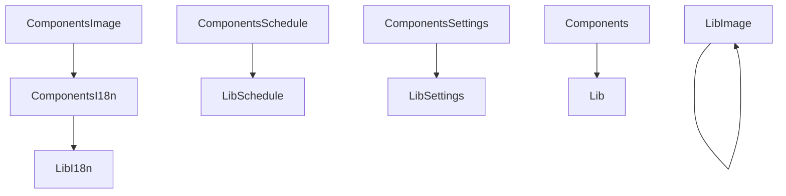

# 設計書

## Overview

**Purpose**: `src/lib/` を、React と react-easy-crop に依存しない業務の判断だけにする。UI に依存する 5 ファイルを部品の側（`src/components/`）へ移し、`postImageProcessing.ts` は型の定義だけを lib 側で持つように直す。利用者に見える画面と振る舞いは変えない。

**Users**: 開発者（`lib/` の判断を React なしで読み、試せるようにする）と、既存の利用者（画面の変化はない）。

**Impact**: `lib/` の `uiInLib` の許容項目が 7 件から 0 件になる。`lib/` の import から `react`・`react-easy-crop` が消える。部品からの import 先が約 80 件変わる。

### Goals

- `lib/` から React と react-easy-crop の import（値と型の両方）を取り除く（要件 1.1・2.1・3.1）
- 移動の前後で、翻訳・切り抜きの計算・画像の加工・予約の利用可否・共有設定の振る舞いを変えない（要件 1.2〜1.4・2.2〜2.4・3.2〜3.4）
- 許容リストの `uiInLib` の項目を 0 件にする（要件 5.1）

### Non-Goals

- `postImageProcessing.ts`（843 行）の分割。画像の処理は React に依存せず、分割は別 spec の論点（`src-folder-layout`）
- 翻訳の文言、切り抜きの仕様、設定の保存形式、予約の仕様の変更
- `components/` 内の部品の再配置（`src-composer-split`・`src-folder-layout`）

## Boundary Commitments

### This Spec Owns

- `lib/` の 5 ファイルからの UI 依存の除去（移動と型の置き換え）
- 移動先の 5 ファイル（`components/i18n/useTranslation.ts`・`components/i18n/renderSlots.tsx`・`components/image/croppedImageStyle.ts`・`components/schedule/useScheduleAvailability.ts`・`components/settings/useShareToggles.ts`）
- 部品の側の import の書き換え（約 80 件）と、steering の領域一覧への `i18n` の登録
- 許容リストの `uiInLib` 項目の削除

### Out of Boundary

- 翻訳の判断（`lib/i18n/format.ts`・`store.ts`・`translate.ts`・`locale.ts`）と、その振る舞い（`i18n` spec）
- 切り抜きと画像の加工の計算（`lib/image/postImageProcessing.ts` の中身。型の定義だけを変える）
- 共有設定の保存と読み出し（`lib/settings/shareSettings.ts`。`settings` spec）
- 予約の利用可否の判定に使う値（`lib/schedule/availabilityHint.ts`・`scheduleLimits.ts`。`scheduled-posting` spec）
- `components/` の再配置（`src-folder-layout`）

### Allowed Dependencies

- `components/i18n/*` → `lib/i18n`（`store`・`translate`・`format`・`locale`）。React は `components/` から使う。
- `components/schedule/useScheduleAvailability.ts` → `lib/schedule/availabilityHint`・`lib/schedule/scheduleLimits`（型）・生成されたクライアント（`@/client/openapi/client`）
- `components/settings/useShareToggles.ts` → `lib/settings/shareSettings`・`util/share/intent`
- `components/image/croppedImageStyle.ts` → react-easy-crop（`Area` 型）・React（`CSSProperties` 型）
- `lib/image/postImageProcessing.ts` → `lib/image/postImageLimits`（既存）。react と react-easy-crop は import しない。
- `lib/` の全ファイル → React・react-easy-crop を import しない（検査: `npm run test:imports` の R2 規則）。

### Revalidation Triggers

- `lib/i18n` の公開の型（`Translator`・`Locale`）と、部品からの呼び出し（`useLocale`・`useT`・`useFormat`・`renderSlots`）の名前と形
- `lib/image/postImageProcessing.ts` の公開の定数（`TARGET_WIDTH`・`TARGET_HEIGHT`）と既定のサムネイルの作成（`createDefaultThumbnail`）の名前と形。`lib/video`・`lib/entry` が使う。
- `CropArea` の形（`x`・`y`・`width`・`height`）と、react-easy-crop の `Area` の形の一致
- `structure.md` の領域の一覧（`i18n` の登録）と、`lib` の依存の向きの規約

## Architecture

### Existing Architecture Analysis

- `lib/` は判断を持つ層で、`components/` は部品の層。依存は `components/` → `lib/` の一方向である（既存の `lib/` が UI を含むのは規約違反）。
- 部品のフックは、`components/<領域>/useX.ts` に置く規約がある（例: `components/share/useWebShareCrosspost.ts`）。
- `lib/i18n` は、React に依存しない翻訳の判断（`translate.ts`）と、React の入口（`react.ts`・`rich.tsx`）が同じフォルダにある。

### Architecture Pattern & Boundary Map



- 選んだパターン: UI に依存するファイルを部品の側へ移す。lib 側に必要な型は、同じ形で lib 側に定義する（構造的な型付けで代入できる）。
- 依存の向き: `components/` → `lib/` の一方向。`lib/` から `components/` への依存は作らない（既存の規約）。
- 既存のパターン（フック `useX.ts`、部品の判断の `camelCase.ts`）を保つ。
- 新しい領域 `i18n` は、横断の基盤（翻訳の入口）として `components/` に置く。

### Technology Stack

| Layer    | Choice / Version        | Role in Feature            | Notes                                         |
| -------- | ----------------------- | -------------------------- | --------------------------------------------- |
| Frontend | React（既存）           | 移動したフックと描画の所属 | `components/` のみ                            |
| Frontend | react-easy-crop（既存） | `Area` 型の参照            | `components/image/` のみ（`lib/` からは外す） |

新しい依存（パッケージ）は追加しない。

## File Structure Plan

### Directory Structure

```
src/components/i18n/
├── useTranslation.ts   # useLocale・useT・useFormat（lib/i18n/react.ts を移す）
└── renderSlots.tsx     # renderSlots（lib/i18n/rich.tsx を移す）
src/components/image/
└── croppedImageStyle.ts # computeCroppedImageStyle（lib/image/croppedImageStyle.ts を移す）
src/components/schedule/
└── useScheduleAvailability.ts  # 予約の利用可否のフックと通知（lib/schedule/useScheduleAvailability.ts を移す）
src/components/settings/
└── useShareToggles.ts  # 共有系設定のフック（lib/settings/useShareToggles.ts を移す）
tests/unit/lib/image/
└── postImageProcessing.test.ts  # computeInitialCrop・computeCropAroundCenter・getSlotDefs の特性化（要件 2.2）
tests/unit/components/image/
└── croppedImageStyle.test.ts    # computeCroppedImageStyle の特性化（要件 2.2）
```

### Modified Files

- `src/lib/image/postImageProcessing.ts` — `react-easy-crop` の `Area` の import を外し、同じ形の `CropArea` 型を定義して使う（要件 2.1）。ほかの処理は変えない。
- `src/lib/image/croppedImageStyle.ts` — 削除（`components/image/croppedImageStyle.ts` へ移す）。
- `src/lib/i18n/react.ts` と `src/lib/i18n/rich.tsx` — 削除（`components/i18n/` へ移す）。
- `src/lib/schedule/useScheduleAvailability.ts` と `src/lib/settings/useShareToggles.ts` — 削除（`components/` へ移す）。
- 部品の import（約 80 件）— `@/lib/i18n/react` → `@/components/i18n/useTranslation`、`@/lib/i18n/rich` → `@/components/i18n/renderSlots`、`@/lib/image/croppedImageStyle` → `@/components/image/croppedImageStyle`、`@/lib/schedule/useScheduleAvailability` → `@/components/schedule/useScheduleAvailability`、`@/lib/settings/useShareToggles` → `@/components/settings/useShareToggles`。
- `.kiro/steering/structure.md` — 領域の一覧に `i18n`（表示言語の React の入口）を追加する。
- `config/architecture/import-allowlist.json` — `uiInLib` の 7 件を削除する（許容 77 → 70）。

変更しない: `lib/i18n/format.ts`・`store.ts`・`translate.ts`・`locale.ts`、`lib/image/postImageProcessing.ts` の計算（型以外）、`lib/video`・`lib/entry`（import の変更なし）。

## Components and Interfaces

### 翻訳の入口（`components/i18n`）

| Component        | Domain/Layer | Intent                                   | Req Coverage | Key Dependencies (P0/P1)                                                    | Contracts |
| ---------------- | ------------ | ---------------------------------------- | ------------ | --------------------------------------------------------------------------- | --------- |
| TranslationHooks | i18n / 部品  | 表示言語の購読と翻訳関数の提供           | 1.2, 1.4     | `lib/i18n/store`（P0）、`lib/i18n/translate`（P0）、`lib/i18n/format`（P0） | Service   |
| SlotRenderer     | i18n / 描画  | 文言の `{name}` を部品の要素へ置き換える | 1.3          | `lib/i18n/translate`の型（P0）                                              | Service   |

- `useLocale(): Locale`、`useT(): Translator`、`useFormat()`（シグネチャは現行の `lib/i18n/react.ts` と同じ）。購読（`useSyncExternalStore`）・既定言語（`DEFAULT_LOCALE`）・再マウントしない契約は変えない。
- `renderSlots(template: string, slots: Record<string, ReactNode>): ReactNode`（現行の `lib/i18n/rich.tsx` と同じ）。

Implementation Notes

- Integration: 部品の import を一括で置換する。`lib/i18n/translate.ts` の公開の型は変えない。
- Validation: 部品の型検査（`npm run test:type`）と、component テスト（6 件）で描画の変化を検出する。
- Risks: 再マウントの防止（`key` に言語を使わない）を、フックの位置を変えても保つ。

### 画像の表示（`components/image`）

| Component         | Domain/Layer | Intent                                             | Req Coverage | Key Dependencies (P0/P1)                                        | Contracts |
| ----------------- | ------------ | -------------------------------------------------- | ------------ | --------------------------------------------------------------- | --------- |
| CroppedImageStyle | image / 描画 | クロップ範囲をプレビューのインラインスタイルにする | 2.2          | react-easy-crop の `Area`（P0）、React の `CSSProperties`（P0） | Service   |

- `computeCroppedImageStyle(crop: Area | null, naturalWidth?: number, naturalHeight?: number): CSSProperties`（現行と同じ。`Area` は react-easy-crop の型）。
- 単体テストは、`react` の型だけに依存する純粋な計算として、現行の戻り値を固定する。

### 画像の加工（`lib/image/postImageProcessing.ts`）

- 変更は型の定義のみ。`CropArea`（`x`・`y`・`width`・`height` の `number`）を定義し、`SlotCropState.cropPixels` と、切り抜きの計算の引数・戻り値の型を `CropArea` にする。
- 関数の名前・引数の順序・戻り値の形・出力は変えない（要件 2.2・2.3）。
- 特性化テスト（`tests/unit/lib/image/postImageProcessing.test.ts`）: `getSlotDefs`（枚数ごとの枠）、`computeInitialCrop`（中央寄せ）、`computeCropAroundCenter`（横長への切り出し）の代表的な入力と出力を固定する。canvas を使う処理は、テストでは扱わない（既存の動作を変えないため）。

### 予約の利用可否（`components/schedule/useScheduleAvailability.ts`）

| Component                | Domain/Layer    | Intent                                         | Req Coverage | Key Dependencies (P0/P1)                                                             | Contracts      |
| ------------------------ | --------------- | ---------------------------------------------- | ------------ | ------------------------------------------------------------------------------------ | -------------- |
| ScheduleAvailabilityHook | schedule / 部品 | 予約の利用可否（登録の有無・制限値）を取得する | 3.3, 3.4     | `lib/schedule/availabilityHint`（P0）、生成クライアント（P0）、`window` の通知（P1） | Service, State |

- `useScheduleAvailability(enabled: boolean, revalidate?: boolean)`、`notifyScheduleCredentialChange(): void`、`SCHEDULE_CREDENTIAL_EVENT`（現行と同じ。ファイルごと移す）。
- 通知の利用者は部品（`AuthorizationReturn`・`ScheduleSetting`）だけで、同じ場所に置くことで依存の向きは一方向になる。

### 共有系設定（`components/settings/useShareToggles.ts`）

| Component        | Domain/Layer    | Intent                                 | Req Coverage | Key Dependencies (P0/P1)                                      | Contracts      |
| ---------------- | --------------- | -------------------------------------- | ------------ | ------------------------------------------------------------- | -------------- |
| ShareTogglesHook | settings / 部品 | 共有系設定の状態と永続化を、画面に結ぶ | 3.2          | `lib/settings/shareSettings`（P0）、`util/share/intent`（P1） | Service, State |

- `useShareToggles(): UseShareTogglesResult`（現行と同じ。ファイルごと移す）。保存の値の決め方（連動・初期値・永続化）は、呼び出す `lib/settings/shareSettings` が持つ。

## Requirements Traceability

| Requirement | Summary                                                   | Components                                          | Interfaces                                                                  | Flows |
| ----------- | --------------------------------------------------------- | --------------------------------------------------- | --------------------------------------------------------------------------- | ----- |
| 1.1         | `lib/i18n` は React を import しない                      | TranslationHooks, SlotRenderer（移動）              | —                                                                           | —     |
| 1.2         | 翻訳の文言・言語の判定は同じ結果                          | TranslationHooks（`lib/i18n/translate` は不変）     | `useT`                                                                      | —     |
| 1.3         | リッチな文言は同じ内容と構造で描画される                  | SlotRenderer                                        | `renderSlots`                                                               | —     |
| 1.4         | 表示言語の変更で、表示中の文言が切り替わる                | TranslationHooks                                    | `useLocale`（購読）                                                         | —     |
| 2.1         | `lib/image` は React と react-easy-crop を import しない  | 型の定義の変更（`CropArea`）                        | `CropArea`                                                                  | —     |
| 2.2         | 切り抜きの計算は同じ値を返す                              | CroppedImageStyle、postImageProcessing 特性化テスト | `computeCroppedImageStyle`・`computeInitialCrop`・`computeCropAroundCenter` | —     |
| 2.3         | 画像の加工は同じ出力を返す                                | postImageProcessing（計算は不変）                   | 既存の関数                                                                  | —     |
| 2.4         | `lib/video`・`lib/entry` は定数と既定のサムネイルを使える | postImageProcessing（位置は不変）                   | `TARGET_WIDTH`・`TARGET_HEIGHT`・`createDefaultThumbnail`                   | —     |
| 3.1         | `lib/settings`・`lib/schedule` は React を import しない  | ScheduleAvailabilityHook・ShareTogglesHook（移動）  | —                                                                           | —     |
| 3.2         | 共有設定の切り替えは同じ値を保存し、表示も同じ            | ShareTogglesHook                                    | `useShareToggles`                                                           | —     |
| 3.3         | 予約の利用可否の判定は同じ結果                            | ScheduleAvailabilityHook                            | `useScheduleAvailability`                                                   | —     |
| 3.4         | 認証情報の変更の通知で、表示が更新される                  | ScheduleAvailabilityHook                            | `notifyScheduleCredentialChange`                                            | —     |
| 4.1         | 利用者に見える画面と操作の振る舞いを変えない              | 全体                                                | —                                                                           | —     |
| 4.2         | 既存のテストは同じ件数が全て通過する                      | test:all                                            | —                                                                           | —     |
| 4.3         | テストの import パスの変更で、期待値と意味は変えない      | 特性化テストの import のみ                          | —                                                                           | —     |
| 5.1         | 移動の完了時、`uiInLib` の項目は 0 件                     | 許容リスト                                          | —                                                                           | —     |
| 5.2         | 移動の後、`npm run test:imports` は違反 0 件              | 検査（R2 規則）                                     | —                                                                           | —     |
| 5.3         | 移動の途中で、許容リストは増やさない                      | 許容リスト                                          | —                                                                           | —     |

## Testing Strategy

### 特性化テスト（移動の前に書き、現行コードで通す）

- `tests/unit/lib/image/postImageProcessing.test.ts`: `getSlotDefs(count)` の枠の数と寸法、`computeInitialCrop` の中央寄せ、`computeCropAroundCenter` の横長への切り出しの代表的な入力と出力（要件 2.2）。
- `tests/unit/components/image/croppedImageStyle.test.ts`: `computeCroppedImageStyle` の、範囲なし（既定のカバー表示）と範囲ありの値（要件 2.2）。
- 翻訳の出力（`tests/unit/lib/i18n/translate.test.ts`）と共有設定の移行（`legacyShareSettings.test.ts`）は既存のテストで固定済み（要件 1.2・3.2 の根拠）。

### 既存のテスト（変更しない。import の変更のみ）

- component テスト（6 件）: 部品の描画（翻訳・リッチな文言・言語の切り替え）を守る（要件 1.3・1.4・4.1）。
- e2e（7 件）: 画面の操作（投稿・設定・予約）の全体を守る（要件 4.1）。
- route テスト（200 件）と unit（208 件）: 変更の前と同じ件数が通過することを確かめる（要件 4.2）。

### 検査（要件 5.1〜5.3）

- `npm run test:imports`: R2（`uiInLib`）の違反が 0 件であることを、移動の後に確かめる。
- 許容リストは、`npm run test:imports -- --emit-allowlist` の下書きの差分（`uiInLib` の削除のみ）を確かめてから反映する。

## Migration Strategy

1. 特性化テストを足す（postImageProcessing の純粋な計算、computeCroppedImageStyle）。現行コードで通す。
2. `postImageProcessing.ts` の `Area` を `CropArea` に置き換える（型のみ）。型検査と特性化テストを通す。
3. `lib/i18n/react.ts`・`rich.tsx` を `components/i18n/` へ移し、部品の import を一括で書き換える。型検査と component テストを通す。
4. `lib/image/croppedImageStyle.ts` を `components/image/` へ移す。
5. `useScheduleAvailability.ts` と `useShareToggles.ts` を `components/` へ移す。
6. steering の領域の一覧に `i18n` を登録する。許容リストの `uiInLib` を消す。
7. `npm run test:all` を通す（件数は、移動の前と同じ、または特性化テストを足した分だけ増える）。

## Open Questions / Risks

- **import の書き換え（約 80 件）の誤り**: 機械的な置換を、型検査（`test:type`）で検出する。書き換えの後に `grep` で `@/lib/i18n/react`・`@/lib/i18n/rich` などが残らないことを確かめる。
- **`postImageProcessing.ts` の大きさ（843 行）**: 今回は分割しない。`src-folder-layout` の論点として記録する。
- **`CropArea` と `Area` の一致**: 型の構造が一致することを、部品の型検査（`CropSlot`・`ImagePicker` からの代入）で確かめる。
