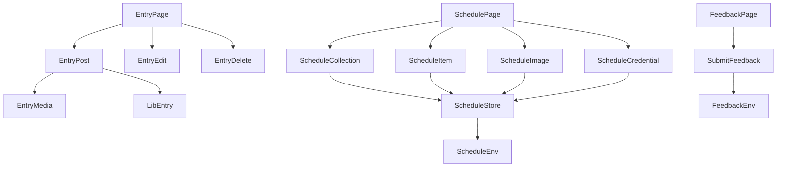
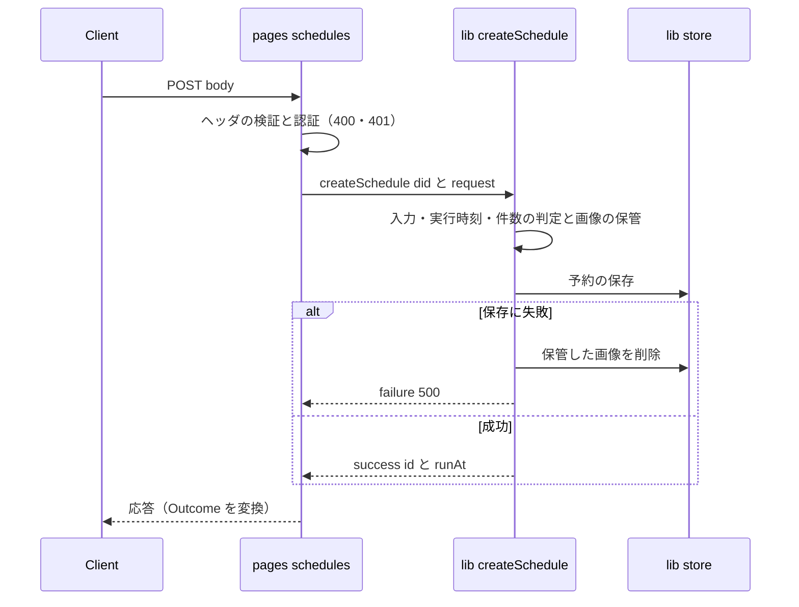

# 設計書

## Overview

**Purpose**: `pages/v2` の API ファイル（エントリ・予約・フィードバック）を、入力の受け取り・業務の呼び出し・応答の返却だけにする。Entry の整形・予約の判断・フィードバックの判定と、Cloudflare のバインディングの読み取りは `lib` の関数へ移す。

**Users**: 開発者（API の判断を `lib` のテストで読めるようにする）と、既存の利用者（画面と外部クライアント）。利用者には、URL・状態コード・応答の形・Cookie の変化はない。

**Impact**: 対象の 6 ファイルの本文が縮む。`lib` に 11 ファイルが増える（`lib/entry` 5・`lib/schedule` 4・`lib/feedback` 1・`util/outcome.ts` 1）。既存の route テストと e2e の結果は変わらない。

### Goals

- 対象の API ファイルから、判断・整形・バインディングの読み取りを除く（要件 1.1・2.1・3.1・4.1）
- 応答の状態コード・形・Cookie を移動の前後で同じにする（要件 2.2・2.3・3.2・4.2）
- 移動の前に、予約とエントリの特性化テストを足す

### Non-Goals

- API の入出力の形の変更（`api-contract`）、認証（`session-accounts`）、応答の組み立て（`json200`・`jsonResponse`）の統合（`src-duplicates`）
- 予約の実行と Cron（`scheduled-posting`）、フィードバックの振る舞い（`feedback`）
- 画面（`.astro`）の構成

## Boundary Commitments

### This Spec Owns

- `pages/v2/entry.ts`・`pages/v2/schedules*`・`pages/v2/feedback.ts` の、入力の受け取りと応答の返却の形
- 上の API の判断を持つ `lib` の関数（新しく作るもの）と、その戻り値の型（`Outcome<T>`）
- 対象の API の特性化テスト（`tests/route/pages/`）と、入口の形の検査（`tests/unit/scripts/pagesThin.test.ts`）

### Out of Boundary

- 入出力のスキーマ（`lib/api/schema/**`）と、その生成物。変更しない。
- セッションと認証（`locals.session`・`locals.agent` の供給）。ミドルウェアが所有する。
- `json200`・`jsonResponse`・`errorResponseFromStatus` の統合。`src-duplicates` が行う。
- 既存の `lib/schedule/store.ts`・`imageStaging.ts`・`stageSchedule.ts` の振る舞い。変更せず、呼び出し側だけを移す。
- Bluesky のレコードの形（`atproto-records`）と Entry のレコードの形（`entry-sharing`）。

### Allowed Dependencies

- `pages/v2/*`（対象）→ `lib/entry`・`lib/schedule`・`lib/feedback` の新しい関数、`lib/api/schema/**`（入力のスキーマ）、`util/http`、既存の `lib/schedule/scheduleResponse`（応答の補助）、`lib/schedule/availabilityHint`（Cookie の補助）
- `lib/entry/*`（新規・移動先）→ 既存の `lib/entry`・`lib/atproto`・`lib/image`・`lib/video`・`util`。`lib/api` は参照しない（循環）。
- `lib/schedule/*`（新規）→ 既存の `lib/schedule`（`store`・`imageStaging`・`stageSchedule`・`env`）・`lib/oauth`。`lib/api` は既存の 2 ファイル以外で参照しない。
- `lib/feedback/submitFeedback.ts` → `lib/feedback`（既存）・`lib/site/buildInfo`（新しい辺。`lib/site` は他の領域を参照しない）・`util`。`lib/api` は参照しない（`lib/api → lib/feedback` の辺があるため）。
- 対象の API ファイルは、`getScheduleEnv`・`getFeedbackEnv`・`@/lib/schedule/store`・`@/lib/schedule/imageStaging`・`cloudflare:workers` を import しない（要件 4.1）。

### Revalidation Triggers

- 応答の形（`ResponseBody200Type`）と、戻り値の DTO の形（代入の型検査が失敗したとき）
- `getScheduleEnv`・`getFeedbackEnv` の取得の仕組み（テストの `vi.mock` の対象）
- `lib/entry/createBskyThread.ts` の入力の型（`ThreadPostInput`・`ThreadEntryInput`）
- `structure.md` の依存の向き（新しい辺を足すとき）

## Architecture

### Existing Architecture Analysis

- 現行の API ファイルは「入力 → 認証 → 業務（lib の関数を順に呼ぶ）→ 応答」を 1 つのハンドラーに持つ。lib の関数は既に使われているが、判断の順序と状態コードの決定はページにある。
- 環境の取得（`getScheduleEnv`・`getFeedbackEnv`）は lib の関数として既にある。ページは取得した値を直接使っている。
- 入力のスキーマ（`lib/api/schema/**`）は、ページが検証する（入力の受け取り）。

### Architecture Pattern & Boundary Map



- 選んだパターン: 判断を `lib` の関数に移し、関数は `Outcome<T>` を返す。ページは入力の検証と、結果の HTTP への変換だけを行う。
- ページの依存の向き: ページ → `lib` の関数（一方向）。`lib` はページを参照しない。
- 既存のパターン（`jsonResponse`・`codeErrorResponse`・`makeScheduleHint*Cookie`・テストの `vi.mock` の単位）は保つ。
- 新しいファイルは、判断の単位（API のリソースごと、エントリの処理ごと）に 1 つの責務を持つ。

### Technology Stack

| Layer                    | Choice / Version                                  | Role in Feature                    | Notes               |
| ------------------------ | ------------------------------------------------- | ---------------------------------- | ------------------- |
| Backend / Services       | Astro API ルート（既存）                          | 入口。入力の検証と応答             | 変更なし            |
| Backend / Services       | TypeScript の関数（`lib`）                        | 判断・バインディングの読み取り     | 新しい関数          |
| Infrastructure / Runtime | `cloudflare:workers` の `env`（既存の取得の関数） | D1・R2・レート制限・トークンの取得 | 取得は `lib` の内側 |

新しい依存（パッケージ）は追加しない。

## File Structure Plan

### Directory Structure

```
src/lib/entry/
├── entryResponse.ts     # CreatedSkyshareEntry → 応答の DTO（serializeSkyshareEntry を移す）
├── postEntry.ts         # POST: from-post 分岐・返信の所有・createBskyThread・応答の組み立て
├── postEntryMedia.ts    # POST: createEntry の検証・埋め込み作成・画像と動画のアップロード
├── editEntry.ts         # PUT: 見出しと本文の更新の判断
└── deleteEntry.ts       # DELETE: 削除の対象の解決と順序、Bluesky 投稿の削除の判断
src/lib/schedule/
├── scheduleCollection.ts # 予約の作成（POST）と一覧（GET）
├── scheduleItem.ts       # 予約 1 件の取得（GET）・置き換え（PUT）・取り消し（DELETE）
├── scheduleImage.ts      # 予約の画像の取得（GET）
└── scheduleCredential.ts # 認証情報の状態（GET）と予約の無効化（DELETE）
src/lib/feedback/
└── submitFeedback.ts    # 送信の判定（設定の確認 → 回数の制限 → Issue の登録）
src/util/
└── outcome.ts           # Outcome<T>（判断の結果の共通の型。lib の全サービスが使う。import を持たない）
tests/route/pages/
├── schedules.test.ts          # 特性化（予約の作成・一覧）
├── scheduleItem.test.ts       # 特性化（予約 1 件）
├── scheduleImage.test.ts      # 特性化（画像・認証情報）
├── entryApi.test.ts           # 特性化（エントリの 400・401・404 と from-post の失敗）
├── scheduleCleanup.test.ts    # 特性化（画像の後始末の失敗が予約の操作の結果を変えないこと。要件 2.4）
tests/unit/scripts/
└── pagesThin.test.ts          # 対象の API ファイルの入口の形を静的に検査（要件 4.1）
tests/unit/lib/feedback/
└── submitFeedback.test.ts     # 送信の判定の単体テスト（503・429・500・成功値。トークンを含まない）
```

### Modified Files

- `src/pages/v2/entry.ts` — 判断と整形を `lib/entry` へ移す。ハンドラーは入力の検証・認証・結果の応答だけにする。`.js` の import（`@/lib/api/response.js`）を `@/lib/api/response` にする（許容項目を 1 件減らす）。
- `src/pages/v2/schedules.ts` — `createSchedule` と `listScheduleSummaries` を呼ぶ。`getScheduleEnv`・`store`・`imageStaging` の import を除く。
- `src/pages/v2/schedules/[id].ts` — `getScheduleDetail`・`replaceSchedule`・`cancelSchedule` を呼ぶ。
- `src/pages/v2/schedules/credential.ts` — `getCredentialState`・`disableScheduling` を呼ぶ。
- `src/pages/v2/schedules/[id]/images/[index].ts` — `getScheduleImage` を呼ぶ。
- `src/pages/v2/feedback.ts` — `submitFeedback` を呼ぶ。`getFeedbackEnv` の import を除く。
- `config/architecture/import-allowlist.json` — `src/pages/v2/entry.ts` の `.js` の項目（jsExtension）を 1 件消す（許容 78 → 77）。
- `src/pages/v2/entry.ts`・`src/pages/v2/schedules.ts` — 応答の DTO と api の推論型の代入可能性を、ページの型注釈付きの代入で型検査で確かめる（`lib/api` と `lib/schedule` の閉路を避けるため、`typeCompat.ts` には置かない）。

変更しない: `lib/api/schema/**`、`lib/schedule/store.ts`・`imageStaging.ts`・`stageSchedule.ts`・`env.ts`、`lib/feedback/env.ts`・`githubIssue.ts`、既存の route テスト（`tests/route/pages/feedback.test.ts` を含む）。

## System Flows

### 予約の作成（POST /v2/schedules）



- 判断の順序（入力 → 実行時刻 → 認証情報 → 件数 → 画像 → 保存）は `lib` の中で変えない。
- ページは `Outcome` の `failure` を `codeErrorResponse`（`code` がある場合）または `errorResponseFromStatus` に変換する。現行の応答と同じ。

## Requirements Traceability

| Requirement | Summary                                                               | Components                                                          | Interfaces                              | Flows      |
| ----------- | --------------------------------------------------------------------- | ------------------------------------------------------------------- | --------------------------------------- | ---------- |
| 1.1         | エントリの入口は、入力・業務の呼び出し・応答だけ。整形を含まない      | EntryPage, EntryPost, EntryMedia, EntryResponse                     | `postEntry`・`Outcome`                  | —          |
| 1.2         | エントリの作成・更新・削除の応答の形と状態コードを変えない            | EntryPost, EntryEdit, EntryDelete, entryApi テスト                  | `postEntry`・`editEntry`・`deleteEntry` | —          |
| 2.1         | 予約の入口は DB と画像ストレージを直接扱わない                        | ScheduleCollection, ScheduleItem, ScheduleImage, ScheduleCredential | 各関数                                  | 予約の作成 |
| 2.2         | 予約の操作の状態コード・応答・Cookie を変えない                       | 4 つの予約サービスと、特性化テスト                                  | 各関数の `Outcome`                      | 予約の作成 |
| 2.3         | 予約の画像の応答（内容・存在しない場合）を変えない                    | ScheduleImage, scheduleImage テスト                                 | `getScheduleImage`                      | —          |
| 2.4         | 画像の後始末の失敗は予約の操作の結果を変えない                        | ScheduleItem, ScheduleCollection                                    | `replaceSchedule`・`cancelSchedule`     | —          |
| 3.1         | フィードバックの入口は、トークンとレート制限を直接扱わない            | SubmitFeedback                                                      | `submitFeedback`                        | —          |
| 3.2         | 送信の判定と応答を変えない（間隔の制限・登録の成否）                  | SubmitFeedback, feedback テスト（既存 7 件）                        | `submitFeedback`                        | —          |
| 3.3         | 外部トークンの値を応答・エラーに含めない                              | SubmitFeedback                                                      | `submitFeedback`                        | —          |
| 4.1         | 対象の API ファイルは、バインディングと外部トークンを直接読まない     | 全ページ, pagesThin テスト                                          | —                                       | —          |
| 4.2         | 利用者に見える URL・メソッド・応答の形・状態コード・Cookie を変えない | 全ページ, 特性化テスト                                              | —                                       | —          |
| 5.1         | 利用者に見える画面と API の振る舞いを変えない                         | 全体                                                                | —                                       | —          |
| 5.2         | 既存のテストは、変更の前と同じ件数が全て通過する                      | test:all                                                            | —                                       | —          |
| 5.3         | テストの import パスの変更は、期待値と検証の意味を変えない            | feedback テスト（変更なし）                                         | —                                       | —          |
| 5.4         | 移動したファイルの許容項目を減らす                                    | entry.ts の `.js` の import                                         | —                                       | —          |

## Components and Interfaces

### 共通の戻り値

```typescript
// 判断の結果。失敗の status は、現行の応答で使う状態コードに限る。
type FailureStatus = 400 | 401 | 404 | 409 | 429 | 500 | 503

type Outcome<T> =
  | { ok: true; value: T }
  | {
      ok: false
      status: FailureStatus
      code?:
        | "ScheduleCredentialRequired"
        | "ScheduleReauthRequired"
        | "ScheduleRunning"
    }
```

- ページの変換: `code` がある失敗は `codeErrorResponse(status, code)`、ない失敗は `errorResponseFromStatus(status)`。
- 例外は戻り値にしない。想定外の例外は、関数の外へ投げ、ページの外側の `catch` で 500 にする（現行と同じ）。

### Entry（`lib/entry`）

| Component     | Domain/Layer     | Intent                                     | Req Coverage | Key Dependencies (P0/P1)                                                  | Contracts |
| ------------- | ---------------- | ------------------------------------------ | ------------ | ------------------------------------------------------------------------- | --------- |
| EntryResponse | Entry / 応答の形 | Entry を応答の DTO にする                  | 1.1          | `CreatedSkyshareEntry`（P0）                                              | Service   |
| EntryPost     | Entry / 作成     | 投稿の作成と from-post の分岐              | 1.1, 1.2     | `createBskyThread`・`createEntryFromExistingPost`（P0）、EntryMedia（P0） | Service   |
| EntryMedia    | Entry / 埋め込み | createEntry の検証・埋め込み・アップロード | 1.1          | `createExternalEmbed` など `lib/atproto/embed`（P0）                      | Service   |
| EntryEdit     | Entry / 更新     | 見出しと本文の更新                         | 1.2          | `updateSkyshareEntry`（P0）                                               | Service   |
| EntryDelete   | Entry / 削除     | 削除の対象の解決と順序                     | 1.2          | `resolveDeleteTargets`（P0）                                              | Service   |

- `postEntry(input: { agent; session; request: EntryPostRequest }): Promise<Outcome<EntryPostResponse>>`
  - `EntryPostRequest` は、ページが検証した入力の形（`uri`・`visual`・`posts`・`reply`・`createEntry`・`heading`・`caption`）を表すドメインの型。api の型は参照しない。
  - `EntryPostResponse` は `{ posts: { url; uri; cid }[]; skyshareEntry?: EntrySummary }`。`EntrySummary` は `serializeSkyshareEntry` の形。
  - 失敗: 400（reply の所有・createEntry の検証）・404（from-post の対象なし）・500（外部連携）。想定外の例外は投げ、入口の外側の catch が `resolveXrpcStatus` で応答にする。
- `editEntry(input: { agent; session; request }): Promise<Outcome<void>>`
  - 失敗: なし（想定外の例外は投げ、入口の外側の catch が `resolveXrpcStatus` で応答にする）。
- `deleteEntry(input: { agent; session; request }): Promise<Outcome<void>>`（失敗: 404・409・500）

Implementation Notes

- Integration: `lib/entry` は `lib/api` を参照しない。ページが検証した入力を、ドメインの型で受け取る。
- Validation: 戻り値の DTO は、ページで `PostSchema.ResponseBody200Type` へ代入して型検査する。
- Risks: `entry.ts` の POST は約 300 行の処理。`postEntry` と `postEntryMedia` に分けて、段階ごとに route テストで確かめる。

### Schedule（`lib/schedule`）

| Component          | Domain/Layer          | Intent                   | Req Coverage  | Key Dependencies (P0/P1)                               | Contracts |
| ------------------ | --------------------- | ------------------------ | ------------- | ------------------------------------------------------ | --------- |
| ScheduleCollection | Schedule / 作成と一覧 | 予約の作成と一覧         | 2.1, 2.2, 2.4 | `stageSchedule`・`store`（P0）、`getScheduleEnv`（P0） | Service   |
| ScheduleItem       | Schedule / 1 件       | 取得・置き換え・取り消し | 2.1, 2.2, 2.4 | `store`・`imageStaging`（P0）                          | Service   |
| ScheduleImage      | Schedule / 画像       | 予約の画像の取得         | 2.1, 2.3      | `getImage`（P0）                                       | Service   |
| ScheduleCredential | Schedule / 認証情報   | 状態の取得と無効化       | 2.1, 2.2      | `store`・`revokeCredential`（P0）                      | Service   |

- `createSchedule(input: { did; request: Request }): Promise<Outcome<{ id: string; runAt: number }>>`（失敗: 400・409・429・500。`code` は保管の判断の結果）
- `listScheduleSummaries(input: { did; query: ScheduleListQuery }): Promise<{ items: ScheduleSummary[]; cursor?: string }>`
- `getScheduleDetail(input: { did; id }): Promise<Outcome<ScheduleDetail>>`（失敗: 404・409・500。facets を除く）
- `replaceSchedule(input: { did; id; request: Request }): Promise<Outcome<{ id; runAt }>>`（失敗: 400・404・409・500。429 は型の上で返り得るが、保管の件数の確認を行わないため実際には返らない。409 の code は ScheduleCredentialRequired・ScheduleReauthRequired・ScheduleRunning。stageSchedule の結果の status と code をそのまま返す。想定外の例外は投げる）
- `cancelSchedule(input: { did; id }): Promise<Outcome<{}>>`（失敗: 404・409）
- `getScheduleImage(input: { did; id; index }): Promise<Outcome<{ bytes; mime }>>`（失敗: 404・409）
- `getCredentialState(input: { did }): Promise<{ body: CredentialStateDto; hint: ScheduleHint }>`
- `disableScheduling(input: { did }): Promise<Outcome<{ cancelled: number; deletedHistory: number }>>`（失敗: 409）

Implementation Notes

- Integration: `stageSchedule` と `parseScheduleBody` は既存のまま使う。`parseScheduleBody` は request を読むため、ページは request を渡す（既存の形と同じ）。
- Validation: 現行の応答との差は、特性化テストで確かめる。`removeImages` の失敗は記録だけする（現行どおり）。
- Risks: `replaceSchedule` の「保管の失敗は再度投げる」順序を移すとき、外側の 500 応答を変えない。

### Feedback（`lib/feedback`）

| Component      | Domain/Layer    | Intent                               | Req Coverage  | Key Dependencies (P0/P1)                                                     | Contracts |
| -------------- | --------------- | ------------------------------------ | ------------- | ---------------------------------------------------------------------------- | --------- |
| SubmitFeedback | Feedback / 送信 | 設定の確認・回数の制限・Issue の登録 | 3.1, 3.2, 3.3 | `getFeedbackEnv`・`createGithubIssue`・`buildIssue`（P0）、`buildInfo`（P1） | Service   |

- `submitFeedback(input: { session: { did; handle }; submission: FeedbackSubmission }): Promise<Outcome<{ number: number; url: string }>>`
  - 順序: 設定の確認（503）→ 回数の制限（429。キーは DID）→ Issue の本文（`buildIssue`）→ 登録（500）。
  - 外部トークンは戻り値とエラーに含めない（要件 3.3）。
- `FeedbackSubmission` は既存の `lib/feedback/submission.ts` の型を使う。

Implementation Notes

- Integration: ページは `RequestHeaderSchema`・`RequestBodySchema` で検証し（400・401）、`submitFeedback` に `FeedbackSubmission` を渡す。
- Validation: 既存の route テスト 7 件（import パスの変更なし）が、順序と応答を守る。

## Data Models

変更なし。D1・R2 のスキーマと、保管の形（`StoredPayload`）は変えない。

## Error Handling

- 判断の失敗は `Outcome` の `status`（と `code`）で表す。ページはこれを既存の応答の関数へ渡す。
- 想定外の例外は、関数の外へ投げる。ページの外側の `catch` が 500 にする（現行と同じ）。
- ログの文言（`console.warn`・`console.error`）は、移動先の関数で現行のまま残す。

## Testing Strategy

### 特性化テスト（移動の前に書く。現行コードで通す）

- `tests/route/pages/schedules.test.ts`: `POST /v2/schedules` の 400・401・409（認証情報なし）・429（件数の上限）、`GET /v2/schedules` の 400・401 と一覧の形。D1 の行を直接作って確かめる。
- `tests/route/pages/scheduleItem.test.ts`: `GET`・`PUT`・`DELETE /v2/schedules/{id}` の 401・404（他人・存在しない）・409（実行中）・成功の応答の形。
- `tests/route/pages/scheduleImage.test.ts`: `GET /v2/schedules/{id}/images/{index}` の 404（範囲外）・409（実行中）・成功（content-type と no-store）。`GET`・`DELETE /v2/schedules/credential` の 401・成功（削除件数）・409。
- `tests/route/pages/entryApi.test.ts`: `POST /v2/entry` の 400（ヘッダ・multipart でない）・401・400（reply の所有が他人）、`PUT`・`DELETE` の 400・401・404。成功系は既存の e2e（`entry.spec.ts`）が守る。

### 既存のテスト（変更しない）

- `tests/route/pages/feedback.test.ts`（7 件）: モックの単位が変わらないため、そのまま通ることを確かめる（要件 3.2・5.3）。
- `tests/e2e/flows/entry.spec.ts`・`schedule.spec.ts`: 正常系の全体を守る。

### 入口の形の検査（要件 4.1）

- `tests/unit/scripts/pagesThin.test.ts`: 対象の 6 ファイルを読み、次を確かめる。`env.` で始まる参照がない。`getScheduleEnv`・`getFeedbackEnv`・`@/lib/schedule/store`・`@/lib/schedule/imageStaging`・`cloudflare:workers` の import がない。

### 全体の検証（要件 5.2）

- `npm run test:all` が、移動の前と同じ件数（単体・component・route・render・e2e）で通る。特性化テストを足した分だけ件数が増える。

## Migration Strategy

1. 特性化テストを足す（route。現行コードで通す）。
2. `feedback` を移す（最も小さい。既存テストで守られている）。
3. `schedules` を移す（credential → images → [id] → collection の順）。各 API を移すたびに route テストを通す。
4. `entry` を移す（DELETE → PUT → POST の順。POST は `postEntryMedia` を先に作る）。各段階で route テストと e2e を通す。
5. `pagesThin.test.ts` を足す。許容リストは `npm run test:imports -- --emit-allowlist` で更新し、entry.ts の `.js` の項目が消えたことを確かめる。

## Open Questions / Risks

- **要件 5.4 の解釈**: 許容リストの `pages/v2` 項目 10 件は、すべて `.js` の規則（所有 `src-import-style`）。本スペックで減らすのは `entry.ts` の 1 件だけ。残る 9 件は所有の spec（`src-import-style`）が減らす。要件の文言はこの解釈で満たせる。
- **entry の成功系の route テスト**: Bluesky への呼び出しを伴うため、route テストでは作りにくい。成功系は e2e に依存する。作れる場合は fakeOutbound で追加する（タスクで判断）。
- **`parseScheduleBody` が request を読む**: 既存の lib 関数であり、入力の受け取りを lib に持つ形が残る。本スペックでは変えない（振る舞いを変えない範囲）。
