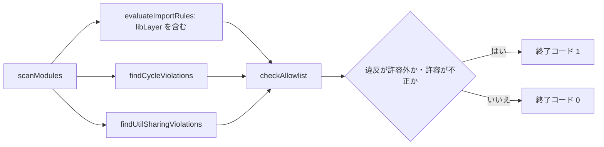

# Design Document

## Overview

**Purpose**: Phase 5 の組み替えが終わった後も、`lib` の層・`util` の汎用性・骨格の置き場の違反が再び入り込まないよう、これらを機械で検査する。検査は既存の方式（`scripts/architecture/` の規則と許容リスト、`tests/unit/scripts/` の静的テスト）に合わせて追加する。

**Users**: 開発者が `npm run test:imports` と `npm run test:unit` を実行し、配置の違反を追加の変更の時点で知る。

**Impact**: 依存規則に `utilShared`・`typesLeaf`・`typesOnly` を加え、許容リストの項目に理由の欄を加える。骨格の置き場・`structure.md` の依存規則の表の一致を静的に検査する。`libLayer` 規則は `lib-layers` が定義済みとし、本仕様は完了時点の有効性と許容の空を確かめる。既存の規則の判定は変えない。

### Goals

- `libLayer` が `test:imports` で有効であり、完了時点で許容の項目が無い
- `src/util/` の各モジュールが、`src/util/` の外の二つ以上の領域から使われることを検査する（規則 `utilShared`）
- `src/types/` が他の層とパッケージを import せず（葉）、型だけを持つことを検査する（規則 `typesLeaf`・`typesOnly`）
- `src/layout/` が存在せず、骨格 `Baselayout` が `src/components/layout/` の部品フォルダにあることを検査する
- 許容リストの各項目が空でない理由を持つことを検査する
- `structure.md` の「依存規則の検査」の表と、検査の規則の一覧が一致することを検査する
- `npm run test:all` が終了コード 0 で、件数が着手時の基準を下回らない

### Non-Goals

- `libLayer` 規則と層の対応表の定義（`lib-layers`）
- `src/util/` と `src/components/` の配置の変更（`util-placement`・`components-small-areas`）
- 400 行を超えるファイルの検査（範囲外。理由は `research.md` の「400 行の検査の要否」）
- 既存の規則（`layer`・`uiInLib`・`cycle`・`crossRegionRelative`・`relativeDepth`・`jsExtension`）の変更

## Boundary Commitments

### This Spec Owns

- 規則 `utilShared` の定義と判定（`scripts/architecture/utilSharing.ts`）
- 規則 `typesLeaf`（辺の規則。`rules.ts`）と `typesOnly`（`src/types/` の文の形。`scripts/architecture/typesOnly.ts`）の定義と判定
- 規則の一覧の単一の定義（`RULE_IDS`・`RuleId`・`RULE_BASIS`）と、`utilShared` の既定の所有 spec
- 許容リストの項目の形式（`reason` の必須化）と、その読み込みの検証
- 骨格の置き場の静的検査（`src/layout/` の不在、`@/layout/` の import の不在、`Baselayout` の所在）
- 規則の一覧と `structure.md` の「依存規則の検査」の表の一致の検査
- 完了時点の許容リストの確認（`libLayer`・`utilShared` の項目が無いこと、全項目に理由があること）
- `structure.md` の「依存規則の検査」の表への `utilShared` の行の追加（骨格の一文は本仕様では書かない。layout-home 3.2 が部品の節の `layout`（骨格）の記述に書いた一文を参照する）

### Out of Boundary

- `libLayer` 規則の判定と層の対応表（`lib-layers` の `scripts/architecture/libLayers.ts`・`rules.ts` の `libLayer`）。本仕様はこれを変更しない
- `src/util/` 内のファイルの移動と import の付け替え（`util-placement`）
- `src/components/` の配置の検査（既存の `componentLayout`・`steeringRegions`）の変更
- 400 行の検査、既存の規則の判定と既存の許容の扱い
- `scripts/` の検査の対象（Phase 2）

### Allowed Dependencies

- `scripts/architecture/utilSharing.ts` → `importGraph.ts`（`ModuleGraph`・`ImportEdge`）・`regions.ts`（`regionOf`）・`rules.ts`（`Violation`・`RuleId`）
- `scripts/architecture/allowlist.ts` → `rules.ts`（`RULE_IDS`・`RuleId`・`Violation`）。`rules.ts` は `allowlist.ts` を import しない
- `scripts/architecture/check-imports.ts` → `utilSharing.ts`・`typesOnly.ts`（違反の合流のみ）
- `scripts/architecture/typesOnly.ts` → `typescript`（構文木の解析のみ。`importGraph.ts` と同じ依存）・`rules.ts`（`Violation`）
- `tests/unit/scripts/*` → `scripts/architecture/*`・`node:fs`・`node:path`（ファイルの読み取りのみ、本仕様の検査のテストはモジュールを実行しない）
- `scripts/architecture/*` は `src/` の中のコードを import しない（既存の方式を保つ）

### Revalidation Triggers

- `RuleId` の追加・削除・改名（`allowlist.ts` の既定の所有 spec、`structure.md` の表、`steeringRules` の検査が変わる）
- `structure.md` の「依存規則の検査」の表の形式（列の順序・見出し）、または「共通（`src/util/`・`src/styles/`）」の見出しの改名（`steeringRules` の照合が壊れる）
- `util-placement` の移動の結果（残す `util/` の件数と利用元の領域の変更）
- `src/types/` の中身（置く型の範囲は `util-placement` の決定に従う）。`typesLeaf`・`typesOnly` の対象が変わる
- `lib-layers` の `libLayer` 規則と層の対応表の変更（完了時の確認の前提が変わる）
- 許容リストの項目の形式の変更（`reason` を含む形式の前提が変わる）

## Architecture

### Existing Architecture Analysis

- `scripts/architecture/` は、走査（`importGraph`）・領域（`regions`）・辺ごとの規則（`rules`）・グラフ全体の規則（`cycles`）・許容リスト（`allowlist`）・CLI（`check-imports`）に分かれる。
- 辺ごとの規則は `evaluateImportRules` に、グラフ全体の規則は `findCycleViolations` の形で加わる。`utilShared` は利用元の集合をモジュールごとに数えるため、後者の形を取る。
- 違反は `ruleId|from|specifier` のキーで許容リストと照合される。既定の所有 spec は `DEFAULT_OWNERS` に規則ごとに持つ。
- `RULE_IDS` は `allowlist.ts` に、`RuleId` は `rules.ts` にあり、二重に定義されている（lib-layers 4.1 が `libLayer` を両方に加えたため）。本仕様で `rules.ts` の `RULE_IDS` に一本化し、lib-layers 4.1 が `allowlist.ts` に加えた配列を置き換える（structure-checks 2.1 の `_Depends` は lib-layers 4.1）。
- 静的な配置の検査（`componentLayout`・`steeringRegions`）は、ファイル名の一覧と文書の文字列を読む。骨格の検査（`layoutSingle`）は、これに加えて `src/` のソース本文を文字列として読む（`@/layout/` の import を文字列で探す）。どの検査もモジュールを実行しない（要件 6.3）。

### Architecture Pattern & Boundary Map

```mermaid
graph TD
    graph[importGraph: ModuleGraph]
    rules[rules.ts: RULE_IDS・RuleId・RULE_BASIS・evaluateImportRules]
    util[utilSharing.ts: findUtilSharingViolations]
    cycles[cycles.ts: findCycleViolations]
    allow[allowlist.ts: reason の検証・DEFAULT_OWNERS]
    cli[check-imports.ts: runImportCheck]
    layoutTest[layoutSingle.test.ts]
    rulesTest[steeringRules.test.ts]
    completeTest[allowlistCompletion.test.ts]
    graph --> rules
    graph --> util
    graph --> cycles
    rules --> util
    rules --> allow
    util --> cli
    cycles --> cli
    rules --> cli
    allow --> cli
    rules --> rulesTest
    allow --> completeTest
```

**Architecture Integration**:

- Selected pattern: 既存の検査の方式（グラフ全体の規則を別モジュールに置き、CLI で合流する）に従う
- Domain/feature boundaries: 規則の判定（純粋関数）と、許容リストの照合（`allowlist.ts`）と、文書・ファイルの静的検査（テスト）を分ける
- Existing patterns preserved: `Violation` の形、`RULE_BASIS` による根拠の紐づけ、許容リストの所有 spec、負例のテスト
- New components rationale: `utilSharing.ts` はモジュールごとの利用元の集合を数えるため、辺の規則に収まらない
- Steering compliance: 規則の根拠は `structure.md` の節だけを指す。規則を変えるときは `structure.md` の表を同じ変更で改訂する

### Technology Stack

| Layer          | Choice / Version               | Role in Feature                                | Notes                |
| -------------- | ------------------------------ | ---------------------------------------------- | -------------------- |
| 検査の実行     | `tsx`（既存の `test:imports`） | `check-imports.ts` の実行                      | 変更なし             |
| 単体テスト     | `vitest`（既存の `test:unit`） | 規則・許容・静的検査の負例と実リポジトリの確認 | 変更なし             |
| 標準ライブラリ | `node:fs`・`node:path`         | 静的な検査のファイル読み取り                   | 新しい依存は加えない |

## File Structure Plan

### Directory Structure

```
scripts/architecture/
├── utilSharing.ts          # 新設: 規則 utilShared。src/util/ の各モジュールの利用元の領域を数える
├── typesOnly.ts            # 新設: 規則 typesOnly。src/types/ の各 .ts が型だけの文を持つことを構文木で確かめる
├── rules.ts                # 変更: RULE_IDS（単一の定義）・RuleId の導出・RULE_BASIS（utilShared・typesLeaf・typesOnly）
├── allowlist.ts            # 変更: RULE_IDS を import・reason の検証・DEFAULT_OWNERS.utilShared
└── check-imports.ts        # 変更: findUtilSharingViolations の結果を違反に合流
tests/unit/scripts/
├── utilSharing.test.ts     # 新設: 負例（fixture のグラフ）と、実リポジトリで 0 件の確認
├── layoutSingle.test.ts    # 新設: src/layout/ の不在・@/layout/ の不在・Baselayout の所在（静的）
├── steeringRules.test.ts   # 新設: RULE_IDS と structure.md の表の一致、RULE_BASIS の節の実在
├── typesRules.test.ts      # 新設: typesLeaf（fixture の辺）・typesOnly（fixture の文）と、実リポジトリの src/types/ の確認
└── allowlistCompletion.test.ts  # 新設: 許容リストの全項目の理由、libLayer・utilShared の項目が 0 件
config/architecture/
└── import-allowlist.json   # 変更なし（entries は空のまま。完了時に libLayer・utilShared を含まない）
```

### Modified Files

- `scripts/architecture/rules.ts` — `RULE_IDS` を `as const` の配列として定義し、`RuleId = (typeof RULE_IDS)[number]` とする。`utilShared` を加え、`RULE_BASIS.utilShared` に `structure.md「共通（`src/util/`・`src/styles/`）」`（利用元が二つ以上の領域のときだけ util に置く）を書く。`RULE_IDS` を export する。`typesLeaf`・`typesOnly` を加え、`RULE_BASIS` の両方を「型（`src/types/`）」の節に向ける。`typesLeaf` は `evaluateImportRules` の辺の規則として加える。
- `scripts/architecture/allowlist.ts` — 内部の `RULE_IDS` を削除し、`rules.ts` から import する。`AllowlistEntry` に `reason: string` を加える。`loadAllowlist` は `reason` が無い・空白だけの場合に `entries[i]: 理由（reason）が空` のエラーを返す。`DEFAULT_OWNERS` に `utilShared: "structure-checks"` を加える。`emitAllowlist` は各項目の `reason` を `""` で出す。
- `scripts/architecture/check-imports.ts` — `runImportCheck` の違反の合流に `findUtilSharingViolations(graph)` を加える。`src/types/` の `.ts` の本文を読み、`findTypesOnlyViolations` の結果も加える。`--emit-allowlist` の出力にも同じ違反が入る。
- `tests/unit/scripts/importRules.test.ts` — 許容リストの節の fixture に `reason` を加える。`--emit-allowlist` の往復のテストは、理由を埋めてから読み込む手順に変える（理由が空の下書きは読み込みで失敗することを確かめる負例を加える）。
- `.kiro/steering/structure.md` — 「依存規則の検査」の表に `utilShared` の行を加える（内容: `src/util/` の各モジュールは、`src/util/` の外の二つ以上の領域から使われること。根拠: 「共通（`src/util/`・`src/styles/`）」の節）。表の下の文に、許容リストの項目は理由を持つことを加える。「共通（`src/util/`・`src/styles/`）」の節に「`src/layout/` を置かない（骨格は `src/components/layout/` の部品フォルダ）」を一文として加える。「型（`src/types/`）」の節は `util-placement` が書き、本仕様は表の行だけを加える。

（`libLayer` の行は `lib-layers` が加える。本仕様は表が両方の行を持つことを検査する。）

## System Flows

新しい実行時の流れは無い。`npm run test:imports` は、既存の `runImportCheck` に `utilShared` の違反が加わるだけである。



## Requirements Traceability

| Requirement | Summary                                                             | Components                                                           | Interfaces                  | Flows        |
| ----------- | ------------------------------------------------------------------- | -------------------------------------------------------------------- | --------------------------- | ------------ |
| 1.1         | `libLayer` が全 `lib` 辺に適用される                                | `rules.ts`（`evaluateImportRules`・lib-layers の規則）               | `evaluateImportRules`       | 検査の流れ B |
| 1.2         | 基盤 → 業務の辺を違反にする                                         | lib-layers の `libLayer`（負例は `importRules.test.ts`）             | `LibLayerRule`              | 検査の流れ B |
| 1.3         | 業務 → 基盤は違反にしない                                           | lib-layers の `libLayer`（正例は `importRules.test.ts`）             | —                           | —            |
| 1.4         | 完了時に `libLayer` の許容が無い                                    | `allowlistCompletion.test.ts`                                        | `loadAllowlist`             | —            |
| 2.1         | 各 `src/util/` モジュールの利用元の領域を数える                     | `utilSharing.ts`                                                     | `findUtilSharingViolations` | 検査の流れ D |
| 2.2         | 領域が二つ未満なら違反                                              | `utilSharing.ts`                                                     | `Violation`（`utilShared`） | 検査の流れ D |
| 2.3         | `src/util/` 内の import は数えない                                  | `utilSharing.ts`                                                     | —                           | —            |
| 2.4         | 二つ以上の領域から使われれば違反にしない                            | `utilSharing.ts`・`utilSharing.test.ts`                              | —                           | —            |
| 2.5         | 許容リストの仕組みに乗せる                                          | `allowlist.ts`（`DEFAULT_OWNERS.utilShared`）・`check-imports.ts`    | `checkAllowlist`            | 検査の流れ E |
| 2.6         | 完了時に `utilShared` の許容が無く、残る `util` が通る              | `allowlistCompletion.test.ts`・`utilSharing.test.ts`（実リポジトリ） | —                           | —            |
| 3.1         | `src/layout/` が無い                                                | `layoutSingle.test.ts`                                               | `findLayoutViolations`      | —            |
| 3.2         | `@/layout/` の import が無い                                        | `layoutSingle.test.ts`                                               | —                           | —            |
| 3.3         | `Baselayout` が `src/components/layout/` の部品フォルダにある       | `layoutSingle.test.ts`                                               | —                           | —            |
| 3.4         | `src/layout/` を含む一覧を違反として報告（負例）                    | `layoutSingle.test.ts`                                               | `findLayoutViolations`      | —            |
| 4.1         | 許容の項目は `reason` を持つ                                        | `allowlist.ts`（`AllowlistEntry.reason`）                            | `loadAllowlist`             | —            |
| 4.2         | `reason` が無い・空なら読み込みエラーで終了コード 1                 | `allowlist.ts`・`check-imports.ts`                                   | `loadAllowlist`             | 検査の流れ E |
| 4.3         | 下書きは `reason` を空で出す                                        | `allowlist.ts`（`emitAllowlist`）                                    | `emitAllowlist`             | —            |
| 4.4         | 空の許容リストは新しい形式に適合する                                | `config/architecture/import-allowlist.json`（変更なし）              | —                           | —            |
| 5.1         | 全規則の根拠が `structure.md` の節を指す                            | `rules.ts`（`RULE_BASIS`）・`steeringRules.test.ts`                  | `RULE_BASIS`                | —            |
| 5.2         | 表が全規則の行を持つ                                                | `structure.md`・`steeringRules.test.ts`                              | `RULE_IDS`                  | —            |
| 5.3         | 表と規則の不一致で失敗する                                          | `steeringRules.test.ts`                                              | `RULE_IDS`                  | —            |
| 5.4         | 利用元の規約と骨格の一本化の規約が `structure.md` にある            | `structure.md`・`steeringRules.test.ts`（節の実在）                  | —                           | —            |
| 6.1         | 既存の規則の判定を変えない                                          | `rules.ts`（既存の規則は変更なし）・既存の `importRules.test.ts`     | —                           | —            |
| 6.2         | 既存の方式（純粋関数・負例・所有 spec・根拠）に従う                 | 全コンポーネント                                                     | —                           | —            |
| 6.3         | 静的な検査は `componentLayout` の方式に従う                         | `layoutSingle.test.ts`                                               | —                           | —            |
| 7.1         | `test:imports` が 0 で終わり、許容外の違反と許容の不正が無い        | `check-imports.ts`・完了時の実行                                     | `runImportCheck`            | 検査の流れ E |
| 7.2         | `test:all` が 0 で終わる                                            | 検証手順（Testing Strategy）                                         | —                           | —            |
| 7.3         | 件数が着手時の基準を下回らない                                      | 検証手順（Testing Strategy）                                         | —                           | —            |
| 7.4         | 利用者に見える振る舞い・API・生成物を変えない                       | 変更はすべて `scripts/`・`tests/`・`structure.md`                    | —                           | —            |
| 8.1         | `src/types/` から出る辺を検査する                                   | `rules.ts`（`typesLeaf`）                                            | `evaluateImportRules`       | —            |
| 8.2         | `src/types/` が他の層・パッケージを import しない                   | `rules.ts`（`typesLeaf`）・`typesRules.test.ts`                      | `RuleId` の `typesLeaf`     | —            |
| 8.3         | `src/types/` の文は型だけ                                           | `typesOnly.ts`                                                       | `findTypesOnlyViolations`   | —            |
| 8.4         | 許容は理由付きの項目だけ。型だけの文の形                            | `typesOnly.ts`・`check-imports.ts`・`allowlist.ts`                   | `checkAllowlist`            | 検査の流れ E |
| 8.5         | 完了時に `typesLeaf`・`typesOnly` の許容が無く、実リポジトリで 0 件 | `allowlistCompletion.test.ts`・`typesRules.test.ts`（実リポジトリ）  | —                           | —            |
| 8.6         | 負例で検査が違反を見つけることを確かめる                            | `typesRules.test.ts`                                                 | —                           | —            |

## Components and Interfaces

| Component                                                | Domain/Layer | Intent                                                                 | Req Coverage  | Key Dependencies (P0/P1)                 | Contracts |
| -------------------------------------------------------- | ------------ | ---------------------------------------------------------------------- | ------------- | ---------------------------------------- | --------- |
| RuleRegistry (`rules.ts`)                                | 検査（基盤） | 規則の一覧と根拠の単一の定義                                           | 5.1, 5.2, 6.1 | `importGraph` (P0)                       | State     |
| UtilSharingRule (`utilSharing.ts`)                       | 検査         | `src/util/` の各モジュールの利用元の領域が二つ以上であることを確かめる | 2.1〜2.4      | `regions` (P0), `ModuleGraph` (P0)       | Service   |
| AllowlistReason (`allowlist.ts`)                         | 検査         | 許容の項目の理由の検証と、既定の所有 spec                              | 4.1〜4.3, 2.5 | `RuleRegistry` (P0)                      | State     |
| LayoutSingle test (`layoutSingle.test.ts`)               | 検査（静的） | 骨格の置き場が一つであることを確かめる                                 | 3.1〜3.4      | `node:fs` (P1)                           | —         |
| SteeringRules test (`steeringRules.test.ts`)             | 検査（静的） | 規則の一覧と `structure.md` の表・根拠の節の一致                       | 5.1〜5.4      | `RuleRegistry` (P0), `structure.md` (P0) | —         |
| AllowlistCompletion test (`allowlistCompletion.test.ts`) | 検査（静的） | 完了時点の許容リストの確認                                             | 1.4, 2.6, 4.4 | `allowlist.ts` (P0)                      | —         |

### 検査（scripts/architecture）

#### RuleRegistry（rules.ts）

| Field        | Detail                           |
| ------------ | -------------------------------- |
| Intent       | 規則の識別子と根拠を一箇所に持つ |
| Requirements | 5.1, 5.2, 6.1                    |

**Responsibilities & Constraints**

- `RULE_IDS` を `as const` の配列で定義し、`RuleId` を導く。`libLayer`（`lib-layers`）と `utilShared`・`typesLeaf`・`typesOnly`（本仕様）を含む
- `RULE_BASIS: Record<RuleId, string>` は全規則について、`structure.md` の節名を「」で囲んで指す
- 既存の規則の関数（`layerRule` など）と `RULES` の並びは変えない

**Contracts**: State [x]

##### State Management

- `RULE_IDS` は規則の一覧の唯一の定義。`allowlist.ts`・`steeringRules.test.ts` は、この一覧を読むだけ

**Implementation Notes**

- `utilShared` の根拠は `structure.md` の「共通（`src/util/`・`src/styles/`）」の見出し（利用元が二つ以上の領域のときだけ `util` に置く、の規約を含む節）
- `typesLeaf`・`typesOnly` の根拠は `structure.md` の「型（`src/types/`）」の見出し（葉の規則と型だけの規約を含む節）

#### UtilSharingRule（utilSharing.ts）

| Field        | Detail                                                                                               |
| ------------ | ---------------------------------------------------------------------------------------------------- |
| Intent       | `src/util/` の各モジュールについて、`src/util/` の外からの利用元の領域が二つ以上であることを確かめる |
| Requirements | 2.1, 2.2, 2.3, 2.4                                                                                   |

**Responsibilities & Constraints**

- 入力は `ModuleGraph`。`graph.modules` の中で `src/util/` 配下のモジュールを対象にする
- 利用元は、`edge.target.kind === "module"` かつ `edge.target.path` が対象のモジュールに一致する辺の `edge.from`。`edge.from` が `src/util/` 配下のものは除く
- 利用元の `regionOf(edge.from)` の集合の大きさが 2 未満（0 件を含む）なら違反にする
- 型だけの辺も利用元に数える（既存の規則と同じ扱い）

**Contracts**: Service [x]

##### Service Interface

```typescript
// 規則 utilShared。違反は ruleId "utilShared"、from は util のモジュールのパス、specifier は ""
export const findUtilSharingViolations: (graph: ModuleGraph) => Violation[]
```

- Preconditions: `graph` は `scanModules` が返す形（`modules` と `edges` を持つ）
- Postconditions: 違反の `message` は「利用元の領域が N 件（領域の一覧、無ければ「なし」）。二つ以上の領域が使う物だけを util に置く」。違反の並びは `graph.modules` の順序に従う
- Invariants: `src/util/` 以外のモジュールは違反にしない。`src/util/` 内の辺は利用元に数えない。ファイルを読まない（純粋関数）

**Implementation Notes**

- 特定の領域の名前（`lib/feedback` など）を規則に書かない（想定の構成に依存させない。既存の `importRules.test.ts` の「想定の構成からの独立」の方針）
- 規則の例の負例は、fixture のグラフで「領域が一つ」「領域が 0」「`util` 内からの利用のみ」「領域が二つ」「`pages` の直下のファイル」を与える（Testing Strategy）

#### TypesRules（rules.ts・typesOnly.ts）

| Field        | Detail                                              |
| ------------ | --------------------------------------------------- |
| Intent       | `src/types/` が葉であり、型だけを持つことを確かめる |
| Requirements | 8.1, 8.2, 8.3, 8.4, 8.5, 8.6                        |

**Responsibilities & Constraints**

- `typesLeaf`（辺の規則。`rules.ts` の `evaluateImportRules` に加える）: 辺の `from` が `src/types/` で始まり、`target` が `src/types/` の外のモジュール（相対パスで外へ出るものを含む）またはパッケージ（外部の型を含む）なら違反（ruleId `typesLeaf`）。`import type` の辺も数える（型だけの辺も違反）
- `typesOnly`（`typesOnly.ts`）: `src/types/` の `.ts` の本文を構文木で読み、`type` 宣言・`interface` 宣言・`export type`・`export interface`・`import type` 以外の文を違反にする（ruleId `typesOnly`）。値の宣言（`const`・`let`・`var`・`function`・`class`・`enum`・`namespace`）、`export default`、値の `import`、`export *`、値の `export { ... } from` は違反
- 対象のファイル（util-placement の決定）: `src/types/clientEnvironment.ts`・`src/types/outcome.ts`・`src/types/formData.ts` の 3 件。いずれも import を持たない
- 判定は純粋な関数で、ファイルを読まない。読み取りは `check-imports.ts` が行う
- 所有 spec は `structure-checks`。根拠は `RULE_BASIS` で「型（`src/types/`）」の節を指す

**Contracts**: Service [x]

##### Service Interface

```typescript
// 規則 typesLeaf（辺の規則）。違反は ruleId "typesLeaf"、from と specifier は辺の値
// 規則 typesOnly（文の規則）。違反は ruleId "typesOnly"、from はファイルのパス、specifier は ""
export const findTypesOnlyViolations: (
  files: readonly { path: string; text: string }[],
) => Violation[]
```

- Preconditions: `files` は `src/types/` 配下の `.ts` のパスと本文（UTF-8）
- Postconditions: 違反の `message` は「src/types/ は型だけを持つ（値の宣言と値の import は禁止）」
- Invariants: 型だけの文（`type`・`interface`・`import type`・`export type`・`export interface`）は違反にしない。`.astro` は対象にしない

**Implementation Notes**

- 構文木の解析は `importGraph.ts` と同じ `typescript` を使う（新しい依存は増やさない）
- `typesLeaf` は `src/types/` 以外への参照をすべて違反にするため、`lib`・`components`・`util`・`pages` を個別に書かない（想定の構成に依存させない）
- 負例は fixture（グラフと文字列）で固定し、実リポジトリでは `src/types/` の違反が 0 件であることを確かめる

#### AllowlistReason（allowlist.ts）

| Field        | Detail                                                         |
| ------------ | -------------------------------------------------------------- |
| Intent       | 許容の項目に理由を持たせ、理由の無い項目を読み込みで失敗させる |
| Requirements | 4.1, 4.2, 4.3, 2.5                                             |

**Responsibilities & Constraints**

- `AllowlistEntry` に `reason: string` を加える。`loadAllowlist` は `reason` が文字列でない、または `trim()` 後に空なら `entries[i]: 理由（reason）が空、または無い` を `errors` に入れ、その項目を `entries` に入れない
- `checkAllowlist` のキー照合（`ruleId|from|specifier`）は変えない
- `emitAllowlist` は各項目の `reason` を `""` にする（下書きは理由を埋めるまで読み込めない）
- `DEFAULT_OWNERS.utilShared`・`DEFAULT_OWNERS.typesLeaf`・`DEFAULT_OWNERS.typesOnly` は `structure-checks`（`.kiro/specs/structure-checks` が存在するため、所有 spec の存在検証を通る）

**Contracts**: State [x]

**Implementation Notes**

- 既存の `importRules.test.ts` の「下書きは…そのまま照合すると違反も stale も 0 件」は、キーの照合の性質なので変えない。読み込みの往復のテストには理由を埋める手順を加える
- 許容リストが空のため（`entries: []`）、既存の項目への影響は無い

#### CheckImports（check-imports.ts）

- `runImportCheck` の `violations` に `...findUtilSharingViolations(graph)` を加える。その他の処理（未解決の import・許容リストの読み込み・stale の警告・終了コード）は変えない

### 静的な検査（tests/unit/scripts）

#### LayoutSingle（layoutSingle.test.ts）

| Field        | Detail                                                                                 |
| ------------ | -------------------------------------------------------------------------------------- |
| Intent       | 骨格（`Baselayout`）の置き場が `src/components/layout/` の一つだけであることを確かめる |
| Requirements | 3.1, 3.2, 3.3, 3.4, 6.3                                                                |

**Responsibilities & Constraints**

- 純粋関数 `findLayoutViolations(paths: readonly string[]): string[]` は、`src/layout/` で始まる相対パスを返す（ファイル名の一覧に対して判定し、モジュールを読み込まない）
- `src/` の全ソース（`.ts`・`.tsx`・`.astro`）の本文を読み、`@/layout/` で始まる文字列リテラルを持つファイルを列挙する。違反が 0 件であることを確かめる（3.2）
- `src/components/layout/Baselayout/index.astro` が存在することを確かめる（3.3）
- 負例: `["src/layout/Baselayout.astro", "src/components/layout/Baselayout/index.astro"]` を与え、`src/layout/Baselayout.astro` だけが報告されることを確かめる（3.4）

**Implementation Notes**

- `src/layout/` が既に無いことは、`layout-home` の完了で成り立つ。本テストは完了時の状態を固定する

#### SteeringRules（steeringRules.test.ts）

| Field        | Detail                                                             |
| ------------ | ------------------------------------------------------------------ |
| Intent       | 規則の一覧と `structure.md` の表・根拠の節が一致することを確かめる |
| Requirements | 5.1, 5.2, 5.3, 5.4                                                 |

**Responsibilities & Constraints**

- `structure.md` の「## 依存規則の検査」の節から、表の行の一列目（規則名）を集める（見出し行と区切り行は除く）
- 集めた名前と `RULE_IDS` が、双方向に一致することを確かめる（表に無い規則、規則に無い表の行の両方を失敗にする）
- `RULE_BASIS` の各値の「」で囲まれた名前が `structure.md` の見出し（`#` で始まる行の本文）と一致することを確かめる
- `structure.md` に「共通（`src/util/`・`src/styles/`）」の節と、`src/layout/` を置かない旨（文字列 `` `src/layout/` ``）が含まれることを確かめる
- `structure.md` に「型（`src/types/`）」の節が含まれることを確かめる（`typesLeaf`・`typesOnly` の根拠）
- 負例: 規則が 1 つ足りない表・余分な行を持つ表の文字列を与え、差が報告されることを確かめる

**Implementation Notes**

- 表の行は `|` で区切る。列の空白は `trim()` する。規則名はバッククォートで囲まない（既存の表の書式に従う）

#### AllowlistCompletion（allowlistCompletion.test.ts）

- `config/architecture/import-allowlist.json` を `loadAllowlist` で読み、エラーが無いことを確かめる（4.4）
- 読み込んだ項目のうち `ruleId` が `libLayer`・`utilShared`・`typesLeaf`・`typesOnly` のものが 0 件であることを確かめる（1.4・2.6・8.5）
- 負例: `ruleId: "utilShared"` の項目を持つ一時的な内容（文字列の JSON）を与え、違反として報告されることを確かめる（一時ファイルは `fs.mkdtempSync` で作り、テストの後に消す）

## Data Models

変更なし。許容リストの項目の形式に `reason` の文字列が加わる（DB・R2・Cookie の形は変えない）。

```typescript
// config/architecture/import-allowlist.json の 1 項目（本仕様の後）
type AllowlistEntry = {
  ruleId: RuleId
  from: string
  specifier: string
  owner: string
  reason: string // 空でない理由。空の下書きは読み込みで失敗する
}
```

## Error Handling

### Error Strategy

- `utilShared` の違反: 許容リストに無ければ `違反: [utilShared] <モジュール> ...` を出し、終了コード 1
- `reason` の欠落・空: `エラー: entries[i]: 理由（reason）が空、または無い` を出し、終了コード 1（既存の許容リストのエラーと同じ扱い）
- 未知の規則名の項目: 既存の `未知の規則` のエラーのまま（`RULE_IDS` の一覧が `utilShared` を含むため、`utilShared` の項目は既知になる）

### Monitoring

本仕様は運用の挙動を変えない。検査の結果は `npm run test:imports` と `npm run test:unit` の出力で確かめる。

## Testing Strategy

### Unit Tests

- `tests/unit/scripts/utilSharing.test.ts`（負例・正例を fixture のグラフで固定）:
  - 利用元が一つの領域（二つのファイルでも同じ領域）→ 違反（2.2）
  - 利用元が 0 件 → 違反（2.2）
  - `src/util/` 内からの利用のみ → 違反（2.3）
  - 利用元が二つの領域 → 違反にしない（2.4）
  - `src/pages/` の直下の二つのファイル（同じ領域 `pages`）→ 違反（領域の定義どおり。Design Decisions の trade-off の固定）
  - 実リポジトリの `scanModules` の結果で、`src/util/` の違反が 0 件（2.6・`util-placement` 完了の前提）
- `tests/unit/scripts/typesRules.test.ts`（負例・正例を fixture で固定）:
  - typesLeaf: `src/types/a.ts` → `src/lib/x.ts`・`src/util/y.ts`・パッケージ（`react` など）は違反（8.2）。`src/types/a.ts` → `src/types/b.ts`、`src/lib/x.ts` → `src/types/a.ts` は違反にしない（8.1）
  - typesOnly: `export const`・`export enum`・`export default`・値の `import`・`export *` は違反（8.3）。`export type`・`export interface`・`import type` は違反にしない（8.4）
  - 実リポジトリの `src/types/` の違反が 0 件（8.5）
- `tests/unit/scripts/steeringRules.test.ts`: 5.1〜5.4 の正例・負例（Components の節）
- `tests/unit/scripts/layoutSingle.test.ts`: 3.1〜3.4（Components の節）
- `tests/unit/scripts/allowlistCompletion.test.ts`: 4.4・1.4・2.6（Components の節）
- `libLayer` の正例・負例（基盤 → 業務が違反、業務 → 基盤・`guestMode.ts` が違反でない）は、lib-layers 4.2 の `importRules.test.ts` が持つ。本仕様は fixture の検査を再掲せず、lib-layers 4.2 の結果を完了時の確認（7.1）の前提として参照する
- `tests/unit/scripts/importRules.test.ts`（既存・更新）: 許容リストの fixture に `reason` を加え、`reason` の欠落・空の負例を加える。`--emit-allowlist` の往復は、理由を埋めてから読み込む

### Integration Tests

- `npm run test:imports` の CLI（既存の `runImportCheck` の節）: `utilShared` の違反が許容外なら終了コード 1、許容内なら 0。`reason` の欠落は終了コード 1（既存の節に負例を追加）

### 検証手順（完了条件）

1. 着手前に `npm run test:all` の終了コードと通過件数を記録する（基準。件数は `test:all` の出力から取る）
2. 上流（`util-placement`・`lib-layers`・`layout-home`）が完了していることを確かめる。`src/util/` の残りが util-placement の結果の 5 件、`src/types/` が型だけの 3 件（`clientEnvironment.ts`・`outcome.ts`・`formData.ts`）、`src/layout/` が無い、許容リストが空であること
3. 各段階で `npm run test:imports` と `npm run test:unit` を実行する（終了コード 0）
4. 最後に `npm run test:all` が終了コード 0 で、件数が基準を下回らないことを確かめる

## Migration Strategy

1. 基準の記録（`npm run test:all` の件数）と、上流の完了の確認（Testing Strategy の 2）
2. `rules.ts` で `RULE_IDS` を一本化し、`utilShared`・`typesLeaf`・`typesOnly` と `RULE_BASIS` を加える（`allowlist.ts` は import に切り替える）
3. `utilSharing.ts` を加え、`check-imports.ts` に合流させる。`test:imports` が 0 で終わることを確かめる（上流の完了後なので違反は 0 件）
4. `allowlist.ts` に `reason` の検証と `DEFAULT_OWNERS.utilShared` を加え、`importRules.test.ts` の fixture を更新する
5. 静的な検査（`layoutSingle`・`steeringRules`・`allowlistCompletion`）と、`typesRules`（`typesLeaf`・`typesOnly`）を加える
6. `structure.md` の表に `utilShared`・`typesLeaf`・`typesOnly` の行を加える（`steeringRules` が通ることを確かめる）。骨格の一文は layout-home 3.2 の記述を参照し、本仕様では加えない
7. `npm run test:all` の終了コードと件数を確かめる

ロールバック: 段階 2 から 4 は一つの変更にまとめ、失敗したらその変更だけを戻す。段階 3 で違反が残る場合は、上流の未完了を示すので、本仕様を進めず上流へ戻す（許容リストに項目を足して隠さない）。

## Supporting References

- 判断の根拠と実測: `.kiro/specs/structure-checks/research.md`
