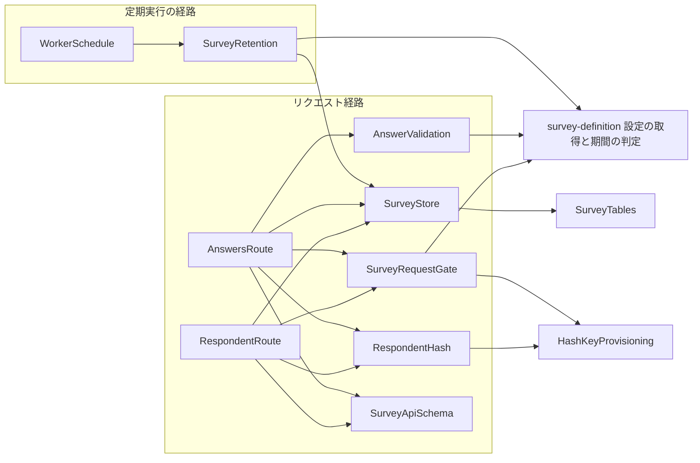
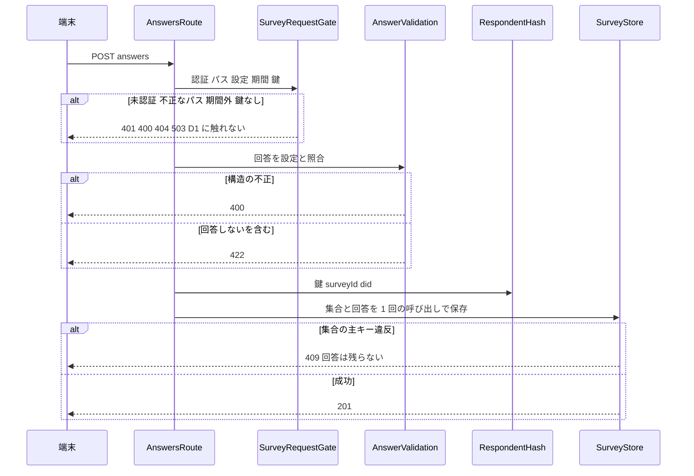
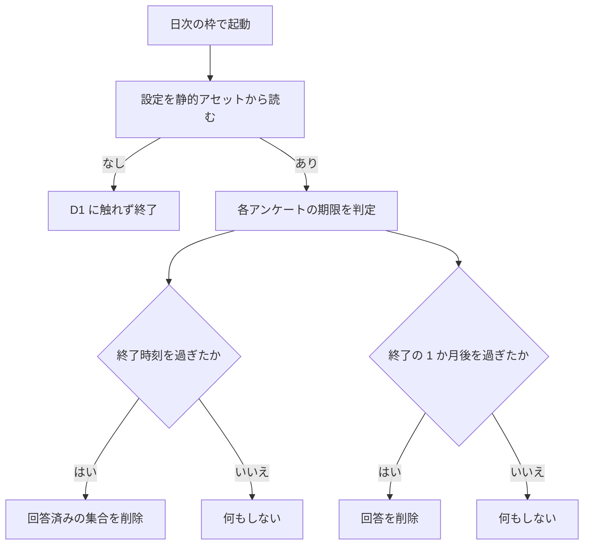

# Design Document

## Overview

**Purpose**: ログインした利用者のアンケートへの回答を、回答者を特定できない形で受け付けて保存し、同じ利用者による重複を防ぎ、保持期限を過ぎたデータを自動で削除する。
**Users**: 回答する利用者（複数アカウントを含む）、データを集計する運営者、確認・登録・保存を呼び出す後続の機能（survey-form）、削除を確認する後続の機能（survey-operation）。
**Impact**: D1 に 2 つの表を足し、回答済みの確認・登録・回答の保存の 3 つの API と、既存の毎分の定期実行の日次の枠に載る削除を加える。秘密値 `SURVEY_HASH_KEY` を既存の自動登録の仕組みに足す。アンケートの設定が無い環境や、アンケートが開催されていない間は、D1 に一切触れない。

### Goals

- 回答済みの記録と回答を結びつけない 2 つの表に分け、回答から did を復元できない形で保存する。
- 重複の判定を、事前の読み取りなしに、保存の 1 回の呼び出しの主キー違反で行う。
- 期間外・未定義のアンケートへの操作を、D1 に触れずに拒否する。
- 保持期限を過ぎたデータを、状態を持たない日次の削除で消す。
- 通常のログインでは D1 に触れず、無料枠の CPU（10ms）を守る。

### Non-Goals

- 設定の形式・検証・期間と保持期限の判定（survey-definition）。
- 画面・端末側の記録・呼び出しの判断（survey-form・choice-question）。
- 運営の手順と、設定からの期限切れのアンケートの除去（survey-operation）。
- 回答の集計・閲覧・取り消し・訂正。プライバシーポリシーの更新。

## Boundary Commitments

### This Spec Owns

- 回答済みの確認（GET）・登録（PUT）・回答の保存（POST）の API の契約（スキーマ・状態コード・応答）。
- 回答の検証（survey-definition の設定との照合、「回答しない」を含む回答の拒否）と、保存する回答の正規化。
- D1 の 2 つの表（回答済みの集合と匿名の回答）、ハッシュによる回答者の記録、重複の防止。
- 保持期限を過ぎたデータの削除（日次の枠）。
- 秘密値 `SURVEY_HASH_KEY` の自動登録とローカルの生成。
- 422 の応答の追加（共通のエラー応答）、D1 の型とテスト用フェイクの `batch` の追加。

### Out of Boundary

- 設定のスキーマと検証、`currentSurvey`・`retentionDeadlines`・`retentionExpired`・`readSurveyConfig` の実装（survey-definition）。
- アンケートの画面、localStorage の記録、確認・登録・保存を呼ぶ判断（survey-form）。
- `gh variable` の操作、変数からの期限切れのアンケートの除去（survey-operation）。
- 集計の手段（運営者が SQL で行う）。
- 回答の取り消し・訂正、自由記述。
- レート制限（重複は主キーで防ぎ、同一アカウントの 2 回目以降は 409 で終わる）。

### Allowed Dependencies

- survey-definition の `Survey`・`SurveyConfig`・`currentSurvey`・`retentionExpired`・`readSurveyConfig`（名前と形を変えずに使う）。
- 既存の認証（`locals.session.did`）、`errorResponseFromStatus`、`Common.errorResponses`。
- 既存の D1 のバインディング `DB`、静的アセット `ASSETS`、`cloudflare:workers` の動的 import。
- 既存の定期実行の枠（`isHousekeepingTime`）、秘密値の自動登録（`GENERATORS`）。
- Web Crypto（HMAC-SHA256・乱数）、Zod。
- 依存してはならないもの: `@atproto/*`（静的にも動的にも）、R2、予約投稿のストア（`schedule/store.ts`）と暗号（`credentialCrypto.ts`）。D1 の型だけは `schedule/cfTypes.ts` から型として参照する。

### Revalidation Triggers

- API のパス・状態コード・応答の形の変更（survey-form の呼び出しと生成されるクライアントを再確認する）。
- 回答の保存形式（`answers` の JSON の形）・表の列の変更（survey-operation の集計の SQL と prune の確認を再確認する）。
- ハッシュの入力（`survey_id` と did の連結）または鍵の扱いの変更（既存の回答済みの記録と一致しなくなる）。
- 保持期限の規則（survey-definition）の変更。
- 削除の枠の変更（`isHousekeepingTime`）。
- `SURVEY_HASH_KEY` の登録の仕組みの変更。

## Architecture

### Existing Architecture Analysis

- API は `src/lib/api/schema/v2/<リソース>/…` にスキーマ（`operation` を含む）を置き、`src/pages/v2/…` のハンドラが `safeParse` で検証し、`src/lib/api/schema/index.ts` がパスに割り当てる。認証は `locals.session`、応答は `errorResponseFromStatus` と `no-store` つきの JSON。
- D1 は `getScheduleEnv` のように `cloudflare:workers` を動的に import して得る。テストはそのモジュールを差し替える。
- 定期実行は `src/worker.ts` の `scheduled` が毎分予約を実行し、`isHousekeepingTime` が真の 1 回だけ後片付けを `ctx.waitUntil` で呼ぶ。
- 秘密値は `GENERATORS`（`prepare-local-env.mjs`）の全キーが、`ensure-worker-secrets.mjs` により配備先へ、未登録のものだけ登録される。
- `src/middleware.ts` から静的に辿れる範囲で `@atproto/*` を読み込まない制約（`tests/lib/coldStart.test.ts`）がある。本機能はルートの下の部品だけで構成し、中間層に載らない。

### Architecture Pattern & Boundary Map



**Architecture Integration**:

- Selected pattern: 薄いルートが、共通の入口（Gate）・純粋な検証・保管の部品を順に呼ぶ。D1 に触れるのは `SurveyStore` だけにする。
- Dependency direction: `SurveyApiSchema`・`RespondentHash`・`AnswerValidation`（純粋）→ `SurveyStore`（D1）→ `SurveyRequestGate`・`SurveyRetention`（上流の設定を読む）→ `RespondentRoute`・`AnswersRoute`・`WorkerSchedule`（最も外側）の順に外へ向かう。内側の部品は外側を import しない。`SurveyTables` と `HashKeyProvisioning` はデータと環境の土台で、どの部品からも import されない。
- Domain/feature boundaries: 認証と対象の判定（Gate）、回答の内容の検証（AnswerValidation）、匿名化（RespondentHash）、保管（SurveyStore）、削除（SurveyRetention）は変更の理由が別のため分ける。
- Existing patterns preserved: 動的 import で得るバインディング、`locals.session.did`、`errorResponseFromStatus`、コードファーストのスキーマ、毎分の定期実行の日次の枠、`GENERATORS` による秘密値。
- Steering compliance: `api-design.md`（動詞を含めないパス、`no-store`、言語を持たないエラー）、`tech.md`（無料枠の CPU、`@atproto/*` なし）、`coding-conventions.md`（日本語のコメント、アロー関数）。

### Technology Stack

| Layer                    | Choice / Version                    | Role in Feature                              | Notes                                              |
| ------------------------ | ----------------------------------- | -------------------------------------------- | -------------------------------------------------- |
| API                      | Astro のルート＋Zod（既存）         | 3 つの操作の契約と検証                       | 契約は `src/lib/api/schema/v2/surveys/` に置く     |
| Data / Storage           | Cloudflare D1（既存の `DB`）        | 回答済みの集合と匿名の回答の保管             | 移行 `0006_survey.sql`。`batch` を使う             |
| Crypto                   | Web Crypto（HMAC-SHA256・乱数）     | 回答者のハッシュ、回答の識別子               | 依存の追加なし                                     |
| Infrastructure / Runtime | Workers の Cron と `ASSETS`（既存） | 日次の削除、設定の読み出し                   | 既存の毎分の定期実行の日次の枠に相乗りする         |
| Secrets                  | `GENERATORS`（既存の仕組み）        | `SURVEY_HASH_KEY` の自動登録とローカルの生成 | Base64 の 32 バイト。`SCHEDULE_ENC_KEY` とは別の値 |

## File Structure Plan

### Directory Structure

```
migrations/
└── 0006_survey.sql                  # SurveyTables: 回答済みの集合と匿名の回答の 2 表（WITHOUT ROWID）
src/lib/api/schema/v2/surveys/
└── _surveyId/
    ├── respondent/
    │   ├── get.ts                   # SurveyApiSchema: 回答済みの確認の契約
    │   └── put.ts                   # SurveyApiSchema: 回答済みとしての登録の契約
    └── answers/
        └── post.ts                  # SurveyApiSchema: 回答の保存の契約
src/lib/survey/
├── env.ts                           # SurveyRequestGate が使う: バインディングの取得（動的 import）
├── request.ts                       # SurveyRequestGate: 認証・パス・設定と期間・鍵の確認
├── answers.ts                       # AnswerValidation: 回答の検証・正規化・回答した日
├── respondentHash.ts                # RespondentHash: 回答者の一方向の値
├── store.ts                         # SurveyStore: 2 表の読み書きと削除
└── retention.ts                     # SurveyRetention: 保持期限を過ぎたデータの削除
src/pages/v2/surveys/[surveyId]/
├── respondent.ts                    # RespondentRoute: GET と PUT
└── answers.ts                       # AnswersRoute: POST
tests/lib/survey/                    # 上の lib の単体テスト
tests/pages/v2/surveys/              # 2 つのルートのテスト
tests/hack/                          # 秘密値の登録のテスト（既存のファイルに追加）
```

> `env.ts` は `request.ts` と `retention.ts` が型を共有するための置き場所で、独立した部品ではない（バインディングの取得だけ）。

### Modified Files

- `src/lib/api/schema/index.ts` — SurveyApiSchema: 3 つの operation をパスに割り当てる。
- `src/lib/api/schema/common.ts` — SurveyApiSchema: 422 のエラーの説明を足す。
- `src/lib/api/response.ts` — SurveyRequestGate: `errorResponseFromStatus` に 422 を足す。
- `src/lib/schedule/cfTypes.ts` — SurveyStore: `D1Database` の型に `batch` を足す。
- `tests/helpers/fakeD1.ts` — SurveyStore: `batch` をトランザクションで再現し、1 回の呼び出しとして数える。
- `src/worker.ts` — WorkerSchedule: 日次の枠にアンケートの削除を足す。
- `hack/prepare-local-env.mjs` — HashKeyProvisioning: `GENERATORS` に `SURVEY_HASH_KEY` を足す。
- `hack/ensure-worker-secrets.mjs` — HashKeyProvisioning: 先頭の説明を、鍵が作り直し不可であることに合わせる。コードは変えない。
- `.dev.vars.template` — HashKeyProvisioning: `SURVEY_HASH_KEY` の説明を足す。
- `DEVELOP.md`・`docs/architecture.md`（と該当の節）— 秘密値の一覧・データの構成を実装と同じ変更で更新する。

## System Flows



- 判定の順序は、認証 → パス → 設定と期間 → 鍵 → 本文の構造 → 未完了 → 保存。D1 に触れるのは最後の保存だけ（確認と登録は 1 回の読み取りか書き込み）。
- 重複は保存の失敗として現れ、トランザクションにより回答も残らない。事前の読み取りは行わない。



- 削除は設定にあるアンケートだけが対象で、失敗は記録して次の項目へ進む。翌日の同じ枠で再び試みる。

## Requirements Traceability

| Requirement | Summary                          | Components                                       | Interfaces                                                     | Flows          |
| ----------- | -------------------------------- | ------------------------------------------------ | -------------------------------------------------------------- | -------------- |
| 1.1         | 未認証の拒否                     | SurveyRequestGate                                | `resolveSurveyRequest`                                         | システムフロー |
| 1.2         | did をセッションからだけ得る     | SurveyRequestGate, SurveyApiSchema               | `resolveSurveyRequest`（入力に did を持たない）                | —              |
| 1.3         | 応答のキャッシュ禁止             | SurveyRequestGate, RespondentRoute, AnswersRoute | `noStoreJson`, `noStoreEmpty`, `errorResponseFromStatus`       | —              |
| 1.4         | 入力の形式の不正                 | SurveyRequestGate, SurveyApiSchema               | `PathParamsSchema`, `RequestBodySchema`                        | システムフロー |
| 1.5         | 予期しない失敗                   | RespondentRoute, AnswersRoute                    | `try/catch` から 500                                           | —              |
| 2.1         | 未定義のアンケート               | SurveyRequestGate                                | `resolveSurveyRequest`                                         | システムフロー |
| 2.2         | 期間外のアンケート               | SurveyRequestGate                                | `resolveSurveyRequest`（`currentSurvey`）                      | システムフロー |
| 2.3         | 設定が無い・取得できない         | SurveyRequestGate                                | `readSurveyConfig` の「なし」                                  | システムフロー |
| 2.4         | 期間内は受け付ける               | SurveyRequestGate                                | `resolveSurveyRequest`                                         | システムフロー |
| 2.5         | 鍵が無いとき                     | SurveyRequestGate                                | `resolveSurveyRequest` の 503                                  | システムフロー |
| 3.1         | 回答済みかを真偽で返す           | RespondentRoute, SurveyApiSchema                 | GET `/v2/surveys/{surveyId}/respondent/`                       | —              |
| 3.2         | 回答済みの返答                   | SurveyStore, RespondentRoute                     | `isRespondent`                                                 | —              |
| 3.3         | 未回答の返答                     | SurveyStore, RespondentRoute                     | `isRespondent`                                                 | —              |
| 3.4         | 内容も時刻も返さない             | SurveyApiSchema                                  | `ResponseBody200Schema`（`answered` のみ）                     | —              |
| 3.5         | 読み取り 1 回                    | SurveyStore                                      | `isRespondent`                                                 | —              |
| 4.1         | 回答済みとして登録               | RespondentRoute, SurveyStore                     | PUT `/v2/surveys/{surveyId}/respondent/`, `registerRespondent` | —              |
| 4.2         | 登録の冪等                       | SurveyStore                                      | `registerRespondent`（挿入の重複を無視）                       | —              |
| 4.3         | 回答を受け取らない               | SurveyApiSchema, RespondentRoute                 | PUT に本文なし                                                 | —              |
| 4.4         | 書き込み 1 回                    | SurveyStore                                      | `registerRespondent`                                           | —              |
| 5.1         | 質問ごとの選択結果               | SurveyApiSchema                                  | `RequestBodySchema`                                            | —              |
| 5.2         | 質問の不足                       | AnswerValidation                                 | `checkAnswers`                                                 | システムフロー |
| 5.3         | 無い質問                         | AnswerValidation                                 | `checkAnswers`                                                 | システムフロー |
| 5.4         | 単一選択の個数                   | AnswerValidation                                 | `checkAnswers`                                                 | システムフロー |
| 5.5         | 複数選択の空・重複・上限         | AnswerValidation                                 | `checkAnswers`                                                 | システムフロー |
| 5.6         | 無い選択肢                       | AnswerValidation                                 | `checkAnswers`                                                 | システムフロー |
| 5.7         | 回答しないを含む回答             | AnswerValidation, AnswersRoute                   | `checkAnswers` の `declined`                                   | システムフロー |
| 5.8         | 定義にない項目                   | SurveyApiSchema                                  | `RequestBodySchema`（strict）                                  | —              |
| 6.1         | 回答の保存と 201                 | AnswersRoute, SurveyStore                        | `saveAnswer`                                                   | システムフロー |
| 6.2         | 回答に回答者を示す値を持たせない | SurveyTables, SurveyStore                        | `survey_answers` の列                                          | —              |
| 6.3         | 日だけを持つ                     | AnswerValidation, SurveyTables                   | `answeredOn`                                                   | —              |
| 6.4         | アンケートごとに異なる一方向の値 | RespondentHash                                   | `respondentHash`                                               | —              |
| 6.5         | 集合に参照も時刻も持たせない     | SurveyTables                                     | `survey_respondents` の列                                      | —              |
| 6.6         | 鍵なしで再計算できない           | RespondentHash                                   | `respondentHash`（HMAC）                                       | —              |
| 6.7         | 両方成功か両方なし               | SurveyStore                                      | `saveAnswer`（`batch`）                                        | システムフロー |
| 7.1         | 回答済みの重複                   | SurveyStore, AnswersRoute                        | `saveAnswer` の `duplicate`                                    | システムフロー |
| 7.2         | 同時の重複                       | SurveyStore                                      | `saveAnswer`（主キー）                                         | システムフロー |
| 7.3         | 登録だけ済ませた後の回答         | SurveyStore                                      | `saveAnswer`（同じ主キー）                                     | システムフロー |
| 7.4         | 別アカウントは保存               | RespondentHash, SurveyStore                      | `respondentHash`（did ごとに別の値）                           | —              |
| 7.5         | 事前の読み取りなし               | SurveyStore, AnswersRoute                        | `saveAnswer`                                                   | システムフロー |
| 8.1         | 集合の削除                       | SurveyRetention, SurveyStore                     | `runSurveyRetention`, `purgeRespondents`                       | 削除のフロー   |
| 8.2         | 回答の削除                       | SurveyRetention, SurveyStore                     | `runSurveyRetention`, `purgeAnswers`                           | 削除のフロー   |
| 8.3         | 日次の枠だけ                     | WorkerSchedule                                   | `scheduled`（`isHousekeepingTime`）                            | 削除のフロー   |
| 8.4         | 期限を過ぎたものに限る           | SurveyRetention                                  | `retentionExpired`                                             | 削除のフロー   |
| 8.5         | 設定が無いとき触れない           | SurveyRetention                                  | `readSurveyConfig` の「なし」                                  | 削除のフロー   |
| 8.6         | 失敗の分離                       | SurveyRetention, WorkerSchedule                  | 項目ごとの `try/catch`, 別の `waitUntil`                       | 削除のフロー   |
| 8.7         | 繰り返しても変わらない           | SurveyRetention, SurveyStore                     | `DELETE` の冪等                                                | 削除のフロー   |
| 8.8         | 翌日の回収                       | SurveyRetention, WorkerSchedule                  | 期限での絞り込み（状態なし）                                   | 削除のフロー   |
| 9.1         | 要求が無いときは触れない         | SurveyRequestGate, RespondentRoute, AnswersRoute | D1 に触れるのは各ルートの要求の中だけ                          | —              |
| 9.2         | CPU の範囲・重いライブラリなし   | SurveyRequestGate, RespondentHash                | 依存の制約                                                     | —              |
| 9.3         | 保存は 1 回の呼び出し            | SurveyStore                                      | `saveAnswer`                                                   | システムフロー |
| 9.4         | 鍵を出力しない                   | RespondentHash, SurveyRequestGate                | ログに値を含めない                                             | —              |
| 10.1        | 配備での鍵の登録                 | HashKeyProvisioning                              | `GENERATORS`                                                   | —              |
| 10.2        | ローカルでの生成                 | HashKeyProvisioning                              | `GENERATORS`                                                   | —              |
| 10.3        | 上書きしない                     | HashKeyProvisioning                              | `planSecretWrites`, `fillMissingSecrets`                       | —              |
| 10.4        | 共用する環境に同じ値             | HashKeyProvisioning                              | `planSecretWrites`                                             | —              |
| 10.5        | 片方だけのとき失敗               | HashKeyProvisioning                              | `planSecretWrites` の errors                                   | —              |
| 10.6        | 暗号鍵とは別の値                 | HashKeyProvisioning                              | 独立した `GENERATORS` のキー                                   | —              |
| 10.7        | 構造が用意される                 | SurveyTables                                     | `0006_survey.sql`（既存の移行の適用）                          | —              |

## Components and Interfaces

| Component           | Domain/Layer   | Intent                                             | Req Coverage                                                                   | Key Dependencies (P0/P1)                                                                 | Contracts      |
| ------------------- | -------------- | -------------------------------------------------- | ------------------------------------------------------------------------------ | ---------------------------------------------------------------------------------------- | -------------- |
| SurveyApiSchema     | API 契約       | 3 つの操作の入力・出力・状態コードを定める         | 1.2, 1.4, 3.1, 3.4, 4.3, 5.1, 5.8                                              | Zod（P0）, `Common.errorResponses`（P0）                                                 | API            |
| SurveyRequestGate   | API 共通       | 認証・パス・設定と期間・鍵を決まった順序で判定する | 1.1, 1.2, 1.3, 1.4, 2.1, 2.2, 2.3, 2.4, 2.5, 9.1, 9.2, 9.4                     | `readSurveyConfig`・`currentSurvey`（P0）, `locals.session`（P0）                        | Service        |
| AnswerValidation    | 共有ロジック   | 回答を設定と照合し、保存用に正規化する             | 5.2, 5.3, 5.4, 5.5, 5.6, 5.7, 6.3                                              | `Survey`（P0）                                                                           | Service        |
| RespondentHash      | 共有ロジック   | アンケートごとに異なる回答者の一方向の値を求める   | 6.4, 6.6, 7.4, 9.2, 9.4                                                        | Web Crypto（P0）                                                                         | Service        |
| SurveyStore         | 保管           | 2 表の読み書きと削除。D1 に触れる唯一の部品        | 3.2, 3.3, 3.5, 4.1, 4.2, 4.4, 6.1, 6.7, 7.1, 7.2, 7.3, 7.5, 8.1, 8.2, 8.7, 9.3 | D1 `DB`（P0）, SurveyTables（P0）                                                        | Service, State |
| RespondentRoute     | API ルート     | 回答済みの確認（GET）と登録（PUT）                 | 1.3, 1.5, 3.1, 3.2, 3.3, 4.1, 4.3, 9.1                                         | SurveyRequestGate（P0）, RespondentHash（P0）, SurveyStore（P0）                         | API            |
| AnswersRoute        | API ルート     | 回答の検証と保存（POST）                           | 1.3, 1.5, 5.7, 6.1, 7.1, 7.5, 9.1                                              | SurveyRequestGate（P0）, AnswerValidation（P0）, RespondentHash（P0）, SurveyStore（P0） | API            |
| SurveyRetention     | 削除           | 保持期限を過ぎたデータを削除する                   | 8.1, 8.2, 8.4, 8.5, 8.6, 8.7, 8.8                                              | `readSurveyConfig`・`retentionExpired`（P0）, SurveyStore（P0）, `ASSETS`（P0）          | Batch          |
| WorkerSchedule      | 定期実行       | 日次の枠で削除を起動する                           | 8.3, 8.6, 8.8                                                                  | SurveyRetention（P0）, `isHousekeepingTime`（P0）                                        | Batch          |
| SurveyTables        | データ         | 回答済みの集合と匿名の回答の 2 表                  | 6.2, 6.3, 6.5, 10.7                                                            | 既存の移行の適用（P0）                                                                   | State          |
| HashKeyProvisioning | 配備・開発環境 | `SURVEY_HASH_KEY` の自動登録とローカルの生成       | 10.1, 10.2, 10.3, 10.4, 10.5, 10.6                                             | `GENERATORS`・`planSecretWrites`（P0）                                                   | Batch          |

### API 契約

#### SurveyApiSchema

| Field        | Detail                                                    |
| ------------ | --------------------------------------------------------- |
| Intent       | 3 つの操作の契約を、検証と OpenAPI の単一の源として定める |
| Requirements | 1.2, 1.4, 3.1, 3.4, 4.3, 5.1, 5.8                         |

**Responsibilities & Constraints**

- 1 エンドポイントにつきスキーマは 1 つ。検証用と生成用に分けない。
- 入力に did・回答者を示す値・時刻を持たせない（did はセッションからだけ得る）。
- パスの変数 `surveyId` は survey-definition のアンケート識別子の形式（`^[a-z0-9]+(-[a-z0-9]+)*$`、40 文字以内）で検証する。
- 本文は strict。質問の識別子の数・選択肢の配列の長さに上限を置き、巨大な入力を早期に拒否する。

**Dependencies**

- Inbound: RespondentRoute, AnswersRoute — 検証（P0）; `src/lib/api/schema/index.ts` — OpenAPI への割り当て（P0）
- External: Zod, zod-openapi — 既存（P0）

**Contracts**: API [x]

##### API Contract

| Method | Endpoint                             | Request                                                       | Response                    | Errors                            |
| ------ | ------------------------------------ | ------------------------------------------------------------- | --------------------------- | --------------------------------- |
| GET    | `/v2/surveys/{surveyId}/respondent/` | なし                                                          | 200 `{ answered: boolean }` | 400, 401, 404, 500, 503           |
| PUT    | `/v2/surveys/{surveyId}/respondent/` | なし                                                          | 204（本文なし）             | 400, 401, 404, 500, 503           |
| POST   | `/v2/surveys/{surveyId}/answers/`    | `{ answers: { [questionId]: string \| string[] } }`（strict） | 201（本文なし）             | 400, 401, 404, 409, 422, 500, 503 |

```ts
import { z } from "zod/v4"

export const PathParamsSchema: z.ZodObject<{ surveyId: z.ZodString }> // 識別子の形式で strict

// get.ts
export const ResponseBody200Schema: z.ZodObject<{ answered: z.ZodBoolean }> // strict

// post.ts
export const RequestBodySchema: z.ZodObject<{
  answers: z.ZodRecord<
    z.ZodString,
    z.ZodUnion<[z.ZodString, z.ZodArray<z.ZodString>]>
  >
}> // strict。キーと選択肢の識別子は識別子の形式、件数に上限を置く
export type RequestBodyType = z.infer<typeof RequestBodySchema>
```

- 状態コードの意味: 400 入力の不正、401 未認証、404 未定義・期間外・設定なし、409 回答済み、422 回答しないを含む未完了の回答、503 鍵の未設定。エラー応答は言語を持たない分類（`{ error: string }`）で、表示用の文言は画面側が持つ。
- GET・PUT・POST ともに、cookie のヘッダーを OpenAPI の要求として宣言する（検証は認証が担う）。

**Implementation Notes**

- Integration: `index.ts` に `"/v2/surveys/{surveyId}/respondent/"`（get・put）と `"/v2/surveys/{surveyId}/answers/"`（post）を足す。`Common.errorResponses` の説明表に 422 を足す。`npm run codegen` で生成物が更新される。
- Validation: 質問の識別子と選択肢の識別子は、survey-definition の識別子の形式で検証する。設定との突き合わせは AnswerValidation が行う。
- Risks: スキーマの形を変えると survey-form の呼び出しが影響を受ける。Revalidation Triggers に記載。

### API 共通

#### SurveyRequestGate

| Field        | Detail                                                      |
| ------------ | ----------------------------------------------------------- |
| Intent       | 3 つの操作の前処理を、D1 に触れる前に決まった順序で済ませる |
| Requirements | 1.1, 1.2, 1.3, 1.4, 2.1, 2.2, 2.3, 2.4, 2.5, 9.1, 9.2, 9.4  |

**Responsibilities & Constraints**

- 判定の順序は、認証（401）→ パスの形式（400）→ 設定の取得と対象の判定（404）→ 鍵（503）。どの失敗でも D1 に触れない。
- did は `locals.session.did` からだけ得る。
- 設定は `readSurveyConfig(env.ASSETS, origin)` で読む（`origin` は要求の URL から）。ビルドの旗が偽なら、静的アセットにも触れず「なし」になる。
- 現在のアンケート（`currentSurvey(config, now)`）の識別子がパスの `surveyId` と一致するときだけ通す。一致しない・現在のアンケートが無いときは 404。
- `@atproto/*`・予約投稿のストア・暗号に依存しない。
- 応答は `noStoreJson`・`noStoreEmpty`（`cache-control: no-store`）と `errorResponseFromStatus`（422 を追加）で返す。

**Dependencies**

- Inbound: RespondentRoute, AnswersRoute — 前処理（P0）
- Outbound: なし（D1 に触れない）
- External: survey-definition の `readSurveyConfig`・`currentSurvey`（P0）, `cloudflare:workers`（バインディング。P0）, 認証ミドルウェアの `locals.session`（P0）

**Contracts**: Service [x]

##### Service Interface

```ts
import type { Survey } from "@/lib/survey/definition"
import type { D1Database } from "@/lib/schedule/cfTypes"

/** 通った後の文脈。D1 のバインディングと鍵を含む */
export type SurveyRequestContext = {
  survey: Survey
  did: string
  db: D1Database
  hashKey: string
  now: Date
}

export type SurveyRequestResult =
  | { ok: true; context: SurveyRequestContext }
  | { ok: false; response: Response }

export const resolveSurveyRequest: (args: {
  request: Request
  params: Record<string, string | undefined>
  locals: { session?: { did: string } }
  now?: Date
}) => Promise<SurveyRequestResult>

export const noStoreJson: (body: unknown, status?: number) => Response
export const noStoreEmpty: (status: number) => Response
```

- Preconditions: `locals` は認証ミドルウェアが供給する。
- Postconditions: `ok: true` のとき、`survey` は開催期間内の現在のアンケートで、`survey.id` はパスの `surveyId` と一致し、`hashKey` は空でない。
- Invariants: `ok: false` の経路は D1 を呼ばない。

**Implementation Notes**

- Integration: バインディングは `getSurveyEnv`（`env.ts`。`cloudflare:workers` を動的に import）から得る。テストはこのモジュールを差し替える。
- Validation: パスは `SurveyApiSchema` の `PathParamsSchema` で検証する。
- Risks: 鍵の未設定は 503 で、利用者の操作は失敗するが、フェイルオープンの端末側は何も表示しない。

### 共有ロジック

#### AnswerValidation

| Field        | Detail                                         |
| ------------ | ---------------------------------------------- |
| Intent       | 回答を設定と照合し、保存用に正規化する（純粋） |
| Requirements | 5.2, 5.3, 5.4, 5.5, 5.6, 5.7, 6.3              |

**Responsibilities & Constraints**

- 構造の検証を先に行い、すべて妥当なうえで「回答しない」の選択肢を含むときだけ未完了とする。
- 複数選択の選択は、設定の選択肢の順に並べ替えて保存する（選択順を残さない）。質問の順も設定の順に並べる。
- 回答した日は日本標準時の暦で数え、日より細かい時刻を返さない。
- 時刻は引数で受け取り、内部で現在時刻を読まない。D1・セッション・atproto に依存しない。

**Dependencies**

- Inbound: AnswersRoute（P0）
- Outbound: なし
- External: survey-definition の `Survey` の型（P0）

**Contracts**: Service [x]

##### Service Interface

```ts
import type { Survey } from "@/lib/survey/definition"

/** 端末から受け取る回答（質問 ID → 選択肢 ID か配列） */
export type AnswerInput = Record<string, string | string[]>

/** 保存する回答。キーは質問の順、複数選択の配列は選択肢の順 */
export type NormalizedAnswers = Record<string, string | string[]>

export type AnswerCheck =
  | { ok: true; answers: NormalizedAnswers }
  | { ok: false; reason: "invalid" | "declined" }

export const checkAnswers: (survey: Survey, input: AnswerInput) => AnswerCheck

/** 回答した日（日本標準時の暦）。YYYY-MM-DD */
export const answeredOn: (now: Date) => string
```

- Preconditions: `survey` は検証済みの設定の要素。
- Postconditions: `ok: true` の `answers` は、全質問を含み、各選択肢が設定に存在し、「回答しない」を含まず、単一選択は 1 つ、複数選択は 1 つ以上かつ上限以下で重複がない。
- Invariants: 入力を変更しない。

**Implementation Notes**

- Integration: 保存する JSON は `JSON.stringify(answers)`。キーの順は質問の順に固定する。
- Validation: 質問の過不足・単一選択の個数・複数選択の空と重複と上限・無い選択肢を `invalid`、妥当なうえでの「回答しない」を `declined` とする。
- Risks: 保存形式の変更は集計の SQL に影響する。Revalidation Triggers に記載。

#### RespondentHash

| Field        | Detail                                                             |
| ------------ | ------------------------------------------------------------------ |
| Intent       | アンケートごとに異なる、鍵なしでは再計算できない回答者の値を求める |
| Requirements | 6.4, 6.6, 7.4, 9.2, 9.4                                            |

**Responsibilities & Constraints**

- `HMAC-SHA256(鍵, surveyId + did)` を 16 進の文字列で返す。鍵は Base64 の 32 バイト。
- 同じアンケートで同じ did は常に同じ値、別の did または別のアンケートでは別の値になる。
- 鍵・did・値をログや例外に含めない。鍵が不正（Base64 でない・長さが違う）なら、値を含まない固定の例外にする。
- Web Crypto だけに依存する。

**Dependencies**

- Inbound: RespondentRoute, AnswersRoute（P0）
- External: Web Crypto（P0）

**Contracts**: Service [x]

##### Service Interface

```ts
export const respondentHash: (
  key: string,
  surveyId: string,
  did: string,
) => Promise<string>
```

- Preconditions: `key` は Base64 の 32 バイト。
- Postconditions: 64 文字の 16 進。
- Invariants: 同じ入力で同じ出力。

**Implementation Notes**

- Integration: `surveyId` は `[a-z0-9-]` だけ、did は `did:` で始まる。連結の境界は曖昧にならない。
- Validation: 既知の入力で出力が固定されることをテストする。
- Risks: 入力の連結の方法を変えると既存の記録と一致しなくなる。

### 保管

#### SurveyStore

| Field        | Detail                                                                         |
| ------------ | ------------------------------------------------------------------------------ |
| Intent       | 2 表の読み書きと削除を担い、D1 に触れる唯一の部品となる                        |
| Requirements | 3.2, 3.3, 3.5, 4.1, 4.2, 4.4, 6.1, 6.7, 7.1, 7.2, 7.3, 7.5, 8.1, 8.2, 8.7, 9.3 |

**Responsibilities & Constraints**

- 確認は主キーでの 1 回の読み取り、登録は挿入の重複を無視する 1 回の書き込み。
- 回答の保存は、`batch` で「集合への通常の INSERT → 回答の INSERT」を 1 回の呼び出しで送る。集合の主キー違反でバッチ全体が失敗し、回答は残らない。事前の SELECT は行わない。
- 例外のうち、`survey_respondents` の主キー違反だけを重複として扱う。それ以外は呼び出し元へ投げる。
- 削除は `DELETE ... WHERE survey_id = ?` で、削除した行数を返す。
- SQL は常にバインド変数を使う。

**Dependencies**

- Inbound: RespondentRoute, AnswersRoute, SurveyRetention（P0）
- External: D1 `DB`（P0）

**Contracts**: Service [x] / State [x]

##### Service Interface

```ts
import type { D1Database } from "@/lib/schedule/cfTypes"

export const isRespondent: (
  db: D1Database,
  surveyId: string,
  didHash: string,
) => Promise<boolean>

export const registerRespondent: (
  db: D1Database,
  surveyId: string,
  didHash: string,
) => Promise<void>

export type SaveAnswerResult = "saved" | "duplicate"

export const saveAnswer: (
  db: D1Database,
  input: {
    surveyId: string
    didHash: string
    answerId: string
    answersJson: string
    answeredOn: string
  },
) => Promise<SaveAnswerResult>

export const purgeRespondents: (
  db: D1Database,
  surveyId: string,
) => Promise<number>
export const purgeAnswers: (db: D1Database, surveyId: string) => Promise<number>
```

- Preconditions: 呼び出し元が `didHash` を求めている（did を渡さない）。
- Postconditions: `saved` のとき集合と回答の両方が存在する。`duplicate` のとき回答は存在しない。それ以外の失敗は例外で、どちらも存在しない。
- Invariants: この部品の引数と戻り値に did は現れない。

##### State Management

- State model: 集合（誰が回答したか）と回答（何と回答したか）を結びつけない。
- Persistence & consistency: 2 つの挿入を 1 つのバッチ（トランザクション）にして整合させる。
- Concurrency strategy: 同時の要求は主キーが直列化し、片方だけが成功する。

**Implementation Notes**

- Integration: `D1Database` の型に `batch(statements): Promise<{ meta?: { changes?: number } }[]>` を足す。フェイクは `BEGIN`／`COMMIT`／`ROLLBACK` で再現し、バッチ全体を 1 回の呼び出しとして数える。
- Validation: 主キー違反の判定は、例外メッセージが `UNIQUE constraint failed: survey_respondents` を含むかで行う。実装時にローカルの D1 で実際の文言を実測し、判定とテストを合わせる。
- Risks: 文言に依存する。実測とテストで固定する。

### API ルート

#### RespondentRoute

| Field        | Detail                                         |
| ------------ | ---------------------------------------------- |
| Intent       | 回答済みの確認（GET）と登録（PUT）を受け付ける |
| Requirements | 1.3, 1.5, 3.1, 3.2, 3.3, 4.1, 4.3, 9.1         |

**Responsibilities & Constraints**

- GET: 前処理 → 値の計算 → 主キーでの 1 回の読み取り → 200 `{ answered }`。
- PUT: 前処理 → 値の計算 → 1 回の書き込み → 204。本文を読まない。
- 失敗は `try/catch` で受け、内部の情報を含まない 500 にする。

**Dependencies**

- Outbound: SurveyRequestGate（P0）, RespondentHash（P0）, SurveyStore（P0）, SurveyApiSchema（P0）

**Contracts**: API [x]（契約は SurveyApiSchema）

**Implementation Notes**

- Integration: `src/pages/v2/surveys/[surveyId]/respondent.ts` に `GET`・`PUT` を `export` する。
- Validation: 前処理の失敗はそのまま返す。
- Risks: なし。

#### AnswersRoute

| Field        | Detail                            |
| ------------ | --------------------------------- |
| Intent       | 回答を検証して保存する（POST）    |
| Requirements | 1.3, 1.5, 5.7, 6.1, 7.1, 7.5, 9.1 |

**Responsibilities & Constraints**

- 順序は、前処理 → 本文の JSON の解析と `RequestBodySchema`（400）→ `checkAnswers`（`invalid` は 400、`declined` は 422）→ 値の計算 → `saveAnswer`（`duplicate` は 409、`saved` は 201）。
- 回答の識別子は `crypto.randomUUID()`、回答した日は `answeredOn(now)`。
- 保存の例外は記録し、内部の情報を含まない 500 にする。ログに did・値・回答の内容を含めない。

**Dependencies**

- Outbound: SurveyRequestGate（P0）, AnswerValidation（P0）, RespondentHash（P0）, SurveyStore（P0）, SurveyApiSchema（P0）

**Contracts**: API [x]（契約は SurveyApiSchema）

**Implementation Notes**

- Integration: `src/pages/v2/surveys/[surveyId]/answers.ts` に `POST` を `export` する。
- Validation: 本文の JSON が壊れていれば 400。
- Risks: なし。

### 削除

#### SurveyRetention

| Field        | Detail                                           |
| ------------ | ------------------------------------------------ |
| Intent       | 設定と時刻から、保持期限を過ぎたデータを削除する |
| Requirements | 8.1, 8.2, 8.4, 8.5, 8.6, 8.7, 8.8                |

**Responsibilities & Constraints**

- 設定を静的アセットから読み、アンケートごとに `retentionExpired` を判定する。回答済みの集合が期限切れなら `purgeRespondents`、回答が期限切れなら `purgeAnswers` を呼ぶ。
- 設定が「なし」なら D1 に触れずに終わる。
- 項目ごとに例外を捕らえて記録し、次の項目へ進む。全体も例外を外へ投げない。
- 状態を持たない。実行を繰り返しても結果は同じで、削除済みなら 0 行になる。
- 設定の読み出しは `present: true` を明示し、ビルドの旗の置換が定期実行のエントリに効くかに依存しない。仮の原点を使う。

**Dependencies**

- Inbound: WorkerSchedule（P0）
- Outbound: SurveyStore（P0）
- External: survey-definition の `readSurveyConfig`・`retentionExpired`（P0）, `ASSETS`（P0）

**Contracts**: Batch [x]

##### Batch / Job Contract

- Trigger: 日次の枠（`isHousekeepingTime`）の定期実行から呼ばれる。
- Input / validation: `env`（`DB`・`ASSETS`）と現在時刻。設定は `readSurveyConfig` が検証する。
- Output / destination: D1 の 2 表の行の削除。戻り値なし。
- Idempotency & recovery: 期限での絞り込みだけで状態を持たず、失敗しても翌日の同じ枠で回収される。

```ts
import type { D1Database } from "@/lib/schedule/cfTypes"

export type SurveyRetentionEnv = {
  DB: D1Database
  ASSETS: { fetch(input: Request | string): Promise<Response> }
}

export const runSurveyRetention: (
  env: SurveyRetentionEnv,
  now: Date,
) => Promise<void>
```

**Implementation Notes**

- Integration: `ASSETS.fetch` はパスで引くため、原点は固定の仮の値でよい。
- Validation: 設定にあるアンケートだけが対象。設定から消えたアンケートのデータは削除できない（運用の前提）。
- Risks: 運用が先に設定を消すとデータが残る。survey-operation が、データの削除を確認してから設定を除く。

### 定期実行

#### WorkerSchedule

| Field        | Detail                                   |
| ------------ | ---------------------------------------- |
| Intent       | 既存の日次の枠に、アンケートの削除を足す |
| Requirements | 8.3, 8.6, 8.8                            |

**Responsibilities & Constraints**

- `isHousekeepingTime` が真の分岐に、`runSurveyRetention` を別の `ctx.waitUntil` として足す。予約投稿の後片付けと互いに失敗が影響しない。
- 毎分の予約の実行には何も足さない。

**Dependencies**

- Outbound: SurveyRetention（P0）; External: 既存の `isHousekeepingTime`（P0）

**Contracts**: Batch [x]

**Implementation Notes**

- Integration: `scheduled` の `env` の型を `ScheduleEnv & SurveyRetentionEnv` にする。`ASSETS` は既に宣言されたバインディング。
- Validation: 日次の枠の分だけ呼ばれ、ほかの分では呼ばれないことをテストする。
- Risks: なし。

### データ

#### SurveyTables

| Field        | Detail                                                      |
| ------------ | ----------------------------------------------------------- |
| Intent       | 回答済みの集合と匿名の回答を、互いに結びつけない 2 表にする |
| Requirements | 6.2, 6.3, 6.5, 10.7                                         |

**Responsibilities & Constraints**

- 詳細は Data Models に記す。移行 `migrations/0006_survey.sql` は、既存の配備の手順（`wrangler d1 migrations apply`）で適用される。

**Contracts**: State [x]

### 配備・開発環境

#### HashKeyProvisioning

| Field        | Detail                                             |
| ------------ | -------------------------------------------------- |
| Intent       | `SURVEY_HASH_KEY` を既存の自動登録の仕組みに載せる |
| Requirements | 10.1, 10.2, 10.3, 10.4, 10.5, 10.6                 |

**Responsibilities & Constraints**

- `GENERATORS` に `SURVEY_HASH_KEY`（Base64 の 32 バイトの乱数）を足す。配備（`ensure-worker-secrets.mjs`）とローカル（`prepare-local-env.mjs`）の両方が `GENERATORS` を共有するため、コードの追加は 1 キーだけで済む。
- 未登録のものだけ登録し、登録済みの値を上書きしない。
- `--develop` では Worker とプレビューの基本設定に同じ値を登録する。片方にだけ登録済みのときは、`REGENERATABLE` に入れないため失敗で終える（作り直すと既存の記録と一致しなくなる）。
- 本番は独立した D1 を持つため、本番の値は develop と別でよい。
- `SCHEDULE_ENC_KEY` とは別のキーで、値も別。

**Dependencies**

- External: 既存の `GENERATORS`・`planSecretWrites`・`fillMissingSecrets`（P0）

**Contracts**: Batch [x]

**Implementation Notes**

- Integration: `.dev.vars.template` に `SURVEY_HASH_KEY` のコメントを足す。
- Validation: 既存の登録計画のテストに、新しいキーの生成・上書きなし・片方だけのときの失敗を足す。
- Risks: 既存の Preview は、作られた時点の基本設定のシークレットを持ち続ける。既存の仕組み（`--preview` による作り直し）が、欠けたシークレットを検知して作り直す。

## Data Models

### Logical Data Model

- **回答済みの集合（survey_respondents）**: アンケートごとの、回答済みの利用者の一方向の値の集合。回答への参照も時刻も持たない。
- **匿名の回答（survey_answers）**: アンケートごとの回答。識別子は乱数。did に関わる値と日より細かい時刻を持たない。
- 2 表の間に外部キーも共通の値も無い。集合の行から回答は引けず、回答の行から利用者は引けない。
- 一意性: 集合は（アンケート、回答者の値）、回答は（アンケート、識別子）。重複の判定は集合の一意性が担う。

### Physical Data Model

```sql
-- 回答済みの利用者の集合。回答への参照も時刻も持たない
CREATE TABLE survey_respondents (
  survey_id TEXT NOT NULL,
  did_hash TEXT NOT NULL,
  PRIMARY KEY (survey_id, did_hash)
) WITHOUT ROWID;

-- 匿名の回答。回答者に関わる値を持たない
CREATE TABLE survey_answers (
  survey_id TEXT NOT NULL,
  id TEXT NOT NULL,
  answers TEXT NOT NULL,
  answered_on TEXT NOT NULL,
  PRIMARY KEY (survey_id, id)
) WITHOUT ROWID;
```

- `WITHOUT ROWID`: 挿入順（rowid）を持たず、主キー順に並ぶ。2 表の挿入順の突き合わせによる再識別を避ける。
- `did_hash`: 64 文字の 16 進。`id`: `crypto.randomUUID()`。`answers`: 質問 ID → 選択肢 ID か選択肢 ID の配列の JSON。`answered_on`: `YYYY-MM-DD`（日本標準時）。
- 削除は主キーの先頭（`survey_id`）での範囲の削除で、追加の索引は要らない。集計は運営者が SQL で行う（例: `SELECT answers FROM survey_answers WHERE survey_id = ?`）。

### Data Contracts & Integration

- 端末との契約は SurveyApiSchema。保存する `answers` の JSON は、質問の順のキーと、複数選択のときの選択肢の順の配列。

## Error Handling

### Error Strategy

- 失敗は言語を持たない分類で返す。表示用の文言は画面側が持つ。
- D1 に触れる前に判定できる失敗（401・400・404・503）は、D1 に触れずに返す。
- 予期しない失敗は記録し、内部の情報を含まない 500 にする。記録に did・回答者の値・回答の内容・鍵を含めない。

### Error Categories and Responses

- **User Errors**: 401 未認証、400 入力の不正（パス・本文・設定と合わない回答）、404 未定義・期間外・設定なし、409 回答済み。
- **Business Logic Errors**: 422 回答しないを含む未完了の回答。
- **System Errors**: 503 鍵の未設定、500 D1 の失敗・不正な鍵・予期しない例外。
- 削除の失敗は応答を持たない。記録だけして、予約投稿の定期実行とほかのアンケートに影響させない。

### Monitoring

- 失敗は固定の文言とアンケートの識別子だけでコンソールに記録する（did・値・鍵は含めない）。Workers の observability で確認する。

## Testing Strategy

### Unit Tests

- AnswerValidation: 妥当な回答が正規化される（質問の順・選択肢の順）。質問の不足・無い質問・単一選択の個数・複数選択の空と重複と上限超え・無い選択肢が `invalid`、妥当なうえで「回答しない」を含むと `declined`、構造の不正と「回答しない」が重なると `invalid`（5.2–5.7）。回答した日が日本標準時の暦で、日付の境界（UTC 15:00）で変わる（6.3）。
- RespondentHash: 同じ入力で同じ値、別の did・別のアンケート・別の鍵で別の値、64 文字の 16 進、不正な鍵で固定の例外になり値を含まない（6.4, 6.6, 7.4, 9.4）。
- SurveyStore: 確認が 1 回の読み取り、登録が 1 回の書き込みで冪等（3.5, 4.2, 4.4）。保存が 1 回の呼び出しで両表に入り、2 回目は `duplicate` で回答が増えない。別の失敗では両表に何も残らない（6.7, 7.1, 7.3, 7.5, 9.3）。削除が対象のアンケートの行だけを消し、削除済みでは 0 行を返す（8.7）。
- SurveyRequestGate: 判定の順序（未認証が最初、次にパス、設定、鍵）で、どの失敗でも D1 が呼ばれない。期間外・未定義・設定なしが 404、鍵なしが 503（1.1, 1.4, 2.1–2.5）。

### Integration Tests

- RespondentRoute と AnswersRoute（フェイク D1・差し替えたバインディング）: GET が未回答→PUT→GET で回答済みになる。POST が 201、同じアカウントの 2 回目が 409、PUT 済みのアカウントの POST が 409、別のアカウントの POST が 201、同時の 2 回の POST で 1 回だけ保存される（7.1–7.4）。「回答しない」を含む POST が 422 で何も保存されず、構造の不正が 400（5.x）。すべての応答に `no-store` が付く（1.3）。保存された両表の行から did を含む値が見つからない（6.2, 6.5）。
- SurveyRetention と WorkerSchedule: 時刻を動かして、終了前は何も削除されず、終了後に集合だけ、1 か月後に回答も削除される。設定なしでは D1 が呼ばれない。1 件の失敗が次の項目を止めない。日次の枠の分だけ呼ばれる（8.1–8.8）。
- HashKeyProvisioning: 新しいキーが登録の計画に現れ、登録済みは上書きされず、片方だけの登録は失敗する。ローカルの生成が未設定のキーだけを埋める（10.1–10.6）。
- 移行: フェイク D1 に全移行を適用すると 2 表ができ、列が設計どおりである（10.7）。

### 実機の確認

- ローカルの D1（wrangler）で、移行を適用し、集合への重複した挿入を含むバッチを実行して、例外の文言を実測する。判定の文言とテストを合わせる。
- 生成されるクライアント（`npm run codegen`）が型検査を通る。コールドスタートの検査（`tests/lib/coldStart.test.ts`）が通る。

## Security Considerations

- 回答と did を結びつけない。集合は一方向の値だけ、回答は did に関わる値を持たない。2 表は挿入順を持たず、時刻は日単位に丸める。
- 鍵はシークレットとして保管し、ログ・応答・データに出さない。鍵を持たない者は、did から値を再計算できないため、漏れた集合から利用者を特定できない。
- 入力は strict で上限を置く。回答の内容は設定に存在する識別子だけを受け入れる。SQL は常にバインド変数を使う。
- 認証は必須で、did は常にセッションから得る。他人の名義で確認・登録・回答することはできない。

## Performance & Scalability

- 通常のログインでは D1 に触れない。確認は読み取り 1 回、登録は書き込み 1 回、回答の保存は 1 回の呼び出し（書き込み 2 行）。期間外の要求は D1 に触れない。
- HMAC は 1ms 未満で、設定は ASSETS からの読み出し（survey-definition のメモリ保持つき）。`@atproto/*` は読み込まない。
- 日次の削除は、設定のアンケート数に比例する DELETE だけ（削除済みなら 0 行）。毎分の実行には何も足さない。
