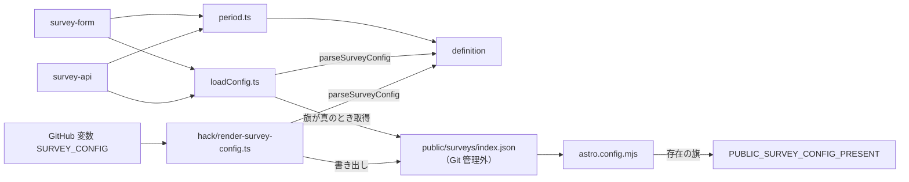
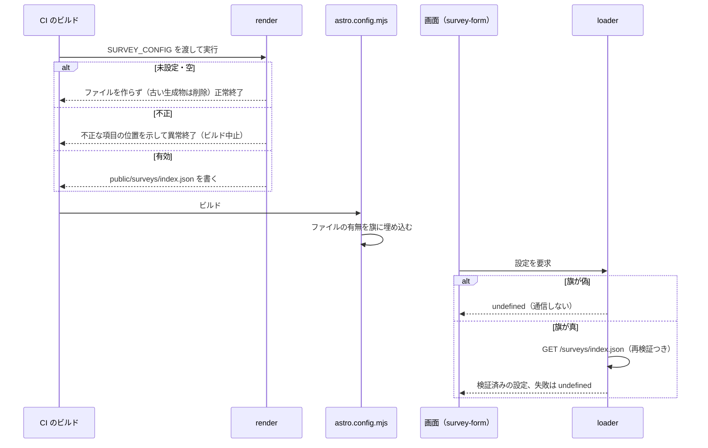

# Design Document

## Overview

**Purpose**: アンケートの期間・質問・選択肢・文言を、コードの外の設定として定義し、検証・判定・配信する土台を提供する。
**Users**: アンケートを実施する運営者と、設定を読んで画面と回答の保存を組み立てる後続の機能（survey-api・survey-form）。
**Impact**: 設定の元（GitHub のリポジトリ変数 `SURVEY_CONFIG`）から、ビルド時に配信用の静的ファイル `public/surveys/index.json` を生成する工程を足す。変数が未設定の環境（フォークを含む）では何も生成せず、画面にもサーバーにも影響しない。

### Goals

- 設定の形式と検証を、サーバー・クライアント・生成処理が共有する 1 つのスキーマにする。
- 現在のアンケートと保持期限の判定を、時刻を引数に取る純粋関数にする。
- 設定が無い環境では、通信もエラー表示も起こさない。
- 質問・選択肢・文言をソースコードに持たない。

### Non-Goals

- 回答の保存・重複の判定・保持期限による削除の実行（survey-api）。
- 質問の表示と回答の入力（survey-form・choice-question）。
- 設定の元の登録・更新・削除と、運営者への聞き取り・翻訳の作成（施行ワークフロー）。

## Boundary Commitments

### This Spec Owns

- 設定の形式（Zod スキーマと型）、検証、不正の報告の形式。
- 現在のアンケートの判定と、保持期限の算出・判定。
- 表示言語に応じた文言の選択。
- 設定の取得（クライアントはビルドの有無の旗を見てから静的ファイルを取得、サーバーは `ASSETS` から読む）と、失敗時に「アンケートなし」とする規則。
- `SURVEY_CONFIG` から `public/surveys/index.json` を生成する処理、そのビルドと CI への組み込み。

### Out of Boundary

- 回答のデータ（D1 のテーブル・API・ハッシュ・削除の実行）。
- ダイアログ・質問の描画・localStorage の判定。
- `gh variable set` による変数の登録と、期限切れの変数の削除。

### Allowed Dependencies

- `src/lib/i18n/locale.ts` の `LOCALES`・`Locale`（対応言語の単一の源）。
- Zod（既存）。生成処理の実行に `tsx`（既存の devDependency）。
- Astro の `vite.define` によるビルド定数、Workers の `ASSETS` バインディング。
- 依存してはならないもの: `@atproto/*`、D1・R2、セッション。

### Revalidation Triggers

- 設定のスキーマの変更（survey-api の回答の検証、survey-form の描画、施行ワークフローの組み立てを再確認する）。
- `LOCALES` の追加・削除（既存の設定が不正になる。設定の元の再登録が要る）。
- 保持期限の算出規則の変更（survey-api の削除と、プライバシーポリシーの記載を再確認する）。
- 静的ファイルのパス・ビルドの旗の名前の変更。

## Architecture

### Existing Architecture Analysis

- 運用者ごとの値は、`astro.config.mjs` が環境変数から読み、`vite.define` でビルド定数にする（`PUBLIC_COMMIT_SHA` など）。同じ形で、設定ファイルの有無を旗にする。
- `hack/*.mjs` は配備の前処理を担う。TypeScript のスキーマを共有するため、本 spec の生成処理は `tsx` で動かす（`apigen:doc` と同じ流儀）。
- `ASSETS` バインディングは `wrangler.template.jsonc` に既にある。サーバーは静的ファイルをネットワークを介さずに読める。
- Workers の無料枠の CPU 制約のため、`@atproto/*` を読み込まない。

### Architecture Pattern & Boundary Map



**Architecture Integration**:

- Selected pattern: 純粋なスキーマと判定関数を中心に、取得（I/O）と生成（Node）を外側に置く。
- 既存の流儀を保つ: Zod による外部入力の検証、`vite.define` によるビルド定数、日本語の責務コメント。
- 新しい部品の理由: スキーマ（共有の契約）、期間の判定（時刻を注入できる純粋関数）、取得（クライアントとサーバーの差）、生成（CI）は変更の理由が別である。

### Technology Stack

| Layer        | Choice / Version               | Role in Feature                        | Notes                                          |
| ------------ | ------------------------------ | -------------------------------------- | ---------------------------------------------- |
| 共有ロジック | TypeScript + Zod               | スキーマ・検証・期間の判定             | 外部依存なし。Workers とブラウザと Node で動く |
| 生成         | `tsx` で動く TypeScript        | 変数からの静的ファイルの生成           | `package.json` の `build:survey`               |
| 配信         | Astro の `public/` と `ASSETS` | 静的ファイルの配信とサーバーの読み出し | 静的アセットは Workers の課金対象外            |
| CI           | GitHub Actions                 | ビルドの前に生成を実行                 | `deploy.yaml`・`preview.yaml`                  |

## File Structure Plan

### Directory Structure

```
src/lib/survey/
├── definition.ts      # スキーマ・型・parseSurveyConfig・localize（純粋）
├── period.ts          # currentSurvey・保持期限の算出と判定（純粋）
└── loadConfig.ts      # 配信用の設定の取得（クライアント fetch / サーバー ASSETS）。失敗は undefined
hack/
└── render-survey-config.ts   # SURVEY_CONFIG → public/surveys/index.json の生成
tests/lib/survey/
├── definition.test.ts
├── period.test.ts
└── loadConfig.test.ts
tests/hack/renderSurveyConfig.test.ts
tests/fixtures/survey/       # 検証用の設定（有効・不正の組）
```

### Modified Files

- `astro.config.mjs` — `public/surveys/index.json` の有無を `import.meta.env.PUBLIC_SURVEY_CONFIG_PRESENT`（"true" / "false"）として埋め込む。
- `package.json` — `build:survey`（`tsx hack/render-survey-config.ts`）を追加し、`build` と `dev` で `build:v2` / `astro dev` の前に実行する。
- `.gitignore` — `/public/surveys/` を管理外にする。
- `.github/workflows/deploy.yaml`・`preview.yaml` — 「Run build」の環境に `SURVEY_CONFIG: ${{ vars.SURVEY_CONFIG }}` を渡す（e2e・検証ジョブには渡さない）。
- `DEVELOP.md` — 設定の仕組みと、手元で試す手順（`SURVEY_CONFIG` を指定して生成する）。
- `docs/architecture.md` — 構成の追記（アンケートの設定の節）。

## System Flows



- 「設定が無い」を実行時の 404 で知ると、通信とコンソールのエラーが出る。要件 4.1 を満たすため、存在はビルド時に旗として決める。
- 旗が真でも、取得・解析・検証のどれかが失敗したら `undefined` を返し、何も表示しない（要件 4.2）。

## Requirements Traceability

| Requirement | Summary                    | Components |
| ----------- | -------------------------- | ---------- |
| 1.1–1.10    | 設定の形式と検証           | D-1        |
| 2.1–2.5     | 多言語の文言               | D-1        |
| 3.1–3.3     | 期間の形式・重複の検証     | D-1        |
| 3.4–3.7     | 現在のアンケート・保持期限 | D-2        |
| 4.1–4.4     | 設定が無い・読めないとき   | D-3, D-5   |
| 5.1–5.6     | 配信用の設定の生成         | D-4        |
| 6.1–6.5     | CI への組み込み            | D-5        |
| 7.1–7.4     | 自動検査                   | テスト一式 |

## Components and Interfaces

### D-1: 設定のスキーマ（`definition.ts`）

**Requirements**: 1.1–1.10, 2.1–2.5, 3.1–3.3

```ts
import type { Locale } from "@/lib/i18n/locale"

/** 全対応言語の文言。`satisfies Record<Locale, …>` により、言語を足すと型エラーで気づく */
export type LocalizedText = Record<Locale, string>

export type SurveyOption = {
  id: string
  label: LocalizedText
  /** 選ぶと回答を完了として扱わない（「回答しない」） */
  decline?: boolean
}
export type SurveyQuestion =
  | { id: string; kind: "single"; title: LocalizedText; options: SurveyOption[] }
  | {
      id: string
      kind: "multiple"
      title: LocalizedText
      options: SurveyOption[]
      /** 選べる数の上限。1 以上かつ decline を除く選択肢の数以下 */
      maxSelect?: number
    }
export type Survey = {
  id: string
  opensAt: string // UTC からのオフセット付き ISO 8601
  closesAt: string // 同上。この時刻を含まない
  title: LocalizedText
  description?: LocalizedText
  questions: SurveyQuestion[]
}
export type SurveyConfig = { surveys: Survey[] }

export const SurveyConfigSchema: z.ZodType<SurveyConfig> // すべて strict

export type ParseResult =
  | { ok: true; config: SurveyConfig }
  | { ok: false; issues: string[] } // 各要素は "surveys.0.questions.1: 理由"。入力の値を含めない

export const parseSurveyConfig = (input: unknown): ParseResult
export const localize = (text: LocalizedText, locale: Locale): string
```

| 規則         | 実装                                                                                                                                                   |
| ------------ | ------------------------------------------------------------------------------------------------------------------------------------------------------ |
| 識別子       | `^[a-z0-9]+(-[a-z0-9]+)*$`、40 文字以内（アンケート・質問・選択肢）。アンケートはファイル内で一意、質問は同じアンケート内、選択肢は同じ質問内で一意    |
| 文言         | `z.strictObject({ ja: nonBlank, en: nonBlank } satisfies Record<Locale, …>)`。`nonBlank` は `trim()` 後に 1 文字以上。未対応の言語キーは strict で拒否 |
| 質問・選択肢 | `kind` で分岐。選択肢は 2 つ以上、`decline` を持つ選択肢は 1 質問に 1 つまで。`maxSelect` は `multiple` だけ。`single` に含めると拒否                  |
| アンケート   | 質問は 1 つ以上。`description` は任意                                                                                                                  |
| 日時         | `z.string().datetime({ offset: true })`。`closesAt > opensAt` を確認する                                                                               |
| 期間の重複   | `opensAt` で並べ、直前の `closesAt` より前に始まる次のアンケートを拒否する。終了時刻は含まないため、`closesAt === 次の opensAt` は許す                 |
| 余計な項目   | すべて strict。定義にない項目を拒否する                                                                                                                |

- 不正の報告は Zod の issue の「位置」と、スキーマ側で書いた固定の理由だけで組み立てる。値は載せない（`received` を使わない）。
- `localize` は `text[locale]` を返すだけで、フォールバックは持たない。全言語が必須のため、型の上で欠けることがない。

### D-2: 期間と保持期限（`period.ts`）

**Requirements**: 3.4, 3.5, 3.6, 3.7

```ts
export const currentSurvey = (config: SurveyConfig, now: Date): Survey | undefined
// opensAt <= now < closesAt。期間の重複は D-1 が排除するため、高々 1 件

export type RetentionDeadlines = {
  /** 回答済みの利用者の集合の保持期限 = closesAt */
  respondentsUntil: Date
  /** 回答の保持期限 = closesAt の 1 か月後（日本標準時の暦） */
  answersUntil: Date
}
export const retentionDeadlines = (survey: Survey): RetentionDeadlines
export const retentionExpired = (
  survey: Survey,
  now: Date,
): { respondents: boolean; answers: boolean } // now >= 各期限 のとき true
```

- 「1 か月後」は、`closesAt` を日本標準時（UTC+9、夏時間なし）の暦に直し、月を 1 つ進める。翌月に同じ日がなければその月の末日にする（1/31 → 2/28）。時刻は保つ。
- 期限は「その時刻を含めて過ぎた」と扱う（`now >= 期限`）。`closesAt` の瞬間にアンケートは閉じ、集合も期限切れになる。
- すべて `now` を引数にし、`Date.now()` を内部で呼ばない。

### D-3: 設定の取得（`loadConfig.ts`）

**Requirements**: 4.1, 4.2, 4.4

```ts
/** ビルドの旗。未定義・"true" 以外は偽 */
export const isSurveyConfigPresent = (): boolean

/** 画面用。旗が偽なら通信せず undefined。真なら GET /surveys/index.json（cache: "no-cache"）→ 検証。失敗は undefined */
export const fetchSurveyConfig = (
  options?: { present?: boolean; fetcher?: typeof fetch },
): Promise<SurveyConfig | undefined>

/** サーバー用。旗が偽なら読まず undefined。真なら ASSETS から同じファイルを読み検証する。失敗は undefined */
export const readSurveyConfig = (
  assets: { fetch(input: Request | string): Promise<Response> },
  origin: string,
  options?: { present?: boolean },
): Promise<SurveyConfig | undefined>
```

- どの失敗（404・通信エラー・JSON の不正・検証の失敗）も `undefined` に潰し、例外を投げない。理由は表示しない。
- `cache: "no-cache"` は、ブラウザの再検証（ETag）を行い、期間の開始と終了の反映の遅れを抑える。
- サーバーは isolate のメモリに短時間（60 秒）キャッシュしてよい。判定の時刻は呼び出し側が渡すため、キャッシュは設定の内容だけに作用する。

### D-4: 生成処理（`hack/render-survey-config.ts`）

**Requirements**: 5.1–5.6

```ts
export const renderSurveyConfig = (
  raw: string | undefined,
  outputPath: string,
): { status: "written" | "removed" | "absent"; issues?: string[] }
// 終了コード: written / removed / absent は 0、不正は 1
```

| 入力             | 動作                                                                                                                                            |
| ---------------- | ----------------------------------------------------------------------------------------------------------------------------------------------- |
| 未設定・空白だけ | 出力先が既にあれば削除し（`removed`）、なければ何もしない（`absent`）。終了コード 0                                                             |
| JSON として不正  | 固定の文言「SURVEY_CONFIG が JSON として読めない」だけを標準エラーに出す。`JSON.parse` の例外の文言は入力の断片を含むため出さない。終了コード 1 |
| 検証に失敗       | `issues`（位置と理由）を標準エラーに出す。終了コード 1                                                                                          |
| 有効             | `parseSurveyConfig` の結果を `JSON.stringify` で書く（スキーマの順で出力されるため、入力のキー順に依らず同じ内容になる。冪等）                  |

- 出力先は既定で `public/surveys/index.json`。親ディレクトリがなければ作る。
- 手元で試すときは `SURVEY_CONFIG='{"surveys":[…]}' npm run build:survey`。

### D-5: ビルドと CI への組み込み

**Requirements**: 4.1, 4.3, 6.1–6.5

- `astro.config.mjs`: `existsSync("public/surveys/index.json")` を `vite.define` の `import.meta.env.PUBLIC_SURVEY_CONFIG_PRESENT` に埋め込む。
- `package.json`: `"build:survey": "tsx hack/render-survey-config.ts"`。`build` と `dev` で、`build:pripare` の後、`build:v2`（`astro dev`）の前に実行する。
- `deploy.yaml`・`preview.yaml`: 「Run build」の `env` に `SURVEY_CONFIG: ${{ vars.SURVEY_CONFIG }}` を足す。生成の失敗は `npm run build` の失敗となり、後続の配備に進まない（6.3）。
- 検証ジョブと e2e には変数を渡さない（6.4）。e2e が必要とする開催中の設定は、e2e のハーネスが `tests/fixtures/survey/` の設定を `SURVEY_CONFIG` に渡して生成する（survey-form の spec が扱う）。
- フォークやリポジトリ変数が未設定の環境では、`vars.SURVEY_CONFIG` は空文字になり、生成は `absent` で正常終了する（6.5）。

## Error Handling

- 生成時の不正は、ビルドの失敗として運営者にすぐ見せる（黙って無効にしない）。メッセージは位置と理由だけを示し、設定の値は出さない。
- 実行時の失敗（取得・検証）は利用者に見せず、アンケートなしとして続ける。利用者の通常の操作を妨げない。

## Testing Strategy

### Unit Tests

- `definition.test.ts`: 有効な設定が通る。識別子の重複・不正な文字、選択肢 1 つ、`decline` が 2 つ、`single` の `maxSelect`、`maxSelect` の範囲外、定義にない項目、質問 0 件が拒否される（1.1–1.10）。`ja` と `en` のどちらかの欠落・空白・余計な言語が拒否され（2.1–2.3）、`LocalizedText` のキーが `LOCALES` と一致する（2.5）。`localize` が指定の言語を返す（2.4）。
- `definition.test.ts`: 終了 ≦ 開始、期間の重複が拒否され、`closesAt === 次の opensAt` は通る（3.2, 3.3）。不正の報告に入力の値が含まれない（5.6）。
- `period.test.ts`: `opensAt` ちょうど・`closesAt` の直前と直後で `currentSurvey` が変わる（3.4, 3.5）。保持期限が、通常の月・1/31・うるう年の 1/29・12 月の繰り上がりで正しい。`retentionExpired` が期限の直前・ちょうど・直後で変わる（3.6, 3.7）。
- `loadConfig.test.ts`: 旗が偽なら `fetcher` が呼ばれず `undefined`。旗が真で 404・通信エラー・壊れた JSON・検証の失敗がすべて `undefined`。有効なら設定が返る（4.1, 4.2）。サーバー側も同様（`ASSETS` のモック）。

### Integration Tests

- `renderSurveyConfig.test.ts`: 有効→書かれ、同じ入力で 2 回実行しても内容が同一（5.1, 5.4）。未設定・空→ファイルなし、古い生成物は削除（5.2）。不正な JSON・検証の失敗→終了コード 1 で、標準エラーに入力の値が含まれない（5.3, 5.6）。
- 設定が無いときに何も表示されないことは、survey-form の E2E が受け持つ。ここでは旗が偽のときの `fetchSurveyConfig` が通信しないことで担保する（7.4）。

## Security Considerations

- 設定は公開の静的ファイルで配信される。質問・選択肢・文言以外の情報（秘密・回答者・内部の識別子）を載せない。strict なスキーマが、意図しない項目の混入を生成時に止める。
- 生成のログに設定の値を出さない（CI のログは公開リポジトリでは閲覧できる）。
