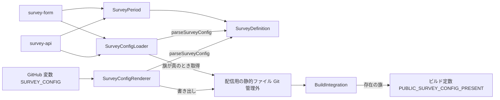
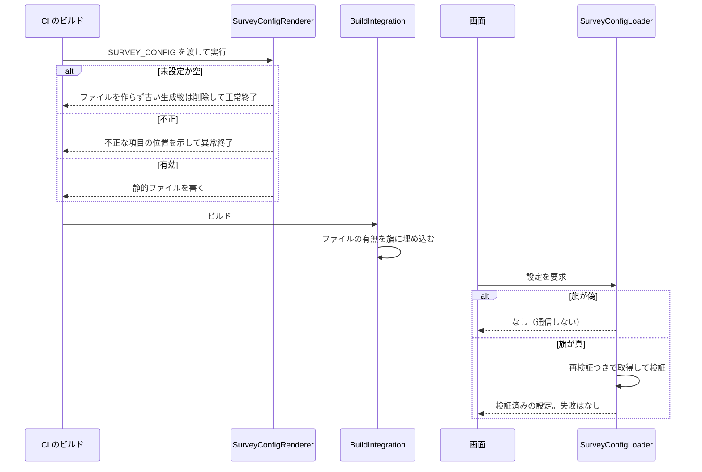

# Design Document

## Overview

**Purpose**: アンケートの期間・質問・選択肢・文言を、コードの外の設定として定義し、検証・判定・配信する土台を提供する。
**Users**: アンケートを実施する運営者と、設定を読んで画面と回答の保存を組み立てる後続の機能（survey-api・survey-form・survey-operation）。
**Impact**: 設定の元（GitHub のリポジトリ変数 `SURVEY_CONFIG`）から、ビルド時に配信用の静的ファイルを生成する工程を足す。変数が未設定の環境（フォークを含む）では何も生成せず、画面にもサーバーにも影響しない。

### Goals

- 設定の形式と検証を、サーバー・クライアント・生成処理が共有する 1 つのスキーマにする。
- 現在のアンケートと保持期限の判定を、時刻を引数に取る純粋関数にする。
- 設定が無い環境では、通信もエラー表示も起こさない。
- 質問・選択肢・文言をソースコードに持たない。

### Non-Goals

- 回答の保存・重複の判定・保持期限による削除の実行（survey-api）。
- 質問の表示と回答の入力（survey-form・choice-question）。
- 設定の元の登録・更新・削除と、運営者への聞き取り・翻訳の作成（survey-operation）。

## Boundary Commitments

### This Spec Owns

- 設定の形式（スキーマと型）、検証、不正の報告の形式。
- 現在のアンケートの判定と、回答データの保持期限の算出・判定。
- 表示言語に応じた文言の選択。
- 設定の取得（画面はビルドの旗を見てから静的ファイルを取得、サーバーは `ASSETS` から読む）と、失敗時に「アンケートなし」とする規則。
- `SURVEY_CONFIG` から配信用の静的ファイルを生成する処理と、そのビルドと CI への組み込み。
- 配信用の静的ファイルの場所。生成物は `public/surveys/index.json`（Git 管理外）、配信 URL は `/surveys/index.json` とする。運営者・画面・サーバーに見える契約である。

### Out of Boundary

- 回答のデータ（D1 のテーブル・API・ハッシュ・削除の実行）。
- ダイアログ・質問の描画・localStorage の判定。
- `gh variable set` による変数の登録と、期限切れの変数の削除。
- e2e のハーネスが開催中の設定を生成する仕組み（survey-form が受け持つ。本 spec の生成処理は、変数の代わりに任意の入力を受け取れる形にしておく）。

### Allowed Dependencies

- `src/lib/i18n/locale.ts` の `LOCALES`・`Locale`（対応言語の単一の源）。
- Zod（既存）。生成処理の実行に `tsx`（既存の devDependency）。
- Astro の `vite.define` によるビルド定数、Workers の `ASSETS` バインディング。
- 依存してはならないもの: `@atproto/*`、D1・R2、セッション。

### Revalidation Triggers

- 設定のスキーマの変更（survey-api の回答の検証、survey-form の描画、survey-operation の組み立てを再確認する）。
- `LOCALES` の追加・削除（既存の設定が不正になる。設定の元の再登録が要る）。
- 保持期限の算出規則の変更（survey-api の削除と、プライバシーポリシーの記載を再確認する）。
- 静的ファイルの URL・ビルドの旗の名前・変数名の変更。

## Architecture

### Existing Architecture Analysis

- 運用者ごとの値は、`astro.config.mjs` が環境変数から読み、`vite.define` でビルド定数にする（`PUBLIC_COMMIT_SHA` など）。同じ形で、設定ファイルの有無を旗にする。
- `hack/*` は配備の前処理を担う。TypeScript のスキーマを共有するため、生成処理は `tsx` で動かす（`apigen:doc` と同じ流儀）。
- `ASSETS` バインディングは `wrangler.template.jsonc` に既にある。サーバーは静的ファイルをネットワークを介さずに読める。
- `src/middleware.ts` から静的に辿れる範囲で `@atproto/*` を読み込まない制約（`tests/lib/coldStart.test.ts` が検査）がある。本 spec の部品は atproto に依存しない。

### Architecture Pattern & Boundary Map



**Architecture Integration**:

- Selected pattern: 純粋なスキーマと判定関数を中心に、取得（I/O）と生成（Node）を外側に置く。
- Dependency direction: `SurveyDefinition` → `SurveyPeriod`・`SurveyConfigLoader`・`SurveyConfigRenderer` → `BuildIntegration` の順に外へ向かう。内側の部品は外側を import しない。
- Domain/feature boundaries: スキーマ（共有の契約）、期間の判定（時刻を注入できる純粋関数）、取得（画面とサーバーの差）、生成（CI）は変更の理由が別なので別の部品にする。
- Existing patterns preserved: Zod による外部入力の検証、`vite.define` によるビルド定数、日本語の責務コメント。
- Steering compliance: `tech.md` の Workers の制約、`structure.md` の `lib/<責務>/` の置き場所、`coding-conventions.md` のコメント規約。

### Technology Stack

| Layer        | Choice / Version               | Role in Feature                        | Notes                                              |
| ------------ | ------------------------------ | -------------------------------------- | -------------------------------------------------- |
| 共有ロジック | TypeScript + Zod（既存）       | スキーマ・検証・期間の判定             | 外部依存の追加なし。Workers・ブラウザ・Node で動く |
| 生成         | `tsx`（既存）                  | 変数からの静的ファイルの生成           | `package.json` のスクリプトから実行                |
| 配信         | Astro の `public/` と `ASSETS` | 静的ファイルの配信とサーバーの読み出し | 静的アセットは Workers の課金対象外                |
| CI           | GitHub Actions（既存）         | ビルドの前に生成を実行                 | 本番・develop・プレビューの各ワークフロー          |

## File Structure Plan

### Directory Structure

```
src/lib/survey/
├── definition.ts      # SurveyDefinition: スキーマ・型・検証・文言の選択（純粋）
├── period.ts          # SurveyPeriod: 現在のアンケートと保持期限の判定（純粋）
└── loadConfig.ts      # SurveyConfigLoader: 配信用の設定の取得。失敗は「なし」
hack/
└── render-survey-config.ts   # SurveyConfigRenderer: 変数から静的ファイルを生成
public/surveys/index.json     # 生成物（Git 管理外）。配信 URL は /surveys/index.json
tests/lib/survey/              # 上の 3 部品の単体テスト
tests/hack/renderSurveyConfig.test.ts
tests/fixtures/survey/         # 検証用の設定（有効・不正の組）
```

### Modified Files

- `astro.config.mjs` — BuildIntegration: 配信用の設定の有無を旗として埋め込む。
- `package.json` — BuildIntegration: 生成のスクリプトを足し、ビルドと開発の前に実行する。
- `.gitignore` — 生成物 `public/surveys/index.json` を管理外にする。
- `.github/workflows/deploy.yaml`・`preview.yaml` — BuildIntegration: ビルドの工程に変数を渡す（検証・e2e のジョブには渡さない）。
- `DEVELOP.md`・`docs/architecture.md` — 設定の仕組みと手元で試す手順を追記する（実装と同じ変更で更新する）。

## System Flows



- 設定の存在を実行時の 404 で知ると、通信とコンソールのエラーが出る。要件 4.1 を満たすため、存在はビルド時に旗として決める。
- 旗が真でも、取得・解析・検証のどれかが失敗したら「なし」を返し、何も表示しない（要件 4.2）。

## Requirements Traceability

| Requirement   | Summary                              | Components                             | Interfaces                                  | Flows          |
| ------------- | ------------------------------------ | -------------------------------------- | ------------------------------------------- | -------------- |
| 1.1, 1.2, 1.3 | 設定の構造と複数選択の上限           | SurveyDefinition                       | `SurveyConfigSchema`                        | —              |
| 1.4, 1.9      | 「回答しない」の識別と数の制約       | SurveyDefinition                       | `SurveyOption.decline`                      | —              |
| 1.5           | 自由記述を持たない                   | SurveyDefinition                       | `SurveyQuestion`（種別は 2 つだけ）         | —              |
| 1.6, 1.7      | 識別子の形式と一意性                 | SurveyDefinition                       | `parseSurveyConfig`                         | —              |
| 1.8           | 質問・選択肢の最小数                 | SurveyDefinition                       | `parseSurveyConfig`                         | —              |
| 1.10          | 定義にない項目の拒否                 | SurveyDefinition                       | `SurveyConfigSchema`（strict）              | —              |
| 2.1, 2.2, 2.3 | 全言語の文言の必須と未対応言語の拒否 | SurveyDefinition                       | `LocalizedText`                             | —              |
| 2.4           | 指定言語の文言の返却                 | SurveyDefinition                       | `localize`                                  | —              |
| 2.5           | 言語の追加で足りない設定を拒否       | SurveyDefinition                       | `LocalizedText`（`Record<Locale, …>`）      | —              |
| 3.1, 3.2, 3.3 | 日時の形式・順序・重複               | SurveyDefinition                       | `parseSurveyConfig`                         | —              |
| 3.4, 3.5      | 現在のアンケートの判定               | SurveyPeriod                           | `currentSurvey`                             | —              |
| 3.6, 3.7, 3.8 | 保持期限の算出と期限切れの判定       | SurveyPeriod                           | `retentionDeadlines`, `retentionExpired`    | —              |
| 4.1, 4.2      | 設定が無い・読めないときの扱い       | SurveyConfigLoader, BuildIntegration   | `fetchSurveyConfig`, `readSurveyConfig`, 旗 | システムフロー |
| 4.3           | 未設定のビルドに設定を含めない       | SurveyConfigRenderer, BuildIntegration | `renderSurveyConfig`, 旗                    | システムフロー |
| 4.4           | 質問をコードに持たない               | SurveyDefinition, SurveyConfigRenderer | —                                           | —              |
| 5.1, 5.2, 5.3 | 生成・未設定・不正                   | SurveyConfigRenderer                   | `renderSurveyConfig`                        | システムフロー |
| 5.4           | 同じ入力で同じ出力                   | SurveyConfigRenderer                   | `renderSurveyConfig`                        | —              |
| 5.5           | 生成物を管理外にする                 | BuildIntegration                       | `.gitignore`                                | —              |
| 5.6           | 不正の報告に値を含めない             | SurveyDefinition, SurveyConfigRenderer | `ParseResult.issues`                        | システムフロー |
| 6.1, 6.2, 6.3 | ビルド前の生成と失敗時の中止         | BuildIntegration                       | ワークフローの環境変数                      | システムフロー |
| 6.4           | 検証用のビルドは変数に依存しない     | BuildIntegration                       | `renderSurveyConfig` の入力                 | —              |
| 6.5           | 変数が無い環境でも工程が通る         | SurveyConfigRenderer, BuildIntegration | `renderSurveyConfig`                        | システムフロー |

## Components and Interfaces

| Component            | Domain/Layer | Intent                             | Req Coverage                                                                                        | Key Dependencies (P0/P1)                | Contracts |
| -------------------- | ------------ | ---------------------------------- | --------------------------------------------------------------------------------------------------- | --------------------------------------- | --------- |
| SurveyDefinition     | 共有ロジック | 設定の形式・検証・文言の選択       | 1.1, 1.2, 1.3, 1.4, 1.5, 1.6, 1.7, 1.8, 1.9, 1.10, 2.1, 2.2, 2.3, 2.4, 2.5, 3.1, 3.2, 3.3, 4.4, 5.6 | `LOCALES`（P0）, Zod（P0）              | Service   |
| SurveyPeriod         | 共有ロジック | 現在のアンケートと保持期限の判定   | 3.4, 3.5, 3.6, 3.7, 3.8                                                                             | SurveyDefinition（P0）                  | Service   |
| SurveyConfigLoader   | 取得         | 配信用の設定の取得。失敗は「なし」 | 4.1, 4.2                                                                                            | SurveyDefinition（P0）, `ASSETS`（P1）  | Service   |
| SurveyConfigRenderer | 生成         | 変数から静的ファイルを生成         | 4.3, 4.4, 5.1, 5.2, 5.3, 5.4, 5.6, 6.4, 6.5                                                         | SurveyDefinition（P0）, `tsx`（P1）     | Batch     |
| BuildIntegration     | ビルド・CI   | 生成と旗をビルドと CI に組み込む   | 4.1, 4.3, 5.5, 6.1, 6.2, 6.3, 6.4, 6.5                                                              | SurveyConfigRenderer（P0）, Astro（P0） | Batch     |

### 共有ロジック

#### SurveyDefinition

| Field        | Detail                                                                                              |
| ------------ | --------------------------------------------------------------------------------------------------- |
| Intent       | 設定の形式を定め、外部入力を検証して型付きで返す                                                    |
| Requirements | 1.1, 1.2, 1.3, 1.4, 1.5, 1.6, 1.7, 1.8, 1.9, 1.10, 2.1, 2.2, 2.3, 2.4, 2.5, 3.1, 3.2, 3.3, 4.4, 5.6 |

**Responsibilities & Constraints**

- スキーマと型の単一の源。サーバー・画面・生成処理が同じものを使う。
- 不正の報告に入力の値を載せない。
- `@atproto/*`・D1・セッションに依存しない。

**Dependencies**

- Inbound: SurveyPeriod, SurveyConfigLoader, SurveyConfigRenderer, survey-api, survey-form, survey-operation — 検証済みの設定を読む（P0）
- External: `LOCALES`（`src/lib/i18n/locale.ts`）— 必須の言語の一覧（P0）, Zod — 検証（P0）

**Contracts**: Service [x]

##### Service Interface

```ts
import type { z } from "zod"
import type { Locale } from "@/lib/i18n/locale"

/** 全対応言語の文言。言語を足すと、スキーマ側が型エラーで追随を求める */
export type LocalizedText = Record<Locale, string>

export type SurveyOption = {
  id: string
  label: LocalizedText
  /** 選ぶと回答を完了として扱わない（「回答しない」） */
  decline?: boolean
}
export type SurveyQuestion =
  | {
      id: string
      kind: "single"
      title: LocalizedText
      options: SurveyOption[]
    }
  | {
      id: string
      kind: "multiple"
      title: LocalizedText
      options: SurveyOption[]
      /** 選べる数の上限。1 以上かつ decline を除く選択肢の数以下 */
      maxSelect?: number
    }
export type Survey = {
  id: string
  opensAt: string // UTC からのオフセット付き ISO 8601
  closesAt: string // 同上。この時刻を含まない
  title: LocalizedText
  description?: LocalizedText
  questions: SurveyQuestion[]
}
export type SurveyConfig = { surveys: Survey[] }

export type ParseResult =
  { ok: true; config: SurveyConfig } | { ok: false; issues: string[] } // 各要素は「位置: 理由」。入力の値を含めない

export const SurveyConfigSchema: z.ZodType<SurveyConfig>
export const parseSurveyConfig: (input: unknown) => ParseResult
export const localize: (text: LocalizedText, locale: Locale) => string
```

- Preconditions: `input` は任意の値（`unknown`）。
- Postconditions: `ok: true` のとき、`config` は下記の規則をすべて満たす。
- Invariants: 返す `issues` は固定の理由と位置だけで組み立てる。

| 規則         | 内容                                                                                                                     |
| ------------ | ------------------------------------------------------------------------------------------------------------------------ |
| 識別子       | `^[a-z0-9]+(-[a-z0-9]+)*$`、40 文字以内。アンケートはファイル内、質問は同じアンケート内、選択肢は同じ質問内で一意        |
| 文言         | 各言語のキーを持つ strict なオブジェクト。`trim()` 後に 1 文字以上。未対応の言語のキーは拒否                             |
| 質問・選択肢 | `kind` で分岐。選択肢は 2 つ以上、`decline` は 1 質問に 1 つまで。`maxSelect` は `multiple` だけ                         |
| アンケート   | 質問は 1 つ以上。`description` は任意（指定するなら全言語）                                                              |
| 日時         | オフセットつきの ISO 8601。`closesAt` は `opensAt` より後                                                                |
| 期間の重複   | `opensAt` 順に並べ、直前の `closesAt` より前に始まる次のアンケートを拒否。`closesAt` と次の `opensAt` が等しい隣接は許す |
| 余計な項目   | すべて strict。定義にない項目を拒否                                                                                      |

**Implementation Notes**

- Integration: `localize` は `text[locale]` を返すだけで、フォールバックを持たない。全言語が必須のため、型の上で欠けることがない。
- Validation: 言語の追加は、スキーマ側を `satisfies Record<Locale, …>` で書くことで、足りない箇所が型エラーになる。
- Risks: `LOCALES` を増やすと、登録済みの設定が不正になる。Revalidation Triggers に記載した。

#### SurveyPeriod

| Field        | Detail                                       |
| ------------ | -------------------------------------------- |
| Intent       | 時刻から現在のアンケートと保持期限を判定する |
| Requirements | 3.4, 3.5, 3.6, 3.7, 3.8                      |

**Responsibilities & Constraints**

- すべて `now` を引数に取る純粋関数にし、内部で現在時刻を読まない。
- 「1 か月後」は、`closesAt` を日本標準時（UTC+9、夏時間なし）の暦に直して月を 1 つ進める。翌月に同じ日がなければその月の末日にする（1/31 → 2/28）。時刻は保つ。
- 期限は `now >= 期限` で過ぎたとする。`closesAt` の瞬間にアンケートは閉じ、回答済みの集合の期限も切れる。

**Dependencies**

- Inbound: survey-api, survey-form, survey-operation — 判定を使う（P0）
- Outbound: SurveyDefinition — 型（P0）

**Contracts**: Service [x]

##### Service Interface

```ts
export const currentSurvey: (
  config: SurveyConfig,
  now: Date,
) => Survey | undefined
// opensAt <= now < closesAt。期間の重複は SurveyDefinition が排除するため、高々 1 件

export type RetentionDeadlines = {
  /** 回答済みの利用者の集合の保持期限 = closesAt */
  respondentsUntil: Date
  /** 回答の保持期限 = closesAt の 1 か月後 */
  answersUntil: Date
}
export const retentionDeadlines: (survey: Survey) => RetentionDeadlines
export const retentionExpired: (
  survey: Survey,
  now: Date,
) => { respondents: boolean; answers: boolean }
```

### 取得

#### SurveyConfigLoader

| Field        | Detail                                                   |
| ------------ | -------------------------------------------------------- |
| Intent       | 配信用の設定を取得して検証する。どの失敗も「なし」にする |
| Requirements | 4.1, 4.2                                                 |

**Responsibilities & Constraints**

- ビルドの旗が偽なら、通信も読み出しもしない。
- 404・通信エラー・解析の失敗・検証の失敗を区別せず「なし」にし、例外を投げず、表示もしない。
- 取得先は `/surveys/index.json`。画面側は再検証つきで取得し、期間の開始と終了の反映の遅れを抑える。サーバー側は設定の内容だけを 60 秒メモリに保持してよい（判定の時刻は呼び出し側が渡す）。

**Dependencies**

- Inbound: survey-api, survey-form — 設定を得る（P0）
- Outbound: SurveyDefinition — 検証（P0）
- External: `ASSETS` バインディング — サーバーでの読み出し（P1）, ビルドの旗（P0）

**Contracts**: Service [x]

##### Service Interface

```ts
/** ビルドの旗。未定義と "true" 以外は偽 */
export const isSurveyConfigPresent: () => boolean

export const fetchSurveyConfig: (options?: {
  present?: boolean
  fetcher?: typeof fetch
}) => Promise<SurveyConfig | undefined>

export const readSurveyConfig: (
  assets: { fetch(input: Request | string): Promise<Response> },
  origin: string,
  options?: { present?: boolean },
) => Promise<SurveyConfig | undefined>
```

- Preconditions: `present` を省くとビルドの旗を使う（テストでは明示する）。
- Postconditions: 返り値が `undefined` でないとき、検証を通った設定である。

### 生成

#### SurveyConfigRenderer

| Field        | Detail                                             |
| ------------ | -------------------------------------------------- |
| Intent       | 変数の値を検証して、配信用の静的ファイルに書き出す |
| Requirements | 4.3, 4.4, 5.1, 5.2, 5.3, 5.4, 5.6, 6.4, 6.5        |

**Responsibilities & Constraints**

- 未設定・空白だけなら、既存の生成物を削除して（なければ何もせず）正常終了する。
- 設定として読めない値は固定の文言だけを標準エラーに出す。パーサーの例外メッセージは入力の断片を含むため出さない。検証の失敗は位置と理由を出す。
- 検証を通した内容をスキーマの順で書く。入力のキーの順に依らず同じ内容になり、繰り返し実行しても結果が変わらない。
- 入力は引数で受け取れる形にする（CI は環境変数から、e2e などは任意の入力から呼べる）。

**Dependencies**

- Inbound: BuildIntegration — ビルドの前に実行（P0）
- Outbound: SurveyDefinition — 検証（P0）
- External: `tsx` — TypeScript の実行（P1）

**Contracts**: Batch [x]

##### Batch / Job Contract

- Trigger: ビルドと開発サーバーの前のスクリプト、および手元での実行。
- Input / validation: 設定の元の文字列（未設定可）。`parseSurveyConfig` で検証する。
- Output / destination: `public/surveys/index.json`（Git 管理外。配信 URL は `/surveys/index.json`）。
- Idempotency & recovery: 同じ入力で同じ出力。未設定のときは古い生成物を取り除く。失敗時はファイルを書かずに終了コード 1。

```ts
export const renderSurveyConfig: (
  raw: string | undefined,
  outputPath: string,
) => { status: "written" | "removed" | "absent"; issues?: string[] }
// written / removed / absent は終了コード 0、検証の失敗は 1
```

### ビルド・CI

#### BuildIntegration

| Field        | Detail                                         |
| ------------ | ---------------------------------------------- |
| Intent       | 生成と存在の旗を、ビルドと CI の工程に組み込む |
| Requirements | 4.1, 4.3, 5.5, 6.1, 6.2, 6.3, 6.4, 6.5         |

**Responsibilities & Constraints**

- 配信用の設定の有無を、`vite.define` でビルド定数 `PUBLIC_SURVEY_CONFIG_PRESENT`（"true" / "false"）として埋め込む。
- ビルドと開発サーバーの前に生成のスクリプトを実行する。
- 本番・develop・プレビューのビルドの工程にだけ `SURVEY_CONFIG` を渡す。検証と e2e のジョブには渡さない。
- 生成の失敗は、ビルドの失敗として配備の前に止まる。

**Dependencies**

- Outbound: SurveyConfigRenderer — 生成の実行（P0）
- External: Astro の設定、GitHub Actions のワークフロー — 組み込み先（P0）

**Contracts**: Batch [x]

##### Batch / Job Contract

- Trigger: `npm run build`・開発サーバーの起動・CI のビルド工程。
- Input / validation: リポジトリ変数 `SURVEY_CONFIG`（ワークフローの環境変数経由）。
- Output / destination: ビルド成果物に含まれる静的ファイルと旗。
- Idempotency & recovery: 変数が同じなら成果物も同じ。変数が未設定なら成果物に何も含めない。

**Implementation Notes**

- Integration: フォークなどで `vars.SURVEY_CONFIG` が空文字になっても、生成は「なし」で正常終了する。
- Validation: 旗が真になるのは、生成物が存在するビルドだけ。
- Risks: 旗はビルドの成果物に固定されるため、設定を変えるには再ビルド（再配備）が要る。設計の前提（設定の変更は再デプロイ）と一致する。

## Error Handling

### Error Strategy

- 生成時の不正は、ビルドの失敗として運営者にすぐ見せる（黙って無効にしない）。メッセージは位置と理由だけを示し、設定の値は出さない。
- 実行時の失敗（取得・検証）は利用者に見せず、アンケートなしとして続ける。利用者の通常の操作を妨げない。

### Error Categories and Responses

- **運営者のエラー（設定の不備）**: 生成が異常終了し、位置と理由を標準エラーに出す。ビルドは中止される。
- **システムエラー（取得の失敗）**: 「なし」を返す。画面は何も出さず、サーバーは期間外と同じ扱いにする。
- **業務ルール違反（期間の重複・言語の欠落）**: 検証が拒否し、どの項目かを示す。

## Testing Strategy

### Unit Tests

- SurveyDefinition: 有効な設定が通る。識別子の重複・不正な文字、選択肢 1 つ、`decline` が 2 つ、`single` の `maxSelect`、`maxSelect` の範囲外、定義にない項目、質問 0 件が拒否される（1.1, 1.2, 1.3, 1.4, 1.5, 1.6, 1.7, 1.8, 1.9, 1.10）。各言語の欠落・空白・余計な言語が拒否され、`LocalizedText` のキーが `LOCALES` と一致する（2.1, 2.2, 2.3, 2.4, 2.5）。終了 ≦ 開始と期間の重複が拒否され、隣接は通る（3.1, 3.2, 3.3）。不正の報告に入力の値が含まれない（5.6）。
- SurveyPeriod: `opensAt` ちょうど・`closesAt` の直前と直後で現在のアンケートが変わる（3.4, 3.5）。保持期限が通常の月・1/31・うるう年の 1/29・12 月の繰り上がりで正しい。期限切れの判定が期限の直前・ちょうど・直後で変わる（3.6, 3.7, 3.8）。
- SurveyConfigLoader: 旗が偽のとき取得の関数が呼ばれず「なし」。旗が真で 404・通信エラー・壊れた JSON・検証の失敗が「なし」、有効なら設定が返る。サーバー側も `ASSETS` のモックで同様に確認する（4.1, 4.2）。

### Integration Tests

- SurveyConfigRenderer: 有効→書かれ、同じ入力の 2 回目で内容が同一（5.1, 5.4）。未設定・空→ファイルなし、古い生成物は削除（5.2, 6.5）。不正な入力→異常終了で、標準エラーに入力の値が含まれない（5.3, 5.6）。
- BuildIntegration: 変数を与えたビルドで静的ファイルと旗（真）が成果物に含まれ、与えないビルドでは含まれず旗が偽になる（4.1, 4.3, 6.1, 6.4）。

### E2E/UI Tests

- 本 spec の範囲に画面はない。設定が無いときに何も表示されないことは、survey-form の E2E で確認する。

## Security Considerations

- 設定は公開の静的ファイルとして配信される。質問・選択肢・文言以外の情報（秘密・回答者・内部の識別子）を載せない。strict なスキーマが、意図しない項目の混入を生成時に止める。
- 生成のログに設定の値を出さない。
