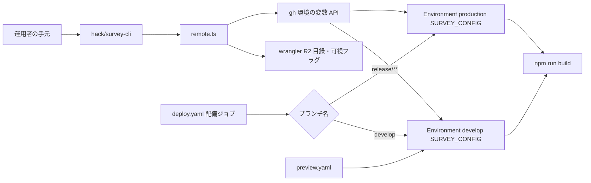
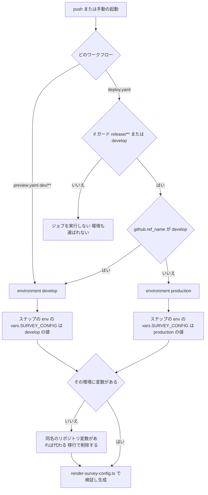
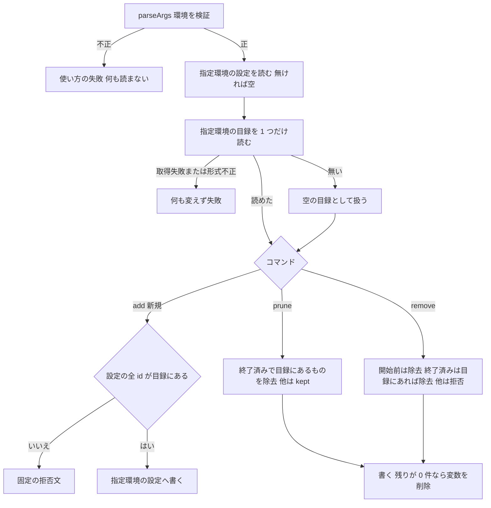
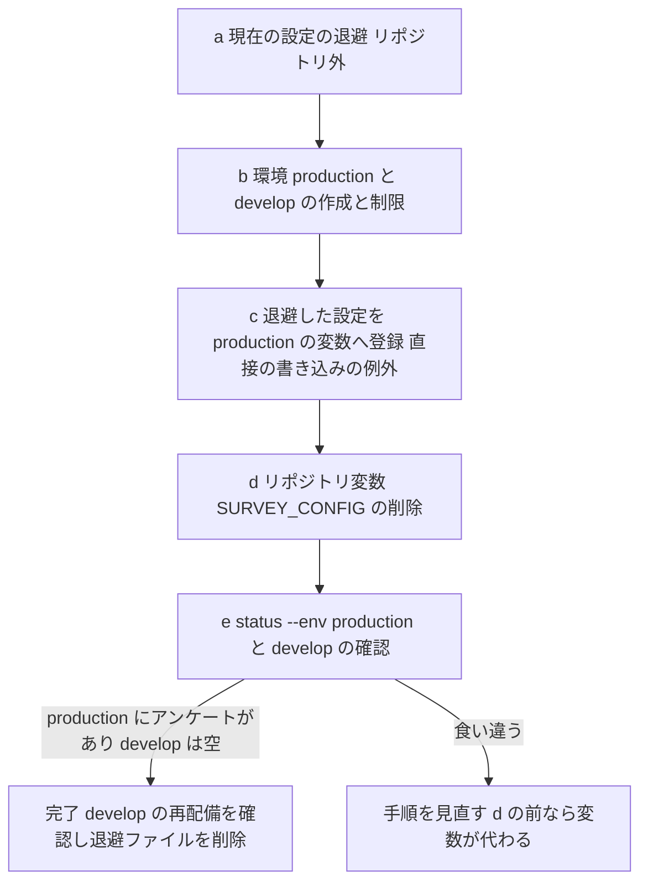

# Design Document

## Overview

**Purpose**: アンケートの設定（`SURVEY_CONFIG`）を、本番（`production`）と検証用（`develop`）で別々に持てるようにする。GitHub の Environments（環境ごとに変数や配備の制限を持てる GitHub の仕組み）に環境ごとの変数を置き、ビルドは自分の環境の値だけを読む。運用 CLI は 6 つのコマンドすべてで `--env` を必須にし、登録・除去の判断を指定した環境の目録（集計済みアンケートの一覧）だけで行う。

**Users**: 手元で認証済みの `gh` と `wrangler` を使うアンケートの運用者と、手順を案内する `survey-run` skill。

**Impact**: 今は `deploy.yaml`・`preview.yaml` が同じリポジトリ変数を読み、CLI の `prune`・`remove`・`add` が両環境の目録を突き合わせている。これを「環境ごとの変数」と「1 環境の目録だけで判断する CLI」に置き換える。両環境を突き合わせるための型・分岐・固定文は削除する（v2 は未公開のため、互換の層は作らない）。

### Goals

- develop に置いた試験用のアンケートが本番のビルドに載らず、本番の設定も develop に漏れない。
- 6 つのコマンドが、指定した環境の設定・目録・可視フラグだけを読み書きする。
- 既存の設定を、失わずに `production` へ移す手順を決める（移行の途中で、環境の変数が無いと同名のリポジトリ変数へ代わる点を踏まえる）。
- 設定の JSON の作り方（`add --file`）、結果の 1 行の形式、終了コード、秘密を出さない規則は変えない。

### Non-Goals

- 設定の形式（`SurveyConfigSchema`）、統計ファイルの形式、集計、結果ページ。
- CI への変数の書き込み権限の付与（書き込みは手元の認証済み `gh` だけ）。
- 環境の作成と変数の移行の実行そのもの（手順だけを定める。実行は運用者）。
- `survey-operations` 4.2 の実機の確認（この spec の完了後に develop の試験用アンケートで行う）。

## Boundary Commitments

### This Spec Owns

- ビルドがどの環境の `SURVEY_CONFIG` を読むかの選択（`deploy.yaml` の配備ジョブと `preview.yaml` の `environment:`）。
- CLI の環境の指定（6 コマンドで `--env` 必須）、環境の変数の読み書き・削除、環境が未作成のときの失敗の分類。
- `add`・`prune`・`remove` の判断を、指定した環境の目録だけで完結させる規則と、その固定の文言。
- 共有の設定（リポジトリ変数 `SURVEY_CONFIG`）から環境の設定への移行の手順（`docs/DEVELOP.md`・`survey-run` skill）。
- `survey-run` skill の 2 つの複製（`.claude/skills/` と `.agents/skills/`）を同じ内容に保つ。`.agents` の複製は Codex が読むため、この spec の対象に含める（決定 2026-11-16。research.md の「survey-run skill の 2 つの複製」）。
- `survey-operations` と `roadmap.md` の、共有の設定・両環境の目録を前提にした記述への追補。

### Out of Boundary

- 設定の形式・質問・下書きの形式・識別子の採番・締切の規則（`survey-operations` / `surveys`）。
- 目録・結果・可視フラグの形式と書き込み（`survey-results-aggregation`。読むだけ）。
- 公開の切り替え・再配備の起動・リリースブランチの選び方（`survey-operations` の要件 4・5。動作を変えない）。
- 環境や変数の実際の作成・移行の実行、`.claude/settings` への実行許可の追加。
- `scripts/survey/render-survey-config.ts`、`scripts/secrets/sync-github-variables.mjs`、ローカルの `npm run dev` と E2E の仕組み（変更しない。理由は Existing Architecture Analysis）。

### Allowed Dependencies

- `@/lib/survey/definition`（`parseSurveyConfig`）、`@/lib/survey/results/schema`（目録の検証と読み取り）、`@/lib/api/contract/surveyPath`（`idSchema`）。
- 運用者の手元の `gh`・`wrangler`・`git`（子プロセス）。GitHub の REST API の環境の変数（`repos/{repo}/environments/{env}/variables/SURVEY_CONFIG`）。
- 禁止: CI（ワークフロー）から変数へ書き込むこと、リポジトリ変数 `SURVEY_CONFIG` への読み書きを CLI に残すこと、`src/` から `hack/` への参照。

### Revalidation Triggers

- 環境の追加（`production`・`develop` 以外）、環境の名前の変更。`SurveyEnv` と GitHub の環境名と、結果の保管先の環境の対応が崩れる。
- `deploy.yaml` の対象ブランチ・環境の選択式・`preview.yaml` の対象の変更。
- GitHub の環境の変数 API、`gh variable --env` の挙動の変更（特に 404 の応答）。
- 目録の読み取り（`survey-results-aggregation` の形式・`readIndex` の契約）の変更。
- 設定の変数の大きさの上限（48 KB）の変更。
- リポジトリ変数 `SURVEY_CONFIG` が再び作られたとき（環境の変数が無い環境へ代わるため、本番・develop の分離が崩れる）。

## Architecture

### Existing Architecture Analysis

- CLI は「入口 `cli.ts`（流れ）・`args.ts`（引数）・`config.ts`/`lifecycle.ts`（純粋な変換と判定）・`remote.ts`（外部の操作。`SurveyRemote` の背後）」に分かれ、テストは偽の `SurveyRemote` と偽の `RunCommand` で行う。この分離は保つ。
- 現状の両環境の突き合わせは `cli.ts` の `readIndexes`、`lifecycle.ts` の `AggregatedByEnv`・`environments`・`PruneKept.pending`・`RemoveDecision` の `pending`、固定の拒否文 2 か所にだけある。`config.ts` の `addSurvey`・`removeSurveys` は 1 つの設定を受けて返す純粋な関数で、環境を知らない。変更は要らない。
- 設定の読み書きは `remote.ts` の 3 メソッド（`readConfigValue`・`writeConfigValue`・`deleteConfigValue`）に閉じている。リポジトリ変数のパス（`actions/variables`）と `gh variable ... -R` を使う。
- ワークフローでは、`SURVEY_CONFIG` を読むのは `deploy.yaml` の `Run build` と `preview.yaml` の `Run build` の、ステップの `env:` だけ（`verify.yaml`・`e2e.yaml` は参照しない。調査済み）。環境の変数はジョブに `environment:` を付けたジョブのステップで読める。ワークフロー直下の `env:` では読めないが、`SURVEY_CONFIG` はそこに置いていないため、参照式（`${{ vars.SURVEY_CONFIG }}`）は変えなくてよい。
- `render-survey-config.ts` は環境変数 `SURVEY_CONFIG` の値だけを読む。値の出どころに依存しないため変更しない。ローカルの `SURVEY_CONFIG="$(cat my-survey.json)" npm run dev` と E2E のハーネス（`envWithE2eSurveyConfig`）も、環境変数を直接渡すため影響を受けない。
- `scripts/secrets/sync-github-variables.mjs` は `SURVEY_CONFIG` を管理の対象外（`MANAGED_ELSEWHERE`）にしており、リポジトリ変数の一覧だけを見る。環境の変数は見ないため変更しない。

### Architecture Pattern & Boundary Map



- Selected pattern: 現行の分離を保ち、環境を「変数の置き場の名前」として一貫して渡す。CLI は `SurveyEnv`（`production` | `develop`）をそのまま GitHub の環境名と結果の保管先の環境に使う（名前の変換表を持たない）。
- New components: なし。新規のテストファイルは 2 つ（ワークフローの構造の検査、`survey-run` の 2 つの複製の一致の検査）。既存の CLI の 4 ファイル、ワークフロー 2 本、`survey-run` の複製 2 つを変える。
- Steering compliance: 判断・規則は `.kiro/` に残す（`spec-practices.md`）。`docs/` は人が読む手順だけ。CLI のテストは `tests/unit/hack/survey-cli/`（`testing.md` の unit 層、P0 外）。

### Technology Stack

| Layer        | Choice / Version                           | Role in Feature                   | Notes                                                   |
| ------------ | ------------------------------------------ | --------------------------------- | ------------------------------------------------------- |
| CLI          | TypeScript（`tsx`）、`hack/survey-cli/`    | 6 コマンドの `--env` 必須化と判断 | 現行どおり。`package.json` の `survey` は変えない       |
| 設定の保存   | GitHub Environments の変数 `SURVEY_CONFIG` | 環境ごとの設定                    | 読みは `gh api`、書き・削除は `gh variable ... --env`   |
| 結果の保管先 | `wrangler r2 object get`                   | 指定した環境の目録の読み取り      | 現行どおり                                              |
| CI           | GitHub Actions のジョブの `environment:`   | ビルドが読む変数の環境の選択      | 書き込み権限は与えない（`permissions: contents: read`） |

## File Structure Plan

### Directory Structure

新規のファイルは 2 つ（ワークフローの構造の静的な検査、`survey-run` の 2 つの複製の一致の検査）。残りは既存の変更。

```
.github/workflows/
├── deploy.yaml      # 変更: deploy ジョブに environment: を付ける
└── preview.yaml     # 変更: preview ジョブに environment: develop を付ける
.agents/skills/survey-run/
└── SKILL.md         # 変更: .claude 側の更新後の内容で全体を置き換える（2 つの複製を byte 単位で同一にする）
.claude/skills/survey-run/
└── SKILL.md         # 変更: 6 コマンドの --env・環境の独立・移行の手順
hack/survey-cli/
├── args.ts          # 変更: add・prune・remove に env を必須で持たせる
├── cli.ts           # 変更: 1 環境の目録だけを読む。固定文・案内の更新
├── lifecycle.ts     # 変更: 環境の突き合わせを削除し、1 環境の集合で判定する
└── remote.ts        # 変更: 設定の読み・書き・削除を環境の変数へ
tests/unit/scripts/
├── surveyWorkflowEnvironment.test.ts  # 新規: ワークフローの構造の静的な検査（テキスト）
└── surveyRunSkillCopies.test.ts       # 新規: survey-run の 2 つの複製が同じ内容であることの静的な検査
```

`config.ts` は変更しない（環境を知らない純粋な変換のため）。

### Modified Files

- `.github/workflows/deploy.yaml` — `deploy` ジョブに `environment: ${{ github.ref_name == 'develop' && 'develop' || 'production' }}` を足す。先頭コメントの「Variables:」の説明に、`SURVEY_CONFIG` は環境（`production`・`develop`）の変数であると足す。
- `.github/workflows/preview.yaml` — `preview` ジョブに `environment: develop` を足す。コメントに同様の説明を足す。
- `hack/survey-cli/args.ts` — `Command` の `add`・`prune`・`remove` に `env: SurveyEnv` を足し、`--env` の検証を 6 コマンド共通にする。「`--env` を使えません」の拒否を削除する。
- `hack/survey-cli/cli.ts` — `readIndexes` を、1 環境の目録を読んで検証する `loadIndex` に置き換え、`add`・`prune`・`remove`・`status`・`publish`・`unpublish` が同じものを使う。設定の読み取りを環境つきにする。固定の拒否文を要件 4.4 の文言にする。`failure` に環境未作成の分類を足す。
- `hack/survey-cli/lifecycle.ts` — `AggregatedByEnv`・`environments` を削除。`PruneKept`・`RemoveDecision` から `pending` を外し、`decidePrune`・`decideRemove` は 1 環境の集計済みの識別子の集合だけを受ける。
- `hack/survey-cli/remote.ts` — `SurveyRemote` の設定の 3 メソッドに `env` を足し、環境の変数のパス・コマンドへ変える。`RemoteErrorKind` に環境未作成を足す。ファイル先頭のコメントを環境の変数に合わせる。
- `tests/unit/hack/survey-cli/{args,lifecycle,cli,remote}.test.ts` — Testing Strategy に列挙した項目を直す。
- `docs/DEVELOP.md` — 3.2（変数の説明・コマンドの列挙・新規登録の拒否文・環境ごとの独立）、5.1（`deploy.yaml` が環境を選ぶこと）、5.4（`prune --env`、取り込み前の除去、develop の除去は本番と独立）、6.2 の変数の表の `SURVEY_CONFIG` 行（環境の変数。6.2.1 を参照）と、6.2 の中の新しい小節 `#### 6.2.1 アンケートの設定（環境ごとの変数）` を足す。6.9 の決定の後ろには置かない（6.9 は節の締めの決定の記録のため）。6.2.1 の内容は、(1) 2 つの GitHub の環境と配備ブランチの制限の作成、(2) `SURVEY_CONFIG` は環境ごとの変数で、`npm run survey -- ... --env` だけで管理すること、(3) リポジトリ変数からの移行の手順 (a)〜(e)（(d) の前提を含む）、(4) リポジトリ変数が残るときの警告（環境の変数が無い環境では同名のリポジトリ変数の値が使われる）。重ならないよう、`survey-results-public` が編集する CI/CD の認証情報・R2・6.5 の `SURVEY_RESULTS` には触れない。6.2.1 には、移行の (d) の前提（Migration Strategy の「(d) の前提」と同じ内容）、(e) の develop の再配備の確認、手順の認証の確認に `gh auth status` を含めることを書く。
- `.claude/skills/survey-run/SKILL.md` と `.agents/skills/survey-run/SKILL.md`（2 つの複製。この spec で両方を変える）— `.claude` の複製は、6 コマンドすべてで `--env` 必須、環境ごとの独立、1 環境の目録だけで決まる登録・除去、develop の試験の流れ、移行の手順への案内（(d) の前提と (e) の再配備の確認を含む）を書く。`.agents` の複製は古い内容を直さず、`.claude` の複製を更新した後に全体を置き換え、2 つを byte 単位で同一にする（Codex がアンケートを作るときも同じ手順になる）。`docs/DEVELOP.md` 3.2 の `.agents/skills/survey-run/` の記述（Codex 用）は、この複製が同じ内容になるため、そのまま正しい。
- `.kiro/specs/survey-operations/{requirements,design,tasks}.md` と `.kiro/steering/roadmap.md` — 追補（Migration Strategy の後ろの「既存の記述への追補」に一覧）。既存の記述は消さない。

## System Flows

### 環境の選択（ビルドが読む設定）



- ブランチの選択式は、既存の `concurrency.group` と `TARGET_FLAG` と同じ式（`github.ref_name == 'develop'`）にそろえる。`release/**` かどうかの判断は `if:` が先に行うため、式は「develop か、それ以外（= release）」の 2 択でよい。
- 手動起動（`workflow_dispatch`）で `release/**`・`develop` 以外が選ばれたときは、既存の `if:` でジョブごと実行されない。`environment:` はジョブが実行されるときだけ解決される想定である（Open Questions / Risks の項目 7 に記す）。`release/**` の手動起動の `dry_run` は、`production` の環境の設定でビルドと検証だけを行う。
- リポジトリ変数が残っていると、環境の変数が無い環境へ代わる。これが移行の順序（共有の設定の削除は環境の設定の登録の後）の理由で、`remote.ts` はリポジトリ変数を読まない（要件 3.1）。このため 1.4 と 1.5 は、この順序と「リポジトリ変数を作り直さない」でだけ成り立つ（注 1）。

### add・prune・remove の判断（指定した環境だけ）



- 目録を読むのは 1 環境の 1 回だけ。`--dry-run` でも読む（要件 4.2）。もう一方の環境の目録・設定・可視フラグには触れない。
- 目録が無い（R2 のキーが無い）ときは空の目録（要件 4.3）。取得失敗・形式不正は、何も書かずに失敗。

## Requirements Traceability

| Requirement | Summary                                         | Components                                 | Interfaces                                           | Flows              |
| ----------- | ----------------------------------------------- | ------------------------------------------ | ---------------------------------------------------- | ------------------ |
| 1.1         | release/\*\* は production の設定               | deploy.yaml                                | ジョブの `environment:` の式                         | 環境の選択         |
| 1.2         | develop ブランチは develop の設定               | deploy.yaml                                | ジョブの `environment:` の式                         | 環境の選択         |
| 1.3         | dev/\*\* のプレビューは develop の設定          | preview.yaml                               | `environment: develop`                               | 環境の選択         |
| 1.4         | 対象外の環境・共有の設定を渡さない              | deploy.yaml, preview.yaml, 移行手順        | 環境の変数、共有の設定の削除（注 1）                 | 環境の選択         |
| 1.5         | 設定が無ければ機能なしで完了                    | render-survey-config.ts（変更なし）        | 既存の「未設定なら作らない」（注 1）                 | 環境の選択         |
| 1.6         | 対象ブランチ・配備の可否を変えない              | deploy.yaml, preview.yaml                  | 既存の `on:`・`if:` を保つ                           | 環境の選択         |
| 1.7         | verify・E2E に渡さない                          | verify.yaml, e2e.yaml（変更なし）          | `environment:` を付けない                            | 環境の選択         |
| 2.1         | 6 コマンドで `--env` 必須                       | args.ts                                    | `Command`、`parseEnv`                                | 判断               |
| 2.2         | 不正な env は何も読まず使い方の失敗             | args.ts, cli.ts                            | `parseArgs` が先に失敗                               | 判断               |
| 2.3         | 指定した環境だけに触れる                        | cli.ts, remote.ts                          | `SurveyRemote` の env つきメソッド                   | 判断               |
| 2.4         | dry-run・no-deploy・repo・出力の規則を保つ      | args.ts, cli.ts                            | 既存の検証を保つ                                     | 判断               |
| 2.5         | JSON の作り方を変えない                         | config.ts（変更なし）                      | `addSurvey`                                          | —                  |
| 3.1         | 環境の設定だけを読む                            | remote.ts                                  | `readConfigValue(env)`                               | 環境の選択         |
| 3.2         | 環境の設定だけに書く・削除                      | remote.ts                                  | `writeConfigValue(env, …)`、`deleteConfigValue(env)` | 判断               |
| 3.3         | 未登録は空の設定                                | remote.ts, cli.ts                          | `readConfigValue` の 404 は `undefined`              | 判断               |
| 3.4         | 環境が未作成での書き込みは固定の文言で失敗      | remote.ts, cli.ts                          | `RemoteError("no-environment")`、`failure`           | 判断               |
| 3.5         | 環境が未作成での読み取りは空                    | remote.ts                                  | 404 は `undefined`                                   | 判断               |
| 3.6         | 残らなければ環境の変数を削除                    | cli.ts, remote.ts                          | `deleteConfigValue(env)`、404 は済みとする           | 判断               |
| 3.7         | 48 KB 上限を環境ごとに適用、status は指定環境   | cli.ts, config.ts                          | `addSurvey`、`runStatus` の見出し                    | —                  |
| 3.8         | 読めない・利用不可は区別できる固定文言          | remote.ts, cli.ts                          | `remoteErrorFor`、`failure`                          | 判断               |
| 4.1         | 新規登録は全 id が指定環境の目録にあるときだけ  | cli.ts                                     | `loadIndex`、`runAdd`                                | 判断               |
| 4.2         | add は dry-run でも指定環境の目録だけを読む     | cli.ts                                     | `loadIndex(remote, env)`                             | 判断               |
| 4.3         | 目録が無ければ空、失敗・不正は何も変えず失敗    | cli.ts, remote.ts                          | `readIndex(env)`                                     | 判断               |
| 4.4         | 固定の拒否文（この環境の文言）                  | cli.ts                                     | `NEW_REGISTRATION_REFUSAL`                           | 判断               |
| 4.5         | 締切の規則を指定環境の目録で適用                | cli.ts                                     | `runAdd` の既存の更新の分岐                          | 判断               |
| 4.6         | 同じ下書きを別々の環境へ独立して登録            | cli.ts, remote.ts                          | 環境ごとの設定・採番                                 | —                  |
| 4.7         | 検証・開始日時・識別子・変更なしの規則を保つ    | config.ts（変更なし）                      | `addSurvey`                                          | —                  |
| 5.1         | prune は指定環境の記録があるものだけ除去        | lifecycle.ts, cli.ts                       | `decidePrune(config, ids, now)`                      | 判断               |
| 5.2         | もう一方の目録を読まない                        | cli.ts                                     | `loadIndex(remote, env)` の 1 回                     | 判断               |
| 5.3         | 記録の無い終了済みは残し「この環境で未集計」    | lifecycle.ts, cli.ts                       | `kept <id>(not-aggregated: <env>)`                   | 判断               |
| 5.4         | 目録を読めない・形式不正は何も除去しない        | cli.ts                                     | `loadIndex` の失敗                                   | 判断               |
| 5.5         | 開始前・開催中は prune で除去しない             | lifecycle.ts                               | `decidePrune`                                        | 判断               |
| 5.6         | 開始前の remove は除去                          | lifecycle.ts                               | `decideRemove`                                       | 判断               |
| 5.7         | 終了済みは指定環境の記録があるときだけ除去      | lifecycle.ts                               | `decideRemove`                                       | 判断               |
| 5.8         | 未記録の終了済み・開催中は拒否                  | lifecycle.ts, cli.ts                       | `RemoveDecision`、拒否の 1 行                        | 判断               |
| 5.9         | 設定に無い識別子は not-found                    | cli.ts                                     | 既存の `not-found` の行                              | 判断               |
| 5.10        | 強制の指定を持たない                            | args.ts                                    | `--force` の拒否を保つ                               | —                  |
| 5.11        | 除去・残した識別子と案内を結果に示す            | cli.ts                                     | `NOT_AGGREGATED_GUIDANCE`                            | 判断               |
| 6.1         | 移行の順序 (a)〜(e)                             | DEVELOP.md 6.2.1, survey-run（2 つの複製） | 手順の記述                                           | Migration Strategy |
| 6.2         | (d) を (c) の後に置く理由                       | DEVELOP.md 6.2.1, survey-run（2 つの複製） | 手順の記述                                           | Migration Strategy |
| 6.3         | 移行後の status の確認                          | DEVELOP.md 6.2.1, cli.ts                   | `status --env production` / `develop`                | Migration Strategy |
| 6.4         | 退避の本文をリポジトリ・出力に残さない          | DEVELOP.md 6.2.1                           | 退避先・削除の手順                                   | Migration Strategy |
| 6.5         | 運用者の作業・手元の認証済み gh                 | DEVELOP.md 6.2.1                           | 手順の記述                                           | Migration Strategy |
| 6.6         | 共有の設定が残る状態の警告                      | DEVELOP.md 6.2.1, survey-run（2 つの複製） | 手順の記述                                           | Migration Strategy |
| 7.1         | skill に 6 コマンドの `--env`・独立・判断を示す | survey-run SKILL.md（2 つの複製）          | 手順の記述                                           | —                  |
| 7.2         | skill に develop の試験の流れを示す             | survey-run SKILL.md（2 つの複製）          | 手順の記述                                           | —                  |
| 7.3         | DEVELOP.md の 3.x・5.x・6.x を環境ごとに        | DEVELOP.md                                 | Modified Files に列挙した見出し                      | —                  |
| 7.4         | prune --env production と develop の独立        | DEVELOP.md 5.4                             | 手順の記述                                           | —                  |
| 7.5         | 環境の作成・登録・移行の順序を示す              | DEVELOP.md 6.2.1                           | 手順の記述                                           | Migration Strategy |
| 7.6         | 直接の書き換えをしない（移行は例外と明記）      | DEVELOP.md, survey-run（2 つの複製）       | 手順の記述                                           | Migration Strategy |
| 7.7         | roadmap と survey-operations への追補           | 追補の一覧                                 | 既存の記述を残し置き換えを示す                       | —                  |
| 7.8         | リリースブランチの選び方・再配備を変えない      | cli.ts（`runVisibilitySwitch`）            | 既存の分岐を保つ                                     | —                  |

注 1（1.4・1.5）: GitHub は、ジョブが環境を使うとき、環境の変数が無ければ同名のリポジトリ変数の値を使う。そのため、ワークフローの設定だけでは 1.4（共有の設定を渡さない）と 1.5（設定が無ければ機能なしで完了）を強制できない。両方が成り立つのは、移行の (d) でリポジトリ変数 `SURVEY_CONFIG` を削除し、以後リポジトリ変数を作り直さない場合だけである。環境の変数を `prune` で全部削除したときも、同名のリポジトリ変数が残っている間（移行の途中だけ）は同じことが起きる。

## Components and Interfaces

| Component    | Domain/Layer | Intent                                      | Req Coverage                                                   | Key Dependencies (P0/P1)                          | Contracts |
| ------------ | ------------ | ------------------------------------------- | -------------------------------------------------------------- | ------------------------------------------------- | --------- |
| deploy.yaml  | CI           | 配備のビルドに環境の設定を渡す              | 1.1, 1.2, 1.4, 1.6, 1.7                                        | GitHub Environments (P0)                          | Batch     |
| preview.yaml | CI           | プレビューのビルドに develop の設定を渡す   | 1.3, 1.4, 1.6                                                  | GitHub Environments (P0)                          | Batch     |
| args.ts      | CLI 入口     | 6 コマンドの `--env` を検証する             | 2.1, 2.2, 2.4, 5.10                                            | なし                                              | Service   |
| cli.ts       | CLI 流れ     | 1 環境の設定・目録だけで 6 コマンドを進める | 2.3, 3.3, 3.6, 3.7, 3.8, 4.1–4.6, 5.1–5.4, 5.8, 5.9, 5.11, 7.8 | remote.ts (P0), lifecycle.ts (P0), config.ts (P0) | Service   |
| lifecycle.ts | CLI 判定     | 1 環境の集計済みの集合で除去を判定する      | 5.1, 5.3, 5.5, 5.6, 5.7, 5.8                                   | なし                                              | Service   |
| remote.ts    | CLI 外部     | 環境の変数の読み書き・削除と失敗の分類      | 3.1, 3.2, 3.3, 3.4, 3.5, 3.6, 3.8                              | `gh` (P0)、`wrangler` (P0)                        | Service   |
| 手順書       | 運用         | 環境の作成・移行・日常の手順を示す          | 6.1–6.6, 7.1–7.7                                               | なし                                              | —         |

### CI

#### deploy.yaml / preview.yaml

| Field        | Detail                                                                      |
| ------------ | --------------------------------------------------------------------------- |
| Intent       | ビルドのジョブに GitHub の環境を付け、`vars.SURVEY_CONFIG` を環境の値にする |
| Requirements | 1.1, 1.2, 1.3, 1.4, 1.6, 1.7                                                |

**Responsibilities & Constraints**

- `deploy.yaml` の `deploy` ジョブにだけ `environment:` を付ける。`verify`・`e2e`（呼び出しの再利用ワークフロー）には付けない。そのため両ジョブは環境の変数を読めず、`SURVEY_CONFIG` は渡らない（1.7）。
- `preview.yaml` の `preview` ジョブに `environment: develop` を付ける。

```yaml
# deploy.yaml
deploy:
  needs: [verify, e2e]
  if: startsWith(github.ref, 'refs/heads/release/') || github.ref == 'refs/heads/develop'
  # release/** は production、develop は develop の環境の変数を使う。
  environment: ${{ github.ref_name == 'develop' && 'develop' || 'production' }}
```

```yaml
# preview.yaml
preview:
  # dev/** のプレビューは develop の環境の変数を使う。
  environment: develop
```

- `on:`・`if:`・`concurrency:`・`permissions:`・`Run build` の `SURVEY_CONFIG: ${{ vars.SURVEY_CONFIG }}` の記述は変えない（式は同じで、環境を付けたジョブでは環境の値に解決される）。
- 環境のデプロイブランチの制限（GitHub 側の設定。運用者が環境の作成時に行う）: `develop` の環境に `develop` と `dev/**`、`production` の環境に `release/**`。`dev/**` が `dev/foo` に一致するかは確認済みの事実ではない。環境の作成後に、プレビューを 1 回動かして確かめる。一致しなければ `dev/*` に変えて確かめ、それでも一致しなければ `develop` の環境の制限を外す（Open Questions / Risks の項目 5）。
- GitHub は環境を使うジョブごとに、配備の記録（Deployments）を残す。外部への影響はない。

**Contracts**: Batch [x]

- Trigger: 既存どおり（push、手動）。 Input: 環境の変数。 Output: ビルドの `SURVEY_CONFIG`。
- Idempotency & recovery: 変数が無ければ設定なしで動く。取り違えは、環境の変数を直して再配備すれば直る。

### CLI 入口

#### args.ts

| Field        | Detail                                                      |
| ------------ | ----------------------------------------------------------- |
| Intent       | 6 コマンドすべての `--env` を検証し、型のあるコマンドにする |
| Requirements | 2.1, 2.2, 2.4, 5.10                                         |

```typescript
export type SurveyEnv = "production" | "develop"

export type Command =
  | { name: "add"; file: string; env: SurveyEnv; dryRun: boolean }
  | { name: "status"; env: SurveyEnv }
  | {
      name: "publish" | "unpublish"
      id: string
      env: SurveyEnv
      deploy: boolean
      dryRun: boolean
    }
  | { name: "prune"; env: SurveyEnv; dryRun: boolean }
  | { name: "remove"; id: string; env: SurveyEnv; dryRun: boolean }
```

- 引数の個数・`--file`・`--no-deploy`・`--dry-run` の可否の検証は現状を保つ（`--no-deploy` は `publish`・`unpublish` だけ、`--dry-run` は `status` 以外、`--file` は `add` だけ）。
- `--env` の検証は、コマンドごとの分岐の前に 1 か所へまとめる（`production`・`develop` のどちらかでなければ `error: usage: --env に production または develop を指定してください`）。入力の値は使い方の行に含めない。「`add`・`prune`・`remove` では `--env` を使えません」の 2 つの分岐を削除する。
- 使い方の失敗は、`createSurveyRemote` を作る前に返る。何も読み書きしない（2.2）。

#### cli.ts

| Field        | Detail                                                                                         |
| ------------ | ---------------------------------------------------------------------------------------------- |
| Intent       | 指定した環境の設定と目録だけを読み、判断して書き、固定の行を返す                               |
| Requirements | 2.3, 3.3, 3.6, 3.7, 3.8, 4.1, 4.2, 4.3, 4.4, 4.5, 4.6, 5.1, 5.2, 5.3, 5.4, 5.8, 5.9, 5.11, 7.8 |

```typescript
/** 指定した環境の目録を 1 つだけ読み、検証して返す。無ければ undefined。 */
const loadIndex = async (
  remote: SurveyRemote,
  env: SurveyEnv,
): Promise<SurveyIndex | undefined | SurveyCliResult> => {
  /* … */
}

/** 指定した環境の設定を読む。変数が無い、環境が無い場合は空の設定。 */
const readConfig = async (
  remote: SurveyRemote,
  env: SurveyEnv,
): Promise<SurveyConfig | SurveyCliResult> => {
  /* … */
}
```

- `run` は `parsed.command.env` で設定を読む。`runAdd` に渡す前の読み取りも同じ環境。
- `loadIndex` は現行の `readIndexes` の 1 環境版。両環境を読み切ってから失敗を返す必要がなくなるため、例外はそのまま `run` の `catch`（`failure`）へ流す。目録の形式が不正なら `invalid("目録の形式が正しくありません")`。`runStatus`・`runVisibilitySwitch` にある同じ検証の重複も `loadIndex` に置き換える（二重の検証を 1 つにする）。
- `add`: `ids = indexIds(index)` を作り、新規なら `config.surveys.every(s => ids.has(s.id))` のときだけ進める。満たさなければ次の固定の 1 行（要件 4.4 の文言そのまま）。既存の更新の締切の規則は、`ids.has(existing.id)` で適用する（要件 4.5。文言 `error: refused: 集計済みのアンケートの締切は変更できません` は変えない）。

  `error: refused: この環境に未集計のアンケートがあります。集計を待つか、開始前なら remove、開催中なら締切を前倒しして配備し、集計を待ってください。`

- `prune`: `decidePrune(config, ids, now)`。残したものの行は `kept <id>(not-aggregated: <env>)` （環境名は指定した環境の 1 つ）。除去後に残りが 0 件なら `deleteConfigValue(env)`、それ以外は `writeConfigValue(env, …)`。結果の行の形（`removed`・`nothing to remove`・`nothing removed`・`(surveys N -> M)`）は変えない。
- `remove`: `decideRemove(survey, ids, now)`。拒否は `error: refused: <id> is active (results would be lost)`、または `error: refused: <id> is closed (results would be lost; not aggregated: <env>)` に、案内を添える。
- 案内の `NOT_AGGREGATED_GUIDANCE`（` ; see DEVELOP.md 5.4 / survey-run (not-aggregated)`）は文言を変えない。指す先の DEVELOP.md 5.4 と skill の該当の項は、この spec で「その環境の目録に記録がない」ことの手順に書き換える（要件 5.11）。
- `failure(error)` に環境未作成の種類を足す: `error: no-environment: GitHub の環境が未作成か、権限が足りません。DEVELOP.md 6.2.1 の手順で環境を作り、gh auth status で権限を確かめてください`（要件 3.4。環境の値・外部の文言を含めない固定の文言）。
- 削除するもの: `readIndexes`、`productionIds`・`developIds`、両環境の「記録がそろう」条件、「両環境へ配備し」を含む旧い固定文。
- `status` の見出しの `config X/48 KB` は、指定した環境の設定の大きさになる（読み取りが環境つきのため。要件 3.7）。48 KB の上限は `addSurvey` が環境ごとの設定に適用する。
- `runVisibilitySwitch`・`startDeploy`・リリースブランチの選択は変更しない（要件 7.8）。

### CLI 判定

#### lifecycle.ts

| Field        | Detail                                                 |
| ------------ | ------------------------------------------------------ |
| Intent       | 1 環境の集計済みの識別子の集合から、除去の可否を決める |
| Requirements | 5.1, 5.3, 5.5, 5.6, 5.7, 5.8                           |

```typescript
/** 自動除去を保留したアンケート。理由は常に「その環境で未集計」。 */
export type PruneKept = { id: string }

export type RemoveDecision =
    | { kind: "remove" }
    | { kind: "refused"; reason: "active" | "not-aggregated" }

export const decidePrune = (
    config: SurveyConfig,
    aggregated: ReadonlySet<string>,
    now: Date,
): { remove: string[]; kept: PruneKept[] }

export const decideRemove = (
    survey: Survey,
    aggregated: ReadonlySet<string>,
    now: Date,
): RemoveDecision
```

- 終了時刻を過ぎていて `aggregated` にあるものを除去し、無いものを `kept` に入れる。開始前・開催中は対象外（現状の判定を保つ）。`decideRemove` は、開始前なら `remove`、開催中なら `refused: active`、終了済みで `aggregated` に無ければ `refused: not-aggregated`。
- 削除するもの: `AggregatedByEnv`、`environments`、`PruneKept.pending`、`RemoveDecision` の `pending`。

### CLI 外部

#### remote.ts

| Field        | Detail                                                                                         |
| ------------ | ---------------------------------------------------------------------------------------------- |
| Intent       | 指定した環境の変数を読み書き・削除し、失敗を固定の種類に分類する（外部の文言・本文を出さない） |
| Requirements | 3.1, 3.2, 3.3, 3.4, 3.5, 3.6, 3.8                                                              |

```typescript
export type RemoteErrorKind =
  "auth" | "unavailable" | "parse" | "no-environment"

export type SurveyRemote = {
  /** 指定した環境の変数の値。変数が無い、環境が無い場合は undefined。 */
  readConfigValue(env: SurveyEnv): Promise<string | undefined>
  /** 指定した環境の変数へ書く。環境が無ければ RemoteError("no-environment")。 */
  writeConfigValue(env: SurveyEnv, value: string): Promise<void>
  /** 指定した環境の変数を削除する。既に無い（環境が無い場合を含む）ときは何もしない。 */
  deleteConfigValue(env: SurveyEnv): Promise<void>
  /* readIndex 以下は現行のまま */
}
```

- 読み取り: `gh api repos/<repo>/environments/<env>/variables/SURVEY_CONFIG`（現行のリポジトリ変数のパスの代わり）。成功なら `value` を取り出す。標準エラーに `HTTP 404` があれば `undefined`（変数が無いのか環境が無いのかは区別しない。どちらも空として扱う: 要件 3.3・3.5）。ほかは `remoteErrorFor`（`auth` / `unavailable`）。
- 書き込み: `gh variable set SURVEY_CONFIG --env <env> -R <repo>`。値は標準入力で渡す（現行どおり。コマンドの引数や出力に載せない）。失敗時に `HTTP 404` なら `RemoteError("no-environment")`、ほかは `remoteErrorFor`。`--env` なしの呼び出し（リポジトリ変数への書き込み）はコードに残さない。引数の組み立ては `env` を必須とする 1 つの関数に集め、`--env` を付けない経路を作らない（要件 3.2）。
- 最初の実装ステップ（受け入れの前提）: 環境が未作成のリポジトリに対して `gh variable set SURVEY_CONFIG --env <env>` を実行し、標準エラーに `HTTP 404` が含まれることを実リポジトリで確かめる（Open Questions / Risks の項目 1）。含まれなければ、書き込みの経路を事前確認に切り替える。書き込みの前に `gh api repos/<repo>/environments/<env>` を呼び、404 なら `RemoteError("no-environment")`、200 なら `gh variable set` を行う。事前確認の 404 以外の失敗は `remoteErrorFor` で分類する。
- 削除: `gh variable delete SURVEY_CONFIG --env <env> -R <repo>`。`HTTP 404` は「既に無い」で成功扱い。
- `env` は `SurveyEnv`（列挙）のため、API のパスと `--env` の値に使ってよい（利用者の入力は `parseArgs` の検証を通った値だけ）。
- 404 以外の分類は現行の `isAuthFailure`（`401`・`403`・未ログインの語）を保つ。環境の変数の API は、環境が無ければ 404、権限が無ければ 403 になる想定（Open Questions / Risks の項目 2・3）。
- 目録・結果・可視フラグ・配備・ブランチの操作は変更しない。リポジトリ変数のパス（`actions/variables`）と、`gh variable` の `--env` なしの呼び出しはコードから無くす。

**Contracts**: Service [x]

- Preconditions: `env` は `SurveyEnv`。 Postconditions: 失敗時は何も変更しない。 Invariants: 外部コマンドの標準出力・標準エラー・値を例外・結果に含めない。

### 手順書

- `docs/DEVELOP.md`・`survey-run` skill（2 つの複製とも同じ内容）の内容は Modified Files と Migration Strategy に従う。手順書は「設定の変数や公開状態を CLI 以外で直接書き換えない」の原則を保ち、移行の (c) だけが例外であることを明記する（要件 7.6）。

## Data Models

新しいデータはない。環境の設定は、現行の `SURVEY_CONFIG` と同じ JSON（`SurveyConfigSchema`）を GitHub の環境の変数に置く。変数名・大きさの上限（48 KB）も同じ。環境は `production` と `develop` の 2 つで、名前は `SurveyEnv` の値と同じ。目録・結果・可視フラグ（R2）の形式は変えない。

## Error Handling

### Error Strategy

失敗は `RemoteError` の種類（`auth`・`unavailable`・`parse`・`no-environment`）に分類し、`cli.ts` の `failure` が固定の 1 行に変える。外部コマンドの標準エラー・設定の本文・読んだ内容は例外にも出力にも含めない（現行の規則）。

### Error Categories and Responses

| 状況                          | 結果                                                                                                                                             |
| ----------------------------- | ------------------------------------------------------------------------------------------------------------------------------------------------ |
| `--env` が無い・不正          | `error: usage: --env に production または develop を指定してください`（何も読まない）                                                            |
| 環境の変数を読む: 404         | 空の設定として続ける（`status` は `no surveys`、`add` は新しい設定）。権限不足が 404 で隠れる場合も同じく空になる（項目 3）                      |
| 書き込み: 環境が未作成（404） | `error: no-environment: GitHub の環境が未作成か、権限が足りません。DEVELOP.md 6.2.1 の手順で環境を作り、gh auth status で権限を確かめてください` |
| 削除: 404                     | 既に無いものとして成功                                                                                                                           |
| 認証が無い・利用できない      | 現行の `error: auth: …` / `error: unavailable: …`                                                                                                |
| 目録の取得失敗・形式不正      | `error: unavailable: …` / `error: invalid: 目録の形式が正しくありません`。何も変更しない                                                         |
| 新規登録が未集計に妨げられる  | 要件 4.4 の固定の 1 行                                                                                                                           |
| 除去が拒否される              | `error: refused: <id> is active                                                                                                                  | closed (…)`（`not-aggregated` のとき案内つき） |

### Monitoring

なし（CLI の 1 行の結果と、GitHub Actions の実行ログだけ。ワークフローには `SURVEY_CONFIG` の値を出力しない現行の規則を保つ）。

## Testing Strategy

`testing.md` の unit 層。実際の `gh`・`wrangler` は通常のテストで使わない。ワークフローには YAML の構文解析の依存がなく、既存に同じ種類の構造検査もない（`privacyDates.test.ts` がワークフローを読むのは、特定の語が残らないことの確認だけ）。ここでは同じ方式（ファイルを文字列で読む）で、構造を最小限だけ検査する。

### Unit（偽の `SurveyRemote` と偽の `RunCommand`）

- **args**（2.1, 2.2, 2.4, 5.10）: 6 コマンドのすべてで `--env production|develop` が通り、欠落・不正値・重複が使い方の失敗になる。`add`・`prune`・`remove` の期待値に `env` を足す。「`add`・`prune`・`remove` は `--env` を使えない」旨の既存ケースは、「必須」のケースに置き換える。`--force`、`--file`・`--no-deploy` の可否の既存ケースは保つ。使い方の行に入力値が含まれないこと。
- **lifecycle**（5.1, 5.3, 5.5, 5.6, 5.7, 5.8）: `decidePrune`・`decideRemove` を 1 環境の集合で検証する。集合にある・ない・開始前・開催中の組み合わせ。両環境の組み合わせのケースと `pending` の期待値は削除する。
- **remote**（3.1–3.6, 3.8）: 読み取りの引数が `repos/<repo>/environments/<env>/variables/SURVEY_CONFIG` であること、404 が `undefined`、書き込みの引数に `--env <env>` と `-R` が必ず含まれ値が標準入力であること、書き込みの 404 が `no-environment`、削除の 404 が成功、403・未ログインが `auth`、その他が `unavailable`、値・標準エラーが例外に載らないこと。リポジトリ変数のパス・`--env` なしの `gh variable` の呼び出しが無いこと（全呼び出しを走査して確かめる）。
- **remote の事前確認の変形**（最初の実装ステップで `HTTP 404` が出ないと分かった場合だけ）: 環境の確認が 404 のとき `gh variable set` を呼ばず `no-environment` になること、200 のとき書き込みが行われること、確認の 404 以外は `remoteErrorFor` で分類されること。
- **cli add**（4.1–4.6, 3.7）: 指定した環境の目録だけが読まれること（偽の remote が `readIndex` の呼び出しの環境を記録し、もう一方が一度も呼ばれない）、`--dry-run` でも同じ、目録が無ければ空、取得失敗・不正なら何も書かない、全 id が目録にあれば登録できる、そうでなければ要件 4.4 の文言と完全一致する 1 行、既存の更新の締切の拒否、同じ下書きを `production`・`develop` へ別々に登録したとき設定が独立すること、48 KB 超が `too-large` になること。
- **cli prune・remove**（5.1–5.4, 5.8, 5.9, 5.11）: 1 環境の目録だけを読む、記録があるものだけ除去、記録が無い終了済みは `kept <id>(not-aggregated: <env>)` と案内、開始前・開催中は除去しない、全除去で `deleteConfigValue(env)`、目録の失敗で何も変えない、`remove` の開始前・終了済み（記録あり・なし）・開催中・設定に無い識別子。
- **cli status・設定の読み取り**（3.3, 3.5, 3.7）: 設定が無い環境で `status: env=<env> no surveys`、見出しの大きさが指定環境の設定の値であること。
- **cli 失敗**（3.4, 3.8）: 環境が未作成のときの固定の行と、何も書かれていないこと。
- **維持の確認**（7.8）: `publish`・`unpublish`・リリースブランチの選択の既存のテストが、設定の読み取りの環境の変更の影響だけで通ること（期待値の変更は、偽の remote のメソッドの引数に `env` が増えた分だけ）。

### 静的な検査（`tests/unit/scripts/surveyWorkflowEnvironment.test.ts`。ファイルの文字列を読む）

- `deploy.yaml` の `deploy` ジョブに、`github.ref_name == 'develop'` で `develop` を、それ以外で `production` を選ぶ `environment:` があること。`preview.yaml` のジョブに `environment: develop` があること（1.1, 1.2, 1.3）。
- `#` で始まる行（コメント）を除き、`SURVEY_CONFIG` を参照する行が、`deploy.yaml`・`preview.yaml` の `Run build` のステップの `env:` の中にだけあり、ワークフロー直下の `env:` に無いこと（コメントには語が出るため、語の有無では判定せず、`Run build` の `env:` の中かどうかで判定する）。`verify.yaml`・`e2e.yaml` に `SURVEY_CONFIG` が無いこと（1.4, 1.7）。
- `deploy.yaml` の `on:` の対象と `if:` の式、`preview.yaml` の `on:` の対象が、変更前と同じ文字列であること（1.6）。構造の検査は文字列の照合であり、GitHub 側の環境の実在・ブランチの制限は検査できない。

### 静的な検査（`tests/unit/scripts/surveyRunSkillCopies.test.ts`。2 つのファイルを読む）

- `.claude/skills/survey-run/SKILL.md` と `.agents/skills/survey-run/SKILL.md` の内容が、文字単位で同一であること（Decision 1。7.1・7.2 の skill の内容が、Codex 用の複製で古いまま残ることを防ぐ）。失敗したとき、どちらを正とするかは `.claude` の複製である（`.agents` を直す）。

### 人が行う確認（自動化しない）

- 移行の手順（Migration Strategy）の実行と、両環境の `status` の確認（6.1〜6.6）。
- 環境のデプロイブランチの制限が `dev/foo`（プレビュー）に一致するかの確認（プレビューを 1 回動かす）。
- Open Questions / Risks の項目 1〜8 の実機の確認（項目 1・2・3 は実装の最初のステップで行う）。
- develop の試験用アンケートでの、`add`・`status`・`publish`・`unpublish`・`remove`（7.2。`survey-operations` 4.2 を兼ねる）。

## Security Considerations

- CI の `permissions` は `contents: read` のまま。環境の変数への書き込みは、手元で認証済みの `gh`（リポジトリの管理者）だけが行う。
- 環境の変数は平文の設定で、秘密ではない（現行のリポジトリ変数と同じ扱い）。ログに値を出さない規則を保つ。移行で退避した本文は、リポジトリの外の一時ファイルに権限を絞って置き、移行の確認後に削除する。本文を端末へ出力しない（要件 6.4）。
- 環境のデプロイブランチの制限で、`production` の変数が `release/**` 以外のブランチのジョブへ渡らないようにする（`develop` の環境は `develop` と `dev/**`）。制限が使えない場合の弱まりは、リスクとして Migration Strategy に記す。
- 1.4 の強制の限界（注 1 と同じ）: 環境の変数が無い環境では、同名のリポジトリ変数の値が使われる。1.4 は移行の (d) と、リポジトリ変数を作り直さないことでだけ成り立つ。環境の変数の全削除も、同名のリポジトリ変数が残る間（移行の途中だけ）は同じ。

## Migration Strategy

共有の設定（リポジトリ変数）から環境の設定への移行の手順。運用者（または許可を得た作業者）が手元の認証済み `gh` で行い、`docs/DEVELOP.md` の 6.2 の小節 6.2.1 に同じ順序で書く。



1. (a) `gh api repos/<repo>/actions/variables/SURVEY_CONFIG --jq .value` の出力を、権限を絞った一時ファイル（リポジトリの外）へ保存する。端末へ出さず、リポジトリにも結果の出力にも残さない。
2. (b) 環境 `production`・`develop` を作る。デプロイブランチの制限は `develop` の環境に `develop` と `dev/**`、`production` の環境に `release/**`。制限の登録の方法（環境の作成 API と制限の API）は実施時に確かめる。
3. (c) 退避した本文を `gh variable set SURVEY_CONFIG --env production -R <repo> < <退避ファイル>` で登録する。専用 CLI は下書きから 1 件ずつ登録する体系で、識別子・開始日時が決まった既存の設定をそのまま移せないため、ここだけ直接の書き込みを例外として認める（要件 7.6）。
4. (d) リポジトリ変数を削除する（`gh variable delete SURVEY_CONFIG -R <repo>`）。(c) の後に行う理由は、環境の変数が無い環境では同名のリポジトリ変数に代わるため。(c) の前に消すと、本番の設定が一時的に無くなる。**(d) の前提**: 次のどちらかを満たすこと。(i) 環境の付いた新しい `deploy.yaml`・`preview.yaml` が develop に取り込まれ、本番が配備に使う最新の `release/**` ブランチにも取り込まれている。(ii) 本番がまだアンケート機能を配備していない。理由: 配備は、そのブランチ自身のワークフローファイルで動く。古いワークフロー（`environment:` なし）は、(d) の後に `vars.SURVEY_CONFIG` を読むと、削除済みのリポジトリ変数のため空の値になる。
5. (e) `npm run survey -- status --env production` が移した設定のアンケートを示し、`npm run survey -- status --env develop` が `no surveys` を示すことを確かめる。続けて develop を再配備し、develop の表示に移した本番のアンケートが載らないこと（develop の環境の設定は空のため）を確かめる。確認後に退避ファイルを削除する。

- 移行の順序の前提: CLI とワークフローの変更を develop に取り込む前後で、環境の変数が無くても（リポジトリ変数があれば）ビルドは今までと同じ値で動く。移行の完了までの間、develop も同じ値を読むため、今と同じ状態である（悪化しない）。(d) の前提は、上の手順 (d) を参照する。
- 環境の作成前に、ワークフローが `environment:` を参照した場合、GitHub は環境を自動で作る想定である（制限なし）。制限が無い状態を避けるため、(b) をワークフローの取り込みより先に行う（Open Questions / Risks の項目 4）。
- ロールバック: 環境の変数を削除して退避から再度登録、またはリポジトリ変数を作り直す（作り直すと環境の変数が無い環境に代わる。再作成は (e) の確認で失敗した場合だけにする）。
- リスクと代替（項目 5）: デプロイブランチの `dev/**` が一致しなければ、`dev/*` に変えて確かめ、それでも一致しなければ `develop` の環境の制限を外す（`develop` ブランチと `dev/**` が同じ環境を使うため、制限なしでも設定の漏れは起きない。`production` の制限は `release/**` で維持する）。`release/**` が一致しないときは、`release/*` に変えて確かめ、それでも一致しなければ制限を外す（この場合、本番の変数は `release/**` 以外のブランチのジョブからも読めるため、運用者に確認してから外す）。

### 既存の記述への追補（要件 7.7）

既存の記述は削除せず、置き換えを示す注記（`（2026-11-16 追補: survey-env-config が置き換え）`）を足す。

- `survey-operations/requirements.md`: 要件 2（2.1 `--env` の対象、2.3 両環境の目録、2.4 `add` に `--env` を受け付けない、2.5）、要件 6・7（両環境の判断）、8.12〜8.14（両環境の目録での登録判断）、9.16（`status`・`publish`・`unpublish` だけが `--env` 必須）。Introduction・Boundary Context の「CI の設定・`deploy.yaml` の変更は対象外」。
- `survey-operations/design.md`: Boundary Commitments の Out of Boundary（`deploy.yaml` の変更）、System Flows の add・prune・remove の図、Decision 6、`remote.ts` の `SurveyRemote`（設定の 3 メソッドに環境が付く）。
- `survey-operations/tasks.md`: 2.1・2.3・2.4・3.2 の記述のうち「両環境の目録」「`--env` を取らない」。4.2 は、develop の試験用アンケートで進める旨。
- `.kiro/steering/roadmap.md`: Phase 11 に、2026-11-13 の決定（`prune`・`remove` は `--env` を取らない）の置き換えを示す追補と、完了の記録。

## Open Questions / Risks

GitHub 側の挙動のうち、この作業では確かめていない事項。各項目に「未確認の内容」「確認の時期と方法」「外れた場合の代わり」を書く。実装の最初のステップ（受け入れの前提）で確かめるものは、その順で確かめる。

1. **`gh variable set --env` が、未作成の環境に対して標準エラーに `HTTP 404` を出すか**
   - 確認の時期と方法: 実装の最初のステップ。未作成の環境に対して 1 回実行し、標準エラーと終了コードを記録する。
   - 外れた場合: 書き込みの経路を事前確認（`gh api repos/<repo>/environments/<env>` の 404 で `no-environment`）に切り替える（remote.ts の節と Decision 2）。
2. **環境の変数の読み（`gh api repos/<repo>/environments/<env>/variables/SURVEY_CONFIG`）が、環境が無いときに 404 を返すか**
   - 確認の時期と方法: 項目 1 と同じ機会に、未作成の環境に対して読みを 1 回行う。
   - 外れた場合: 404 以外が返るなら、その応答を空として扱ってよいかを判断するため、実装を止めて報告する。読みを空とする要件 3.3・3.5 は保つ。
3. **権限が足りないときの応答（403 か、404 で隠れるか）**
   - 未確認の内容: 404 が権限不足を隠すなら、読みは空に見え、「アンケートが無い」と誤認しうる。
   - 確認の時期と方法: 実装の最初のステップで、項目 1 と同時に、権限の無い状態で読みと書きを 1 回ずつ行う。
   - 外れた場合の代わり（緩和）: 手順書（DEVELOP.md 6.2.1）の認証の確認に `gh auth status` を含める。書き込みの失敗の文言（`no-environment`）は、「環境が未作成か権限が足りない」と案内し、権限の確認を促す。読みの 404 を空とする扱いは変えない。
4. **環境を参照するジョブが、環境が無いとき自動で作るか（制限なしで作られるか）**
   - 確認の時期と方法: (b) の環境を作るより前にワークフローが取り込まれないようにして避ける。自動で作られたかは、取り込み後に環境の一覧で確かめる。
   - 外れた場合: 制限の無い環境が自動で作られたら、(b) の制限を後から付ける。移行の (d) の前提（ワークフローの取り込み）を守る限り、環境の変数が無い状態でもリポジトリ変数は残っており、設定の値は今と同じである。
5. **デプロイブランチの制限の名前のパターンが、実際のブランチに一致するか**（`dev/**` が `dev/foo` に、`release/**` が `release/foo` に一致するか）
   - 確認の時期と方法: `dev/**` は、環境の作成後にプレビューを 1 回動かして確かめる。`release/**` は、`release/` のブランチの手動起動（`dry_run`）で確かめる。
   - 外れた場合: `dev/**` は `dev/*` に変えて確かめ、それでも一致しなければ `develop` の環境の制限を外す。`release/**` は `release/*` に変えて確かめ、それでも一致しなければ制限を外す（運用者に確認してから外す）。
6. **環境の変数の大きさの上限**
   - 未確認の内容: 上限が同じ 48 KB かは未確認。
   - 確認の時期と方法: 移行の (c) で退避した本文を登録し、登録が成功することを確かめる。上限の実値は GitHub の文書で確かめる（実装の時点）。
   - 外れた場合の代わり: 仮定どおり 48 KB を保ち、既存の `too-large` の判定を変えない。上限が 48 KB より小さく登録が失敗すれば、何も変わらず失敗するだけで設定は壊れない。その場合は上限の扱いを運用者に戻して決める。
7. **`if:` で飛ばされたジョブ（実行されないジョブ）が `environment:` を解決するか**
   - 想定: 解決しない（ジョブが実行されるときだけ解決される）。System Flows の手動起動の記述はこの想定に基づく。
   - 確認の時期と方法: 手動起動で `release/**`・`develop` 以外を選んだ実行を見て、配備の記録（Deployments）が増えていないことを確かめる。
   - 外れた場合の代わり: 飛ばされたジョブでも環境が解決されるなら、配備の記録が残るだけでビルドは走らないため、設定の漏れは起きない。記録の扱いを運用者に伝える。
8. **`preview.yaml` の `environment: develop` はジョブ単位のため、ブランチ名が不正でステップが飛ばされても、環境が解決されて配備の記録が残るか。ブランチの制限に合わないと、ジョブ全体が拒否されるか**
   - 確認の時期と方法: 項目 5 のプレビューの実行で、ジョブ全体が拒否されずに動くことを確かめる。不正なブランチ名の場合は、実機で試せる範囲で確かめる。
   - 外れた場合の代わり: 制限に一致しないなら項目 5 の代わりに従う。配備の記録が残るだけでは外部への影響はない。

## Design Decisions

### Decision 1: 設定の読みは `gh api`、書き・削除は `gh variable --env`

- 現行の読みの `gh api`（応答の `value` を取り出す）と、書き・削除の `gh variable`（値は標準入力）の組み合わせを保ち、パスと `--env` だけを変える。値を引数に載せない現行の性質と、既存の分類・テストの形を保てる。代替（`gh api` で全部、`gh variable get` で読み）は research.md に記す。

### Decision 2: 環境が未作成の書き込みだけを新しい種類 `no-environment` にする

- 読み・削除の 404 は「空・済み」で、利用者に違いを示す必要がない。書き込みの 404 だけが、何も書けなかったことと原因（環境が無い）を示す必要がある（要件 3.4）。既存の 3 種に混ぜると、認証や接続の失敗と区別がつかない。
- 書き込みの 404 を標準エラーの `HTTP 404` の照合で判定することは未確認である。最初の実装ステップで実リポジトリにより確かめ、外れたら事前確認（`gh api repos/<repo>/environments/<env>` の有無）へ切り替える（Open Questions / Risks の項目 1）。

### Decision 3: 両環境の突き合わせの型・分岐を残さず、1 環境の集合へ単純化する

- v2 は未公開のため、`pending` の配列や環境の配列を残さない。除去の判断は `ReadonlySet<string>` 1 つで足りる。

### Decision 4: `loadIndex` を 6 コマンドで共通にする

- 目録の読み取りと検証が `readIndexes`・`runStatus`・`runVisibilitySwitch` で重複していたため、1 環境版の 1 関数にまとめ、環境の取り違えが起きる場所を減らす。

### Decision 5: ワークフローの環境の選択は、既存と同じ式で行う

- `concurrency.group`・`TARGET_FLAG` が `github.ref_name == 'develop'` で develop を選んでいるため、同じ式にそろえ、環境と配備先がずれない。`if:` が先に `release/**` と `develop` 以外を止める。

## Supporting References

- 調査の記録（代替案・GitHub の挙動で確かめていない事項）: `.kiro/specs/survey-env-config/research.md`
