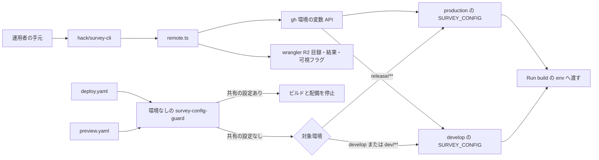
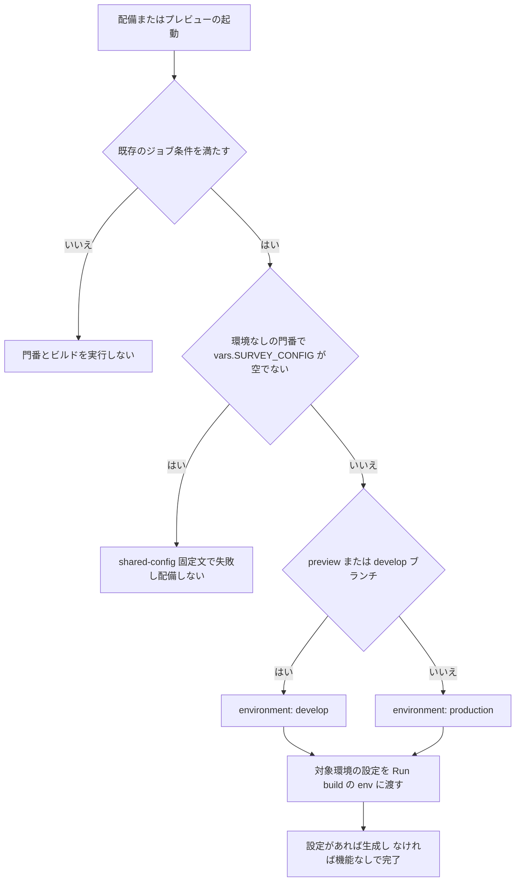
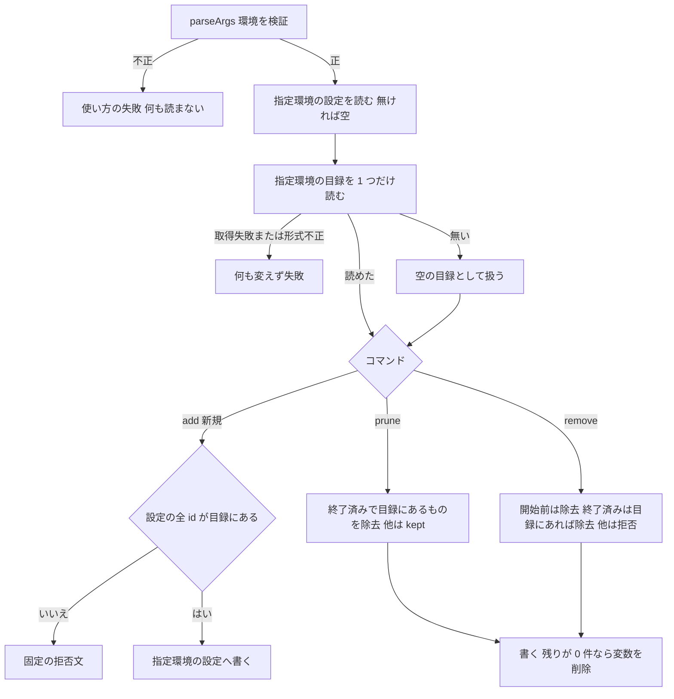
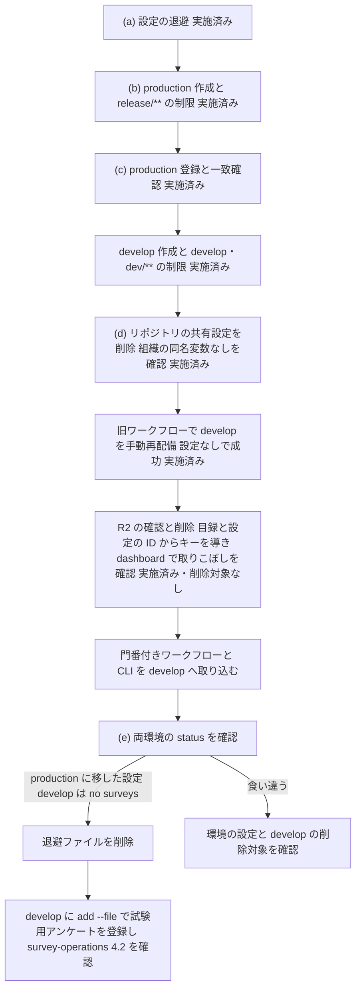

# Design Document

## Overview

**Purpose**: アンケートの設定（`SURVEY_CONFIG`）を、本番（`production`）と検証用（`develop`）で別々に持てるようにする。GitHub の Environments（環境ごとに変数や配備の制限を持てる GitHub の仕組み）に環境ごとの変数を置き、ビルドは自分の環境の値だけを読む。運用 CLI は 6 つのコマンドすべてで `--env` を必須にし、登録・除去の判断を指定した環境の目録（集計済みアンケートの一覧）だけで行う。

**Users**: 手元で認証済みの `gh` と `wrangler` を使うアンケートの運用者と、手順を案内する `survey-run` skill。

**Impact**: 変更前の `deploy.yaml`・`preview.yaml` は同じリポジトリ変数を参照し、CLI の `prune`・`remove`・`add` は両環境の目録を突き合わせる。これを「環境ごとの変数」と「1 環境の目録だけで判断する CLI」に置き換える。2026-11-18 に共有の設定の削除と develop の設定なしでの再配備まで実施済みであり、新しいワークフローと CLI はこれから取り込む。両環境を突き合わせるための型・分岐・固定文は削除する（v2 は未公開のため、互換の層は作らない）。

### Goals

- develop に置いた試験用のアンケートが本番のビルドに載らず、本番の設定も develop に漏れない。
- 6 つのコマンドが、指定した環境の設定・目録・可視フラグだけを読み書きする。
- 既存の設定を、失わずに `production` へ移す手順を決める（移行の途中で、環境の変数が無いと同名のリポジトリ変数へ代わる点を踏まえる）。
- 設定の JSON の作り方（`add --file`）、結果の 1 行の形式、終了コード、秘密を出さない規則は変えない。

### Non-Goals

- 設定の形式（`SurveyConfigSchema`）、統計ファイルの形式、集計、結果ページ。
- CI への変数の書き込み権限の付与（書き込みは手元の認証済み `gh` だけ）。
- 環境の作成と変数の移行の実行そのもの（手順だけを定める。実行は運用者）。
- `survey-operations` 4.2 の実機の確認（この spec の完了後に develop の試験用アンケートで行う）。

## Boundary Commitments

### This Spec Owns

- ビルドがどの環境の `SURVEY_CONFIG` を読むかの選択（`deploy.yaml` の配備ジョブと `preview.yaml` の `environment:`）。
- CLI の環境の指定（6 コマンドで `--env` 必須）、環境の変数の読み書き・削除、環境が未作成のときの失敗の分類。
- `add`・`prune`・`remove` の判断を、指定した環境の目録だけで完結させる規則と、その固定の文言。
- 共有の設定（リポジトリ変数 `SURVEY_CONFIG`）から環境の設定への移行の手順（`docs/DEVELOP.md`・`survey-run` skill）。
- `survey-run` skill の 2 つの複製（`.claude/skills/` と `.agents/skills/`）を同じ内容に保つ。`.agents` の複製は Codex が読むため、この spec の対象に含める（決定 2026-11-16。research.md の「survey-run skill の 2 つの複製」）。
- `survey-operations` と `roadmap.md` の、共有の設定・両環境の目録を前提にした記述への追補。
- `deploy.yaml`・`preview.yaml` の環境なしの門番による、共有の設定が存在する場合のビルドと配備の停止、およびその静的な検査。
- 移行時の develop の設定・目録・結果・可視フラグの削除手順。運用者が `gh`・`wrangler` で行い、専用 CLI の機能は増やさない。
- 実装時に、共有の `.claude/settings.json` の実行許可へ `Bash(npm run survey:*)` だけを追加する。CLI が `gh` を内部で呼ぶため、`gh` の直接実行の許可は追加しない。brief.md と対象範囲が異なる点は、この design.md と利用者の決定（2026-11-18）を正とする。
- 後続の `ops-agent-setup` が `.agents/skills/survey-run/` を削除するときは、`tests/unit/scripts/surveyRunSkillCopies.test.ts` も同時に削除し、存在しない複製を読む検査を残さない。

### Out of Boundary

- 設定の形式・質問・下書きの形式・識別子の採番・締切の規則（`survey-operations` / `surveys`）。
- 目録・結果・可視フラグの形式と既存の書き込み規則の変更（既存の `publish`・`unpublish` の書き込みは保つ。移行時の develop の旧データの削除手順はこの spec に含む）。
- 公開の切り替え・再配備の起動・リリースブランチの選び方（`survey-operations` の要件 4・5。動作を変えない）。
- 環境や変数の実際の作成・移行・旧データの削除の実行（運用者の作業。手順と実装時の実行許可の追加はこの spec に含む）。
- `scripts/survey/render-survey-config.ts`、`scripts/secrets/sync-github-variables.mjs`、ローカルの `npm run dev` と E2E の仕組み（変更しない。理由は Existing Architecture Analysis）。

### Allowed Dependencies

- `@/lib/survey/definition`（`parseSurveyConfig`）、`@/lib/survey/results/schema`（目録の検証と読み取り）、`@/lib/api/contract/surveyPath`（`idSchema`）。
- 運用者の手元の `gh`・`wrangler`・`git`（子プロセス）。GitHub の REST API の環境の変数（`repos/{repo}/environments/{env}/variables/SURVEY_CONFIG`）。
- 禁止: CI（ワークフロー）から変数へ書き込むこと、リポジトリ変数 `SURVEY_CONFIG` への読み書きを CLI に残すこと、`src/` から `hack/` への参照。

### Revalidation Triggers

- 環境の追加（`production`・`develop` 以外）、環境の名前の変更。`SurveyEnv` と GitHub の環境名と、結果の保管先の環境の対応が崩れる。
- `deploy.yaml` の対象ブランチ・環境の選択式・`preview.yaml` の対象の変更。
- GitHub の環境の変数 API、`gh variable --env` の挙動の変更（特に 404 の応答）。
- 目録の読み取り（`survey-results-aggregation` の形式・`readIndex` の契約）の変更。
- 設定の変数の大きさの上限（48 KB = 48,000 バイト）の変更。
- リポジトリまたは組織に変数 `SURVEY_CONFIG` が再び作られたとき（環境なしの門番が検出してビルドと配備を停止する。削除後に再実行する）。

## Architecture

### Existing Architecture Analysis

- CLI は「入口 `cli.ts`（流れ）・`args.ts`（引数）・`config.ts`/`lifecycle.ts`（純粋な変換と判定）・`remote.ts`（外部の操作。`SurveyRemote` の背後）」に分かれ、テストは偽の `SurveyRemote` と偽の `RunCommand` で行う。この分離は保つ。
- 現状の両環境の突き合わせは `cli.ts` の `readIndexes`、`lifecycle.ts` の `AggregatedByEnv`・`environments`・`PruneKept.pending`・`RemoveDecision` の `pending`、固定の拒否文 2 か所にだけある。`config.ts` の `addSurvey`・`removeSurveys` は 1 つの設定を受けて返す純粋な関数で、環境を知らない。環境の分離による変更は不要だが、実測した上限に合わせて `VARIABLE_LIMIT_BYTES` の 1 行だけを `48000` に直す。
- 設定の読み書きは `remote.ts` の 3 メソッド（`readConfigValue`・`writeConfigValue`・`deleteConfigValue`）に閉じている。リポジトリ変数のパス（`actions/variables`）と `gh variable ... -R` を使う。
- ワークフローでは、`SURVEY_CONFIG` を読むのは `deploy.yaml` の `Run build` と `preview.yaml` の `Run build` の、ステップの `env:` だけ（`verify.yaml`・`e2e.yaml` は参照しない。調査済み）。環境の変数はジョブに `environment:` を付けたジョブのステップで読める。ワークフロー直下の `env:` では読めないが、`SURVEY_CONFIG` はそこに置いていないため、参照式（`${{ vars.SURVEY_CONFIG }}`）は変えなくてよい。
- `render-survey-config.ts` は環境変数 `SURVEY_CONFIG` の値だけを読む。値の出どころに依存しないため変更しない。ローカルの `SURVEY_CONFIG="$(cat my-survey.json)" npm run dev` と E2E のハーネス（`envWithE2eSurveyConfig`）も、環境変数を直接渡すため影響を受けない。
- `scripts/secrets/sync-github-variables.mjs` は `SURVEY_CONFIG` を管理の対象外（`MANAGED_ELSEWHERE`）にしており、リポジトリ変数の一覧だけを見る。環境の変数は見ないため変更しない。

### Architecture Pattern & Boundary Map



- Selected pattern: 現行の分離を保ち、環境を「変数の置き場の名前」として一貫して渡す。CLI は `SurveyEnv`（`production` | `develop`）をそのまま GitHub の環境名と結果の保管先の環境に使う（名前の変換表を持たない）。
- 追加する構成: ワークフロー 2 本に環境なしの門番ジョブ `survey-config-guard` を追加する。新規のテストファイルは 2 つ（ワークフローの構造の検査、`survey-run` の 2 つの複製の一致の検査）。既存の CLI の 5 ファイル（`config.ts` は上限の 1 行だけ）、ワークフロー 2 本、skill の複製 2 つ、実行許可と手順書を変更する。
- Steering compliance: 判断・規則は `.kiro/` に残す（`spec-practices.md`）。`docs/` は人が読む手順だけ。CLI のテストは `tests/unit/hack/survey-cli/`（`testing.md` の unit 層、P0 外）。

### Technology Stack

| Layer        | Choice / Version                           | Role in Feature                   | Notes                                                   |
| ------------ | ------------------------------------------ | --------------------------------- | ------------------------------------------------------- |
| CLI          | TypeScript（`tsx`）、`hack/survey-cli/`    | 6 コマンドの `--env` 必須化と判断 | 現行どおり。`package.json` の `survey` は変えない       |
| 設定の保存   | GitHub Environments の変数 `SURVEY_CONFIG` | 環境ごとの設定                    | 読みは `gh api`、書き・削除は `gh variable ... --env`   |
| 結果の保管先 | `wrangler r2 object get`                   | 指定した環境の目録の読み取り      | 現行どおり                                              |
| CI           | GitHub Actions のジョブの `environment:`   | ビルドが読む変数の環境の選択      | 書き込み権限は与えない（`permissions: contents: read`） |

## File Structure Plan

### Directory Structure

新規のファイルは 2 つ（ワークフローの構造の静的な検査、`survey-run` の 2 つの複製の一致の検査）。残りは既存の変更。

```
.github/workflows/
├── deploy.yaml      # 変更: deploy ジョブに environment: を付ける
└── preview.yaml     # 変更: preview ジョブに environment: develop を付ける
.agents/skills/survey-run/
└── SKILL.md         # 変更: .claude 側の更新後の内容で全体を置き換える（2 つの複製を byte 単位で同一にする）
.claude/skills/survey-run/
└── SKILL.md         # 変更: 6 コマンドの --env・環境の独立・移行の手順
hack/survey-cli/
├── args.ts          # 変更: add・prune・remove に env を必須で持たせる
├── config.ts        # 変更: VARIABLE_LIMIT_BYTES を 48000 に直す（1 行。決定 2026-11-17）
├── cli.ts           # 変更: 1 環境の目録だけを読む。固定文・案内の更新
├── lifecycle.ts     # 変更: 環境の突き合わせを削除し、1 環境の集合で判定する
└── remote.ts        # 変更: 設定の読み・書き・削除を環境の変数へ
tests/unit/scripts/
├── surveyWorkflowEnvironment.test.ts  # 新規: ワークフローの構造の静的な検査（テキスト）
└── surveyRunSkillCopies.test.ts       # 新規: survey-run の 2 つの複製が同じ内容であることの静的な検査
```

`config.ts` は、変数の大きさの上限の定数 `VARIABLE_LIMIT_BYTES` を `48 * 1024` から `48000` に直す 1 行だけを変える（環境の変数の実際の上限。Open Questions の項目 6・9。決定 2026-11-17）。それ以外は変更しない（環境を知らない純粋な変換のため）。`cli.ts` の KB 表示（`formatKilobytes`・`VARIABLE_LIMIT_KB`）は 1 KB = 1000 バイトで計算する（`/ 1024` を `/ 1000` に直す）。

### Modified Files

- `.github/workflows/deploy.yaml` — `deploy` ジョブに `environment: ${{ github.ref_name == 'develop' && 'develop' || 'production' }}` を足す。環境なしの `survey-config-guard` ジョブを追加し、`deploy.needs` の既存の `verify`・`e2e` に加える。門番のジョブ条件は `deploy` と同じにし、`permissions: {}` とする。共有の設定はステップの `if:` だけで判定し、固定文を出して失敗する。先頭コメントに環境の変数と門番を説明する。
- `.github/workflows/preview.yaml` — `preview` ジョブに `environment: develop` と `needs: [survey-config-guard]` を足す。環境なしの門番を同じ方式で追加する。現在の `preview` にジョブの `if:` は無いため、門番にも付けず、既存の起動条件を保つ。
- `.claude/settings.json` — 共有の設定ファイルの実行許可へ `Bash(npm run survey:*)` だけを足す。CLI が `gh` を内部で呼ぶため、`gh` の直接実行の許可は追加しない。CI の権限は増やさない。
- `tests/unit/scripts/surveyWorkflowEnvironment.test.ts` — 環境の選択に加え、両ワークフローの門番、環境指定の不在、待ち合わせ、ジョブ条件、空の権限、共有の設定の判定と固定文を検査する。
- `hack/survey-cli/args.ts` — `Command` の `add`・`prune`・`remove` に `env: SurveyEnv` を足し、`--env` の検証を 6 コマンド共通にする。「`--env` を使えません」の拒否を削除する。
- `hack/survey-cli/config.ts` — `VARIABLE_LIMIT_BYTES` を `48 * 1024` から `48000` に直す（環境の変数の実際の上限）。ほかは変更しない。
- `hack/survey-cli/cli.ts` — `readIndexes` を、1 環境の目録を読んで検証する `loadIndex` に置き換え、`add`・`prune`・`remove`・`status`・`publish`・`unpublish` が同じものを使う。設定の読み取りを環境つきにする。固定の拒否文を要件 4.4 の文言にする。`failure` に環境未作成の分類を足す。
- `hack/survey-cli/lifecycle.ts` — `AggregatedByEnv`・`environments` を削除。`PruneKept`・`RemoveDecision` から `pending` を外し、`decidePrune`・`decideRemove` は 1 環境の集計済みの識別子の集合だけを受ける。
- `hack/survey-cli/remote.ts` — `SurveyRemote` の設定の 3 メソッドに `env` を足し、環境の変数のパス・コマンドへ変える。`RemoteErrorKind` に環境未作成を足す。ファイル先頭のコメントを環境の変数に合わせる。`R2_KEY_MISSING_PHRASE` のコメントを、develop で 2026-11-16 に実機の標準エラーとの一致を確認済みである旨へ直す。定数の値は変えない。
- `tests/unit/hack/survey-cli/{args,lifecycle,cli,remote,config}.test.ts` — Testing Strategy に列挙した項目を直す。`config.test.ts` は上限の定数の期待値を `48000` に直す。
- `docs/DEVELOP.md` — 3.2（変数の説明・6 コマンドの環境指定・新規登録の拒否文・環境ごとの独立）、5.1（`deploy.yaml` の環境選択）、5.2（プレビューが develop の環境を使うこと）、5.4（`prune --env production`、取り込み前の除去、develop の除去は本番と独立）、6.2 の変数の表の `SURVEY_CONFIG` 行を更新する。6.2 の中に `#### 6.2.1 アンケートの設定（環境ごとの変数）` を足し、6.9 の後ろには置かない。6.2.1 の内容は、(1) 2 つの環境と配備ブランチの制限、(2) 環境ごとの `SURVEY_CONFIG` を `npm run survey -- ... --env` だけで管理すること、(3) Migration Strategy と同じ手順記号 (a)〜(e)・前提・実施済みの記録、(4) リポジトリまたは組織の同名変数が残ると門番が固定の `shared-config` 文言でビルドと配備を停止し、共有の変数を削除する必要があること、とする。認証の確認に `gh auth status` を含め、旧ワークフローによる develop の再配備と R2 の確認は (d) の実施済み作業として記す。(e) の両環境の `status` と退避ファイルの削除を終えた後、develop の試験用アンケートを `add --file` で登録して `survey-operations` 4.2 の確認に使う手順も示す。設定の値は秘密ではなく、`Run build` の `env:` 見出しで通常のビルドログに出ること、門番自身は値を出力しないことを書く。`survey-results-public` が編集する CI/CD の認証情報・R2・6.5 の `SURVEY_RESULTS` には触れない。
- `.claude/skills/survey-run/SKILL.md` と `.agents/skills/survey-run/SKILL.md`（2 つの複製。この spec で両方を変える）— `.claude` の複製に、6 コマンドすべてで `--env` 必須、環境ごとの独立、1 環境の目録だけで決まる登録・除去、develop の試験の流れを書く。移行の案内は Migration Strategy と同じ (a)〜(e) とし、(d) の前提、共有の設定の削除後に行った旧ワークフローでの再配備と R2 の確認、(e) の両環境の `status` と退避ファイルの削除を記す。develop の試験用アンケートは、新しいワークフローと CLI の取り込み後、(e) の確認を済ませてから `add --file` で登録する。`.agents` の複製は `.claude` の更新後の全文で置き換え、2 つを byte 単位で同一にする。`docs/DEVELOP.md` 3.2 の Codex 用の複製への案内は維持する。
- `.kiro/specs/survey-operations/{requirements,design,tasks}.md` と `.kiro/steering/roadmap.md` — 追補（Migration Strategy の後ろの「既存の記述への追補」に一覧）。既存の記述は消さない。

## System Flows

### 環境の選択（ビルドが読む設定）



- ブランチの選択式は、既存の `concurrency.group` と `TARGET_FLAG` と同じ式（`github.ref_name == 'develop'`）にそろえる。`release/**` かどうかの判断は `if:` が先に行うため、式は「develop か、それ以外（= release）」の 2 択でよい。
- 手動起動（`workflow_dispatch`）で `release/**`・`develop` 以外が選ばれたときは、既存の `deploy.if` と同じ条件により門番も `deploy` も実行されない。飛ばされたジョブは環境を作らず、配備の記録も残さないことを 2026-11-17 に実機で確認済みである（項目 7）。`release/**` の手動起動の `dry_run` も門番を通り、`production` の環境の設定でビルドと検証だけを行う。
- 環境の変数が無い場合、同名のリポジトリ変数へ代わる挙動は実機で確認済みである。新しいワークフローは環境なしの門番でリポジトリ・組織の共有の設定を先に検出し、存在すればビルドと配備を停止する。CLI は共有の設定を読まない（要件 3.1）。共有の設定が無い場合だけ対象環境の設定を読み、未登録なら機能なしで完了する（注 1）。

### add・prune・remove の判断（指定した環境だけ）



- 目録を読むのは 1 環境の 1 回だけ。`--dry-run` でも読む（要件 4.2）。もう一方の環境の目録・設定・可視フラグには触れない。
- 目録が無い（R2 のキーが無い）ときは空の目録（要件 4.3）。取得失敗・形式不正は、何も書かずに失敗。

## Requirements Traceability

| Requirement | Summary                                                        | Components                                                   | Interfaces                                                                                            | Flows              |
| ----------- | -------------------------------------------------------------- | ------------------------------------------------------------ | ----------------------------------------------------------------------------------------------------- | ------------------ |
| 1.1         | release/\*\* は production の設定                              | deploy.yaml                                                  | ジョブの `environment:` の式                                                                          | 環境の選択         |
| 1.2         | develop ブランチは develop の設定                              | deploy.yaml                                                  | ジョブの `environment:` の式                                                                          | 環境の選択         |
| 1.3         | dev/\*\* のプレビューは develop の設定                         | preview.yaml                                                 | `environment: develop`                                                                                | 環境の選択         |
| 1.4         | 対象外の環境・共有の設定を渡さない                             | deploy.yaml, preview.yaml                                    | 環境の変数、環境なしの `survey-config-guard`（注 1）                                                  | 環境の選択         |
| 1.5         | 設定が無ければ機能なしで完了                                   | render-survey-config.ts（変更なし）                          | 既存の「未設定なら作らない」（注 1）                                                                  | 環境の選択         |
| 1.6         | 対象ブランチ・配備の可否を変えない                             | deploy.yaml, preview.yaml                                    | 既存の `on:`・`if:` を保つ                                                                            | 環境の選択         |
| 1.7         | verify・E2E に渡さない                                         | verify.yaml, e2e.yaml（変更なし）                            | `environment:` を付けない                                                                             | 環境の選択         |
| 1.8         | 共有の設定があれば設定を読む前に失敗し配備しない               | deploy.yaml, preview.yaml, surveyWorkflowEnvironment.test.ts | `survey-config-guard`、`needs:`、固定の `shared-config` 文言                                          | 環境の選択         |
| 2.1         | 6 コマンドで `--env` 必須                                      | args.ts                                                      | `Command`、`parseEnv`                                                                                 | 判断               |
| 2.2         | 不正な env は何も読まず使い方の失敗                            | args.ts, cli.ts                                              | `parseArgs` が先に失敗                                                                                | 判断               |
| 2.3         | 指定した環境だけに触れる                                       | cli.ts, remote.ts                                            | `SurveyRemote` の env つきメソッド                                                                    | 判断               |
| 2.4         | dry-run・no-deploy・repo・出力の規則を保つ                     | args.ts, cli.ts                                              | 既存の検証を保つ                                                                                      | 判断               |
| 2.5         | JSON の作り方を変えない                                        | config.ts（上限の 1 行だけ変更）                             | 既存の下書きの検証と `addSurvey`                                                                      | —                  |
| 3.1         | 環境の設定だけを読む                                           | remote.ts                                                    | `readConfigValue(env)`                                                                                | 環境の選択         |
| 3.2         | 環境の設定だけに書く・削除                                     | remote.ts                                                    | `writeConfigValue(env, …)`、`deleteConfigValue(env)`                                                  | 判断               |
| 3.3         | 未登録は空の設定                                               | remote.ts, cli.ts                                            | `readConfigValue` の 404 は `undefined`                                                               | 判断               |
| 3.4         | 環境が未作成での書き込みは固定の文言で失敗                     | remote.ts, cli.ts                                            | `RemoteError("no-environment")`、`failure`                                                            | 判断               |
| 3.5         | 環境が未作成での読み取りは空                                   | remote.ts                                                    | 404 は `undefined`                                                                                    | 判断               |
| 3.6         | 残らなければ環境の変数を削除                                   | cli.ts, remote.ts                                            | `deleteConfigValue(env)`、404 は済みとする                                                            | 判断               |
| 3.7         | 48 KB 上限を環境ごとに適用、status は指定環境                  | cli.ts, config.ts                                            | `VARIABLE_LIMIT_BYTES`（48000）、`addSurvey`、`runStatus` の見出し                                    | —                  |
| 3.8         | 読めない・利用不可は区別できる固定文言                         | remote.ts, cli.ts                                            | `remoteErrorFor`、`failure`                                                                           | 判断               |
| 4.1         | 新規登録は全 id が指定環境の目録にあるときだけ                 | cli.ts                                                       | `loadIndex`、`runAdd`                                                                                 | 判断               |
| 4.2         | add は dry-run でも指定環境の目録だけを読む                    | cli.ts                                                       | `loadIndex(remote, env)`                                                                              | 判断               |
| 4.3         | 目録が無ければ空、失敗・不正は何も変えず失敗                   | cli.ts, remote.ts                                            | `readIndex(env)`                                                                                      | 判断               |
| 4.4         | 固定の拒否文（この環境の文言）                                 | cli.ts                                                       | `NEW_REGISTRATION_REFUSAL`                                                                            | 判断               |
| 4.5         | 締切の規則を指定環境の目録で適用                               | cli.ts                                                       | `runAdd` の既存の更新の分岐                                                                           | 判断               |
| 4.6         | 同じ下書きを別々の環境へ独立して登録                           | cli.ts, remote.ts                                            | 環境ごとの設定・採番                                                                                  | —                  |
| 4.7         | 検証・開始日時・識別子・変更なしの規則を保つ                   | config.ts（上限の 1 行だけ変更）                             | 既存の `addSurvey` の変換と検証                                                                       | —                  |
| 5.1         | prune は指定環境の記録があるものだけ除去                       | lifecycle.ts, cli.ts                                         | `decidePrune(config, ids, now)`                                                                       | 判断               |
| 5.2         | もう一方の目録を読まない                                       | cli.ts                                                       | `loadIndex(remote, env)` の 1 回                                                                      | 判断               |
| 5.3         | 記録の無い終了済みは残し「この環境で未集計」                   | lifecycle.ts, cli.ts                                         | `kept <id>(not-aggregated: <env>)`                                                                    | 判断               |
| 5.4         | 目録を読めない・形式不正は何も除去しない                       | cli.ts                                                       | `loadIndex` の失敗                                                                                    | 判断               |
| 5.5         | 開始前・開催中は prune で除去しない                            | lifecycle.ts                                                 | `decidePrune`                                                                                         | 判断               |
| 5.6         | 開始前の remove は除去                                         | lifecycle.ts                                                 | `decideRemove`                                                                                        | 判断               |
| 5.7         | 終了済みは指定環境の記録があるときだけ除去                     | lifecycle.ts                                                 | `decideRemove`                                                                                        | 判断               |
| 5.8         | 未記録の終了済み・開催中は拒否                                 | lifecycle.ts, cli.ts                                         | `RemoveDecision`、拒否の 1 行                                                                         | 判断               |
| 5.9         | 設定に無い識別子は not-found                                   | cli.ts                                                       | 既存の `not-found` の行                                                                               | 判断               |
| 5.10        | 強制の指定を持たない                                           | args.ts                                                      | `--force` の拒否を保つ                                                                                | —                  |
| 5.11        | 除去・残した識別子と案内を結果に示す                           | cli.ts                                                       | `NOT_AGGREGATED_GUIDANCE`                                                                             | 判断               |
| 6.1         | 移行の順序 (a)〜(e)                                            | DEVELOP.md 6.2.1, survey-run（2 つの複製）                   | 手順の記述                                                                                            | Migration Strategy |
| 6.2         | 共有の設定の削除・再配備・旧データの確認を取り込み前に行う理由 | DEVELOP.md 6.2.1, survey-run（2 つの複製）                   | 実施順序と前提の記述                                                                                  | Migration Strategy |
| 6.3         | 移行後の status の確認                                         | DEVELOP.md 6.2.1, cli.ts                                     | `status --env production` / `develop`                                                                 | Migration Strategy |
| 6.4         | 退避の本文をリポジトリ・出力に残さない                         | DEVELOP.md 6.2.1                                             | 退避先・削除の手順                                                                                    | Migration Strategy |
| 6.5         | 運用者の作業・手元の認証済み gh                                | DEVELOP.md 6.2.1                                             | 手順の記述                                                                                            | Migration Strategy |
| 6.6         | 共有の設定が残る場合の停止と削除の案内                         | DEVELOP.md 6.2.1, survey-run（2 つの複製）                   | 門番による停止と共有の設定の削除手順                                                                  | Migration Strategy |
| 6.7         | develop の設定・目録・結果・可視フラグを移行時に削除           | DEVELOP.md 6.2.1, survey-run（2 つの複製）                   | 再配備後に目録と設定の識別子からキーを導き、運用者が確認・削除する手順。取りこぼしは dashboard で確認 | Migration Strategy |
| 7.1         | skill に 6 コマンドの `--env`・独立・判断を示す                | survey-run SKILL.md（2 つの複製）                            | 手順の記述                                                                                            | —                  |
| 7.2         | skill に develop の試験の流れを示す                            | survey-run SKILL.md（2 つの複製）                            | 手順の記述                                                                                            | —                  |
| 7.3         | DEVELOP.md の 3.x・5.x・6.x を環境ごとに                       | DEVELOP.md                                                   | Modified Files に列挙した見出し                                                                       | —                  |
| 7.4         | prune --env production と develop の独立                       | DEVELOP.md 5.4                                               | 手順の記述                                                                                            | —                  |
| 7.5         | 環境の作成・登録・移行の順序を示す                             | DEVELOP.md 6.2.1                                             | 手順の記述                                                                                            | Migration Strategy |
| 7.6         | 直接の書き換えをしない（移行は例外と明記）                     | DEVELOP.md, survey-run（2 つの複製）                         | 手順の記述                                                                                            | Migration Strategy |
| 7.7         | roadmap と survey-operations への追補                          | 追補の一覧                                                   | 既存の記述を残し置き換えを示す                                                                        | —                  |
| 7.8         | リリースブランチの選び方・再配備を変えない                     | cli.ts（`runVisibilitySwitch`）                              | 既存の分岐を保つ                                                                                      | —                  |

注 1（1.4・1.5・1.8）: GitHub は、環境の変数が無い場合に同名のリポジトリ変数へ代わる。新しいワークフローは、環境なしの `survey-config-guard` で `vars.SURVEY_CONFIG != ''` を判定し、リポジトリまたは組織の共有の設定があれば固定文で失敗する。`deploy`・`preview` は `needs:` で門番の成功を待つため、共有の設定をビルドへ渡さない。環境なしのジョブには環境の変数が見えず、リポジトリ・組織の変数だけが見えることは実機で確認済みである。共有の設定が無く、対象環境にも設定が無い場合は、既存の生成処理がアンケート機能なしで完了する。

## Components and Interfaces

| Component                           | Domain/Layer | Intent                                                        | Req Coverage                                                   | Key Dependencies (P0/P1)                          | Contracts |
| ----------------------------------- | ------------ | ------------------------------------------------------------- | -------------------------------------------------------------- | ------------------------------------------------- | --------- |
| deploy.yaml                         | CI           | 門番の成功後に対象環境の設定をビルドへ渡す                    | 1.1, 1.2, 1.4, 1.6, 1.7, 1.8                                   | GitHub Environments (P0)                          | Batch     |
| preview.yaml                        | CI           | 門番の成功後に develop の設定をビルドへ渡す                   | 1.3, 1.4, 1.6, 1.8                                             | GitHub Environments (P0)                          | Batch     |
| render-survey-config.ts（変更なし） | ビルド       | 設定が無い場合はアンケート機能を生成しない                    | 1.5                                                            | 既存の設定の検証 (P0)                             | Batch     |
| config.ts（上限の 1 行だけ変更）    | CLI 変換     | 下書きの形式・変換の規則を保ち、48,000 バイトの上限を適用する | 2.5, 3.7, 4.7                                                  | 既存の設定のスキーマ (P0)                         | Service   |
| args.ts                             | CLI 入口     | 6 コマンドの `--env` を検証する                               | 2.1, 2.2, 2.4, 5.10                                            | なし                                              | Service   |
| cli.ts                              | CLI 流れ     | 1 環境の設定・目録だけで 6 コマンドを進める                   | 2.3, 3.3, 3.6, 3.7, 3.8, 4.1–4.6, 5.1–5.4, 5.8, 5.9, 5.11, 7.8 | remote.ts (P0), lifecycle.ts (P0), config.ts (P0) | Service   |
| lifecycle.ts                        | CLI 判定     | 1 環境の集計済みの集合で除去を判定する                        | 5.1, 5.3, 5.5, 5.6, 5.7, 5.8                                   | なし                                              | Service   |
| remote.ts                           | CLI 外部     | 環境の変数の読み書き・削除と失敗の分類                        | 3.1, 3.2, 3.3, 3.4, 3.5, 3.6, 3.8                              | `gh` (P0)、`wrangler` (P0)                        | Service   |
| 手順書                              | 運用         | 環境の作成・移行・develop の旧データの削除・日常の手順を示す  | 6.1–6.7, 7.1–7.7                                               | なし                                              | —         |

### CI

#### deploy.yaml / preview.yaml

| Field        | Detail                                                                      |
| ------------ | --------------------------------------------------------------------------- |
| Intent       | ビルドのジョブに GitHub の環境を付け、`vars.SURVEY_CONFIG` を環境の値にする |
| Requirements | 1.1, 1.2, 1.3, 1.4, 1.6, 1.7, 1.8                                           |

**Responsibilities & Constraints**

- `deploy.yaml` の `deploy` ジョブにだけ `environment:` を付ける。`verify`・`e2e`（呼び出しの再利用ワークフロー）には付けない。そのため両ジョブは環境の変数を読めず、`SURVEY_CONFIG` は渡らない（1.7）。
- `preview.yaml` の `preview` ジョブに `environment: develop` を付ける。

両ワークフローに `survey-config-guard` を追加する。門番には `environment:` を付けず、`permissions: {}` と `timeout-minutes: 5` を指定する。値をシェルへ渡さず、ステップの `if:` で空でないことだけを判定する。拒否時は次の固定の 1 行を出して `exit 1` とする。

`error: shared-config: リポジトリ（または組織）の変数 SURVEY_CONFIG が残っています。削除してください（DEVELOP.md 6.2.1）`

```yaml
# deploy.yaml の jobs 内
survey-config-guard:
  if: startsWith(github.ref, 'refs/heads/release/') || github.ref == 'refs/heads/develop'
  runs-on: ubuntu-latest
  timeout-minutes: 5
  permissions: {}
  steps:
    - name: Reject shared survey config
      if: ${{ vars.SURVEY_CONFIG != '' }}
      run: |
        echo 'error: shared-config: リポジトリ（または組織）の変数 SURVEY_CONFIG が残っています。削除してください（DEVELOP.md 6.2.1）'
        exit 1

deploy:
  needs: [verify, e2e, survey-config-guard]
  if: startsWith(github.ref, 'refs/heads/release/') || github.ref == 'refs/heads/develop'
  environment: ${{ github.ref_name == 'develop' && 'develop' || 'production' }}
  # 残りの既存の設定とステップを保つ。
```

```yaml
# preview.yaml の jobs 内
survey-config-guard:
  runs-on: ubuntu-latest
  timeout-minutes: 5
  permissions: {}
  steps:
    - name: Reject shared survey config
      if: ${{ vars.SURVEY_CONFIG != '' }}
      run: |
        echo 'error: shared-config: リポジトリ（または組織）の変数 SURVEY_CONFIG が残っています。削除してください（DEVELOP.md 6.2.1）'
        exit 1

preview:
  needs: [survey-config-guard]
  environment: develop
  # 残りの既存の設定とステップを保つ。
```

- 門番のジョブ条件は待つ側と同じにする。`deploy` の条件は既存の式を複写し、現在ジョブの `if:` が無い `preview` とその門番には付けない。既存のプレビュー名の判定とステップの `if:` は保つ。
- 既存の `on:`・ビルドするジョブの `if:`・`concurrency:`・ワークフロー全体の `permissions:`・`Run build` の `SURVEY_CONFIG: ${{ vars.SURVEY_CONFIG }}` は変えない。門番だけは `permissions: {}` で権限を空にする。
- `SURVEY_CONFIG` の参照箇所は、環境なしの門番のステップの `if:` と、ビルドするジョブの `Run build` の `env:` に限る。門番は値を出力せず、ビルドは対象環境の値だけを受け取る。検証・E2E には渡さない。
- 環境のデプロイブランチの制限は `develop` に `develop`・`dev/**`、`production` に `release/**` とする。`dev/**` が実ブランチ `dev/probe-envcheck` に一致することは 2026-11-17 に確認済みである。実際の `release/**` での確認だけを項目 5 の積み残しとする。
- GitHub は環境を使うジョブごとに、配備の記録（Deployments）を残す。外部への影響はない。

**Contracts**: Batch [x]

- Trigger: 既存どおり（push、手動）。 Input: 環境の変数。 Output: ビルドの `SURVEY_CONFIG`。
- Idempotency & recovery: 変数が無ければ設定なしで動く。取り違えは、環境の変数を直して再配備すれば直る。

### CLI 入口

#### args.ts

| Field        | Detail                                                      |
| ------------ | ----------------------------------------------------------- |
| Intent       | 6 コマンドすべての `--env` を検証し、型のあるコマンドにする |
| Requirements | 2.1, 2.2, 2.4, 5.10                                         |

```typescript
export type SurveyEnv = "production" | "develop"

export type Command =
  | { name: "add"; file: string; env: SurveyEnv; dryRun: boolean }
  | { name: "status"; env: SurveyEnv }
  | {
      name: "publish" | "unpublish"
      id: string
      env: SurveyEnv
      deploy: boolean
      dryRun: boolean
    }
  | { name: "prune"; env: SurveyEnv; dryRun: boolean }
  | { name: "remove"; id: string; env: SurveyEnv; dryRun: boolean }
```

- 引数の個数・`--file`・`--no-deploy`・`--dry-run` の可否の検証は現状を保つ（`--no-deploy` は `publish`・`unpublish` だけ、`--dry-run` は `status` 以外、`--file` は `add` だけ）。
- `--env` の検証は、コマンドごとの分岐の前に 1 か所へまとめる（`production`・`develop` のどちらかでなければ `error: usage: --env に production または develop を指定してください`）。入力の値は使い方の行に含めない。「`add`・`prune`・`remove` では `--env` を使えません」の 2 つの分岐を削除する。
- 使い方の失敗は、`createSurveyRemote` を作る前に返る。何も読み書きしない（2.2）。

#### cli.ts

| Field        | Detail                                                                                         |
| ------------ | ---------------------------------------------------------------------------------------------- |
| Intent       | 指定した環境の設定と目録だけを読み、判断して書き、固定の行を返す                               |
| Requirements | 2.3, 3.3, 3.6, 3.7, 3.8, 4.1, 4.2, 4.3, 4.4, 4.5, 4.6, 5.1, 5.2, 5.3, 5.4, 5.8, 5.9, 5.11, 7.8 |

```typescript
/** 指定した環境の目録を 1 つだけ読み、検証して返す。無ければ undefined。 */
const loadIndex = async (
  remote: SurveyRemote,
  env: SurveyEnv,
): Promise<SurveyIndex | undefined | SurveyCliResult> => {
  /* … */
}

/** 指定した環境の設定を読む。変数が無い、環境が無い場合は空の設定。 */
const readConfig = async (
  remote: SurveyRemote,
  env: SurveyEnv,
): Promise<SurveyConfig | SurveyCliResult> => {
  /* … */
}
```

- `run` は `parsed.command.env` で設定を読む。`runAdd` に渡す前の読み取りも同じ環境。
- `loadIndex` は現行の `readIndexes` の 1 環境版。両環境を読み切ってから失敗を返す必要がなくなるため、例外はそのまま `run` の `catch`（`failure`）へ流す。目録の形式が不正なら `invalid("目録の形式が正しくありません")`。`runStatus`・`runVisibilitySwitch` にある同じ検証の重複も `loadIndex` に置き換える（二重の検証を 1 つにする）。
- `add`: `ids = indexIds(index)` を作り、新規なら `config.surveys.every(s => ids.has(s.id))` のときだけ進める。満たさなければ次の固定の 1 行（要件 4.4 の文言そのまま）。既存の更新の締切の規則は、`ids.has(existing.id)` で適用する（要件 4.5。文言 `error: refused: 集計済みのアンケートの締切は変更できません` は変えない）。

  `error: refused: この環境に未集計のアンケートがあります。集計を待つか、開始前なら remove、開催中なら締切を前倒しして配備し、集計を待ってください。`

- `prune`: `decidePrune(config, ids, now)`。残したものの行は `kept <id>(not-aggregated: <env>)` （環境名は指定した環境の 1 つ）。除去後に残りが 0 件なら `deleteConfigValue(env)`、それ以外は `writeConfigValue(env, …)`。結果の行の形（`removed`・`nothing to remove`・`nothing removed`・`(surveys N -> M)`）は変えない。
- `remove`: `decideRemove(survey, ids, now)`。拒否は `error: refused: <id> is active (results would be lost)`、または `error: refused: <id> is closed (results would be lost; not aggregated: <env>)` に、案内を添える。
- 案内の `NOT_AGGREGATED_GUIDANCE`（` ; see DEVELOP.md 5.4 / survey-run (not-aggregated)`）は文言を変えない。指す先の DEVELOP.md 5.4 と skill の該当の項は、この spec で「その環境の目録に記録がない」ことの手順に書き換える（要件 5.11）。
- `failure(error)` に環境未作成の種類を足す: `error: no-environment: GitHub の環境が未作成か、権限が足りません。DEVELOP.md 6.2.1 の手順で環境を作り、gh auth status で権限を確かめてください`（要件 3.4。環境の値・外部の文言を含めない固定の文言）。
- 削除するもの: `readIndexes`、`productionIds`・`developIds`、両環境の「記録がそろう」条件、「両環境へ配備し」を含む旧い固定文。
- `status` の見出しの `config X/48 KB` は、指定した環境の設定の大きさになる（読み取りが環境つきのため。要件 3.7）。上限は 48,000 バイト（1 KB = 1000 バイト）で、`addSurvey` が環境ごとの設定に適用する。見出しの KB 表示は `bytes / 1000` で計算し、`X/48 KB` の形は変わらない。
- `runVisibilitySwitch`・`startDeploy`・リリースブランチの選択は変更しない（要件 7.8）。

### CLI 判定

#### lifecycle.ts

| Field        | Detail                                                 |
| ------------ | ------------------------------------------------------ |
| Intent       | 1 環境の集計済みの識別子の集合から、除去の可否を決める |
| Requirements | 5.1, 5.3, 5.5, 5.6, 5.7, 5.8                           |

```typescript
/** 自動除去を保留したアンケート。理由は常に「その環境で未集計」。 */
export type PruneKept = { id: string }

export type RemoveDecision =
    | { kind: "remove" }
    | { kind: "refused"; reason: "active" | "not-aggregated" }

export const decidePrune = (
    config: SurveyConfig,
    aggregated: ReadonlySet<string>,
    now: Date,
): { remove: string[]; kept: PruneKept[] }

export const decideRemove = (
    survey: Survey,
    aggregated: ReadonlySet<string>,
    now: Date,
): RemoveDecision
```

- 終了時刻を過ぎていて `aggregated` にあるものを除去し、無いものを `kept` に入れる。開始前・開催中は対象外（現状の判定を保つ）。`decideRemove` は、開始前なら `remove`、開催中なら `refused: active`、終了済みで `aggregated` に無ければ `refused: not-aggregated`。
- 削除するもの: `AggregatedByEnv`、`environments`、`PruneKept.pending`、`RemoveDecision` の `pending`。

### CLI 外部

#### remote.ts

| Field        | Detail                                                                                         |
| ------------ | ---------------------------------------------------------------------------------------------- |
| Intent       | 指定した環境の変数を読み書き・削除し、失敗を固定の種類に分類する（外部の文言・本文を出さない） |
| Requirements | 3.1, 3.2, 3.3, 3.4, 3.5, 3.6, 3.8                                                              |

```typescript
export type RemoteErrorKind =
  "auth" | "unavailable" | "parse" | "no-environment"

export type SurveyRemote = {
  /** 指定した環境の変数の値。変数が無い、環境が無い場合は undefined。 */
  readConfigValue(env: SurveyEnv): Promise<string | undefined>
  /** 指定した環境の変数へ書く。環境が無ければ RemoteError("no-environment")。 */
  writeConfigValue(env: SurveyEnv, value: string): Promise<void>
  /** 指定した環境の変数を削除する。既に無い（環境が無い場合を含む）ときは何もしない。 */
  deleteConfigValue(env: SurveyEnv): Promise<void>
  /* readIndex 以下は現行のまま */
}
```

- 読み取り: `gh api repos/<repo>/environments/<env>/variables/SURVEY_CONFIG`（現行のリポジトリ変数のパスの代わり）。成功なら `value` を取り出す。標準エラーに `HTTP 404` があれば `undefined`（変数が無いのか環境が無いのかは区別しない。どちらも空として扱う: 要件 3.3・3.5）。ほかは `remoteErrorFor`（`auth` / `unavailable`）。
- 書き込み: `gh variable set SURVEY_CONFIG --env <env> -R <repo>`。値は標準入力で渡す（現行どおり。コマンドの引数や出力に載せない）。失敗時に `HTTP 404` なら `RemoteError("no-environment")`、ほかは `remoteErrorFor`。`--env` なしの呼び出し（リポジトリ変数への書き込み）はコードに残さない。引数の組み立ては `env` を必須とする 1 つの関数に集め、`--env` を付けない経路を作らない（要件 3.2）。
- 実機の確認済み事項: 未作成の環境への `gh variable set/delete --env` は、終了コード 1 と標準エラーの `HTTP 404: Not Found` を返す（2026-11-17、項目 1）。既存の環境への変数の新規登録と既存値の上書きも成功を確認済みである。設計どおり書き込みの 404 を `no-environment` に分類し、環境の有無を調べる事前確認は追加しない。
- 削除: `gh variable delete SURVEY_CONFIG --env <env> -R <repo>`。`HTTP 404` は「既に無い」で成功扱い。
- `env` は `SurveyEnv`（列挙）のため、API のパスと `--env` の値に使ってよい（利用者の入力は `parseArgs` の検証を通った値だけ）。
- 404 以外の分類は現行の `isAuthFailure`（`401`・`403`・未ログインの語）を保つ。環境が無い場合と変数が無い場合の読みの 404 は実機で確認済みである（項目 2）。権限不足が 403 になるか 404 で隠れるかだけが未確認で、項目 3 の緩和と積み残しとして扱う。
- 目録・結果・可視フラグ・配備・ブランチの操作は変更しない。リポジトリ変数のパス（`actions/variables`）と、`gh variable` の `--env` なしの呼び出しはコードから無くす。

**Contracts**: Service [x]

- Preconditions: `env` は `SurveyEnv`。 Postconditions: 失敗時は何も変更しない。 Invariants: 外部コマンドの標準出力・標準エラー・値を例外・結果に含めない。

### 手順書

- `docs/DEVELOP.md`・`survey-run` skill（2 つの複製とも同じ内容）の内容は Modified Files と Migration Strategy に従う。手順書は「設定の変数や公開状態を CLI 以外で直接書き換えない」の原則を保つ。移行時の production への直接登録、develop の設定・目録・結果・可視フラグの削除、共有の設定の削除を例外として明記する（要件 7.6）。専用 CLI に移行用の削除機能は追加しない。

## Data Models

新しいデータはない。環境の設定は、現行の `SURVEY_CONFIG` と同じ JSON（`SurveyConfigSchema`）を GitHub の環境の変数に置く。変数名も同じ。大きさの上限は 48,000 バイト（実機で確認した環境の変数の上限。現行の 48 * 1024 から直す）。環境は `production` と `develop` の 2 つで、名前は `SurveyEnv` の値と同じ。目録・結果・可視フラグ（R2）の形式は変えない。

## Error Handling

### Error Strategy

失敗は `RemoteError` の種類（`auth`・`unavailable`・`parse`・`no-environment`）に分類し、`cli.ts` の `failure` が固定の 1 行に変える。外部コマンドの標準エラー・設定の本文・読んだ内容は例外にも出力にも含めない（現行の規則）。

### Error Categories and Responses

| 状況                          | 結果                                                                                                                                                                |
| ----------------------------- | ------------------------------------------------------------------------------------------------------------------------------------------------------------------- |
| `--env` が無い・不正          | `error: usage: --env に production または develop を指定してください`（何も読まない）                                                                               |
| 環境の変数を読む: 404         | 空の設定として続ける（`status` は `no surveys`、`add` は新しい設定）。権限不足が 404 で隠れる場合も同じく空になる（項目 3）                                         |
| 書き込み: 環境が未作成（404） | `error: no-environment: GitHub の環境が未作成か、権限が足りません。DEVELOP.md 6.2.1 の手順で環境を作り、gh auth status で権限を確かめてください`                    |
| 削除: 404                     | 既に無いものとして成功                                                                                                                                              |
| 認証が無い・利用できない      | 現行の `error: auth: …` / `error: unavailable: …`                                                                                                                   |
| 目録の取得失敗・形式不正      | `error: unavailable: …` / `error: invalid: 目録の形式が正しくありません`。何も変更しない                                                                            |
| 新規登録が未集計に妨げられる  | 要件 4.4 の固定の 1 行                                                                                                                                              |
| 除去が拒否される              | `error: refused: <id> is active \| closed (…)`（`not-aggregated` のとき案内つき）                                                                                   |
| 共有の設定が存在する          | `error: shared-config: リポジトリ（または組織）の変数 SURVEY_CONFIG が残っています。削除してください（DEVELOP.md 6.2.1）`（門番が失敗し、ビルドと配備を実行しない） |

### Monitoring

追加の監視は設けず、CLI の結果と GitHub Actions の実行ログを使う。設定の値は秘密ではなく、`Run build` の `env:` 見出しで通常のビルドログに出る（現状と同じ）。門番自身は値を出力せず、拒否時の固定文だけを出す。CLI の結果や例外に設定の本文や外部コマンドの出力を含めない規則は保つ。

## Testing Strategy

`testing.md` の unit 層。実際の `gh`・`wrangler` は通常のテストで使わない。ワークフローには YAML の構文解析の依存がなく、既存に同じ種類の構造検査もない（`privacyDates.test.ts` がワークフローを読むのは、特定の語が残らないことの確認だけ）。ここでは同じ方式（ファイルを文字列で読む）で、構造を最小限だけ検査する。

### Unit（偽の `SurveyRemote` と偽の `RunCommand`）

- **args**（2.1, 2.2, 2.4, 5.10）: 6 コマンドのすべてで `--env production|develop` が通り、欠落・不正値・重複が使い方の失敗になる。`add`・`prune`・`remove` の期待値に `env` を足す。「`add`・`prune`・`remove` は `--env` を使えない」旨の既存ケースは、「必須」のケースに置き換える。`--force`、`--file`・`--no-deploy` の可否の既存ケースは保つ。使い方の行に入力値が含まれないこと。
- **lifecycle**（5.1, 5.3, 5.5, 5.6, 5.7, 5.8）: `decidePrune`・`decideRemove` を 1 環境の集合で検証する。集合にある・ない・開始前・開催中の組み合わせ。両環境の組み合わせのケースと `pending` の期待値は削除する。
- **remote**（3.1–3.6, 3.8）: 読み取りの引数が `repos/<repo>/environments/<env>/variables/SURVEY_CONFIG` であること、404 が `undefined`、書き込みの引数に `--env <env>` と `-R` が必ず含まれ値が標準入力であること、書き込みの 404 が `no-environment`、削除の 404 が成功、403・未ログインが `auth`、その他が `unavailable`、値・標準エラーが例外に載らないこと。リポジトリ変数のパス・`--env` なしの `gh variable` の呼び出しが無いこと（全呼び出しを走査して確かめる）。
- **6 コマンドの環境の分離**（2.3）: `add`・`status`・`publish`・`unpublish`・`prune`・`remove` を両方の環境で実行するケースを用意し、偽の remote の全呼び出しを記録する。設定・目録・結果・可視フラグの読み書きが指定した環境だけで、もう一方の環境には一度もアクセスしないことを確かめる。各コマンドが本来行わない読み書きも増えていないことを確かめる。
- **config の維持と上限**（2.5, 3.7, 4.7）: 既存の `config.test.ts` で、下書きの形式、不正入力、開始日時の補い、識別子の発行、締切の日付、変更なしの結果の検査を保つ。変更する上限の期待値は `48000` とし、UTF-8 の 48000・48001 バイトの境界を確かめる。複数バイト文字でも文字数ではなくバイト数で判定することを確かめる。
- **設定なしのビルド**（1.5）: `render-survey-config.ts` の既存の未設定時の検査を用い、アンケート機能を生成せず正常終了することを確認する。既存の検査で不足する場合だけ、その挙動のケースを追加する。
- **cli add**（4.1–4.6, 3.7）: 指定した環境の目録だけが読まれること（偽の remote が `readIndex` の呼び出しの環境を記録し、もう一方が一度も呼ばれない）、`--dry-run` でも同じ、目録が無ければ空、取得失敗・不正なら何も書かない、全 id が目録にあれば登録できる、そうでなければ要件 4.4 の文言と完全一致する 1 行、既存の更新の締切の拒否、同じ下書きを `production`・`develop` へ別々に登録したとき設定が独立すること、48,000 バイト超が `too-large` になること。
- **cli prune・remove**（5.1–5.4, 5.8, 5.9, 5.11）: 1 環境の目録だけを読む、記録があるものだけ除去、記録が無い終了済みは `kept <id>(not-aggregated: <env>)` と案内、開始前・開催中は除去しない、全除去で `deleteConfigValue(env)`、目録の失敗で何も変えない、`remove` の開始前・終了済み（記録あり・なし）・開催中・設定に無い識別子。
- **cli status・設定の読み取り**（3.3, 3.5, 3.7）: 設定が無い環境で `status: env=<env> no surveys`、見出しの大きさが指定環境の設定の値であること。
- **cli 失敗**（3.4, 3.8）: 環境が未作成のときの固定の行と、何も書かれていないこと。
- **維持の確認**（7.8）: `publish`・`unpublish`・リリースブランチの選択の既存のテストが、設定の読み取りの環境の変更の影響だけで通ること（期待値の変更は、偽の remote のメソッドの引数に `env` が増えた分だけ）。

### 静的な検査（`tests/unit/scripts/surveyWorkflowEnvironment.test.ts`。ファイルの文字列を読む）

- `deploy.yaml` の `deploy` ジョブに、`github.ref_name == 'develop'` で `develop` を、それ以外で `production` を選ぶ `environment:` があること。`preview.yaml` のジョブに `environment: develop` があること（1.1, 1.2, 1.3）。
- コメントを除き、`vars.SURVEY_CONFIG` の参照が、環境なしの門番の拒否ステップの `if:` と、ビルドするジョブの `Run build` の `env:` にだけあること。ワークフロー直下の `env:`、門番の `env:`・`run:` へ値を渡していないこと、`verify.yaml`・`e2e.yaml` に参照が無いことを確かめる。固定のエラー文に含まれる変数名は値の参照と区別する（1.4, 1.7, 1.8）。
- 両ワークフローに `survey-config-guard` があり、門番のジョブに `environment:` が無く、`permissions: {}` と `timeout-minutes: 5` があること。`deploy`・`preview` の `needs:` に門番が含まれ、`deploy` の既存の `verify`・`e2e` も保たれることを確かめる。
- 門番のジョブ条件が待つ側と同じであること（`deploy` は既存の式と一致、`preview` は両方ともジョブの `if:` が無い）。拒否ステップの条件が `vars.SURVEY_CONFIG != ''` で、CI の節の固定文と完全一致する 1 行の出力、および `exit 1` があることを確かめる（1.6, 1.8）。
- `deploy.yaml` の `on:` の対象と `if:` の式、`preview.yaml` の `on:` の対象が、変更前と同じ文字列であること（1.6）。構造の検査は文字列の照合であり、GitHub 側の環境の実在・ブランチの制限は検査できない。

### 静的な検査（`tests/unit/scripts/surveyRunSkillCopies.test.ts`。2 つのファイルを読む）

- `.claude/skills/survey-run/SKILL.md` と `.agents/skills/survey-run/SKILL.md` の内容が、文字単位で同一であること（Decision 1。7.1・7.2 の skill の内容が、Codex 用の複製で古いまま残ることを防ぐ）。失敗したとき、どちらを正とするかは `.claude` の複製である（`.agents` を直す）。

### 人が行う確認（自動化しない）

- 2026-11-18 に実施済みの環境作成・共有の設定の削除・旧ワークフローでの develop の再配備・R2 の確認を記録と照合する。R2 は目録が無く、退避した設定の識別子に対応する結果・可視フラグも無いため、削除対象は無かった。新しいワークフローと CLI の取り込み後、production が移した設定を表示し、develop が `no surveys` を表示することを確認してから退避ファイルを削除する（6.1〜6.7）。
- 2026-11-17 に確認済みの項目 1・2・4・6・7・8 と `dev/**` の一致は再調査の前提にしない。既存の環境への変数の上書きと、環境なしの門番から見える変数の範囲も確認済みである。リリース時の積み残しは項目 3 と項目 5 の 2 つだけとする。
- 実装の最初に、空の本番バケットに対する `status --env production` が目録なしを空として扱うことを確認する（項目 10）。
- `docs/DEVELOP.md` の 3.2・5.1・5.2・5.4・6.2・6.2.1 と skill の両方を読み、環境の独立、`prune --env production`、develop の除去の独立、環境の作成と移行の順序、直接操作の原則と移行時の例外を要件 7.3〜7.6 と照合する。6.2.1 の項目 (4) が共有の設定による門番の停止を説明し、手順記号 (a)〜(e) が要件 6.1・6.2 と Migration Strategy に一致することも確認する。下の追補一覧を実際の `survey-operations` と roadmap に照合し、要件 7.7 の追補漏れと存在しない番号が無いこと、8.17 を変更なしと明記したことを確認する。
- 移行後、develop の試験用アンケートで `add`・`status`・`publish`・`unpublish`・`remove` の流れを確認する（7.2。`survey-operations` 4.2 を兼ねる）。

## Security Considerations

- ワークフロー全体と既存のビルドするジョブの権限は従来どおりとし、門番だけを `permissions: {}` にする。環境の変数への書き込みは手元で認証済みの `gh` が行う。共有の `.claude/settings.json` に追加する実行許可は `Bash(npm run survey:*)` だけとし、CLI が `gh` を内部で呼ぶ。CI に書き込み権限を与えない。
- 環境の変数は平文の設定で、秘密ではない。値は `Run build` の `env:` 見出しで通常のビルドログに出る（現状と同じ）。門番自身は値を出力しない。CLI の結果や例外に本文を含めない規則は保つ。移行で退避した本文は、リポジトリの外の一時ファイルに権限を絞って置き、移行の確認後に削除する。退避作業で本文を端末や結果の出力へ表示しない（要件 6.4）。
- 環境のデプロイブランチの制限で、`production` の変数が `release/**` 以外のブランチのジョブへ渡らないようにする（`develop` の環境は `develop` と `dev/**`）。制限が使えない場合の対応は Open Questions / Risks の項目 5 に従う。
- 共有の設定の排除（注 1 と同じ）: 環境なしの門番がリポジトリ・組織の `SURVEY_CONFIG` を検出し、固定の `shared-config` 文言で失敗する。ビルドするジョブが門番の成功を待つため、共有の設定が残っていてもビルドへ渡らない。門番は値をステップの条件判定だけに使い、ログやシェルへ渡さない。門番の不在・環境の付与・待ち合わせの欠落は静的な検査で検出する。

## Migration Strategy

共有の設定から環境の設定への移行手順を、`docs/DEVELOP.md` 6.2.1 と skill の両方に同じ手順記号 (a)〜(e) で記す。運用者が手元の認証済み `gh`・`wrangler` で行う。2026-11-18 に、新しいワークフローと CLI の取り込み前の移行作業は実施済みである。最初の push で新しい `preview.yaml` が走るため、環境の作成と共有の設定の削除は実装前に済ませる。



1. (a) 現在の設定を、権限を絞ったリポジトリ外の一時ファイルへ退避する。2026-11-18 に実施済みである。退避作業で本文を端末・リポジトリ・結果の出力に残さない。
2. (b) `production` 環境を作成し、配備ブランチを `release/**` に制限する。2026-11-18 に実施済みであり、作り直さない。
3. (c) 退避した本文を `gh variable set SURVEY_CONFIG --env production -R <repo> < <退避ファイル>` で登録し、削除前のリポジトリ変数との一致をハッシュで確認する。2026-11-18 に実施済みである。本文やハッシュの実値は文書や結果の出力に残さない。続いて `develop` 環境を作成し、配備ブランチを `develop`・`dev/**` に制限した。この作業も同日に実施済みである。production の設定は最初のリリースから使う。本番にはアンケート機能をまだ配備していない。
4. (d) **共有の設定の削除の前提**は、production への登録と一致確認、develop の環境と制限の作成が済んでいることである。リポジトリ変数を `gh variable delete SURVEY_CONFIG -R <repo>` で削除し、このリポジトリから参照できる組織の同名変数も無いことを確認する。2026-11-18 に実施済みである。続いて旧ワークフローで develop を手動再配備し、設定なしで成功した。
   - 再配備後、develop の環境の設定が未登録であることと、`skyshare-survey-results-develop` の旧データを確認する。環境の設定があれば運用者が `gh variable delete SURVEY_CONFIG --env develop -R <repo>` で削除する。R2 の対象は目録・結果・可視フラグとし、本番の `skyshare-survey-results` と重ならないことを確認する。
   - wrangler には一覧機能が無いため、目録を取得し、目録と退避した設定にある識別子の和集合から `resultKey(id)`・`visibilityKey(id)` を導く。目録自体は `INDEX_KEY` を使う。目録が無い場合も退避した設定の識別子を確認する。存在する対象を運用者が `wrangler r2 object delete <bucket>/<key> --remote` で削除し、目録にない対象などの取りこぼしは dashboard で確認する。目録は識別子を確認してから削除する。
   - 2026-11-18 の確認では、目録が無く、退避した設定の識別子に対応する結果・可視フラグも無いため、削除対象は無かった。移行時のこの確認・削除は直接操作の例外であり、CLI の機能は増やさない。本番の設定・バケット・オブジェクトには触れない。
   - ここまでを済ませてから、門番付きワークフローと CLI を develop に取り込む。この取り込みは未実施である。共有の設定を先に削除することで、最初の push から門番が停止する事態を避ける。
5. (e) 本番の結果バケット `skyshare-survey-results` は 2026-11-18 に作成済みで、空であることを前提とする。実装の最初に、項目 10 の目録なしの扱いを確認する。新しいワークフローと CLI の取り込み後、`npm run survey -- status --env production` が移した設定のアンケートを示し、`npm run survey -- status --env develop` が `no surveys` を示すことを確認してから退避ファイルを削除する。この状態を移行の完了とする。
6. 移行の完了後、develop に試験用のサンプルのアンケートを `npm run survey -- add --file <下書きファイル> --env develop` で登録し、`survey-operations` 4.2 の実機の確認に使う。要件 6.3 の `no surveys` の確認より先には登録しない。

- 共有の設定の削除から取り込みまで、develop の配備にアンケート機能が載らないことは許容する。旧ワークフローによる設定なしの再配備は実施済みである。
- 未作成の環境を参照するジョブは環境を制限なしで自動作成することが確認済みである。両環境と制限は取り込み前に作成済みである。
- 確認で食い違う場合は、環境の設定と develop の削除対象を確認する。production の設定の復旧が必要なら退避から production に再登録する。共有の設定を作り直すと門番が停止するため、共有の設定への復旧は行わない。
- `dev/**` の実ブランチとの一致は確認済みである。実際の `release/**` との一致は項目 5 に従い初回リリースで確認する。

### 既存の記述への追補（要件 7.7）

既存の記述は削除せず、置き換えを示す注記（`（2026-11-18 追補: survey-env-config が置き換え）`）を足す。変更しない規則も下記のとおり明示する。

- `survey-operations/requirements.md`:
  - Introduction の環境の定義（設定を両環境で共有する記述）、Introduction・Boundary Context の CI の設定・`deploy.yaml` の変更を対象外とする記述。
  - 2.1・2.3〜2.5 の環境指定と共有の設定、要件 6・7 の両環境による除去の判断・未集計の案内を、6 コマンドの環境指定と指定環境だけの判断へ置き換える。
  - 8.12〜8.14 の両環境による新規登録の判断と旧拒否文、および 8.16 の「いずれかの環境で集計済み」を、指定環境の目録による判断へ置き換える。
  - 8.17 は変更なし。開催中の更新に対する締切の日付の受理条件と、前倒し不能時の固定文を維持する。集計済みの判定に用いる環境の変更は 8.16 の追補で扱う。
  - 9.5・9.15 の開催中の取り下げを、指定環境への配備・日次集計・同じ環境の状態確認・除去へ置き換える。
  - 9.6 の main への取り込み前の除去を `prune --env production` とし、develop の除去は独立とする。
  - 9.8 の直接操作の禁止には、移行時の production 登録、develop の旧データの削除、共有の設定の削除を例外として追補する。
  - 9.9・9.14 の未集計時の案内は指定環境だけを対象とし、新規登録の拒否文はこの spec の要件 4.4 を正とする。
  - 9.11 の変更箇所の制限には、6.2.1 の環境の作成・移行・門番による停止の説明を含むことを追補する。
  - 9.16 は 6 コマンドすべてで `--env` 必須とする。
- `survey-operations/design.md`:
  - Goals、Boundary Commitments の Out of Boundary、System Flows の add・prune・remove の図と説明、Requirements Traceability の共有設定・両環境を前提とした行に、置き換え先を追補する。
  - CLI の引数、登録拒否文、`decidePrune`・`decideRemove` の型と判断、`remote.ts` の `SurveyRemote` の設定の 3 メソッド、Testing Strategy の両環境の組み合わせの検査に追補する。
  - Decision 6 は、設定の共有と `--env` なしの判断をこの spec が置き換える旨を追補する。Decision 7 は、締切の前倒し後の配備・集計・状態確認・除去を指定環境だけで行う旨を追補する。
- `survey-operations/tasks.md`:
  - 1.1 の引数、1.2 の両環境による除去と組み合わせの検査、2.1 の設定の変換・上限、2.3 の設定の読み書きと外部操作の契約に追補する。
  - 3.1 の両環境による登録判断・拒否文・未集計時の案内、3.3 の両環境による除去・開催中の取り下げ・未集計時の案内に追補する。
  - 4.2 の運用中の設定の作り直しは、2026-11-18 の production への移行済みの設定を作り直さず、この spec の移行後に develop の試験用アンケートで実機の確認を進める旨を追補する。存在しないタスク 2.4 は挙げない。
- `survey-operations/brief.md`・`research.md`: 共有の設定、両環境による登録・除去、`--env` を取らない決定は当時の記録として残し、現在の規則はこの spec に置き換わった旨を追補する。
- `.kiro/steering/roadmap.md`: Phase 11 に、2026-11-13 の決定（`prune`・`remove` は `--env` を取らない）の置き換えを示す追補と、完了時の記録を足す。
- 「共有のスキーマ」「両方の回答行と集合」など、環境の設定の共有を意味しない記述は置き換えない。

## Open Questions / Risks

GitHub 側の挙動の確認結果と、残る確認事項を記録する。2026-11-17 の実機確認が済んだ項目は、未確認の前提として扱わない。既存の環境への変数の上書きと、環境なしのジョブから見える変数の範囲も実機で確認済みである。リリース時の積み残しは項目 3 と項目 5 の 2 つとし、空の本番バケットに対する実装開始時の確認を項目 10 に記す。

1. **`gh variable set --env` が、未作成の環境に対して標準エラーに `HTTP 404` を出すか**
   - 確認は実施済みである。下記の結果に基づき、標準エラーの `HTTP 404` で分類する。既存の環境への新規登録と既存値の上書きも成功を確認済みで、事前確認への切り替えは不要である。
   - **確認結果（2026-11-17、実機）**: 未作成の環境への `gh variable set --env` は終了コード 1 で、標準エラーに `HTTP 404: Not Found` を含む。`gh variable delete --env` も同じ。想定どおりのため、事前確認への切り替えは要らない。環境は自動で作られない。
2. **環境の変数の読み（`gh api repos/<repo>/environments/<env>/variables/SURVEY_CONFIG`）が、環境が無いときに 404 を返すか**
   - 確認は実施済みである。環境なし・変数なしの読みの 404 は、要件 3.3・3.5 に従い空として扱う。権限不足時の応答は項目 3 で別に扱う。
   - **確認結果（2026-11-17、実機）**: 未作成の環境の読み（`gh api .../variables/SURVEY_CONFIG`）は HTTP 404。想定どおり。変数が無い環境（環境はある）でも 404。
3. **権限が足りないときの応答（403 か、404 で隠れるか）**
   - 未確認の内容: 404 が権限不足を隠すなら、読みは空に見え、「アンケートが無い」と誤認しうる。
   - 確認の時期と方法: 実装の最初のステップで、項目 1 と同時に、権限の無い状態で読みと書きを 1 回ずつ行う。
   - 外れた場合の代わり（緩和）: 手順書（DEVELOP.md 6.2.1）の認証の確認に `gh auth status` を含める。書き込みの失敗の文言（`no-environment`）は、「環境が未作成か権限が足りない」と案内し、権限の確認を促す。読みの 404 を空とする扱いは変えない。
   - **確認結果**: 未確認（権限を絞ったトークンが要る）。**リリース時の積み残し**に移す。緩和（案内文と `gh auth status`）は設計のまま保つ。
4. **環境を参照するジョブが、環境が無いとき自動で作るか（制限なしで作られるか）**
   - 確認の時期と方法: (b) の環境を作るより前にワークフローが取り込まれないようにして避ける。自動で作られたかは、取り込み後に環境の一覧で確かめる。
   - 対応: 環境と制限をワークフローの取り込みより先に作る。制限なしの環境が見つかった場合は、想定した制限を付けてから移行後の確認を進める。共有の設定は取り込み前に削除し、残っていれば門番が停止する。
   - **確認結果（2026-11-17、実機）**: **自動で作られる**。存在しない環境名を `environment:` に書いたジョブが実行されると、環境が作られ（ブランチの制限なし・保護なし）、変数は空のまま配備の記録が残る。このため移行の (b)「環境と制限を先に作る」と (d) の前提「ワークフローを取り込む前に環境を作る」は必須で、順序を守る理由が事実として確かめられた。
5. **デプロイブランチの制限の名前のパターンが、実際のブランチに一致するか**（`dev/**` が `dev/foo` に、`release/**` が `release/foo` に一致するか）
   - 確認の時期と方法: `dev/**` は実ブランチで確認済みである。実際の `release/**` だけを、初回リリースの手動起動（`dry_run`）で確認する。
   - 外れた場合: `dev/**` は `dev/*` に変えて確かめ、それでも一致しなければ `develop` の環境の制限を外す。`release/**` は `release/*` に変えて確かめ、それでも一致しなければ制限を外す（運用者に確認してから外す）。
   - **確認結果（2026-11-17、実機）**: `dev/**` は `dev/probe-envcheck`（実際のブランチ）に一致し、ジョブが動いた。`release/**` は本番のブランチに触れないため、同じ形の代用（`probe/**`・`probe/*` が `probe/x` に一致、ジョブが動いた）で確かめた。パターンの規則は接頭辞に依らないため、`release/**` も一致する見込み。実際の `release/**` での確認は**リリース時の積み残し**。
6. **環境の変数の大きさの上限**
   - 上限は実機で確認済みであり、48,000 バイトとする。対応は項目 9 の決定 A に従う。
   - 大きさは UTF-8 のバイト数で数える。複数バイト文字も実際に占めるバイト数で上限判定するため、安全側に扱える。
   - **確認結果（2026-11-17、実機）**: 上限は **48,000 バイト**（48000 は通り、48001 は HTTP 422 `Value is too large`）。48 KB（49152 バイト）ではない。現行の `VARIABLE_LIMIT_BYTES = 48 * 1024`（`config.ts`）のままだと、48001〜49152 バイトの設定は `too-large` の検査を通り、書き込みで 422 になる。リポジトリ変数の上限は未確認（触れていない）。対応は項目 9 に記す。
7. **`if:` で飛ばされたジョブ（実行されないジョブ）が `environment:` を解決するか**
   - 飛ばされたジョブは環境を解決せず、環境も配備の記録も作らないことを確認済みである。門番も待つ側と同じジョブ条件にし、対象外の起動では両方を実行しない。
   - **確認結果（2026-11-17、実機）**: **解決しない**。`if: false` のジョブに存在しない環境名を書いても、環境は作られず、配備の記録も残らなかった。想定どおり。
8. **`preview.yaml` の `environment: develop` はジョブ単位のため、ブランチ名が不正でステップが飛ばされても、環境が解決されて配備の記録が残るか。ブランチの制限に合わないと、ジョブ全体が拒否されるか**
   - 環境のブランチ制限に一致しない場合はジョブ全体が失敗し、ステップは実行されず、配備の記録が残ることを確認済みである。環境を使うジョブが動いた後にプレビュー名の判定でステップを飛ばす場合と、ジョブの `if:` で飛ばす項目 7 の場合を区別する。
   - **確認結果（2026-11-17、実機）**: 制限に一致しないブランチ（`develop` だけを許す環境を `dev/probe-envcheck` から参照）では、**ジョブ全体が失敗**し（ステップは 0 件）、配備の記録は残る。制限に一致するジョブは通常どおり動く。`dev/**` は実ブランチで一致を確かめたため、`preview.yaml` の `environment: develop` は動く。
9. **環境の変数の上限が 48,000 バイトであること（項目 6 の結果）への対応**
   - **決定（2026-11-17、利用者）**: 案 A。`config.ts` の `VARIABLE_LIMIT_BYTES` を `48000` にし、`cli.ts` の KB 表示を 1 KB = 1000 バイトで計算する。`add` は登録前に 48,000 バイト超を `too-large` で止める。`status`・`add` の `X/48 KB` の形は変わらない。要件 3.7 の文言に、1 KB = 1000 バイトと実際の上限を足した。
   - 未確認の内容: リポジトリ変数の上限（この作業は環境の変数だけを使うため影響しない）。
   - テストへの影響: `config.test.ts` の `expect(VARIABLE_LIMIT_BYTES).toBe(48 * 1024)` を `48000` に直す。上限を超える・超えない境界（48000・48001 バイト）のケースを、定数を基準に保つ。
10. **存在しない R2 キーの標準エラーと、空の本番バケット**
    - `remote.ts` の `R2_KEY_MISSING_PHRASE` は `The specified key does not exist` である。develop では 2026-11-16 に、実際の標準エラー `The specified key does not exist.` との一致を確認済みである（`.kiro/specs/survey-operations/tasks.md` の「4.2 の実機の確認（2026-11-16、完了にはしない）」）。
    - 本番バケット `skyshare-survey-results` は 2026-11-18 に作成済みで、空である。実装の最初に `status --env production` を実行し、目録なしを取得失敗にせず空として扱い、環境の設定に登録済みのアンケートを表示することを確認する。
    - `remote.ts` の定数のコメントは develop で確認済みである旨へ直す。定数の値と、存在しない目録を空として扱う契約は変えない。

- 古い `dev/**` のプレビューの失敗・アンケートの欠けは許容し、古いブランチの再実行や停止位置ごとの再開手順は対応しない。

### リリース時の積み残し（本番ブランチでしか確かめられない事項）

- 項目 3: 権限不足のときの応答（403 か 404 か）。権限を絞ったトークンが要る。それまでは緩和の文言で運用する。
- 項目 5: 実際の `release/**` のブランチでの制限の一致。初回の `release/*` の手動起動（`dry_run`）で確かめ、一致しなければ `release/*` に変える。

## Design Decisions

### Decision 1: 設定の読みは `gh api`、書き・削除は `gh variable --env`

- 現行の読みの `gh api`（応答の `value` を取り出す）と、書き・削除の `gh variable`（値は標準入力）の組み合わせを保ち、パスと `--env` だけを変える。値を引数に載せない現行の性質と、既存の分類・テストの形を保てる。代替（`gh api` で全部、`gh variable get` で読み）は research.md に記す。

### Decision 2: 環境が未作成の書き込みだけを新しい種類 `no-environment` にする

- 読み・削除の 404 は「空・済み」で、利用者に違いを示す必要がない。書き込みの 404 だけが、何も書けなかったことと原因（環境が無い）を示す必要がある（要件 3.4）。既存の 3 種に混ぜると、認証や接続の失敗と区別がつかない。
- 未作成の環境への書き込みが標準エラーに `HTTP 404` を含むことは 2026-11-17 に実機で確認済みである。既存の環境への新規登録と既存値の上書きも確認済みのため、設計どおり標準エラーで分類し、事前確認は追加しない（項目 1）。

### Decision 3: 両環境の突き合わせの型・分岐を残さず、1 環境の集合へ単純化する

- v2 は未公開のため、`pending` の配列や環境の配列を残さない。除去の判断は `ReadonlySet<string>` 1 つで足りる。

### Decision 4: `loadIndex` を 6 コマンドで共通にする

- 目録の読み取りと検証が `readIndexes`・`runStatus`・`runVisibilitySwitch` で重複していたため、1 環境版の 1 関数にまとめ、環境の取り違えが起きる場所を減らす。

### Decision 5: ワークフローの環境の選択は、既存と同じ式で行う

- `concurrency.group`・`TARGET_FLAG` が `github.ref_name == 'develop'` で develop を選んでいるため、同じ式にそろえ、環境と配備先がずれない。`if:` が先に `release/**` と `develop` 以外を止める。

## Supporting References

- 調査の記録（代替案・GitHub の挙動で確かめていない事項）: `.kiro/specs/survey-env-config/research.md`
