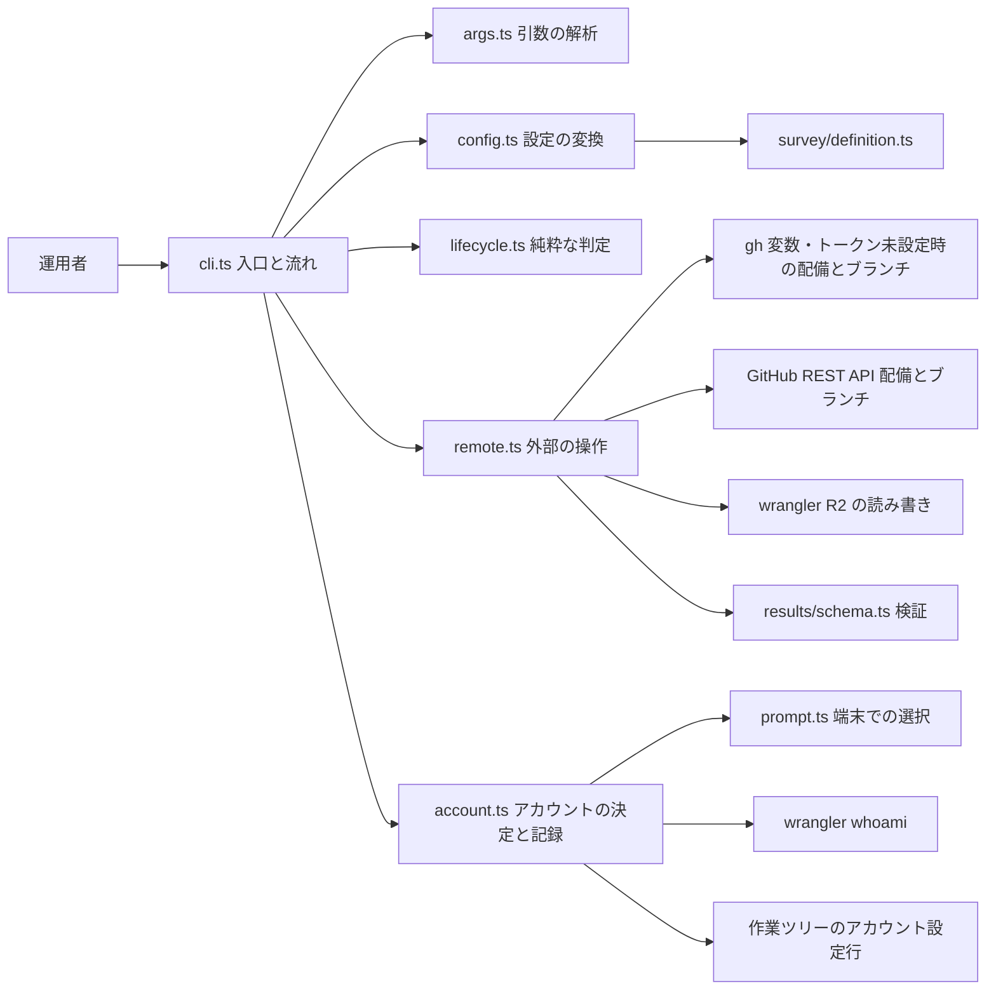
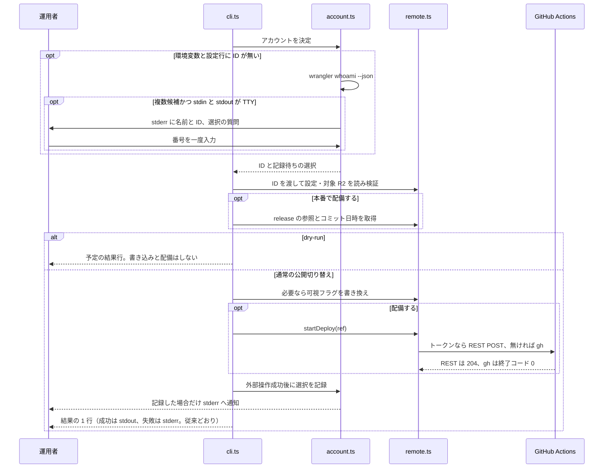
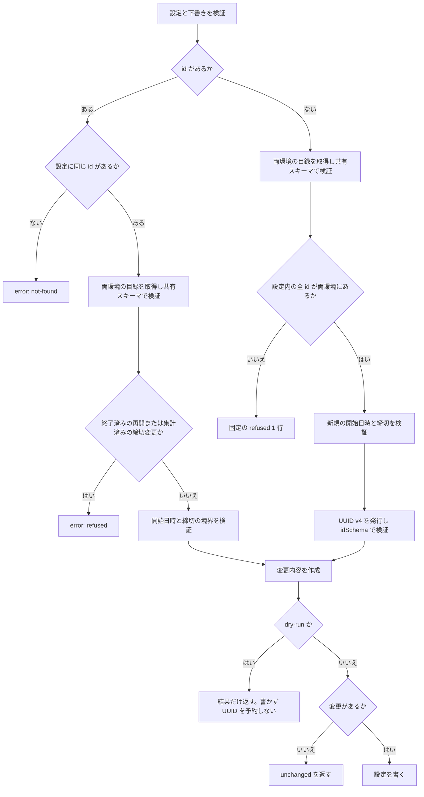
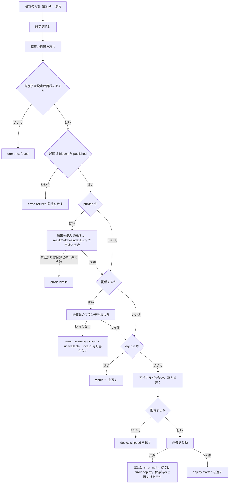
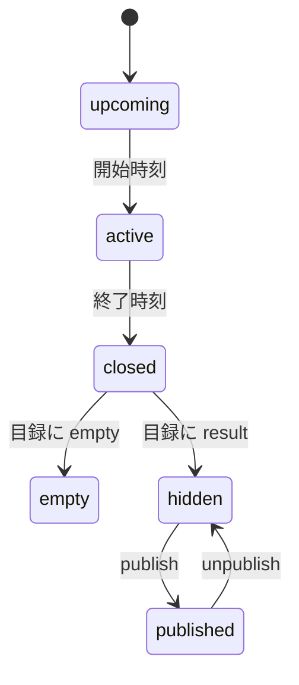
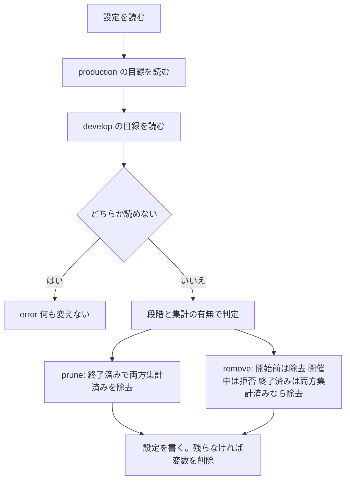

# Design Document

## Overview

**Purpose**: アンケートの運用 CLI（`npm run survey`）を、登録・状態確認・公開の切り替え・除去の平坦な体系に作り直し、公開の切り替えで再配備を起動し、設定からの除去を「集計済みだけ」に置き換える。
**Users**: アンケートを運用する人と、手順を案内する `survey-run` skill。設定の操作には手元で認証済みの `gh`、R2 の操作には手元で認証済みの `wrangler` を使う。再配備とその起動先の取得は、`SURVEY_DEPLOY_TOKEN` があればそのトークン、無ければ認証済みの `gh` を使う。
**Impact**: 現行の CLI が依存している保持期限の判定（`retentionExpired`）と、回答の保存先（D1）の行の確認をなくす。段階を 6 つにし、結果の保管先（R2）の目録と可視フラグを読み書きする。アンケート全体の題・説明が設定の形式から消えるため、下書きと聞き取りの形式を直す。

### Goals

- 状態を「アンケートごとに 1 つの段階」で 1 つの表にして示す。
- 公開・非公開の切り替えと再配備の起動を、環境を必ず選ばせて行う。
- 設定からの除去を、両環境で集計済みのものだけに限り、結果を失う操作を止める。
- 出力の形式と「秘密を出さない」規則、手元の認証だけで動く性質を保つ。
- `survey-results-aggregation` が廃止する保持期限の判定への依存を、この CLI から無くす。

> 2026-11-18 追補: survey-env-config が置き換え。設定と判断はコマンドで指定した `production` または `develop` に限定し、両環境共有の設定を前提としない。

### Non-Goals

- 統計ファイルの形式・集計・回答の削除（`survey-results-aggregation`）。
- 結果ページ・ビルド時の取得（`survey-results-public`）。
- 設定の形式そのものの変更（`surveys`。この spec は変更後の形式に従う）。
- 配備の完了・画面への反映の確認、反映待ちの表示（Decision 5）。
- 移行の手順（アンケート機能は未公開のため作らない）。

> 2026-11-18 追補: survey-env-config が置き換え。環境ごとの設定と移行手順は `.kiro/specs/survey-env-config/design.md` の要件 6・7 に従う。

## Boundary Commitments

### This Spec Owns

- CLI のコマンド体系・引数・結果の形式（`add`・`status`・`publish`・`unpublish`・`prune`・`remove`）。
- 段階の定義と判定、`prune`・`remove` の除去の規則、最新のリリースブランチの決め方。
- 結果の保管先の可視フラグの書き込み（唯一の書き手。不正な可視フラグを上書きで直せる唯一の手段でもある）と、目録・結果・可視フラグの読み出し（検証は `survey-results-aggregation` のスキーマを使う）。
- 配備の起動。`SURVEY_DEPLOY_TOKEN` があれば GitHub REST API、無ければ `gh workflow run` で `deploy.yaml` を起動する。トークン経路で失敗しても `gh` に切り替えない。
- 六つのコマンドに共通する Cloudflare アカウントの決定と、対話で選んだ ID の作業ツリー直下の `.dev.vars` への記録。扱う設定行は `CLOUDFLARE_ACCOUNT_ID=` だけとする。
- `deploy.yaml` のファイル名、`workflow_dispatch`、入力 `dry_run` と値 `"false"`、起動先のブランチ規則を呼び出し側の契約として守る。ビルドは引き続き GitHub Actions が担当し、静的な `/surveys` を生成する。
- 下書きの形式の固定データ（`tests/fixtures/survey-operation/drafts/`）と CLI のテスト。
- `survey-run` skill と `docs/DEVELOP.md` の運用の手順。

### Out of Boundary

- 統計ファイルの形式・キー名・検証スキーマ（`survey-results-aggregation`。ここでは読むだけ）。
- 結果の本体・目録の書き込み（Worker だけ）。
- 設定の形式（`SurveyConfigSchema`）と、`tests/fixtures/survey/` の固定データ・`SurveyDialog`・辞書の題・説明の廃止（`surveys`）。
- `npm run survey:render`、CI の設定、結果の保管先の作成、`deploy.yaml` の変更。
- 孤立した回答（設定から集計前に消えたアンケートの行）の探索と削除。

> 2026-11-18 追補: survey-env-config が置き換え。環境ごとの設定管理・移行、CI の環境選択と共有設定の門番は survey-env-config の対象とし、この spec の対象外という境界を更新する。

### Allowed Dependencies

- `@/lib/survey/definition`（`parseSurveyConfig`・型）、`@/lib/survey/results/schema`（検証・キー名・版の定数と、上流の約束である純粋な判定 `resultMatchesIndexEntry(entry, result)`・`isVisible(visibility)`）、`@/lib/api/contract/surveyPath`（`idSchema`）。
- `scripts/lib/github.mjs`（Git のリモートからの `owner/repo` の解析）、`scripts/lib/jsonc.mjs`（テンプレートの読み込み）。
- 運用者の手元の `gh`・`wrangler`・`git`（子プロセスとして呼ぶ）。Git は既存のリポジトリ識別だけに使い、ブランチの作成・切り替え・push を求めない。
- Node 22 の標準 `fetch`、`node:readline/promises`、ファイル操作。HTTP・対話用の依存パッケージは増やさない。
- GitHub REST API の利用は、再配備の起動と、そのための `release/` の参照・先頭コミット日時の取得に限定する。設定の読み書きは引き続き `gh` を使う。
- 禁止: `src/` から `hack/` への参照、`cloudflare:workers` や Worker 専用モジュールの import、D1 への問い合わせ、`lib/survey/period.ts` の保持期限の判定。

### Revalidation Triggers

- 統計ファイルのキー名・形式・版の変更、バケット名の宣言（`config/wrangler.template.jsonc` の `SURVEY_RESULTS`）の変更。
- 設定の形式の変更（`SurveyConfigSchema`、下書きの形式）。
- `deploy.yaml` のファイル名・`workflow_dispatch`・入力名 `dry_run`・値の受理形式・起動できるブランチの規則の変更。REST の本文 `{ref, inputs:{dry_run:"false"}}` と成功応答 `204` は呼び出し契約とする。リリースブランチの命名の方式の確定。
- GitHub REST API の版・権限・応答形式の変更。公開リポジトリだけで使える無認証の取得を前提にしない。
- `wrangler whoami --json` の終了状態、`loggedIn`・`accounts[].id`・`accounts[].name` の変更。
- `.dev.vars` の配置・管理方法・権限、作業ツリーごとの独立性の変更。
- `scripts/secrets/*` による `.dev.vars` の読み書きの変更。
- Node 22 の標準 `fetch` と端末入力の対応環境の変更。
- 環境の追加（`production`・`develop` 以外）。
- `survey-results-aggregation` の `resultMatchesIndexEntry`・`isVisible` の契約（引数・判定の規則）の変更。上流に識別子の再利用専用規則は設けない。
- 統計ファイルの目録に「回答の削除の完了」の印が足されたとき（Decision 13 の見直し）。
- `survey-results-aggregation` の日次の枠の、設定に無い識別子の回答行と回答済みの集合の行の削除（孤立した回答の掃除。冪等・設定に同じ識別子があれば終了済みでも本流に任せ、設定に無い識別子だけを掃除する）の変更・廃止（Decision 13 の前提）。

## Architecture

### Existing Architecture Analysis

- 現行の `cli.ts` は、引数の解析 → 設定の取得 → 変換 → 反映 → 固定の 1 行の出力、という流れで、`SurveyRemote`・時刻・ファイル読み込みを差し込める。失敗は `RemoteError` の種類（`auth`・`unavailable`・`parse`）で固定の文言に変える。この形を保つ。
- `lifecycle.ts` の段階の判定と除去の判定は `retentionExpired` と D1 の行に依存する。置き換える。
- `remote.ts` の D1 の部分（`hasRows`・`parseDatabaseNames`・SQL）は消し、バケット名の読み取りと R2・配備の呼び出しを足す。

### Architecture Pattern & Boundary Map



- Selected pattern: 現行の「流れ（cli）・純粋な変換（config・lifecycle）・外部の操作（remote）」の分離を保つ。
- 設定・R2・配備の操作は `SurveyRemote`、アカウントの決定と記録は `SurveyAccountService` の背後に置く。流れのテストは両方の偽の実装を使う。
- `remote.ts` は偽の `RunCommand` と `fetch`、`account.ts` は偽の実行・設定行の読み書き・選択、`prompt.ts` は偽の端末判定・入出力で検証する。
- Steering compliance: R2 バケットは用途ごとに分ける（`r2-buckets.md`）。この CLI は `skyshare-survey-results` を読み書きするだけで、バケットを増やさない。

### Technology Stack

| Layer        | Choice / Version                        | Role in Feature                                                                                              | Notes                                                       |
| ------------ | --------------------------------------- | ------------------------------------------------------------------------------------------------------------ | ----------------------------------------------------------- |
| CLI          | TypeScript（`tsx`）                     | `npm run survey`                                                                                             | 現行どおり。`package.json` の `survey` スクリプトは変えない |
| 設定の保存   | `gh variable`・`gh api`                 | `SURVEY_CONFIG` の読み書き                                                                                   | 現行どおり                                                  |
| 結果の保管先 | `wrangler r2 object get/put`（4.147.0） | 目録・結果・可視フラグ                                                                                       | `--remote`・`--file`。追加の認証情報は不要                  |
| 配備の起動   | `gh workflow run`                       | `deploy.yaml` の手動起動                                                                                     | `dry_run=false`                                             |
| 検証         | `@/lib/survey/results/schema`（zod）    | 読んだ統計ファイルの検証と、`resultMatchesIndexEntry`（結果と目録の一致）・`isVisible`（公開かどうか）の判定 | 形式も判定も独自に定義しない                                |

## File Structure Plan

### Directory Structure

```
hack/survey-cli/
├── cli.ts         # 入口。引数の解析結果から流れを組み立て、結果の行を返す
├── args.ts        # 引数の解析。要件 11・12 による変更は不要
├── account.ts     # アカウントの決定と .dev.vars の対象行だけの読み書き
├── prompt.ts      # TTY の判定、stderr への候補表示、一度だけの選択
├── config.ts      # 設定の変換（add・remove・prune の変更）。下書きの形式
├── lifecycle.ts   # 段階・除去・最新のリリースブランチの純粋な判定
└── remote.ts      # gh・wrangler の呼び出し、バケット名の読み取り、失敗の分類
tests/unit/hack/survey-cli/
├── args.test.ts   # 引数の検証
├── lifecycle.test.ts
├── config.test.ts
├── cli.test.ts    # 偽の remote・account で順序、結果、失敗時の未記録を検証
├── account.test.ts # 優先順位、対象行だけの読み書き、権限、作業ツリーの分離
├── prompt.test.ts # TTY の組み合わせ、stderr、Ctrl-C・EOF・不正入力
└── remote.test.ts # 偽の RunCommand で外部コマンドの引数・失敗の分類・秘密の非表示
tests/fixtures/survey-operation/drafts/
├── without-id.json   # 新規登録の下書き（題・説明なし）
├── with-id.json      # 更新の下書き（id あり）
└── legacy-title.json # 拒否される旧形式（全体の題・説明あり）
```

### Modified Files

- `hack/survey-cli/cli.ts` — 6 コマンドの流れ、結果の形式（`status` の表は複数行）、新しい失敗の種類。D1 の確認を削除。アカウント決定をすべての変更より前に置き、記録を外部操作の成功後に置く。配備の認証失敗と保存済み状態を同じ結果行で示す。出力先（成功は stdout、失敗は stderr）は変えない。
- `hack/survey-cli/config.ts` — `canonicalSurvey` と `DraftSurvey` から `title`・`description` を外す。`removeSurveys` は流用。
- `hack/survey-cli/lifecycle.ts` — `retentionExpired` の import と `RowPresence`・旧 `decidePrune` を削除し、新しい判定に置き換える。
- `hack/survey-cli/remote.ts` — R2 の子プロセス環境へ決定済みのアカウント ID を渡す。配備とブランチの取得をトークンの有無で分岐する。HTTP の固定分類と応答の検証を担当する。
- `hack/survey-cli/account.ts` — 新規。環境変数 → 作業ツリー直下の設定行 → 単一候補 → 対話の順に決定し、成功後に対話で選んだ ID だけを記録する。
- `hack/survey-cli/prompt.ts` — 新規。端末の判定、候補の表示、番号の入力、中止を担当し、外部サービスやファイルを操作しない。
- `hack/survey-cli/args.ts` — 要件 11・12 では変更しない。既存の六つのコマンドと指定を使う。
- import は同じディレクトリ内を `./account`・`./prompt` のように拡張子なしとし、`src/` の参照は `@/` を使う。`remote.ts` は `account.ts` を参照せず、循環を作らない。新規・更新モジュールとテストは、import より前に日本語の `/** … */` で目的を書く。コメントに要件番号・変更履歴を書かない。
- `tsconfig.json` — `include` に `hack/**/*` を足す（`npm run test:type` が CLI を直接検査するため）。
- `.kiro/steering/testing.md` — この spec が直すのは、`hack/` のテストの置き場の節（配置の一覧に `tests/unit/hack/` を足し、`hack/` の CLI のテストは P0 ではなく、被覆率の閾値を置かないと書く）だけ。ほかの節には触れない。
- `.claude/skills/survey-run/SKILL.md`（と、同じ内容が残っていれば `.agents/skills/survey-run/SKILL.md`）— 新しい体系・聞き取りの変更・下書きの参照先。
- `docs/DEVELOP.md` — この spec が直す見出しは、3.1 の `hack/` の説明、3.2 アンケート（コマンドの列挙・結果の保管先との関係）、5.1 の配備の節（再配備の起動）、5.4 main への取り込み前のアンケート除去（`prune` の新しい規則と、`develop` の目録が無いときの手順）、6.x の `SURVEY_CONFIG` の行（6.2 の変数の表）だけ。`survey-results-public` は CI/CD の認証情報、R2、プレビューの各節と、6.5 の `SURVEY_RESULTS` の行を直す。重ならないよう、6.5 の表と R2 の節はこの spec では触れない。
- `tests/fixtures/survey-operation/drafts/*` — 新規（旧い参照先は存在しない）。この spec が作る固定データの置き場はここ（`tests/fixtures/survey-operation/`）だけで、`tests/fixtures/survey/` は `surveys` の担当である。

### 要件 9.18 の手順書への反映内容

`docs/DEVELOP.md` の 3.2・5.1 と `.claude/skills/survey-run/SKILL.md` の公開・非公開および認証の説明に、次を追加する。アカウントの説明は 1.1 の作業ツリーの扱いを参照する。

- 再配備用の環境変数は `SURVEY_DEPLOY_TOKEN`。値を手順の出力・会話・下書き・`.dev.vars` に残さず、運用者がプロセス環境へ渡す。文書の例は変数名と値のプレースホルダーだけにする。
- 対象リポジトリに限定した fine-grained PAT の権限は `Actions: Read and write` と `Contents: Read`。後者は本番の起動先を選ぶ参照・コミット日時の取得に必要である。`docs/DEVELOP.md` と `deploy.yaml` からリポジトリの公開設定は確認できなかったため、非公開でも動く権限を前提とする。Actions の権限は特定の workflow だけへの限定を保証するものではない。
- 未設定時は従来の `gh`。トークンが設定されている場合の認証・権限の失敗では `gh` に切り替えない。設定の操作には別途 `gh` の認証が必要である。`GITHUB_TOKEN`・`GH_TOKEN` を再配備用の変数の代わりに使わない。
- 作業ブランチの作成・切り替え・push は不要。起動先・`--repo`・`--no-deploy`・`--dry-run` は従来どおりで、配備の完了は GitHub Actions で確認する。
- アカウントは `CLOUDFLARE_ACCOUNT_ID` の環境変数、実行した作業ツリー直下の `.dev.vars`、単一候補、端末での選択の順に決める。対話で選んだ ID は操作成功後にその作業ツリーだけへ記録する。
- `error: unavailable` の原因には、複数のアカウントがあり非対話で選べない場合がある。環境変数または `.dev.vars` の対象行で指定する。`--dry-run` は質問を行うが記録しない。
- `.dev.vars` は存在しなければ `0600` で作り、既存権限は広げない。ほかの行を変更しない。ID 自体は秘密ではないが、同じファイルの認証情報を表示しない。
- `npm run sync:github`（`scripts/secrets/sync-github-variables.mjs`）は `.dev.vars` の `CLOUDFLARE_ACCOUNT_ID` を CI 用の GitHub Secrets へ登録するため、CLI が記録した ID も次の同期で CI の配備先アカウントになる（CLI 自身は GitHub へ登録しない。要件 12 の範囲外）。

権限の根拠は [workflow dispatch](https://docs.github.com/en/rest/actions/workflows#create-a-workflow-dispatch-event)、[matching refs](https://docs.github.com/en/rest/git/refs#list-matching-references)、[コミット取得](https://docs.github.com/en/rest/commits/commits#get-a-commit) とする。

## System Flows

### 共通のアカウント決定と再配備

六つのコマンドすべてで、引数の検証後、設定や可視フラグ、`.dev.vars` を変更する前にアカウントを決める。`--repo` は GitHub の対象だけを変え、ローカルの記録先は実行した作業ツリーから変えない。



- 図の配備部分は `publish`・`unpublish` に限る。ほかのコマンドも、必要な読み取り・検証と操作が成功してから選択を記録する。`status` は設定・R2 を変更しないが、対話で選んだ ID の記録が失敗した場合は表を返さず固定の 1 行で失敗する（記録失敗の固定行を使う）。
- アカウントの取得・選択、指定 ID での事前読み取り、設定や結果の検証、必要な配備先の取得のいずれかに失敗したら、設定・可視フラグ・`.dev.vars` を変更しない。
- `.dev.vars` の記録は、対象コマンドの外部操作がすべて成功するまで保留する。R2 の書き込みや配備に失敗した場合も記録しない。配備失敗前に可視フラグが保存済みなら、既存の再実行による回復を使う。
- `--dry-run` も同じ優先順位と質問を使うが、設定・可視フラグ・アカウント ID を書かず、配備を起動しない。`--no-deploy` はブランチ取得と配備だけを省き、アカウントの決定は省かない。
- 外部操作とローカル記録を一つのトランザクションにはしない。事前読み取り後にサービスや権限が変わり、外部の書き込みが失敗する可能性は残る。その場合も `.dev.vars` は未記録とし、既に完了した変更を隠さない。

### 登録と更新（add）



> 2026-11-18 追補: survey-env-config が置き換え。現在の add は指定環境の設定と目録だけを読む。

- 目録の取得と形式検証は dry-run でも省かない。キーが無いときは空の目録として扱うが、取得失敗・形式不正は登録を止める。設定が空の場合も両環境を読む。
- 新規登録の可否は、設定内の全識別子が両方の目録に存在するかだけで決める。開始前のアンケートも対象。設定に残る集計済みの過去分は新規登録を妨げない。
- 識別子の発行は新規登録の検証と可否確認を通過した後だけ行う。複数の `add` は運用者が直列に実行する。

> 2026-11-18 追補: survey-env-config が置き換え。`add --env <環境>` は指定環境の設定・目録だけを使い、新規登録もその環境の全識別子が同じ環境の目録にある場合だけ認める。

### 公開の切り替え（publish / unpublish）



- 配備先を決めるのは、可視フラグを書く前にする。決まらないのに書いて半端な状態になるのを避ける（要件 5.4）。
- 可視フラグが不正な形式でも、止めずに進める。`publish`・`unpublish` は不正な可視フラグを「望む状態ではない」と見なして上書きする（Decision 14、要件 4.11）。
- 可視フラグが既に望む状態でも配備を起動する。配備の起動に失敗した後の再実行で、配備だけを起動し直せる（要件 4.8, 5.6）。

### 段階（状態遷移）



- 段階は、時刻を先に見て、集計済みの状態は終了時刻以後にだけ使う（設定の期間が後から延ばされたときに、集計済みのものが `hidden` に見えて開催中なのに除去できるように見えるのを避ける）。

### 除去（prune / remove）



> 2026-11-18 追補: survey-env-config が置き換え。現在の prune・remove は指定環境の設定と目録だけを読み、同環境の設定だけを書き換える。

- 目録が無い（`index.json` が存在しない）ことは「何も集計されていない」として扱い、読めない・検証に通らないこととは区別する。

> 2026-11-18 追補: survey-env-config が置き換え。図の旧い環境横断の流れはそのまま残す。現在は `prune --env <環境>` と `remove <識別子> --env <環境>` が指定環境の設定と目録だけを読み、除去判断と書き込みを同じ環境で完結させる。

## Requirements Traceability

| Requirement | Summary                                                     | Components                   | Interfaces                                                      | Flows                        |
| ----------- | ----------------------------------------------------------- | ---------------------------- | --------------------------------------------------------------- | ---------------------------- |
| 1.1         | 6 コマンドだけ                                              | args                         | `parseArgs`                                                     | -                            |
| 1.2         | 不正な指定は変更せず使い方                                  | args, cli                    | `parseArgs`                                                     | -                            |
| 1.3         | status 以外は 1 行                                          | cli                          | `SurveyCliResult`                                               | -                            |
| 1.4         | 失敗は `error:`・終了コード                                 | cli                          | `SurveyCliResult`                                               | -                            |
| 1.5         | 秘密を出さない                                              | cli, remote                  | `RemoteError`, 結果の組み立て                                   | -                            |
| 1.6         | `--dry-run`                                                 | args, cli                    | `Command`                                                       | 公開の切り替え               |
| 1.7         | `--repo`                                                    | args, remote                 | `SurveyRemoteOptions`                                           | -                            |
| 1.8         | 手元の認証と再配備用トークン。CI の書き込み権限は増やさない | remote                       | `SurveyRemoteOptions`, `RunCommand`, `fetch`                    | 共通のアカウント決定と再配備 |
| 1.9         | 認証と利用不可の区別                                        | remote, cli                  | `RemoteError`                                                   | -                            |
| 2.1         | 環境の必須                                                  | args                         | `Command`                                                       | -                            |
| 2.2         | 不正な環境は何も読み書きしない                              | args                         | `parseArgs`                                                     | -                            |
| 2.3         | prune・remove は両環境                                      | cli, lifecycle               | `decidePrune`, `decideRemove`                                   | 除去                         |
| 2.4         | add は環境なし                                              | args                         | `parseArgs`                                                     | -                            |
| 2.5         | 受け付けない `--env` は使い方                               | args                         | `parseArgs`                                                     | -                            |
| 3.1         | 設定と目録を合わせた表                                      | cli, lifecycle               | `buildStatusRows`                                               | -                            |
| 3.2         | 行の内容                                                    | lifecycle, cli               | `StatusRow`                                                     | -                            |
| 3.3         | upcoming                                                    | lifecycle                    | `surveyStage`                                                   | 段階                         |
| 3.4         | active                                                      | lifecycle                    | `surveyStage`                                                   | 段階                         |
| 3.5         | closed                                                      | lifecycle                    | `surveyStage`                                                   | 段階                         |
| 3.6         | empty                                                       | lifecycle                    | `surveyStage`                                                   | 段階                         |
| 3.7         | hidden（不正も含む。判定は `isVisible`）                    | lifecycle, remote            | `surveyStage`, `readVisibility`                                 | 段階                         |
| 3.8         | published                                                   | lifecycle, remote            | `surveyStage`, `readVisibility`                                 | 段階                         |
| 3.9         | 設定から除去済みも含める                                    | lifecycle                    | `buildStatusRows`                                               | -                            |
| 3.10        | 題を持たない                                                | lifecycle                    | `StatusRow`                                                     | -                            |
| 3.11        | 変数の使用量                                                | cli, config                  | `byteLength`                                                    | -                            |
| 3.12        | アンケートが無い                                            | cli                          | -                                                               | -                            |
| 3.13        | 目録が読めない                                              | remote, cli                  | `readIndex`                                                     | -                            |
| 3.14        | 書き換えない                                                | cli                          | -                                                               | -                            |
| 3.15        | 不正な可視フラグは hidden に警告の印                        | lifecycle, remote, cli       | `readVisibility`, `StatusRow.invalidVisibility`                 | 段階                         |
| 4.1         | publish                                                     | cli, remote                  | `writeVisibility`                                               | 公開の切り替え               |
| 4.2         | unpublish                                                   | cli, remote                  | `writeVisibility`                                               | 公開の切り替え               |
| 4.3         | 集計前は拒否                                                | cli, lifecycle               | `surveyStage`                                                   | 公開の切り替え               |
| 4.4         | empty は拒否                                                | cli, lifecycle               | `surveyStage`                                                   | 公開の切り替え               |
| 4.5         | 識別子が無い                                                | cli                          | -                                                               | 公開の切り替え               |
| 4.6         | 結果の検証失敗・目録との不一致は公開しない                  | cli, remote                  | `readResult`, `resultMatchesIndexEntry`                         | 公開の切り替え               |
| 4.7         | unpublish は壊れた結果でも可                                | cli                          | -                                                               | 公開の切り替え               |
| 4.8         | 既に望む状態                                                | cli                          | -                                                               | 公開の切り替え               |
| 4.9         | 本体・目録・他の環境に触れない                              | remote                       | `writeVisibility`                                               | -                            |
| 4.10        | 設定に無くても切り替えられる                                | cli, lifecycle               | `buildStatusRows`                                               | 公開の切り替え               |
| 4.11        | 不正な可視フラグでも進めて上書き                            | cli, remote                  | `readVisibility`, `writeVisibility`                             | 公開の切り替え               |
| 5.1         | dry_run を偽で起動                                          | remote                       | `startDeploy`                                                   | 公開の切り替え               |
| 5.2         | develop は develop ブランチ                                 | cli                          | `deployRef`                                                     | 公開の切り替え               |
| 5.3         | production は最新のリリース                                 | lifecycle, remote            | `latestReleaseBranch`, `listReleaseBranches`                    | 公開の切り替え               |
| 5.4         | 決まらなければ書かない                                      | cli                          | `deployRef`                                                     | 公開の切り替え               |
| 5.5         | 起動の失敗は保存済みと再実行を示す                          | cli                          | -                                                               | 公開の切り替え               |
| 5.6         | 既に望む状態でも配備                                        | cli                          | -                                                               | 公開の切り替え               |
| 5.7         | `--no-deploy`                                               | args, cli                    | `Command`                                                       | 公開の切り替え               |
| 5.8         | dry-run は起動先を示す                                      | cli                          | -                                                               | 公開の切り替え               |
| 5.9         | 手元の認証はトークンを含む。起動だけを確認する              | cli, remote                  | `startDeploy`                                                   | 共通のアカウント決定と再配備 |
| 6.1         | 両環境で集計済みだけ除去                                    | lifecycle, cli               | `decidePrune`                                                   | 除去                         |
| 6.2         | D1 を使わない                                               | remote                       | -                                                               | -                            |
| 6.3         | 公開・非公開に関わらず除去                                  | lifecycle                    | `decidePrune`                                                   | 除去                         |
| 6.4         | 未集計は残して環境を示す                                    | lifecycle                    | `PruneKept`                                                     | 除去                         |
| 6.5         | 目録が読めなければ何も除去しない                            | cli                          | `readIndex`                                                     | 除去                         |
| 6.6         | 開始前・開催中は除去しない                                  | lifecycle                    | `decidePrune`                                                   | 除去                         |
| 6.7         | 残らなければ変数を削除                                      | cli, remote                  | `deleteConfigValue`                                             | 除去                         |
| 6.8         | 対象が無い                                                  | cli                          | -                                                               | 除去                         |
| 6.9         | 除去・残した理由を示し、手順書への案内を添える              | cli                          | -                                                               | 除去                         |
| 7.1         | 開始前は除去                                                | lifecycle                    | `decideRemove`                                                  | 除去                         |
| 7.2         | 開催中は拒否                                                | lifecycle                    | `decideRemove`                                                  | 除去                         |
| 7.3         | 終了済みは両方集計済みで除去                                | lifecycle                    | `decideRemove`                                                  | 除去                         |
| 7.4         | 未集計は拒否                                                | lifecycle                    | `decideRemove`                                                  | 除去                         |
| 7.5         | 設定に無い                                                  | cli                          | -                                                               | 除去                         |
| 7.6         | 強制の指定なし                                              | args                         | `parseArgs`                                                     | -                            |
| 7.7         | 残らなければ変数を削除                                      | cli                          | `deleteConfigValue`                                             | 除去                         |
| 7.8         | 目録が読めなければ変更しない                                | cli                          | `readIndex`                                                     | 除去                         |
| 8.1         | add の検証と反映                                            | cli, config                  | `addSurvey`                                                     | -                            |
| 8.2         | 下書きに全体の題・説明なし                                  | config                       | `DraftSurvey`                                                   | -                            |
| 8.3         | 旧形式は拒否                                                | config                       | `parseSurveyConfig`                                             | -                            |
| 8.4         | 開始日時を補う                                              | config                       | `addSurvey`                                                     | -                            |
| 8.5         | 更新は開始日時を保つ                                        | config                       | `addSurvey`                                                     | -                            |
| 8.6         | 検証・容量の失敗                                            | config, cli                  | `AddOutcome`                                                    | -                            |
| 8.7         | 変更が無い                                                  | config, cli                  | `AddOutcome`                                                    | -                            |
| 8.8         | 本文を出さない                                              | cli                          | -                                                               | -                            |
| 8.9         | 新規 ID は UUID v4 とし idSchema で検証                     | config                       | `createId`, `idSchema`                                          | 登録                         |
| 8.10        | ID の有無で新規・更新を分ける                               | config                       | `addSurvey`                                                     | 登録                         |
| 8.11        | 不正な ID は invalid、設定に無い ID は not-found            | config, cli                  | `addSurvey`                                                     | 登録                         |
| 8.12        | 全設定 ID が両目録にある場合だけ新規可                      | cli                          | `readIndex`                                                     | 登録                         |
| 8.13        | 目録取得の扱いは dry-run でも同じ                           | cli, remote                  | `readIndex`                                                     | 登録                         |
| 8.14        | 新規拒否は固定の 1 行                                       | cli                          | `SurveyCliResult`                                               | 登録                         |
| 8.15        | 締切日付を検証し日本時間 0 時に変換                         | config                       | `DraftSurvey`, `addSurvey`                                      | 登録                         |
| 8.16        | 締切境界・再開・集計済み変更を拒否                          | config, cli                  | `addSurvey`                                                     | 登録                         |
| 8.17        | 指定した締切日での前倒し判定                                | config                       | `addSurvey`                                                     | 登録                         |
| 8.18        | 検証・登録可否の後に ID を発行                              | config                       | `createId`                                                      | 登録                         |
| 9.1         | skill が新体系                                              | survey-run skill             | -                                                               | -                            |
| 9.2         | 聞き取りから題・説明を外す                                  | survey-run skill             | -                                                               | -                            |
| 9.3         | 運用の規則を保つ                                            | survey-run skill             | -                                                               | -                            |
| 9.4         | 段階と再配備の説明                                          | survey-run skill             | -                                                               | -                            |
| 9.5         | 開催中の取り下げの手順                                      | survey-run skill             | -                                                               | -                            |
| 9.6         | DEVELOP.md 5.4                                              | DEVELOP.md                   | -                                                               | -                            |
| 9.7         | DEVELOP.md 3.2                                              | DEVELOP.md                   | -                                                               | -                            |
| 9.8         | 直接書き換えない                                            | survey-run skill, DEVELOP.md | -                                                               | -                            |
| 9.9         | develop 未集計の抜け道                                      | survey-run skill, DEVELOP.md | -                                                               | 除去                         |
| 9.10        | 集計済みの終了日時を延ばさない                              | survey-run skill             | -                                                               | -                            |
| 9.11        | DEVELOP.md の直す項を限る                                   | DEVELOP.md                   | -                                                               | -                            |
| 9.12        | skill は status 全体表・他は固定 1 行を報告                 | survey-run skill             | -                                                               | -                            |
| 9.13        | 手順書に UUID・日付・開始前の登録制限を書く                 | survey-run skill, DEVELOP.md | -                                                               | -                            |
| 9.14        | 固定拒否文と次の手順を案内                                  | survey-run skill, DEVELOP.md | -                                                               | 登録                         |
| 9.15        | 開催中の取り下げの順序を案内                                | survey-run skill, DEVELOP.md | -                                                               | 除去                         |
| 9.16        | --env の使い分けを手順書に示す                              | survey-run skill, DEVELOP.md | -                                                               | -                            |
| 9.17        | 集計失敗時の R2 復旧手順                                    | DEVELOP.md                   | -                                                               | -                            |
| 9.18        | トークンの渡し方・権限、アカウントの決定、選択不能時の案内  | survey-run skill, DEVELOP.md | 要件 9.18 の手順書への反映内容                                  | 共通のアカウント決定と再配備 |
| 10.1        | 保持期限を使わない                                          | lifecycle                    | `surveyStage`                                                   | -                            |
| 10.2        | D1 に触れない                                               | remote                       | `SurveyRemote`                                                  | -                            |
| 10.3        | 時刻・期間・目録だけで判定                                  | lifecycle                    | `surveyStage`                                                   | 段階                         |
| 10.4        | 共有のスキーマと判定で検証                                  | remote, cli                  | `parseSurveyIndex`, `resultMatchesIndexEntry`, `isVisible` ほか | -                            |
| 11.1        | トークンで対象ブランチの配備を起動                          | remote                       | `startDeploy`, `fetch`                                          | 公開の切り替え               |
| 11.2        | 未設定時は従来の gh                                         | remote                       | `SurveyRemoteOptions`, `RunCommand`                             | 公開の切り替え               |
| 11.3        | トークンの認証失敗は gh に切り替えず保存済みも示す          | remote, cli                  | `RemoteError`, `startDeploy`                                    | 公開の切り替え               |
| 11.4        | トークンも gh 認証も無い場合の順序と固定文                  | remote, cli                  | `listReleaseBranches`, `startDeploy`                            | 公開の切り替え               |
| 11.5        | 起動先と各指定の動作を維持                                  | cli, remote, lifecycle       | `latestReleaseBranch`, `SurveyRemoteOptions`                    | 公開の切り替え               |
| 11.6        | トークンを出力・例外・ファイルに残さない                    | remote, cli                  | `fetch`, `RemoteError`, `SurveyCliResult`                       | 共通のアカウント決定と再配備 |
| 11.7        | トークンは配備と必要な起動先取得だけ                        | remote                       | `listReleaseBranches`, `startDeploy`, `RunCommand`              | 公開の切り替え               |
| 11.8        | 作業ブランチの作成・切り替え・push が不要                   | remote                       | `resolveRepo`, `startDeploy`                                    | 共通のアカウント決定と再配備 |
| 12.1        | add を含む六つのコマンドで変更前にアカウントを決定          | cli, account                 | `resolveAccount`, `createRemote`                                | 共通のアカウント決定と再配備 |
| 12.2        | 環境変数を最優先                                            | account                      | `resolveAccount`                                                | 共通のアカウント決定と再配備 |
| 12.3        | 作業ツリー直下の対象行を次に使用                            | account                      | `readAccountLine`                                               | 共通のアカウント決定と再配備 |
| 12.4        | 対象行だけを解釈し、ほかの行を使用・表示しない              | account                      | `readAccountLine`, `writeAccountLine`                           | 共通のアカウント決定と再配備 |
| 12.5        | 単一候補を自動使用                                          | account                      | `resolveAccount`                                                | 共通のアカウント決定と再配備 |
| 12.6        | 複数候補を TTY で名前・ID から選択                          | account, prompt              | `chooseAccount`, `PromptDependencies`                           | 共通のアカウント決定と再配備 |
| 12.7        | 選択した ID の行だけを成功後に記録し通知                    | account, cli                 | `persistAccount`, `writeAccountLine`                            | 共通のアカウント決定と再配備 |
| 12.8        | 非 TTY は変更せず指定を求める固定行                         | account, prompt, cli         | `AccountError`, `SurveyCliResult`                               | 共通のアカウント決定と再配備 |
| 12.9        | 中止・一覧取得失敗は変更せず固定文                          | account, prompt, cli         | `AccountError`, `RemoteError`                                   | 共通のアカウント決定と再配備 |
| 12.10       | 質問と一覧は stderr、結果の 1 行は従来の出力先              | prompt, cli                  | `PromptDependencies`, `SurveyCliResult`                         | 共通のアカウント決定と再配備 |
| 12.11       | 指定 ID で利用不能なら記録せず固定文                        | cli, remote, account         | `readIndex`, `persistAccount`, `RemoteError`                    | 共通のアカウント決定と再配備 |
| 12.12       | dry-run も質問するが記録しない                              | cli, account, prompt         | `resolveAccount`, `persistAccount`                              | 共通のアカウント決定と再配備 |

> 2026-11-18 追補: survey-env-config が置き換え。追跡表の共有設定・両環境を前提とする登録・除去の各行は、6 コマンドの `--env` 必須と指定環境だけの判断に読み替える。

## Components and Interfaces

| Component | Domain/Layer | Intent                               | Req Coverage                                                                                                                     | Key Dependencies (P0/P1)                     | Contracts |
| --------- | ------------ | ------------------------------------ | -------------------------------------------------------------------------------------------------------------------------------- | -------------------------------------------- | --------- |
| args      | 入口         | 引数の解析と使い方の検証             | 1.1, 1.2, 1.6, 1.7, 2.1, 2.2, 2.4, 2.5, 5.7, 7.6                                                                                 | なし                                         | Service   |
| cli       | 入口         | 流れと結果の組み立て                 | 1.3, 1.4, 1.5, 1.9, 2.3, 3.1, 3.11–3.15, 4.1–4.11, 5.2, 5.4–5.6, 5.8, 5.9, 6.5, 6.7–6.9, 7.5, 7.7, 7.8, 8.6–8.8, 8.11–8.14, 8.16 | args, config, lifecycle, remote (P0)         | Service   |
| config    | 変換         | 設定の追加・更新・除去、下書きの形式 | 8.1–8.7, 8.9, 8.10, 8.11, 8.15–8.18                                                                                              | `definition.ts`, `idSchema` (P0)             | Service   |
| lifecycle | 純粋な判定   | 段階・除去・リリースブランチ・表の行 | 2.3, 3.1–3.10, 4.3, 4.4, 4.10, 5.3, 6.1, 6.3, 6.4, 6.6, 7.1–7.4, 10.1, 10.3, 11.5                                                | なし                                         | Service   |
| remote    | 外部         | 変数・R2・配備・ブランチと失敗の分類 | 1.5, 1.7–1.9, 3.7, 3.8, 3.13, 4.1, 4.2, 4.6, 4.9, 5.1, 5.3, 5.9, 6.2, 6.7, 10.2, 10.4, 11.1–11.8, 12.9, 12.11                    | `gh`・`wrangler`・`fetch`・共有スキーマ (P0) | Service   |
| account   | 外部         | アカウントの決定と対象行の記録       | 12.1–12.9, 12.11, 12.12                                                                                                          | RunCommand・prompt・ファイル操作 (P0)        | Service   |
| prompt    | 端末         | TTY の判定と一度だけの選択           | 12.6, 12.8–12.10, 12.12                                                                                                          | `node:readline/promises` (P0)                | Service   |
| 手順書    | 文書         | skill と DEVELOP.md                  | 9.1–9.18                                                                                                                         | 上の CLI (P0)                                | -         |

`cli` の担当には、上表に加えて 11.3–11.6、12.1、12.7–12.12 の順序・失敗・出力の制御を含める。

### 入口

#### args.ts

| Field        | Detail                                                                                                             |
| ------------ | ------------------------------------------------------------------------------------------------------------------ |
| Intent       | 引数を検証し、コマンドの型に変える。環境・識別子・指定の組み合わせの誤りは、何も読み書きする前に使い方の失敗にする |
| Requirements | 1.1, 1.2, 1.6, 1.7, 2.1, 2.2, 2.4, 2.5, 5.7, 7.6                                                                   |

##### Service Interface

```typescript
export type SurveyEnv = "production" | "develop"

export type Command =
    | { name: "add"; file: string; dryRun: boolean }
    | { name: "status"; env: SurveyEnv }
    | {
          name: "publish" | "unpublish"
          id: string
          env: SurveyEnv
          deploy: boolean
          dryRun: boolean
      }
    | { name: "prune"; dryRun: boolean }
    | { name: "remove"; id: string; dryRun: boolean }

export type ParsedArgs =
    | { ok: true; command: Command; repo?: string }
    | { ok: false; usage: string }

export const parseArgs = (argv: readonly string[]): ParsedArgs
```

- Preconditions: なし（未検証の引数の配列）。
- Postconditions: `id` は `idSchema` に通った値だけ（結果の行に出してよい）。`--repo` は `owner/repo` の形だけ。同じ指定の重複・未知の指定・余分な位置引数は `ok: false`。`status` の `--dry-run`、`add`・`prune`・`remove` の `--env`・`--no-deploy` は `ok: false`。`--force` は未知の指定として拒否する。
- 使い方の文言は 1 行で、入力の値を含めない。

> 2026-11-18 追補: survey-env-config が置き換え。6 コマンドすべてで `--env production|develop` を必須とし、欠落・不正値・重複は外部操作前に使い方の失敗とする。

#### cli.ts

| Field        | Detail                                                                               |
| ------------ | ------------------------------------------------------------------------------------ |
| Intent       | 引数・設定・目録から結果の行を組み立てる。標準出力には直接書かず、`run` が結果を返す |
| Requirements | 上の表のとおり                                                                       |

##### Service Interface

```typescript
export type SurveyCliDependencies = {
  remote?: SurveyRemote
  createId?: () => string
  now?: () => Date
  readFile?: (filePath: string) => string
  account?: SurveyAccountService
  createRemote?: (options: SurveyRemoteOptions) => SurveyRemote
  env?: NodeJS.ProcessEnv
}

// account の既定は `account.ts` の `createSurveyAccountService({ root, env, run })`（root の既定は実行した作業ツリーのリポジトリ直下）。
// createRemote の既定は `createSurveyRemote`。

/** status は複数行（先頭が見出し、続きが表の行）。ほかは 1 行 */
export type SurveyCliResult = { code: 0 | 1; lines: string[] }

export const run: (
  argv: readonly string[],
  dependencies?: SurveyCliDependencies,
) => Promise<SurveyCliResult>
```

<!-- prettier-ignore-start -->
- 結果の行の形式（固定）:
  - `add: created|updated|unchanged <id> (surveys N, X/48 KB)`（現行のまま。`[dry-run] ` を先頭に付ける）
  - `status: env=<環境> surveys N, config X/48 KB` の次に、アンケートごとに 1 行 `  <id>  <段階>  closes <YYYY-MM-DD HH:mm> JST  <config|r2-only>`。可視フラグが不正な行の末尾には ` !invalid-visibility` を付ける（段階は `hidden`。要件 3.15）。アンケートが無いときは `status: env=<環境> no surveys`。
  - `publish|unpublish: published|hidden|unchanged <id> (<環境>); deploy started (<ref>)|deploy skipped (--no-deploy)`。dry-run は `[dry-run] publish: would publish <id> (<環境>); would deploy <ref>`。
  - `prune: removed <id>, ... (surveys A -> B); kept <id>(not-aggregated: <環境>), ...`、`prune: nothing to remove`、`prune: nothing removed; kept ...`。`kept` を含む行の末尾には ` ; see DEVELOP.md 5.4 / survey-run (not-aggregated)` を付け、手順書の「集計されていない環境がある場合」へ案内する。`remove` の `refused ... not-aggregated: <環境>` の行にも同じ案内を付ける。
  - `remove: removed <id> (surveys A -> B)`。
  - `add` の新規登録拒否: `error: refused: 未集計のアンケートがあります。集計を待つか、開始前なら remove、開催中なら締切を前倒しして両環境へ配備し、集計を待ってください。`。この文面はテストで固定する。
  - 開催中の更新で締切を前倒しできない場合: `error: refused: 前倒しできません。自然な終了と集計を待ってください。`。指定締切の前倒し条件を満たさず、かつ開始日時より後で最も早い日本時間 0 時が現在の締切以後ならこの行を返す。この文面もテストで固定する。

  - 配備先を決められない場合（本番にリリースブランチが無い）: `error: no-release: 本番のリリースブランチがありません`（実装時の決定）。何も書かない。
  - 配備を省く dry-run: `[dry-run] publish: would publish <id> (<環境>); deploy skipped (--no-deploy)`（実装時の決定。`unpublish` も同じ形）。
  - 失敗: `error: usage|invalid|auth|unavailable|too-large|not-found|refused|no-release|deploy: <固定の文言>`。`refused` は `<id> is <段階>` と理由の固定語（`results would be lost`・`nothing to publish`・`not aggregated: <環境>`）または上記の `add` 専用の固定文言。`deploy` は「可視フラグは保存済み。同じコマンドの再実行で配備だけを起動できる」。
<!-- prettier-ignore-end -->

- Postconditions: 識別子・段階・環境・数値・日時以外の入力由来の値を行に含めない。設定の読み込みが不正なら `error: invalid`（位置と理由だけ。現行どおり）。

> 2026-11-18 追補: survey-env-config が置き換え。設定の変数の大きさの上限は環境ごとに 48,000 バイト（1 KB = 1000 バイト、要件 3.7）とし、各環境の設定に個別に適用する。

> 2026-11-18 追補: survey-env-config が置き換え。新規登録の拒否文は要件 4.4 の固定文 `error: refused: この環境に未集計のアンケートがあります。集計を待つか、開始前なら remove、開催中なら締切を前倒しして配備し、集計を待ってください。` とし、拒否判定は指定環境の設定と目録だけで行う。

### 変換と判定

#### config.ts

- 下書きは設定の 1 件から `id` と `opensAt` を省ける形とし、`closesAt` は実在する `YYYY-MM-DD` の日付文字列とする。アンケート全体の題・説明、`opensAt` は下書きに含めない。旧形式の題・説明は strict な検証で拒否する。
- 契約は `addSurvey(current, draft, registeredAt, newId?)` とする。下書きに `id` が無い場合だけ新規登録し、ある場合は同じ識別子を持つ設定済みアンケートの更新だけを行う。指定 ID が無ければ `not-found` とし、新規追加しない。
- 新規登録では開始日時を `registeredAt` から作り、締切を日本時間 0 時の ISO 8601 に変換する。`closesAt > registeredAt` が必要。更新では開始日時を元の値に保ち、`closesAt > opensAt` が必要。
- 更新対象がすでに終了している場合、更新後の締切が現在時刻より後になる再開を拒否する。目録のどちらかに ID があれば集計済みで、締切の変更を拒否する。期間の一致確認はしない。開催中の更新で許す変更は締切だけで、下書きに書かれた日付の日本時間 0 時を指定締切として使う。指定締切が現在の締切より前かつ元の開始日時より後なら受理し、それ以外（現在の締切以後または開始日時以下）は拒否する。「元の開始日時より後で最も早い日本時間 0 時」は skill が提案する運用上の目安で、CLI の受理条件ではない。その最も早い 0 時が現在の締切以後なら、`error: refused: 前倒しできません。自然な終了と集計を待ってください。` の固定の 1 行を返す。
- 結果の形（実装時の決定）: `AddOutcome` は、登録・更新・変更なし（`created`・`updated`・`unchanged`。`id`・`config`・`value` を持つ）、`invalid`（`issues`）、`too-large`（`bytes`）、`not-found`（指定 ID が設定に無い。値を持たない）、`refused`（`line`: 出力する固定の 1 行）の 5 つの状態を持つ。`refused` の行は、`error: refused: 前倒しできません。自然な終了と集計を待ってください。`（元の開始日時より後で最も早い日本時間 0 時が現在の締切以後のとき。開始がちょうど日本時間 0 時なら、その翌日の 0 時を最も早い 0 時とする）、`error: refused: 締切は現在の締切より前の日付を指定してください。`（前倒しの余地があるのに、指定締切が現在の締切以後のとき）、`error: refused: 開催中は締切の前倒し以外を更新できません。`（開催中に締切以外を変えるとき）、`error: refused: 終了済みのアンケートは再開できません。`（終了済みで、更新後の締切が現在より後になるとき）。
- `createId?: () => string` を依存として受け、既定値を `node:crypto` の `randomUUID` とする。設定・下書き・登録可否の検証後、新規だけで呼び、戻り値を `idSchema` で検証する。dry-run は識別子を予約しない。
- 月ごとの連番、月を求める処理、下書きの内容から既存識別子を探す処理は設けない。変更がない場合だけでなく、すべての `add` は直列実行を前提とし、同時実行を制御する仕組みは持たない。

#### lifecycle.ts

| Field        | Detail                                                                 |
| ------------ | ---------------------------------------------------------------------- |
| Intent       | 時刻・設定の期間・目録の状態だけから、段階と除去の可否を決める純粋関数 |
| Requirements | 3.1–3.10, 3.15, 4.3, 4.4, 5.3, 6.1, 6.3, 6.4, 6.6, 7.1–7.4, 10.1, 10.3 |

##### Service Interface

```typescript
export type SurveyStage =
  "upcoming" | "active" | "closed" | "empty" | "hidden" | "published"

/** 可視フラグの読み取り結果。invalid は形式が不正（段階は hidden 扱いで、警告の印を付ける） */
export type VisibilityState = "visible" | "hidden" | "invalid"

/** 目録の記録。無ければ undefined（集計済みでない） */
export type Aggregation =
  | { outcome: "result"; visibility: VisibilityState }
  | { outcome: "empty" }
  | undefined

export type Period = { opensAt: string; closesAt: string }

export const surveyStage: (
  period: Period,
  aggregation: Aggregation,
  now: Date,
) => SurveyStage

export type StatusRow = {
  id: string
  stage: SurveyStage
  closesAt: string
  inConfig: boolean
  /** 可視フラグが不正。表に `!invalid-visibility` を付ける */
  invalidVisibility: boolean
}

/** 設定の期間を優先し、設定に無いものは目録の期間で行を作る。開始時刻の昇順、同じなら識別子の昇順 */
export const buildStatusRows: (
  config: SurveyConfig,
  index: ReadonlyMap<string, { period: Period; aggregation: Aggregation }>,
  now: Date,
) => StatusRow[]

export type PruneKept = { id: string; pending: SurveyEnv[] }

/** aggregated は環境ごとの、目録に記録がある識別子の集合 */
export const decidePrune: (
  config: SurveyConfig,
  aggregated: Readonly<Record<SurveyEnv, ReadonlySet<string>>>,
  now: Date,
) => { remove: string[]; kept: PruneKept[] }

export type RemoveDecision =
  | { kind: "remove" }
  | { kind: "refused"; reason: "active" }
  | { kind: "refused"; reason: "not-aggregated"; pending: SurveyEnv[] }

export const decideRemove: (
  survey: Survey,
  aggregated: Readonly<Record<SurveyEnv, ReadonlySet<string>>>,
  now: Date,
) => RemoveDecision

export const latestReleaseBranch: (
  branches: readonly { name: string; committedAt: string }[],
) => string | undefined

/** ISO 8601 の日時を `YYYY-MM-DD HH:mm`（日本標準時）にする */
export const formatJst: (iso: string) => string
```

> 2026-11-18 追補: survey-env-config が置き換え。`decidePrune`・`decideRemove` は指定環境から得た単一の集計済み識別子集合を受け取る。`PruneKept` と `RemoveDecision` に不足環境一覧を持たせず、終了済みは指定環境の目録に識別子が無ければ除去しない。

- 規則: 時刻が開始より前は `upcoming`、開始以後・終了より前は `active`。終了以後は、`aggregation` が無ければ `closed`、`empty` なら `empty`、`result` なら `visibility` が `visible` のとき `published`、`hidden`・`invalid` のとき `hidden`（`invalid` の行には `invalidVisibility` を立てる）。終了時刻ちょうどは終了済み（`period.ts` の「終了時刻を含まない」と同じ）。
- `decidePrune` は、終了済み（`now >= closesAt`）で、`production`・`develop` の両方に識別子があるものを `remove` に入れる。終了済みで足りない環境があるものは `kept`（`pending` に足りない環境を、`production`・`develop` の順で）。開始前・開催中は結果に現れない。
- `decideRemove` は、`now < opensAt` なら `remove`、`opensAt <= now < closesAt` なら `refused: active`、終了済みは `decidePrune` と同じ条件で `remove` か `refused: not-aggregated`。
- `latestReleaseBranch` は `committedAt` が新しいものを選び、同時刻は名前の降順。空なら `undefined`。
- Invariants: 入力を変更しない。現在時刻を内部で取らない。`retentionExpired`・`period.ts` の保持の判定を import しない。

### 外部の操作

#### remote.ts

| Field        | Detail                                                                                                        |
| ------------ | ------------------------------------------------------------------------------------------------------------- |
| Intent       | `gh`・`wrangler` を手元の認証で呼び、結果を型にして返す。失敗は 3 種に分類し、外部の文言・本文を出さない      |
| Requirements | 1.5, 1.7–1.9, 3.7, 3.8, 3.13, 4.1, 4.2, 4.6, 4.9, 5.1, 5.3, 5.9, 6.2, 6.7, 10.2, 10.4, 11.1–11.8, 12.9, 12.11 |

##### Service Interface

```typescript
export type SurveyRemote = {
  readConfigValue(): Promise<string | undefined>
  writeConfigValue(value: string): Promise<void>
  deleteConfigValue(): Promise<void>
  /** 目録。object が無ければ undefined。形式が不正なら RemoteError("parse") */
  readIndex(env: SurveyEnv): Promise<SurveyIndex | undefined>
  /**
   * 可視フラグ。無ければ "hidden"（`isVisible(undefined)` と同じ）。
   * 形式が検証に通れば `isVisible` の結果で "visible" か "hidden"。形式が不正なら "invalid"
   * （例外にしない。`status` は警告の印を付け、`publish`・`unpublish` は上書きで進める）
   */
  readVisibility(env: SurveyEnv, surveyId: string): Promise<VisibilityState>
  /** 結果。無ければ undefined。形式が不正なら RemoteError("parse") */
  readResult(
    env: SurveyEnv,
    surveyId: string,
  ): Promise<SurveyResult | undefined>
  /** 可視フラグだけを書く。他のキーには書かない */
  writeVisibility(
    env: SurveyEnv,
    surveyId: string,
    visible: boolean,
  ): Promise<void>
  listReleaseBranches(): Promise<{ name: string; committedAt: string }[]>
  startDeploy(ref: string): Promise<void>
}
```

> 2026-11-18 追補: survey-env-config が置き換え。設定の `readConfigValue`・`writeConfigValue`・`deleteConfigValue` は環境を必須引数として受け、指定した GitHub Environment の `SURVEY_CONFIG` だけを読み書き・削除する。

- `RemoteError` の種類は現行の `auth`・`unavailable`・`parse` のまま。バケット名は `config/wrangler.template.jsonc` の `SURVEY_RESULTS` の `bucket_name` から読み、`develop` は `-develop` を付ける（`scripts/config/render-wrangler.mjs` と同じ規則）。宣言が無ければ `parse`。
- R2 の読み取り: `wrangler r2 object get <バケット>/<キー> --remote --file <一時ファイル>`。一時ディレクトリを作って読み、成功・失敗のどちらでも消す。「キーが無い」と判定できる標準エラーのときだけ `undefined`。ほかの失敗は `auth` または `unavailable`。
- R2 の書き込み: 可視フラグの本体を `parseSurveyVisibility` で検証してから、`wrangler r2 object put <バケット>/visibility/<id>.json --remote --file <一時ファイル> --content-type application/json`。キーは `visibilityKey` で作り、ほかのキーを組み立てない。
- 配備の起動: `SURVEY_DEPLOY_TOKEN` が存在すれば標準 `fetch` で `POST https://api.github.com/repos/<owner>/<repo>/actions/workflows/deploy.yaml/dispatches` を送る。本文は `{ref, inputs:{dry_run:"false"}}`。`204` だけを成功とし、本文を読まない。未設定時だけ `gh workflow run deploy.yaml --ref <ref> -f dry_run=false -R <repo>` を使う。設定済みで空文字の場合も `auth` とし、`gh` へ切り替えない。
- ブランチ: トークンがあれば `GET /repos/<owner>/<repo>/git/matching-refs/heads/release/` と、返った SHA ごとの `GET /repos/<owner>/<repo>/commits/<sha>` を同じトークンで呼ぶ。未設定時は従来の `gh api` で同じ情報を得る。`develop`、`--no-deploy`、公開切り替え以外のコマンドでは取得しない。
- 両経路で `refs/heads/release/` の接頭辞、SHA、`commit.committer.date` の ISO 日時を検証し、既存の `{name, committedAt}[]` を返す。取得日時や author の日時は使わない。空配列は有効で、`latestReleaseBranch` が未選択を返す。検証失敗・一部取得失敗時は部分的な一覧を採用せず失敗する。
- 最新の判定は既存どおり、先頭コミットの committer 日時、同時刻は名前の降順とする。参照更新時刻を取得する設計には変えない。取得後の参照削除などによる dispatch の失敗は保存済みの失敗として扱う。
- HTTP の URL は固定の `https://api.github.com` と検証済みの repo・SHA から組み立てる。応答の `url` はたどらない。`Authorization: Bearer …`、`Accept: application/vnd.github+json`、`X-GitHub-Api-Version: 2022-11-28` を付ける。POST は JSON の Content-Type を付け、リダイレクトは追わない。
- `fetch` は 15 秒で打ち切り、POST を自動再送しない。GET は `200` だけを成功とし、JSON と必要な項目を検証する。`repos/<repo>/…` の GET/POST は、トークンがある場合に `401`・`403`・`404` を `auth` とする。fine-grained PAT にリポジトリへのアクセス権が無い場合も `404` となるため、誤った `--repo` と区別できず、固定の認証行は誤った `--repo` も含む。通信・タイムアウト・ほかの非成功応答は `unavailable`、成功した GET の JSON・形の不正は `parse`。POST の `204` 以外の成功応答も契約不一致の `parse` とする。応答本文・ヘッダー・元の例外・認証情報を分類後の例外に添付しない。
- Invariants: 標準出力・標準エラー・読んだ本文を例外やログに含めない。D1 に触れない。

#### remote.ts の追加契約

`SurveyRemote` のメソッドと戻り値は変更しない。`listReleaseBranches()` と `startDeploy(ref)` の内部経路、R2 呼び出しの子プロセス環境だけを変更する。

`SurveyRemoteOptions` は既存の項目に次を追加する。

```typescript
export type SurveyRemoteOptions = {
  run?: RunCommand
  repo?: string
  bucketTemplatePath?: string
  accountId?: string
  env?: NodeJS.ProcessEnv
  fetch?: typeof globalThis.fetch
}
```

- `env` の既定値は `process.env` のスナップショット、`fetch` の既定値は Node 22 の標準実装。トークンはそのスナップショットの `SURVEY_DEPLOY_TOKEN` だけから取得する。
- `remote.ts` は任意の `run` 呼び出しへ渡す子プロセス環境をスナップショットから組み立てる際、`SURVEY_DEPLOY_TOKEN` を除去する。偽の `RunCommand` に渡る `options.env` にもトークンを含めない。
- CLI はアカウントの決定後に `createSurveyRemote({repo, accountId, env})` を呼ぶ。テストでは `createRemote` を差し込み、渡した ID と順序を検査する。既存の `remote` 注入も維持し、その場合もアカウントの前処理と記録の制御を省かない。
- `RunCommand` と `CommandRunOptions` は変更しない。既存の第 4 引数 `options.env` を利用し、R2 の get・put の両方へ `{...env, CLOUDFLARE_ACCOUNT_ID: accountId}` を渡す。`runLocal` は指定環境で置き換えるため、ID だけの環境を渡さない。
- `runLocal` を名前付きで公開し、`account.ts` の既定の実行にも使う。`remote.ts` から `account.ts` への依存は作らない。
- `runLocal` は `options.env` が無い場合にも、子プロセス環境から `SURVEY_DEPLOY_TOKEN` をもう一度除去する。これにより `gh`・`git`・wrangler R2 呼び出し・`account.ts` の `wrangler whoami` のいずれもトークンを継承しない。
- `GITHUB_TOKEN`・`GH_TOKEN` の既存の扱いは維持するが、それらを専用トークンの代用として検出しない。
- `RemoteErrorKind` は現在の実装の `auth | unavailable | parse | no-environment` を維持する。HTTP のための種類は増やさず、既存の `no-environment` も削除しない。

#### account.ts

| Field        | Detail                                                         |
| ------------ | -------------------------------------------------------------- |
| Intent       | アカウントの決定と、対話で選んだ ID の対象行への記録を分離する |
| Requirements | 12.1–12.9, 12.11, 12.12                                        |

##### Service Interface

```typescript
export type ResolvedAccount = {
  id: string
  source: "env" | "file" | "single" | "prompt"
}

export type SurveyAccountService = {
  resolveAccount(): Promise<ResolvedAccount>
  persistAccount(account: ResolvedAccount): Promise<void>
}

export type AccountErrorKind =
  | "non-interactive"
  | "cancelled"
  | "invalid-account"
  | "storage-read"
  | "storage-write"

export class AccountError extends Error {
  constructor(public kind: AccountErrorKind) {
    super(kind)
    this.name = "AccountError"
  }
}
```

- `AccountError` の `message` は kind だけで、外部由来の文言を含めない。`cli.ts` は kind から固定行へ変換し、`storage-read` は読み取り失敗の行へ対応させる。`storage-write` は、`resolveAccount` 中に投げられたものを書き込み事前確認失敗の行（何も変更していない）、`persistAccount` 中に投げられたものを操作後の記録失敗の行へ、どちらの呼び出しかで写像する。`status` で記録に失敗した場合も操作後の記録失敗の行を使う（外部への書き込みは無いが、表は返さず同じ行で失敗する）。

- `resolveAccount` は副作用のない決定を行う。空でない環境変数、実行した作業ツリー直下の `.dev.vars` の対象行の順に調べ、値があれば一覧取得と質問を行わない。設定行の読み取り失敗は `AccountError("storage-read")` とする。不正な指定は下位の候補で補わず `invalid-account` にする。
- 指定が無ければ `wrangler whoami --json` を捕捉して実行する。`loggedIn` が真で、`accounts` が ID と名前を持つ配列であることを確認する。ID・名前以外のアカウント属性や `authType` は使わない。`loggedIn: false`（未ログイン）は `RemoteError("auth")`、一覧取得の非ゼロ終了・不正 JSON・候補なし・不正なアカウント情報など他の失敗は `RemoteError("unavailable")` とする。未ログインは要件 1.9 に従い認証と利用不能を区別する。
- 候補が一つなら自動使用し、複数なら端末で選ぶ。自動使用だけではファイルに記録しない。対話で選んだ場合は `source: "prompt"` として記録待ちにし、返す前に記録先の書き込み可否を確認する。既存ファイルならファイルの `W_OK` に加えて親ディレクトリの `W_OK|X_OK`（一時ファイルを作って置換するため）、未作成なら親ディレクトリの `W_OK|X_OK` を確認し、失敗時は `AccountError("storage-write")` として何も変更しない。この確認は `resolveAccount({ checkWritable })` の指定で行い、CLI は dry-run のときだけ `checkWritable: false` を渡す（dry-run は記録しないため、書けない環境でも dry-run は通す。要件 12.12）。
- `persistAccount` は `source: "prompt"` だけを書き、環境変数・既存行・単一候補の使用では何もしない。呼ぶかどうかと呼ぶ時点は CLI が制御し、dry-run・拒否・外部操作失敗では呼ばない。
- 依存として実行関数、環境変数、作業ツリーのルート、`readAccountLine`・`writeAccountLine`、選択関数を差し込める。既定のルートは実行モジュールが属する作業ツリーのリポジトリ直下とする。共通の Git 管理ディレクトリや別の作業ツリーを探さない。

##### 対象行の読み書き

- ID の形式は空白・改行を含まない 32 桁の十六進数として検証する。対象行は `CLOUDFLARE_ACCOUNT_ID=` の代入だけとし、値の外側の空白と対応する引用符は除けるが、変数展開やコード実行は行わない。空の代入は未指定として扱い、重複した代入は拒否する。
- `.dev.vars` 全体を文字列化して dotenv・JSON・シェルで解析しない。`readAccountLine` は対象キーの行だけを抽出・解釈する。行を探すための走査と、更新時にほかのバイト列をそのまま保持する処理を、ほかの設定値の読み取り・利用から分離する。
- 書き込む行は `CLOUDFLARE_ACCOUNT_ID='<id>'` とし、`config/.dev.vars.template` の `KEY='値'` 規約に合わせる。読み取り側は引用符付き・引用符なしの値を受け付ける。
- `writeAccountLine` は対象の代入行だけを置換し、無ければ一行追加する。ほかの行の内容・順序・改行を保持する。ID を記録した通知は `Cloudflare アカウント ID を .dev.vars に記録しました。` の固定文で stderr に出す。
- 新規ファイルは排他的に `0600` で作成する。既存ファイルは置換前に `fs.access W_OK` で書き込み可能か確認し、親ディレクトリも `W_OK|X_OK` を確認する。不可なら `storage-write` で失敗する（chmod も rename もしない）。置換ファイルは既存ファイルと同じ mode（決して広げない）とし、可能なら同じ owner とする。シンボリックリンクはたどらない。
- 更新は同じディレクトリの制限された一時ファイルを使い、成功時に置換する。失敗時は一時ファイルを除去する。
- 同じ作業ツリーでのコマンドと `.dev.vars` の編集は直列実行を前提とする。記録直前に読み直して対象行と元ファイルの変更を確認し、選択中に変更されていたら上書きせず `storage-write` とする。外部操作後の記録失敗も `storage-write` とし、その操作が完了したことを固定文で示す。

#### prompt.ts

| Field        | Detail                                               |
| ------------ | ---------------------------------------------------- |
| Intent       | 名前と ID を stderr に示し、一度だけ番号を受け付ける |
| Requirements | 12.6, 12.8–12.10, 12.12                              |

##### Service Interface

```typescript
export type AccountChoice = { id: string; name: string }

export type PromptDependencies = {
  stdinIsTTY: () => boolean
  stdoutIsTTY: () => boolean
  writeStderr: (text: string) => void
  readChoice: () => Promise<string | undefined>
}

export const chooseAccount: (
  accounts: readonly AccountChoice[],
  dependencies?: PromptDependencies,
) => Promise<string | undefined>
```

- 既定の対話可否は `process.stdin.isTTY === true && process.stdout.isTTY === true`。stderr の TTY 状態では判定しない。
- 名前・ID の一覧と `Cloudflare アカウントを選択してください（番号）: ` を stderr に出す。名前の改行・制御文字を表示前に除き、外部の案内文や JSON 全体を転送しない。
- `node:readline/promises` は stdin を入力、stderr を出力として使う。候補の範囲内の整数を一度だけ受け付ける。
- Ctrl-C・EOF・空入力・番号以外・範囲外はすべて中止として扱い、再質問しない。入力待ちとハンドラーを終了させ、`AccountError("cancelled")` に変換する。未処理の例外やスタックを出さない。
- 結果行は `SurveyCliResult.lines` だけで管理し、質問・一覧・記録通知を混ぜない。結果の出力先は従来どおり（成功は stdout、失敗は stderr）で、変えない。

## Data Models

読むのは `survey-results-aggregation` の `SurveyIndex`・`SurveyResult`・`SurveyVisibility`、書くのは `SurveyVisibility`（`{ schemaVersion, visible }`）と `SurveyConfig` だけである。下書きは `id` が任意で、アンケート全体の題・説明と `opensAt` を持たず、`closesAt` は `YYYY-MM-DD`。`id` が無ければ新規、あれば既存設定の更新である。日付は実在性を検証して日本時間 0 時の ISO 8601 に直す。

## Error Handling

### Error Strategy

- 引数の誤りは、ファイル・端末・外部サービスへアクセスする前に失敗させる。以後は、アカウントの決定 → 設定と対象 R2 の読み取り・検証 → 操作可否と必要な起動先の決定 → 変更 → 配備 → アカウントの記録の順に進める。
- 指定 ID の有効性は `whoami` の一覧だけで判断せず、その ID を子プロセス環境へ渡した対象 R2 の読み取りで確認する。既存のキー不存在だけは空の目録として扱い、アカウント・バケット・権限の失敗をキー不存在に変換しない。
- 記録待ちの ID は外部操作がすべて成功するまで保存しない。`add` の設定書き込みも、この前処理を通過してから行う。
- `publish`・`unpublish` は配備先を可視フラグの書き換え前に決める。本番の一覧取得失敗・リリースなしでは何も変更しない。フラグ保存後の配備失敗では `auth` とほかの分類を保ち、保存済みで再実行できる旨を同じ一行に含める。
- トークンが無い場合も同じ順序を使う。本番では `gh api` の認証失敗が変更前に起こり、develop ではフラグ保存後の `gh workflow run` で認証失敗が起こりうる。

### Error Categories and Responses

- 利用者の誤り: `usage`（引数）、`invalid`（下書き・設定）、`not-found`（識別子）、`refused`（段階の規則。結果を失う・公開できる結果が無い）。
- 外部: `auth`（トークン・gh・wrangler の認証または権限）、`unavailable`（サービス・アカウント一覧・ブランチ一覧の利用不能）、`invalid`（`RemoteError("parse")` の応答検証失敗）、`no-release`（本番の起動先なし）。フラグ保存後は認証失敗を `auth`、ほかの配備失敗を `deploy` とし、保存済みと再実行を示す。既存の `no-environment` は維持する。
- アカウントの中止・非対話・不正指定・記録失敗は `AccountError` で扱う。`RemoteErrorKind` は増やさない。CLI は既知の種類だけを固定文へ変換し、任意の `error.message` を結果に採用しない。
- すべて終了コード 1 で、先頭が `error:`。成功は 0。

### 追加・更新する固定の結果行

以下を完全一致で検証する。いずれも終了コードは 1 で、結果は従来どおり stderr の一行とする（成功時の stdout は変えない）。認証の固定文（`gh または wrangler の認証が必要`）を直接検査する既存テストは無い（`cli.test.ts` は `^error: (auth|unavailable|invalid):` の正規表現と kind の網羅だけ）ため、新しい固定文の完全一致のテストを追加する。一方、配備失敗の旧文言（`error: deploy: 可視フラグは保存済み。同じコマンドの再実行で配備だけを起動できる`）を完全一致で検査する既存テスト（`tests/unit/hack/survey-cli/cli.test.ts` の 1083 行付近）は、新しい文言に更新する。文言を変えるのは、認証・利用不能・応答不正を区別し、トークン経路でも成り立たせるための実装上の決定で、要件 1.9 の『固定の文言』の範囲内とする。

| 条件                                                 | 結果行                                                                                                                                                   |
| ---------------------------------------------------- | -------------------------------------------------------------------------------------------------------------------------------------------------------- |
| 変更前の認証・権限の失敗                             | `error: auth: GitHub または Cloudflare の認証または権限が必要です。`                                                                                     |
| 外部サービス・アカウント一覧の取得失敗               | `error: unavailable: 外部サービスを利用できません`                                                                                                       |
| HTTP の成功応答の形式不正                            | `error: invalid: 外部サービスの応答を読み取れません`                                                                                                     |
| 複数候補で stdin または stdout が非 TTY              | `error: unavailable: Cloudflare アカウントを選択できません。CLOUDFLARE_ACCOUNT_ID を環境変数または .dev.vars に指定してください。`                       |
| Ctrl-C・EOF・空入力・不正な選択                      | `error: refused: Cloudflare アカウントの選択を中止しました。`                                                                                            |
| アカウント ID の不正・対象行の重複                   | `error: invalid: Cloudflare アカウント ID の指定が正しくありません。`                                                                                    |
| フラグ保存後の配備の認証・権限失敗                   | `error: auth: GitHub または Cloudflare の認証または権限が必要です。可視フラグは保存済み。同じコマンドの再実行で配備だけを起動できます。`                 |
| フラグ保存後の配備の利用不能                         | `error: deploy: 外部サービスを利用できません。可視フラグは保存済み。同じコマンドの再実行で配備だけを起動できます。`                                      |
| フラグ保存後の配備応答の契約不一致                   | `error: deploy: 外部サービスの応答を読み取れません。可視フラグは保存済み。同じコマンドの再実行で配備だけを起動できます。`                                |
| 外部操作成功後の ID 記録失敗・競合                   | `error: unavailable: 操作は完了しましたが、Cloudflare アカウント ID を .dev.vars に記録できません。CLOUDFLARE_ACCOUNT_ID を指定して再実行してください。` |
| 記録前のローカル設定行の読み取り失敗（読み取り専用） | `error: unavailable: Cloudflare アカウント ID の設定を読み取れません。`                                                                                  |
| 選択時の記録先の書き込み事前確認失敗                 | `error: unavailable: Cloudflare アカウント ID を .dev.vars に記録できません。書き込み権限を確かめるか、CLOUDFLARE_ACCOUNT_ID を指定してください。`       |

可視フラグが既に望む状態の場合も、配備失敗の行の「保存済み」は現在の状態が保存されていることを示す。ID 記録失敗で、完了した外部操作を取り消したと誤認させない。

### Monitoring

- 追加の記録は持たない。結果の行が運用の記録で、`survey-run` skill がそれを利用者に伝える。

## Testing Strategy

`testing.md` の層に従い、CLI は Node で動く純粋な規則と、差し込んだ偽の外部で確かめる（unit 層。`tests/unit/hack/survey-cli/`）。実際の `gh`・`wrangler` は通常のテストで使わない。この CLI は P0 の対象ではなく、被覆率の閾値は置かない。

### Unit

- **add/config**: UUID v4 が `idSchema` に通ること、ID なしの下書きは内容が同じでも既存を更新しないこと、不正な指定 ID と設定に無い指定 ID がそれぞれ `invalid`・`not-found` で拒否されることを確認する。開始前・開催中・終了済みの設定と、目録が両方・片方・どちらにも無い場合の可否を確認する。空の設定でも目録取得失敗・形式不正なら登録しない。dry-run でも同じ判定をする。日付の実在性、日本時間 0 時への変換、登録時刻以下・開始日時以下の締切拒否、当日開始と日をまたいだ開始での前倒し、1 日だけのアンケートや当日開始で前倒しできない場合の固定文、終了済み再開と集計済み締切変更の拒否を確認する。新規登録拒否の固定文も完全一致で確かめ、拒否時は固定の 1 行だけで下書き本文を出さない。
- **args**: 6 コマンドの正しい指定が通る（1.1）、未知のコマンド・足りない・余分・重複・`--force` が使い方の失敗（1.2, 7.6）、`status`・`publish`・`unpublish` の `--env` の欠落と不正値（2.1, 2.2）、`add`・`prune`・`remove` の `--env`（2.4, 2.5）、`--repo` の形式（1.7）、`--dry-run`・`--no-deploy` の受理（1.6, 5.7）。
- **lifecycle**: 段階の境界（開始ちょうど・終了ちょうど。3.3–3.8）、集計済みでも終了前は時刻が優先（段階の遷移の注記）、`buildStatusRows` で設定に無い目録の行・並び順・題を持たないこと（3.9, 3.10, 4.10）、`decidePrune` の組み合わせ（両方・片方・どちらも無い・開始前・開催中。6.1, 6.3, 6.4, 6.6）、`decideRemove` の 3 通り（7.1–7.4）、`latestReleaseBranch`（1 本・複数・同時刻・空。5.3）、`formatJst`（3.2）。

> 2026-11-18 追補: survey-env-config が置き換え。両環境の除去組み合わせテストは指定環境の集計有無（あり・なし）を検査するケースに置き換える。6 コマンドを両環境それぞれで実行し、他方の環境へアクセスしないことも確認する。

- **config**: 新しい下書きの登録・更新・開始日時の保持・変更なし・容量超過（8.1, 8.4–8.7）、旧形式の下書き（`legacy-title.json`）が `invalid`（8.3）、題・説明を含まない出力（8.2）。
- **remote**: 偽の `RunCommand` で、`wrangler r2 object` と `gh workflow run`・`gh api` の引数の配列を確かめる（5.1, 4.1, 4.2, 5.3）。可視フラグを書くキーが `visibility/<id>.json` だけであること（4.9）。「キーが無い」と認証の失敗と利用不可の分類、標準エラーと本文が例外に載らないこと（1.5, 1.9）。`develop` のバケット名に `-develop` が付くこと。D1 の呼び出しが無いこと（6.2, 10.2）。形式が不正な目録が `parse` になること（3.13, 10.4）。可視フラグが無い・公開・非公開・不正の 4 通りが `hidden`・`visible`・`hidden`・`invalid` になること（3.7, 3.8, 3.15）。
- **cli**（偽の `SurveyRemote`）: `status` の表と使用量・アンケートなし・目録の失敗・不正な可視フラグの行に `!invalid-visibility` が付いて段階が `hidden` であること（3.1, 3.11–3.15）、`publish`・`unpublish` の成功・拒否（`upcoming`・`active`・`closed`・`empty`）・識別子なし・結果の検証失敗・目録と一致しない結果での `publish` の `invalid`・壊れた結果での `unpublish`・不正な可視フラグでの `publish`・`unpublish` の上書き・既に望む状態で配備だけ・`--no-deploy`・`--dry-run`・本番のブランチが無いときに何も書かないこと・配備の失敗後の文言（4.1–4.11, 5.1–5.9）、`prune` の除去・残す・両環境・片方の目録の失敗で何も変えない・全除去で変数を削除・`nothing to remove`・`kept` の行の案内（6.1–6.9, 2.3）、`remove` の開始前・開催中・終了済み（集計済みと未集計）・設定に無い・目録の失敗（7.1–7.8）、すべての失敗の行に入力の本文や外部の文言が出ないこと（1.3–1.5, 8.8）。
- **固定データ**: `tests/fixtures/survey-operation/drafts/` の `without-id.json`・`with-id.json` が現行の設定の形式で検証に通り、`legacy-title.json` が通らないこと（8.1–8.3）。
- **固定文**: `tests/unit/hack/survey-cli/cli.test.ts` の配備失敗旧文言の完全一致を新しい文言へ更新し、認証固定文の完全一致テストを追加する。

### 要件 11・12 の追加検証

通常のテストは `tests/unit/hack/survey-cli/` に置き、実ネットワーク・実際の gh・wrangler を一切呼ばない。`RunCommand`・`fetch`・設定行の読み書き・prompt・TTY を差し込み、呼び出し順と未呼び出しも検証する。

| 要件  | 検証内容                                                                                                                                                                                                                                                                                                                                                          |
| ----- | ----------------------------------------------------------------------------------------------------------------------------------------------------------------------------------------------------------------------------------------------------------------------------------------------------------------------------------------------------------------- |
| 11.1  | POST の URL・Authorization・本文・ref を確認し、204 を本文解析なしで成功とする                                                                                                                                                                                                                                                                                    |
| 11.2  | 未設定時だけ従来の gh workflow run と引数を使う                                                                                                                                                                                                                                                                                                                   |
| 11.3  | GET・POST の 401/403/404 と空の専用トークンで gh に切り替えない。変更前と保存後の固定行を区別する                                                                                                                                                                                                                                                                 |
| 11.4  | トークンなし・gh 未認証で、本番の一覧取得前後と develop の dispatch 時の順序を確認する                                                                                                                                                                                                                                                                            |
| 11.5  | 両経路の develop・最新 release・空一覧・取得失敗・同時刻、repo 指定、no-deploy、dry-run を検証する                                                                                                                                                                                                                                                                |
| 11.6  | 偽の RunCommand で記録した全 invocation の `options.env`（存在時）にトークンが無いことを確認する。実際の子プロセスで `node -e 'console.log(JSON.stringify(process.env.SURVEY_DEPLOY_TOKEN ?? null))'` を `options.env` あり・なしで実行し、継承されないことを gh・git・wrangler（whoami を含む）で確認する。応答・例外・結果・dry-run・ファイルにも秘密を残さない |
| 11.7  | トークンで呼ぶのは dispatch・matching-refs・必要なコミット取得だけ。設定操作は引き続き gh である                                                                                                                                                                                                                                                                  |
| 11.8  | Git の呼び出しを既存の origin 取得だけに限定し、branch・checkout・switch・push が無い                                                                                                                                                                                                                                                                             |
| 12.1  | 六つのコマンドでアカウント決定が最初の変更より前。add の目録失敗でも設定を書かない                                                                                                                                                                                                                                                                                |
| 12.2  | 環境変数が設定行・一覧より優先し、ファイル読み取り・whoami・prompt を呼ばない                                                                                                                                                                                                                                                                                     |
| 12.3  | 設定行が一覧より優先し、実行した作業ツリーのパスを使う。repo 指定でも変わらない                                                                                                                                                                                                                                                                                   |
| 12.4  | 秘密を含む不透明な行を保持し、対象行以外を設定として解釈・利用・表示しない                                                                                                                                                                                                                                                                                        |
| 12.5  | 一候補なら質問しない。自動使用だけでは記録しない                                                                                                                                                                                                                                                                                                                  |
| 12.6  | 複数候補で両方 TTY のとき、名前と ID を表示し選んだ ID を返す                                                                                                                                                                                                                                                                                                     |
| 12.7  | 選択時に記録先の書き込み可否を確認し、外部操作成功後だけ対象行を更新・追加する。新規 0600、既存権限を拡大せず、ほかのバイト列を保持し stderr に通知する。resolve 時に書き込み不能なら何も変更しない                                                                                                                                                               |
| 12.8  | stdin/stdout の TTY の四つの組み合わせで、両方真以外は質問・書き込みなしの固定行                                                                                                                                                                                                                                                                                  |
| 12.9  | Ctrl-C・EOF・空・文字列・範囲外で一度だけ失敗。whoami 未ログインは `auth`、非ゼロ・不正 JSON・候補なし・不正アカウントは `unavailable`。読み取り失敗と書き込み事前確認失敗を別の固定行にし、書き込み不能なら何も変更しない                                                                                                                                        |
| 12.10 | 質問・一覧・記録通知は stderr に出る。status 以外の結果は従来どおり固定の一行（成功は stdout、失敗は stderr）で、status は既存の表を維持する                                                                                                                                                                                                                      |
| 12.11 | 全 R2 子プロセスへの ID と既存環境の引き継ぎを検証する。指定 ID での読み取り・書き込み失敗、配備失敗で ID を記録しない                                                                                                                                                                                                                                            |
| 12.12 | dry-run でも質問と検証を行うが、設定・R2・dev.vars を書かず、POST も gh workflow run も呼ばない                                                                                                                                                                                                                                                                   |

- HTTP の通信例外・タイムアウト・リダイレクト・404・422・429・5xx、GET の不正 JSON・形・日時、POST の契約外成功を分類する。トークン経路の `repos/<repo>/…` GET/POST の 401/403/404 は `auth`、その他の非成功と通信エラーは `unavailable`。応答本文と元の例外を結果に含めない。
- アカウント選択後に対象 ID で R2 が使えない場合、業務上の拒否、リリースなし、設定の gh 書き込み失敗、配備失敗の各場合に `.dev.vars` が未変更であることを確認する。
- 対象行の重複・不正値、書き込み不能、シンボリックリンク、選択中のファイル変更、記録失敗時の固定行と一時ファイルの除去を検証する。
- 二つの偽の作業ツリーを用意し、一方への記録が他方へ影響しないことを確認する。
- 1.8・5.9 は、認証経路を変えても CI の権限変更・配備完了のポーリングが無いことを確認する。9.18 は手順書の読み合わせで、専用変数・権限・認証失敗時の非フォールバック・作業ツリー・非対話の対処がそろうことを確認する。
- `resolveAccount` の `storage-read` は読み取り失敗の固定行、`storage-write` は書き込み事前確認失敗または外部操作後の記録失敗の固定行へ `cli.ts` が写像する。`storage-read` と `storage-write` は別の kind とし、追加の reason フィールドは設けない。`storage-write` の二つの行は、`resolveAccount` と `persistAccount` のどちらの呼び出しで投げられたかで区別する。事前確認は dry-run では行わない。テストに、親ディレクトリが書けない場合の事前確認失敗（何も変更しない）と、dry-run では事前確認しないことを加える。

### Integration（人が行う実機の確認。自動化しない）

- `develop` で、`status`・`publish`・`unpublish` を実バケットに対して実行し、`develop` の配備が起動されること（5.1, 5.2）。本番のリリースブランチの選択は、実在のブランチが現れてから確かめる（5.3）。
- 運用中の `SURVEY_CONFIG` の作り直し（Decision 11。この spec のタスク 4.2 だけが担当する）。
- 手順書の読み合わせ（9.9, 9.10, 9.11）: `develop` の再配備の抜け道、集計済みの終了日時を延ばさない旨、DEVELOP.md の直す項の範囲。

## Implementation Order Prerequisites

- 要件 11・12 に対応するタスクは `/kiro-spec-tasks survey-operations` で作る（既存の 1.1〜4.2 は要件 1〜10 のまま）。

- 実装順: `surveys` の設定形式変更 → `survey-results-aggregation` 1〜3.4 → この spec の 3.1 まで → aggregation 3.5・4.1。この spec の 3.2 以降は自身の依存に従って進める。依存はこの spec の 3.1 完了 → aggregation 3.5 → 同 4.1 の一方向とする。
- `survey-results-aggregation` の形式の部品（検証スキーマ・キー名）と、テンプレートの `SURVEY_RESULTS` の宣言が先に要る（目録・可視フラグの読み書きとバケット名の読み取りに使う）。
- `config.ts` の `title`・`description` の除去は、`surveys` の設定の形式の変更の後に行う（先に行うと型が合わない）。
- 段階の判定の作り直し（`retentionExpired` の参照の除去）は、`survey-results-aggregation` の保持期限の削除より先に終える。

## Security Considerations

- `SURVEY_DEPLOY_TOKEN` はプロセス環境から HTTP の Authorization へだけ渡す。`remote.ts` が全 `run` 呼び出し用環境から除去し、`runLocal` も `options.env` が無い場合に再度除去する。結果・例外・ログ・dry-run・コマンド引数・ファイルにも残さない。HTTP の応答本文や元の例外も出さない（1.5, 11.6）。
- トークンは対象リポジトリの `Actions: Read and write` と、起動先取得用の `Contents: Read` に限定する。設定変更に使わず、CI の設定・可視状態への書き込み権限は増やさない（1.8）。
- `.dev.vars` から解釈するのは `CLOUDFLARE_ACCOUNT_ID` の行だけとする。ほかの行を環境へ展開したり、表示・例外に含めたりしない。更新時はほかの行を不透明なバイト列として保持し、置換前に `fs.access W_OK` を確認して既存の mode・可能な限り owner を保つ。同じディレクトリの制限付き一時ファイルを失敗時に除去し、新規ファイルは排他的に `0600` で作成する。
- アカウント ID と名前は秘密ではなく、選択のため stderr に表示できる。ただし名前の制御文字を除去する。トークン・メールアドレス・whoami の応答全体は表示しない。
- 記録先は実行した作業ツリーだけとし、別の作業ツリーや Git 共通ディレクトリへ秘密を含むファイルをコピーしない。
- 結果の行に出すのは、検証済みの識別子・段階・環境・数値・日時・固定の文言だけ。設定の本文、回答、外部コマンドの標準エラーを出さない（1.5）。
- `publish` は可視フラグ以外のキーに書かない。キーは識別子の検証を通した後に、共有の関数で作る（4.9）。
- 本番を意図せず操作しないよう、R2 を書き換えるコマンドに `--env` を必須にする（2.1）。

## Design Decisions

### Decision 1: CLI の置き場は `hack/survey-cli/` のままとする

- **Rationale**: `ops-tooling-layout`（2026-10-31 改訂）は、手作業の道具を `hack/` に置くと決めている。新しい `publish`・`prune`・配備の起動もすべて運用者の手元の操作で、CI や hooks から呼ばれない。`npm run survey` の名前も変わらない。
- **Trade-off**: `tsconfig.json` の `include` に `hack/` が無いので足す。`scripts/` と違い `hack/` はテストの対象外ではないため、`testing.md` に追記する。

### Decision 2: 段階は 6 つ。回答 0 件の段階名は `empty`

- 目録の `outcome` の名前（`empty`）と同じ語にそろえ、`hidden`・`published` と並んで「集計済みの 3 つ」を作る。回答 0 件のものは公開できる結果が無いため、`hidden` に含めず分ける。`closed` は「終了済みで集計待ち」、集計は Worker が終了の翌日までに行う。
- 時刻を先に見る。集計済みの状態は終了時刻以後にだけ使う。

### Decision 3: 本番の配備先は「最後に更新された `release/*` ブランチ」

- ブランチ名の並べ替えは、命名の方式が決まっていないので誤る。最後の本番の配備の履歴は、初回や失敗の続くときに決められない。先頭のコミットの日時が最新のものは、DEVELOP.md の「古いリリースへの再 push で巻き戻さない」運用と合う。`--dry-run` で起動先を見られる。ブランチが無い・取得できないときは何も書かずに失敗する。

### Decision 4: `--no-deploy` を持つ

- 複数のアンケートを続けて切り替えるとき、最後に 1 回だけ配備したい。配備の起動の失敗の後の確認や、配備を別に起動したい場合にも要る。既定は「起動する」で、ブリーフの決定に沿う。

### Decision 5: `status` に反映待ちは出さない

- 可視フラグの形式に書き換えの時刻が無く、配備の履歴と比べられない。形式の変更は承認済みの `survey-results-aggregation` を動かす。代わりに、`publish` の結果で配備を起動したことを示し、手順書で完了の確認を案内する。形式に時刻が足されたら再検討する（Revalidation）。

### Decision 6: `prune`・`remove` は両環境を確かめ、`--env` を取らない

- 設定は両環境が読み、集計は環境ごとの Worker が設定を見て行う。一方だけ確かめて外すと、他方の回答が孤立して二度と集計されない。`--env` を取らなければ、取りこぼしが手順に残らない。R2 を書き換えるのは `publish`・`unpublish` だけで、そこでは `--env` を必須にしている。これは、ブリーフの「R2 を扱うコマンドに `--env` 必須」の `prune` の部分の調整であり、ユーザーが 2026-11-13 に確認して決定済みである（理由は上のとおり: 一方の環境だけ確かめると、他方の回答が孤立して二度と集計されないため）。
- 片方の環境が使えないと、`prune`・`remove` は進まない。結果を失わないことを優先する。

> 2026-11-18 追補: survey-env-config が置き換え。共有設定と `--env` なしの判断を廃止し、両コマンドは `--env` を必須として指定環境の設定・目録だけで判断する。

### Decision 7: 開催中は締切を前倒しして集計を待つ

- `remove` は開催中の直接削除を拒否し、強制指定は持たない。開催中は同じ識別子の `add` で締切だけを前倒しする。指定締切は下書きの日付の日本時間 0 時で、現在の締切より前かつ元の開始日時より後なら受理する。「元の開始日時より後で最も早い日本時間 0 時」は skill が提案する目安であり、CLI の受理条件ではない。
- 設定を更新しただけでは、既に配備された設定を使う受付は止まらない。更新した設定を本番と develop の両方へ配備し、日次集計後に両環境の `status --env` で `empty`・`hidden`・`published` を確認し、`remove` または `prune` する。除去コマンドはその時点でも両方の目録を読み直す。skill と DEVELOP.md に順序を書く。
- 終了済みのアンケートの再開と、いずれかの目録に識別子があるアンケートの締切変更は拒否する。集計済みの判定は識別子の有無だけで、期間の一致を条件にしない。

> 2026-11-18 追補: survey-env-config が置き換え。締切前倒し後の配備、日次集計、状態確認、除去は指定環境だけで行う。

### Decision 8: すべての書き換えのコマンドに `--dry-run` を持たせる

- 現行は `add`・`prune` にある。`publish`・`unpublish`・`remove` にも同じ指定を付けて、すべての書き換えを事前に確かめられるようにする。実装は「書き込みの直前で止める」だけで、追加の分岐は小さい。

### Decision 9: `status` だけ複数行にする

- ブリーフの「1 つの表にする」を満たすため。行の列は固定で、入力由来の自由な文字列（題）を出さない。ほかのコマンドは 1 行のまま。結果の型は `line` から `lines` に変える。

### Decision 10: `publish` は配備先を先に決め、既に望む状態でも配備する

- フラグを書いた後に配備先が決まらず、半端な状態になるのを避ける。配備の起動の失敗は再実行で回復でき、再実行時はフラグが変わらないが配備を起動する。

### Decision 11: テストの固定データと運用中の設定

- 現在のリポジトリには、CLI のテストも `tests/fixtures/survey-operation/drafts/` も無い（履歴にだけある）。したがって「更新」でなく新規に作る。`tests/fixtures/survey/`（`config.ts`・`e2e-open.json`）は `surveys` の担当で、この spec は触れない。この spec が作るのは `tests/fixtures/survey-operation/` だけである。
- 運用中の `SURVEY_CONFIG` は、旧形式のまま（全体の題を持つ）では新しい検証が通らず、CLI の `status`・`add` も設定の読み込みで失敗する。移行の手順は作らず、設定の形式の変更の実装後に、運用者が一度だけ変数を削除し、質問の題「UIデザインはどちらが好みですか？」で `survey-run` の手順どおり登録し直す（現在の選択肢は、削除の前に運用者が控える）。この一度きりの作業は skill には書かず、tasks の最後（4.2）に運用者の作業として置く。作り直しの担当はこの spec の 4.2 だけで、`roadmap.md` の `surveys` の項目はこれに任せる。

### Decision 12: 出力の識別子は検証後にだけ出す

- 識別子は `idSchema` に通った値だけを結果に出す。目録・設定から読んだ識別子も同じ検証を通ったもの（設定は `SurveyConfigSchema`、目録は共有のスキーマ）なので、安全に表示できる。

### Decision 13: 集計済みの記録と回答の削除の時間差は、集計側の日次の枠が埋める

- Worker は結果と目録を保存した後、同じ実行で回答を削除する。目録の記録は「保存の完了」の印で「回答の削除の完了」の印ではないため、削除に失敗した日に `prune`・`remove` が設定から外すと、その環境の回答が残りうる。
- この時間差は、上流の `survey-results-aggregation` の変更で埋まる（ユーザーの決定 2026-11-13）。日次の枠は、設定に無い識別子だけを対象にし、回答行と回答済みの集合の行の両方を削除する（何度実行しても同じ結果になる）。設定に同じ識別子があれば、終了済みでも掃除を飛ばして本流に任せる。したがって、`prune`・`remove` の後に残った回答も、翌日以降の日次の枠が片付ける。掃除は上限 200 件／日の範囲で片付き、対象は目録に記録があり、終了時刻以後で、設定に無い識別子である。もう既知の制約ではない。
- 目録に削除の完了の印を足すこと、回答の保存先への問い合わせを復活させること（要件 10.2 に反する）は、引き続き行わない。
- 補助の案内: 手順書（skill・DEVELOP.md）に、「終了の翌日以降（日次の枠が 1 回以上動いた後）に除去する」「Worker の日次の記録に削除の失敗が出ていないことを確かめる」と書く。これは削除の失敗に早く気づくための補助で、安全性の前提ではない。
- 上流の依存: この回復は `survey-results-aggregation` の日次の枠の孤立した回答の掃除に頼る（Revalidation Triggers）。

### Decision 14: 不正な可視フラグは `hidden` に警告の印を付け、`publish`・`unpublish` は進める

- 形式が不正な可視フラグを `status` が失敗にすると、1 件の不正で表全体が見えなくなる。一方、結果ページのビルド（`survey-results-public`）は不正な可視フラグで失敗する。そこで `status` は段階を `hidden` とし、行に `!invalid-visibility` を付けて、運用者が気づけるようにする。
- `publish`・`unpublish` は不正な可視フラグを理由に拒否しない。「既に望む状態」とも見なさず、望む状態で上書きする。`unpublish` は不正な可視フラグを直す手段になる（ビルドが失敗しているときの復旧に使える）。
- 公開かどうかの判定は `isVisible`、結果と目録の一致の判定は `resultMatchesIndexEntry`（どちらも `survey-results-aggregation` の純粋な関数。上流の約束）を使い、独自に書かない。`publish` は結果の形式の検証に加えて、結果が目録の記録（識別子・開始日時・終了日時）と一致することを確かめ、食い違えば `error: invalid` で公開しない。

### Decision 15: 再配備専用の環境変数は `SURVEY_DEPLOY_TOKEN`

- **Rationale**: `GITHUB_TOKEN`・`GH_TOKEN` は gh 自身も読むため、専用トークンの存在と gh の認証状態を区別しにくい。専用名なら「存在すれば REST、失敗時も gh に切り替えない」を明確に実装・検証できる。設定済みの空文字も認証失敗とする。
- **Trade-off**: 設定操作用の gh と再配備用の認証を別々に準備する。対象リポジトリの fine-grained PAT は `Actions: Read and write`、本番の起動先取得を含めるため `Contents: Read` を必要とする。公開設定はローカル資料から確定できないため、非公開でも動く前提を採る。手順書への記載は要件 9.18 の反映内容に従う。

### Decision 16: HTTP は Node 22 の標準 `fetch` を差し込む

- **Rationale**: 新しい依存を加えず、既存の外部操作の責務を `remote.ts` に保てる。`fetch` を差し込めば実ネットワークなしで応答・通信例外・タイムアウトを検証できる。トークンを使う `repos/<repo>/…` GET/POST の `401`・`403`・`404` は `auth`、それ以外の非成功応答と通信エラーは `unavailable`、成功応答の形式不正は `parse` に統一する。fine-grained PAT にリポジトリへのアクセス権が無い場合は `404` になるため、誤った `--repo` と区別できず、固定の認証行は誤った `--repo` も含む。403 のレート制限と、起動先取得中の `commits/<sha>` の 404（参照・コミットの削除）も同じ制約により auth の固定行になりうる。
- **Trade-off**: JSON の形と日時の検証を呼び出し側が持つ。応答本文・元の例外を捨てるため詳細な原因は結果に出ないが、秘密の非表示を優先する。POST は自動再送せず、配備完了を待たない。

### Decision 17: ブランチ取得の経路だけを変え、選択の意味を維持する

- **Rationale**: トークンがある場合は matching-refs と先頭コミットの committer 日時を REST で取り、無い場合は既存の gh で取る。`listReleaseBranches` の型と `latestReleaseBranch` の判定を維持すれば、起動先の規則を認証経路から独立させられる。
- **Trade-off**: 本番では候補ごとのコミット取得が必要になる。途中失敗で一部だけを使うと最新の判断を誤るため、全候補を取得できなければ変更前に失敗する。取得後に参照が変わる競合は残り、dispatch 失敗は既存の再実行で回復する。

### Decision 18: アカウントの決定と記録を別の操作にする

- **Rationale**: 環境変数 → 対象行 → 単一候補 → 対話の優先順位を守りつつ、選んだ ID で外部サービスを使えない場合に記録しないためである。六つのコマンドの変更前に決定し、必要な読み取りと外部操作がすべて成功した後だけ対話で選んだ ID を記録する。
- 要件にない安全策: 32 桁の十六進数の形式検証と不正値の `invalid`、重複行の拒否、シンボリックリンクを辿らないこと、選択中のファイル変更の検知（競合）、書き込み可否（W_OK）の事前確認。これらは安全のために追加し、要件 12 には含まれない。
- **Trade-off**: 操作成功後にローカル記録だけが失敗しうる。その場合は操作完了と記録失敗を明示し、外部変更を取り消したとは扱わない。dry-run は質問しても記録しない。単一候補の自動使用では記録せず、作業ツリーをまたぐ共有もしない。

### Decision 19: 対話は stdin と stdout の両方が TTY の場合だけ、一度行う

- **Rationale**: 入力か結果出力がパイプの場合に対話を始めない。質問・候補・記録通知は stderr に出し、結果の一行は従来の出力先（成功は stdout、失敗は stderr）のまま変えないので、status 以外の一行の契約を維持できる。Ctrl-C・EOF・空・不正な番号はすべて中止に統一する。
- **Trade-off**: 入力間違いはコマンドの再実行が必要になる。再質問とその上限を設けず、変更が無い中止を確実に判定できることを優先する。

### Decision 20: アカウント処理と端末処理を専用ファイルへ分ける

- **Rationale**: `account.ts` は決定と対象行の保存、`prompt.ts` は端末だけを担当する。`remote.ts` は決定済み ID とトークン経路を受け持ち、`cli.ts` が順序を制御する。引数は増えないため `args.ts` は変更しない。
- **Trade-off**: ファイルと依存注入の項目は増えるが、`SurveyRemote` のメソッドと既存の `RunCommand` を変えず、環境・ファイル・端末・HTTP を独立して検証できる。日本語の目的ヘッダーと既存の import 規則を各モジュールに適用する。
