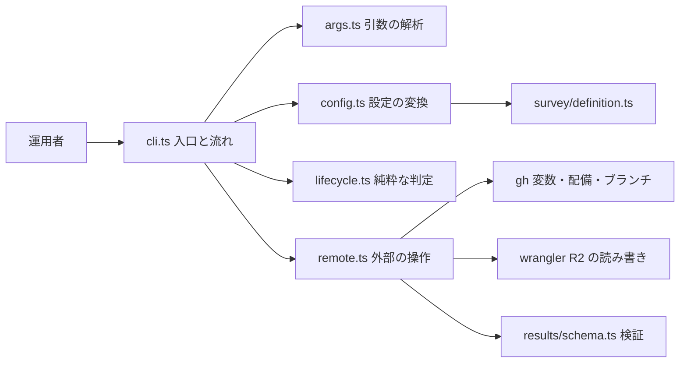
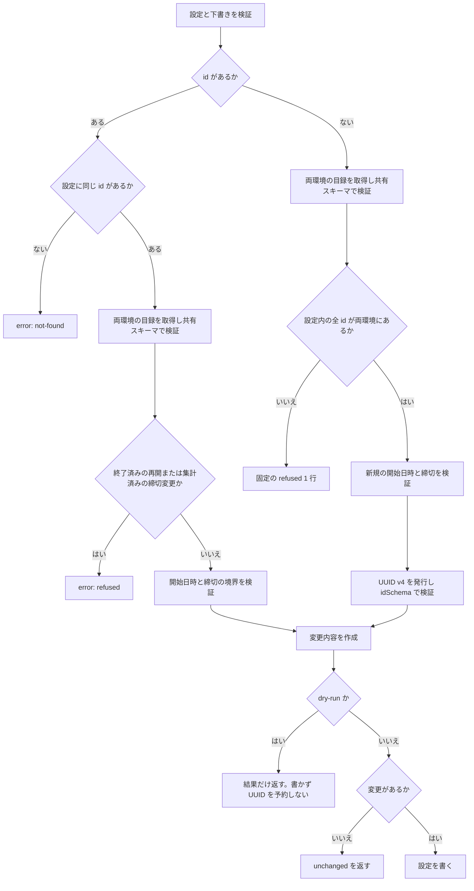
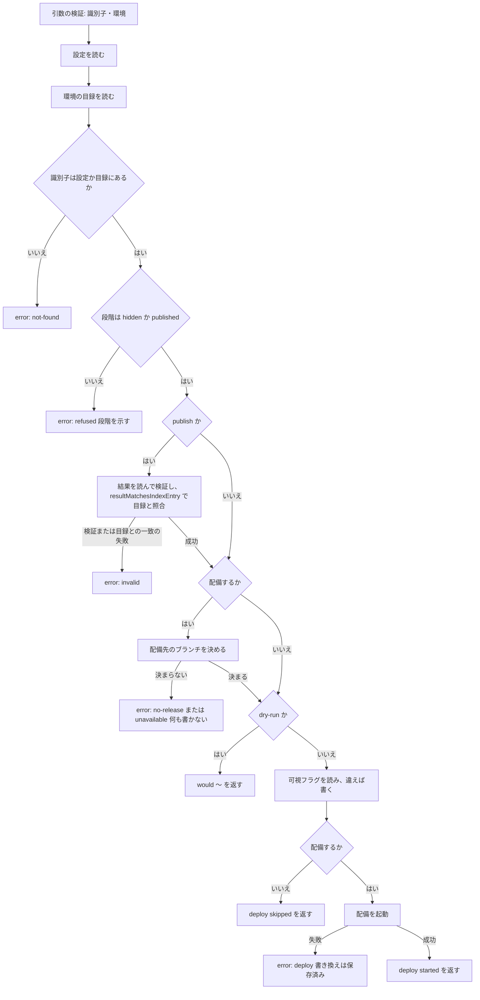
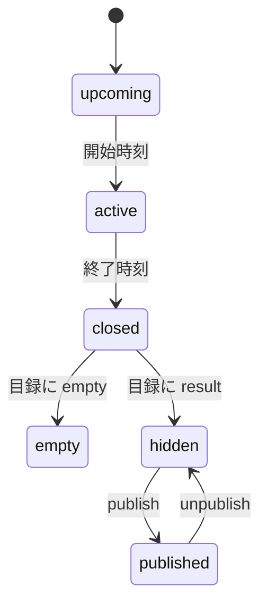
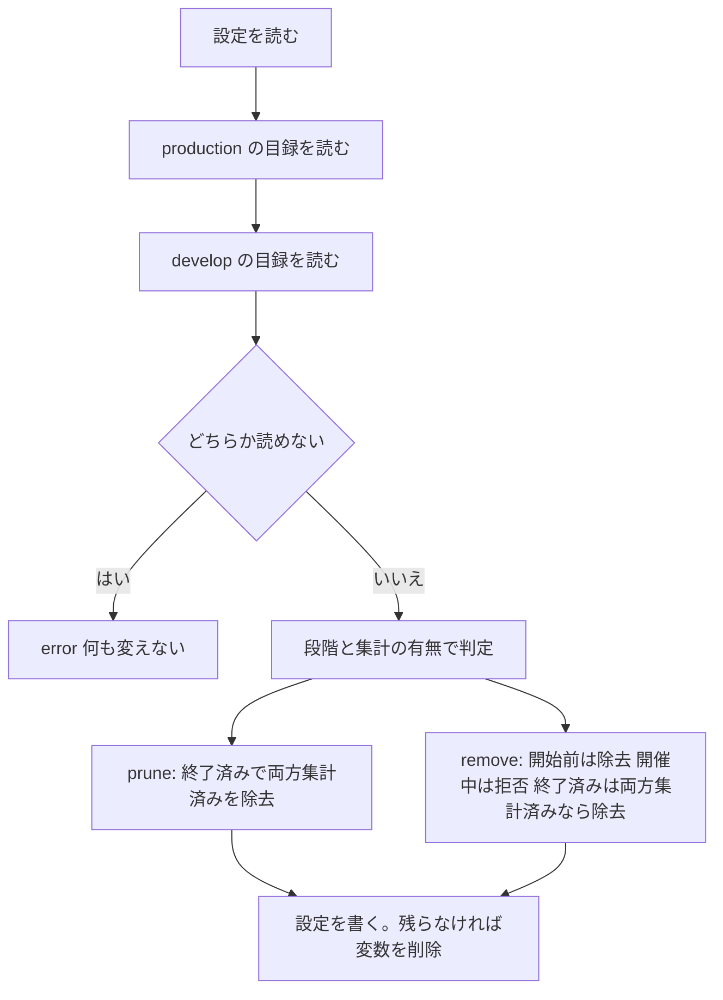

# Design Document

## Overview

**Purpose**: アンケートの運用 CLI（`npm run survey`）を、登録・状態確認・公開の切り替え・除去の平坦な体系に作り直し、公開の切り替えで再配備を起動し、設定からの除去を「集計済みだけ」に置き換える。
**Users**: アンケートを運用する人（手元で `gh` と `wrangler` にログイン済み）と、手順を案内する `survey-run` skill。
**Impact**: 現行の CLI が依存している保持期限の判定（`retentionExpired`）と、回答の保存先（D1）の行の確認をなくす。段階を 6 つにし、結果の保管先（R2）の目録と可視フラグを読み書きする。アンケート全体の題・説明が設定の形式から消えるため、下書きと聞き取りの形式を直す。

### Goals

- 状態を「アンケートごとに 1 つの段階」で 1 つの表にして示す。
- 公開・非公開の切り替えと再配備の起動を、環境を必ず選ばせて行う。
- 設定からの除去を、両環境で集計済みのものだけに限り、結果を失う操作を止める。
- 出力の形式と「秘密を出さない」規則、手元の認証だけで動く性質を保つ。
- `survey-results-aggregation` が廃止する保持期限の判定への依存を、この CLI から無くす。

### Non-Goals

- 統計ファイルの形式・集計・回答の削除（`survey-results-aggregation`）。
- 結果ページ・ビルド時の取得（`survey-results-public`）。
- 設定の形式そのものの変更（`surveys`。この spec は変更後の形式に従う）。
- 配備の完了・画面への反映の確認、反映待ちの表示（Decision 5）。
- 移行の手順（アンケート機能は未公開のため作らない）。

## Boundary Commitments

### This Spec Owns

- CLI のコマンド体系・引数・結果の形式（`add`・`status`・`publish`・`unpublish`・`prune`・`remove`）。
- 段階の定義と判定、`prune`・`remove` の除去の規則、最新のリリースブランチの決め方。
- 結果の保管先の可視フラグの書き込み（唯一の書き手。不正な可視フラグを上書きで直せる唯一の手段でもある）と、目録・結果・可視フラグの読み出し（検証は `survey-results-aggregation` のスキーマを使う）。
- 配備の起動（`deploy.yaml` の手動起動）。
- 下書きの形式の固定データ（`tests/fixtures/survey-operation/drafts/`）と CLI のテスト。
- `survey-run` skill と `docs/DEVELOP.md` の運用の手順。

### Out of Boundary

- 統計ファイルの形式・キー名・検証スキーマ（`survey-results-aggregation`。ここでは読むだけ）。
- 結果の本体・目録の書き込み（Worker だけ）。
- 設定の形式（`SurveyConfigSchema`）と、`tests/fixtures/survey/` の固定データ・`SurveyDialog`・辞書の題・説明の廃止（`surveys`）。
- `npm run survey:render`、CI の設定、結果の保管先の作成、`deploy.yaml` の変更。
- 孤立した回答（設定から集計前に消えたアンケートの行）の探索と削除。

### Allowed Dependencies

- `@/lib/survey/definition`（`parseSurveyConfig`・型）、`@/lib/survey/results/schema`（検証・キー名・版の定数と、上流の約束である純粋な判定 `resultMatchesIndexEntry(entry, result)`・`isVisible(visibility)`）、`@/lib/api/contract/surveyPath`（`idSchema`）。
- `scripts/lib/github.mjs`（Git のリモートからの `owner/repo` の解析）、`scripts/lib/jsonc.mjs`（テンプレートの読み込み）。
- 運用者の手元の `gh`・`wrangler`・`git`（子プロセスとして呼ぶ）。
- 禁止: `src/` から `hack/` への参照、`cloudflare:workers` や Worker 専用モジュールの import、D1 への問い合わせ、`lib/survey/period.ts` の保持期限の判定。

### Revalidation Triggers

- 統計ファイルのキー名・形式・版の変更、バケット名の宣言（`config/wrangler.template.jsonc` の `SURVEY_RESULTS`）の変更。
- 設定の形式の変更（`SurveyConfigSchema`、下書きの形式）。
- `deploy.yaml` の入力名（`dry_run`）・起動できるブランチの規則の変更、リリースブランチの命名の方式の確定。
- 環境の追加（`production`・`develop` 以外）。
- `survey-results-aggregation` の `resultMatchesIndexEntry`・`isVisible` の契約（引数・判定の規則）の変更。上流に識別子の再利用専用規則は設けない。
- 統計ファイルの目録に「回答の削除の完了」の印が足されたとき（Decision 13 の見直し）。
- `survey-results-aggregation` の日次の枠の、設定に無い識別子の回答行と回答済みの集合の行の削除（孤立した回答の掃除。冪等・設定に同じ識別子があれば終了済みでも本流に任せ、設定に無い識別子だけを掃除する）の変更・廃止（Decision 13 の前提）。

## Architecture

### Existing Architecture Analysis

- 現行の `cli.ts` は、引数の解析 → 設定の取得 → 変換 → 反映 → 固定の 1 行の出力、という流れで、`SurveyRemote`・時刻・ファイル読み込みを差し込める。失敗は `RemoteError` の種類（`auth`・`unavailable`・`parse`）で固定の文言に変える。この形を保つ。
- `lifecycle.ts` の段階の判定と除去の判定は `retentionExpired` と D1 の行に依存する。置き換える。
- `remote.ts` の D1 の部分（`hasRows`・`parseDatabaseNames`・SQL）は消し、バケット名の読み取りと R2・配備の呼び出しを足す。

### Architecture Pattern & Boundary Map



- Selected pattern: 現行の「流れ（cli）・純粋な変換（config・lifecycle）・外部の操作（remote）」の分離を保つ。
- 外部の操作はすべて `SurveyRemote` の背後に置き、流れのテストは偽の実装で行い、`remote.ts` のテストは偽の実行関数（`RunCommand`）で行う。
- Steering compliance: R2 バケットは用途ごとに分ける（`r2-buckets.md`）。この CLI は `skyshare-survey-results` を読み書きするだけで、バケットを増やさない。

### Technology Stack

| Layer        | Choice / Version                        | Role in Feature                                                                                              | Notes                                                       |
| ------------ | --------------------------------------- | ------------------------------------------------------------------------------------------------------------ | ----------------------------------------------------------- |
| CLI          | TypeScript（`tsx`）                     | `npm run survey`                                                                                             | 現行どおり。`package.json` の `survey` スクリプトは変えない |
| 設定の保存   | `gh variable`・`gh api`                 | `SURVEY_CONFIG` の読み書き                                                                                   | 現行どおり                                                  |
| 結果の保管先 | `wrangler r2 object get/put`（4.147.0） | 目録・結果・可視フラグ                                                                                       | `--remote`・`--file`。追加の認証情報は不要                  |
| 配備の起動   | `gh workflow run`                       | `deploy.yaml` の手動起動                                                                                     | `dry_run=false`                                             |
| 検証         | `@/lib/survey/results/schema`（zod）    | 読んだ統計ファイルの検証と、`resultMatchesIndexEntry`（結果と目録の一致）・`isVisible`（公開かどうか）の判定 | 形式も判定も独自に定義しない                                |

## File Structure Plan

### Directory Structure

```
hack/survey-cli/
├── cli.ts         # 入口。引数の解析結果から流れを組み立て、結果の行を返す
├── args.ts        # 引数の解析と使い方の検証（新規。コマンドの増加で cli.ts から分ける）
├── config.ts      # 設定の変換（add・remove・prune の変更）。下書きの形式
├── lifecycle.ts   # 段階・除去・最新のリリースブランチの純粋な判定
└── remote.ts      # gh・wrangler の呼び出し、バケット名の読み取り、失敗の分類
tests/unit/hack/survey-cli/
├── args.test.ts   # 引数の検証
├── lifecycle.test.ts
├── config.test.ts
├── cli.test.ts    # 偽の SurveyRemote で各コマンドの流れと出力
└── remote.test.ts # 偽の RunCommand で外部コマンドの引数・失敗の分類・秘密の非表示
tests/fixtures/survey-operation/drafts/
├── without-id.json   # 新規登録の下書き（題・説明なし）
├── with-id.json      # 更新の下書き（id あり）
└── legacy-title.json # 拒否される旧形式（全体の題・説明あり）
```

### Modified Files

- `hack/survey-cli/cli.ts` — 6 コマンドの流れ、結果の形式（`status` の表は複数行）、新しい失敗の種類。D1 の確認を削除。
- `hack/survey-cli/config.ts` — `canonicalSurvey` と `DraftSurvey` から `title`・`description` を外す。`removeSurveys` は流用。
- `hack/survey-cli/lifecycle.ts` — `retentionExpired` の import と `RowPresence`・旧 `decidePrune` を削除し、新しい判定に置き換える。
- `hack/survey-cli/remote.ts` — D1 の部分を削除し、R2・配備・ブランチの操作を足す。
- `tsconfig.json` — `include` に `hack/**/*` を足す（`npm run test:type` が CLI を直接検査するため）。
- `.kiro/steering/testing.md` — この spec が直すのは、`hack/` のテストの置き場の節（配置の一覧に `tests/unit/hack/` を足し、`hack/` の CLI のテストは P0 ではなく、被覆率の閾値を置かないと書く）だけ。ほかの節には触れない。
- `.claude/skills/survey-run/SKILL.md`（と、同じ内容が残っていれば `.agents/skills/survey-run/SKILL.md`）— 新しい体系・聞き取りの変更・下書きの参照先。
- `docs/DEVELOP.md` — この spec が直す見出しは、3.1 の `hack/` の説明、3.2 アンケート（コマンドの列挙・結果の保管先との関係）、5.1 の配備の節（再配備の起動）、5.4 main への取り込み前のアンケート除去（`prune` の新しい規則と、`develop` の目録が無いときの手順）、6.x の `SURVEY_CONFIG` の行（6.2 の変数の表）だけ。`survey-results-public` は CI/CD の認証情報、R2、プレビューの各節と、6.5 の `SURVEY_RESULTS` の行を直す。重ならないよう、6.5 の表と R2 の節はこの spec では触れない。
- `tests/fixtures/survey-operation/drafts/*` — 新規（旧い参照先は存在しない）。この spec が作る固定データの置き場はここ（`tests/fixtures/survey-operation/`）だけで、`tests/fixtures/survey/` は `surveys` の担当である。

## System Flows

### 登録と更新（add）



- 目録の取得と形式検証は dry-run でも省かない。キーが無いときは空の目録として扱うが、取得失敗・形式不正は登録を止める。設定が空の場合も両環境を読む。
- 新規登録の可否は、設定内の全識別子が両方の目録に存在するかだけで決める。開始前のアンケートも対象。設定に残る集計済みの過去分は新規登録を妨げない。
- 識別子の発行は新規登録の検証と可否確認を通過した後だけ行う。複数の `add` は運用者が直列に実行する。

### 公開の切り替え（publish / unpublish）



- 配備先を決めるのは、可視フラグを書く前にする。決まらないのに書いて半端な状態になるのを避ける（要件 5.4）。
- 可視フラグが不正な形式でも、止めずに進める。`publish`・`unpublish` は不正な可視フラグを「望む状態ではない」と見なして上書きする（Decision 14、要件 4.11）。
- 可視フラグが既に望む状態でも配備を起動する。配備の起動に失敗した後の再実行で、配備だけを起動し直せる（要件 4.8, 5.6）。

### 段階（状態遷移）



- 段階は、時刻を先に見て、集計済みの状態は終了時刻以後にだけ使う（設定の期間が後から延ばされたときに、集計済みのものが `hidden` に見えて開催中なのに除去できるように見えるのを避ける）。

### 除去（prune / remove）



- 目録が無い（`index.json` が存在しない）ことは「何も集計されていない」として扱い、読めない・検証に通らないこととは区別する。

## Requirements Traceability

| Requirement | Summary                                          | Components                   | Interfaces                                                      | Flows          |
| ----------- | ------------------------------------------------ | ---------------------------- | --------------------------------------------------------------- | -------------- |
| 1.1         | 6 コマンドだけ                                   | args                         | `parseArgs`                                                     | -              |
| 1.2         | 不正な指定は変更せず使い方                       | args, cli                    | `parseArgs`                                                     | -              |
| 1.3         | status 以外は 1 行                               | cli                          | `SurveyCliResult`                                               | -              |
| 1.4         | 失敗は `error:`・終了コード                      | cli                          | `SurveyCliResult`                                               | -              |
| 1.5         | 秘密を出さない                                   | cli, remote                  | `RemoteError`, 結果の組み立て                                   | -              |
| 1.6         | `--dry-run`                                      | args, cli                    | `Command`                                                       | 公開の切り替え |
| 1.7         | `--repo`                                         | args, remote                 | `SurveyRemoteOptions`                                           | -              |
| 1.8         | 手元の認証だけ                                   | remote                       | `RunCommand`                                                    | -              |
| 1.9         | 認証と利用不可の区別                             | remote, cli                  | `RemoteError`                                                   | -              |
| 2.1         | 環境の必須                                       | args                         | `Command`                                                       | -              |
| 2.2         | 不正な環境は何も読み書きしない                   | args                         | `parseArgs`                                                     | -              |
| 2.3         | prune・remove は両環境                           | cli, lifecycle               | `decidePrune`, `decideRemove`                                   | 除去           |
| 2.4         | add は環境なし                                   | args                         | `parseArgs`                                                     | -              |
| 2.5         | 受け付けない `--env` は使い方                    | args                         | `parseArgs`                                                     | -              |
| 3.1         | 設定と目録を合わせた表                           | cli, lifecycle               | `buildStatusRows`                                               | -              |
| 3.2         | 行の内容                                         | lifecycle, cli               | `StatusRow`                                                     | -              |
| 3.3         | upcoming                                         | lifecycle                    | `surveyStage`                                                   | 段階           |
| 3.4         | active                                           | lifecycle                    | `surveyStage`                                                   | 段階           |
| 3.5         | closed                                           | lifecycle                    | `surveyStage`                                                   | 段階           |
| 3.6         | empty                                            | lifecycle                    | `surveyStage`                                                   | 段階           |
| 3.7         | hidden（不正も含む。判定は `isVisible`）         | lifecycle, remote            | `surveyStage`, `readVisibility`                                 | 段階           |
| 3.8         | published                                        | lifecycle, remote            | `surveyStage`, `readVisibility`                                 | 段階           |
| 3.9         | 設定から除去済みも含める                         | lifecycle                    | `buildStatusRows`                                               | -              |
| 3.10        | 題を持たない                                     | lifecycle                    | `StatusRow`                                                     | -              |
| 3.11        | 変数の使用量                                     | cli, config                  | `byteLength`                                                    | -              |
| 3.12        | アンケートが無い                                 | cli                          | -                                                               | -              |
| 3.13        | 目録が読めない                                   | remote, cli                  | `readIndex`                                                     | -              |
| 3.14        | 書き換えない                                     | cli                          | -                                                               | -              |
| 3.15        | 不正な可視フラグは hidden に警告の印             | lifecycle, remote, cli       | `readVisibility`, `StatusRow.invalidVisibility`                 | 段階           |
| 4.1         | publish                                          | cli, remote                  | `writeVisibility`                                               | 公開の切り替え |
| 4.2         | unpublish                                        | cli, remote                  | `writeVisibility`                                               | 公開の切り替え |
| 4.3         | 集計前は拒否                                     | cli, lifecycle               | `surveyStage`                                                   | 公開の切り替え |
| 4.4         | empty は拒否                                     | cli, lifecycle               | `surveyStage`                                                   | 公開の切り替え |
| 4.5         | 識別子が無い                                     | cli                          | -                                                               | 公開の切り替え |
| 4.6         | 結果の検証失敗・目録との不一致は公開しない       | cli, remote                  | `readResult`, `resultMatchesIndexEntry`                         | 公開の切り替え |
| 4.7         | unpublish は壊れた結果でも可                     | cli                          | -                                                               | 公開の切り替え |
| 4.8         | 既に望む状態                                     | cli                          | -                                                               | 公開の切り替え |
| 4.9         | 本体・目録・他の環境に触れない                   | remote                       | `writeVisibility`                                               | -              |
| 4.10        | 設定に無くても切り替えられる                     | cli, lifecycle               | `buildStatusRows`                                               | 公開の切り替え |
| 4.11        | 不正な可視フラグでも進めて上書き                 | cli, remote                  | `readVisibility`, `writeVisibility`                             | 公開の切り替え |
| 5.1         | dry_run を偽で起動                               | remote                       | `startDeploy`                                                   | 公開の切り替え |
| 5.2         | develop は develop ブランチ                      | cli                          | `deployRef`                                                     | 公開の切り替え |
| 5.3         | production は最新のリリース                      | lifecycle, remote            | `latestReleaseBranch`, `listReleaseBranches`                    | 公開の切り替え |
| 5.4         | 決まらなければ書かない                           | cli                          | `deployRef`                                                     | 公開の切り替え |
| 5.5         | 起動の失敗は保存済みと再実行を示す               | cli                          | -                                                               | 公開の切り替え |
| 5.6         | 既に望む状態でも配備                             | cli                          | -                                                               | 公開の切り替え |
| 5.7         | `--no-deploy`                                    | args, cli                    | `Command`                                                       | 公開の切り替え |
| 5.8         | dry-run は起動先を示す                           | cli                          | -                                                               | 公開の切り替え |
| 5.9         | 完了は確かめない                                 | cli                          | -                                                               | -              |
| 6.1         | 両環境で集計済みだけ除去                         | lifecycle, cli               | `decidePrune`                                                   | 除去           |
| 6.2         | D1 を使わない                                    | remote                       | -                                                               | -              |
| 6.3         | 公開・非公開に関わらず除去                       | lifecycle                    | `decidePrune`                                                   | 除去           |
| 6.4         | 未集計は残して環境を示す                         | lifecycle                    | `PruneKept`                                                     | 除去           |
| 6.5         | 目録が読めなければ何も除去しない                 | cli                          | `readIndex`                                                     | 除去           |
| 6.6         | 開始前・開催中は除去しない                       | lifecycle                    | `decidePrune`                                                   | 除去           |
| 6.7         | 残らなければ変数を削除                           | cli, remote                  | `deleteConfigValue`                                             | 除去           |
| 6.8         | 対象が無い                                       | cli                          | -                                                               | 除去           |
| 6.9         | 除去・残した理由を示し、手順書への案内を添える   | cli                          | -                                                               | 除去           |
| 7.1         | 開始前は除去                                     | lifecycle                    | `decideRemove`                                                  | 除去           |
| 7.2         | 開催中は拒否                                     | lifecycle                    | `decideRemove`                                                  | 除去           |
| 7.3         | 終了済みは両方集計済みで除去                     | lifecycle                    | `decideRemove`                                                  | 除去           |
| 7.4         | 未集計は拒否                                     | lifecycle                    | `decideRemove`                                                  | 除去           |
| 7.5         | 設定に無い                                       | cli                          | -                                                               | 除去           |
| 7.6         | 強制の指定なし                                   | args                         | `parseArgs`                                                     | -              |
| 7.7         | 残らなければ変数を削除                           | cli                          | `deleteConfigValue`                                             | 除去           |
| 7.8         | 目録が読めなければ変更しない                     | cli                          | `readIndex`                                                     | 除去           |
| 8.1         | add の検証と反映                                 | cli, config                  | `addSurvey`                                                     | -              |
| 8.2         | 下書きに全体の題・説明なし                       | config                       | `DraftSurvey`                                                   | -              |
| 8.3         | 旧形式は拒否                                     | config                       | `parseSurveyConfig`                                             | -              |
| 8.4         | 開始日時を補う                                   | config                       | `addSurvey`                                                     | -              |
| 8.5         | 更新は開始日時を保つ                             | config                       | `addSurvey`                                                     | -              |
| 8.6         | 検証・容量の失敗                                 | config, cli                  | `AddOutcome`                                                    | -              |
| 8.7         | 変更が無い                                       | config, cli                  | `AddOutcome`                                                    | -              |
| 8.8         | 本文を出さない                                   | cli                          | -                                                               | -              |
| 8.9         | 新規 ID は UUID v4 とし idSchema で検証          | config                       | `createId`, `idSchema`                                          | 登録           |
| 8.10        | ID の有無で新規・更新を分ける                    | config                       | `addSurvey`                                                     | 登録           |
| 8.11        | 不正な ID は invalid、設定に無い ID は not-found | config, cli                  | `addSurvey`                                                     | 登録           |
| 8.12        | 全設定 ID が両目録にある場合だけ新規可           | cli                          | `readIndex`                                                     | 登録           |
| 8.13        | 目録取得の扱いは dry-run でも同じ                | cli, remote                  | `readIndex`                                                     | 登録           |
| 8.14        | 新規拒否は固定の 1 行                            | cli                          | `SurveyCliResult`                                               | 登録           |
| 8.15        | 締切日付を検証し日本時間 0 時に変換              | config                       | `DraftSurvey`, `addSurvey`                                      | 登録           |
| 8.16        | 締切境界・再開・集計済み変更を拒否               | config, cli                  | `addSurvey`                                                     | 登録           |
| 8.17        | 指定した締切日での前倒し判定                     | config                       | `addSurvey`                                                     | 登録           |
| 8.18        | 検証・登録可否の後に ID を発行                   | config                       | `createId`                                                      | 登録           |
| 9.1         | skill が新体系                                   | survey-run skill             | -                                                               | -              |
| 9.2         | 聞き取りから題・説明を外す                       | survey-run skill             | -                                                               | -              |
| 9.3         | 運用の規則を保つ                                 | survey-run skill             | -                                                               | -              |
| 9.4         | 段階と再配備の説明                               | survey-run skill             | -                                                               | -              |
| 9.5         | 開催中の取り下げの手順                           | survey-run skill             | -                                                               | -              |
| 9.6         | DEVELOP.md 5.4                                   | DEVELOP.md                   | -                                                               | -              |
| 9.7         | DEVELOP.md 3.2                                   | DEVELOP.md                   | -                                                               | -              |
| 9.8         | 直接書き換えない                                 | survey-run skill, DEVELOP.md | -                                                               | -              |
| 9.9         | develop 未集計の抜け道                           | survey-run skill, DEVELOP.md | -                                                               | 除去           |
| 9.10        | 集計済みの終了日時を延ばさない                   | survey-run skill             | -                                                               | -              |
| 9.11        | DEVELOP.md の直す項を限る                        | DEVELOP.md                   | -                                                               | -              |
| 9.12        | skill は status 全体表・他は固定 1 行を報告      | survey-run skill             | -                                                               | -              |
| 9.13        | 手順書に UUID・日付・開始前の登録制限を書く      | survey-run skill, DEVELOP.md | -                                                               | -              |
| 9.14        | 固定拒否文と次の手順を案内                       | survey-run skill, DEVELOP.md | -                                                               | 登録           |
| 9.15        | 開催中の取り下げの順序を案内                     | survey-run skill, DEVELOP.md | -                                                               | 除去           |
| 9.16        | --env の使い分けを手順書に示す                   | survey-run skill, DEVELOP.md | -                                                               | -              |
| 9.17        | 集計失敗時の R2 復旧手順                         | DEVELOP.md                   | -                                                               | -              |
| 10.1        | 保持期限を使わない                               | lifecycle                    | `surveyStage`                                                   | -              |
| 10.2        | D1 に触れない                                    | remote                       | `SurveyRemote`                                                  | -              |
| 10.3        | 時刻・期間・目録だけで判定                       | lifecycle                    | `surveyStage`                                                   | 段階           |
| 10.4        | 共有のスキーマと判定で検証                       | remote, cli                  | `parseSurveyIndex`, `resultMatchesIndexEntry`, `isVisible` ほか | -              |

## Components and Interfaces

| Component | Domain/Layer | Intent                                     | Req Coverage                                                                                                                     | Key Dependencies (P0/P1)                        | Contracts |
| --------- | ------------ | ------------------------------------------ | -------------------------------------------------------------------------------------------------------------------------------- | ----------------------------------------------- | --------- |
| args      | 入口         | 引数の解析と使い方の検証                   | 1.1, 1.2, 1.6, 1.7, 2.1, 2.2, 2.4, 2.5, 5.7, 7.6                                                                                 | なし                                            | Service   |
| cli       | 入口         | 流れと結果の組み立て                       | 1.3, 1.4, 1.5, 1.9, 2.3, 3.1, 3.11–3.15, 4.1–4.11, 5.2, 5.4–5.6, 5.8, 5.9, 6.5, 6.7–6.9, 7.5, 7.7, 7.8, 8.6–8.8, 8.11–8.14, 8.16 | args, config, lifecycle, remote (P0)            | Service   |
| config    | 変換         | 設定の追加・更新・除去、下書きの形式       | 8.1–8.7, 8.9, 8.10, 8.11, 8.15–8.18                                                                                              | `definition.ts`, `idSchema` (P0)                | Service   |
| lifecycle | 純粋な判定   | 段階・除去・リリースブランチ・表の行       | 2.3, 3.1–3.10, 4.3, 4.4, 4.10, 5.3, 6.1, 6.3, 6.4, 6.6, 7.1–7.4, 10.1, 10.3                                                      | なし                                            | Service   |
| remote    | 外部         | 変数・R2・配備・ブランチの操作と失敗の分類 | 1.5, 1.7, 1.8, 1.9, 3.7, 3.8, 3.13, 4.1, 4.2, 4.6, 4.9, 5.1, 5.3, 6.2, 6.7, 10.2, 10.4                                           | `gh`・`wrangler` (P0), `results/schema.ts` (P0) | Service   |
| 手順書    | 文書         | skill と DEVELOP.md                        | 9.1–9.17                                                                                                                         | 上の CLI (P0)                                   | -         |

### 入口

#### args.ts

| Field        | Detail                                                                                                             |
| ------------ | ------------------------------------------------------------------------------------------------------------------ |
| Intent       | 引数を検証し、コマンドの型に変える。環境・識別子・指定の組み合わせの誤りは、何も読み書きする前に使い方の失敗にする |
| Requirements | 1.1, 1.2, 1.6, 1.7, 2.1, 2.2, 2.4, 2.5, 5.7, 7.6                                                                   |

##### Service Interface

```typescript
export type SurveyEnv = "production" | "develop"

export type Command =
    | { name: "add"; file: string; dryRun: boolean }
    | { name: "status"; env: SurveyEnv }
    | {
          name: "publish" | "unpublish"
          id: string
          env: SurveyEnv
          deploy: boolean
          dryRun: boolean
      }
    | { name: "prune"; dryRun: boolean }
    | { name: "remove"; id: string; dryRun: boolean }

export type ParsedArgs =
    | { ok: true; command: Command; repo?: string }
    | { ok: false; usage: string }

export const parseArgs = (argv: readonly string[]): ParsedArgs
```

- Preconditions: なし（未検証の引数の配列）。
- Postconditions: `id` は `idSchema` に通った値だけ（結果の行に出してよい）。`--repo` は `owner/repo` の形だけ。同じ指定の重複・未知の指定・余分な位置引数は `ok: false`。`status` の `--dry-run`、`add`・`prune`・`remove` の `--env`・`--no-deploy` は `ok: false`。`--force` は未知の指定として拒否する。
- 使い方の文言は 1 行で、入力の値を含めない。

#### cli.ts

| Field        | Detail                                                                               |
| ------------ | ------------------------------------------------------------------------------------ |
| Intent       | 引数・設定・目録から結果の行を組み立てる。標準出力には直接書かず、`run` が結果を返す |
| Requirements | 上の表のとおり                                                                       |

##### Service Interface

```typescript
export type SurveyCliDependencies = {
  remote?: SurveyRemote
  createId?: () => string
  now?: () => Date
  readFile?: (filePath: string) => string
}

/** status は複数行（先頭が見出し、続きが表の行）。ほかは 1 行 */
export type SurveyCliResult = { code: 0 | 1; lines: string[] }

export const run: (
  argv: readonly string[],
  dependencies?: SurveyCliDependencies,
) => Promise<SurveyCliResult>
```

- 結果の行の形式（固定）:
  - `add: created|updated|unchanged <id> (surveys N, X/48 KB)`（現行のまま。`[dry-run] ` を先頭に付ける）
  - `status: env=<環境> surveys N, config X/48 KB` の次に、アンケートごとに 1 行 `  <id>  <段階>  closes <YYYY-MM-DD HH:mm> JST  <config|r2-only>`。可視フラグが不正な行の末尾には ` !invalid-visibility` を付ける（段階は `hidden`。要件 3.15）。アンケートが無いときは `status: env=<環境> no surveys`。
  - `publish|unpublish: published|hidden|unchanged <id> (<環境>); deploy started (<ref>)|deploy skipped (--no-deploy)`。dry-run は `[dry-run] publish: would publish <id> (<環境>); would deploy <ref>`。
  - `prune: removed <id>, ... (surveys A -> B); kept <id>(not-aggregated: <環境>), ...`、`prune: nothing to remove`、`prune: nothing removed; kept ...`。`kept` を含む行の末尾には ` ; see DEVELOP.md 5.4 / survey-run (not-aggregated)` を付け、手順書の「集計されていない環境がある場合」へ案内する。`remove` の `refused ... not-aggregated: <環境>` の行にも同じ案内を付ける。
  - `remove: removed <id> (surveys A -> B)`。
  - `add` の新規登録拒否: `error: refused: 未集計のアンケートがあります。集計を待つか、開始前なら remove、開催中なら締切を前倒しして両環境へ配備し、集計を待ってください。`。この文面はテストで固定する。
  - 開催中の更新で締切を前倒しできない場合: `error: refused: 前倒しできません。自然な終了と集計を待ってください。`。指定締切の前倒し条件を満たさず、かつ開始日時より後で最も早い日本時間 0 時が現在の締切以後ならこの行を返す。この文面もテストで固定する。
  - 配備先を決められない場合（本番にリリースブランチが無い）: `error: no-release: 本番のリリースブランチがありません`（実装時の決定）。何も書かない。
  - 配備を省く dry-run: `[dry-run] publish: would publish <id> (<環境>); deploy skipped (--no-deploy)`（実装時の決定。`unpublish` も同じ形）。
  - 失敗: `error: usage|invalid|auth|unavailable|too-large|not-found|refused|no-release|deploy: <固定の文言>`。`refused` は `<id> is <段階>` と理由の固定語（`results would be lost`・`nothing to publish`・`not aggregated: <環境>`）または上記の `add` 専用の固定文言。`deploy` は「可視フラグは保存済み。同じコマンドの再実行で配備だけを起動できる」。
- Postconditions: 識別子・段階・環境・数値・日時以外の入力由来の値を行に含めない。設定の読み込みが不正なら `error: invalid`（位置と理由だけ。現行どおり）。

### 変換と判定

#### config.ts

- 下書きは設定の 1 件から `id` と `opensAt` を省ける形とし、`closesAt` は実在する `YYYY-MM-DD` の日付文字列とする。アンケート全体の題・説明、`opensAt` は下書きに含めない。旧形式の題・説明は strict な検証で拒否する。
- 契約は `addSurvey(current, draft, registeredAt, newId?)` とする。下書きに `id` が無い場合だけ新規登録し、ある場合は同じ識別子を持つ設定済みアンケートの更新だけを行う。指定 ID が無ければ `not-found` とし、新規追加しない。
- 新規登録では開始日時を `registeredAt` から作り、締切を日本時間 0 時の ISO 8601 に変換する。`closesAt > registeredAt` が必要。更新では開始日時を元の値に保ち、`closesAt > opensAt` が必要。
- 更新対象がすでに終了している場合、更新後の締切が現在時刻より後になる再開を拒否する。目録のどちらかに ID があれば集計済みで、締切の変更を拒否する。期間の一致確認はしない。開催中の更新で許す変更は締切だけで、下書きに書かれた日付の日本時間 0 時を指定締切として使う。指定締切が現在の締切より前かつ元の開始日時より後なら受理し、それ以外（現在の締切以後または開始日時以下）は拒否する。「元の開始日時より後で最も早い日本時間 0 時」は skill が提案する運用上の目安で、CLI の受理条件ではない。その最も早い 0 時が現在の締切以後なら、`error: refused: 前倒しできません。自然な終了と集計を待ってください。` の固定の 1 行を返す。
- 結果の形（実装時の決定）: `AddOutcome` は、登録・更新・変更なし（`created`・`updated`・`unchanged`。`id`・`config`・`value` を持つ）、`invalid`（`issues`）、`too-large`（`bytes`）、`not-found`（指定 ID が設定に無い。値を持たない）、`refused`（`line`: 出力する固定の 1 行）の 5 つの状態を持つ。`refused` の行は、`error: refused: 前倒しできません。自然な終了と集計を待ってください。`（元の開始日時より後で最も早い日本時間 0 時が現在の締切以後のとき。開始がちょうど日本時間 0 時なら、その翌日の 0 時を最も早い 0 時とする）、`error: refused: 締切は現在の締切より前の日付を指定してください。`（前倒しの余地があるのに、指定締切が現在の締切以後のとき）、`error: refused: 開催中は締切の前倒し以外を更新できません。`（開催中に締切以外を変えるとき）、`error: refused: 終了済みのアンケートは再開できません。`（終了済みで、更新後の締切が現在より後になるとき）。
- `createId?: () => string` を依存として受け、既定値を `node:crypto` の `randomUUID` とする。設定・下書き・登録可否の検証後、新規だけで呼び、戻り値を `idSchema` で検証する。dry-run は識別子を予約しない。
- 月ごとの連番、月を求める処理、下書きの内容から既存識別子を探す処理は設けない。変更がない場合だけでなく、すべての `add` は直列実行を前提とし、同時実行を制御する仕組みは持たない。

#### lifecycle.ts

| Field        | Detail                                                                 |
| ------------ | ---------------------------------------------------------------------- |
| Intent       | 時刻・設定の期間・目録の状態だけから、段階と除去の可否を決める純粋関数 |
| Requirements | 3.1–3.10, 3.15, 4.3, 4.4, 5.3, 6.1, 6.3, 6.4, 6.6, 7.1–7.4, 10.1, 10.3 |

##### Service Interface

```typescript
export type SurveyStage =
  "upcoming" | "active" | "closed" | "empty" | "hidden" | "published"

/** 可視フラグの読み取り結果。invalid は形式が不正（段階は hidden 扱いで、警告の印を付ける） */
export type VisibilityState = "visible" | "hidden" | "invalid"

/** 目録の記録。無ければ undefined（集計済みでない） */
export type Aggregation =
  | { outcome: "result"; visibility: VisibilityState }
  | { outcome: "empty" }
  | undefined

export type Period = { opensAt: string; closesAt: string }

export const surveyStage: (
  period: Period,
  aggregation: Aggregation,
  now: Date,
) => SurveyStage

export type StatusRow = {
  id: string
  stage: SurveyStage
  closesAt: string
  inConfig: boolean
  /** 可視フラグが不正。表に `!invalid-visibility` を付ける */
  invalidVisibility: boolean
}

/** 設定の期間を優先し、設定に無いものは目録の期間で行を作る。開始時刻の昇順、同じなら識別子の昇順 */
export const buildStatusRows: (
  config: SurveyConfig,
  index: ReadonlyMap<string, { period: Period; aggregation: Aggregation }>,
  now: Date,
) => StatusRow[]

export type PruneKept = { id: string; pending: SurveyEnv[] }

/** aggregated は環境ごとの、目録に記録がある識別子の集合 */
export const decidePrune: (
  config: SurveyConfig,
  aggregated: Readonly<Record<SurveyEnv, ReadonlySet<string>>>,
  now: Date,
) => { remove: string[]; kept: PruneKept[] }

export type RemoveDecision =
  | { kind: "remove" }
  | { kind: "refused"; reason: "active" }
  | { kind: "refused"; reason: "not-aggregated"; pending: SurveyEnv[] }

export const decideRemove: (
  survey: Survey,
  aggregated: Readonly<Record<SurveyEnv, ReadonlySet<string>>>,
  now: Date,
) => RemoveDecision

export const latestReleaseBranch: (
  branches: readonly { name: string; committedAt: string }[],
) => string | undefined

/** ISO 8601 の日時を `YYYY-MM-DD HH:mm`（日本標準時）にする */
export const formatJst: (iso: string) => string
```

- 規則: 時刻が開始より前は `upcoming`、開始以後・終了より前は `active`。終了以後は、`aggregation` が無ければ `closed`、`empty` なら `empty`、`result` なら `visibility` が `visible` のとき `published`、`hidden`・`invalid` のとき `hidden`（`invalid` の行には `invalidVisibility` を立てる）。終了時刻ちょうどは終了済み（`period.ts` の「終了時刻を含まない」と同じ）。
- `decidePrune` は、終了済み（`now >= closesAt`）で、`production`・`develop` の両方に識別子があるものを `remove` に入れる。終了済みで足りない環境があるものは `kept`（`pending` に足りない環境を、`production`・`develop` の順で）。開始前・開催中は結果に現れない。
- `decideRemove` は、`now < opensAt` なら `remove`、`opensAt <= now < closesAt` なら `refused: active`、終了済みは `decidePrune` と同じ条件で `remove` か `refused: not-aggregated`。
- `latestReleaseBranch` は `committedAt` が新しいものを選び、同時刻は名前の降順。空なら `undefined`。
- Invariants: 入力を変更しない。現在時刻を内部で取らない。`retentionExpired`・`period.ts` の保持の判定を import しない。

### 外部の操作

#### remote.ts

| Field        | Detail                                                                                                   |
| ------------ | -------------------------------------------------------------------------------------------------------- |
| Intent       | `gh`・`wrangler` を手元の認証で呼び、結果を型にして返す。失敗は 3 種に分類し、外部の文言・本文を出さない |
| Requirements | 1.5, 1.7, 1.8, 1.9, 3.7, 3.8, 3.13, 4.1, 4.2, 4.6, 4.9, 5.1, 5.3, 6.2, 6.7, 10.2, 10.4                   |

##### Service Interface

```typescript
export type SurveyRemote = {
  readConfigValue(): Promise<string | undefined>
  writeConfigValue(value: string): Promise<void>
  deleteConfigValue(): Promise<void>
  /** 目録。object が無ければ undefined。形式が不正なら RemoteError("parse") */
  readIndex(env: SurveyEnv): Promise<SurveyIndex | undefined>
  /**
   * 可視フラグ。無ければ "hidden"（`isVisible(undefined)` と同じ）。
   * 形式が検証に通れば `isVisible` の結果で "visible" か "hidden"。形式が不正なら "invalid"
   * （例外にしない。`status` は警告の印を付け、`publish`・`unpublish` は上書きで進める）
   */
  readVisibility(env: SurveyEnv, surveyId: string): Promise<VisibilityState>
  /** 結果。無ければ undefined。形式が不正なら RemoteError("parse") */
  readResult(
    env: SurveyEnv,
    surveyId: string,
  ): Promise<SurveyResult | undefined>
  /** 可視フラグだけを書く。他のキーには書かない */
  writeVisibility(
    env: SurveyEnv,
    surveyId: string,
    visible: boolean,
  ): Promise<void>
  listReleaseBranches(): Promise<{ name: string; committedAt: string }[]>
  startDeploy(ref: string): Promise<void>
}
```

- `RemoteError` の種類は現行の `auth`・`unavailable`・`parse` のまま。バケット名は `config/wrangler.template.jsonc` の `SURVEY_RESULTS` の `bucket_name` から読み、`develop` は `-develop` を付ける（`scripts/config/render-wrangler.mjs` と同じ規則）。宣言が無ければ `parse`。
- R2 の読み取り: `wrangler r2 object get <バケット>/<キー> --remote --file <一時ファイル>`。一時ディレクトリを作って読み、成功・失敗のどちらでも消す。「キーが無い」と判定できる標準エラーのときだけ `undefined`。ほかの失敗は `auth` または `unavailable`。
- R2 の書き込み: 可視フラグの本体を `parseSurveyVisibility` で検証してから、`wrangler r2 object put <バケット>/visibility/<id>.json --remote --file <一時ファイル> --content-type application/json`。キーは `visibilityKey` で作り、ほかのキーを組み立てない。
- 配備の起動: `gh workflow run deploy.yaml --ref <ref> -f dry_run=false -R <repo>`。
- ブランチ: `gh api repos/<repo>/git/matching-refs/heads/release/` で先頭のコミットを得て、`gh api repos/<repo>/commits/<sha>` の `commit.committer.date` を取る。
- Invariants: 標準出力・標準エラー・読んだ本文を例外やログに含めない。D1 に触れない。

## Data Models

読むのは `survey-results-aggregation` の `SurveyIndex`・`SurveyResult`・`SurveyVisibility`、書くのは `SurveyVisibility`（`{ schemaVersion, visible }`）と `SurveyConfig` だけである。下書きは `id` が任意で、アンケート全体の題・説明と `opensAt` を持たず、`closesAt` は `YYYY-MM-DD`。`id` が無ければ新規、あれば既存設定の更新である。日付は実在性を検証して日本時間 0 時の ISO 8601 に直す。

## Error Handling

### Error Strategy

- 何も変更する前に検証できる誤り（引数、設定の形式、環境）は先に失敗させる。書き込みは、読み取りと判定がすべて成功した後に 1 回だけ行う。
- 書き込みが 2 つ要る `publish`・`unpublish`（可視フラグと配備）は、配備先を先に決め、フラグの後の配備の失敗は再実行で回復できる形にする。

### Error Categories and Responses

- 利用者の誤り: `usage`（引数）、`invalid`（下書き・設定）、`not-found`（識別子）、`refused`（段階の規則。結果を失う・公開できる結果が無い）。
- 外部: `auth`（`gh`・`wrangler` の認証）、`unavailable`（外部サービス・ブランチの一覧）、`invalid`（外部の応答・目録・結果が検証に通らない）、`no-release`（本番の配備先のブランチが無い）、`deploy`（配備の起動に失敗。フラグは保存済み）。
- すべて終了コード 1 で、先頭が `error:`。成功は 0。

### Monitoring

- 追加の記録は持たない。結果の行が運用の記録で、`survey-run` skill がそれを利用者に伝える。

## Testing Strategy

`testing.md` の層に従い、CLI は Node で動く純粋な規則と、差し込んだ偽の外部で確かめる（unit 層。`tests/unit/hack/survey-cli/`）。実際の `gh`・`wrangler` は通常のテストで使わない。この CLI は P0 の対象ではなく、被覆率の閾値は置かない。

### Unit

- **add/config**: UUID v4 が `idSchema` に通ること、ID なしの下書きは内容が同じでも既存を更新しないこと、不正な指定 ID と設定に無い指定 ID がそれぞれ `invalid`・`not-found` で拒否されることを確認する。開始前・開催中・終了済みの設定と、目録が両方・片方・どちらにも無い場合の可否を確認する。空の設定でも目録取得失敗・形式不正なら登録しない。dry-run でも同じ判定をする。日付の実在性、日本時間 0 時への変換、登録時刻以下・開始日時以下の締切拒否、当日開始と日をまたいだ開始での前倒し、1 日だけのアンケートや当日開始で前倒しできない場合の固定文、終了済み再開と集計済み締切変更の拒否を確認する。新規登録拒否の固定文も完全一致で確かめ、拒否時は固定の 1 行だけで下書き本文を出さない。
- **args**: 6 コマンドの正しい指定が通る（1.1）、未知のコマンド・足りない・余分・重複・`--force` が使い方の失敗（1.2, 7.6）、`status`・`publish`・`unpublish` の `--env` の欠落と不正値（2.1, 2.2）、`add`・`prune`・`remove` の `--env`（2.4, 2.5）、`--repo` の形式（1.7）、`--dry-run`・`--no-deploy` の受理（1.6, 5.7）。
- **lifecycle**: 段階の境界（開始ちょうど・終了ちょうど。3.3–3.8）、集計済みでも終了前は時刻が優先（段階の遷移の注記）、`buildStatusRows` で設定に無い目録の行・並び順・題を持たないこと（3.9, 3.10, 4.10）、`decidePrune` の組み合わせ（両方・片方・どちらも無い・開始前・開催中。6.1, 6.3, 6.4, 6.6）、`decideRemove` の 3 通り（7.1–7.4）、`latestReleaseBranch`（1 本・複数・同時刻・空。5.3）、`formatJst`（3.2）。
- **config**: 新しい下書きの登録・更新・開始日時の保持・変更なし・容量超過（8.1, 8.4–8.7）、旧形式の下書き（`legacy-title.json`）が `invalid`（8.3）、題・説明を含まない出力（8.2）。
- **remote**: 偽の `RunCommand` で、`wrangler r2 object` と `gh workflow run`・`gh api` の引数の配列を確かめる（5.1, 4.1, 4.2, 5.3）。可視フラグを書くキーが `visibility/<id>.json` だけであること（4.9）。「キーが無い」と認証の失敗と利用不可の分類、標準エラーと本文が例外に載らないこと（1.5, 1.9）。`develop` のバケット名に `-develop` が付くこと。D1 の呼び出しが無いこと（6.2, 10.2）。形式が不正な目録が `parse` になること（3.13, 10.4）。可視フラグが無い・公開・非公開・不正の 4 通りが `hidden`・`visible`・`hidden`・`invalid` になること（3.7, 3.8, 3.15）。
- **cli**（偽の `SurveyRemote`）: `status` の表と使用量・アンケートなし・目録の失敗・不正な可視フラグの行に `!invalid-visibility` が付いて段階が `hidden` であること（3.1, 3.11–3.15）、`publish`・`unpublish` の成功・拒否（`upcoming`・`active`・`closed`・`empty`）・識別子なし・結果の検証失敗・目録と一致しない結果での `publish` の `invalid`・壊れた結果での `unpublish`・不正な可視フラグでの `publish`・`unpublish` の上書き・既に望む状態で配備だけ・`--no-deploy`・`--dry-run`・本番のブランチが無いときに何も書かないこと・配備の失敗後の文言（4.1–4.11, 5.1–5.9）、`prune` の除去・残す・両環境・片方の目録の失敗で何も変えない・全除去で変数を削除・`nothing to remove`・`kept` の行の案内（6.1–6.9, 2.3）、`remove` の開始前・開催中・終了済み（集計済みと未集計）・設定に無い・目録の失敗（7.1–7.8）、すべての失敗の行に入力の本文や外部の文言が出ないこと（1.3–1.5, 8.8）。
- **固定データ**: `tests/fixtures/survey-operation/drafts/` の `without-id.json`・`with-id.json` が現行の設定の形式で検証に通り、`legacy-title.json` が通らないこと（8.1–8.3）。

### Integration（人が行う実機の確認。自動化しない）

- `develop` で、`status`・`publish`・`unpublish` を実バケットに対して実行し、`develop` の配備が起動されること（5.1, 5.2）。本番のリリースブランチの選択は、実在のブランチが現れてから確かめる（5.3）。
- 運用中の `SURVEY_CONFIG` の作り直し（Decision 11。この spec のタスク 4.2 だけが担当する）。
- 手順書の読み合わせ（9.9, 9.10, 9.11）: `develop` の再配備の抜け道、集計済みの終了日時を延ばさない旨、DEVELOP.md の直す項の範囲。

## Implementation Order Prerequisites

- 実装順: `surveys` の設定形式変更 → `survey-results-aggregation` 1〜3.4 → この spec の 3.1 まで → aggregation 3.5・4.1。この spec の 3.2 以降は自身の依存に従って進める。依存はこの spec の 3.1 完了 → aggregation 3.5 → 同 4.1 の一方向とする。
- `survey-results-aggregation` の形式の部品（検証スキーマ・キー名）と、テンプレートの `SURVEY_RESULTS` の宣言が先に要る（目録・可視フラグの読み書きとバケット名の読み取りに使う）。
- `config.ts` の `title`・`description` の除去は、`surveys` の設定の形式の変更の後に行う（先に行うと型が合わない）。
- 段階の判定の作り直し（`retentionExpired` の参照の除去）は、`survey-results-aggregation` の保持期限の削除より先に終える。

## Security Considerations

- CLI は新しい秘密を持たない。`gh`・`wrangler` の手元の認証だけを使い、CI の書き込み権限を増やさない（1.8）。
- 結果の行に出すのは、検証済みの識別子・段階・環境・数値・日時・固定の文言だけ。設定の本文、回答、外部コマンドの標準エラーを出さない（1.5）。
- `publish` は可視フラグ以外のキーに書かない。キーは識別子の検証を通した後に、共有の関数で作る（4.9）。
- 本番を意図せず操作しないよう、R2 を書き換えるコマンドに `--env` を必須にする（2.1）。

## Design Decisions

### Decision 1: CLI の置き場は `hack/survey-cli/` のままとする

- **Rationale**: `ops-tooling-layout`（2026-10-31 改訂）は、手作業の道具を `hack/` に置くと決めている。新しい `publish`・`prune`・配備の起動もすべて運用者の手元の操作で、CI や hooks から呼ばれない。`npm run survey` の名前も変わらない。
- **Trade-off**: `tsconfig.json` の `include` に `hack/` が無いので足す。`scripts/` と違い `hack/` はテストの対象外ではないため、`testing.md` に追記する。

### Decision 2: 段階は 6 つ。回答 0 件の段階名は `empty`

- 目録の `outcome` の名前（`empty`）と同じ語にそろえ、`hidden`・`published` と並んで「集計済みの 3 つ」を作る。回答 0 件のものは公開できる結果が無いため、`hidden` に含めず分ける。`closed` は「終了済みで集計待ち」、集計は Worker が終了の翌日までに行う。
- 時刻を先に見る。集計済みの状態は終了時刻以後にだけ使う。

### Decision 3: 本番の配備先は「最後に更新された `release/*` ブランチ」

- ブランチ名の並べ替えは、命名の方式が決まっていないので誤る。最後の本番の配備の履歴は、初回や失敗の続くときに決められない。先頭のコミットの日時が最新のものは、DEVELOP.md の「古いリリースへの再 push で巻き戻さない」運用と合う。`--dry-run` で起動先を見られる。ブランチが無い・取得できないときは何も書かずに失敗する。

### Decision 4: `--no-deploy` を持つ

- 複数のアンケートを続けて切り替えるとき、最後に 1 回だけ配備したい。配備の起動の失敗の後の確認や、配備を別に起動したい場合にも要る。既定は「起動する」で、ブリーフの決定に沿う。

### Decision 5: `status` に反映待ちは出さない

- 可視フラグの形式に書き換えの時刻が無く、配備の履歴と比べられない。形式の変更は承認済みの `survey-results-aggregation` を動かす。代わりに、`publish` の結果で配備を起動したことを示し、手順書で完了の確認を案内する。形式に時刻が足されたら再検討する（Revalidation）。

### Decision 6: `prune`・`remove` は両環境を確かめ、`--env` を取らない

- 設定は両環境が読み、集計は環境ごとの Worker が設定を見て行う。一方だけ確かめて外すと、他方の回答が孤立して二度と集計されない。`--env` を取らなければ、取りこぼしが手順に残らない。R2 を書き換えるのは `publish`・`unpublish` だけで、そこでは `--env` を必須にしている。これは、ブリーフの「R2 を扱うコマンドに `--env` 必須」の `prune` の部分の調整であり、ユーザーが 2026-11-13 に確認して決定済みである（理由は上のとおり: 一方の環境だけ確かめると、他方の回答が孤立して二度と集計されないため）。
- 片方の環境が使えないと、`prune`・`remove` は進まない。結果を失わないことを優先する。

### Decision 7: 開催中は締切を前倒しして集計を待つ

- `remove` は開催中の直接削除を拒否し、強制指定は持たない。開催中は同じ識別子の `add` で締切だけを前倒しする。指定締切は下書きの日付の日本時間 0 時で、現在の締切より前かつ元の開始日時より後なら受理する。「元の開始日時より後で最も早い日本時間 0 時」は skill が提案する目安であり、CLI の受理条件ではない。
- 設定を更新しただけでは、既に配備された設定を使う受付は止まらない。更新した設定を本番と develop の両方へ配備し、日次集計後に両環境の `status --env` で `empty`・`hidden`・`published` を確認し、`remove` または `prune` する。除去コマンドはその時点でも両方の目録を読み直す。skill と DEVELOP.md に順序を書く。
- 終了済みのアンケートの再開と、いずれかの目録に識別子があるアンケートの締切変更は拒否する。集計済みの判定は識別子の有無だけで、期間の一致を条件にしない。

### Decision 8: すべての書き換えのコマンドに `--dry-run` を持たせる

- 現行は `add`・`prune` にある。`publish`・`unpublish`・`remove` にも同じ指定を付けて、すべての書き換えを事前に確かめられるようにする。実装は「書き込みの直前で止める」だけで、追加の分岐は小さい。

### Decision 9: `status` だけ複数行にする

- ブリーフの「1 つの表にする」を満たすため。行の列は固定で、入力由来の自由な文字列（題）を出さない。ほかのコマンドは 1 行のまま。結果の型は `line` から `lines` に変える。

### Decision 10: `publish` は配備先を先に決め、既に望む状態でも配備する

- フラグを書いた後に配備先が決まらず、半端な状態になるのを避ける。配備の起動の失敗は再実行で回復でき、再実行時はフラグが変わらないが配備を起動する。

### Decision 11: テストの固定データと運用中の設定

- 現在のリポジトリには、CLI のテストも `tests/fixtures/survey-operation/drafts/` も無い（履歴にだけある）。したがって「更新」でなく新規に作る。`tests/fixtures/survey/`（`config.ts`・`e2e-open.json`）は `surveys` の担当で、この spec は触れない。この spec が作るのは `tests/fixtures/survey-operation/` だけである。
- 運用中の `SURVEY_CONFIG` は、旧形式のまま（全体の題を持つ）では新しい検証が通らず、CLI の `status`・`add` も設定の読み込みで失敗する。移行の手順は作らず、設定の形式の変更の実装後に、運用者が一度だけ変数を削除し、質問の題「UIデザインはどちらが好みですか？」で `survey-run` の手順どおり登録し直す（現在の選択肢は、削除の前に運用者が控える）。この一度きりの作業は skill には書かず、tasks の最後（4.2）に運用者の作業として置く。作り直しの担当はこの spec の 4.2 だけで、`roadmap.md` の `surveys` の項目はこれに任せる。

### Decision 12: 出力の識別子は検証後にだけ出す

- 識別子は `idSchema` に通った値だけを結果に出す。目録・設定から読んだ識別子も同じ検証を通ったもの（設定は `SurveyConfigSchema`、目録は共有のスキーマ）なので、安全に表示できる。

### Decision 13: 集計済みの記録と回答の削除の時間差は、集計側の日次の枠が埋める

- Worker は結果と目録を保存した後、同じ実行で回答を削除する。目録の記録は「保存の完了」の印で「回答の削除の完了」の印ではないため、削除に失敗した日に `prune`・`remove` が設定から外すと、その環境の回答が残りうる。
- この時間差は、上流の `survey-results-aggregation` の変更で埋まる（ユーザーの決定 2026-11-13）。日次の枠は、設定に無い識別子だけを対象にし、回答行と回答済みの集合の行の両方を削除する（何度実行しても同じ結果になる）。設定に同じ識別子があれば、終了済みでも掃除を飛ばして本流に任せる。したがって、`prune`・`remove` の後に残った回答も、翌日以降の日次の枠が片付ける。掃除は上限 200 件／日の範囲で片付き、対象は目録に記録があり、終了時刻以後で、設定に無い識別子である。もう既知の制約ではない。
- 目録に削除の完了の印を足すこと、回答の保存先への問い合わせを復活させること（要件 10.2 に反する）は、引き続き行わない。
- 補助の案内: 手順書（skill・DEVELOP.md）に、「終了の翌日以降（日次の枠が 1 回以上動いた後）に除去する」「Worker の日次の記録に削除の失敗が出ていないことを確かめる」と書く。これは削除の失敗に早く気づくための補助で、安全性の前提ではない。
- 上流の依存: この回復は `survey-results-aggregation` の日次の枠の孤立した回答の掃除に頼る（Revalidation Triggers）。

### Decision 14: 不正な可視フラグは `hidden` に警告の印を付け、`publish`・`unpublish` は進める

- 形式が不正な可視フラグを `status` が失敗にすると、1 件の不正で表全体が見えなくなる。一方、結果ページのビルド（`survey-results-public`）は不正な可視フラグで失敗する。そこで `status` は段階を `hidden` とし、行に `!invalid-visibility` を付けて、運用者が気づけるようにする。
- `publish`・`unpublish` は不正な可視フラグを理由に拒否しない。「既に望む状態」とも見なさず、望む状態で上書きする。`unpublish` は不正な可視フラグを直す手段になる（ビルドが失敗しているときの復旧に使える）。
- 公開かどうかの判定は `isVisible`、結果と目録の一致の判定は `resultMatchesIndexEntry`（どちらも `survey-results-aggregation` の純粋な関数。上流の約束）を使い、独自に書かない。`publish` は結果の形式の検証に加えて、結果が目録の記録（識別子・開始日時・終了日時）と一致することを確かめ、食い違えば `error: invalid` で公開しない。
