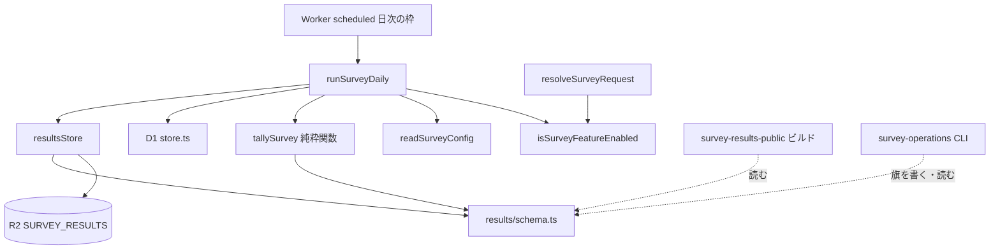
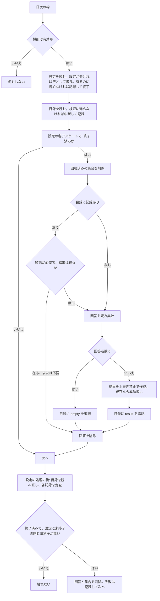

# Design Document

## Overview

**Purpose**: アンケートの実施期間が終わったら、日次の後片付けの枠で回答を自動で集計し、割合だけの統計ファイルを運用者の結果の保管先（R2）へ書き、保存の成功後にだけ D1 の回答を削除する。
**Users**: 運用者（結果の公開を決める人）と、統計ファイルを読む `survey-results-public`（ビルド時）・`survey-operations`（CLI）。
**Impact**: 現行の保持期限の処理（`runSurveyRetention`、終了の 1 か月後に回答を削除）を、集計と「保存成功後の削除」に置き換える。アンケート機能は D1 と R2 を前提とし、R2 が無い環境では提示・回答・集計のすべてが無効になる。

### Goals

- 終了済み・未集計のアンケートを、日次の枠で冪等に集計し、結果を非表示で保存する。
- 統計ファイルの形式を、書く側（Worker）と読む側（ビルド・CLI）が共有する検証スキーマとして定める（この spec が唯一の所有者）。
- 回答の削除の契機を「結果の保存の成功後」だけにする。
- アンケート機能の有効・無効の判定を、実行時とビルド時の両方で 1 か所に定める。

### Non-Goals

- 結果ページ・ビルド時の取得（`survey-results-public`）。可視フラグを書き換える操作と再配備の起動（`survey-operations`）。
- 提示・回答の保存・回答済みの確認の仕様（`surveys`）。
- R2 バケットの作成、ビルドが実際のバケットを読むための `remote: true` の付与（`survey-results-public` の「ローカル・CI・プレビューでの取得の扱い」）。
- 孤立した回答（設定から集計前に消されたアンケートの行）の探索と削除。

## Boundary Commitments

### This Spec Owns

- 統計ファイルの形式（結果・目録・可視フラグ）と検証スキーマ、R2 のオブジェクトの構成（キー名）。
- 集計の規則（割合・複数選択・「回答しない」・0 件・読めない回答）。
- 日次の枠の入口 `runSurveyDaily`（集計・保存・回答の削除・回答済みの集合の削除）。
- アンケート機能の有効・無効の判定（実行時の `isSurveyFeatureEnabled`、ビルド時の旗の条件）。
- R2 バケット `skyshare-survey-results` とバインディング `SURVEY_RESULTS` の宣言（テンプレート・route テストの設定）。
- 保持期限の廃止（`retention.ts` と `period.ts` の保持の判定の削除）。

### Out of Boundary

- 可視フラグの書き換えの操作（CLI。この spec は形式と「無ければ非表示」の意味だけを定める）。
- 結果の読み出し・並べ替え・表示（`survey-results-public`）。Worker は統計ファイルを実行時に読んで返さない。
- 設定の形式（`SurveyConfigSchema`）、回答の形（`NormalizedAnswers`）、D1 の表の構造（`surveys`）。
- バケットの作成、ビルドの `remote: true`、CI の認証情報。

### Allowed Dependencies

- `lib/survey` 内の既存部品（`definition.ts`・`answers.ts` の `checkAnswers`・`loadConfig.ts`・`store.ts`・`period.ts`）、`lib/api/contract/surveyPath`（`idSchema`）、`lib/platform`（Cloudflare の型。型のみ）、`lib/i18n`（`Locale` の型のみ）。
- `results/schema.ts` は zod・`idSchema`・型だけに依存する（ビルドと CLI が読み込むため、Worker 専用のモジュールと `cloudflare:workers` に依存しない）。
- Cloudflare の D1・R2 バインディング。`@atproto/*` は import しない（Cron の経路の規則）。

### Revalidation Triggers

- 統計ファイルのキー名・形式・版の変更（`survey-results-public`・`survey-operations` の再確認）。
- 「無ければ非表示」「集計は旗を書かない」の規則の変更。
- 機能の有効判定の条件（バインディング名）の変更。
- `period.ts` の `currentSurvey` の意味の変更、`SurveyConfig` の形式変更（質問の題・選択肢の複写に影響）。
- 回答の削除の契機の変更（`surveys` の更新）。
- 設定から外れたアンケートの回答の掃除（目録の走査。識別子の再利用の保護を含む）の規則の変更。

## Architecture

### Existing Architecture Analysis

- Worker（`src/worker.ts`）は `scheduled` で、毎分の予約投稿を `waitUntil` に登録し、日次の枠（`isHousekeepingTime`）で後片付けとアンケートの保持を別々の `waitUntil` に登録する。失敗は互いに伝播させない。この形を保つ。
- 設定は静的アセットの `/surveys/index.json` から `readSurveyConfig` で読む（ビルドの旗が `"true"` のときだけ）。日次の枠でも同じ経路で読む。
- 回答の保存は `saveAnswer`（集合と回答を 1 つの `batch`）。D1 の削除は `purgeRespondents`・`purgeAnswers`。
- R2 の前例は `SCHEDULE_IMAGES`。型は `lib/platform/cfTypes.ts` に構造的に定義し、テストは同じ形のフェイクを使える。

### Architecture Pattern & Boundary Map



**Architecture Integration**:

- Selected pattern: 日次の枠から呼ばれる 1 本の手順（Batch / Job）。判断（集計・形式）は純粋関数と zod スキーマ、副作用（R2・D1）は薄い保管の部品に分ける。
- Domain/feature boundaries: 形式（`results/schema.ts`）は読み手と共有、保管（`results/store.ts`）と手順（`daily.ts`）は Worker だけが使う。
- Existing patterns preserved: `waitUntil` を分けた日次の枠、失敗を記録して握りつぶす、ログに本文を出さない、`cfTypes.ts` の構造的な型。
- Steering compliance: `r2-buckets.md`（専用バケット・名前・バインディング名）、`comments.md`（ファイル先頭の説明・日本語のコメント）、`testing.md`（層の選択）。

### Technology Stack

| Layer                    | Choice / Version                                                | Role in Feature                            | Notes                                                 |
| ------------------------ | --------------------------------------------------------------- | ------------------------------------------ | ----------------------------------------------------- |
| Backend / Services       | Cloudflare Workers（既存の `scheduled`）                        | 日次の枠で集計・保存・削除                 | `@atproto/*` を読まない                               |
| Data / Storage           | D1（既存の 2 表。構造は変えない）、R2 `skyshare-survey-results` | 回答の読み取りと削除、統計ファイルの保存   | R2 の条件付き書き込みで同時実行を防ぐ                 |
| Validation               | zod（既存）                                                     | 統計ファイルの検証スキーマ                 | 書く側・読む側で共有                                  |
| Infrastructure / Runtime | `config/wrangler.template.jsonc`、`render-wrangler.mjs`（既存） | バインディングの宣言と環境ごとのバケット名 | develop の `-develop`・プレビューの共用は既存の仕組み |

## File Structure Plan

### Directory Structure

```
src/lib/survey/
├── feature.ts          # 機能の有効・無効の判定（実行時: D1 と R2 の両方があるか）
├── daily.ts            # 日次の枠の入口 runSurveyDaily（runSurveyRetention の置き換え）
└── results/
    ├── schema.ts       # 統計ファイルの形式・検証スキーマ・キー名（読み手と共有。zod と型だけに依存）
    ├── tally.ts        # 回答 → 結果の純粋関数（割合・規則）
    └── store.ts        # R2 の読み書き（目録の比較交換・結果の上書き禁止の作成）
```

### Modified Files

- `src/lib/survey/period.ts` — 保持期限の判定（`RetentionDeadlines`・`retentionDeadlines`・`retentionExpired`・`addOneMonthInJst`）を削除し、`currentSurvey` を残す。終了の判定 `isClosed(survey, now)` を足す。
- `src/lib/survey/store.ts` — 回答の読み取り `readAnswerRows(db, surveyId)`（`answers` 列の文字列の配列を返す）を足す。`purgeRespondents`・`purgeAnswers` は残す。
- `src/lib/survey/env.ts` — `SurveyEnv` に `SURVEY_RESULTS?` を足す。
- `src/lib/survey/request.ts` — 設定を読む前に機能の有効判定を行い、無効なら設定なしと同じ 404 を返す。
- `src/lib/survey/retention.ts` — 削除（`daily.ts` に置き換え）。
- `src/lib/platform/cfTypes.ts` — 結果の保管先の構造的な型 `SurveyResultsBucket`（`head`・`get`・`put` の `onlyIf`）を足す。既存の `R2Bucket` は変えない。
- `src/lib/site/surveyPresence.ts` — ビルドの旗に「D1 と `SURVEY_RESULTS` が宣言されている」条件を足す（`declaresSurveyBindings`）。
- `astro.config.mjs` — 生成済みの `wrangler.jsonc`（既に読み込み済み）から宣言の有無を判定して旗に渡す。
- `src/worker.ts` — 日次の枠で `runSurveyRetention` の代わりに `runSurveyDaily` を登録する。`env` の型に `SURVEY_RESULTS` を足す。
- `config/wrangler.template.jsonc` — `r2_buckets` に `SURVEY_RESULTS`（`skyshare-survey-results`）を足し、コメントを更新する。
- `tests/route/wrangler.jsonc` — `SURVEY_RESULTS` のテスト用バケット（`skyshare-survey-results-test`）を足す。
- `config/test/vitest.route.config.ts` — 分岐被覆率の対象を `retention.ts` から `daily.ts`・`results/store.ts` に置き換える。
- `tests/route/survey/retention.test.ts` — 削除（`daily.test.ts` に置き換え）。`tests/fixtures/survey/config.ts` はコメント行（保持期限の記述）だけを更新する（題・説明の廃止はこの spec ではなく `surveys` の更新が担当）。
- `.kiro/steering/testing.md`・`tech.md` — 保持期限に関する節だけ（`survey-operations` は `hack/` の配置の節を編集する）。保持期限の記述（P0 のモジュール一覧・アーキテクチャの要約）を、`daily.ts`・集計に合わせて直す（実装と同じ変更で行う）。
- `hack/survey-cli/lifecycle.ts` — `retentionExpired` の参照は `survey-operations` が置き換える（本 spec は触れない。実装順は tasks の依存で扱う）。

## System Flows



- 設定の処理のあとの走査（L〜M2）は、設定から外れたアンケートの削除の取りこぼし（Worker の削除が失敗した日に、設定の整理で設定から消えた場合）を直す経路で、毎日行う。目録は最大 200 件で、1 件あたり削除は 2 回（回答・集合）だけなので、毎回行っても軽い。結果の有無（`empty`・`result`）にかかわらず対象にする。設定に同じ識別子の未終了のアンケートがあるとき（識別子の再利用）は、新しい回答を消さないよう触れない。
- 各アンケートの処理は独立した try で囲み、失敗は識別子と例外の種類の名前だけを記録して次へ進む。
- 目録の追記は、読んだ ETag との比較交換（最大 3 回、失敗のたびに読み直す）。目録が無いときは作成のみ許す。比較交換に 3 回失敗したら、そのアンケートは失敗として扱う（回答は消さない）。
- 目録に記録がある `result` で結果が無い（運用者が消した）場合は、回答が残っていれば作り直す。回答が既に無ければ（0 件の集計になる）作り直さず、不整合として記録するだけにする（空の結果で上書きしない）。

## Requirements Traceability

| Requirement | Summary                                            | Components                                                   | Interfaces                           | Flows      |
| ----------- | -------------------------------------------------- | ------------------------------------------------------------ | ------------------------------------ | ---------- |
| 1.1         | 両方あれば機能が働く                               | isSurveyFeatureEnabled                                       | `isSurveyFeatureEnabled`             | 日次の枠 B |
| 1.2         | R2 が無ければ全機能を無効                          | isSurveyFeatureEnabled, resolveSurveyRequest, runSurveyDaily | 同上                                 | B          |
| 1.3         | 無効時は設定なしと同じ応答                         | resolveSurveyRequest                                         | 404 を返す                           | —          |
| 1.4         | 無効時は集計も削除もしない                         | runSurveyDaily                                               | 最初の判定                           | B → Z      |
| 1.5         | ビルドに宣言が無ければ入口を出さない               | declaresSurveyBindings, surveyConfigPresentFlag              | 旗                                   | —          |
| 2.1         | 終了後・未保存なら集計して保存                     | runSurveyDaily, tallySurvey, resultsStore                    | 手順                                 | E〜K       |
| 2.2         | 開始前・実施中は触れない                           | isClosed                                                     | 終了の判定                           | E          |
| 2.3         | 終了時刻の後に限る                                 | isClosed                                                     | `closesAt <= now`                    | E          |
| 2.4         | 設定に無いものは集計しない                         | runSurveyDaily                                               | 設定の各アンケートだけを走査         | C, E       |
| 2.5         | 保存済みは再集計しない                             | runSurveyDaily, resultsStore                                 | 目録・結果の有無                     | G, H       |
| 3.1         | 割合の分母は回答者数                               | tallySurvey                                                  | `SurveyResult`                       | I          |
| 3.2         | 小数 1 桁                                          | tallySurvey                                                  | 丸め                                 | I          |
| 3.3         | 複数選択は合計が 100 を超えてよい                  | tallySurvey                                                  | 選択肢ごとに独立                     | I          |
| 3.4         | 「回答しない」を含めない                           | tallySurvey                                                  | decline を除く                       | I          |
| 3.5         | 0 件は結果を作らない                               | tallySurvey, runSurveyDaily                                  | `undefined` を返す                   | J          |
| 3.6         | 伏せ字・丸めをしない                               | tallySurvey                                                  | しきい値を持たない                   | I          |
| 3.7         | 読めない回答は数えない                             | tallySurvey                                                  | `checkAnswers` の再利用              | I          |
| 4.1         | 結果の内容                                         | SurveyResultSchema                                           | 結果の形式                           | —          |
| 4.2         | 持たない情報                                       | SurveyResultSchema                                           | strict                               | —          |
| 4.3         | 文言を設定から複写                                 | tallySurvey                                                  | 題・文言の複写                       | I          |
| 4.4         | 目録の内容                                         | SurveyIndexSchema                                            | 目録の形式                           | —          |
| 4.5         | 形式の版                                           | schema.ts                                                    | `schemaVersion`                      | —          |
| 4.6         | 共有の検証の規則                                   | schema.ts                                                    | `parse*` の 3 関数                   | —          |
| 4.7         | 検証に通らない内容は使わない                       | schema.ts, resultsStore                                      | `ok: false` を返す                   | D          |
| 5.1         | 非表示で作る                                       | runSurveyDaily                                               | 旗を書かない                         | J2         |
| 5.2         | 旗が無い・不正は非表示                             | SurveyVisibilitySchema, `isVisible`                          | 読み手の規則                         | —          |
| 5.3         | 旗を単独で書き換えられる                           | `visibilityKey`                                              | 独立したオブジェクト                 | —          |
| 5.4         | 書き換えで本体・目録は不変                         | resultsStore                                                 | 旗と本体・目録の書き手を分ける       | —          |
| 5.5         | 集計は旗を書かない                                 | runSurveyDaily                                               | 旗のキーに書かない                   | —          |
| 5.6         | 資材に含めない                                     | R2 のオブジェクトの構成                                      | リポジトリ・ビルドに置かない         | —          |
| 6.1         | 保存成功後に同じ処理で削除                         | runSurveyDaily                                               | 順序: 作成→目録→削除                 | J〜K       |
| 6.2         | 失敗なら削除せず再試行                             | runSurveyDaily                                               | 例外で K に進まない                  | 失敗の扱い |
| 6.3         | 削除の契機は保存成功後だけ                         | runSurveyDaily, period.ts                                    | 保持期限の削除                       | —          |
| 6.4         | 0 件でも削除する                                   | runSurveyDaily                                               | empty の記録後に削除                 | J1         |
| 6.5         | 実施中・開始前は削除しない                         | isClosed                                                     | 終了の判定                           | E          |
| 6.6         | 集合は終了後に成否と無関係に削除                   | runSurveyDaily                                               | F                                    | F          |
| 6.7         | 1 か月後の保持期限を持たない                       | period.ts, retention.ts の削除                               | —                                    | —          |
| 6.8         | 設定から外れた終了済みの記録の回答・集合を毎日掃除 | runSurveyDaily                                               | 目録の走査・冪等な削除               | L, M, M2   |
| 6.9         | 同じ識別子の未終了が設定にあれば触れない           | runSurveyDaily                                               | 設定の未終了の識別子との照合         | M, M1      |
| 6.10        | 掃除の失敗は記録して続行・冪等                     | runSurveyDaily                                               | 記録ごとの try、`logFailure`         | M2         |
| 6.11        | 設定が読めないときは掃除しない                     | runSurveyDaily                                               | 存在するのに読めなければ記録して戻る | C          |
| 7.1         | 上書きせず削除のみ                                 | resultsStore                                                 | `etagDoesNotMatch: "*"`              | J2         |
| 7.2         | 繰り返しても同じ状態                               | runSurveyDaily                                               | 冪等な手順                           | G, H       |
| 7.3         | 同時実行で壊れない                                 | resultsStore                                                 | 条件付き書き込み・比較交換           | 目録の追記 |
| 7.4         | 1 件の失敗が他を止めない                           | runSurveyDaily                                               | アンケートごとの try                 | E          |
| 7.5         | 記録は識別子と例外名だけ                           | runSurveyDaily                                               | `logFailure`                         | —          |
| 7.6         | 目録が不正なら中断                                 | runSurveyDaily, resultsStore                                 | D                                    | D          |
| 7.7         | 結果ありで目録に無ければ足して削除                 | runSurveyDaily                                               | I〜J2                                | J2         |
| 8.1         | 専用の保管先                                       | wrangler テンプレート                                        | `SURVEY_RESULTS`                     | —          |
| 8.2         | 本番・develop・プレビュー                          | render-wrangler（既存）                                      | `-develop` の付与                    | —          |
| 8.3         | 認証情報が無ければローカルの代用                   | tests/route/wrangler.jsonc、テンプレート                     | `remote` を付けない                  | —          |
| 8.4         | 保管先の作成はしない                               | 範囲外                                                       | —                                    | —          |

## Components and Interfaces

| Component                 | Domain/Layer | Intent                           | Req Coverage                                                 | Key Dependencies (P0/P1)                | Contracts |
| ------------------------- | ------------ | -------------------------------- | ------------------------------------------------------------ | --------------------------------------- | --------- |
| results/schema.ts         | 形式（共有） | 統計ファイルの形式・検証・キー名 | 4.1, 4.2, 4.4, 4.5, 4.6, 4.7, 5.2, 5.3                       | zod, idSchema (P0)                      | State     |
| results/tally.ts          | 業務（純粋） | 回答 → 結果                      | 3.1–3.7, 4.3                                                 | `checkAnswers` (P0), schema (P0)        | Service   |
| results/store.ts          | 保管         | R2 の読み書きと同時実行の防止    | 4.7, 5.4, 7.1, 7.3, 7.6                                      | `SurveyResultsBucket` (P0), schema (P0) | Service   |
| daily.ts                  | 手順         | 日次の集計・削除                 | 1.2, 1.4, 2.1–2.5, 5.1, 5.5, 6.1–6.6, 6.8–6.11, 7.2, 7.4–7.7 | feature, tally, store, D1 store (P0)    | Batch     |
| feature.ts                | 判定         | 機能の有効判定                   | 1.1–1.3                                                      | なし                                    | Service   |
| surveyPresence.ts（変更） | ビルドの旗   | 宣言の有無                       | 1.5                                                          | astro.config (P0)                       | Service   |
| request.ts（変更）        | API の前処理 | 無効時の 404                     | 1.3                                                          | feature (P0)                            | API       |

### 形式

#### results/schema.ts

| Field        | Detail                                                         |
| ------------ | -------------------------------------------------------------- |
| Intent       | 統計ファイルの形式を唯一定義し、書く側・読む側に同じ検証を渡す |
| Requirements | 4.1, 4.2, 4.4, 4.5, 4.6, 4.7, 5.2, 5.3                         |

**Responsibilities & Constraints**

- キーの定義（R2 のオブジェクトの構成）。
- 3 種の形式の zod スキーマ（すべて `strictObject`。定義にない項目は不正）。
- 読み手の規則 `isVisible`: 旗が「無い」または「検証に通らない」なら偽。ただし、読み手は「通らない」を知らせる（`ok: false` を返す）責務も持つ（要件 4.7 と 5.2 の両立。可視の判定では偽として扱い、検証失敗の通知は呼び出し側が行う）。
- `@/` の別名を使うが、依存は zod・`idSchema`・`Locale` の型だけ。

**R2 のオブジェクトの構成（バケット `skyshare-survey-results`、バインディング `SURVEY_RESULTS`）**

| キー                   | 内容                 | 書き手                          | 作り方                                                      |
| ---------------------- | -------------------- | ------------------------------- | ----------------------------------------------------------- |
| `index.json`           | 目録                 | Worker（追記）                  | 比較交換（`etagMatches`、無ければ `etagDoesNotMatch: "*"`） |
| `surveys/<id>.json`    | アンケートごとの結果 | Worker（1 回だけ）              | 上書き禁止（`etagDoesNotMatch: "*"`）                       |
| `visibility/<id>.json` | 可視フラグ           | `survey-operations` の CLI だけ | 無い＝非表示。Worker は書かない                             |

##### 型（Contract）

```typescript
export const SCHEMA_VERSION = 1

export const INDEX_KEY = "index.json"
export const resultKey = (surveyId: string): string =>
  `surveys/${surveyId}.json`
export const visibilityKey = (surveyId: string): string =>
  `visibility/${surveyId}.json`

/** 割合。百分率で、小数点以下 1 桁。0 以上 100 以下 */
export type Percent = number

export type SurveyResult = {
  schemaVersion: 1
  id: string
  /** 設定の値の複写（UTC からのオフセット付き ISO 8601） */
  opensAt: string
  closesAt: string
  questions: {
    id: string
    kind: "single" | "multiple"
    title: LocalizedText
    /** 「回答しない」の選択肢は含めない。設定の選択肢の順 */
    options: { id: string; label: LocalizedText; percent: Percent }[]
  }[]
}

export type SurveyIndex = {
  schemaVersion: 1
  surveys: {
    id: string
    opensAt: string
    closesAt: string
    /** result: 結果がある。empty: 回答 0 件で結果は作っていない */
    outcome: "result" | "empty"
  }[]
}

export type SurveyVisibility = { schemaVersion: 1; visible: boolean }

export type ParseOutcome<T> = { ok: true; value: T } | { ok: false }

/** 結果が目録の記録と同じアンケートのものか（id・opensAt・closesAt がすべて一致するとき真） */
export declare const resultMatchesIndexEntry: (
  entry: SurveyIndex["surveys"][number],
  result: SurveyResult,
) => boolean
/** 可視フラグが「公表してよい」か。undefined（旗が無い）や visible が true でないものは偽 */
export declare const isVisible: (
  visibility: SurveyVisibility | undefined,
) => boolean
export declare const parseSurveyResult: (
  input: unknown,
) => ParseOutcome<SurveyResult>
export declare const parseSurveyIndex: (
  input: unknown,
) => ParseOutcome<SurveyIndex>
export declare const parseSurveyVisibility: (
  input: unknown,
) => ParseOutcome<SurveyVisibility>
```

- 読み手の規則の単一の実装: `resultMatchesIndexEntry` と `isVisible` は純粋関数で、`survey-results-public`（ビルド）と `survey-operations`（publish・status）は、読み手の規則をこの 2 つで判定し、それぞれで書き直さない。
- 検証の追加規則: `percent` は 0 以上 100 以下で、10 倍が整数。`surveys`（目録）の `id` は重複しない。`options`・`questions` の `id` は各々の中で重複しない。目録の `id` と結果の `id` が一致するかは読み手が確かめる（スキーマは単一のファイルを検証する）。
- 不正の報告は「位置: 理由」を作らず、成否だけを返す（読んだ本文を出さないため）。
- 結果は件数・回答者数・回答日・個別の回答・アンケート全体の題と説明を持たず、`strictObject` が混入を拒む（要件 4.2）。
- 例（結果）:
  `{"schemaVersion":1,"id":"survey-2026-a","opensAt":"2026-11-01T00:00:00+09:00","closesAt":"2026-12-01T00:00:00+09:00","questions":[{"id":"q-ui","kind":"single","title":{"ja":"…","en":"…"},"options":[{"id":"v1","label":{"ja":"…","en":"…"},"percent":42.9},{"id":"v2","label":{"ja":"…","en":"…"},"percent":57.1}]}]}`

#### results/tally.ts

| Field        | Detail                                                                      |
| ------------ | --------------------------------------------------------------------------- |
| Intent       | 回答の JSON の配列と設定のアンケートから、結果（または 0 件）を作る純粋関数 |
| Requirements | 3.1, 3.2, 3.3, 3.4, 3.5, 3.6, 3.7, 4.3                                      |

##### Service Interface

```typescript
export const tallySurvey = (
    survey: Survey,
    answerRows: string[],
): SurveyResult | undefined
```

- Preconditions: `survey` は検証済みの設定のアンケート。`answerRows` は D1 の `answers` 列の文字列。
- Postconditions: 各行を JSON として読み、`checkAnswers(survey, parsed)` が `ok: true` のものだけを回答者として数える（読めない行・設定に合わない行・辞退を含む行は除外）。回答者数が 0 なら `undefined`。割合は `Math.round(選んだ人数 * 1000 / 回答者数) / 10`。「回答しない」の選択肢と、アンケート全体の題・説明も含めない。質問・選択肢の題と文言は設定から複写する。
- Invariants: 入力を変更しない。しきい値・補正（合計を 100 に合わせる等）を持たない。

### 保管

#### results/store.ts

| Field        | Detail                                           |
| ------------ | ------------------------------------------------ |
| Intent       | 統計ファイルの R2 への読み書きと、同時実行の防止 |
| Requirements | 4.7, 5.4, 7.1, 7.3, 7.6                          |

##### Service Interface

```typescript
export type IndexSnapshot = { index: SurveyIndex; etag: string | undefined }

/** 目録を読む。無ければ空の目録と etag なし。検証に通らなければ例外 */
export const readIndex = (bucket: SurveyResultsBucket): Promise<IndexSnapshot>

/** 結果が在るか（head） */
export const resultExists = (bucket: SurveyResultsBucket, surveyId: string): Promise<boolean>

/** 結果を上書き禁止で作る。既に在れば作らず "exists" を返す（成功扱い） */
export const putResultOnce = (
    bucket: SurveyResultsBucket,
    result: SurveyResult,
): Promise<"created" | "exists">

/** 目録に項目を足す（比較交換、最大 3 回）。既に同じ識別子の項目があれば何もしない。3 回失敗したら例外 */
export const appendIndexEntry = (
    bucket: SurveyResultsBucket,
    entry: SurveyIndex["surveys"][number],
): Promise<void>
```

- Preconditions: 書く内容は検証スキーマで検証済み（`put` の前に `parse` を通す）。
- Postconditions: 旗（`visibility/`）のキーには書かない。目録に足した項目は識別子で一意。書き込みの `contentType` は `application/json`。
- 例外の種類: `IndexInvalidError`（目録が検証に通らない）・`IndexConflictError`（比較交換が尽きた）。名前だけを記録に使う。

##### 構造的な型（`cfTypes.ts`）

```typescript
export type SurveyResultsBucket = {
  head: (key: string) => Promise<{ etag: string } | null>
  get: (
    key: string,
  ) => Promise<{ etag: string; text: () => Promise<string> } | null>
  put: (
    key: string,
    value: string,
    options?: {
      onlyIf?: { etagMatches?: string; etagDoesNotMatch?: string }
      httpMetadata?: { contentType?: string }
    },
  ) => Promise<{ etag: string } | null>
}
```

- 条件に合わなかった `put` は `null` を返す（R2 の仕様）。

### 手順

#### daily.ts（`runSurveyDaily`）

| Field        | Detail                                                                                                                   |
| ------------ | ------------------------------------------------------------------------------------------------------------------------ |
| Intent       | 日次の枠で、終了済みのアンケートを集計して保存し、成功後に回答を削除する。設定から外れた終了済みの記録の回答も掃除する   |
| Requirements | 1.2, 1.4, 2.1, 2.2, 2.3, 2.4, 2.5, 5.1, 5.5, 6.1, 6.2, 6.3, 6.4, 6.5, 6.6, 6.8, 6.9, 6.10, 6.11, 7.2, 7.4, 7.5, 7.6, 7.7 |

**Contracts**: Batch [x]

##### Batch / Job Contract

- Trigger: `scheduled` の日次の枠（`isHousekeepingTime`）。`ctx.waitUntil` に async 関数で包んで登録する（同期の例外を波及させない）。
- Input / validation: `env`（`DB`・`ASSETS`・`SURVEY_RESULTS?`）、`now`（現在時刻）。機能が無効（`isSurveyFeatureEnabled` が偽）なら即座に戻る。設定が存在しない（ビルドの旗が偽。変数が無い・空）ときは、設定のアンケートの処理を空として扱い、掃除は実行する（最後の 1 件の除去で設定が消えても掃除が動くため）。設定が存在するのに形式が不正などで読めないときは、掃除を含め何もせず、例外の種類の名前だけを記録して戻る（設定に同じ識別子の未終了のアンケートがあるか判定できず、開催中の回答を消す危険があるため）。存在の判定は `isSurveyConfigPresent()`、読めたかは `readSurveyConfig` の結果で行う。
- Output / destination: R2 の結果・目録、D1 の回答・集合の削除。戻り値は無し。例外を外へ投げない。
- 各アンケート（設定にあるもので、`isClosed(survey, now)`）の手順:
  1. 回答済みの集合を削除する（失敗は記録して続行。集計とは独立）。
  2. 目録に記録があり `outcome: "empty"` なら、回答を削除して終わる。
  3. 目録に記録があり `outcome: "result"` で結果が在るなら、回答を削除して終わる。
  4. それ以外は、回答を読み `tallySurvey` する。`undefined`（0 件）なら、`resultExists` で結果の有無を確かめた上で、結果が無いときだけ目録に `empty` を足す（結果が在るのに目録が無いときは `result` を足す。このとき目録に足す期間の項目 `opensAt`・`closesAt` は、今の設定ではなく、既に在る結果のファイルの値を使う）。0 件でなければ `putResultOnce` で結果を作る（`"exists"` は成功）。結果の作成が成功したら目録に `result` を足す（既に同じ識別子があれば何もしない）。
  5. 4 が成功したときだけ、回答を削除する。
- 設定から外れた記録の掃除（設定の各アンケートの処理が終わったあとに実行。設定が存在しないときも実行する。設定が存在して読めないときは実行しない）:
  1. 目録を読み直す（検証に通らなければ、掃除はせず記録して終わる）。
  2. 各記録について、`closesAt <= now`（`isClosed` と同じ判定）で、かつ、現在の設定に同じ識別子の「まだ終了していない」アンケートが無いときだけ、`DELETE ... WHERE survey_id = ?` を回答・集合の両方の表に行う（`purgeAnswers`・`purgeRespondents` を使う）。設定に同じ識別子の未終了のアンケートがあるときは触れない（識別子の再利用）。
  3. 記録ごとに独立した try で囲み、失敗は識別子と例外の種類の名前だけを記録して次へ進む。削除は何度行っても同じ状態になる（冪等）。目録には何も書かない（「削除済み」の印は持たない。統計ファイルの形式は変えない）。
  4. `outcome` が `empty` でも `result` でも対象にする。目録は最大 200 件、1 件あたり削除 2 回。毎回の実行で行う。
- Idempotency & recovery: 目録を「完了の印」とし、結果→目録→削除の順にする。途中で失敗しても、翌日の実行が続きから直る。結果は上書きされず、目録は識別子で一意に保つ。記録の無い状態で結果だけが在る場合は、再集計の結果を作らず（`"exists"`）、目録に足すだけで回答を削除する（要件 7.7）。
- 失敗の記録: `console.error("runSurveyDaily: <段階> failed id=<識別子> kind=<例外の name>")` の形で、識別子と例外の種類の名前だけを出す。回答・結果の本文・回答者に関する値を出さない。目録の検証失敗は `IndexInvalidError` として、全体を中断して 1 行記録する（要件 7.6）。
- 可視フラグには書かない（要件 5.1, 5.5）。

#### feature.ts

##### Service Interface

```typescript
export const isSurveyFeatureEnabled = (env: {
    DB?: unknown
    SURVEY_RESULTS?: unknown
}): boolean
```

- `DB` と `SURVEY_RESULTS` がどちらも真（存在する）のときだけ真。実行時（API・日次の枠）の唯一の判定。
- ビルド時の判定は `declaresSurveyBindings(wrangler)`（`surveyPresence.ts`）で、`d1_databases` に `DB`、`r2_buckets` に `SURVEY_RESULTS` の宣言があるときだけ旗を `"true"` にする（設定の有無の条件に「かつ」を足す）。

#### request.ts（変更）

- 判定順は 401（認証）→ 400（識別子）→ 機能の有効判定・設定・開催中の一致（いずれも 404、同じ応答）→ 503（鍵）。無効時は設定を読まず、D1 に触れない。

## Data Models

### Logical Data Model

- D1 の 2 表（`survey_respondents`・`survey_answers`）の構造は変えない。読み取りは `SELECT answers FROM survey_answers WHERE survey_id = ?`。
- R2 の 3 種のオブジェクトは上記のとおり。目録は小さな JSON（アンケートの数だけ。件数・回答者数は持たない）。
- 版: `schemaVersion: 1`。互換のない変更は版を上げ、読み手は未知の版を不正として拒否する（`z.literal(1)`）。

## Error Handling

### Error Strategy

- 手順の各段階は個別の失敗として扱い、回答の削除は保存の成功の確認が取れたときだけ行う。

### Error Categories and Responses

- **R2 の書き込み失敗・比較交換の枯渇**: そのアンケートの回答を削除せず、記録して次へ。翌日に再試行。
- **目録の検証失敗**: 上書きせず、全体を中断して記録。運用者が目録を確認する。
- **D1 の読み取り・削除の失敗**: 結果の保存より前なら中断、削除の失敗なら記録（翌日、既に保存済みとして削除だけ再試行）。
- **設定から外れた記録の掃除での削除の失敗**: その記録だけ識別子と例外名を記録して次へ進む。翌日の掃除が再び試みる。掃除での目録の読み直しの失敗・検証失敗は、掃除だけを記録して終わる（設定の処理の結果には影響しない）。
- **機能の無効**: エラーにせず、何もしない（API は 404）。

### Monitoring

- 日次の枠の失敗は 1 件 1 行（識別子と例外の種類の名前）。成功のログは出さない（回数・回答者数を出さない）。

## Testing Strategy

層は `testing.md` に従う。題名は英語で、受入基準の識別子を含めない。

### Unit（Node。`config/test/vitest.unit.config.ts`）

- `tallySurvey`: 単一選択の割合と丸め（例 1/3 → 33.3、2/3 → 66.7）、複数選択の合計が 100 を超える、「回答しない」の選択肢が結果に無い、0 件で `undefined`、読めない行・設定に合わない行の除外、設定の文言の複写。
- `results/schema.ts`: `resultMatchesIndexEntry`（id・opensAt・closesAt のどれか 1 つの不一致で偽）と `isVisible`（undefined・visible が true でないもので偽）、3 種の形式の正常・未知の項目（件数・回答者数・アンケート全体の題）・未知の版・範囲外の割合・目録の識別子の重複の拒否。
- `declaresSurveyBindings` と旗の組み合わせ（宣言なし・片方のみ・両方）。
- `period.ts` の `isClosed` の境界（終了時刻ちょうどで真）。

### Route（workerd。`config/test/vitest.route.config.ts`）

- `runSurveyDaily`（設定から外れた記録の掃除）: 設定に無く終了済みの記録の回答・集合が消える（`empty`・`result` の両方）／設定そのものが無い（旗が偽）状態でも終了済みの記録の回答が消える／設定が存在するのに不正なら何も削除せず記録だけする／設定に同じ識別子の未終了のアンケートがあるとき回答・集合に触れない（識別子の再利用）／削除の失敗（D1 を失敗させるフェイク）が他の記録の処理を止めず、識別子と例外名だけが記録される／繰り返し実行しても同じ（冪等）。
- `runSurveyDaily`: 終了前は何もしない／終了後は結果と目録ができ回答が消える／結果の保存に失敗（R2 を失敗させるフェイク）すると回答が残る／回答 0 件は `empty` を記録して削除／繰り返し実行しても同じ／結果が既にあれば上書きせず削除だけ／目録が不正なら何も書かず中断／1 件の失敗が他のアンケートを止めない／機能が無効なら R2 にも D1 にも触れない／集合は集計が失敗しても終了後に削除される／ログに本文が出ない。
- `results/store.ts`: 上書き禁止の作成が 2 回目に `"exists"`、目録の比較交換で 2 つの追記が両方残る、旗のキーに書かない。
- `resolveSurveyRequest`: `SURVEY_RESULTS` が無いとき 404（設定なしと同じ）で、D1 に触れない。

### E2E

- 既存のアンケートの流れ（`tests/e2e/flows`）が、ローカルの代用の R2 を宣言した状態で通ることを確かめる（新しい流れは作らない）。

## Security Considerations

- 統計ファイルは割合だけで、匿名性を保つ。しきい値による伏せ字は設けない（運用者が公開の切り替えで判断する）。回答済みの集合は終了後すぐに削除し、結果の保存の成否に依存させない。
- 可視フラグが無い・不正なときは非表示。出し忘れ側に倒す。
- ログに回答・本文を出さない。R2 のバインディングは結果専用で、予約の画像と共有しない。

## Supporting References

- 判断の経緯と比較は `research.md`。
