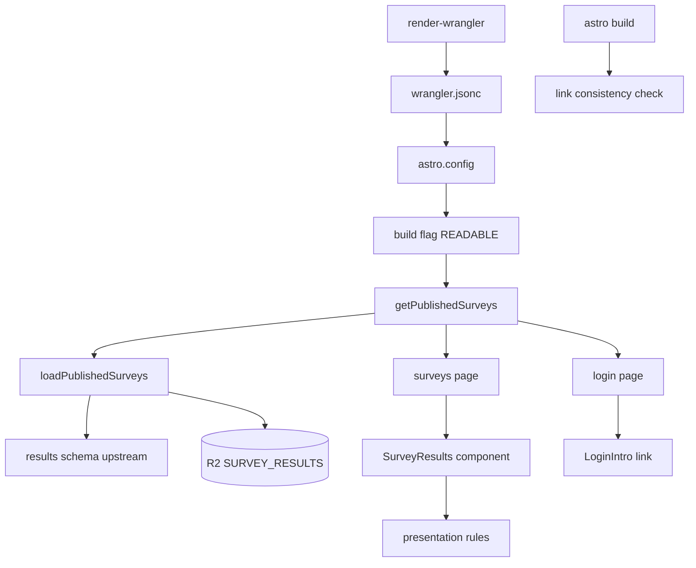
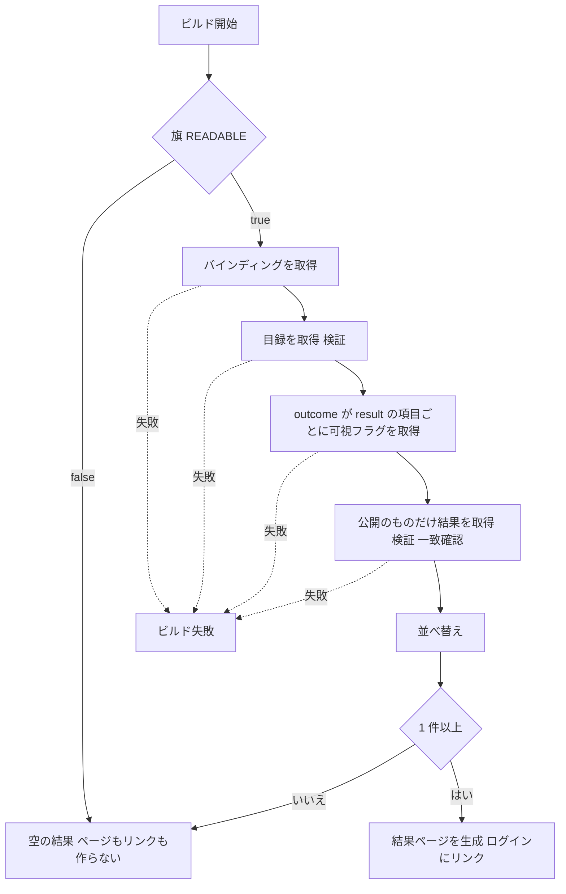

# Design Document

## Overview

**Purpose**: 運用者が公開に切り替えたアンケートの結果を、ログインしていない人にも見せる静的な結果ページ `/surveys/` を、ビルド時に結果の保管先（R2）から取り込んで作る。
**Users**: 結果を見る人（回答者・興味のある人）、結果を公開する運用者、フォークや手元の開発者（機能を無効のまま使う人）。
**Impact**: ビルドに「結果の取得と検証」を加え、結果ページとログイン画面のリンクを、同じ判定（公開済みが 1 件以上か）で出し分ける。実行時の API は作らない。

### Goals

- 読み取りの情報があるビルドだけが、公開済みの結果を新しい順に静的なページへ取り込む。
- 取得・検証の失敗はビルドの失敗にし、黙って結果ページが消えることを防ぐ。
- 情報が無い環境（ローカル・E2E・フォーク）は従来どおり動く。
- 色は既存の共通トークンと共通の見た目の部品だけを使う。

### Non-Goals

- 統計ファイルの形式・集計・可視フラグの書き換え・再配備の起動（上流）。
- 結果の保管先の作成、ダッシュボードからの導線、実行時の API、空・失敗の画面。

## Boundary Commitments

### This Spec Owns

- 結果公開機能の有効・無効の判定（ビルドの旗 `PUBLIC_SURVEY_RESULTS_READABLE`）と、`render-wrangler` が結果の保管先の接続（`remote: true`）を付ける条件。
- ビルド時の取得・検証・公開の絞り込み・並べ替え・失敗の扱い（`getPublishedSurveys`）。
- 結果ページ `/surveys/`、結果の部品（カード・グラフ）、割合・実施時期の表示規則。
- ログイン画面のリンクの出し分けと、ページとリンクの整合を守るビルド後の検査。
- この機能の辞書（日本語・英語）と、プライバシーポリシーの該当記述。
- CI のビルドに渡す認証情報（`preview.yaml`・`deploy.yaml`）。

### Out of Boundary

- 統計ファイルの形式・キー名・検証スキーマ、集計、回答の削除（`survey-results-aggregation`）。
- 可視フラグの書き換えと再配備（`survey-operations`）。
- アンケートの機能の有効・無効の判定（`isSurveyFeatureEnabled`、`PUBLIC_SURVEY_CONFIG_PRESENT`）。
- バケットの作成、`config/wrangler.template.jsonc` の `SURVEY_RESULTS` の宣言（上流が行う）。

### Allowed Dependencies

- `lib/survey/results/schema.ts` の `parseSurveyIndex`・`parseSurveyResult`・`parseSurveyVisibility`・`INDEX_KEY`・`resultKey`・`visibilityKey`・型 `SurveyResult`・`resultMatchesIndexEntry(entry, result)`（結果の識別子・開始・終了が目録の項目と同じかを返す）・`isVisible(visibility)`（可視フラグが無い、または公開でなければ偽を返す）（読むだけ。再定義しない。不一致の判定と公開の判定を、この部品の中に独自に持たない）。
- `lib/i18n` の型 `Locale` のみ（`lib/survey` の許可された依存。`lib/site` には依存しない。旗は `import.meta.env` から直接読む）。部品（`components/`）は辞書（`useT`）・UI の共通部品・`src/styles/`（トークン・`ui.module.css`）を使う。
- `lib/platform` の型 `SurveyResultsBucket`（`cfTypes`。型のみ。`buildData.ts` が保管先の読み取りの型に使う）。
- `cloudflare:workers` は `lib/survey/publicResults/buildData.ts` の動的 import だけで使う。

### Revalidation Triggers

- 統計ファイルのキー・形式・版の変更、可視フラグの意味の変更（`survey-results-aggregation`）。
- 上流の `resultMatchesIndexEntry`・`isVisible` の判定の変更（変わったら、不一致で失敗にする条件と、公開・非公開の絞り込みがこの機能の期待のままか、`loadPublishedSurveys` の単体テストとあわせて確かめ直す）。
- `render-wrangler` の `r2_buckets` の生成の変更、`SURVEY_RESULTS` のバインディング名の変更。
- ビルドの旗の名前・意味の変更、`/surveys/` のアドレスの変更（`survey-operations` の手順書・ログイン画面）。
- 結果の文言の言語の追加（`LOCALES`）。
- `astro.config.mjs` の `vite.define` と `surveyPresence.ts` は上流（`survey-results-aggregation`）も変更する。旗を足す箇所の競合に注意し、実装順は tasks の依存で扱う。

## Architecture

### Existing Architecture Analysis

- Astro は `output: "server"`。多くの画面は `prerender = true` の静的な文書で、ページの生成は workerd の中で動く。
- ビルドの旗は `astro.config.mjs` が `vite.define` で渡す前例がある（`PUBLIC_SURVEY_CONFIG_PRESENT`）。`wrangler.jsonc` は `render-wrangler.mjs` が生成し、`astro.config.mjs` が読む。
- 静的ページの言語切り替えは、React の島が `useT`（辞書）で追従する（`PolicyCards`・`LoginIntro`）。
- ログイン画面の案内は React の島 `LoginIntro`（文中のリンクを `renderSlots` で組み立てる）。

### Architecture Pattern & Boundary Map



**Architecture Integration**:

- Selected pattern: ビルド時の取り込み。判断（絞り込み・並べ替え・検証の呼び出し）は保管先の読み取りを引数で受ける純粋寄りの関数 `loadPublishedSurveys`、副作用（バインディングの取得・記憶）は薄い `buildData.ts` に分ける。
- Existing patterns preserved: 旗を `vite.define` で渡す、`lib/*/env.ts` の動的 import、島での言語切り替え、辞書の ja 正本と en の型追随。
- Steering compliance: `r2-buckets.md`（`remote: true` は認証情報が揃うときだけ、バインディングごと）、`structure*.md`（領域・層）、`comments.md`、`testing.md`。

### Technology Stack

| Layer           | Choice / Version                                            | Role in Feature                              | Notes                                           |
| --------------- | ----------------------------------------------------------- | -------------------------------------------- | ----------------------------------------------- |
| Frontend        | Astro 7.3.2（静的生成）、React 19（島）、CSS Modules        | 結果ページ・カード・グラフ・ログインのリンク | 色は `tokens.css` の既存トークンだけ            |
| Build / Runtime | `@astrojs/cloudflare` 14.1.4、`cloudflare:workers` の `env` | ビルド時に `SURVEY_RESULTS` を読む           | 新しい依存は無い                                |
| Data / Storage  | R2 `skyshare-survey-results`（読み取りのみ）                | 統計ファイルの取得                           | 書き込みは上流                                  |
| Validation      | zod（上流の共有スキーマ）                                   | 取得した内容の検証                           | 形式は再定義しない                              |
| Infrastructure  | `render-wrangler.mjs`、GitHub Actions                       | `remote: true` の付与、CI の認証情報         | `CLOUDFLARE_API_TOKEN`・`CLOUDFLARE_ACCOUNT_ID` |

## Design Decisions（brief が設計に残した判断）

| 判断                                         | 決定                                                                                                                                                                                                                                                                                                                                                                                                                                                                  | 理由                                                                                                                                                                                 |
| -------------------------------------------- | --------------------------------------------------------------------------------------------------------------------------------------------------------------------------------------------------------------------------------------------------------------------------------------------------------------------------------------------------------------------------------------------------------------------------------------------------------------------- | ------------------------------------------------------------------------------------------------------------------------------------------------------------------------------------ |
| 結果を静的データに変える段階                 | ページの生成の中。`getStaticPaths`（結果ページ）とログイン画面のフロントマターが共通の関数 `getPublishedSurveys` を呼ぶ。`build:prepare` には置かない                                                                                                                                                                                                                                                                                                                 | バインディングは workerd のページ生成にだけある。Node の前処理で読むには別の接続と認証の経路が要る                                                                                   |
| ローカルの固定のサンプル                     | 置かない                                                                                                                                                                                                                                                                                                                                                                                                                                                              | 本番のコードに偽データの分岐を入れると、オプトアウトの規則が二重になる。表示は `tests/fixtures` の部品データで確かめ、実物は認証情報付きの開発サーバー（develop の保管先）で確かめる |
| プライマリ色のトークン                       | `--color-bluesky`（最大の棒の下地）、棒の中の文字は `--color-white`                                                                                                                                                                                                                                                                                                                                                                                                   | リンク・青いボタンが使うブランドの色。ボタンと同じ組み合わせにそろえる                                                                                                               |
| 灰色                                         | 棒の下地は `--color-gray`、最大以外の棒は `--color-gray-hover`、文字は `--color-text`                                                                                                                                                                                                                                                                                                                                                                                 | 合意済み。`--color-muted` は背景と混ざるので使わない                                                                                                                                 |
| 同率の最大                                   | 同じ最大の割合の選択肢すべてをプライマリ色にする。最大が 0（すべて 0%）なら誰も強調しない                                                                                                                                                                                                                                                                                                                                                                             | 同率を区別する根拠が無い。0% を強調すると誤読される                                                                                                                                  |
| ログイン画面のリンクと結果ページの共通の判定 | 共通の `getPublishedSurveys`（ビルドの間 1 回だけ取得し結果を記憶する）で件数を決める。さらにビルド後の検査で「ログイン画面にリンクがある ⇔ `/surveys/` が生成されている」を確かめ、違えば失敗にする                                                                                                                                                                                                                                                                  | ページ間でのモジュールの共有は実行環境が保証しないため、検査で守る                                                                                                                   |
| `remote: true` の付与                        | `renderWranglerFile` の引数 `remote`（既定は偽）が真のとき、`SURVEY_RESULTS` の `r2_buckets` の項目にだけ付ける。真にするのは、認証情報（`CLOUDFLARE_API_TOKEN`・`CLOUDFLARE_ACCOUNT_ID`）が両方ある `render-deploy-config.mjs`（配備）と `prepare-local-env.mjs`（手元の開発）だけ。E2E は既定のまま（手元に認証情報があっても接続しない）。本番以外の設定（develop・e2e）で付けるときのバケット名は `-develop` 付きにする（手元の開発が本番のバケットへ接続しない） | `r2-buckets.md` の規則。ほかのバインディング（`SCHEDULE_IMAGES`）は常にローカル                                                                                                      |
| ビルドの旗の導き方                           | 生成された `wrangler.jsonc` の `SURVEY_RESULTS` に `remote: true` があるとき `PUBLIC_SURVEY_RESULTS_READABLE="true"`                                                                                                                                                                                                                                                                                                                                                  | 「情報の有無」の判定が 1 か所（生成）になり、旗と接続が食い違わない                                                                                                                  |
| CI の認証情報                                | `preview.yaml`・`deploy.yaml` の「Run build」に 2 つのシークレットを渡す。`e2e.yaml` には渡さない                                                                                                                                                                                                                                                                                                                                                                     | 「Configure build setting」は既に持つ（`remote: true` の付与に使う）。ビルドが接続するのは「Run build」。E2E は常にオフライン                                                        |
| 目録が無いとき                               | 集計済み 0 件として扱う（失敗しない）                                                                                                                                                                                                                                                                                                                                                                                                                                 | 初期の運用で配備が止まらない。`survey-results-aggregation` も「無ければ空」と定める                                                                                                  |
| 可視フラグが不正なとき                       | ビルドを失敗させる（無い場合は非表示）                                                                                                                                                                                                                                                                                                                                                                                                                                | 上流の「読み手が通らないことを知らせる」責務。公開したはずが黙って出ない事故を防ぐ                                                                                                   |
| 取得の上限                                   | 全体 30 秒、目録 64 KiB、結果 256 KiB、可視フラグ 1 KiB、目録の項目 200 件                                                                                                                                                                                                                                                                                                                                                                                            | 統計ファイルは割合だけの小さな JSON。上限を超えた異常をビルドで止める                                                                                                                |
| 実施時期の表記                               | 開始日は `YYYY/MM/DD`。終了日は「終了時刻の 1 ミリ秒前」の日付（終了時刻は期間に含まれないため）を、保存されているオフセットの日付のまま `MM/DD`（開始と同じ年）または `YYYY/MM/DD`（年が違う）で表す。区切りは日本語「〜」・英語「–」                                                                                                                                                                                                                                | 合意した画面の `2026/09/01 〜 09/30` に合わせる。時刻の変換でずれない                                                                                                                |
| 棒の最小幅                                   | 割合が 0 より大きい棒は、数字が入る最小幅（`4.5rem`。最大の棒の数字を太字 `1.25rem` にしたため）を確保する。0% は棒を描かず、数字は下地の上に `--color-text` で出す                                                                                                                                                                                                                                                                                                   | 数字を棒の中に置く合意と、小さな割合の可読性の両立。数字が正確な値を示す                                                                                                             |
| プライバシーポリシー                         | 更新する。`privacy.external.surveyResults`（結果公表だけを書く。割合や匿名の説明は書かない）・`privacy.retention.surveyAnswer` などを書き換える・足す（日英）                                                                                                                                                                                                                                                                                                         | 回答の削除時期は上流の実装で変わる。公表することと範囲（割合だけ）を書く                                                                                                             |
| 結果ページの部品の置き場                     | 新しい領域 `components/survey/SurveyResults/`（利用元が `pages/` のため領域の直下）                                                                                                                                                                                                                                                                                                                                                                                   | `structure-components.md` の置き方の規則                                                                                                                                             |

## File Structure Plan

### Directory Structure

```
src/
├── lib/
│   ├── site/
│   │   └── surveyResultsReadable.ts      # 生成設定から旗の値を決める（Node の astro.config から使う）
│   └── survey/
│       └── publicResults/
│           ├── loadPublished.ts          # 取得・検証・絞り込み・並べ替え・失敗（保管先の読み取りを引数に受ける）
│           ├── buildData.ts              # バインディングを取得し、結果を 1 回だけ取り込んで記憶する
│           ├── staticPaths.ts            # 公開結果の件数から結果ページの静的経路を決める
│           └── presentation.ts           # 実施時期・割合の表記、最大の選択肢の判定
├── components/
│   └── survey/
│       └── SurveyResults/
│           ├── index.tsx                 # カードの並びと見出し（島）
│           ├── index.module.css
│           └── SurveyResultCard/
│               ├── index.tsx             # 1 件のカード（時期・質問ごとのグラフ）
│               ├── index.module.css
│               └── PercentBar/
│                   ├── index.tsx         # 1 つの選択肢の行（文言と棒）
│                   └── index.module.css
└── pages/
    └── surveys/
        └── [...slug].astro               # /surveys/ の静的生成（0 件なら作らない）
scripts/
└── build/
    └── checkSurveyResultsLinks.mjs       # ビルド後に、リンクとページの整合を検査する
```

### Modified Files

- `scripts/config/render-wrangler.mjs` — `buildWranglerConfig` と `renderWranglerFile` に `remote`（既定は偽）を足し、真のとき `SURVEY_RESULTS` に `remote: true` を付ける（本番以外の設定では `-develop` 付きの名前にする）。
- `scripts/config/render-deploy-config.mjs`・`scripts/secrets/prepare-local-env.mjs` — 認証情報が両方あるとき `remote` を真にして呼ぶ。`scripts/e2e/run-e2e.mjs` は変更しない（既定の偽のまま）。
- `astro.config.mjs` — 生成した設定から `PUBLIC_SURVEY_RESULTS_READABLE` を `vite.define` で渡す（上流も同じファイルに別の旗の条件を足す）。
- `src/pages/login.astro` — `getPublishedSurveys` の件数から、`LoginIntro` へリンクの有無を渡す。
- `src/components/account/LoginIntro/index.tsx` — リンクの有無の引数と、文中の小リンクを足す。
- `src/lib/i18n/messages/ja/survey.ts`・`en/survey.ts`、`ja/page.ts`・`en/page.ts`、`ja/nav.ts`・`en/nav.ts` — 結果ページの見出し・時期の区切り・ログインの文・ページの題。
- `src/lib/i18n/messages/ja/privacy.ts`・`en/privacy.ts`、`src/lib/site/policySections.ts` — 公表と回答の削除時期の記述、回答の扱いの簡潔化、重複する節の削除、許可が無効になった後の保持の説明（2026-11-14 の利用者の指示。「辞書・プライバシー・CI・手順書」の節を参照）。
- `src/components/timeline/Timeline/SurveyGate/SurveyDialog/index.tsx`・`ja/survey.ts`・`en/survey.ts` — 回答の画面の注意書きの「プライバシーポリシー」をリンクにする（`survey.irreversible` の `{link}`）。
- `package.json` — `build:v2` の `astro build` の後に検査を呼ぶ。
- `.github/workflows/preview.yaml`・`deploy.yaml` — 「Run build」に認証情報を渡す。
- `docs/DEVELOP.md` — この機能が編集する節は、「CI/CD の認証情報」（認証情報の渡し方）、「R2 の節」（配備する運用者は結果の保管先が必要で、無効にできるのは認証情報の無い環境（ローカル・テスト）だけであること）、「ローカルの確認」（手元の開発は develop のバケットを読む。手元の開発では `getPublishedSurveys` の記憶が更新されないため、保管先の内容を更新したあとに見直すには開発サーバーを再起動する）、「プレビューの更新」（既存のプレビューは次のプッシュまで更新されない）、「本番バケットの先行作成」（配備の前に本番のバケットを作る必要がある旨の 1 行。この 1 行だけは、上流 `survey-results-aggregation` のリリースが必要とするため、aggregation の配備前に先行してよい）。`survey-operations` が編集する節（3.x・5.x）には手を入れない。6.5 節（D1・R2 の表）は、この機能では `SURVEY_RESULTS` の行だけを編集する。
- `.kiro/steering/structure-components.md` — 領域 `components/survey` を一覧に追加し、「アンケート（`survey`）…の部品は、利用する親の子に置く」の記述を「結果ページの部品は `pages/` が使うため `components/survey/` の直下に置く。回答の部品は従来どおり親の子」に直す。`.kiro/steering/r2-buckets.md` — 追記は不要（既存の規則に従う）。
- `tests/e2e/flows/login.spec.ts` — 情報が無い環境で、リンクが無く `/surveys/` が見つからないことを足す。

## System Flows



- 取得の失敗・検証の失敗・上限の超過・不一致は、すべて例外を投げ、Astro のビルドを失敗させる。
- 目録が無いときは D の先で空の目録として扱い、H の「いいえ」に進む。
- ビルド後に検査が `dist/client/login/index.html` の `/surveys/` へのリンクの有無と `dist/client/surveys/index.html` の有無を比べ、違えば失敗にする。

## Requirements Traceability

| Requirement | Summary                            | Components                                               | Interfaces                              | Flows   |
| ----------- | ---------------------------------- | -------------------------------------------------------- | --------------------------------------- | ------- |
| 1.1         | 情報があれば有効                   | surveyResultsReadable, render-wrangler, astro.config     | `surveyResultsReadableFlag`             | B       |
| 1.2         | 情報が無ければ作らず接続しない     | surveyResultsReadable, getPublishedSurveys               | 旗が偽なら空を返す                      | B → Z   |
| 1.3         | ローカルの dev も同じ規則          | prepare-local-env, render-wrangler, astro.config         | 同じ生成設定                            | B       |
| 1.4         | 無効でもビルドは失敗しない         | getPublishedSurveys                                      | 空の結果                                | Z       |
| 1.5         | アンケート機能の判定と独立         | surveyResultsReadable                                    | 別の旗                                  | B       |
| 2.1         | 目録と公開済みの結果だけ取得       | loadPublishedSurveys                                     | `loadPublishedSurveys`                  | D, E, F |
| 2.2         | 共有の検証の規則                   | loadPublishedSurveys                                     | `parse*`                                | D, E, F |
| 2.3         | 旗が無ければ非表示                 | loadPublishedSurveys                                     | 旗の取得の `null`                       | E       |
| 2.4         | 目録が無ければ 0 件                | loadPublishedSurveys                                     | 目録の `null`                           | D       |
| 2.5         | 取得の失敗でビルド失敗             | loadPublishedSurveys, SurveyResultsLoadError             | `read`・`missing`・`timeout`            | X       |
| 2.6         | 検証に通らなければ失敗             | loadPublishedSurveys, SurveyResultsLoadError             | `invalid`                               | X       |
| 2.7         | 上限の超過で失敗                   | loadPublishedSurveys                                     | `limit`                                 | X       |
| 2.8         | 識別子・期間の不一致で失敗         | loadPublishedSurveys                                     | `mismatch`                              | X       |
| 2.9         | 失敗に本文を含めない               | SurveyResultsLoadError                                   | 種類と識別子だけ                        | X       |
| 2.10        | 結果の無い項目は対象外             | loadPublishedSurveys                                     | `outcome: "empty"` を飛ばす             | E       |
| 3.1         | 公開済みだけ載せる                 | loadPublishedSurveys                                     | 可視の絞り込み                          | F       |
| 3.2         | 開始時刻の新しい順                 | loadPublishedSurveys                                     | 並べ替えの規則                          | G       |
| 3.3         | 同じなら終了時刻、識別子           | loadPublishedSurveys                                     | 並べ替えの規則                          | G       |
| 3.4         | 反映は次の配備                     | surveys page                                             | 静的生成                                | I       |
| 4.1         | 0 件ならページを作らない           | surveys page                                             | `getStaticPaths` が空                   | H → Z   |
| 4.2         | 0 件ならリンクを出さない           | login page, LoginIntro                                   | 件数からの引数                          | H → Z   |
| 4.3         | 空・失敗の画面を作らない           | surveys page                                             | 空の画面の分岐を持たない                | —       |
| 4.4         | ページとリンクの整合               | getPublishedSurveys, checkSurveyResultsLinks             | 共通の判定と検査                        | I       |
| 5.1         | 1 件 1 カード                      | SurveyResults, SurveyResultCard                          | —                                       | I       |
| 5.2         | 実施時期の表記                     | presentation                                             | `formatSurveyPeriod`                    | I       |
| 5.3         | 質問・選択肢・割合を設定順で       | SurveyResultCard, PercentBar                             | 結果の順                                | I       |
| 5.4         | 割合だけを表示                     | SurveyResultCard                                         | 割合以外を表示しない                    | I       |
| 5.5         | 複数選択の注記を出さない           | SurveyResultCard                                         | 質問の種類で分岐しない                  | I       |
| 5.6         | 言語の切り替えに追従               | SurveyResults（島）                                      | `useT`・`useLocale`                     | I       |
| 5.7         | ログイン不要                       | surveys page                                             | 認証を要求しない                        | I       |
| 5.8         | 検索に公開                         | surveys page                                             | robots の指定                           | I       |
| 6.1         | 左に文言、右に棒、数字は棒の中     | PercentBar                                               | 行の配置                                | I       |
| 6.2         | 最大だけプライマリ色               | presentation, PercentBar                                 | `topOptionIds`                          | I       |
| 6.3         | 同率はすべてプライマリ色           | presentation                                             | `topOptionIds`                          | I       |
| 6.4         | すべて 0 なら強調しない            | presentation                                             | `topOptionIds`                          | I       |
| 6.5         | スマホ幅は 1 列                    | PercentBar                                               | 幅の切り替え                            | I       |
| 6.6         | 既存トークンだけ、ライト・ダーク   | PercentBar                                               | トークンの参照                          | I       |
| 6.7         | 読み上げに伝わる                   | PercentBar                                               | `role="meter"` と値の属性               | I       |
| 6.8         | 小さな割合の可読性                 | PercentBar                                               | 棒の最小幅                              | I       |
| 7.1         | リンクを文中に出す                 | LoginIntro                                               | `showSurveyResults`                     | I       |
| 7.2         | ボタン風にしない                   | LoginIntro                                               | 文中の `<a>`                            | I       |
| 7.3         | ほかの画面に出さない               | LoginIntro                                               | 設置はログインの島だけ                  | —       |
| 7.4         | 存在しなければ文ごと出さない       | LoginIntro                                               | 条件の描画                              | H → Z   |
| 7.5         | 日英で表示                         | 辞書                                                     | `page.login.surveyResults`              | I       |
| 8.1         | 配備のビルドが認証情報を受け取る   | preview.yaml, deploy.yaml                                | 「Run build」の環境変数                 | —       |
| 8.2         | 情報が無い環境は従来どおり         | render-wrangler                                          | `remote` の既定は偽（E2E は変更しない） | B → Z   |
| 8.3         | 接続は情報が揃うときだけ           | render-wrangler, render-deploy-config, prepare-local-env | 条件 `hasReadCredentials`               | —       |
| 8.4         | プレビューは develop の保管先      | render-wrangler（既存の `-develop`）                     | 既存の仕組み                            | —       |
| 8.5         | 既存プレビューの更新は次のプッシュ | docs/DEVELOP.md                                          | 手順書                                  | —       |
| 9.1         | 結果公表の記述                     | 辞書（`privacy.external.surveyResults`）                 | —                                       | —       |
| 9.2         | 回答の削除時期の記述               | 辞書（`privacy.retention.surveyAnswer`）                 | —                                       | —       |
| 9.3         | 日英の両方                         | 辞書                                                     | ja・en                                  | —       |
| 9.4         | 回答の扱いの簡潔な記述             | 辞書（`privacy.collected.survey`）                       | —                                       | —       |
| 9.5         | 重複する記述を持たない             | 辞書・`policySections`                                   | —                                       | —       |
| 9.6         | 無効後の保持の説明                 | 辞書（`privacy.retention.item3`）                        | —                                       | —       |
| 9.7         | 注意書きのポリシーへのリンク       | SurveyDialog・辞書（`survey.irreversible`）              | `{link}` と `renderSlots`               | —       |

## Components and Interfaces

| Component                    | Domain/Layer   | Intent                         | Req Coverage                | Key Dependencies (P0/P1)           | Contracts      |
| ---------------------------- | -------------- | ------------------------------ | --------------------------- | ---------------------------------- | -------------- |
| surveyResultsReadable        | site（基盤）   | 生成設定から旗を決める         | 1.1, 1.2, 1.3, 1.5, 8.3     | なし                               | Service        |
| render-wrangler（変更）      | scripts        | `remote: true` の付与          | 8.2, 8.3, 8.4               | 既存の生成 (P0)                    | Service        |
| loadPublishedSurveys         | survey（業務） | 取得・検証・絞り込み・並べ替え | 2.1–2.10, 3.1–3.3           | results/schema (P0)                | Service        |
| getPublishedSurveys          | survey（業務） | バインディング取得と記憶       | 1.2, 1.4, 4.4               | loadPublishedSurveys (P0)、旗 (P0) | Service, State |
| presentation                 | survey（業務） | 時期・割合・最大の判定         | 5.2, 6.2, 6.3, 6.4          | `lib/i18n` (P1)                    | Service        |
| surveys page                 | pages          | `/surveys/` の静的生成         | 3.4, 4.1, 4.3, 5.7, 5.8     | getPublishedSurveys (P0)           | —              |
| SurveyResults 系             | components     | カードとグラフ                 | 5.1, 5.3–5.6, 6.1, 6.5–6.8  | presentation (P0)、`useT` (P0)     | State          |
| LoginIntro・login page       | account・pages | リンクの出し分け               | 4.2, 7.1–7.5                | getPublishedSurveys (P0)           | —              |
| checkSurveyResultsLinks      | scripts        | ページとリンクの整合の検査     | 4.4                         | ビルド出力 (P0)                    | Batch          |
| CI・docs・辞書・プライバシー | —              | 認証情報・手順・文言           | 8.1, 8.5, 9.1–9.3, 5.6, 7.5 | —                                  | —              |

### site

#### surveyResultsReadable

| Field        | Detail                                         |
| ------------ | ---------------------------------------------- |
| Intent       | 生成した設定から、結果公開機能の旗の値を決める |
| Requirements | 1.1, 1.2, 1.3, 1.5, 8.3                        |

```typescript
type Wrangler = { r2_buckets?: { binding: string; remote?: boolean }[] }

/** `SURVEY_RESULTS` が実バケットへつながる設定（remote: true）のとき true */
export const declaresReadableSurveyResults = (wrangler: Wrangler): boolean

/** ビルド定数 `PUBLIC_SURVEY_RESULTS_READABLE` の値 */
export const surveyResultsReadableFlag = (wrangler: Wrangler): "true" | "false"
```

- Postconditions: `remote` が真の `SURVEY_RESULTS` の項目があるときだけ `"true"`。`SURVEY_CONFIG` の有無や D1 の宣言には依存しない（1.5）。
- `astro.config.mjs`（Node）から使うため、Node とブラウザの外部に依存しない。

### scripts

#### render-wrangler（変更）

```typescript
// 認証情報が両方あるか（環境変数）。値は空白だけでない文字列
export const hasReadCredentials = (env: Record<string, string | undefined>): boolean
// buildWranglerConfig の引数に remote（boolean）を足す。renderWranglerFile の引数に remote?: boolean（既定 false）を足す
export const REMOTE_R2_BINDINGS: readonly ["SURVEY_RESULTS"]
```

- 条件: `remote` が真のとき、`REMOTE_R2_BINDINGS` に含まれるバインディングの `r2_buckets` の項目に `remote: true` を足す。`previews.r2_buckets` には足さない。設定の名前が `production` 以外で `develop` が偽のときは、その項目の `bucket_name` に `-develop` を付ける（手元の開発の接続先を develop にそろえる）。
- 呼び出し側: `render-deploy-config.mjs` と `prepare-local-env.mjs` は `remote: hasReadCredentials(process.env)` で呼ぶ。`run-e2e.mjs` は `remote` を渡さない。

### lib/survey

#### loadPublishedSurveys

| Field        | Detail                                             |
| ------------ | -------------------------------------------------- |
| Intent       | 保管先から公開済みの結果を取り込み、新しい順に返す |
| Requirements | 2.1–2.10, 3.1, 3.2, 3.3                            |

```typescript
export type ResultsReader = {
  get: (
    key: string,
  ) => Promise<{ size: number; text: () => Promise<string> } | null>
}

export type LoadLimits = {
  totalTimeoutMs: number
  maxIndexBytes: number
  maxResultBytes: number
  maxVisibilityBytes: number
  maxSurveys: number
}

export const DEFAULT_LOAD_LIMITS: LoadLimits // 30_000 / 65_536 / 262_144 / 1_024 / 200

export type LoadFailureKind =
  | "read"
  | "timeout"
  | "limit"
  | "invalid-json"
  | "invalid"
  | "missing"
  | "mismatch"

export class SurveyResultsLoadError extends Error {
  readonly kind: LoadFailureKind
  readonly surveyId: string | undefined
}

export const loadPublishedSurveys: (
  reader: ResultsReader,
  limits?: LoadLimits,
) => Promise<SurveyResult[]>
```

- Preconditions: `reader` は読み取り専用の関数 `get` だけを持つ（実バケットの `get` が構造的に満たす）。
- Postconditions: 目録の `outcome: "result"` の項目ごとに `visibility/<id>.json` を取得し、無ければ非表示（可視フラグが無い状態を上流の `isVisible` に渡すと偽になる）とし、公開かどうかは上流の `isVisible` で決める（独自に `visible === true` を判定しない）。公開の項目の結果を取得して検証し、結果の `id`・`opensAt`・`closesAt` が目録と同じかは上流の `resultMatchesIndexEntry` で確かめ、偽なら `mismatch` にする（独自の比較を持たない）。結果の並びは、開始時刻（日時として比較）の降順、同じなら終了時刻の降順、同じなら識別子の昇順。
- 失敗: 目録の本文が JSON でなければ `invalid-json`、検証に通らなければ `invalid`（可視フラグを含む）、公開の項目の結果が無ければ `missing`、不一致は `mismatch`、`get` の例外は `read`、全体の時間を超えたら `timeout`、大きさ・件数の超過は `limit`。目録が無い場合は `[]`。
- Invariants: 例外のメッセージとログに、読んだ本文・検証の詳細な位置を載せない。メッセージは `survey results load failed: <kind>` に識別子（検証済みの目録の識別子）を添えるだけ。全体の時間は `Promise.race` で測り、完了時にタイマーを解除する。取得は件数の上限の範囲で並行してよい。

#### getPublishedSurveys

| Field        | Detail                                                                    |
| ------------ | ------------------------------------------------------------------------- |
| Intent       | ビルドの間、結果を 1 回だけ取り込み、ページ側が同じ結果を使えるようにする |
| Requirements | 1.2, 1.4, 4.4                                                             |

```typescript
export const getPublishedSurveys: () => Promise<SurveyResult[]>
```

- Preconditions: ビルド（静的生成）または開発サーバーの中で呼ぶ。
- Postconditions: `import.meta.env.PUBLIC_SURVEY_RESULTS_READABLE` が `"true"` でなければ、バインディングに触れず `[]`。真のときは `cloudflare:workers` を動的 import して `env.SURVEY_RESULTS` を `loadPublishedSurveys` へ渡す。バインディングが無ければ `SurveyResultsLoadError`（`read`）。
- State: 最初の呼び出しの `Promise` をモジュール内に記憶し、以後は同じものを返す。失敗した `Promise` も記憶し、同じ失敗を返す。

#### presentation

```typescript
/** 開始日と、期間に含まれる最後の日の表記（区切りは含めない。部品が辞書の `surveyResults.period` で結ぶ） */
export const formatSurveyPeriod: (
  opensAt: string,
  closesAt: string,
) => { start: string; end: string }
/** 割合の表示。小数点以下は最大 1 桁（50 は "50"、42.9 は "42.9"）。単位は含めない */
export const formatPercent: (percent: number, locale: Locale) => string
/** 質問の中で最大の割合を持つ選択肢の識別子の集合。最大が 0 なら空 */
export const topOptionIds: (
  options: { id: string; percent: number }[],
) => Set<string>
```

- `formatSurveyPeriod` は、終了時刻の 1 ミリ秒前の日付を、保存されたオフセットの日付のまま使う。開始と同じ年なら終了日は `MM/DD`。区切りは部品が辞書の `surveyResults.period`（`{start} 〜 {end}` / `{start} – {end}`）で結ぶ（`lib/survey` は辞書に依存しない）。

### components

#### SurveyResults（島）・SurveyResultCard・PercentBar

```typescript
export type SurveyResultsProps = { surveys: SurveyResult[] }
```

- SurveyResults: ページ見出し（`surveyResults.heading`）と、各アンケートのカードを縦に並べる。`useT` で言語に追従する（再マウントしない）。
- SurveyResultCard: 共通のカードの見た目（`ui["base-card"]`・`ui["base-padding"]`）。実施時期（`text-muted`）と、質問ごとの題・選択肢の並びを表示する。アンケートの題・説明・件数・複数選択の注記を出さない。
- PercentBar の props（実装時の決定）: `{ label: string; percent: number; highlight: boolean }`。`label` は選択肢の文言、`percent` は 0 以上 100 以下の割合、`highlight` は最大の選択肢か（`topOptionIds` の結果から呼び出し側が決める）。表示言語は `useT` から得る。
- PercentBar: 1 つの選択肢の行。`role="meter"`、`aria-valuemin=0`、`aria-valuemax=100`、`aria-valuenow`、`aria-label`（選択肢の文言）。棒は `data-top="true"` のとき `--color-bluesky` の下地と `--color-white` の太字・`1.25rem` の文字（利用者の決定。research.md）、そうでなければ `--color-gray-hover` の下地と `--color-text` の文字。下地は `--color-gray`。棒の幅は割合の％、0 より大きければ最小幅 `4.5rem`、0 は棒を描かず数字を下地の上に出す。幅 640px 未満では 1 列（文言が棒の上）、以上では左に文言・右に棒（`tokens.css` の切替境界と同じ）。
- 新しい色・角の丸め・余白の値を定義せず、`tokens.css` の `--color-*`・`--space-*`・`--radius-*` を参照する。

#### pages: surveys

```typescript
// src/pages/surveys/[...slug].astro
export const getStaticPaths: () => Promise<
  { params: { slug: undefined }; props: { surveys: SurveyResult[] } }[]
>
```

- `prerender = true`。公開済みが 0 件なら `[]`（ページを作らない）。1 件以上なら `slug` を指定しない 1 本の経路（`/surveys/`）。
- `Baselayout`（`pageTitleKey="pageTitle.surveyResults"`、robots は `index, follow, noarchive, noimageindex`）、`StandaloneFooter` を使い、`SurveyResults` を `client:load` で出す。ログインを要求しない。
- 取得した結果は props として島に渡す（公開データ。件数・回答者数は元から無い）。

#### login page・LoginIntro

- `login.astro`: フロントマターで `(await getPublishedSurveys()).length > 0` を求め、`<LoginIntro client:load showSurveyResults={…} />` に渡す。
- `LoginIntro`: `showSurveyResults` が真のときだけ、案内カードの `v2Notice` の下に 1 文を足す。文は `renderSlots(raw("page.login.surveyResults"), { link: <a href="/surveys/">{t("page.login.surveyResultsLink")}</a> })`。リンクは既存のリンクと同じ見た目の文中の `<a>`。

### scripts/build

#### checkSurveyResultsLinks

```typescript
export const findLinkMismatch: (input: {
  loginHtml: string
  surveysPageExists: boolean
}) => "link-without-page" | "page-without-link" | undefined
```

- Trigger: `build:v2` の `astro build` の後（`node scripts/build/checkSurveyResultsLinks.mjs`）。
- Input: `dist/client/login/index.html` の本文（`href="/surveys/"` の有無）と、`dist/client/surveys/index.html` の有無。
- Output: 不一致なら 1 行のエラーを出して終了コードを 1 にする。一致なら何も出さない。
- Idempotency: 読むだけ。結果の本文を出さない。

### 辞書・プライバシー・CI・手順書

- 辞書（ja を正本、en を型で追随）:
  - `surveyResults.heading`（アンケートの結果）、`surveyResults.period`（`{start} 〜 {end}`）、`pageTitle.surveyResults`（`アンケートの結果 | {service}`）、`page.login.surveyResults`（`ログイン時のアンケートの結果は{link}で公開しています。`）、`page.login.surveyResultsLink`（`こちら`）。
  - `privacy.external.surveyResults`: 情報の共有の最後の項目「アンケートの結果公表」にする（利用者の決定、2026-11-14）。利用目的のアンケートの 2 項目（`privacy.purpose.survey`・`privacy.purpose.surveyPublish`）は削除した（利用状況の把握と本サービスの改善に含まれる）。割合だけを公開する旨や、個別の回答・回答者の数を公開しない旨は書かない。
  - `privacy.retention.surveyAnswer`: 「アンケートの回答は、終了後に集計の結果の保存を確認した後に削除します。」結果確定後の削除 batch が失敗すると、回答は翌日以降の再試行まで残る。
  - **文面の整理（利用者の指示、2026-11-14。要件 9.4〜9.7）**:
    - `privacy.collected.survey`: 「アンケート回答時は、アンケート回答内容と重複回答防止の為の識別子」にする（利用者の指示、2026-11-14。匿名であることは、回答の画面の説明とこの項目で伝わるため、無理に説明しない）。
    - 削除: `privacy.collected.note`（通常の投稿の保管の注記）、`privacy.retention.surveyHash`（重複判定用ハッシュの削除。`surveyAnswer` の一文で足りる）、`privacy.security.item4`（予約の許可の範囲。認可の説明で足りる）。
    - `privacy.external.github`: 「バグ報告または機能提案内容の公開」に短くする（掲載先と残り方は `privacy.retention.feedback` が書く）。
    - `privacy.retention.item3`: 「予約投稿機能有効化時は、認証情報が無効になった、または機能が30日使われていない場合に削除されます。」の 1 文にする（利用者の決定、2026-11-14。識別子を残す記述は持たない。予約の機能の変更は下の「予約の許可の印の廃止」を参照）。
    - 削除: `privacy.retention.surveyDevice`（端末の記録の保持。`collected.survey` から端末の説明を外したため、参照先が無くなる。利用者の決定）。
  - **全体の文面の整理（利用者の指示、2026-11-14。要件 9.5）**: 収集する情報・共有・保持・権利を、次のとおり短くした。ログイン `Blueskyアカウントに関する認証情報`／予約 `予約投稿機能有効化時は、添付画像を含む投稿内容およびBlueskyアカウントに関する認証情報`／通信 `ホスティングプロバイダが収集するIPアドレスやブラウザ情報`（保持も「ホスティングプロバイダが定める期間」。共有の項目も `…を委託するホスティングプロバイダでの取り扱い`）／解析 `Google アナリティクスによる利用状況`／不具合の報告 `不具合の報告・機能の提案フォーム利用時は、入力情報及びアカウント識別情報、利用者端末情報および本サービスに関する情報`／予約の操作と無効化 `予約投稿の変更・取消・削除は…予約機能を無効化した場合、予約内容およびBlueskyアカウントに関する認証情報は削除されます。`／セキュリティは箇条書きをやめ、1 文 `利用者の情報を守るため、通信は暗号化され、本サービスへ保存される認証情報は暗号化して保管されます。` にした（「情報を扱うのは運営者に限ります」は、委託先や解析・Issue でも情報が扱われ断定が広すぎるため削除。利用者の決定）。パスワードを保存しない旨は書かない（パスワードそのものは扱わないため、利用者の注意を引く必要がない）。英語は同じ内容で訳した。
  - **予約の許可の印の廃止（利用者の決定、2026-11-14。要件 9.6）**: 許可が無効になったとき（`executor` が失効を知ったとき）と、予約がないまま 30 日使われないとき（`purgeIdleCredentials`）は、認可の情報の行ごと削除する。`schedule_credentials.reauth_required`、`markCredentialReauth`、`purgeReauthMarkers`、`REAUTH_MARKER_KEEP_SECONDS`、認証情報の状態の応答の `reauthRequired`、`ScheduleReauthRequired`（409）、設定の再許可の案内、投稿フォームの再許可のダイアログは廃止した（列は `0001_initial.sql` から直接外した。D1 は初期状態から作り直す運用のため、移行は積まない。develop の D1 は作り直す）。設定のスイッチは静かにオフに戻り、予約の失敗は失敗の記録（`schedule.failure.CredentialExpired`・`CredentialMissing` が「設定で予約投稿を有効にし直してください」と案内する）で利用者が分かる。この変更は予約の機能の範囲で、`survey-results-public` の境界の外だが、ポリシーの簡潔化（要件 9.5・9.6）のために利用者が決定した。予約の機能に専用の spec は無い。
  - 回答の画面の注意書き `survey.irreversible` は `{link}` を持ち、`SurveyDialog` が `renderSlots` で `/privacy/` へのリンク（別のタブで開く）に差し替える。
- `preview.yaml`・`deploy.yaml` の「Run build」の `env` に `CLOUDFLARE_API_TOKEN`・`CLOUDFLARE_ACCOUNT_ID`（`secrets`）を足す。`e2e.yaml` には足さない。
- `docs/DEVELOP.md`: 認証情報が無い環境では結果ページが無効であること、手元で確かめるときの認証情報の渡し方（develop の設定）、既存のプレビューは次のプッシュまで更新されないこと、本番のバケットを配備の前に作る必要があること（この 1 行は aggregation の配備前に先行してよい）、手元の開発では `getPublishedSurveys` の記憶が更新されないため開発サーバーの再起動が要ること。編集する節は変更ファイルの記述に列挙したものに限り、`survey-operations` の 3.x・5.x の節には触れない。6.5 節は `SURVEY_RESULTS` の行だけ。

## Data Models

- 新しいデータの形は定義しない。結果・目録・可視フラグの形は `survey-results-aggregation` の `results/schema.ts` を使う。画面へ渡す型は `SurveyResult[]`（上流の型）。
- 画面が使う値は、実施時期（`opensAt`・`closesAt`）、質問の題、選択肢の文言、割合だけ。

## Error Handling

### Error Strategy

- 取得・検証・上限・不一致はすべてビルドの失敗にする（空や失敗の画面は作らない）。失敗の通知は種類と対象の識別子だけを含む。
- 旗が偽（情報が無い）は失敗ではなく、機能が無いものとして空を返す。

### Error Categories and Responses

- **取得の失敗**（`read`・`timeout`・`missing`）: ビルドを止め、運用者が保管先と認証情報を確認する。
- **形式の失敗**（`invalid-json`・`invalid`・`mismatch`）: ビルドを止める。結果ページを作らない。上流の保管の内容を確認する。
- **上限**（`limit`）: ビルドを止める。異常な大きさ・件数。
- **整合の検査の失敗**: 配備を止め、ビルドを再実行する。

### Monitoring

- ビルドのログに失敗の種類と識別子を 1 行出す。成功時は何も出さない（件数も出さない）。

## Testing Strategy

層は `testing.md` に従う。題名は英語で、要件番号を含めない。

### Unit（`tests/unit/`）

- `loadPublishedSurveys`（フェイクの `reader`）: 公開・非公開・旗なし・`empty` 項目の絞り込み、開始・終了・識別子の並び、目録なしで `[]`、検証に通らない目録・結果・旗の失敗、結果なし・識別子の不一致・期間の不一致の失敗（判定は上流の `resultMatchesIndexEntry`、公開の絞り込みは上流の `isVisible` を使っていること。無効な可視フラグの形はビルドの失敗、可視フラグなしは非表示）、大きさと件数の上限、タイムアウト（偽のタイマー）、失敗のメッセージに本文が含まれないこと。
- `presentation`: 実施時期（同じ年・年をまたぐ・終了時刻が日付の境目・オフセット付き）、割合の表記（整数・小数 1 桁・英語の書式）、`topOptionIds`（単独・同率・すべて 0）。
- `surveyResultsReadable`: `remote: true` の有無・ほかのバインディングだけ・`r2_buckets` なし。
- `render-wrangler`（`tests/unit/scripts/renderWrangler.test.ts` を拡張）: 認証情報が両方あるときだけ `SURVEY_RESULTS` に `remote: true`、どちらか欠ければ付かない、`SCHEDULE_IMAGES` と `previews` に付かない、`remote: false` の指定。
- `findLinkMismatch`: 一致 2 通りと不一致 2 通り。

### Component（`tests/component/`）

- `SurveyResults`: 質問の題・選択肢の文言・割合の表示、件数・アンケートの題・注記が無いこと、最大の選択肢だけに強調の印（同率はすべて、すべて 0 なら無し）、`role="meter"` の値、言語の切り替えで文言が変わること。
- `LoginIntro`: `showSurveyResults` が真のときだけ文中のリンク（`/surveys/`）があり、偽なら文もリンクも無いこと。

### Render

- 対象なし（ページの存在はビルド後の検査と E2E で見る）。

### E2E（`tests/e2e/flows/login.spec.ts`）

- 認証情報の無い E2E の環境では、ログイン画面にリンクが無く、`/surveys/` が「見つからない」を返す。

### ビルドの確認（実装の最後）

- develop の保管先に結果と可視フラグを置いたビルド（またはプレビュー）で、`/surveys/` とログインのリンクの出現、可視フラグを外した再ビルドでの消失、保管先のオブジェクトを壊したときのビルドの失敗を確かめる。

## Security Considerations

- 取得は読み取りだけ。認証情報はビルドの環境変数に限り、ログ・成果物に出さない。
- 結果の本文・失敗した検証の内容をログに出さない。
- 公開される内容は割合だけ（上流の形式が件数・回答者を持たない）。島へ渡すデータもその範囲。

## Residual Risks

- ログイン画面と結果ページが別々に取得した場合、2 回の取得の間に保管先が更新されると、件数が同じでも内容が違う結果になりうる。ビルド後の検査はページとリンクの有無だけを見る。完全な一致が必要になったら、ビルドの前段で 1 度だけ書き出す方式へ設計を戻す。

## Performance & Scalability

- 取得は 1 ビルドに 1 回（記憶）。項目数は上限 200。静的な文書として配信するため、実行時の負荷は無い。
