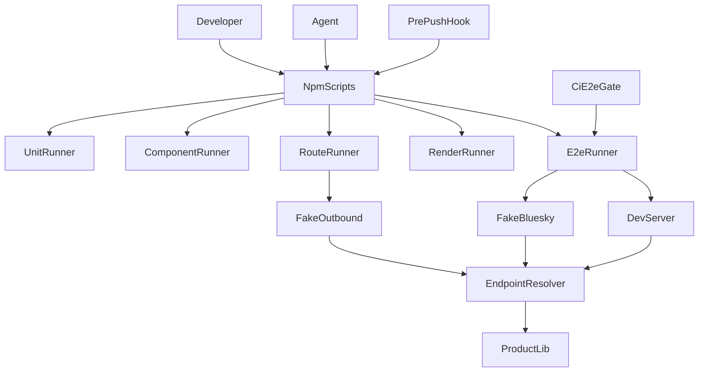
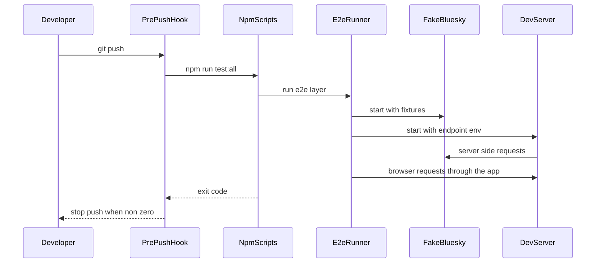

# Design Document

## Overview

**Purpose**: 本 spec は、このリポジトリのテストを一貫した方針で作り直し、実行できるようにする基盤を定める。検証層の実行環境、配置、カバレッジの基準、実行の入口、push と CI のゲート、および E2E で Bluesky を偽装する仕組みを含む。

**Users**: 開発者とコーディングエージェントが、機能の受入基準を検証するテストを書き、`npm` のコマンドで層ごとに、または全層を実行する。CI は PR で E2E を実行する。

**Impact**: 旧テストは `_tests/` ごと破棄済みで、`tests/` は空の状態である。現在の設定（`vitest.config.ts`、`playwright.config.ts`、`e2e.yaml` の unit 段）はテストの配置や対象を古い前提で持っている。本 spec はそれらを新しい方針に合わせる。製品コードへの変更は、Bluesky の接続先を一箇所で解決する仕組み（要件 12）に限る。

### Goals

- 五つの検証層（unit・route・component・render・e2e）を、層ごとに分けた設定と実行の入口で動かす。
- P0 の振る舞いを実装するモジュールに、分岐カバレッジ 80% の基準を適用する。
- E2E で、Bluesky のサーバー由来とブラウザ由来の両方の通信を偽のサービスへ向ける。
- push 前に全層を実行し、人間とエージェントの両方で同じように強制する。
- CI（PR）は E2E のみを必須にする。

### Non-Goals

- 個々の機能のテストケース（各機能 spec）。
- 実 Bluesky に対する live 層（別 spec）。
- 既存の古いコメント・設定の整理（別の spec）。
- 接続先の解決以外の製品コードの変更。

## Boundary Commitments

### This Spec Owns

- 検証層の定義と、層ごとの実行設定（unit・route・component・render・e2e）。
- テストの配置（`tests/` の構造）と、共有の支援コード（フェイク、フィクスチャ、セットアップ）。
- カバレッジの基準の適用（P0 モジュールの分岐 80%）と、失敗の発生点の記録（4.4・4.5）。
- P0 の unit 層モジュールの変異テストの報告（4.6）。ゲートにはしない。
- 実行の入口（npm スクリプト）と、push 前フック、CI の E2E ゲート。
- E2E の 6 本の流れの範囲と、偽の Bluesky サービスの仕組み。
- Bluesky の接続先を解決する単一の仕組み（`src/lib/platform/blueskyEndpoints.ts`）と、その呼び出し箇所の置き換え。
- route 層の互換日付の差の報告。

### Out of Boundary

- 機能の受入基準に対応するテストの中身（各機能 spec）。
- live 層の実 Bluesky テストと、そのテスト用アカウントの管理（別 spec）。
- 旧コメントの `specs/...` 参照、古い設定値の整理（別の spec）。
- 接続先の解決以外の振る舞いの変更。とくに OAuth の検証規則（発行元の一致など）は変えない。
- `scripts/`・`_legacy/`・外部サービスの内部。

### Allowed Dependencies

- テスト基盤は次に依存してよい: `vitest`、`@cloudflare/vitest-plugin`、`@testing-library/react`、`@testing-library/dom`、`happy-dom`、`@playwright/test`、`wrangler` の設定ファイル（`wrangler.template.jsonc`）、`migrations/`。
- 製品側の接続先の解決（`src/lib/platform/blueskyEndpoints.ts`）は、環境変数の値だけを入力に取る純粋な関数とする。`src/lib/platform/` は他の領域に依存しない。
- `src/lib/atproto/`・`src/lib/oauth/`・`src/lib/session/` は、接続先の解決を `src/lib/platform/` から受け取ってよい。逆方向の依存は作らない。
- テストは製品の公開モジュールを import してよい。製品から `tests/` を import しない。

### Revalidation Triggers

- 接続先の環境変数の名前、既定値、解決の規則の変更（偽の Bluesky と dev サーバーの起動方法に影響する）。
- 層の分割（設定ファイルの追加・統合）と、npm スクリプトの名前の変更（pre-push フックと CI が依存する）。
- E2E の 6 本の流れの変更（偽のサービスの endpoint の範囲に影響する）。
- route 層で使う workerd の互換日付の変更。
- `.claude/hooks/session-start.sh` と `package.json` の `prepare` の変更（利用者の未コミットの変更と衝突しうる）。

## Architecture

### Existing Architecture Analysis

- 現在のテスト設定: `vitest.config.ts`（Node、`tests/**/*.test.ts`）、`vitest.astro.config.ts`（Astro の container、`tests/astro/**`）、`playwright.config.ts`（`tests/e2e`、live の project を含む）。いずれも `tests/` を前提にしているが、`tests/` は空である。
- CI: `.github/workflows/e2e.yaml` は `workflow_call` と `workflow_dispatch` だけで、PR で動かない。unit・astro の段と live の project を含む。
- フック: `.claude/hooks/session-start.sh` は `CLAUDE_CODE_REMOTE` が `true` のときだけ動く。
- 接続先: Bluesky のサービス URL は、`src/lib/atproto/agentFactory.ts`・`src/lib/oauth/client.ts`・`src/lib/oauth/discovery.ts`・`src/lib/atproto/did.ts`・`src/lib/atproto/videoAuth.ts` に直書きされている。`src/env.ts` は `PUBLIC_DEFAULT_ATP_SERVICE` と `PUBLIC_PLC_DIRECTORY_BASE_URL` を読むが、既定値も含めて分散している。

### Architecture Pattern & Boundary Map



**Architecture Integration**:

- Selected pattern: 層ごとに独立した実行環境（設定ファイル）を持ち、npm スクリプトが順に束ねる。
- Domain boundaries: テストの実行環境（Node、workerd、DOM、ブラウザ）は層ごとに分け、混在させない。製品の接続先は単一の解決関数に集める。
- Existing patterns preserved: `vitest.astro.config.ts` の Astro container による描画テスト、`scripts/run-e2e.mjs` による dev サーバーの起動と後始末。
- New components rationale: 層ごとの設定（workerd の環境が他の層と共存できないため）、偽の Bluesky（要件 10.3・12.5 を満たすため）、接続先の解決（要件 12.1〜12.4）、フック（要件 8）。
- Steering compliance: `testing.md` の方針（層、優先度、ゲート）に従う。型は `any` を使わない。

### Technology Stack

| Layer         | Choice / Version                                                           | Role in Feature                                           | Notes                                                                                                           |
| ------------- | -------------------------------------------------------------------------- | --------------------------------------------------------- | --------------------------------------------------------------------------------------------------------------- |
| Unit / Render | vitest 4.1（Node）                                                         | 純粋関数と Astro の描画の検証                             | 既存。render は `getViteConfig` を使う                                                                          |
| Route         | `@cloudflare/vitest-plugin` 1.4.11                                         | API ルートを workerd で実行し、D1 と R2 の binding を使う | 旧 `pool-workers` の後継。peer は vitest ^4.1                                                                   |
| Component     | `@testing-library/react` 16.3、`@testing-library/dom` 10.4、`happy-dom` 21 | 対話する React 部品の検証                                 | ファイル単位で happy-dom を指定する                                                                             |
| E2E           | `@playwright/test` 1.63                                                    | 利用者の流れをブラウザで検証                              | 既存。偽の Bluesky と dev サーバーを使う                                                                        |
| Hooks         | `prepare`（npm）、`.githooks/pre-push`                                     | 人間とエージェントの push 前の強制                        | `postinstall` は既存の `patch-package` のまま                                                                   |
| Fake Bluesky  | Node の HTTP サーバー（テスト支援コード）                                  | 認可サーバー、PDS、AppView、PLC の固定応答                | E2E と route で共有する応答の定義を使う                                                                         |
| Mutation      | `@stryker-mutator/core` 10.1.1、`@stryker-mutator/vitest-runner` 10.1.1    | P0 の unit 層モジュールの変異テスト（報告のみ）           | PoC で動作を確認済み。サンドボックスの複製で `.agents` などを `ignorePatterns` で除外する                       |
| Coverage      | `@vitest/coverage-istanbul` 4.1.11                                         | P0 モジュールの分岐カバレッジの計測と閾値                 | route 層（workerd）で計測と glob 単位の閾値を検証済み。v8 は workerd で使えないため、全層で istanbul に統一する |

## File Structure Plan

### Directory Structure

```
config/test/vitest.unit.config.ts            # unit 層の設定（Node、tests/unit）。旧 vitest.config.ts を置き換える
config/test/vitest.component.config.ts       # component 層の設定（Node、happy-dom をファイル単位で指定）
config/test/vitest.route.config.ts           # route 層の設定（workerd。cloudflareTest を使う）
# coverage の閾値は config/test/vitest.unit.config.ts と config/test/vitest.route.config.ts に置く（P0 の glob 単位）
config/test/vitest.astro.config.ts           # render 層の設定（既存を流用。include を tests/render に変える）
tests/
├── unit/                        # src/lib/ の対応パスを映す
├── component/                   # src/components/ の対応パスを映す
├── route/                       # src/pages/ の対応パスを映す
│   ├── wrangler.jsonc           # route 層の binding（DB、SCHEDULE_IMAGES）。本番の設定とは別に持つ
│   └── support/applyMigrations.ts  # 各テストの前に D1 のマイグレーションを適用する
├── render/                      # src/pages/ の .astro ページ
├── e2e/
│   └── flows/                   # 6 本の流れ（login・thread-posting・entry・schedule・survey・feedback）。偽の Bluesky と dev サーバーは scripts/e2e/run-e2e.mjs が起動する
├── support/
│   ├── fakeBluesky/             # 認可サーバー、PDS、AppView、PLC の固定応答（HTTP サーバー）。serve.ts が単独のプロセスとして起動する（DID は起動のたびに作る）
│   └── fakeOutbound.ts          # route 層の外部通信（miniflare の outboundService）
└── fixtures/                    # 固定の DID、鍵、ドキュメント（本番の鍵は含めない）
src/lib/platform/
├── blueskyEndpoints.ts          # Bluesky の接続先を環境変数から解決する単一の関数
└── publicEndpoints.ts           # ビルド時の import.meta.env から接続先を解決した定数（ブラウザへ配る値）
scripts/
├── e2e/run-e2e.mjs                  # 偽の Bluesky・dev サーバーの起動と後始末（E2E の入口）
├── config/render-wrangler.mjs          # config/<名前>.json から wrangler.jsonc を生成する（設定の源は wrangler の vars）
├── secrets/sync-github-variables.mjs    # config/production.json と .dev.vars を GitHub・Worker へ登録する
├── lib/                         # jsonc・dotenv・GitHub のリモート解析（純粋な関数）
└── git/setup-git-hooks.mjs          # core.hooksPath を .githooks に設定する（git 管理外では何もしない）
.githooks/
└── pre-push                     # npm run test:all を実行し、失敗なら push を止める
```

### Modified Files

- `package.json` — `test` 系スクリプトを層ごとに再定義（`test:unit`・`test:component`・`test:route`・`test:render`・`test:e2e`・`test:all`）。`prepare` に `node scripts/git/setup-git-hooks.mjs` を追加。`test:astro` は `test:render` に改名。
- `config/test/playwright.config.ts` — `testDir` を `tests/e2e/flows` にし、live の project を削除。偽の Bluesky は `scripts/e2e/run-e2e.mjs` が起動するため、`globalSetup` は使わない。
- `scripts/e2e/run-e2e.mjs` — dev サーバーの起動時に、接続先の環境変数（偽の Bluesky の URL）を渡す。
- `.github/workflows/e2e.yaml` — `pull_request` のトリガーを追加。unit・astro の段と live の項目を削除。
- `.claude/hooks/session-start.sh` — `CLAUDE_CODE_REMOTE` のガードより前に、`node scripts/git/setup-git-hooks.mjs` を実行する行を追加（既存の行は変えない）。
- `src/lib/session/oauthLogin.ts`・`src/pages/v2/bsky/session.ts`・`src/components/account/LoginForm/index.tsx`・`src/env.ts` — 認可サーバーの直書きを解決関数に置き換える（一覧は「接続先の直書きの箇所」を参照）。`src/lib/platform/blueskyEndpoints.ts` を使う。
- `src/env.ts` — 既存の `PUBLIC_DEFAULT_ATP_SERVICE` と `PUBLIC_PLC_DIRECTORY_BASE_URL` の読み取りを `blueskyEndpoints` に移す。

### Removed Files

- `vitest.config.ts`（`vitest.unit.config.ts` に置き換える）
- `vitest.route.config.ts` の spike 用の `tests/route/spike/` と、spike の確認用の値

### 現況との対応（2026-11-10 追補）

| 設計時のパス                                            | 現在のパス                                  | 変えた spec          |
| ------------------------------------------------------- | ------------------------------------------- | -------------------- |
| ルートの各 `vitest.*.config.ts`・`playwright.config.ts` | `config/test/` の下の同名ファイル           | `repo-root-layout`   |
| `scripts/run-e2e.mjs`                                   | `scripts/e2e/run-e2e.mjs`                   | `ops-tooling-layout` |
| `scripts/render-wrangler.mjs`                           | `scripts/config/render-wrangler.mjs`        | `ops-tooling-layout` |
| `scripts/sync-github-variables.mjs`                     | `scripts/secrets/sync-github-variables.mjs` | `ops-tooling-layout` |
| `scripts/setup-git-hooks.mjs`                           | `scripts/git/setup-git-hooks.mjs`           | `ops-tooling-layout` |
| `src/lib/platform/blueskyEnv.ts`（未作成）              | `src/lib/platform/blueskyEndpoints.ts`      | `test-foundation`    |
| `src/lib/session/cookies.ts`                            | `src/lib/session/cookies/`                  | `lib-large-files`    |

## Requirements Traceability

| Requirement | Summary                                                | Components                                             | Interfaces                                                  | Flows      |
| ----------- | ------------------------------------------------------ | ------------------------------------------------------ | ----------------------------------------------------------- | ---------- |
| 1.1         | 五つの検証層の定義                                     | LayerConfigs                                           | 層の一覧（設定ファイル）                                    | —          |
| 1.2         | 純粋な規則は unit                                      | LayerConfigs                                           | `vitest.unit.config.ts`                                     | —          |
| 1.3         | API ルートは route                                     | RouteHarness                                           | `vitest.route.config.ts`                                    | —          |
| 1.4         | 対話部品は component                                   | ComponentHarness                                       | `vitest.component.config.ts`                                | —          |
| 1.5         | .astro の描画は render                                 | LayerConfigs                                           | `vitest.astro.config.ts`                                    | —          |
| 1.6         | 横断する流れは e2e                                     | E2eHarness                                             | `playwright.config.ts`                                      | Flow E2E   |
| 1.7         | route は workerd、unit と component は Node            | RouteHarness, ComponentHarness                         | 各設定ファイルの環境                                        | —          |
| 2.1         | P0 の一覧                                              | Priority（steering）                                   | 文書                                                        | —          |
| 2.2         | P1 の一覧                                              | Priority（steering）                                   | 文書                                                        | —          |
| 2.3         | P2 の一覧                                              | Priority（steering）                                   | 文書                                                        | —          |
| 2.4         | hack・_legacy・外部サービスを除外                      | LayerConfigs                                           | include の範囲                                              | —          |
| 2.5         | 優先度のない振る舞いは spec で定める                   | Priority（steering）                                   | 文書                                                        | —          |
| 3.1         | P0 の受入基準に 1 件以上のテスト                       | Priority（steering）                                   | 文書（検証は tasks で行う）                                 | —          |
| 3.2         | 逆方向は強制しない                                     | Priority（steering）                                   | 文書                                                        | —          |
| 3.3         | テストの題名は英語                                     | Priority（steering）                                   | 文書                                                        | —          |
| 3.4         | 題名に識別子（要件番号・AC タグ）を含めない            | Priority（steering）                                   | 文書                                                        | —          |
| 4.1         | P0 モジュールの分岐 80%                                | CoverageGate                                           | `coverage.thresholds`（ファイルまたは glob 単位、istanbul） | —          |
| 4.2         | src 全体の目標を置かない                               | CoverageGate                                           | 設定に全体の閾値を置かない                                  | —          |
| 4.3         | P1・P2 に要件を置かない                                | CoverageGate                                           | 閾値の対象外                                                | —          |
| 4.4         | P0 の失敗の発生点すべてに、失敗の種類を検証するテスト  | CoverageGate（発生点の一覧）、各 P0 モジュールのテスト | 発生点の一覧（機能の spec）、テストの題名に失敗の種類       | —          |
| 4.5         | 失敗の発生点の一覧を機能の spec に記録                 | CoverageGate                                           | 機能の spec の一覧（`design.md` の Testing Strategy）       | —          |
| 4.6         | P0 unit モジュールの変異テストの報告（ゲートにしない） | MutationReport                                         | Stryker の設定、報告の出力                                  | —          |
| 5.1         | 既定のテストは外部接続なし                             | FakeBluesky, FakeOutbound                              | 既定の接続先                                                | —          |
| 5.2         | 時刻と乱数は注入                                       | ComponentHarness, RouteHarness                         | テストのヘルパー                                            | —          |
| 5.3         | 実際の認証情報を含めない                               | Fixtures                                               | `tests/fixtures/`                                           | —          |
| 5.4         | D1・R2 は本番と同じスキーマ、空から開始                | RouteHarness                                           | `applyMigrations`、isolated storage                         | —          |
| 5.5         | 実行順に依存しない                                     | RouteHarness, ComponentHarness                         | 各テストの前の初期化                                        | —          |
| 6.1         | すべて tests/ 配下                                     | Layout                                                 | ディレクトリ構造                                            | —          |
| 6.2         | 層のディレクトリは src のパスを映す                    | Layout                                                 | ディレクトリ構造                                            | —          |
| 6.3         | フェイクは support、データは fixtures                  | Layout                                                 | ディレクトリ構造                                            | —          |
| 7.1         | 全層のコマンドと層ごとのコマンド                       | Scripts                                                | `package.json` の scripts                                   | —          |
| 7.2         | いずれか失敗で全体を失敗                               | Scripts                                                | `test:all` の直列の終了コード                               | —          |
| 7.3         | 手動起動なしで E2E を実行                              | E2eHarness                                             | `scripts/run-e2e.mjs`                                       | Flow E2E   |
| 8.1         | npm install で hooksPath を設定                        | GitHooks                                               | `prepare` → `setup-git-hooks.mjs`                           | Flow Hooks |
| 8.2         | エージェントのセッション開始で設定                     | GitHooks                                               | `session-start.sh` の追加行                                 | Flow Hooks |
| 8.3         | push で全層（E2E 含む）を実行                          | GitHooks                                               | `.githooks/pre-push`                                        | Flow Hooks |
| 8.4         | 失敗で push を中止                                     | GitHooks                                               | pre-push の終了コード                                       | Flow Hooks |
| 8.5         | 人間とエージェントで同じ動作                           | GitHooks                                               | 同じ hooksPath と同じスクリプト                             | Flow Hooks |
| 9.1         | PR で E2E を必須                                       | CiGate                                                 | `e2e.yaml` の `pull_request`                                | —          |
| 9.2         | 他の層は CI で必須にしない                             | CiGate                                                 | `e2e.yaml` から unit・astro の段を削除                      | —          |
| 9.3         | CI で live を実行しない                                | CiGate                                                 | live の project を削除                                      | —          |
| 10.1        | E2E の六つの流れ                                       | E2eHarness                                             | `tests/e2e/flows/`                                          | Flow E2E   |
| 10.2        | 予約は E2E で実行しない                                | E2eHarness                                             | 流れの範囲（作成と一覧まで）                                | Flow E2E   |
| 10.3        | 実行中、Bluesky の通信を偽へ向ける                     | FakeBluesky, BlueskyEndpoints                          | 接続先の環境変数                                            | Flow E2E   |
| 10.4        | 実アカウントを使わない                                 | FakeBluesky                                            | 既定の DID とハンドル                                       | —          |
| 10.5        | 偽が応答しない場合は失敗、実サービスへ戻らない         | FakeBluesky, BlueskyEndpoints                          | 未定義の経路は 404 を返す                                   | —          |
| 11.1        | 同梱の workerd が対応する最新の互換日付                | RouteHarness                                           | `tests/route/wrangler.jsonc`                                | —          |
| 11.2        | 互換日付の差を文書に記録                               | RouteHarness                                           | `steering/testing.md`                                       | —          |
| 11.3        | 差を route 層の実行時に報告                            | RouteHarness                                           | 設定の読み込み時の警告                                      | —          |
| 12.1        | 基底 URL を設定で差し替え可能                          | BlueskyEndpoints                                       | `resolveBlueskyEndpoints(env)`                              | —          |
| 12.2        | 指定されたら既定へ送らない                             | BlueskyEndpoints                                       | 解決結果の全項目                                            | —          |
| 12.3        | 未指定なら本番と同じ既定値                             | BlueskyEndpoints                                       | 既定値の定数                                                | —          |
| 12.4        | 本番の画面と API の振る舞いを変えない                  | BlueskyEndpoints, 呼び出し箇所                         | 既定値の同一性の検証                                        | —          |
| 12.5        | E2E の起動時に偽の接続先を設定                         | E2eHarness                                             | `scripts/run-e2e.mjs`                                       | Flow E2E   |

## Components and Interfaces

| Component        | Domain/Layer        | Intent                                                    | Req Coverage                              | Key Dependencies (P0/P1)                             | Contracts     |
| ---------------- | ------------------- | --------------------------------------------------------- | ----------------------------------------- | ---------------------------------------------------- | ------------- |
| LayerConfigs     | Test infrastructure | 層ごとの実行環境と include の範囲                         | 1.1, 1.2, 1.5, 2.4                        | vitest (P0)                                          | Config        |
| RouteHarness     | Test infrastructure | workerd での API ルートの実行                             | 1.3, 1.7, 5.2, 5.4, 5.5, 11.1, 11.2, 11.3 | `@cloudflare/vitest-plugin` (P0), `migrations/` (P0) | Config, State |
| ComponentHarness | Test infrastructure | DOM 環境と RTL の初期化                                   | 1.4, 1.7, 5.2, 5.5                        | happy-dom (P0), RTL (P0)                             | Config        |
| E2eHarness       | Test infrastructure | 偽の Bluesky と dev サーバーの起動                        | 1.6, 7.3, 10.1, 10.2, 10.3, 12.5          | Playwright (P0), FakeBluesky (P0)                    | Batch         |
| FakeBluesky      | Test support        | Bluesky のサービスの固定応答                              | 5.1, 10.3, 10.4, 10.5                     | BlueskyEndpoints (P0)                                | API           |
| FakeOutbound     | Test support        | route 層の外部通信の応答                                  | 5.1, 10.5                                 | miniflare outboundService (P0)                       | API           |
| CoverageGate     | Test infrastructure | P0 モジュールの分岐 80% と、失敗の発生点の記録            | 4.1, 4.2, 4.3, 4.4, 4.5                   | istanbul coverage (P0)                               | Config        |
| MutationReport   | Test infrastructure | P0 の unit 層モジュールの変異テストの実行と生き残りの報告 | 4.6                                       | Stryker (P0)                                         | Batch         |
| Scripts          | Entry               | 層ごとと全体の実行の入口                                  | 7.1, 7.2                                  | npm (P0)                                             | Batch         |
| GitHooks         | Gate                | 人間とエージェントの push 前の強制                        | 8.1–8.5                                   | git (P0), npm `prepare` (P0)                         | Batch         |
| CiGate           | Gate                | PR の必須ゲート                                           | 9.1–9.3                                   | GitHub Actions (P0)                                  | Batch         |
| BlueskyEndpoints | Product（platform） | Bluesky の接続先の単一の解決                              | 12.1–12.4, 10.5                           | なし（環境変数の値のみ）                             | Service       |

### Test infrastructure

#### LayerConfigs

| Field        | Detail                                           |
| ------------ | ------------------------------------------------ |
| Intent       | 層ごとに独立した設定を持ち、実行環境の混在を防ぐ |
| Requirements | 1.1, 1.2, 1.5, 2.4                               |

**Responsibilities & Constraints**

- unit は Node で `tests/unit` を対象にする。
- component は Node で `tests/component` を対象にする。DOM の環境は各ファイルの指定（`// @vitest-environment happy-dom`）で有効にする。
- route は `config/test/vitest.route.config.ts` にだけ存在する（workerd の環境はカスタム環境と併用できないため）。
- render は既存の `config/test/vitest.astro.config.ts` を使い、対象を `tests/render` にする。
- 対象外（`scripts/`・`_legacy/`・外部）は include に含めない。

**Contracts**: Config [x]

#### RouteHarness

| Field        | Detail                                                    |
| ------------ | --------------------------------------------------------- |
| Intent       | API ルートを workerd で実行し、D1 と R2 の binding を使う |
| Requirements | 1.3, 1.7, 5.2, 5.4, 5.5, 11.1, 11.2, 11.3                 |

**Responsibilities & Constraints**

- `tests/route/wrangler.jsonc` に D1（`DB`）と R2（`SCHEDULE_IMAGES`）の binding を持つ。本番の設定（生成物）は読まない。
- マイグレーションは `readD1Migrations("migrations")` で読み、テスト用の binding として渡す。各テストファイルの前に `applyD1Migrations` を適用する。isolated storage により、テストごとに空の状態から始める。
- 互換日付は、同梱の workerd が対応する最新の日付にする（現時点の確認値は `2026-08-22`）。本番の `wrangler.template.jsonc` の値（`2026-10-08`）との差は、設定の読み込み時に警告として出す（要件 11.3）。差の内容は `steering/testing.md` に記録する（要件 11.2）。
- 時刻と乱数は、テストが値を渡す（製品の関数の引数として注入する）。

**Dependencies**

- Outbound: FakeOutbound — 外部通信の応答（P0）
- External: `@cloudflare/vitest-plugin` — workerd の実行（P0）

**Contracts**: Config [x] / State [x]

**State Management**

- テストファイルごとにマイグレーションを適用する。テスト間の状態は isolated storage で分離する。

**Implementation Notes**

- Integration: spike（`tests/route/spike/`）で、D1 のマイグレーションと Astro の API ルートの直接呼び出しが動くことを確認済み。
- Validation: 互換日付の差の警告が出ることを、設定の確認で検証する。
- Risks: route 層の分岐計測は istanbul で成立を確認済み（PoC）。v8 は workerd で使わない。

#### ComponentHarness

| Field        | Detail                                   |
| ------------ | ---------------------------------------- |
| Intent       | 対話する React 部品を DOM 環境で検証する |
| Requirements | 1.4, 1.7, 5.2, 5.5                       |

**Responsibilities & Constraints**

- `@testing-library/react` と `happy-dom` を使う。テストごとに DOM を作り直す（RTL の自動クリーンアップ）。
- 時刻とタイマーは、テストから注入する（fake timers を使う場合も、テストが明示的に制御する）。

**Contracts**: Config [x]

#### CoverageGate

| Field        | Detail                                    |
| ------------ | ----------------------------------------- |
| Intent       | P0 モジュールの分岐カバレッジに下限を置く |
| Requirements | 4.1, 4.2, 4.3                             |

**Responsibilities & Constraints**

- 閾値は P0 の振る舞いを実装するモジュールの glob に対してのみ置く（分岐 80%）。`src/` 全体の閾値は置かない。
- 閾値のキーにはファイルのパスまたはディレクトリの glob を書く。判定は該当ファイルごとに行われ、閾値を下回ると非ゼロで終わる（PoC で確認済み）。
- 失敗の発生点（4.4）は、P0 モジュールごとに `throw`、エラー応答、失敗コードを列挙し、各発生点に失敗の種類を検証するテストを置く。テストの題名に失敗の種類を含める。
- 発生点の一覧（4.5）は、各機能の spec の Testing Strategy に記録する。一覧と検証の対応は、tasks のレビューで確認する（自動の計測はしない）。
- P0 モジュールの一覧（23 ファイル、実装の調査で確定。根拠は research.md の「P0 モジュールの調査」）。閾値のキーはファイルパスで書く（glob は使わない）。担当層は暫定で、各モジュールのタスクで確定する。
  - unit（Node）: `src/lib/session/cookies/`、`src/lib/schedule/credentialCrypto.ts`、`src/lib/survey/respondentHash.ts`、`src/lib/entry/createBskyThread.ts`、`src/lib/entry/resolveEntryDeleteScope.ts`、`src/lib/entry/resolveDeleteTargets.ts`、`src/lib/feedback/issueContent.ts`、`src/lib/feedback/githubIssue.ts`、`src/lib/i18n/locale.ts`、`src/lib/share/shareBody.ts`、`src/lib/share/counterReserve.ts`（11 ファイル。変異テストの対象）
  - route（workerd、D1・R2・API）: `src/lib/session/oauthSession.ts`、`src/lib/session/bskySessionRefresh.ts`、`src/lib/session/oauthLogin.ts`、`src/lib/schedule/executor.ts`、`src/lib/schedule/runner.ts`、`src/lib/schedule/stageSchedule.ts`、`src/lib/schedule/imageStaging.ts`、`src/lib/survey/store.ts`、`src/lib/survey/retention.ts`、`src/lib/survey/request.ts`、`src/pages/v1/page.ts`、`src/pages/v2/feedback.ts`（12 ファイル）
- 新しい P0 ファイルを足すときは、この一覧と閾値の両方を更新する（Revalidation Trigger）。
- 計測は istanbul で行う。route 層（workerd）での計測と glob 単位の閾値は PoC で確認済み（research.md）。

**Contracts**: Config [x]

### Test support

#### FakeBluesky

| Field        | Detail                                                 |
| ------------ | ------------------------------------------------------ |
| Intent       | Bluesky のサービスの固定応答を、E2E の実行中に提供する |
| Requirements | 5.1, 10.3, 10.4, 10.5                                  |

**Responsibilities & Constraints**

- HTTP サーバーとして、認可サーバー（メタデータ、PAR、トークン、取り消し）、PDS（セッション、レコードの作成と取得、blob）、AppView（投稿一覧、スレッド、候補）、PLC（DID ドキュメント）の固定応答を提供する。
- 対象の endpoint は、E2E の六つの流れが実際に呼ぶものに限る。呼ばれない endpoint は実装しない。
- 定義されていない経路は 404 を返す。実サービスへの転送はしない（要件 10.5）。
- テスト用の DID とハンドルだけを使う（要件 10.4）。

**Contracts**: API [x]

```typescript
type FakeBlueskyOptions = {
  readonly port: number
  readonly issuer: string
  readonly fixtures: FakeBlueskyFixtures
}

interface FakeBluesky {
  readonly origin: string
  readonly requests: ReadonlyArray<{
    readonly method: string
    readonly path: string
  }>
  close(): Promise<void>
}

declare function startFakeBluesky(
  options: FakeBlueskyOptions,
): Promise<FakeBluesky>
```

- Preconditions: `port` は空いている。`fixtures` はテスト用の DID と鍵のみを含む。
- Postconditions: `origin` で応答する。未定義の経路は 404 を返す。
- Invariants: 実 Bluesky のホストへの通信を行わない。

#### FakeOutbound

| Field        | Detail                                     |
| ------------ | ------------------------------------------ |
| Intent       | route 層の外部通信を、固定応答で置き換える |
| Requirements | 5.1, 10.5                                  |

**Responsibilities & Constraints**

- miniflare の `outboundService` を使い、route 層の `fetch` を `FakeBluesky` と同じ応答の定義に向ける。
- `outboundService` の挙動は未検証（Open Questions）。使えない場合は、接続先の環境変数をテスト用の origin に置き換える方式に切り替える。

**Contracts**: API [x]

### Gates

#### GitHooks

| Field        | Detail                                                      |
| ------------ | ----------------------------------------------------------- |
| Intent       | push の前に全層を実行し、人間とエージェントで同じ強制を行う |
| Requirements | 8.1, 8.2, 8.3, 8.4, 8.5                                     |

**Responsibilities & Constraints**

- `scripts/setup-git-hooks.mjs` は、git の作業ツリーでない場合は何もせず終了する。作業ツリーなら `git config core.hooksPath .githooks` を設定する（冪等）。
- `package.json` の `prepare` で、`npm install` と `npm ci` の両方の後に実行する（要件 8.1）。
- `session-start.sh` では、`CLAUDE_CODE_REMOTE` のガードより前に同じスクリプトを実行する（要件 8.2）。既存の行は変えない。
- `.githooks/pre-push` は `npm run test:all` を実行し、非ゼロの終了コードで push を止める（要件 8.3・8.4）。
- 人間とエージェントは、同じ hooksPath と同じスクリプトを使う（要件 8.5）。

**Dependencies**

- Outbound: Scripts — `test:all`（P0）

**Contracts**: Batch [x]

**Implementation Notes**

- Integration: `prepare` は既存の `postinstall`（`patch-package`）と独立に動く。
- Validation: 一時的な clone で `npm install` を実行し、`git config core.hooksPath` が `.githooks` になることを確認する。
- Risks: `core.hooksPath` を tracked なディレクトリへ向けると、そのディレクトリのスクリプトを push 権限のある誰でも実行する（Husky のドキュメントの注意）。`.githooks` の変更はレビュー対象とする。

#### CiGate

| Field        | Detail                           |
| ------------ | -------------------------------- |
| Intent       | PR の必須ゲートを E2E に限定する |
| Requirements | 9.1, 9.2, 9.3                    |

**Responsibilities & Constraints**

- `e2e.yaml` に `pull_request` のトリガーを追加する。
- unit・astro の段（`npm run test:unit`・`npm run test:astro`）と live の項目を削除する。
- 既存の `deploy.yaml` からの `workflow_call` は維持する。

**Contracts**: Batch [x]

### Entry

#### Scripts

| Field        | Detail                   |
| ------------ | ------------------------ |
| Intent       | 層ごとと全体の実行の入口 |
| Requirements | 7.1, 7.2                 |

**Responsibilities & Constraints**

- `test:unit`・`test:component`・`test:route`・`test:render`・`test:e2e` を層ごとに用意する。
- `test:all` は、型検査（`test:type`）、lexicon の lint（`test:lexicon`）、各層を直列に実行する。いずれかが失敗すれば、全体を失敗にする。
- 既存の `test` スクリプトは `test:all` と同じ内容にする。

**Contracts**: Batch [x]

#### E2eHarness

| Field        | Detail                                                         |
| ------------ | -------------------------------------------------------------- |
| Intent       | 偽の Bluesky と dev サーバーを、接続先の環境変数付きで起動する |
| Requirements | 1.6, 7.3, 10.1, 10.2, 10.3, 12.5                               |

**Responsibilities & Constraints**

- `scripts/e2e/run-e2e.mjs` が `tests/support/fakeBluesky/serve.ts` を別プロセスで起動し、その origin を接続先の環境変数として dev サーバーと Playwright へ渡す。`globalSetup` は使わない（起動と後始末をランチャーに集約し、シグナルの扱いを既存のまま保つため）。
- 偽の Bluesky の DID は起動のたびに作る（実行ごとに別の利用者になり、前の実行の記録に影響されない）。
- E2E の六つの流れは `tests/e2e/flows/` に置く。予約は作成と一覧まで検証し、実行は route 層で検証する（要件 10.2）。
- 実アカウントは使わない（要件 10.4）。

**Dependencies**

- Outbound: FakeBluesky（P0）、BlueskyEndpoints（P0）

**Contracts**: Batch [x]

**Implementation Notes**

- Integration: `page.route` はブラウザ由来の通信だけを横取りする。サーバー由来の通信は、接続先の環境変数で偽の origin へ向ける（要件 10.3）。
- Validation: 六つの流れの各テストが、`FakeBluesky.requests` で偽の経路が呼ばれたことを確認する。
- Risks: 実行時間。E2E は dev サーバーのコンパイルに時間がかかるため、既存の `workers: 1` を維持する。

### Product seam

#### BlueskyEndpoints

| Field        | Detail                                                     |
| ------------ | ---------------------------------------------------------- |
| Intent       | Bluesky の接続先を一箇所で解決し、既定値は本番と同じに保つ |
| Requirements | 12.1, 12.2, 12.3, 12.4, 10.5                               |

**Responsibilities & Constraints**

- 解決対象: 認可サーバー（既定 `https://bsky.social`）、PLC ディレクトリ（既定 `https://plc.directory`）、AppView（既定 `https://api.bsky.app`）、PDS の上書き（既定は未設定。未設定なら DID から解決する）。
- 環境変数名（実行時の環境の名前。ビルド時の `import.meta.env` は読まない）: `PUBLIC_DEFAULT_ATP_SERVICE`（AppView）、`PUBLIC_PLC_DIRECTORY_BASE_URL`（PLC）、`PUBLIC_BSKY_AUTH_SERVER_URL`（認可サーバー。ブラウザも `GET /v2/endpoints/` で同じ値を得る）、`BSKY_PDS_URL`（PDS の上書き）。
- 上書きが指定されたら、その値を全経路に使い、既定へ戻さない（要件 12.2）。
- 解決関数 `resolveBlueskyEndpoints` は環境変数の値だけを入力とする純粋な関数。読み取り元は `getBlueskyEndpoints()`（実行時の環境のみ）の一箇所に限る。
- 設定の源（決定）: 非秘密の設定（接続先・運営者の情報）は `wrangler.jsonc` の `vars` だけ。`wrangler.jsonc` は `config/<名前>.json` から `scripts/render-wrangler.mjs` が毎回生成する（Git 管理外）。開発・ビルド・実行時が同じ値を使い、`.env` は使わない。秘密情報は `.dev.vars` と Worker のシークレットに置く。
- ブラウザへの配信: ビルド時の値を静的な JS に埋め込む（`publicEndpoints`）。実行時に取得する公開 API は設けない（静的な HTML の prerender と、E2E の接続先の上書きを、同じ設定の源から扱うため）。

**Dependencies**

- Inbound（サーバー）: `src/env.ts` の定数（DID の解決、OAuth の認可サーバー、ログイン API、Entry の詳細ページ）（P0）
- Inbound（ブラウザ）: `src/lib/platform/publicEndpoints.ts` を経由する `src/lib/atproto/publicAgent.ts`（richtext・suggest・lists・resolveEntryDeleteScope）、`LoginForm`
- External: なし

**Contracts**: Service [x]

```typescript
type BlueskyEndpointEnv = {
  readonly PUBLIC_DEFAULT_ATP_SERVICE?: string
  readonly PUBLIC_PLC_DIRECTORY_BASE_URL?: string
  readonly PUBLIC_BSKY_AUTH_SERVER_URL?: string
  readonly BSKY_PDS_URL?: string
}

type BlueskyEndpoints = {
  readonly authServer: string
  readonly plcDirectory: string
  readonly appView: string
  readonly pdsOverride: string | undefined
}

declare function resolveBlueskyEndpoints(
  env: BlueskyEndpointEnv,
): BlueskyEndpoints
```

- Preconditions: 環境変数の値は空文字でないとき URL として扱う（空は未指定と同じ）。
- Postconditions: 未指定の項目には、本番と同じ既定値を返す（要件 12.3）。
- Invariants: 解決結果は、利用者に見える画面と API の振る舞いを変えない（要件 12.4）。

**Implementation Notes**

- Integration: 既存の呼び出しは引数の値を変えるだけにする。OAuth の検証規則（発行元の一致、PDS の認可サーバーの一致）は変えない。
- Validation: 既定値のとき、置き換え前と同じ URL になることを unit 層で検証する。
- Risks: `videoAuth.ts` は対応 PDS の判定に `bsky.social` 系の接尾辞を使う。`BSKY_PDS_URL` を使う E2E では動画の流れを対象にしないため、判定は変えない（動画は E2E の範囲外）。`BSKY_*` は実行時の環境で読まれる。本番で未設定なら既定値になるため、本番の挙動は変わらない。

## System Flows



- 全層は直列に実行する。いずれかの層が失敗した時点で、以降の層を実行せず非ゼロで終える（要件 7.2）。
- E2E の起動は、偽の Bluesky を先に立て、その origin を dev サーバーへ渡す順序にする。

## Error Handling

### Error Strategy

- 層の失敗はその層の終了コードで伝える。全体の終了コードは、いずれかの失敗で非ゼロにする。
- 偽の Bluesky の未定義の経路は 404 を返し、テストを失敗させる（要件 10.5）。実サービスへは転送しない。
- 互換日付の差は警告として出し、テストは止めない（要件 11.3）。
- 接続先の環境変数が不正な URL の場合、解決時に例外を投げ、起動を止める（既定値へ黙って戻らない）。

### Monitoring

- E2E の偽サービスの `requests` を、失敗時の診断として出す。

## Testing Strategy

基盤そのものの検証（要件に対応するもの）:

- **Unit**: `resolveBlueskyEndpoints` が、既定値と上書きの組み合わせで期待の値を返す（12.1〜12.3）。
- **Unit**: 空文字の環境変数が未指定と同じに扱われる（12.2）。
- **Route**: 互換日付の差の警告が、設定の読み込みで出る（11.3）。
- **Route**: 各テストの前に D1 が空であること（5.4）。
- **E2E**: 六つの流れがそれぞれ、偽の Bluesky の経路を一つ以上呼ぶ（10.3）。
- **E2E**: 偽の応答が定義されていない経路を要求したとき、テストが失敗する（10.5）。
- **Hooks**: 一時的な clone で `npm install` 後に hooksPath が `.githooks` になる（8.1）。
- **Hooks**: 失敗するテストを入れたとき、pre-push が push を止める（8.4）。
- **Coverage**: 閾値の対象の glob に該当するファイルが閾値を下回ると、計測の実行が非ゼロで終わる（4.1）。
- **Coverage**: 対象外のファイル（P1・P2）は閾値の判定に含まれない（4.3）。

機能の検証の方針（各機能 spec が適用する）:

- **失敗の発生点（4.4）**: P0 モジュールの失敗の発生点ごとに、失敗の種類（固定の例外メッセージ、エラーコード、副作用が無いこと）を検査するテストを置く。例: `respondentHash` は不正な Base64 と鍵の長さ不正を、それぞれ固定メッセージで検査する。
- **発生点の一覧（4.5）**: 各機能 spec の Testing Strategy に、発生点と対応するテストの題名を並べる。
- **変異テスト（4.6）**: P0 の unit 層モジュールに対して Stryker を実行し、生き残った変異体の一覧を報告する。数値の下限は置かず、PR と push のゲートにもしない。等価な変異体と観測できない性質は、一覧に人が注釈する。

## Security Considerations

- テストの鍵と DID は fixtures に置く。本番の鍵（`OAUTH_CLIENT_KEY`、`SCHEDULE_ENC_KEY`、`SURVEY_HASH_KEY`）は含めない（要件 5.3）。
- `PUBLIC_BSKY_AUTH_SERVER_URL` と `BSKY_PDS_URL` は、本番の設定に置かない。上書きは開発とテストの環境だけで使う。
- 値の読み取り: `src/env.ts` と `src/lib/platform/publicEndpoints.ts`（ビルド時の `import.meta.env`）。実行時の環境を読む関数（blueskyEnv）は持たない。
- pre-push フックは、tracked なスクリプトを実行する。`.githooks/` の変更はレビューの対象とする。

## Migration Strategy

1. `vitest.config.ts` を `vitest.unit.config.ts` に置き換え、既存の単体テストの include を `tests/unit` に合わせる（テストは空）。
2. `vitest.route.config.ts` の spike を整理し、`tests/route/spike/` を削除する。
3. `blueskyEndpoints` を導入し、直書きの箇所を置き換える（既定値の同一性を unit で確認）。
4. `playwright.config.ts` と `e2e.yaml` を変更する（live の削除、`pull_request` の追加）。
5. `scripts/setup-git-hooks.mjs`、`prepare`、`.githooks/pre-push`、`session-start.sh` の行を追加する。
6. 各層のテストは、機能の spec の tasks で作る（本 spec では基盤の検証まで）。

Rollback: 各段の変更は独立して戻せる。接続先の変更は既定値が同じなので、単独で戻しても本番の挙動は変わらない。

## Supporting References

### 接続先の直書きの箇所（変更の範囲）

実装の調査（3.2 の着手時）で確定した。当初の一覧（agentFactory・oauth/client・did などの「直書き」）は、実際には既定値を持っていなかったため、以下に置き換えた。

- `src/lib/session/oauthLogin.ts`: 認可サーバーの直書き（`https://bsky.social`）を、`getBlueskyEndpoints()` の認可サーバーに置き換えた。
- `src/pages/v2/bsky/session.ts`: アプリパスワードのログインの既定の接続先（未指定時）を、`getBlueskyEndpoints()` の認可サーバーに置き換えた。
- `src/components/account/LoginForm/index.tsx`: ログインの送信値を `src/env.ts` の `publicAuthServer` に置き換えた（スキーマが `service` を必須にしているため）。
- `src/env.ts`: AppView・PLC・認可サーバーの既定値を、`resolveBlueskyEndpoints` の結果に寄せた。
- 変更しない: `agentFactory.ts`（接続先は引数で受ける）、`oauth/discovery.ts`（PDS は DID ドキュメントから解決する）、`did.ts`（PLC は `src/env.ts` の値を使う）、`videoAuth.ts`（対応 PDS の判定。接続先の値ではない）。

## Open Questions / Risks

1. **route 層の coverage の計測（解決済み）**: istanbul を使えば workerd の実行で分岐カバレッジを計測でき、glob 単位の閾値も判定される（PoC、research.md）。v8 は使えない。
2. **`outboundService` の挙動**: miniflare の外部通信の差し替えが、route 層の全経路で動くかは未検証。動かない場合は、接続先の環境変数を route テストで差し替える。
3. **`BSKY_*` の読み取りの場所**: 本番の Worker（`cloudflare:workers` の `env`）と dev サーバー（`process.env`）で、同じ解決関数に値を渡す経路の確認が必要。
4. **`test:type` と `test:lexicon` を `test:all` に含めるか**: 層ではないが、既存の `test` に含まれる。設計では含める。利用者が外すならここで決める。
5. **E2E の流れの具体**: 六つの流れの具体的な操作（画面、入力、期待する表示）は tasks の段階で定める。
6. **変異テストの採否（解決済み）**: 採用。要件 4.6 として、P0 の unit 層に限り報告のみとする。
7. **P0 モジュールの一覧（解決済み）**: 実装の調査で file 単位に確定した（research.md）。担当層は暫定で、各モジュールのタスクで確定する。
