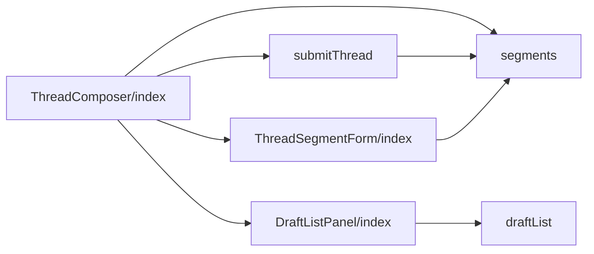
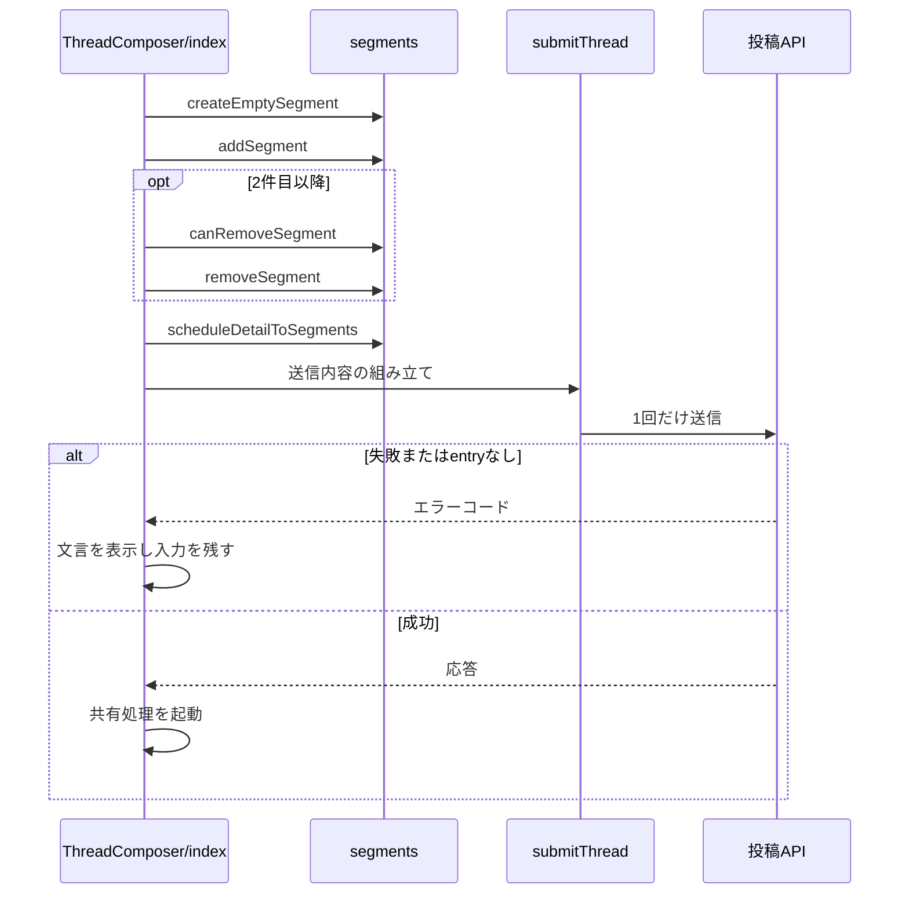

# Design Document

## Overview

**Purpose**: 1件の投稿と複数件のスレッドを同じ投稿フォームで作成し、スレッド全体を1回の操作で投稿できるようにする。
**Users**: 1件の投稿やスレッドを作成して投稿する利用者
**Impact**: 1件の投稿と複数件のスレッドを同じ投稿フォームで作成し、スレッド全体を1回の操作で投稿できるようにする。

### Goals

- 投稿フォームでのセグメント（スレッド内の1投稿）の追加・選択・削除・表示。
- スレッド全体の送信と、entryの作成要求の内容。
- スレッドの下書きの保存と復元と、下書き・予約の画面。
- 投稿フォーム内の共有設定と投稿フォームの設定の配置。

### Non-Goals

- 既存の投稿へスレッドを継ぎ足す操作。
- 共有設定の保持と共有の処理そのもの。
- 画像・動画・リンクカードの各入力部品の内部の動作。

## Boundary Commitments

### This Spec Owns

- 投稿フォームでのセグメント（スレッド内の1投稿）の追加・選択・削除・表示。
- スレッド全体の送信と、entryの作成要求の内容。
- スレッドの下書きの保存と復元と、下書き・予約の画面。
- 投稿フォーム内の共有設定と投稿フォームの設定の配置。

### Out of Boundary

- 既存の投稿へスレッドを継ぎ足す操作。
- 共有設定の保持と共有の処理そのもの。
- 画像・動画・リンクカードの各入力部品の内部の動作。

### Allowed Dependencies

- 投稿の作成 API とスレッドの上限（entry-api、post-record）
- 画像・動画・リンクカード・返信と引用の入力部品（image-picker、video-picker、ogp-link-card、post-gate）
- 下書きの API（draft-api）と予約の画面（schedule-form）
- 共有設定と共有の処理（share-settings、auto-popup、intent-share-dialog）

### Revalidation Triggers

- セグメントの上限（100件）を変えるとき（entry-api・draft-api の上限と一致が要る）
- 送信内容の組み立て（entry の作成要求の条件）を変えるとき
- 下書きに含める項目（画像と動画を含めない）を変えるとき
- 設定の配置（詳細オプション）を変えるとき

## Architecture

### Architecture Pattern & Boundary Map

投稿フォームの構成要素の依存方向を示す。



## File Structure Plan

| パス                                                             | 責務                                               |
| ---------------------------------------------------------------- | -------------------------------------------------- |
| `src/components/post/ThreadComposer/index.tsx`                   | セグメント配列・編集中の位置・送信・共有設定の配置 |
| `src/components/post/ThreadComposer/ThreadSegmentForm/index.tsx` | 1セグメントの編集表示と簡略表示                    |
| `src/components/post/ThreadComposer/segments.ts`                 | セグメントの状態と追加・削除・下書き変換           |
| `src/components/post/ThreadComposer/submitThread.ts`             | 送信内容の組み立てと送信                           |
| `src/lib/entry/draftList.ts`                                     | 下書き一覧の応答の整形                             |
| `src/components/entry/DraftListPanel/index.tsx`                  | 下書きの一覧と復元                                 |

## System Flows

セグメント操作から送信までの流れと、失敗時の分岐を示す。



## Requirements Traceability

| Requirement             | Summary                      | Components |
| ----------------------- | ---------------------------- | ---------- |
| 1.1, 1.2, 1.3           | セグメントの編集             | D-1        |
| 2.1, 2.2, 2.3, 2.4      | セグメントの表示             | D-2        |
| 3.1, 3.2, 3.3, 3.4, 3.5 | 送信                         | D-3        |
| 4.1, 4.2, 4.3, 4.4      | 下書きと予約の書き戻し       | D-4        |
| 5.1, 5.2, 5.3           | 設定の配置とスマホ幅の見た目 | D-4, D-5   |

## Components and Interfaces

#### D-1: セグメントの状態

**Requirements**: 1.1, 1.2, 1.3

```ts
export type SegmentState = {
  id: string
  text: string
  languageCode: string
  selfLabel: CreateEntryBodySelfLabels | undefined
  postGate: PostGateValue
  imageEntry: ImageEntry | null
  ogpResult: OgpResult | null
  videoEntry: VideoEntry | null
}
export const createEmptySegment = (languageCode: string): SegmentState // id は crypto.randomUUID()
export const addSegment = (segments: SegmentState[], languageCode: string): SegmentState[] // MAX_THREAD_POST_COUNT で止める
export const canRemoveSegment = (index: number): boolean => index > 0
export const removeSegment = (segments: SegmentState[], index: number): SegmentState[]
```

`ThreadComposer` は `segments` と `activeIndex` を保持する。単発投稿はセグメントが1件の場合として同じコンポーネントで扱う。各セグメントは入力部品（`PostBodyEditor` `ImagePicker` `VideoPicker` `OgpFetchButton` `PostGateDialog` `SelfLabelsSelect` `LanguageSelect`）を個別にインスタンス化し、`id` はセグメントの位置から一意に決める。

#### D-2: セグメントの表示

**Requirements**: 2.1, 2.2, 2.3, 2.4

```tsx
<div data-testid={`thread-segment-${index}`}>
  <Avatar size="md" />
  {hasNext && <div className={styles["connector-line"]} aria-hidden="true" />}
  {/* 編集表示と簡略表示を常にマウントし、hidden で切り替える */}
  <div hidden={!isActive} data-testid="segment-editor">
    本文・入力部品・ツールボックス
  </div>
  <div hidden={isActive} className={styles.row}>
    本文の要約・画像のサムネイル・削除ボタン
  </div>
</div>
```

- 条件付きの描画で入力部品をアンマウントすると、`ImagePicker` の内部stateが消えて添付済みの画像のプレビューが失われるため、`hidden` で切り替える。
- 簡略表示は `imageEntry.thumbnailPreview` を読み取り専用で表示し、`canRemoveSegment(index)` のときだけ削除ボタンを出す。
- ツールボックス（返信・引用の設定、言語、画像添付、自己ラベル）は、アバターの列の下まで含めた全幅に置く。アバターの縦線は先頭行の範囲に限る。
- 添付の行は、左に画像・動画、右に予約・スレッドへの追加・言語を置く。添付に応じて現れる追加操作（サムネ調整・リンクカードを取得）は、現れたときに添付の行の並びを崩さないよう、その下の別の行に置き、画像か動画か本文の URL があるときだけ描画する。追加操作のボタンには `compact-button` を付ける。

#### D-3: 送信

**Requirements**: 3.1, 3.2, 3.3, 3.4, 3.5

```ts
const entryCandidateIndex = segments.findIndex(
  s => (!!s.imageEntry || !!s.videoEntry) && !manualImageAttach,
)
const posts = await Promise.all(segments.map(buildPostItem)) // 動画 > 画像 > リンクカードの順で1つを載せる
const body = {
  posts,
  ...(entryCandidateIndex !== -1
    ? {
        createEntry: true,
        ...buildEntryText({
          userName,
          postText: segments[0].text,
          videoDurationSec,
        }),
        visual: (
          segments[entryCandidateIndex].imageEntry ??
          segments[entryCandidateIndex].videoEntry!
        ).thumbnailBlob,
      }
    : {}),
}
const res = await createEntry(body) // 1回だけ送信する
```

- 本文のリンク・メンション・ハッシュタグは `detectFacetsForSubmission` で送信直前に検出する。
- entryを要求したのに応答に `skyshareEntry` が無い場合は失敗として扱う。
- 状態は送信中・成功・失敗の3つとし、セグメントごとの進捗は表示しない。
- 送信内容の組み立ては `buildThreadRequestBody` に切り出し、予約の作成と置き換えも同じ本文を使う。
- 予約の状態 `scheduleMode` を保持し、`submitTarget(scheduleMode)` が `post` なら `createEntry`、それ以外は `submitSchedule` に本文を渡す。投稿のボタンの文言は `submitLabelKey` で決める。
- 動画のセグメントがあるときは `hasVideoSegment` が真になり、カレンダーのボタンを無効にする。カレンダーのボタンは編集中のセグメントのツールボックスの、スレッドに追加のボタンの左に `runAtPicker` として渡す。
- キャンセルは `cancelAction(scheduleMode, hasUnsavedDraftChanges())` で、閉じる・下書きの保存の確認・予約の編集の3択に分ける。
- 成功後の共有処理には、先頭のセグメントの本文・応答のentryのURL・先頭のセグメントのリンクカードのURLを渡す。

#### D-4: 下書きと予約の書き戻し

**Requirements**: 4.1, 4.2, 4.3, 4.4, 5.3

| 方向 | 変換                                                                                              |
| ---- | ------------------------------------------------------------------------------------------------- |
| 保存 | `segmentsToDraftPosts(segments)` → `{ text, labels? }[]` を下書きAPIの `posts` に送る             |
| 復元 | `draftPostsToSegments(posts, languageCode)` → 画像・動画・リンクカードが空のセグメント配列        |
| 一覧 | `draftList.ts` が `{ id, posts, updatedAt }` に整形する                                           |
| 予約 | `scheduleDetailToSegments(detail, images, languageCode)` → 画像とリンクカードを含むセグメント配列 |

```ts
export const scheduleDetailToSegments = (
  detail: ScheduleDetail,
  images: Blob[], // images[n] は番号 n の画像
  languageCode: string, // langs が無い投稿に使う
): SegmentState[]
```

- 画像は `originalBlobs` に保管された画像を、`meta` に `imagesMeta` を入れ、`thumbnailBlob` は `detail.visual` の画像があればそれ、無ければ先頭の画像とする。プレビューは `URL.createObjectURL` で作る。
- リンクカードは `ogMeta` と `ogImage` の画像から `OgpResult` を作り、`gate` は `postGate` に、`selfLabels` は `selfLabel` に戻す。
- 下書き・予約の画面は `Overlay` の中に `TabButtons`（下書き・予約）を置き、下書きのタブに `DraftListPanel`、予約のタブに `ScheduleList` を描画する。開くたびに下書きのタブを選ぶ。
- 画面幅が640ピクセル未満のとき、この `Overlay` の背景に `align-items: flex-start` を指定して上端を固定する（投稿フォームの `postform-backdrop` と同じ理由で、一覧の高さが変わっても上端を動かさない）。投稿フォーム上部のキャンセル・下書き・予約・投稿のボタンには `compact-button`（スマホ幅で文字と左右余白を縮める共通のボタンのクラス）を付ける。
- 下書き・予約の画面の見出し行は「閉じる」を絶対配置するため、行に `min-height: var(--size-button-md)` を指定して、カードの `overflow: hidden` でボタンの上端が切れないようにする。
- `DraftListPanel` は `loading` が真の間、`Loading` のスピナーを表示する（取得中に全面を覆うスピナーは出さない）。

#### D-5: 設定の配置

**Requirements**: 5.1, 5.2

| 領域           | 並び順                                                                                                                                                                                                                                                                           |
| -------------- | -------------------------------------------------------------------------------------------------------------------------------------------------------------------------------------------------------------------------------------------------------------------------------- |
| 主トグル       | 画像を自分で添付 → リンクカード優先（link-card-priority 由来。画像を自分で添付がONの間は操作不能）                                                                                                                                                                               |
| 詳細オプション | ポップアップを開く設定 → 自動ポップアップするSNS（ポップアップを開く設定がONのときだけ） → 長文を省略して共有（`disabled={isSubmitting \|\| manualImageAttach}`） → 返信・引用の設定を保存 → 投稿フォームを固定表示しない（タイムラインを表示しないがONの間は OFF かつ操作不能） |

詳細オプションの `Collapsible` には `defaultOpen` を渡さず、設定値によらず閉じた状態で表示する（フォームの情報の密度を下げるため）。

## Error Handling

| 事象               | 処理                                               |
| ------------------ | -------------------------------------------------- |
| 投稿APIの失敗      | エラーコードから文言キーを決めて表示し、入力を残す |
| 投稿者名の取得失敗 | entryの作成失敗として扱い、送信しない              |
| 応答にentryが無い  | entryの作成失敗として扱う                          |

## Testing Strategy

- Unit / Build Tests:
  - `npx vitest run tests/components/post/ThreadComposer/segments.test.ts`
  - `npx vitest run tests/components/post/ThreadComposer/submitThread.test.ts tests/components/post/ThreadComposer/segments.test.ts`
  - `npm run build`
- E2E/UI Tests:
  - `tests/e2e/threadComposer.spec.ts` 1件目に画像を添付してセグメントを追加し編集先を切り替える → 1件目に簡略表示とサムネイルが出て、選び直すと本文が残っている
  - `tests/e2e/tabButtons.spec.ts` 下書き・予約のボタンを押して予約のタブに切り替える → 下書きのタブが初めに選ばれ、予約のタブで予約の一覧が表示される
  - `tests/e2e/intentShare.spec.ts` 長文を省略して共有をONにして投稿フォームを開く → 詳細オプションが閉じた状態で表示される
- テストの名前には、対応する基準 ID を `[thread-composer/<ID>]` の形で付ける（例: `[thread-composer/1.1]`）
