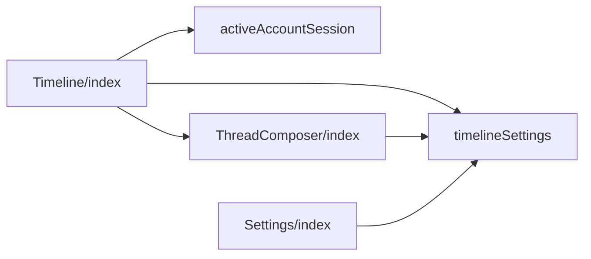
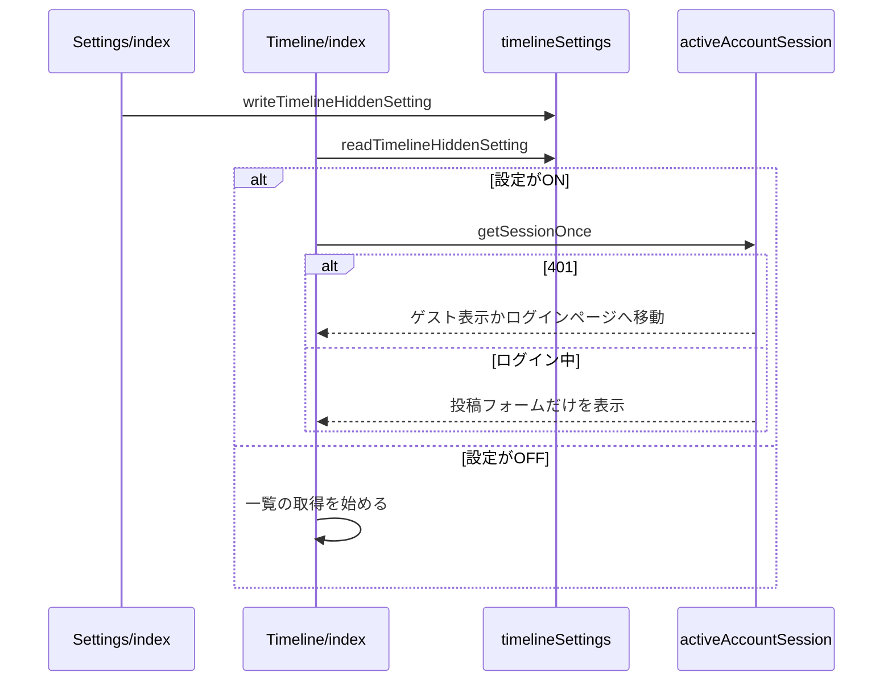

# Design Document

## Overview

**Purpose**: 投稿だけを目的とする利用者のために、自分の投稿の一覧を読み込まず投稿フォームだけを表示する設定を設け、トップページの動作を軽くする。
**Users**: 投稿だけを目的とする利用者
**Impact**: 自分の投稿の一覧を読み込まず投稿フォームだけを表示する設定を設け、トップページの動作を軽くする。

### Goals

- タイムラインを表示しない設定の保持と、設定ページでの切り替え。
- 設定がONのときのトップページの一覧・投稿フォーム・新規投稿ボタンの表示。
- 設定がONのときの、投稿フォームを固定表示しない設定の扱い。

### Non-Goals

- 一覧の表示内容とスレッドの折りたたみ。
- 投稿フォームの入力と投稿の処理。

## Boundary Commitments

### This Spec Owns

- タイムラインを表示しない設定の保持と、設定ページでの切り替え。
- 設定がONのときのトップページの一覧・投稿フォーム・新規投稿ボタンの表示。
- 設定がONのときの、投稿フォームを固定表示しない設定の扱い。

### Out of Boundary

- 一覧の表示内容とスレッドの折りたたみ。
- 投稿フォームの入力と投稿の処理。

### Allowed Dependencies

- ブラウザの保存領域
- 投稿フォームの固定表示の設定（thread-composer）
- ログイン中のアカウント情報（account-session）とゲスト表示（app-navigation）

### Revalidation Triggers

- 設定の保存値の形や既定値を変えるとき
- 投稿フォームを固定表示しない設定との優先関係を変えるとき
- 未ログイン時の遷移（ゲスト表示・ログインページ）を変えるとき

## Architecture

### Architecture Pattern & Boundary Map

設定を参照する構成要素の依存方向を示す。



## File Structure Plan

| パス                                           | 責務                                         |
| ---------------------------------------------- | -------------------------------------------- |
| `src/lib/settings/timelineSettings.ts`         | 設定の読み書き                               |
| `src/components/post/Timeline/index.tsx`       | 一覧・投稿フォーム・新規投稿ボタンの出し分け |
| `src/components/post/ThreadComposer/index.tsx` | 固定表示しないのスイッチの無効化             |
| `src/components/settings/Settings/index.tsx`   | 設定ページの行と固定表示しないの行の無効化   |
| `src/lib/account/activeAccountSession.ts`      | 未ログインの判定に使うセッションの取得       |

## System Flows

トップページで設定を読み込んでから一覧を取得するか決める流れを示す。



## Requirements Traceability

| Requirement   | Summary                    | Components    |
| ------------- | -------------------------- | ------------- |
| 1.1, 1.2, 1.3 | 設定の保持と切り替え       | D-1, D-2, D-3 |
| 2.1, 2.2, 2.3 | トップページの出し分け     | D-2           |
| 3.1, 3.2      | 固定表示しない設定との関係 | D-3           |

## Components and Interfaces

#### D-1: 設定の読み書き

**Requirements**: 1.1

```ts
// 保存キーは timelineHidden。"true" と "false" 以外・window が無い・例外のときは defaultValue
export const readTimelineHiddenSetting = (defaultValue: boolean): boolean
export const writeTimelineHiddenSetting = (value: boolean): void // 例外は握りつぶす
```

#### D-2: トップページの出し分け

**Requirements**: 1.3, 2.1, 2.2, 2.3

```tsx
// マウント前（サーバー描画と初回描画）は null とし、マウント後に保存値を読む
const [timelineHidden, setTimelineHidden] = useState<boolean | null>(null)
const showPinnedForm = !pinnedFormDisabled || timelineHidden === true
// 無限スクロールの enabled: paginationMode === "infinite" && timelineHidden === false
```

| 要素                        | `timelineHidden` が true のとき                                                           |
| --------------------------- | ----------------------------------------------------------------------------------------- |
| 一覧と末尾の表示            | 描画しない。`enabled` が false のため取得も始めない                                       |
| 固定表示の `ThreadComposer` | `pinnedFormDisabled` によらず描画する                                                     |
| `PostLauncher`              | 描画しない（フローティングとサイドバーの両方のボタンが消える）                            |
| 未ログインの判定            | `getSessionOnce` が401なら、ゲスト表示の要求があればゲスト表示、無ければ `/login/` へ移る |

設定の読み込み前（`null`）は一覧の取得を始めないため、ONのときに一覧を1回も取得しない。

#### D-3: 固定表示しないの無効化

**Requirements**: 1.2, 3.1, 3.2

| 箇所                              | 表示                                                                                  |
| --------------------------------- | ------------------------------------------------------------------------------------- |
| 設定ページの表示のグループ        | 表示言語の次にタイムラインを表示しない、その次に固定表示しないのスイッチを置く        |
| 設定ページの固定表示しないの行    | `checked: pinnedFormDisabled && !timelineHidden`、`disabled: timelineHidden`          |
| `ThreadComposer` の詳細オプション | 同じ `checked` と `disabled` にし、詳細オプションを初期状態で開く条件にも同じ値を使う |

固定表示しないの保存値は書き換えない。設定をOFFに戻すと、保存値どおりの表示に戻る。

## Error Handling

| 事象                     | 処理                                   |
| ------------------------ | -------------------------------------- |
| 保存領域の読み取りの例外 | OFFとして扱う                          |
| 保存領域の書き込みの例外 | 書き込みを諦め、表示は維持する         |
| セッションの取得の失敗   | 記録だけして投稿フォームの表示を続ける |

## Testing Strategy

- Unit / Build Tests:
  - `npx vitest run tests/lib/settings/timelineSettings.test.ts`
  - `npx tsc --noEmit`
- E2E/UI Tests:
  - `tests/e2e/timelineHidden.spec.ts` 設定ページでタイムラインを表示しないをONにしてゲスト表示のトップページを開く → 一覧の取得が行われず、投稿フォームとゲスト表示の案内が表示され、新規投稿ボタンとハイドレーション警告が出ない
  - `tests/e2e/timelineHidden.spec.ts` 固定表示しないをONにした後でタイムラインを表示しないをONにし、再びOFFにする → 固定表示しないのスイッチがOFFかつ操作不能になり、OFFに戻すとONの表示に戻る
- テストの名前には、対応する基準 ID を `[timeline-hidden/<ID>]` の形で付ける（例: `[timeline-hidden/1.1]`）
