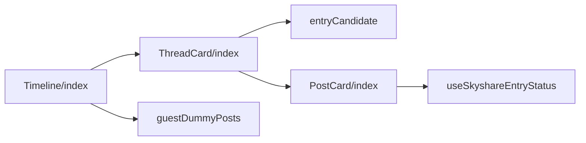
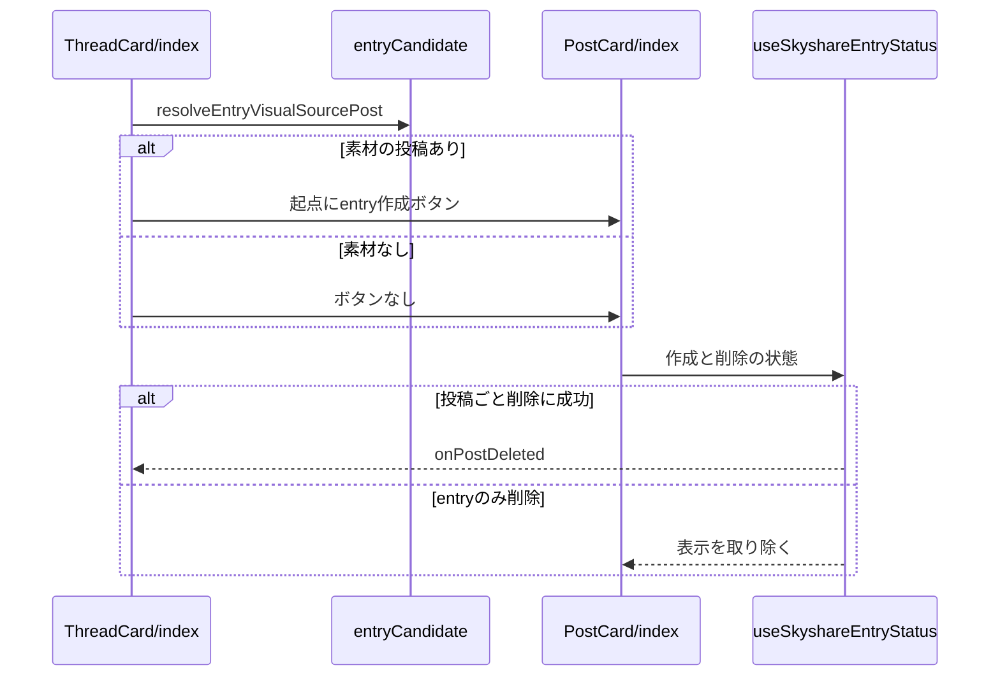

# Design Document

## Overview

**Purpose**: 自分の投稿の一覧で、スレッドをまとめて折りたたんで表示し、entryの無い画像・動画の投稿から後からentryを作成できるようにする。
**Users**: 自分の投稿の一覧を見て、共有用の entry を作成・管理する利用者
**Impact**: 自分の投稿の一覧で、スレッドをまとめて折りたたんで表示し、entry の無い画像・動画の投稿から後から entry を作成できるようにする。

### Goals

- スレッドグループの折りたたみと展開の表示。
- 後からのentryの作成のボタンと、代表画像と派生元の決定。
- 削除の後の一覧の更新。

### Non-Goals

- スレッドの構造の判定。
- 投稿カードの画像の表示と、entryの削除の確認の内部の動作。

## Boundary Commitments

### This Spec Owns

- スレッドグループの折りたたみと展開の表示。
- 後からのentryの作成のボタンと、代表画像と派生元の決定。
- 削除の後の一覧の更新。

### Out of Boundary

- スレッドの構造の判定。
- 投稿カードの画像の表示と、entryの削除の確認の内部の動作。

### Allowed Dependencies

- スレッドの構造の判定（threadChain）
- 投稿カードの画像の表示（image-gallery）と entry の削除の確認（entry-delete-dialog）
- entry の作成 API（entry-api）と代表画像の生成（entry-visual）

### Revalidation Triggers

- スレッドグループの判定を変えるとき（折りたたみ表示と削除範囲に影響する）
- 代表画像の素材と派生元の決め方を変えるとき（entry-api の派生元の規則と整合が要る）
- コントラストを下げる条件を変えるとき

## Architecture

### Architecture Pattern & Boundary Map

タイムライン表示の依存方向を示す。



## File Structure Plan

| パス                                                     | 責務                               |
| -------------------------------------------------------- | ---------------------------------- |
| `src/components/post/Timeline/index.tsx`                 | 一覧の取得とスレッドグループの並び |
| `src/components/post/ThreadCard/index.tsx`               | 1グループの折りたたみと展開        |
| `src/components/post/ThreadCard/entryCandidate.ts`       | 代表画像の素材の投稿の決定         |
| `src/components/post/PostCard/index.tsx`                 | 1投稿のカード                      |
| `src/components/post/PostCard/useSkyshareEntryStatus.ts` | entryの作成・削除の状態            |
| `src/lib/entry/guestDummyPosts.ts`                       | ゲスト表示のスレッドグループ       |

## System Flows

グループの描画と、削除後に一覧を更新する流れを示す。



## Requirements Traceability

| Requirement                  | Summary                | Components    |
| ---------------------------- | ---------------------- | ------------- |
| 1.1, 1.2, 1.3, 1.4, 1.5, 1.6 | スレッドグループの表示 | D-1, D-4, D-5 |
| 2.1, 2.2, 2.3, 2.4           | 後からの entry の作成  | D-2           |
| 3.1, 3.2                     | 削除の後の一覧         | D-3           |
| 4.1, 4.2                     | コントラストの調整     | D-1, D-4      |

## Components and Interfaces

#### D-1: 一覧とグループの表示

**Requirements**: 1.1, 1.2, 1.3, 1.4, 1.6, 4.1

```tsx
<ComponentList
  itemComponent={ThreadCard}
  getItemKey={thread => thread.rootPost.uri}
  getItemProps={thread => ({
    group: thread,
    onPostDeleted: removeItem,
    guestMode,
  })}
  items={items} // ThreadGroup[]。クライアントでは返信の連鎖を組み立て直さない
/>
```

| 要素                   | 表示                                                                                                   |
| ---------------------- | ------------------------------------------------------------------------------------------------------ |
| `replies.length === 0` | 起点の `PostCard` だけを描画する                                                                       |
| 折りたたみボタン       | 「スレッドを展開（N件）」と「折りたたむ」。`Collapsible` と同じCSSの矢印を左に付け、開くと上向きにする |
| 返信                   | `reply-list` で囲み左マージンで段を作る。`PostCard` の `muted` にグループ単位の判定を渡す              |
| entryを開く            | フッターの `entry-link-box` に置き、container query で残り幅が4.5rem未満なら非表示にする               |

ゲスト表示では `GUEST_DUMMY_THREADS` を返す。

#### D-2: 後からのentryの作成

**Requirements**: 2.1, 2.2, 2.3, 2.4

```ts
export const resolveEntryVisualSourcePost = (
  group: ThreadGroup,
): TimelinePost | null => {
  if (group.replies.length === 0) return null
  if (hasEntryMedia(group.rootPost)) return group.rootPost // 画像か利用できる動画を持つ
  return group.replies.find(hasEntryMedia) ?? null
}
// ThreadCard → 起点の PostCard
//   postCreateEntryButton={!!visual} entryVisualSourcePost={visual} entrySourcePost={group.rootPost}
// 返信の PostCard は hideToolbar（下部のツールバーごと表示しない。操作は起点に対して行うため）
// useSkyshareEntryStatus: visualSource = visualSourcePost ?? item（画像取得と createDefaultThumbnail）
//                         source = sourcePost ?? item（API に送る uri）
```

entryの有無は `useSkyshareEntryStatus` の `display` だけで判定する。`group` の `skyshareEntry` は削除後に更新されず、ボタンが復帰しなくなるため参照しない。単独の投稿は `sourcePost` を渡さず、投稿自身を派生元にする。

#### D-3: 削除の後の一覧

**Requirements**: 3.1, 3.2

```tsx
// ThreadCard は起点と返信のどちらの PostCard にも同じコールバックを渡す
<PostCard
  onPostDeleted={() =>
    onPostDeleted(g => g.rootPost.uri === group.rootPost.uri)
  }
/>
```

`useSkyshareEntryStatus` は、`deleteBskyPost: true` の削除が成功したときだけ `onPostDeleted` を呼ぶ。entryだけの削除ではカードのentryの表示だけを取り除く。

#### D-4: グループ単位のコントラスト

**Requirements**: 1.4, 4.1, 4.2

```ts
// ThreadCard: グループのどの投稿も素材とentryを持たないとき、グループ全体をグレーアウトする
const threadMuted =
  resolveEntryVisualSourcePost(group) === null &&
  findEntryCarrier(group) === null
// 起点の PostCard は自身の display（ineligible）で判定し、返信には muted={threadMuted} を渡す
// PostCard: muted 未指定なら display.kind === "ineligible" で判定する
```

`card-muted` は文字を控えめな色にし、ボタン内を含む画像・アイコンの不透明度と彩度を下げ、本文のリンクの色を文字と同じにする。

#### D-5: 後続の投稿のツールバー

**Requirements**: 1.5

```tsx
// ThreadCard: 後続の PostCard にはツールバーを出さない
<PostCard item={reply} hideToolbar muted={threadMuted} />
```

`PostCard` は `hideToolbar` が真のとき、下部のツールバー全体（Blueskyで開く・共有・Entry関連の操作・entryを開くリンク）を描画しない。操作は起点の投稿に対して行う。

## Error Handling

| 事象                   | 処理                                                    |
| ---------------------- | ------------------------------------------------------- |
| 一覧の取得の失敗       | 一覧の読み込み失敗の文言を表示する                      |
| 素材の画像の取得の失敗 | entryの作成の失敗を表示し、ボタンを再度押せる状態に戻す |

## Testing Strategy

- Unit / Build Tests:
  - `npm run build`
  - `npx vitest run tests/components/post/ThreadCard/entryCandidate.test.ts`
- E2E/UI Tests:
  - `tests/e2e/timelineThread.spec.ts` ゲスト表示でスレッドAを展開する → 3件が古い順に表示され、起点にスレッドのタグが無い
  - `tests/e2e/timelineEntryAction.spec.ts` ゲスト表示でentryを持つ投稿を表示する → entryを開くリンクが操作の列の右端に置かれる
  - `tests/e2e/timelineThread.spec.ts` ゲスト表示でスレッドCを表示する → 起点のカードにだけentryを作成のボタンが表示される
  - `tests/e2e/timelineEntryAction.spec.ts` 起点に画像が無く返信に画像があるスレッドでentryを作成する → 送られる派生元が起点の投稿になる
  - `tests/e2e/entryDeleteDialog.spec.ts` ゲスト表示でスレッドBの起点のBluesky投稿を含む削除を確定する → スレッド全体が一覧から消える
  - `tests/e2e/timelineThread.spec.ts` ゲスト表示で画像の無いスレッドを展開する → 起点と返信のすべてのカードがコントラストを下げるクラスを持つ
  - `tests/e2e/timelineThread.spec.ts` ゲスト表示でスレッドを展開する → 起点のカードにだけツールバーが表示される
- テストの名前には、対応する基準 ID を `[timeline/<ID>]` の形で付ける（例: `[timeline/1.1]`）
