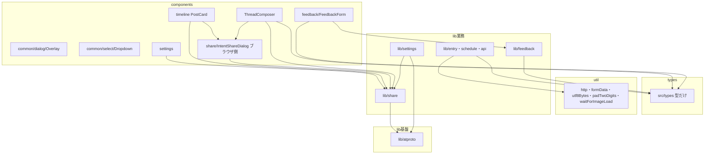

# Design Document

## Overview

**Purpose**: `src/util/` を「二つ以上の領域が使う、領域に依存せず DOM も使わない汎用の関数」だけにする。`util/` の各モジュールは次の四つの規則で分類し直す。(1) 型は `src/types/` に置く（`lib` が使う型が `util` または `components` で定義されている場合を含む）、(2) 業務の判断は `lib/<領域>/` に置く、(3) ブラウザや DOM を操作する処理は、それを使う `components/` の部品の内側に置く（純粋な部分は `lib/` へ分ける）、(4) 汎用の関数だけを `util/` に残す。`util/share` は `lib/share` へ統合する（純粋な部分）。

**Users**: 開発者が、新しい関数や型を置くときに「型なら `src/types`、業務なら `lib`、ブラウザなら `components`、汎用で利用元が二つ以上なら `util`」と判断できる。`structure-checks` が、この規約の一部（`util` の利用元・`src/types` の葉と型だけ）を機械で検査する。

**Impact**: `src/util/` の 25 ファイルのうち 20 件が `util/` から出る。内訳は、単一領域の 14 件（`textarea` 5・`listbox` 2・`clientEnvironment`・`countryFlag`・`autoLink`・`scrollLock`・`textCount`・`object`・`links`）、`util/share/` の 5 件（純粋な部分は `lib/share/`、ブラウザ側は `components/share/IntentShareDialog/`）、型だけの `util/outcome.ts` の 1 件（`src/types/outcome.ts`）。残るのは 5 件（`http`・`formData`・`utf8Bytes`・`padTwoDigits`・`waitForImageLoad`）。`util/formData.ts` は関数を残し、型 `FormDataFieldKind` だけを `src/types/formData.ts` へ移す。利用者に見える振る舞い、API の入出力、生成物は変えない。

### Goals

- `util/` 直下と下位フォルダに、二つ以上の領域が使う汎用のモジュールだけがある（5 件）
- 業務固有のモジュールが、利用元の領域（`lib/` の業務領域、または `components/` の部品フォルダの内側）にある
- 型は `src/types/` にあり、`src/types/` が外（外部パッケージを含む）を import しない
- `util/share` が `lib/share` に統合され、`lib/share` と `lib/settings` の循環がない。ブラウザ側は部品の内側にある
- `structure.md` の `util/` の規約・`src/types/` の規約・`lib` の依存表が、移動後の配置と一致する
- `npm run test:all` が終了コード 0 で通り、件数が着手時の基準を下回らない

### Non-Goals

- 汎用のまま残す 5 件の中身と設計の変更（`util/formData.ts` の型の移動を除く）
- `lib/` の層の分類（`lib-layers`）。`lib/share` は業務の層に置く（`lib-layers` の決定）
- 部品の分割と小さい部品領域の統合（`components-small-areas`）。`componentLayout` の規則の変更も行わない
- 400 行を超えるファイルの分割（`lib-large-files`）。`contentEditableModel.ts` は、本仕様では内容を変えずに移す
- 検査の追加（`structure-checks`）

## Boundary Commitments

### This Spec Owns

- `src/util/` の 20 件の移動先（下の File Structure Plan の表）
- `util/share/` の純粋な部分の `lib/share/` への統合、`lib/share/textCount.ts`・`lib/share/autoPopupTarget.ts`・`lib/share/webShareData.ts` の追加
- `util/share/` のブラウザ側の `components/share/IntentShareDialog/openIntentPopup.ts`・`components/share/IntentShareDialog/webShare.ts` への移動、および呼び出し側の合成（`buildIntentUrl` と `openIntentPopup` の組み合わせ）
- `lib/settings/autoPopupTarget.ts` の `lib/share/` への移動（循環の解消）
- `util/clientEnvironment.ts` の三分割（`src/types/clientEnvironment.ts`・`components/feedback/FeedbackForm/userAgent.ts`・`components/feedback/FeedbackForm/clientEnvironment.ts`）
- `util/outcome.ts` の `src/types/outcome.ts` への移動、`util/formData.ts` の型の `src/types/formData.ts` への移動
- 移動に伴う import とテストのパスの更新
- `structure.md` の `util/` の節の規約（「利用元が複数領域のときだけ `util` に置く」と四つの分類規則）、`src/types/` の節、`lib` の依存の表、`lib` の領域の一覧（名前の変更は無い）
- `src-duplicates` の brief への追記（share の責務の結論を `lib/share` の統合に改める記録）

### Out of Boundary

- 移動したモジュールの振る舞い、export 名、引数と戻り値の型
- `util/http.ts`・`util/utf8Bytes.ts`・`util/padTwoDigits.ts`・`util/formData.ts` の関数の内容
- `util/waitForImageLoad.ts` の中身
- `lib` の層の分類（`lib-layers` の対応表 `scripts/architecture/libLayers.ts`）。ただし `lib` の依存の表は本仕様で改訂する
- 部品の配置の分類と `componentLayout` の規則（`components-small-areas`）
- 検査の規則の追加（`structure-checks`）

### Allowed Dependencies

移動後の依存（すべて単方向。循環を作らない）:

- `lib/share` → `lib/atproto`（`shareBody.ts` が `richTextSegments` を参照する）・`lib/share` 内の他のファイル。`lib/settings`・`util`・`components` を参照しない（移動後、grep で確認する）
- `lib/settings` → `lib/atproto`・`lib/share`（`isValidInstanceDomain`・`AutoPopupTarget`）
- `lib/atproto` → `lib/image`・`lib/video`・`lib/atproto` 内の `autoLink.ts`・`countryFlag.ts`・`object.ts`。`util` を参照しない（移動後に grep で確認する）
- `lib/feedback` → `lib/api`（契約 `contract/feedbackLimits`・`contract/feedbackSubmission`。lib-layers の決定）・`lib/site`・`src/types`（`ClientEnvironment`・`Outcome` の型）。`util` を参照しない。ブラウザの読み取りと `components` を参照しない
- `lib/entry`・`lib/schedule`・`lib/api`・`lib/session`・`lib/video` → `util`（残す 5 件）と `src/types`（型）。`lib/survey` は `util`（`util/http`）のみを使い、`src/types` は使わない。既存の依存の向きに従う
- `components/feedback/FeedbackForm` → `components/feedback/FeedbackForm` 内の `userAgent.ts`・`clientEnvironment.ts`（同じ部品フォルダの内側の相対 import）・`lib/feedback`・`src/types`
- `components/share/IntentShareDialog` → `lib/share`・`src/types`・同じ部品フォルダ内の `openIntentPopup.ts`・`webShare.ts`（相対 import）
- `components/*` → `lib/share`・`lib/feedback`・`lib/atproto`・`src/types`・`util`（残す 5 件）・`components/share/IntentShareDialog` の `openIntentPopup.ts`・`webShare.ts`（`@/` の import）は可（`components` から `lib` への import は既存の規則で許可）
- `src/types/*` → `src/types/*` だけ（外部パッケージを含めて import しない。`structure.md` の `src/types/` の規約。`structure-checks` が検査する）
- `util/` → `lib`・`components`・`pages` を import しない（既存の `layer` 規則）。`util/` → `src/types/*` は可（型の参照のみで、`layer` 規則の対象外）

### Revalidation Triggers

- `lib/share` の公開する型・関数の名前と配置（`counterReserve`・`shareBody`・`intent`・`webShareData`・`intentLength`・`textCount` を参照する部品と業務が増減する）
- `lib/settings` と `lib/share` の依存の向き（逆向きの辺を作ると循環になる）
- `lib/settings/autoPopupTarget.ts` の移動（`AutoPopupTarget` の importer が変わる）
- `components/share/IntentShareDialog/` の中身（`openIntentPopup.ts`・`webShare.ts` を参照する部品が増える場合は、利用元の配置を見直す）
- `ThreadComposer/rules/` の中身（`components-small-areas` が composer の部品を整理するとき、`rules/` に加わる移動済みの 6 件を前提にする）
- `lib-large-files` の `contentEditableModel.ts` の分割（移動先のパスが変わる）
- `src/types/` に型を加える・移す（`lib` と `components` の両方が参照する型の置き場になる）
- `util/` の残す 5 件の決定の変更（`structure.md` の `util/` の節の例外と、`structure-checks` の残りの件数が変わる）
- `structure.md` の `util/` の規約（`structure-checks` が検査の根拠にする）

## Architecture

### Existing Architecture Analysis

- `util/` は「領域に依存しない小さな関数」の置き場だが、利用元の実測（grep）では、単一の領域しか使わないモジュールが 14 件ある。
- `util/share/` は `lib/share`・`lib/settings`・`components` の複数の領域が使うが、`lib/share/` にも同じ概念の 2 件がある（`counterReserve.ts`・`shareBody.ts`）。
- `util/clientEnvironment.ts` は、純粋な判定（`parseUserAgent`）とブラウザの読み取り（`detectStandalone`・`collectClientEnvironment`）と型（`ClientEnvironment`）が一つのファイルにある。型は `lib/feedback` と `components/feedback` の両方が使う。
- `util/share/intent.ts` は純粋な組み立てと、`window.open` を呼ぶ `openIntentPopupFor` が一つのファイルにある。`util/share/webShare.ts` も、純粋な組み立てと `navigator.share` の呼び出しが一つのファイルにある。
- `util/outcome.ts` は型だけのモジュールで、`lib/entry`・`lib/feedback`・`lib/schedule` が使う。`util/formData.ts` は関数と型 `FormDataFieldKind` を持ち、型は `lib/api` が使う。
- 既存の依存の表（`structure.md` の「lib の領域の依存の向き」）は、`lib/settings` → `util/share`、`lib/share` → `util/share` と `lib/settings`（型）、`lib/atproto` → `util/emoji`、`lib/feedback` → `util`（型）を記録している。移動後は、この表を書き換える。
- `scripts/architecture/rules.ts` の `layer` 規則は `util` から `lib` への import を違反にする。このため、`util` の中に置けるのは `lib` を import しないものだけである。
- `tests/unit/scripts/componentLayout.test.ts` の `findOutsidePartViolations` は、部品フォルダ（`index.tsx` を持つフォルダ）の外の `.ts` を違反にする（許容は `i18n/useTranslation.ts` と `layout/nav/*` だけ）。したがって、`components/<領域>/` の直下に `.ts` を新しく置けない。

### Architecture Pattern & Boundary Map

（図は依存の向きの要点だけを示す。`lib/share` が `lib/settings` を参照しない点が循環の解消である。`src/types` は葉で、他の層を参照しない。）

**Architecture Integration**:

- Selected pattern: 四つの分類規則（型は `src/types`、業務は `lib`、ブラウザと DOM は `components`、汎用で利用元が二つ以上は `util`）
- Domain/feature boundaries: 業務の関数は `lib/` の領域、部品の判断は `components/` の部品フォルダの内側、ブラウザの処理は利用元が共有する部品フォルダの内側。`util` は領域に依存せず DOM も使わない関数だけ。型は `src/types/`（葉）
- Existing patterns preserved: 部品フォルダの内側（`ThreadComposer/rules/`）・`lib/<領域>/` の単位・`@/` の import・`lib` の UI 非依存
- New components rationale: 新設するのは分割と型の分離で生じる 6 件（下の File Structure Plan）。関数の本体は、分割を除いて変えない
- Steering compliance: `structure.md` の `util/` の節・`src/types/` の節・依存の表を、同じ変更で改訂する

### Technology Stack

新しい依存は追加しない。

## File Structure Plan

### 分類の四つの規則（決定。2026-11-03 の利用者の決定を具体化）

1. **型**: `lib` が使う型が `util` または `components` で定義されている場合は、`src/types/` に移す（`lib` は `components` を import できないため。`lib` が `util` の型を使う場合も同じ。`Outcome`・`FormDataFieldKind` がこの場合にあたる）。`lib` で定義し `components` だけが使う型は `lib` に残す（`components` は `lib` を import してよい）。`src/types/` の型は、外部パッケージの型（DOM の型など）を import せず、型の持ち主の層に残す。
2. **業務**: 業務の判断（文字数の数え方、共有の本文の組み立て、型の検証など）は `lib/<領域>/` に移す。ただし、利用元が一つの部品だけの純粋な判定は、その部品の内側に置く（利用者の決定 U-3。`parseUserAgent`）。
3. **ブラウザと DOM**: `window`・`document`・`navigator`・`Image`・`Node` などを操作する処理は、それを使う `components/` の部品の内側に移す。関数の中に純粋な部分があれば、その部分だけを `lib/` に分ける。利用元が複数の部品領域にまたがる場合は、それらが共通に import できる部品フォルダ（`components/share/IntentShareDialog/`）の内側に置く（利用者の決定 U-1 の案 C）。
4. **汎用**: 領域に依存せず、DOM も使わない関数は `util/` に残す。利用元が二つ以上の領域であること（`utilShared` の検査）。例外: `util/waitForImageLoad.ts` は DOM の `Image` を使うが、利用元が二つの部品領域のため残す（利用者の決定 U-2）。

### 移動の対応表（実測 2026-11-03。ファイル単位。`util/` から出るのは 20 件）

| 移動元                                                                                                                              | 移動先                                                                                              | 利用元（grep の実測）                                                                                                                                                                                                            | 分類の規則                                                                                                               |
| ----------------------------------------------------------------------------------------------------------------------------------- | --------------------------------------------------------------------------------------------------- | -------------------------------------------------------------------------------------------------------------------------------------------------------------------------------------------------------------------------------- | ------------------------------------------------------------------------------------------------------------------------ |
| `util/share/intent.ts`（純粋部分）                                                                                                  | `lib/share/intent.ts`                                                                               | `lib/settings/shareSettings.ts`・`lib/share/counterReserve.ts`・`components/settings/Settings/index.tsx`・`Settings/useShareToggles.ts`・`components/share/IntentShareDialog/index.tsx`・`ThreadComposer/rules/shareDispatch.ts` | 規則 2（URL と本文の組み立て）                                                                                           |
| `util/share/intent.ts`（`OpenIntentPopupOptions`・`openIntentPopupFor`）                                                            | 削除（呼び出し側で合成する）                                                                        | `IntentShareDialog/index.tsx`・`ThreadComposer/rules/shareDispatch.ts`                                                                                                                                                           | 規則 3。`buildIntentUrl` の結果が無ければ `false`、有れば `openIntentPopup(url, preOpenedWindow)` を呼ぶ（振る舞い不変） |
| `util/share/openIntentPopup.ts`（`preOpenPopupWindow`・`openIntentPopup`）                                                          | `components/share/IntentShareDialog/openIntentPopup.ts`                                             | `ThreadComposer/hooks/useThreadSubmit.ts`・`IntentShareDialog/index.tsx`                                                                                                                                                         | 規則 3（`window.open`）。利用元が composer と share のため、共通の部品フォルダ（U-1 案 C）                               |
| `util/share/intentLength.ts`                                                                                                        | `lib/share/intentLength.ts`                                                                         | `util/share/intent.ts`・`util/share/truncateText.ts`・`util/textCount.ts`・`lib/share/counterReserve.ts`・`ThreadComposer/rules/shareDispatch.ts`・テスト                                                                        | 規則 2（X と taittsuu の文字数の計量）                                                                                   |
| `util/share/truncateText.ts`                                                                                                        | `lib/share/truncateText.ts`                                                                         | `util/share/intent.ts`                                                                                                                                                                                                           | 規則 2（切り詰め）                                                                                                       |
| `util/share/webShare.ts`（`buildWebShareText`・`toShareFile`）                                                                      | `lib/share/webShareData.ts`（新規）                                                                 | `components/timeline/Timeline/ThreadCard/PostCard/useWebShareCrosspost.ts`・`ThreadComposer/rules/shareDispatch.ts`                                                                                                              | 規則 2（共有の本文と File の組み立て）。分割                                                                             |
| `util/share/webShare.ts`（`canShareWithWebApi`・`shareWithWebApi`・`ShareFailureReason`・`ShareExecutionResult`）                   | `components/share/IntentShareDialog/webShare.ts`                                                    | `useWebShareCrosspost.ts`（timeline）・`useThreadSubmit.ts`（composer。`shareDispatch.ts` へ注入）                                                                                                                               | 規則 3（`navigator.share`）。利用元が二つの領域のため共通の部品フォルダ（逸脱は下の「決定から生じる例外」）              |
| `util/textCount.ts`                                                                                                                 | `lib/share/textCount.ts`                                                                            | `components/composer/ThreadComposer/ThreadSegmentForm/index.tsx`・`ThreadComposer/ImageAltDialog/index.tsx`・テスト 2 件                                                                                                         | 規則 2（文字数の数え方。3 件の塊の決定。下の例外を参照）                                                                 |
| `lib/settings/autoPopupTarget.ts`                                                                                                   | `lib/share/autoPopupTarget.ts`                                                                      | `lib/settings/shareSettings.ts`・`lib/share/counterReserve.ts`（型）                                                                                                                                                             | 循環の解消。`util/` 由来ではない                                                                                         |
| `util/object.ts`                                                                                                                    | `lib/atproto/object.ts`                                                                             | `lib/atproto/draft.ts` のみ                                                                                                                                                                                                      | 規則 2（利用元が一つ）                                                                                                   |
| `util/emoji/countryFlag.ts`                                                                                                         | `lib/atproto/countryFlag.ts`                                                                        | `lib/atproto/languageFlag.ts` のみ                                                                                                                                                                                               | 規則 2（利用元が一つ。`util/emoji/` は消える）                                                                           |
| `util/autoLink.ts`                                                                                                                  | `lib/atproto/autoLink.ts`                                                                           | `lib/atproto/richTextSegments.ts` のみ                                                                                                                                                                                           | 規則 2（利用元が一つ）                                                                                                   |
| `util/clientEnvironment.ts`（`ClientEnvironment` 型）                                                                               | `src/types/clientEnvironment.ts`（新規）                                                            | `lib/feedback/feedbackDraft.ts`（型）・`components/feedback/FeedbackForm/index.tsx`（型）                                                                                                                                        | 規則 1（`lib` と `components` が使う）                                                                                   |
| `util/clientEnvironment.ts`（`parseUserAgent` と補助）                                                                              | `components/feedback/FeedbackForm/userAgent.ts`（新規）                                             | `components/feedback/FeedbackForm/clientEnvironment.ts` のみ（`lib/feedback` の内側では使わない）                                                                                                                                | 規則 2 の例外（利用元が部品だけ。利用者の決定 U-3）                                                                      |
| `util/clientEnvironment.ts`（`detectStandalone`・`refineWithUserAgentData`・`collectClientEnvironment`）                            | `components/feedback/FeedbackForm/clientEnvironment.ts`（新規）                                     | `components/feedback/FeedbackForm/index.tsx`                                                                                                                                                                                     | 規則 3（`navigator`・`matchMedia`・`window` の読み取り）                                                                 |
| `util/outcome.ts`（`FailureStatus`・`Outcome` の型のみ）                                                                            | `src/types/outcome.ts`（移動。`util/outcome.ts` は消える）                                          | `lib/entry`（4 件）・`lib/feedback/submitFeedback.ts`・`lib/schedule`（4 件）                                                                                                                                                    | 規則 1（`lib` が `util` で定義された型を使う）。決定から生じる例外を参照                                                 |
| `util/formData.ts`（`FormDataFieldKind` と `LeafFormDataFieldKind`。後者は関数が使うため `src/types/formData.ts` から export する） | `src/types/formData.ts`（新規。`util/formData.ts` は関数だけ残し、両方の型を `import type` で読む） | `lib/api/schema/v2/entry/post.ts`・`lib/api/schema/v2/schedules/post.ts`（型）                                                                                                                                                   | 規則 1（同上）。決定から生じる例外を参照                                                                                 |
| `util/links.ts`                                                                                                                     | `components/composer/ThreadComposer/rules/links.ts`                                                 | `components/composer/ThreadComposer/hooks/useDraftFlow.ts` のみ                                                                                                                                                                  | 規則 3（DOM のクリック対象）。判断は `rules/`                                                                            |
| `util/textarea/contentEditableModel.ts`                                                                                             | `components/composer/ThreadComposer/rules/contentEditableModel.ts`                                  | `hooks/useSuggest.ts`・`ThreadSegmentForm/PostBodyEditor/index.tsx`・`rules/contentEditableReconcile.ts`・`rules/highlightNodeParts.ts`                                                                                          | 規則 3（部品の内側）                                                                                                     |
| `util/textarea/contentEditableReconcile.ts`                                                                                         | `components/composer/ThreadComposer/rules/contentEditableReconcile.ts`                              | `PostBodyEditor/index.tsx`                                                                                                                                                                                                       | 規則 3（`document`・`Node` を使う）                                                                                      |
| `util/textarea/highlightNodeParts.ts`                                                                                               | `components/composer/ThreadComposer/rules/highlightNodeParts.ts`                                    | `contentEditableReconcile.ts`・`PostBodyEditor` 経由                                                                                                                                                                             | 規則 3（部品の内側）                                                                                                     |
| `util/textarea/facetHighlightSegments.ts`                                                                                           | `components/composer/ThreadComposer/rules/facetHighlightSegments.ts`                                | `highlightNodeParts.ts`                                                                                                                                                                                                          | 規則 3（部品の内側。`tlds` を import する）                                                                              |
| `util/textarea/suggestTrigger.ts`                                                                                                   | `components/composer/ThreadComposer/rules/suggestTrigger.ts`                                        | `hooks/useSuggest.ts`                                                                                                                                                                                                            | 規則 3（部品の内側）                                                                                                     |
| `util/listbox/filter.ts`                                                                                                            | `components/common/select/Dropdown/rules/filter.ts`                                                 | `components/common/select/Dropdown/index.tsx`                                                                                                                                                                                    | 規則 3（分類フォルダ `select/` に直接置けない）                                                                          |
| `util/listbox/navigation.ts`                                                                                                        | `components/common/select/Dropdown/rules/navigation.ts`                                             | `components/common/select/Dropdown/index.tsx`                                                                                                                                                                                    | 同上                                                                                                                     |
| `util/scrollLock.ts`                                                                                                                | `components/common/dialog/Overlay/rules/scrollLock.ts`                                              | `components/common/dialog/Overlay/index.tsx`                                                                                                                                                                                     | 規則 3（`document.body` を操作。分類フォルダ `dialog/` に直接置けない）                                                  |

- 表のうち `util/` から出るのは 20 件（`util/share/` の 5 件、型の 1 件 `outcome`、単一領域の 14 件）。`util/formData.ts` は残るが、型の 1 件を移す。`lib/settings/autoPopupTarget.ts` は `util/` 由来ではない。`util/textarea/`・`util/listbox/`・`util/emoji/` の 3 フォルダは空になり削除する。`util/share/` は、5 件すべての移動が完了した時点で削除する。
- 「分割」の行は、一つのファイルを複数の移動先に分ける。分割後の各ファイルの中身は、元の関数の本体と export 名を変えない（import の付け替えを除く）。
- `util/share/intent.ts` の `openIntentPopupFor` は、`lib/share` の `buildIntentUrl` と `openIntentPopup` を組み合わせるだけの関数である。`lib/` は `window.open` を行えず（規則 3）、`util/` は `lib/` を import できない（`layer` 規則）ため、関数を残さず、呼び出し側（部品と `ThreadComposer/rules/`）で二つを組み合わせる。振る舞いは変えない。

### 残す `util/`（5 件。利用元が二つ以上）

- `util/http.ts`（`lib/schedule`・`lib/session`・`lib/survey`・`pages/oauth`・`pages/v1`・`pages/v2`）
- `util/formData.ts`（関数 `formDataIndexedArrayToObjects`・`formDataToObject`。`lib/api`・`lib/schedule`・`pages/v2`。型 `FormDataFieldKind` は `src/types/formData.ts` へ移す）
- `util/utf8Bytes.ts`（`components/entry`・`lib/api`・`lib/entry`）
- `util/padTwoDigits.ts`（`lib/schedule`・`lib/video`）
- `util/waitForImageLoad.ts`（`components/composer`・`components/timeline`）。DOM の `Image` を使うが、利用元が二つの部品領域のため残す（利用者の決定 U-2）

### 新設・移動する `src/types/`（3 件）

- `src/types/clientEnvironment.ts`（新規）: `ClientEnvironment` の型（`os`・`browser`・`userAgent`・`standalone`。プリミティブだけで、外部パッケージの型を使わない）。import を持たない。
- `src/types/outcome.ts`（`util/outcome.ts` の移動）: `FailureStatus`・`Outcome<T>`。import を持たない。
- `src/types/formData.ts`（新規）: `FormDataFieldKind` と `LeafFormDataFieldKind`（どちらも `export type`。`LeafFormDataFieldKind` は `util/formData.ts` の関数が使うため export する）。import を持たない。`util/formData.ts` は `import type { LeafFormDataFieldKind, FormDataFieldKind } from "@/types/formData"` で読む（値の import は増えない）。

### 新設する部品の内側・業務のファイル（分割で生じる 5 件）

- `lib/share/webShareData.ts`（`buildWebShareText`・`toShareFile`）
- `components/feedback/FeedbackForm/userAgent.ts`（`parseUserAgent`・`detectOs`・`detectBrowser`・`dotted`・`UNKNOWN`・`BROWSER_RULES`）
- `components/feedback/FeedbackForm/clientEnvironment.ts`（`detectStandalone`・`UserAgentData`・`refineWithUserAgentData`・`collectClientEnvironment`）

移動だけで名前を変えないもの: `components/share/IntentShareDialog/openIntentPopup.ts`（`util/share/openIntentPopup.ts` から）、`components/share/IntentShareDialog/webShare.ts`（`util/share/webShare.ts` のブラウザ部分から）。

### Modified Files（移動に伴う import の書き換えと、文書の改訂）

- 移動の規則: 移動したモジュールどうしが同じ領域（同じ `lib/<領域>`・同じ部品フォルダ）の内側に入る場合、その間の import は `@/util/...` や `@/lib/<領域>/...` ではなく相対 import（`./`・`../` は 3 段未満）にする。`structure.md` の「同じ部品フォルダ（同じ領域）の内部だけ相対 import」と「領域をまたぐ import は `@/`」に従う
- `src/components/**`・`src/lib/**`・`src/pages/**`: 移動したモジュールを import しているファイルの `@/util/...` を、新しいパスへ書き換える（対応表の利用元。領域の外からの参照は `@/`、同じ領域の内側からの参照は相対 import）
- `src/lib/settings/shareSettings.ts`: `isValidInstanceDomain` の import 元を `@/lib/share/intent`、`AUTO_POPUP_TARGETS`・`AutoPopupTarget` の import 元を `@/lib/share/autoPopupTarget` にする
- `src/lib/share/counterReserve.ts`: `@/lib/settings/shareSettings`（型）を `./autoPopupTarget` へ。`@/util/share/intent`・`@/util/share/intentLength`・`@/util/textCount` は移動先が同じ `lib/share` の中なので相対 import（`./intent`・`./intentLength`）にする
- `src/lib/share/intent.ts`（移動後）: `@/util/share/intentLength`・`@/util/share/truncateText` を相対 import（`./intentLength`・`./truncateText`）にし、`@/util/share/openIntentPopup` の import を削除する。`openIntentPopupFor`・`OpenIntentPopupOptions` は削除する
- `src/components/share/IntentShareDialog/index.tsx`: `openIntentPopupFor` の呼び出しを、`buildIntentUrl`（`@/lib/share/intent`）と `./openIntentPopup`（同じ部品フォルダの内側の相対 import）の組み合わせに置き換える
- `src/components/composer/ThreadComposer/rules/shareDispatch.ts`: `components/` を import しない（`composerSplit` の検査）。`openIntentPopup`・`canShareWithWebApi`・`shareWithWebApi` は `runShareDispatch` の引数（`browser`）で受け取る（決定 U-4）。`lib/share/intent`・`lib/share/intentLength`・`lib/share/webShareData` の純粋な関数は `@/` で直接 import する
- `src/components/composer/ThreadComposer/hooks/useThreadSubmit.ts`: `preOpenPopupWindow` の import を `@/components/share/IntentShareDialog/openIntentPopup` へ
- `src/components/timeline/Timeline/ThreadCard/PostCard/useWebShareCrosspost.ts`: `canShareWithWebApi`・`shareWithWebApi` の import を `@/components/share/IntentShareDialog/webShare` へ
- `src/lib/feedback/feedbackDraft.ts`: `ClientEnvironment` の import 元を `@/types/clientEnvironment` にする（`lib-layers` 2.1 の後に行う）
- `src/lib/feedback/submitFeedback.ts`・`src/lib/entry/*`（4 件）・`src/lib/schedule/*`（4 件）: `Outcome` の import 元を `@/types/outcome` にする（`lib/feedback/submitFeedback.ts` は `lib-layers` 2.1 の後）
- `src/lib/api/schema/v2/entry/post.ts`・`schedules/post.ts`: `FormDataFieldKind` の import 元を `@/types/formData` にする。`lib/schedule/stageSchedule.ts`・`pages/v2/entry.ts` は関数（`formDataToObject`）を使うため `@/util/formData` のまま
- `src/lib/atproto/draft.ts`・`src/lib/atproto/languageFlag.ts`・`src/lib/atproto/richTextSegments.ts`: 同じ領域の中の相対 import（`./object`・`./countryFlag`・`./autoLink`）へ
- `src/components/feedback/FeedbackForm/index.tsx`: `@/util/clientEnvironment` の import を、型は `@/types/clientEnvironment`、`collectClientEnvironment` は `./clientEnvironment`（同じ部品フォルダの内側の相対 import）へ
- `ThreadComposer/hooks/useSuggest.ts`・`ThreadSegmentForm/PostBodyEditor/index.tsx`・`ThreadComposer/hooks/useDraftFlow.ts`: 移動先が同じ部品フォルダ（`ThreadComposer/`）の内側なので、相対 import（`../rules/...`、`../` は 3 段未満）にする。`components/` の他の領域からの参照は `@/` にする（`crossRegionRelative` 規則）
- `src/pages/jump.astro`（コメントの中のパス `src/util/share/openIntentPopup.ts`）: `src/components/share/IntentShareDialog/openIntentPopup.ts` に直す
- `tests/unit/util/textCount.test.ts`・`tests/unit/util/textCountFallback.test.ts`: `tests/unit/lib/share/` へ移し、import を `@/lib/share/...` にする（テストの意味は変えない）
- `tests/unit/scripts/importRules.test.ts`（97 行目の `["src/util/share/intent.ts", "util/share"]`）: 移動後に実在しないため、`["src/util/http.ts", "util"]` に変える
- `.kiro/steering/structure.md`（規約の文言は `structure.md` の改訂の節を参照）:
  - `util/` の節: 規約「利用元が複数領域のときだけ `util` に置く」と四つの分類規則、`waitForImageLoad` の例外を書く
  - 「型（`src/types/`）」の節: 葉の規則（外部パッケージを含む）、型だけの宣言、置く条件（規則 1）を書く
  - 「lib の領域の依存の向き」: `lib/feedback` の行は、lib-layers 5.2 の行（`api`（契約）・`site` の辺）を残し、`util` の参照を書かず、`src/types`（`ClientEnvironment`・`Outcome`）を書く形にする。`lib/share`・`lib/settings`・`lib/atproto` の行は、移動後の import と一致することを確かめる
  - 「領域の一覧」: 領域の名前は変えない（一覧は名前だけを書く。`lib/share` の説明は追加しない）
- `.kiro/specs/src-duplicates/brief.md`: share の責務の結論を、`lib/share` への統合（`util-placement`）に改める旨を追記する（既存の内容は残す）

## Requirements Traceability

| Requirement | Summary                                                                    | Components（移動単位）                                                                                                       | Interfaces                                                                       | Flows                     |
| ----------- | -------------------------------------------------------------------------- | ---------------------------------------------------------------------------------------------------------------------------- | -------------------------------------------------------------------------------- | ------------------------- |
| 1.1         | 単一領域のモジュールは利用元の内側へ                                       | 対応表の単一領域 14 件                                                                                                       | 変更なし（export 名は維持）                                                      | 移動                      |
| 1.2         | `listbox` は `Dropdown` の内側                                             | `Dropdown/rules/filter.ts`・`Dropdown/rules/navigation.ts`                                                                   | `filterOptions`・`navigation` の既存 export                                      | 移動                      |
| 1.3         | `textarea` は ThreadComposer の `rules/` の内側                            | `ThreadComposer/rules/*.ts`（5 件）                                                                                          | 既存 export                                                                      | 移動                      |
| 1.4         | `countryFlag`・`autoLink` は `lib/atproto`                                 | `lib/atproto/countryFlag.ts`・`autoLink.ts`                                                                                  | 既存 export                                                                      | 移動                      |
| 1.5         | `scrollLock` は `Overlay` の内側                                           | `dialog/Overlay/rules/scrollLock.ts`                                                                                         | `acquireScrollLock`・`releaseScrollLock`                                         | 移動                      |
| 1.6         | `clientEnvironment` を三分割する                                           | `src/types/clientEnvironment.ts`・`FeedbackForm/userAgent.ts`・`FeedbackForm/clientEnvironment.ts`                           | `ClientEnvironment`・`parseUserAgent`・`collectClientEnvironment`                | 分割                      |
| 1.7         | `textCount`・`object`・`links` は利用元へ                                  | `lib/share/textCount.ts`・`lib/atproto/object.ts`・`ThreadComposer/rules/links.ts`                                           | 既存 export                                                                      | 移動                      |
| 1.8         | 移動したモジュールの振る舞いは変えない                                     | 全件                                                                                                                         | 変更なし                                                                         | テストで確認              |
| 1.9         | 四つの規則で全件を分類し、design に記録する                                | 本 design の「分類の四つの規則」と対応表                                                                                     | —                                                                                | 文書                      |
| 2.1         | `util/share` の純粋部分を `lib/share` へ                                   | `lib/share/intent.ts`・`intentLength.ts`・`truncateText.ts`・`webShareData.ts`                                               | 既存 export（`webShareData` は `buildWebShareText`・`toShareFile`）              | 移動・分割                |
| 2.2         | `lib/share` に統合し、`util/share/` を残さない                             | `lib/share/` 全体                                                                                                            | —                                                                                | 移動後の確認              |
| 2.3         | 部品の import を `@/lib/share` へ                                          | 利用元の部品（対応表）                                                                                                       | —                                                                                | import 更新               |
| 2.4         | `lib/share` と `lib/settings` の循環を作らない                             | `lib/share/autoPopupTarget.ts`・`counterReserve.ts`・`shareSettings.ts`                                                      | —                                                                                | `libRegionPairs` で確認   |
| 2.5         | `lib/settings` の `util/share` 参照を `lib/share` へ                       | `lib/settings/shareSettings.ts`                                                                                              | `isValidInstanceDomain`                                                          | import 更新               |
| 2.6         | ブラウザの副作用を `lib/share` に置かない                                  | `components/share/IntentShareDialog/openIntentPopup.ts`・`webShare.ts`                                                       | `preOpenPopupWindow`・`openIntentPopup`・`canShareWithWebApi`・`shareWithWebApi` | 移動・呼び出し側の合成    |
| 3.1         | `util/` 直下は二つ以上の領域が使う汎用の 5 件                              | `util/http.ts`・`formData.ts`・`utf8Bytes.ts`・`padTwoDigits.ts`・`waitForImageLoad.ts`                                      | 変更なし（`formData` の型を除く）                                                | 残す                      |
| 3.2         | 残すモジュールの中身は変えない                                             | 上の 5 件                                                                                                                    | 変更なし（`formData` の型のみ例外）                                              | —                         |
| 3.3         | 単一領域のモジュールを `util/` に残さない                                  | `util/` 全体                                                                                                                 | —                                                                                | grep で確認               |
| 4.1         | `structure.md` に規約を書く                                                | `structure.md` の `util/` の節                                                                                               | —                                                                                | 文書                      |
| 4.2         | 単一領域になったら移し、戻さない                                           | `structure.md` の `util/` の節                                                                                               | —                                                                                | 文書                      |
| 4.3         | 移動と同じ変更で `structure.md` を更新する                                 | `structure.md` 全体                                                                                                          | —                                                                                | 文書                      |
| 4.4         | 規約を `structure-checks` が検査できる形で書く                             | `structure.md` の `util/` の節                                                                                               | —                                                                                | 文書                      |
| 4.5         | 四つの分類規則と `waitForImageLoad` の例外を `structure.md` に書く         | `structure.md` の `util/` の節                                                                                               | —                                                                                | 文書                      |
| 4.6         | `src/types/` の節を書く                                                    | `structure.md` の「型（`src/types/`）」の節                                                                                  | —                                                                                | 文書                      |
| 5.1         | 利用者に見える振る舞いを変えない                                           | 全件                                                                                                                         | 変更なし                                                                         | `test:all`・`test:render` |
| 5.2         | import とテストのパスを同じ変更で更新する                                  | テストの 2 件・利用元                                                                                                        | —                                                                                | import 更新               |
| 5.3         | API の入出力を変えない                                                     | `src/client/openapi/`・`npm run apigen`                                                                                      | 変更なし                                                                         | `apigen` の差分なし       |
| 5.4         | `test:all` が終了コード 0                                                  | 全件                                                                                                                         | —                                                                                | `npm run test:all`        |
| 5.5         | 通過件数が着手時の基準を下回らない                                         | 全件                                                                                                                         | —                                                                                | 件数の比較                |
| 6.1         | `src-duplicates` の brief に結論を追記する                                 | `.kiro/specs/src-duplicates/brief.md`                                                                                        | —                                                                                | 文書                      |
| 6.2         | `src-duplicates` の brief の既存内容を残す                                 | 同上                                                                                                                         | —                                                                                | 文書                      |
| 7.1         | `src/types/` の新設（`ClientEnvironment`・`Outcome`・`FormDataFieldKind`） | `src/types/clientEnvironment.ts`・`outcome.ts`・`formData.ts`                                                                | `ClientEnvironment`・`Outcome`・`FormDataFieldKind`                              | 移動                      |
| 7.2         | `lib` が使う `util`・`components` の型を `src/types/` へ                   | `feedbackDraft.ts`・`FeedbackForm/index.tsx`・`lib/entry`・`lib/schedule`・`lib/feedback/submitFeedback.ts`・`lib/api`（型） | `@/types/*`                                                                      | import 更新               |
| 7.3         | `src/types/` は型だけで、外（外部パッケージを含む）を import しない        | `src/types/*.ts`（3 件）                                                                                                     | —                                                                                | `structure-checks` が検査 |
| 7.4         | `lib` で定義し `components` だけが使う型は `lib` に残す                    | `lib/share/intent.ts` の `IntentTarget` 他                                                                                   | —                                                                                | 規則 1 の確認             |

## Components and Interfaces

本仕様は新しい型を作らない（`ClientEnvironment`・`Outcome`・`FormDataFieldKind` は既存の型の移動）。新しいファイルは、分割と型の分離によって生じる 5 件（`lib/share/webShareData.ts`・`components/feedback/FeedbackForm/userAgent.ts`・`components/feedback/FeedbackForm/clientEnvironment.ts`・`src/types/clientEnvironment.ts`・`src/types/formData.ts`）と、移動で名前を変えない 2 件（`openIntentPopup.ts`・`webShare.ts`）である。各モジュールの export 名と型は変えない。

| Unit                                                       | Domain/Layer                     | Intent                                     | Req Coverage  | Key Dependencies                       | Contracts                               |
| ---------------------------------------------------------- | -------------------------------- | ------------------------------------------ | ------------- | -------------------------------------- | --------------------------------------- |
| `lib/share`（移動後）                                      | 業務                             | 共有の文字数・投稿の組み立て・切り詰め     | 2.1, 2.2, 2.4 | `lib/atproto`（P1）                    | 既存の export                           |
| `lib/settings`（移動後）                                   | 業務                             | 共有の設定の読み書き                       | 2.4, 2.5      | `lib/share`（P0）                      | 既存の export                           |
| `components/feedback/FeedbackForm/userAgent.ts`            | 部品の内側（純粋な判定）         | 識別文字列から OS とブラウザを判定する     | 1.6           | なし                                   | `parseUserAgent`                        |
| `components/feedback/FeedbackForm/clientEnvironment.ts`    | 部品の判断（ブラウザの読み取り） | `navigator`・`matchMedia` から環境を集める | 1.6           | `./userAgent`（P0）・`src/types`（P0） | `collectClientEnvironment`              |
| `components/share/IntentShareDialog/openIntentPopup.ts`    | 部品の内側（ブラウザ）           | `window.open` でポップアップを開く         | 2.6           | なし                                   | `preOpenPopupWindow`・`openIntentPopup` |
| `components/share/IntentShareDialog/webShare.ts`           | 部品の内側（ブラウザ）           | `navigator.share` を呼ぶ                   | 2.6           | `lib/share/webShareData`（P1）         | `canShareWithWebApi`・`shareWithWebApi` |
| `src/types/clientEnvironment.ts`                           | 型（葉）                         | 環境の情報の型                             | 7.1, 7.3      | なし                                   | `ClientEnvironment`                     |
| `src/types/outcome.ts`                                     | 型（葉）                         | 操作の結果の型                             | 7.1, 7.3      | なし                                   | `Outcome`・`FailureStatus`              |
| `src/types/formData.ts`                                    | 型（葉）                         | FormData の項目の種別の型                  | 7.1, 7.3      | なし                                   | `FormDataFieldKind`                     |
| `lib/share/webShareData.ts`                                | 業務（純粋な組み立て）           | 共有の本文と File の組み立て               | 2.1           | なし                                   | `buildWebShareText`・`toShareFile`      |
| `ThreadComposer/rules/*`（追加 6 件）                      | 部品の判断（React に依存しない） | 編集欄・候補・リンクの判断                 | 1.3, 1.7      | なし（`tlds` のみ外部）                | 既存の export                           |
| `Dropdown/rules/filter.ts`・`Dropdown/rules/navigation.ts` | 部品の判断                       | 選択肢の絞り込みと移動                     | 1.2           | なし                                   | 既存の export                           |
| `Overlay/rules/scrollLock.ts`                              | 部品の判断                       | `body` のスクロールロック                  | 1.5           | なし                                   | 既存の export                           |

### 分割の詳細（`util/clientEnvironment.ts`・`util/share/intent.ts`・`util/share/webShare.ts`・`util/outcome.ts`・`util/formData.ts`）

- `util/clientEnvironment.ts`: 型 `ClientEnvironment` → `src/types/clientEnvironment.ts`。`parseUserAgent`・`detectOs`・`detectBrowser`・`dotted`・`UNKNOWN`・`BROWSER_RULES` → `components/feedback/FeedbackForm/userAgent.ts`（`UNKNOWN` は `userAgent.ts` の内側で定義する）。`detectStandalone`・`UserAgentData`・`refineWithUserAgentData`・`collectClientEnvironment` → `components/feedback/FeedbackForm/clientEnvironment.ts`（`parseUserAgent` は `./userAgent` から import する）。
- `util/share/intent.ts`: `IntentTarget`・`isValidInstanceDomain`・`BuildIntentTextOptions`・`resolveTruncateLimit`・`buildIntentSuffix`・`buildIntentText`・`IntentUrlOptions`・`buildIntentUrl` → `lib/share/intent.ts`。`OpenIntentPopupOptions`・`openIntentPopupFor` は削除し、呼び出し側で合成する。
- `util/share/openIntentPopup.ts`: `preOpenPopupWindow`・`openIntentPopup` → `components/share/IntentShareDialog/openIntentPopup.ts`（import を持たない）。
- `util/share/webShare.ts`: `buildWebShareText`・`toShareFile` → `lib/share/webShareData.ts`。`canShareWithWebApi`・`shareWithWebApi`（と内部の `ShareFailureReason`・`ShareExecutionResult`）→ `components/share/IntentShareDialog/webShare.ts`（`buildWebShareText` などは `@/lib/share/webShareData` から import する）。
- `util/outcome.ts`: `FailureStatus`・`Outcome` → `src/types/outcome.ts`。ファイルの冒頭の説明（import を持たず、`lib` の各サービスとページの両方から参照できるようにする）は残す。
- `util/formData.ts`: `FormDataFieldKind`・`LeafFormDataFieldKind` → `src/types/formData.ts`（両方とも export する）。`formDataIndexedArrayToObjects`・`formDataToObject` は `util/formData.ts` に残し、`LeafFormDataFieldKind` を含む型を `import type` で `@/types/formData` から読む（関数の内側で `LeafFormDataFieldKind` を使うため）。

## 決定の記録（利用者の決定 2026-11-03）

### U-1: ブラウザ側の共有の処理の配置（決定: 案 C）

- **決定**: `lib/share` は、純粋な URL と本文と File の組み立てだけを持つ。`window.open` を行う処理と `navigator.share` を行う処理は `lib/share` に置かない。呼び出し側（部品と `ThreadComposer/rules/`）が、`lib/share` の純粋な関数と、ブラウザ側の関数を組み合わせて呼ぶ。
- **旧 `openIntentPopupFor` の扱い**: 削除する。呼び出し側では `buildIntentUrl(target, text, options)` を呼び、結果が無ければ `false`、有れば `openIntentPopup(url, preOpenedWindow)` を呼ぶ。判定の順序と戻り値は変えない。
- **ブラウザ側の配置（grep で決定）**:
  - `openIntentPopup.ts`（`preOpenPopupWindow`・`openIntentPopup`）の利用元は、`ThreadComposer/hooks/useThreadSubmit.ts`・`ThreadComposer/rules/shareDispatch.ts`・`share/IntentShareDialog/index.tsx` の三件で、composer と share の二つの領域にまたがる。両方が import できる共通の部品フォルダは `components/share/IntentShareDialog/` のみ。→ `components/share/IntentShareDialog/openIntentPopup.ts`
  - `webShare.ts`（`canShareWithWebApi`・`shareWithWebApi`）の利用元は、`ThreadComposer/rules/shareDispatch.ts`（composer）と `PostCard/useWebShareCrosspost.ts`（timeline）。両方が import できる部品フォルダは `components/share/IntentShareDialog/` のみ（`components/` 直下は `componentLayout` で置けない）。→ `components/share/IntentShareDialog/webShare.ts`（逸脱は下の「決定から生じる例外」）

### U-2: `util/waitForImageLoad.ts` の配置（決定: `util/` に残す）

- **決定**: `util/waitForImageLoad.ts` は `util/` に残す。DOM の `Image` を使うため、規則 4 の「DOM も使わない」の例外として `structure.md` に明記する。利用元は `components/composer/ThreadComposer/rules/submitThread.ts` と `components/timeline/Timeline/ThreadCard/PostCard/PostCardEntryActions/useSkyshareEntryStatus.ts` の二つの部品領域。

### U-3: `parseUserAgent` の置き場（決定: 部品の内側）

- **決定**: `parseUserAgent`（と補助）は `components/feedback/FeedbackForm/userAgent.ts` に置く。利用元が `FeedbackForm/clientEnvironment.ts` だけで、`lib/feedback` の内側では使わないため。`lib/feedback` は `ClientEnvironment` の型だけを `src/types` から使う。

### U-4: `shareDispatch` のブラウザ関数の注入（決定: 案 (b)。2026-11-04）

- **決定**: `ThreadComposer/rules/shareDispatch.ts` は `components/` を import しない。`runShareDispatch` は `openIntentPopup`・`canShareWithWebApi`・`shareWithWebApi` を引数（`browser`）で受け取る。呼び出し側の `hooks/useThreadSubmit.ts` が `components/share/IntentShareDialog/` の関数を import して渡す。振る舞いは変えない。
- **U-1 の読み替え**: U-1 の「`ThreadComposer/rules/` が組み合わせて呼ぶ」は、本決定により `hooks/useThreadSubmit.ts` が組み合わせる、と読む。

### 型の規則（決定）

- `lib` が使う型が `util` または `components` で定義されている場合は、`src/types/` に移す。`lib` で定義し `components` だけが使う型は `lib` に残す（`IntentTarget`・`IntentMeasure` など）。
- `src/types/` は葉で、型だけを持つ。外部パッケージ（DOM の型を含む）を import しない。`ClientEnvironment`・`Outcome`・`FormDataFieldKind` は、いずれもプリミティブか、同じファイル内の型だけで書ける（確認済み）。
- `typesLeaf`・`typesOnly` の検査（`structure-checks`）は、この規則を機械で検査する。

## 決定から生じる例外と差分（記録）

利用者の決定を具体化した結果、次の点が既定の案（controller の旧案と brief）と異なる。実装の前に、この節の内容で足りることを確認する。

1. **残す `util/` の件数は 5 件**: 旧案は 6 件（`outcome` を含む）だった。`util/outcome.ts` は型だけで、`lib` が使うため、型の規則により `src/types/outcome.ts` へ移す。`util/formData.ts` は、型 `FormDataFieldKind` を `lib/api` が使うため、型だけ `src/types/formData.ts` へ移し、関数は残す。
2. **`lib/feedback` の `src/types` の参照は 2 件**: 旧案の「`ClientEnvironment` のみ」に、`Outcome`（`submitFeedback.ts`）が加わる。
3. **`webShare.ts` のブラウザ側の配置は、呼び出し元の共通の祖先ではなく共通の部品フォルダ**: 利用元が composer と timeline の二つにまたがり、両方が import できる部品フォルダは `IntentShareDialog/` のみのため、そこに置く。「利用元の内側に置く」の規則は、部品 P の利用元がすべて H の中にあるときに当てはまるため、このファイルには当てはまらない。`structure.md` の規約はこの場合を「共通の部品フォルダ」と書く。
4. **`textCount.ts` は利用元が components のみだが、`lib/share` に置く**: 3 件の塊の決定（`intentLength` と同じ X・taittsuu の文字数の規則）に従う。U-3 の `parseUserAgent` と判断の基準が一致しないため、差分として記録する。
5. **`waitForImageLoad.ts` は DOM を使うが `util/` に残す**: 規則 4 の例外（U-2）。`structure.md` に明記する。
6. **`util/share/intent.ts` の `openIntentPopupFor` を削除する**: 関数を残すと `util/` か `lib/` に置く必要があり、どちらも制約に当たる（layer 規則と規則 3）。呼び出し側が二つの関数を組み合わせる。

## 実測による controller 決定との差分（記録）

- 旧案の `components/share/` 直下への配置（`openIntentPopupFor`・`openIntentPopup`・`webShare`）は、`componentLayout` の制約で置けない。U-1 の案 C により、`components/share/IntentShareDialog/` の内側に置く
- `util/share/intent.ts` と `util/share/webShare.ts` は、純粋な部分と副作用の部分が一つのファイルにあるため、分割して扱う（旧案は一括の移動）
- `util/clientEnvironment.ts` は三分割（型・純粋な判定・ブラウザの読み取り）。純粋な判定は `lib/feedback` ではなく `components/feedback/FeedbackForm/` に置く（U-3）
- `util/waitForImageLoad.ts` は DOM を使う。旧案の残す件に含めたまま、U-2 の決定として記録する
- `lib/share/webShareData.ts`（新規）は、旧案に無い名前。`webShare` の純粋部分の置き場として追加した
- `util/outcome.ts` と `util/formData.ts` の型は、旧案では残す予定だったが、型の規則により `src/types/` へ移す（上の例外 1）
- `lib/atproto` は移動後に `util` を import しない（旧案の `util/emoji` の削除に加え、`util/object`・`util/autoLink` も内部になる）

## Data Models

該当なし（データの形と保存は変えない）。

## Error Handling

- 移動に伴う import の解決失敗は、型検査（`npm run test:type`）と `test:unit` で検出する。
- 循環の検出は、`test:imports`（ファイル単位）と `libRegionPairs`（領域単位）が行う。
- 分割したファイルの片方を誤って参照しても、ブラウザの副作用が `lib/` に入ったことは、`uiInLib` 規則（`react` の import）では検出できない。`lib/share` の `window`・`document`・`navigator` の参照は、grep で確認する（Testing Strategy）。

## Testing Strategy

- **Unit（既存テストの移動）**: `tests/unit/util/textCount.test.ts`・`textCountFallback.test.ts` を `tests/unit/lib/share/` へ移し、既存の期待値を変えない。`countWeightedTweetLength`・`countTaittsuuLength`・`countGraphemes` の結果が移動前と同じであることを確認する。
- **Import 検査**: `npm run test:imports` が通る。`lib/share` ↔ `lib/settings` の循環がない（`libRegionPairs`）。`util/` から `lib`・`components` への import がない（`layer` 規則）。`src/types/` から外（外部パッケージを含む）への import がない（`structure-checks` の `typesLeaf` が検査する）。
- **Componentレイアウト**: `componentLayout` のテストが、`Dropdown/`・`Overlay/`・`ThreadComposer/rules/`・`FeedbackForm/`・`IntentShareDialog/` の新しい配置を通す（分類フォルダに直接の `.ts` がないこと）。
- **Render・E2E**: `npm run test:render`・`npm run test:e2e` で、composer・共有ダイアログ・設定画面・フィードバックフォームの表示と操作が変わらないことを確認する（5.1）。
- **生成物**: `npm run apigen` の後に `src/client/openapi/` に差分がないことを確認する（5.3）。
- **全体**: `npm run test:all` が終了コード 0。通過件数を着手時に記録し、完了時に下回らないことを確認する（5.4・5.5）。
- **残存の確認（grep）**: `src/`・`tests/`・`scripts/`・`e2e/` に `@/util/share`・`@/util/textarea`・`@/util/listbox`・`@/util/emoji`・`@/util/autoLink`・`@/util/scrollLock`・`@/util/clientEnvironment`・`@/util/textCount`・`@/util/object`・`@/util/links`・`@/util/outcome` が残らないこと。`util/` 直下が 5 件（`http`・`formData`・`utf8Bytes`・`padTwoDigits`・`waitForImageLoad`）だけであること。
- **副作用の確認（grep）**: `src/lib/share/`・`src/lib/feedback/`・`src/lib/atproto/` に `window.`・`document.`・`navigator.`・`new Image` が無いこと。`src/types/` に値の宣言（`export const`・`enum` など）と値の import が無いこと、外部パッケージの import が無いこと。

## Optional Sections

### Migration Strategy

実装の順序（タスクで細分化する）:

1. `lib/settings/autoPopupTarget.ts` → `lib/share/autoPopupTarget.ts` と、`shareSettings.ts`・`counterReserve.ts` の参照の付け替え（循環の解消を先に行う）
2. `util/share/intentLength.ts`・`truncateText.ts`・`util/textCount.ts` → `lib/share/`、`webShare.ts` の純粋部分 → `lib/share/webShareData.ts`、`intent.ts` の純粋部分 → `lib/share/intent.ts`。`openIntentPopupFor` の削除と呼び出し側の合成。`webShare.ts` と `openIntentPopup.ts` のブラウザ部分 → `components/share/IntentShareDialog/`（一括で行う）
3. `lib/atproto` への 3 件（`object`・`countryFlag`・`autoLink`）
4. `src/types/clientEnvironment.ts`・`src/types/outcome.ts`・`src/types/formData.ts`、`FeedbackForm/userAgent.ts`・`FeedbackForm/clientEnvironment.ts`（`lib-layers` 2.1 の後）
5. `ThreadComposer/rules/`（`textarea` 5 件・`links.ts`）、`Dropdown/`（`listbox` 2 件）、`Overlay/rules/scrollLock.ts`
6. `structure.md`・`src-duplicates` の brief・テストの移動とパス更新
7. `test:all` と grep による残存の確認

各段階の後に `npm run test:type` と `npm run test:imports` を通す。
