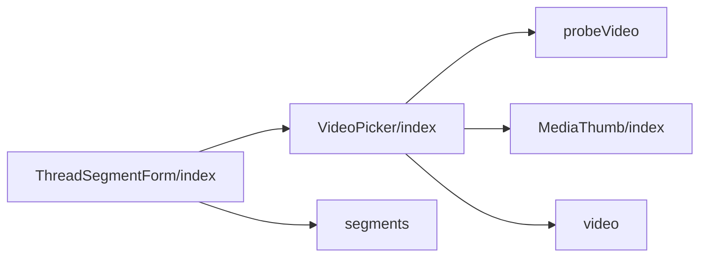
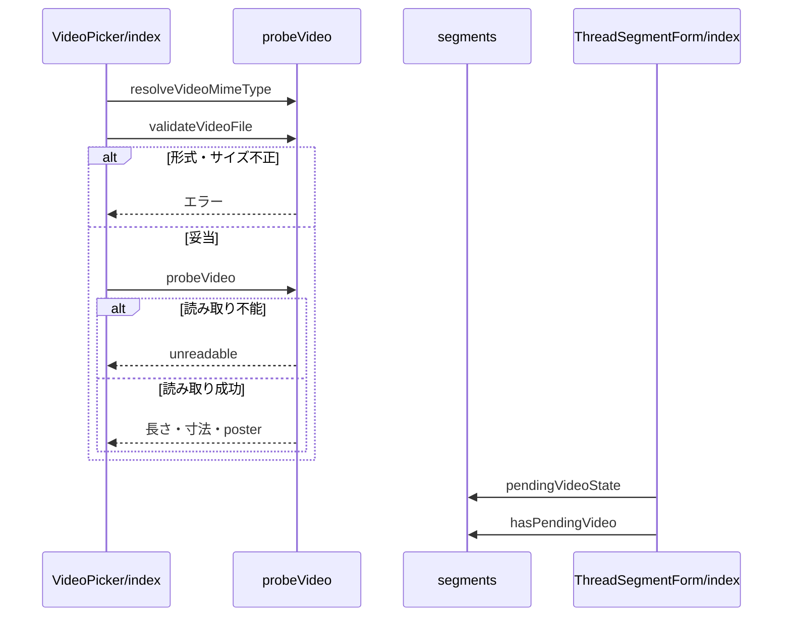

# Design Document

## Overview

**Purpose**: 投稿フォームの各セグメントに動画を1本添付し、アップロードの状況を確認しながら投稿できるようにする。
**Users**: 投稿に動画を添付する利用者
**Impact**: 投稿フォームの各セグメントに動画を1本添付し、アップロードの状況を確認しながら投稿できるようにする。

### Goals

- 動画の選択・検査・プレビュー・取り外し・代替テキストの入力。
- アップロードの進捗と、未完了の間の投稿の抑止。
- 画像・リンクカードとの排他。

### Non-Goals

- 動画サービスとのアップロードの処理。
- 代表画像の生成と調整。
- 1投稿への複数の動画の添付と、動画の編集。

## Boundary Commitments

### This Spec Owns

- 動画の選択・検査・プレビュー・取り外し・代替テキストの入力。
- アップロードの進捗と、未完了の間の投稿の抑止。
- 画像・リンクカードとの排他。

### Out of Boundary

- 動画サービスとのアップロードの処理。
- 代表画像の生成と調整。
- 1投稿への複数の動画の添付と、動画の編集。

### Allowed Dependencies

- 動画サービスとのアップロード（video-upload）
- 代表画像の生成と調整（entry-visual）
- 画像・リンクカードの入力部品（image-picker、ogp-link-card）
- ブラウザの動画のメタデータ読み取り

### Revalidation Triggers

- 添付できる動画の条件（形式・容量・長さ）を変えるとき（Bluesky の動画サービスの制限と整合が要る）
- 動画と画像・リンクカードの排他の規則を変えるとき
- 未完了の動画の状態（アップロード中・失敗）の判定を変えるとき（投稿の抑止に影響する）

## Architecture

### Architecture Pattern & Boundary Map

動画選択の構成要素の依存方向を示す。



## File Structure Plan

| パス                                                             | 責務                                               |
| ---------------------------------------------------------------- | -------------------------------------------------- |
| `src/components/video/VideoPicker/index.tsx`                     | 動画の追加ボタン・プレビュー・進捗                 |
| `src/components/common/MediaThumb/index.tsx`                     | 画像と動画で共用するサムネイルの枠とボタン         |
| `src/lib/video/probeVideo.ts`                                    | 形式・サイズの検査と、長さ・寸法・posterの読み取り |
| `src/components/post/ThreadComposer/segments.ts`                 | 動画の状態と未完了の判定                           |
| `src/components/post/ThreadComposer/ThreadSegmentForm/index.tsx` | 排他・ドロップ・投稿できない理由の表示             |
| `src/images/video.svg`                                           | 動画の追加ボタンの絵柄                             |

## System Flows

動画の検査から排他制御までの流れと、失敗時の分岐を示す。



## Requirements Traceability

| Requirement                  | Summary                        | Components |
| ---------------------------- | ------------------------------ | ---------- |
| 1.1, 1.2, 1.3, 1.4, 1.5      | 動画の添付                     | D-2, D-3   |
| 2.1, 2.2, 2.3, 2.4           | 動画の検査                     | D-1        |
| 3.1, 3.2, 3.3, 3.4, 3.5, 3.6 | プレビューとアップロードの状況 | D-2, D-3   |

## Components and Interfaces

#### D-1: 検査と読み取り

**Requirements**: 2.1, 2.2, 2.3, 2.4

```ts
export const resolveVideoMimeType = (file: Pick<File, "type" | "name">): string | undefined => {
  const byType = VIDEO_SOURCE_FORMATS.find(f => f.mimeType === file.type)
  if (byType) return byType.mimeType
  if (file.type !== "") return undefined
  const ext = file.name.split(".").pop()?.toLowerCase() ?? ""
  return VIDEO_SOURCE_FORMATS.find(f => (f.extensions as readonly string[]).includes(ext))?.mimeType
}
export const validateVideoFile = (file): VideoValidationError | undefined // unsupportedFormat / tooLarge
// <video preload="auto"> で寸法と長さを読み、Math.min(0.1, duration / 2) へシークして poster（JPEG、長辺1280px）を描く
// 600秒超は tooLong、読み込み不能・寸法0・長さが有限でない場合は unreadable
export const probeVideo = async (file: File): Promise<{ width; height; durationSec; posterBlob }>
```

Safariではシーク直後のフレームが未描画のことがあるため、`requestVideoFrameCallback`（無ければ `readyState >= 2`）を最大1秒待ってから描画する。読み取れない動画を長さ・寸法を省いて送る代替の経路は持たない。

#### D-2: 状態とプレビュー

**Requirements**: 1.1, 3.1, 3.2, 3.3, 3.6

```ts
export type VideoEntry = {
  fileName: string
  width: number
  height: number
  durationSec: number
  alt: string
  posterPreview: string
  posterBlob: Blob
  cropState: SlotCropState
  thumbnailPreview: string
  thumbnailBlob: Blob // 再生ボタン入りの代表画像
  upload:
    | { state: "uploading"; progress: VideoUploadProgress }
    | { state: "done"; blob: VideoBlobRef }
    | { state: "error"; messageKey: PlainMessageKey }
}
```

| 要素         | 内容                                                                                            |
| ------------ | ----------------------------------------------------------------------------------------------- |
| 追加ボタン   | `ImagePicker` と同じクラスとアイコン寸法。`<input type="file" accept={VIDEO_ACCEPT}>`           |
| サムネイル   | `MediaThumb` に `thumbnailPreview` を `aspect-ratio: 1200 / 630; object-fit: cover` で表示      |
| ボタン       | 取り外しは40pxの円、代替テキストは高さ36px。`border: 2px solid #fff`、hoverで `--color-bluesky` |
| 進捗         | サムネイルの直下に `role="progressbar"` と状態の文言。失敗時は選び直しのボタン                  |
| 代替テキスト | `ImageAltDialog` で入力する                                                                     |

- アップロードの進捗は最新の `valueRef.current` に `upload` だけを合成して通知し、アップロード中の調整や代替テキストを上書きしない。取り外し済みなら通知しない。
- 取り外しはアップロード中なら `abort()` し、object URL を解放して `onChange(null)` する。
- 失敗は `upload.state = "error"` に閉じ、セグメントの他の入力に触れない。

#### D-3: 排他と投稿の抑止

**Requirements**: 1.2, 1.3, 1.4, 1.5, 3.4, 3.5

```ts
export const pendingVideoState = (segments: SegmentState[]): "uploading" | "error" | null // 失敗を優先
export const hasPendingVideo = (segments: SegmentState[]): boolean => pendingVideoState(segments) !== null
// submitDisabled = 既存条件 || hasPendingVideo(segments)。onSubmit の先頭でも再確認する
```

- `imageEntry` か `ogpResult` があれば動画の追加ボタンを、`videoEntry` があれば画像とリンクカードのボタンを `disabled` にし、`title` に理由を出す。
- 理由（`video.submit.waitUpload` / `video.submit.removeFailed`）は、ツールバーの直後・プレビューの直前に `<p role="status" data-testid="video-submit-reason">` で表示する。
- ドロップでは、ファイルの種別を `resolveVideoMimeType` で判定し、動画か画像が添付済みなら受け付けない。

## Error Handling

| 事象                 | 処理                                         |
| -------------------- | -------------------------------------------- |
| 検査・読み取りの失敗 | 添付せず、`video.error.*` の理由を表示する   |
| アップロードの失敗   | プレビューに理由と選び直しのボタンを表示する |

## Testing Strategy

- Unit / Build Tests:
  - `npx vitest run tests/lib/video/probeVideo.test.ts`
  - `npx vitest run tests/components/post/ThreadComposer/segments.test.ts`
- E2E/UI Tests:
  - `tests/e2e/videoComposer.spec.ts` 動画を選んで変換の完了を待つ → 進捗が表示され、完了まで投稿ボタンが無効で理由が表示される
- テストの名前には、対応する基準 ID を `[video-picker/<ID>]` の形で付ける（例: `[video-picker/1.1]`）
