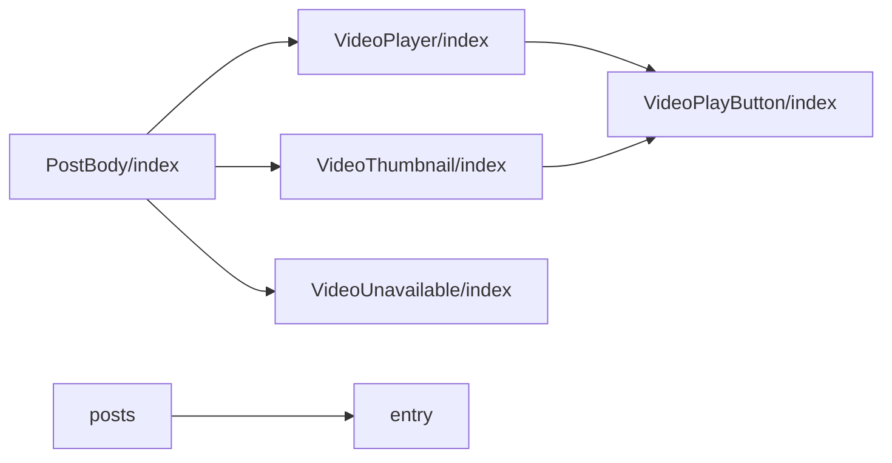
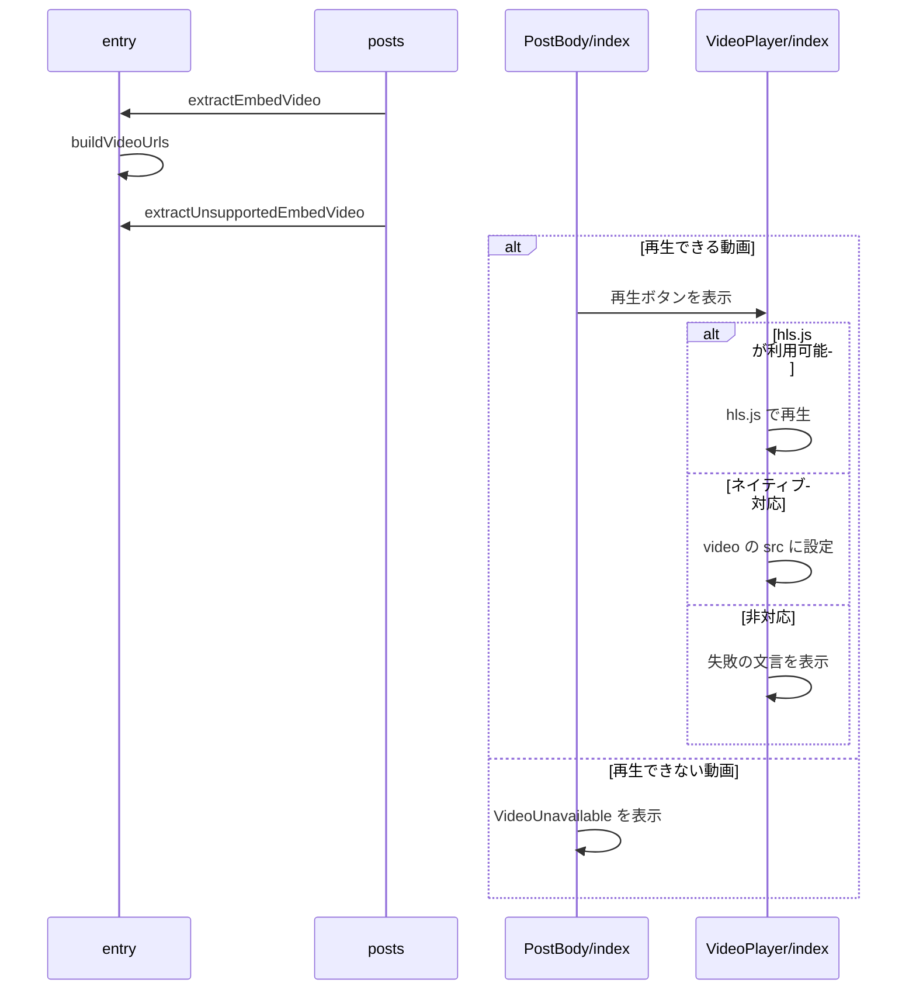

# Design Document

## Overview

**Purpose**: タイムラインとentry詳細ページで動画の投稿をそれと分かる形で表示し、詳細ページでは利用者の操作で動画を再生できるようにする。
**Users**: 動画つきの投稿をタイムラインと entry 詳細ページで見る利用者と閲覧者
**Impact**: 動画の投稿を動画と分かる形で表示し、entry 詳細ページでは利用者の操作で再生できるようにする。再生の前に動画のデータと再生用のライブラリを取得しない。

### Goals

- タイムラインでの動画のサムネイルの表示。
- entry詳細ページでの動画の再生。
- 再生できない動画の表示。
- ゲスト表示とサンプルページの動画の例。

### Non-Goals

- タイムラインでの動画の再生。
- 字幕の表示。

## Boundary Commitments

### This Spec Owns

- タイムラインでの動画のサムネイルの表示。
- entry詳細ページでの動画の再生。
- 再生できない動画の表示。
- ゲスト表示とサンプルページの動画の例。

### Out of Boundary

- タイムラインでの動画の再生。
- 字幕の表示。

### Allowed Dependencies

- Bluesky の動画の配信（HLS のプレイリスト）と HLS 再生ライブラリ（hls.js）
- 投稿の埋め込みからの動画の抽出（entry-detail、timeline の投稿カード）
- 動画の代表画像の再生ボタンの寸法（entry-visual）

### Revalidation Triggers

- 再生ボタンの寸法（直径59px）を変えるとき（entry-visual の代表画像の再生ボタンと整合が要る）
- 再生用のライブラリの読み込み方を変えるとき（再生の前に取得しない制約を保つ）
- 引用投稿の動画の扱いを変えるとき

## Architecture

### Architecture Pattern & Boundary Map

動画表示の部品の依存方向を示す。



## File Structure Plan

| パス                                              | 責務                                              |
| ------------------------------------------------- | ------------------------------------------------- |
| `src/lib/entry/entry.ts`                          | 投稿の埋め込みからの動画の抽出と再生URLの組み立て |
| `src/lib/entry/posts.ts`                          | タイムラインの投稿への動画の付与                  |
| `src/components/video/VideoPlayer/index.tsx`      | entry詳細ページの再生                             |
| `src/components/video/VideoThumbnail/index.tsx`   | タイムラインの静的な表示                          |
| `src/components/video/VideoPlayButton/index.tsx`  | 再生ボタンの見た目                                |
| `src/components/video/VideoUnavailable/index.tsx` | 再生できない動画の表示                            |
| `src/components/post/PostBody/index.tsx`          | 動画・再生できない動画・画像の表示の切り替え      |

## System Flows

動画の抽出と表示の切り替えの流れを示す。



## Requirements Traceability

| Requirement                       | Summary          | Components    |
| --------------------------------- | ---------------- | ------------- |
| 1.1, 1.2, 1.3, 1.4, 1.5, 1.6, 1.7 | 動画の投稿の表示 | D-1, D-2, D-3 |
| 2.1, 2.2, 2.3, 2.4, 2.5           | 再生             | D-3           |
| 3.1                               | 再生できない動画 | D-1, D-4      |

## Components and Interfaces

#### D-1: 動画の抽出

**Requirements**: 1.5, 1.6, 1.7, 3.1

```ts
export type SourceVideo = { cid: string; playlistUrl: string; thumbnailUrl: string; alt: string
                            aspectRatio?: { width: number; height: number } }
export const buildVideoUrls = (repoDid: string, cid: string) => ({
  playlistUrl: `${VIDEO_WATCH_BASE_URL}${encodeURIComponent(repoDid)}/${cid}/playlist.m3u8`,
  thumbnailUrl: `${VIDEO_WATCH_BASE_URL}${encodeURIComponent(repoDid)}/${cid}/thumbnail.jpg`,
})
export const extractEmbedVideo = (embed, repoDid): SourceVideo | undefined // app.bsky.embed.video のみ
export const extractUnsupportedEmbedVideo = (embed, repoDid): SourceVideo | undefined // recordWithMedia の media が video
```

- 再生URLは投稿レコードの埋め込みから組み立て、AppViewの表示用データに依存しない。投稿の直後にAppViewへ反映されていない期間があるため。
- `TimelinePost` と `EntryPostView` に `video` と `unsupportedVideo` を持たせる。埋め込みは1種類のため、両方が同時に設定されることはない。
- ゲスト表示のダミー投稿とサンプルページに動画の投稿を1件ずつ置く。

#### D-2: 表示の切り替え

**Requirements**: 1.1, 1.3, 1.4

```tsx
{video ? (videoInteractive ? <VideoPlayer video={video} postUrl={postUrl} /> : <VideoThumbnail video={video} />)
 : unsupportedVideo ? <VideoUnavailable video={unsupportedVideo} postUrl={unsupportedVideoLinkUrl} />
 : images.length > 0 ? <ImageGallery ... /> : null}
```

- タイムラインは `videoInteractive={false}`、entry詳細ページは既定の `true` を渡す。タイムラインでentryを持つ投稿は代表画像だけを表示し、動画は渡さない。
- コンテナは `aspect-ratio` を動画の比（無ければ16/9）にする。
- `VideoPlayButton` は `VIDEO_OVERLAY_SPEC` を参照し、直径59pxの `rgba(50, 50, 50, 0.6)` の円に `<polygon points="0,0 0,25 20,12.5" fill="#fff">` を中心から右へ2.5pxずらして重ねる。

#### D-3: 再生

**Requirements**: 1.2, 2.1, 2.2, 2.3, 2.4, 2.5

```
初期: <button aria-label={t("video.play")}> に poster の  と VideoPlayButton を重ねる。<video> は作らない
start():
  videoEl = <video controls playsInline poster={thumbnailUrl}>
  const { default: Hls } = await import("hls.js")
  if Hls.isSupported(): hls.loadSource(playlistUrl); hls.attachMedia(videoEl); 致命的なエラーで setError()
  else if videoEl.canPlayType("application/vnd.apple.mpegurl"): videoEl.src = playlistUrl // iOS Safari
  else: setError()
  videoEl の error イベントでも setError()、await videoEl.play()
unmount: hls?.destroy()
エラー: t("video.playError") と postUrl への外部リンク
```

Chromiumはネイティブの再生対応を報告することがあるため、分岐は `canPlayType` ではなく `Hls.isSupported()` を先に判定する。

#### D-4: 再生できない動画

**Requirements**: 3.1

| 要素     | 見た目                                                                         |
| -------- | ------------------------------------------------------------------------------ |
| poster   | `filter: brightness(0.35)` と `rgba(0,0,0,0.45)` の面                          |
| 文言     | `t("video.unavailable.title")`（白・太字）                                     |
| リンク   | `postUrl` があるときだけ `t("video.unavailable.link")`（白・下線・新しいタブ） |
| 操作要素 | 再生ボタンと `<button>` を置かない                                             |

## Error Handling

| 事象                           | 処理                                        |
| ------------------------------ | ------------------------------------------- |
| プレイリストの取得・再生の失敗 | 失敗の文言とBlueskyへのリンクを表示する     |
| 自動再生のブロック             | `controls` から利用者が再生できる状態にする |

## Testing Strategy

- Unit / Build Tests:
  - `npx vitest run tests/lib/entry/entry.test.ts tests/components/video/VideoThumbnail.test.ts`
  - `npm run build`
- E2E/UI Tests:
  - `tests/e2e/videoDisplay.spec.ts` ゲスト表示のタイムラインを開く → 動画の投稿がposterと再生ボタンで表示され、再生されない
  - `tests/e2e/videoDisplay.spec.ts` サンプルのentryページで再生ボタンを押す → 押す前は動画のデータが取得されず、押すと再生され、表示領域の大きさが変わらない
  - `tests/e2e/videoDisplay.spec.ts` 引用投稿の動画を表示する → 暗いposterに文言とリンクが表示され、再生ボタンが無い
- テストの名前には、対応する基準 ID を `[video-player/<ID>]` の形で付ける（例: `[video-player/1.1]`）
