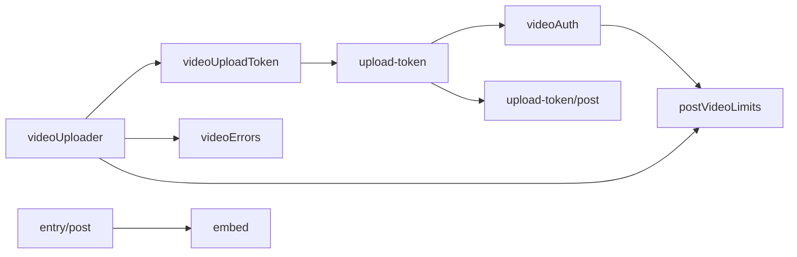
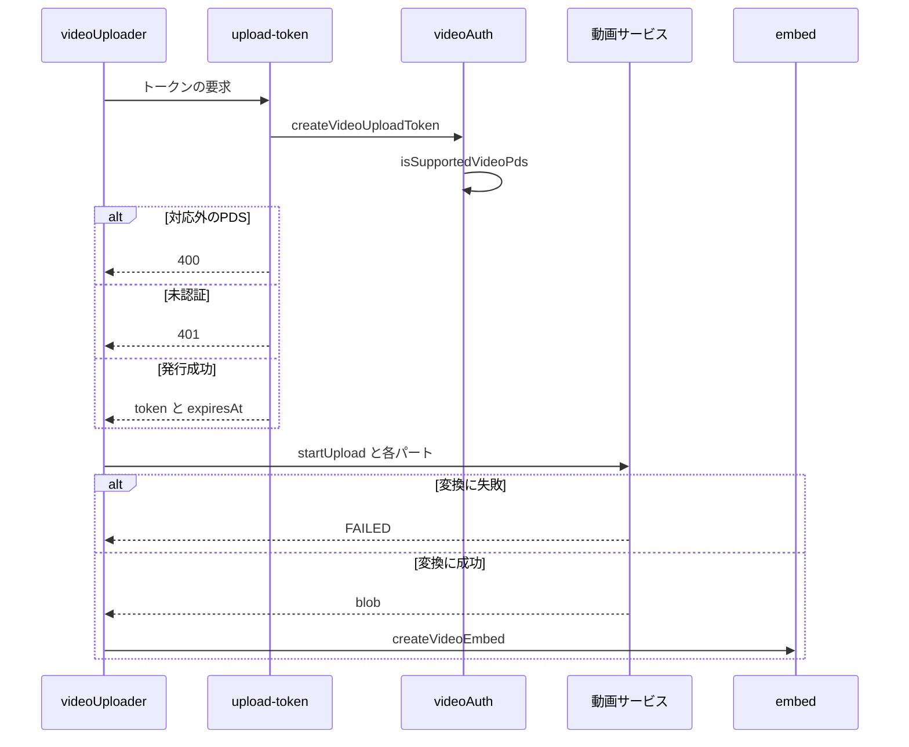

# Design Document

## Overview

**Purpose**: 動画の実体をskyshareのサーバーに通さずにBlueskyの動画サービスへ送り、変換後の動画を投稿に載せられるようにする。
**Users**: 動画つきの投稿を作成する利用者
**Impact**: 動画の実体を skyshare のサーバーに通さず Bluesky の動画サービスへブラウザから直接送り、変換後の動画を投稿に載せられるようにする。

### Goals

- 動画のアップロード用の認証トークンの発行。
- ブラウザから動画サービスへの分割アップロードと変換の待機。
- アップロードの失敗の分類と中断。
- 投稿への動画の埋め込み。

### Non-Goals

- 投稿フォームでの動画の選択と表示。
- 対応PDS以外での動画の投稿と、字幕・GIF表示の指定。
- ページの再読み込みをまたいだアップロードの再開。

## Boundary Commitments

### This Spec Owns

- 動画のアップロード用の認証トークンの発行。
- ブラウザから動画サービスへの分割アップロードと変換の待機。
- アップロードの失敗の分類と中断。
- 投稿への動画の埋め込み。

### Out of Boundary

- 投稿フォームでの動画の選択と表示。
- 対応PDS以外での動画の投稿と、字幕・GIF表示の指定。
- ページの再読み込みをまたいだアップロードの再開。

### Allowed Dependencies

- Bluesky の動画サービスと、対応する PDS（動画アップロード用の認証トークン）
- 投稿の作成 API（entry-api）
- 動画の選択（video-picker）

### Revalidation Triggers

- 動画サービスの制限・エラー名・認証の方式が変わるとき
- 再試行の回数や待機の間隔、変換の待機時間（20分）を変えるとき
- 動画の埋め込みの形式（Bluesky の仕様）が変わるとき
- 投稿 API の動画の分岐（画像・リンクカードとの排他）を変えるとき

## Architecture

### Architecture Pattern & Boundary Map

動画アップロードの構成要素の依存方向を示す。



## File Structure Plan

| パス                                                    | 責務                           |
| ------------------------------------------------------- | ------------------------------ |
| `src/lib/video/postVideoLimits.ts`                      | 動画の上限と動画サービスの定数 |
| `src/lib/atproto/videoAuth.ts`                          | 対応PDSの判定とトークンの発行  |
| `src/pages/v2/bsky/video/upload-token.ts`               | トークン発行のハンドラ         |
| `src/lib/api/schema/v2/bsky/video/upload-token/post.ts` | トークン発行の応答のスキーマ   |
| `src/lib/video/videoUploadToken.ts`                     | クライアントのトークンの取得   |
| `src/lib/video/videoUploader.ts`                        | 分割アップロードと変換の待機   |
| `src/lib/video/videoErrors.ts`                          | 失敗の分類と文言キーの対応     |
| `src/lib/atproto/embed.ts`                              | 動画の埋め込みの組み立て       |
| `src/lib/api/schema/v2/entry/post.ts`                   | 投稿の動画の分岐               |

## System Flows

トークン発行と分割アップロードの流れ、失敗時の分岐を示す。



## Requirements Traceability

| Requirement                       | Summary                  | Components |
| --------------------------------- | ------------------------ | ---------- |
| 1.1, 1.2, 1.3                     | アップロード用のトークン | D-1        |
| 2.1, 2.2, 2.3, 2.4, 2.5, 2.6, 2.7 | 分割アップロード         | D-2        |
| 3.1                               | 失敗の分類               | D-3        |
| 4.1, 4.2, 4.3                     | 投稿への埋め込み         | D-4        |

## Components and Interfaces

#### D-1: トークンの発行

**Requirements**: 1.1, 1.2, 1.3

```ts
export const isSupportedVideoPds = (pdsUrl: string): boolean => {
  const host = new URL(pdsUrl).host
  return host === "bsky.social" || host.endsWith(".host.bsky.network")
}
export const createVideoUploadToken = async (agent, session, nowSec) => {
  const pdsUrl =
    readPdsServiceFromDidDoc(session.didDoc) ??
    (await resolvePdsServiceForDid(session.did))
  if (!pdsUrl) return { ok: false, status: 500 }
  if (!isSupportedVideoPds(pdsUrl)) return { ok: false, status: 400 }
  const expiresAt = nowSec + VIDEO_UPLOAD_TOKEN_TTL_SEC // 30 * 60
  const res = await agent.com.atproto.server.getServiceAuth({
    aud: `did:web:${new URL(pdsUrl).host}`,
    lxm: "com.atproto.repo.uploadBlob",
    exp: expiresAt,
  }) // 失敗は 500。トークンをログに出さない
  return { ok: true, token: res.data.token, did: session.did, expiresAt }
}
// POST /v2/bsky/video/upload-token → 200 { token, did, expiresAt }（Cache-Control: no-store）
```

`aud` を動画サービスにする組み合わせは動画サービスが401で拒否するため、利用者のPDSを `aud` にする。

#### D-2: 分割アップロード

**Requirements**: 2.1, 2.2, 2.3, 2.4, 2.5, 2.6, 2.7

```
getToken = expiresAt - now < 5分 なら fetchToken() で再取得する
1. POST {video.bsky.app/xrpc}/app.bsky.video.startUpload
     { sizeBytes, mimeType, name, durationMs, width, height }（Bearer トークン）
2. partNumber = 1..partCount を順に uploadPart（octet-stream、毎回 getToken()）
     通信エラー・5xx・429 だけを 1s, 2s, 4s 待って最大3回再試行。他の 4xx は即失敗
     成功ごとに onProgress({ phase: "uploading", percent: 送信済み / 全体 * 100 })
3. finishUpload { jobId }（通信エラーは1回だけ再試行）
4. 1.5秒ごとに getJobStatus（認証なし）を問い合わせ、20分で timeout
     COMPLETED → blob を CommonVideoBlobSchema で検証して返す（不正なら unknown）
     FAILED → processingFailed、それ以外 → onProgress({ phase: "processing", percent })
5. 中断: finishUpload の前なら abortUpload を1回だけ要求して AbortError、後なら放置
```

#### D-3: 失敗の分類

**Requirements**: 3.1

| 発生源                                                                     | 分類                                         |
| -------------------------------------------------------------------------- | -------------------------------------------- |
| `startUpload` の `VideoTooLarge` / `BadAspectRatio` / `DailyLimitExceeded` | `tooLarge` / `badAspectRatio` / `dailyLimit` |
| `startUpload` の `UploadForbidden` / `TooManyOpenUploads`                  | `forbidden` / `tooManyUploads`               |
| `ServiceOverloaded`                                                        | `overloaded`                                 |
| `JOB_STATE_FAILED` / 待機の上限超過                                        | `processingFailed` / `timeout`               |
| トークン発行の400 / 再試行後の通信例外                                     | `unsupportedPds` / `network`                 |
| 上記以外                                                                   | `unknown`                                    |

`mapServiceErrorName` が応答の `error` 名から分類し、`mapVideoError(code)` が `video.error.*` の文言キーを返す。

#### D-4: 投稿への埋め込み

**Requirements**: 4.1, 4.2, 4.3

```ts
// EntryPostItemSchema の4つ目の分岐（.strict()。images・ogImage・ogMeta を持たない）
z.object({
  text,
  facets,
  video: Common.CommonVideoBlobSchema,
  videoMeta: Common.CommonVideoMetaSchema,
  langs,
  selfLabels,
  gate,
}).strict()
export const createVideoEmbed = (video, meta) => ({
  $type: "app.bsky.embed.video" as const,
  video,
  alt: meta.alt ?? "",
  aspectRatio: { width: meta.width, height: meta.height },
})
```

ハンドラは埋め込みを動画・画像・リンクカードの順に判定し、動画は送信済みのため `uploadBlob` を呼ばない。

## Error Handling

| 事象                                | 処理 |
| ----------------------------------- | ---- |
| PDSを解決できない・認証の要求の失敗 | 500  |
| 対応外のPDS                         | 400  |
| 未認証                              | 401  |

## Testing Strategy

- Unit / Build Tests:
  - `npx vitest run tests/lib/atproto/videoAuth.test.ts tests/pages/v2/bsky/video/uploadToken.test.ts`
  - `npx vitest run tests/lib/video/videoUploader.test.ts tests/lib/video/videoErrors.test.ts`
  - `npx vitest run tests/pages/v2/entry.test.ts tests/lib/atproto/embed.test.ts`
- テストの名前には、対応する基準 ID を `[video-upload/<ID>]` の形で付ける（例: `[video-upload/1.1]`）
