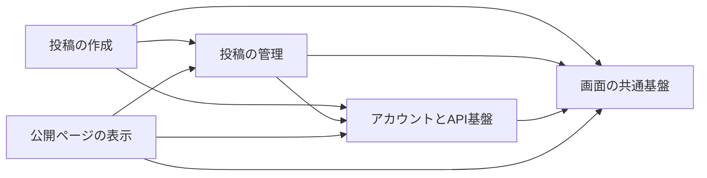
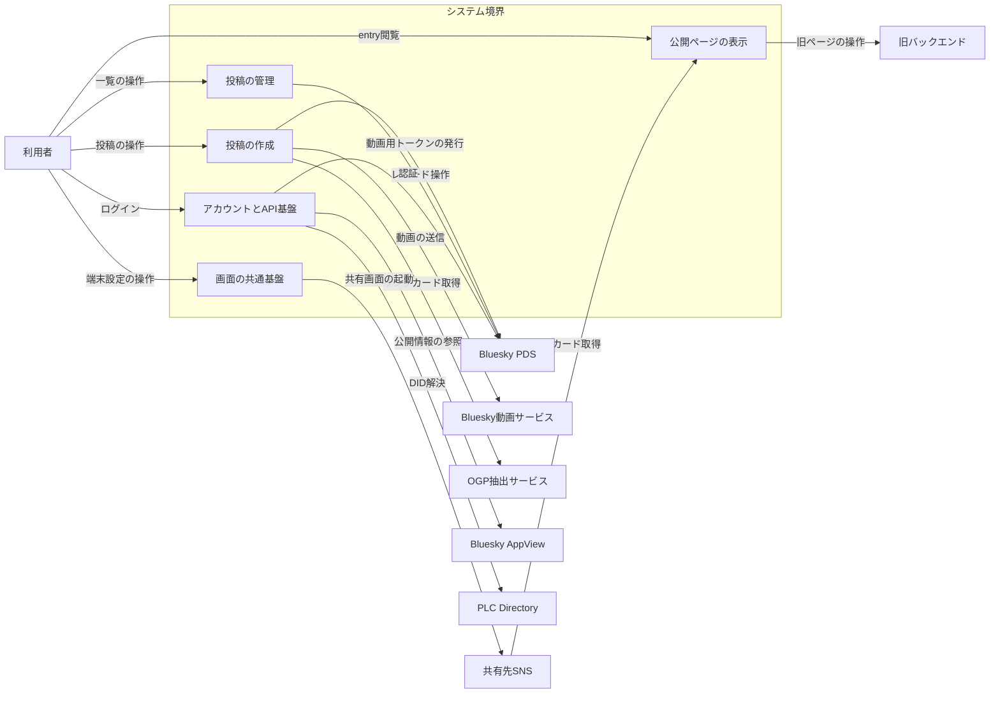
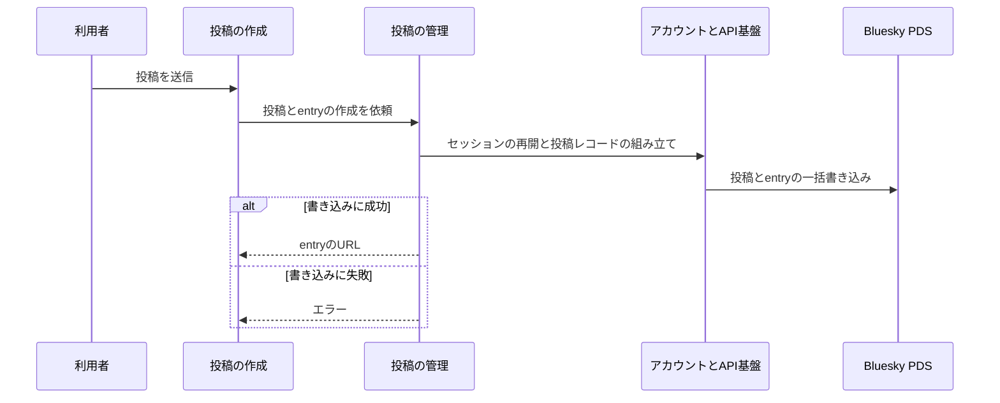
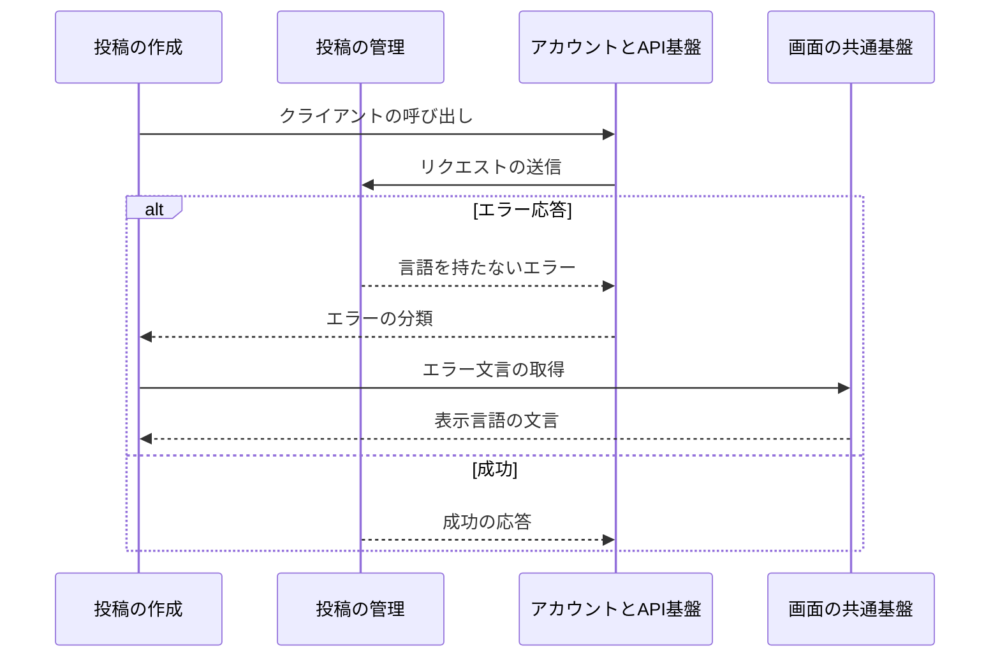

# skyshare アーキテクチャ

## 1. 目的と範囲

skyshare は、Bluesky へ投稿し、投稿から X のリンクカードで内容が伝わる entry を作って共有できる Web アプリである。
利用者の投稿と entry は利用者自身の Bluesky PDS に保管し、skyshare は自前のデータベースを持たない。
旧バックエンドに保存された過去の投稿ページの閲覧と、投稿者本人による削除も扱う。
Bluesky 以外の SNS への投稿の作成は対象外であり、共有先の SNS では共有の投稿画面を開くだけである。

## 2. 構成要素

| 構成要素            | 種別 | 責務                                                      | 詳細                                               |
| ------------------- | ---- | --------------------------------------------------------- | -------------------------------------------------- |
| 利用者              | 外部 | ブラウザで画面を操作する                                  | -                                                  |
| Bluesky PDS         | 外部 | 利用者の投稿とレコードを保管する                          | -                                                  |
| Bluesky AppView     | 外部 | プロフィールやリストを公開 API で返す                     | -                                                  |
| Bluesky動画サービス | 外部 | 動画を受け取って変換し、変換の状態を返す                  | -                                                  |
| OGP抽出サービス     | 外部 | URL からページの題名・説明・画像を返す                    | -                                                  |
| 旧バックエンド      | 外部 | 旧形式の投稿ページを保管して返す                          | -                                                  |
| 共有先SNS           | 外部 | 共有の投稿画面を開き、共有された URL のカードを生成する   | -                                                  |
| PLC Directory       | 外部 | DID から DID ドキュメントを返す                           | -                                                  |
| 画面の共通基盤      | 内部 | 共通の部品・表示言語・設定画面・他 SNS への共有を提供する | [画面の共通基盤](architecture/common-ui.md)        |
| 投稿の作成          | 内部 | 投稿と entry を組み立て、添付と動画を整えて送信する       | [投稿の作成](architecture/compose.md)              |
| 投稿の管理          | 内部 | 投稿の一覧と下書きを扱い、entry を保存して削除する        | [投稿の管理](architecture/manage.md)               |
| アカウントとAPI基盤 | 内部 | ログインとセッションを保ち、Bluesky と API の契約を担う   | [アカウントとAPI基盤](architecture/account-api.md) |
| 公開ページの表示    | 内部 | entry と旧形式の投稿ページを表示し、共有カードを返す      | [公開ページの表示](architecture/public-view.md)    |

## 3. システム構成

機能のくくりの依存は、投稿の作成と管理から基盤の側へ一方向に進む。

## 4. 外部インターフェース

| IF                   | 方向 | 外部の要素          | 内部の要素          |
| -------------------- | ---- | ------------------- | ------------------- |
| 投稿の操作           | 提供 | 利用者              | 投稿の作成          |
| 一覧の操作           | 提供 | 利用者              | 投稿の管理          |
| 端末設定の操作       | 提供 | 利用者              | 画面の共通基盤      |
| ログイン             | 提供 | 利用者              | アカウントとAPI基盤 |
| entry閲覧            | 提供 | 利用者              | 公開ページの表示    |
| カード取得           | 提供 | 共有先SNS           | 公開ページの表示    |
| 動画用トークンの発行 | 利用 | Bluesky PDS         | 投稿の作成          |
| 動画の送信           | 利用 | Bluesky動画サービス | 投稿の作成          |
| リンクカード取得     | 利用 | OGP抽出サービス     | 投稿の作成          |
| レコード操作         | 利用 | Bluesky PDS         | 投稿の管理          |
| 認証                 | 利用 | Bluesky PDS         | アカウントとAPI基盤 |
| 公開情報の参照       | 利用 | Bluesky AppView     | アカウントとAPI基盤 |
| DID解決              | 利用 | PLC Directory       | アカウントとAPI基盤 |
| 旧ページの操作       | 利用 | 旧バックエンド      | 公開ページの表示    |
| 共有画面の起動       | 利用 | 共有先SNS           | 画面の共通基盤      |

システム境界の内側のくくりと外部の要素は、IF の名前を付けた辺で結ぶ。

## 5. 機能

### 投稿とentryの作成

- 関与: 利用者, 投稿の作成, 投稿の管理, アカウントとAPI基盤, Bluesky PDS

投稿と entry の作成は、投稿の作成が管理の API を呼び、基盤を経て PDS へ書き込む。

### APIエラーの表示

- 関与: 投稿の作成, 投稿の管理, アカウントとAPI基盤, 画面の共通基盤

API エラーの表示は、応答の成否で文言の取得が分岐する。

## 6. データ

- なし

## 7. 信頼と検証

| 対象         | 信頼する前提                             | 検証手段                                      | 根拠                   |
| ------------ | ---------------------------------------- | --------------------------------------------- | ---------------------- |
| API の入力値 | クライアントの入力は不正な形式を含みうる | スキーマで検証し、不正な入力を 400 で拒否する | entry-api、api-codegen |

## 8. 技術基盤

| 領域     | 採用                         | 理由                                         | 根拠                   |
| -------- | ---------------------------- | -------------------------------------------- | ---------------------- |
| API 契約 | Zod スキーマ・OpenAPI・orval | 入力の検証と API 文書を1つの定義から導出する | api-codegen、entry-api |

## 9. 横断的制約

| 制約                         | 値                      | 根拠                    |
| ---------------------------- | ----------------------- | ----------------------- |
| 1 投稿に添付できる画像       | 10 枚                   | entry-api、image-picker |
| entry の見出しと説明文の上限 | 100 バイトと 300 バイト | lexicon、entry-api      |
