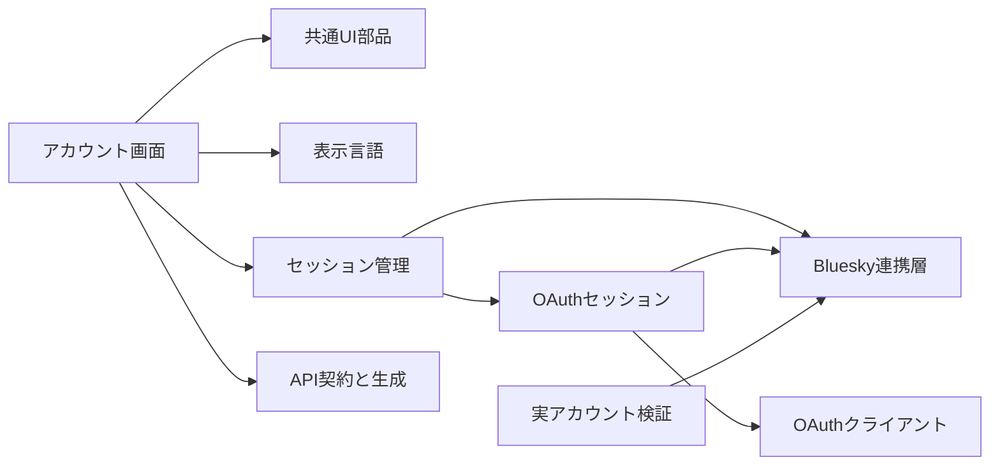
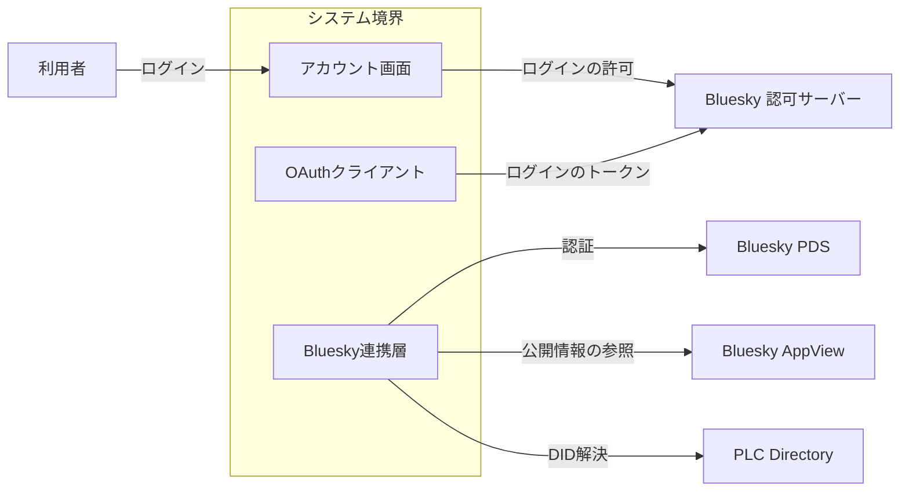
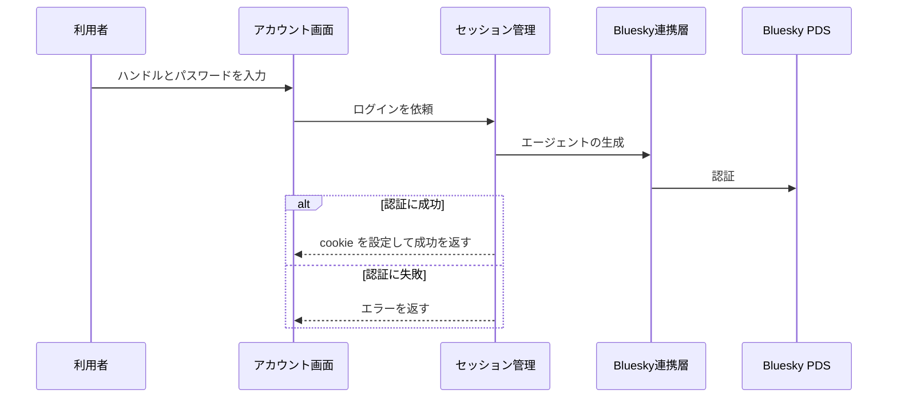
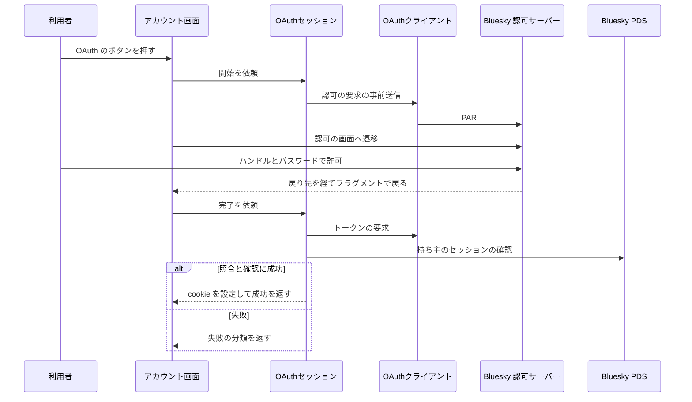
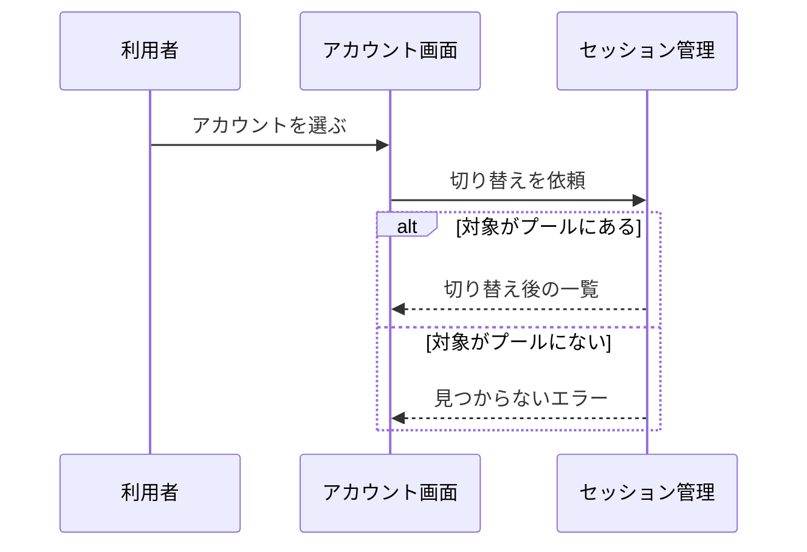

# アカウントとAPI基盤 アーキテクチャ

## 1. 目的と範囲

アカウントとAPI基盤は、OAuth とアプリパスワードでのログインとアカウントの切り替えを受け付け、セッションを保ち、Bluesky への操作と API の契約を担う。
投稿の作成と管理の画面は、別の機能のくくりの対象である。

## 2. 構成要素

| 構成要素             | 種別   | 責務                                                                          | 実装spec                             |
| -------------------- | ------ | ----------------------------------------------------------------------------- | ------------------------------------ |
| 利用者               | 外部   | OAuth の許可かハンドルとパスワードでログインし、アカウントを切り替える        | -                                    |
| Bluesky 認可サーバー | 外部   | ログインの許可を求め、OAuth のトークンを発行・更新・取消する                  | -                                    |
| Bluesky PDS          | 外部   | 利用者の認証を受け付け、投稿とレコードを保管する                              | -                                    |
| Bluesky AppView      | 外部   | プロフィールやリストを公開 API で返す                                         | -                                    |
| PLC Directory        | 外部   | DID から DID ドキュメントを返す                                               | -                                    |
| アカウント画面       | 内部   | ログインの入力とアカウントの切り替えを受け付ける                              | login-accounts                       |
| セッション管理       | 内部   | セッションを cookie に保持し、API ごとに再開と更新を行う                      | account-session                      |
| OAuthセッション      | 内部   | OAuth でのログインを完了させ、そのセッションの更新と DPoP つきの要求を行う    | oauth-session                        |
| OAuthクライアント    | 内部   | クライアントの識別・認可サーバーの探索・トークンの要求・戻りの受け渡しを担う  | oauth-client                         |
| Bluesky連携層        | 内部   | atproto の操作と投稿レコードの組み立てと NSID の導出を担う                    | atproto-access、post-record、lexicon |
| API契約と生成        | 内部   | API の入出力を1か所に定義し、文書とクライアントを生成する                     | api-codegen、api-error-message       |
| 実アカウント検証     | 内部   | 検証用アカウントでログインし、投稿と entry の作成から削除までを自動で検証する | e2elive                              |
| 共通UI部品           | 他機能 | プルダウンと選択肢の見た目・操作・絞り込みを共通にする                        | -                                    |
| 表示言語             | 他機能 | 表示言語を選び、日本語と英語の文言を切り替える                                | -                                    |

## 3. システム構成

アカウント画面は、セッション管理と API 契約を使い、セッション管理は Bluesky 連携層へ依存する。

## 4. 外部インターフェース

| IF                 | 方向 | 外部の要素           | 内部の要素        | 方式                                                     | 認証                                                                   |
| ------------------ | ---- | -------------------- | ----------------- | -------------------------------------------------------- | ---------------------------------------------------------------------- |
| ログイン           | 提供 | 利用者               | アカウント画面    | HTTPS の画面（OAuth の開始、またはハンドルとパスワード） | Bluesky の OAuth の許可、またはハンドルとパスワード                    |
| ログインの許可     | 利用 | Bluesky 認可サーバー | アカウント画面    | ブラウザの遷移（OAuth の認可の画面と戻り）               | 利用者の Bluesky のログイン                                            |
| ログインのトークン | 利用 | Bluesky 認可サーバー | OAuthクライアント | HTTPS（PAR・トークン・取消の端点）                       | クライアントの秘密鍵の証明（開発環境では識別子だけ）と DPoP            |
| 認証               | 利用 | Bluesky PDS          | Bluesky連携層     | HTTPS（XRPC）                                            | 利用者のハンドルとパスワード、または DPoP に結び付いたアクセストークン |
| 公開情報の参照     | 利用 | Bluesky AppView      | Bluesky連携層     | HTTPS（XRPC）                                            | なし                                                                   |
| DID解決            | 利用 | PLC Directory        | Bluesky連携層     | HTTPS（JSON）                                            | なし                                                                   |

利用者はログインでアカウント画面へ入り、Bluesky 連携層と OAuth クライアントが外部の 4 つの要素へ出る。

## 5. 機能

### ログイン

- 関与: 利用者, アカウント画面, セッション管理, Bluesky連携層, Bluesky PDS

ログインは、認証の成否で cookie の設定とエラーの返却に分岐する。

### OAuth でのログイン

- 関与: 利用者, アカウント画面, OAuthセッション, OAuthクライアント, Bluesky 認可サーバー, Bluesky PDS

OAuth でのログインは、戻りの照合と、持ち主の認可サーバーの確認の成否で分岐する。

### アカウントの切り替え

- 関与: 利用者, アカウント画面, セッション管理

アカウントの切り替えは、対象がプールにあるかどうかで結果が分岐する。

## 6. データ

| データ                       | 保管場所                                                  | 書き込み主体    |
| ---------------------------- | --------------------------------------------------------- | --------------- |
| ログインのセッション         | 利用者のブラウザの HttpOnly cookie（アカウントごとに1つ） | セッション管理  |
| OAuth のトークンと DPoP の鍵 | ログインのセッションの cookie の中                        | OAuthセッション |
| OAuth の認可の途中の状態     | 完了の API だけに送る10分の HttpOnly cookie               | OAuthセッション |

## 7. 信頼と検証

| 対象               | 信頼する前提                                 | 検証手段                                                                | 根拠            |
| ------------------ | -------------------------------------------- | ----------------------------------------------------------------------- | --------------- |
| API の呼び出し元   | 呼び出し元は有効なセッションを持つ本人である | リクエストごとにセッションを再開し、できなければ拒否する                | account-session |
| 投稿レコード       | 本文の範囲指定は壊れていることがある         | facet の範囲を検証し、不正なら書き込まない                              | post-record     |
| OAuth の認可の戻り | 戻りは別のサイトから届き、偽の主張を含みうる | 途中の状態と照合し、持ち主の PDS の認可サーバーと発行元の一致を確かめる | oauth-session   |

## 8. 技術基盤

| 領域           | 採用                                                                     | 理由                                                                             | 根拠                        |
| -------------- | ------------------------------------------------------------------------ | -------------------------------------------------------------------------------- | --------------------------- |
| レコード定義   | atproto の Lexicon                                                       | フォークした運用者が自ドメインの NSID で配信する                                 | lexicon                     |
| ログインの認可 | OAuth の confidential client と DPoP（手元では開発用の公開クライアント） | パスワードを預からずにログインでき、手元でも本番と同じ認可サーバーで確かめられる | oauth-client、oauth-session |

## 9. 横断的制約

| 制約                                       | 値         | 根拠            |
| ------------------------------------------ | ---------- | --------------- |
| アカウントのプールの保持数の上限           | 4 件       | account-session |
| 一覧の取得件数の指定                       | 1 から 100 | api-codegen     |
| OAuth のアクセストークンを更新する残り時間 | 60 秒      | oauth-session   |
| OAuth の認可の途中の状態の有効時間         | 10 分      | oauth-session   |
