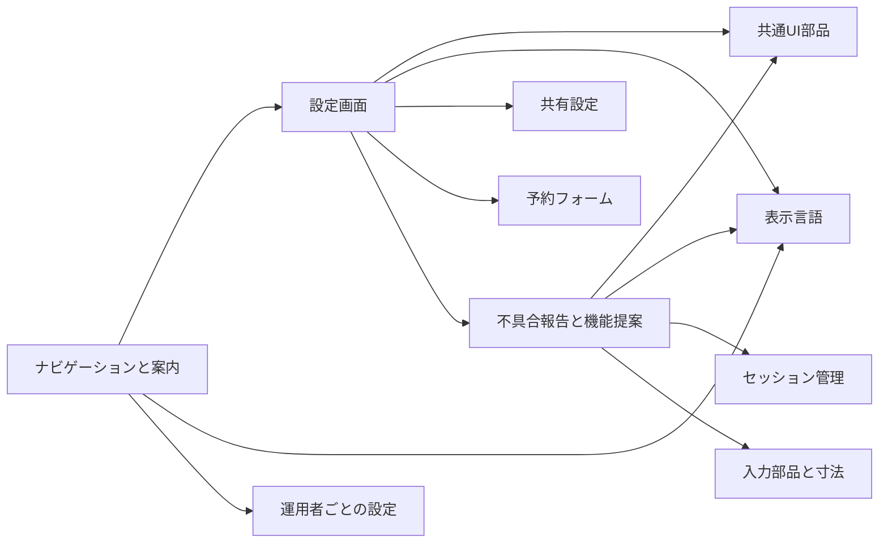
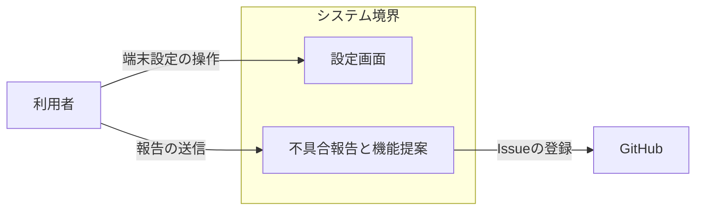
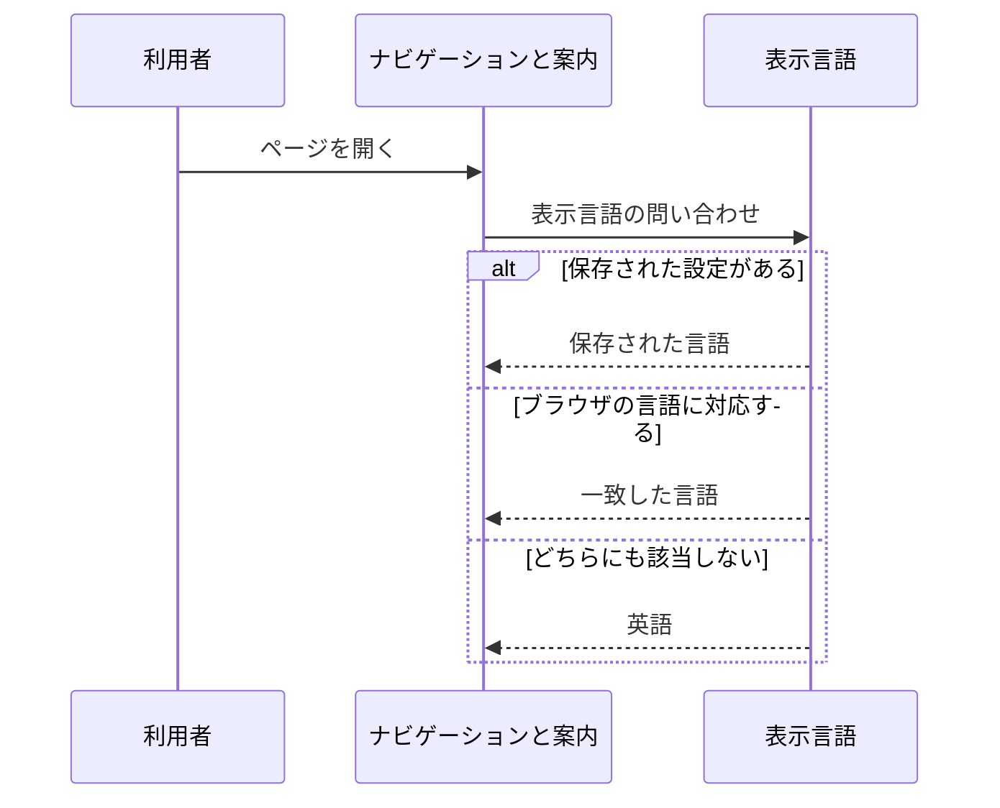
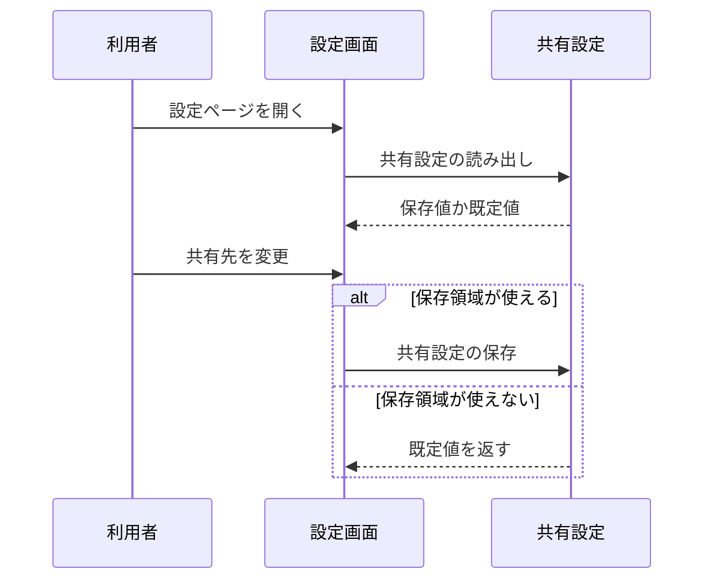
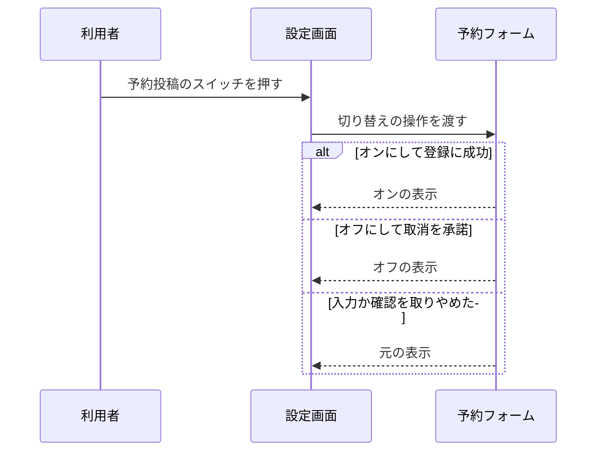
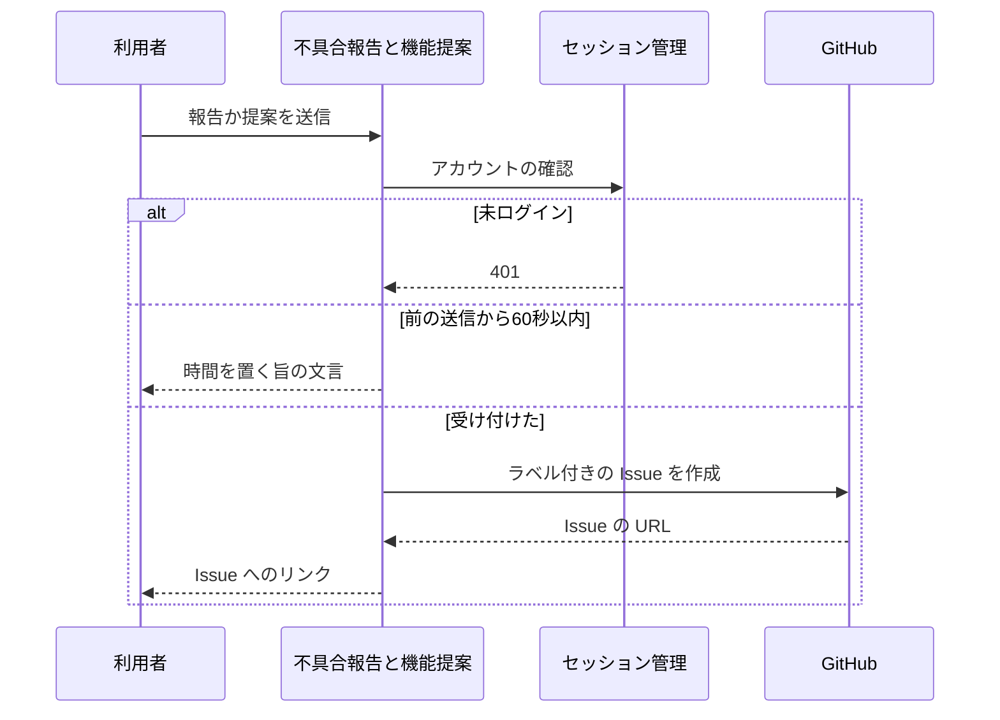

# アプリシェル アーキテクチャ

## 1. 目的と範囲

アプリシェルは、ナビゲーション・ヘルプ・プライバシーポリシーの画面と、端末と機能の設定画面と、不具合の報告と機能の提案の受付を提供する。
各画面が使う部品と表示言語と他 SNS への共有は、画面の共通基盤のくくりの対象である。

## 2. 構成要素

| 構成要素             | 種別   | 責務                                                               | 実装spec                                  |
| -------------------- | ------ | ------------------------------------------------------------------ | ----------------------------------------- |
| 利用者               | 外部   | ブラウザで設定ページを操作し、ヘルプとポリシーを読む               | -                                         |
| GitHub               | 外部   | 報告と提案を公開のリポジトリの Issue として受け取る                | -                                         |
| ナビゲーションと案内 | 内部   | ナビゲーション・ヘルプ・プライバシーポリシーの画面を提供する       | app-navigation、help-page、privacy-policy |
| 設定画面             | 内部   | 端末の設定と予約投稿の有効化を、設定ページとダイアログで操作させる | app-settings、timeline-hidden             |
| 不具合報告と機能提案 | 内部   | 報告と提案を入力させ、報告者と環境の情報を添えて Issue に登録する  | feedback-form、feedback-api               |
| 共通UI部品           | 他機能 | プルダウンと選択肢の見た目と操作を共通にする                       | -                                         |
| 表示言語             | 他機能 | 表示言語を選び、日本語と英語の文言を切り替える                     | -                                         |
| 運用者ごとの設定     | 他機能 | 運営者情報と測定 ID を環境変数から受け取って検査する               | -                                         |
| 共有設定             | 他機能 | 共有の設定を端末に保持し、共有文へ適用する                         | -                                         |
| 予約フォーム         | 他機能 | 設定に置く予約投稿のスイッチと、予約用の認証情報の入力を提供する   | -                                         |
| セッション管理       | 他機能 | ログイン中のアカウントを API の処理に渡す                          | -                                         |
| 入力部品と寸法       | 他機能 | 件名と本文の文字数つきの入力欄を提供する                           | -                                         |

## 3. システム構成

設定画面は、共通の部品と共有の設定と予約投稿のスイッチを束ねて表示する。

## 4. 外部インターフェース

| IF             | 方向 | 外部の要素 | 内部の要素           | 方式                               | 認証                    |
| -------------- | ---- | ---------- | -------------------- | ---------------------------------- | ----------------------- |
| 端末設定の操作 | 提供 | 利用者     | 設定画面             | HTTPS の画面（HTML と JavaScript） | なし                    |
| 報告の送信     | 提供 | 利用者     | 不具合報告と機能提案 | HTTPS の画面と JSON の API         | ログインの cookie       |
| Issueの登録    | 利用 | GitHub     | 不具合報告と機能提案 | HTTPS の REST API                  | Issues の権限だけの PAT |

利用者は、端末設定の操作で設定画面へ入り、報告の送信で報告と提案を送る。

## 5. 機能

### 表示言語の決定

- 関与: 利用者, ナビゲーションと案内, 表示言語

表示言語の決定は、保存された設定とブラウザの言語設定で結果が分岐する。

### 端末設定の変更

- 関与: 利用者, 設定画面, 共有設定

端末設定の変更は、保存領域が使えるかどうかで保存の可否が分岐する。

### 予約投稿の切り替え

- 関与: 利用者, 設定画面, 予約フォーム

予約投稿の切り替えは、認証情報の登録の成否と取消の確認で結果が分岐する。

### 不具合の報告と機能の提案

- 関与: 利用者, 不具合報告と機能提案, セッション管理, GitHub

報告と提案の送信は、ログインの有無と送信の間隔と GitHub の応答で結果が分岐する。

## 6. データ

| データ     | 保管場所                   | 書き込み主体 |
| ---------- | -------------------------- | ------------ |
| 表示テーマ | ブラウザのローカル保存領域 | 設定画面     |

## 7. 信頼と検証

| 対象                     | 信頼する前提                                        | 検証手段                                        | 根拠         |
| ------------------------ | --------------------------------------------------- | ----------------------------------------------- | ------------ |
| 報告に載せる利用者の入力 | 公開の Issue でメンションや HTML として解釈されうる | 閉じられない囲いのコードブロックに入れて載せる  | feedback-api |
| 報告者のアカウント       | 画面が送る値は書き換えられうる                      | ログインのセッションの DID とハンドルだけを使う | feedback-api |

## 8. 技術基盤

- なし

## 9. 横断的制約

| 制約                   | 値                         | 根拠                        |
| ---------------------- | -------------------------- | --------------------------- |
| 報告と提案の送信の間隔 | 1アカウントにつき60秒に1件 | feedback-api                |
| 報告の件名と本文の上限 | 100 文字と 2000 文字       | feedback-api、feedback-form |
