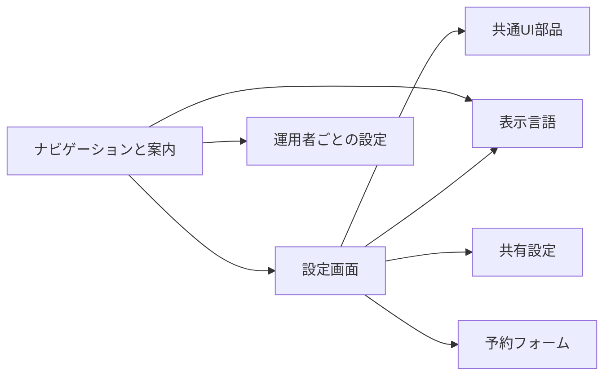
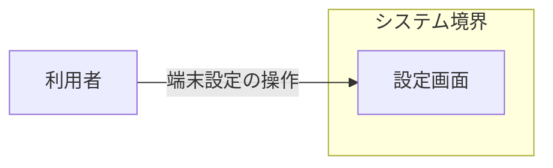
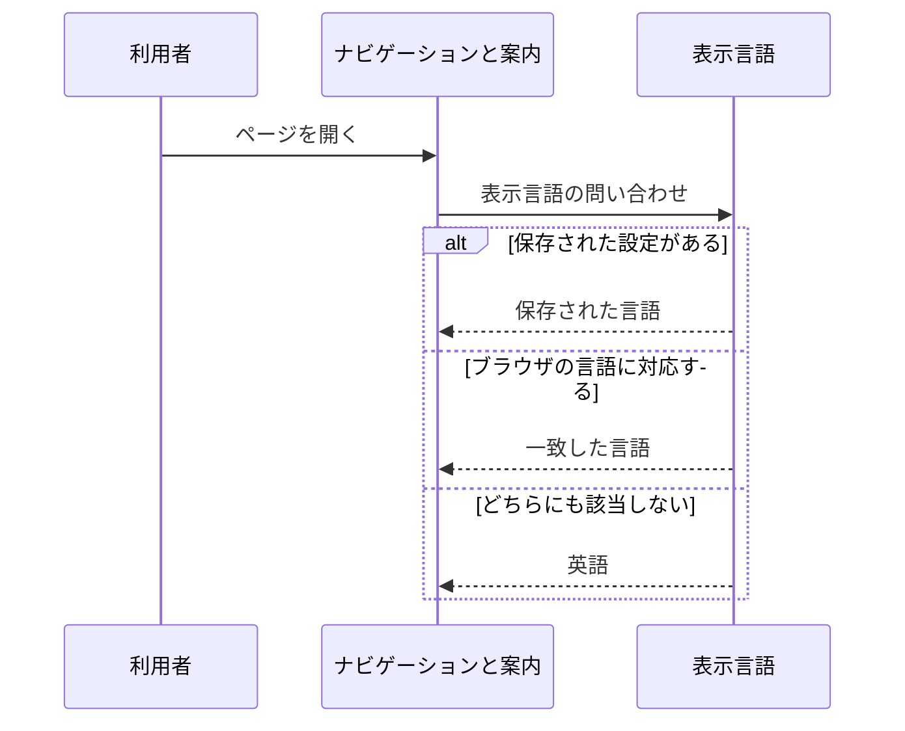
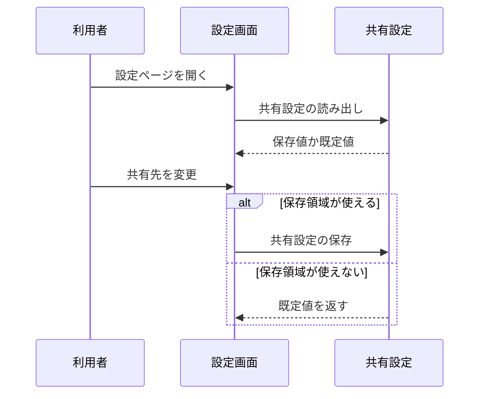
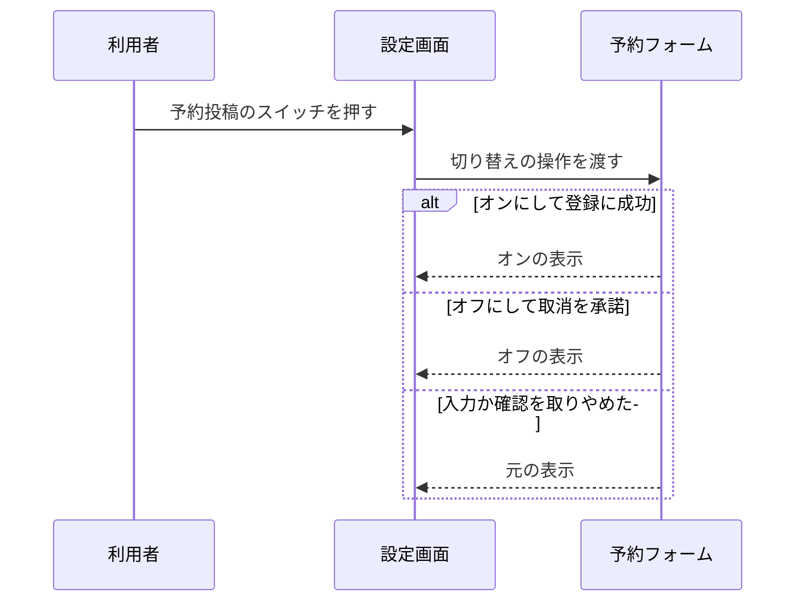

# アプリシェル アーキテクチャ

## 1. 目的と範囲

アプリシェルは、ナビゲーション・ヘルプ・プライバシーポリシーの画面と、端末と機能の設定画面を提供する。
各画面が使う部品と表示言語と他 SNS への共有は、画面の共通基盤のくくりの対象である。

## 2. 構成要素

| 構成要素             | 種別   | 責務                                                               | 実装spec                                  |
| -------------------- | ------ | ------------------------------------------------------------------ | ----------------------------------------- |
| 利用者               | 外部   | ブラウザで設定ページを操作し、ヘルプとポリシーを読む               | -                                         |
| ナビゲーションと案内 | 内部   | ナビゲーション・ヘルプ・プライバシーポリシーの画面を提供する       | app-navigation、help-page、privacy-policy |
| 設定画面             | 内部   | 端末の設定と予約投稿の有効化を、設定ページとダイアログで操作させる | app-settings、timeline-hidden             |
| 共通UI部品           | 他機能 | プルダウンと選択肢の見た目と操作を共通にする                       | -                                         |
| 表示言語             | 他機能 | 表示言語を選び、日本語と英語の文言を切り替える                     | -                                         |
| 運用者ごとの設定     | 他機能 | 運営者情報と測定 ID を環境変数から受け取って検査する               | -                                         |
| 共有設定             | 他機能 | 共有の設定を端末に保持し、共有文へ適用する                         | -                                         |
| 予約フォーム         | 他機能 | 設定に置く予約投稿のスイッチと、予約用の認証情報の入力を提供する   | -                                         |

## 3. システム構成

設定画面は、共通の部品と共有の設定と予約投稿のスイッチを束ねて表示する。

## 4. 外部インターフェース

| IF             | 方向 | 外部の要素 | 内部の要素 | 方式                               | 認証 |
| -------------- | ---- | ---------- | ---------- | ---------------------------------- | ---- |
| 端末設定の操作 | 提供 | 利用者     | 設定画面   | HTTPS の画面（HTML と JavaScript） | なし |

利用者は、端末設定の操作で設定画面へ入る。

## 5. 機能

### 表示言語の決定

- 関与: 利用者, ナビゲーションと案内, 表示言語

表示言語の決定は、保存された設定とブラウザの言語設定で結果が分岐する。

### 端末設定の変更

- 関与: 利用者, 設定画面, 共有設定

端末設定の変更は、保存領域が使えるかどうかで保存の可否が分岐する。

### 予約投稿の切り替え

- 関与: 利用者, 設定画面, 予約フォーム

予約投稿の切り替えは、認証情報の登録の成否と取消の確認で結果が分岐する。

## 6. データ

| データ     | 保管場所                   | 書き込み主体 |
| ---------- | -------------------------- | ------------ |
| 表示テーマ | ブラウザのローカル保存領域 | 設定画面     |

## 7. 信頼と検証

- なし

## 8. 技術基盤

- なし

## 9. 横断的制約

- なし
