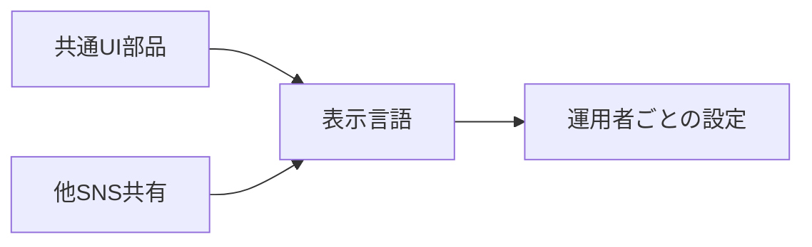
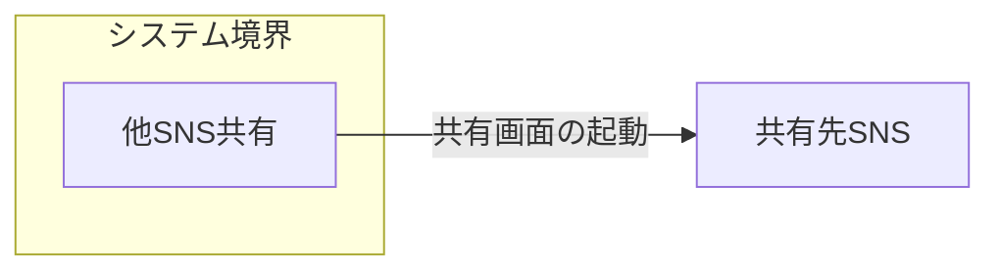
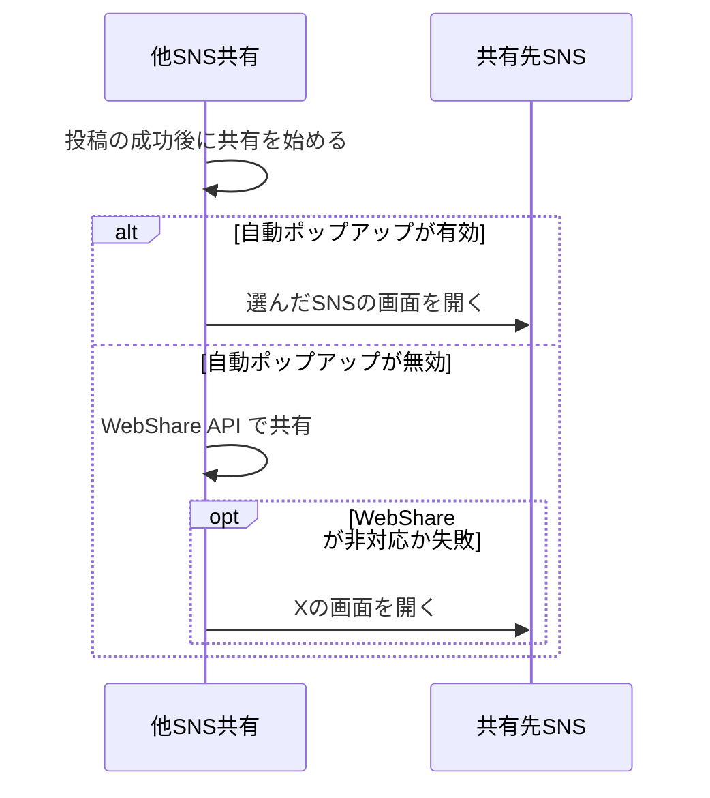

# 画面の共通基盤 アーキテクチャ

## 1. 目的と範囲

画面の共通基盤は、各画面が共通で使う部品・表示言語・運用者ごとの設定・他 SNS への共有を提供する。
設定画面と投稿の作成や一覧の表示は、別の機能のくくりの対象である。

## 2. 構成要素

| 構成要素         | 種別 | 責務                                                                              | 実装spec                                                    |
| ---------------- | ---- | --------------------------------------------------------------------------------- | ----------------------------------------------------------- |
| 共有先SNS        | 外部 | X・タイッツー・Mastodon の共有の投稿画面を開き、共有された URL のカードを生成する | -                                                           |
| 共通UI部品       | 内部 | プルダウンと選択肢の見た目・操作・絞り込みを共通にする                            | dropdown、dropdown-search、listbox-option、language-select  |
| 表示言語         | 内部 | 表示言語を選び、日本語と英語の文言を切り替える                                    | i18n-locale、i18n-messages                                  |
| 運用者ごとの設定 | 内部 | 運営者情報とアクセス解析の測定 ID を環境変数から受け取り、検査する                | site-config                                                 |
| 他SNS共有        | 内部 | 共有先の選択・共有文の組み立て・WebShare API の呼び出し・共有設定の保持を行う     | auto-popup、intent-share-dialog、share-text、share-settings |

## 3. システム構成

共通の部品と他 SNS 共有は、表示言語を通じて文言を得る。

## 4. 外部インターフェース

| IF             | 方向 | 外部の要素 | 内部の要素 | 方式                          | 認証 |
| -------------- | ---- | ---------- | ---------- | ----------------------------- | ---- |
| 共有画面の起動 | 利用 | 共有先SNS  | 他SNS共有  | ブラウザのポップアップ（URL） | なし |

他 SNS 共有は、共有画面の起動で共有先へ出る。

## 5. 機能

### 他SNSへの共有

- 関与: 他SNS共有, 共有先SNS

他 SNS への共有は、自動ポップアップの設定とブラウザの WebShare API の成否で開き方が分岐する。

## 6. データ

| データ         | 保管場所                   | 書き込み主体 |
| -------------- | -------------------------- | ------------ |
| 表示言語の設定 | ブラウザのローカル保存領域 | 表示言語     |
| 共有設定       | ブラウザのローカル保存領域 | 他SNS共有    |

## 7. 信頼と検証

- なし

## 8. 技術基盤

| 領域       | 採用                       | 理由                                                     | 根拠                        |
| ---------- | -------------------------- | -------------------------------------------------------- | --------------------------- |
| 実行基盤   | Cloudflare Workers         | 並行する複数のリクエストの間で表示言語を混ぜずに処理する | i18n-locale                 |
| 端末の設定 | ブラウザのローカル保存領域 | 設定をサーバーへ送らず、端末ごとに保持する               | share-settings、i18n-locale |
| 多言語     | 自前の辞書と翻訳関数       | 追加の実行時依存を増やさず、翻訳漏れを機械的に防ぐ       | i18n-messages、i18n-locale  |

## 9. 横断的制約

- なし
