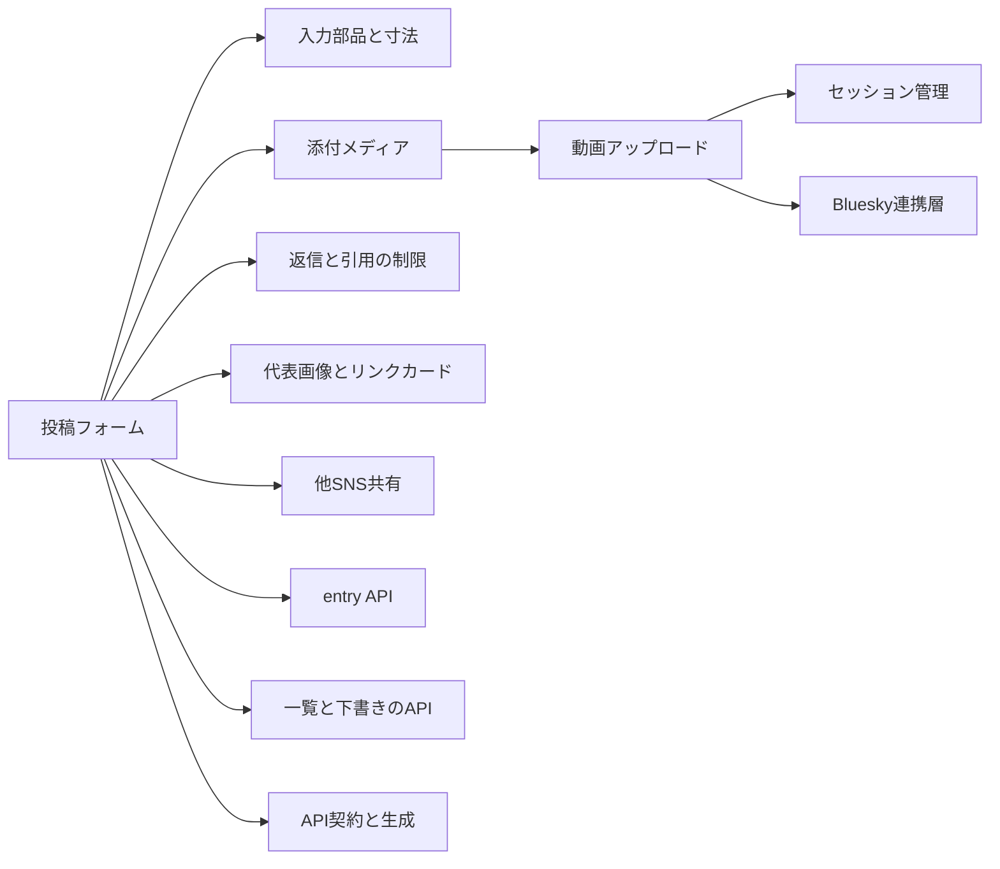
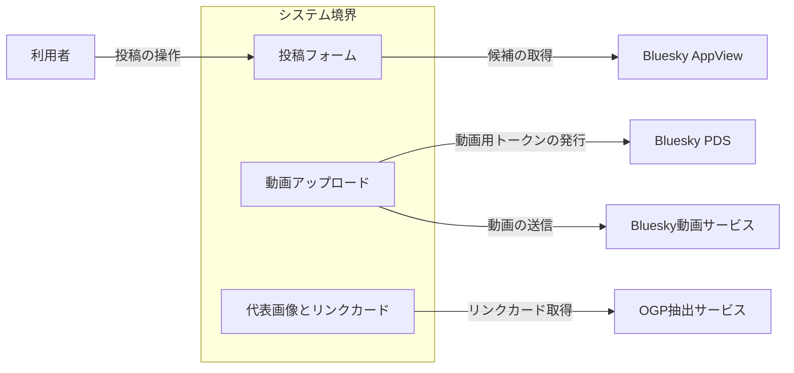
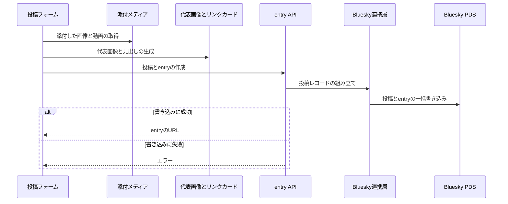
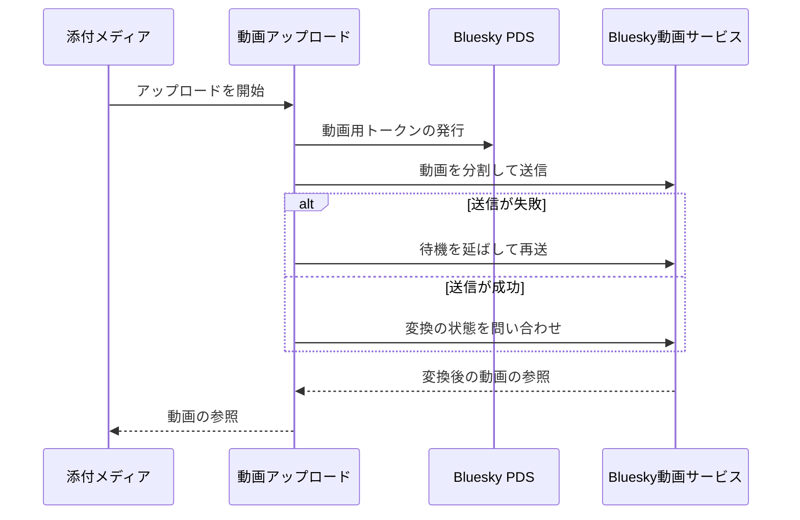
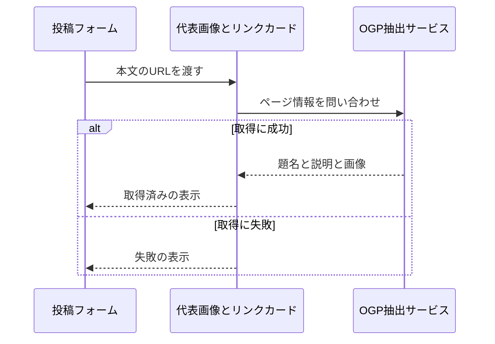
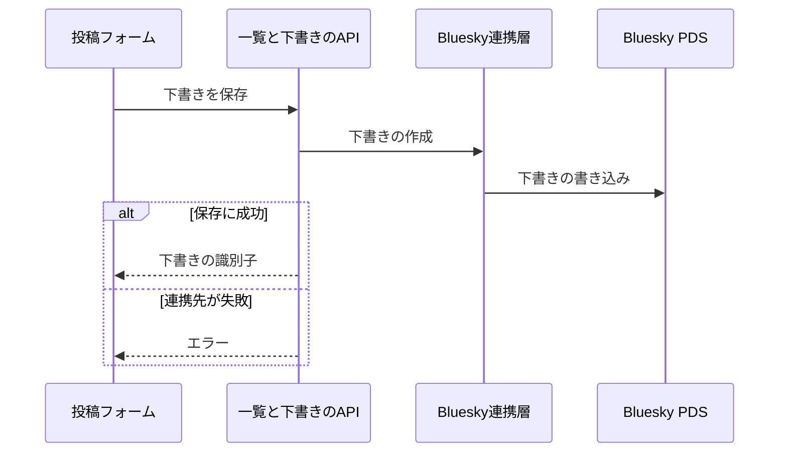

# 投稿の作成 アーキテクチャ

## 1. 目的と範囲

投稿の作成は、単発とスレッドの投稿と entry を同じフォームで組み立て、添付・動画・リンクカードを整えて送信する。
保存の API と一覧の表示は、別の機能のくくりの対象である。

## 2. 構成要素

| 構成要素               | 種別   | 責務                                                                                      | 実装spec                                                       |
| ---------------------- | ------ | ----------------------------------------------------------------------------------------- | -------------------------------------------------------------- |
| 利用者                 | 外部   | 投稿フォームを操作して投稿を作る                                                          | -                                                              |
| Bluesky PDS            | 外部   | 動画用のトークンを発行し、投稿とレコードを保管する                                        | -                                                              |
| Bluesky AppView        | 外部   | 公開 API でメンションの候補とトレンドを返す                                               | -                                                              |
| Bluesky動画サービス    | 外部   | 動画を受け取って変換し、変換の状態を返す                                                  | -                                                              |
| OGP抽出サービス        | 外部   | URL からページの題名・説明・画像を返す                                                    | -                                                              |
| 入力部品と寸法         | 内部   | 文字数つきの入力欄と、画面幅ごとの寸法トークンを提供する                                  | counted-text-input、browser-utils、design-tokens               |
| 投稿フォーム           | 内部   | 単発とスレッドの投稿を同じフォームで作成して送信する                                      | thread-composer、post-body-editor、post-suggest、share-counter |
| 返信と引用の制限       | 内部   | 返信できる相手と引用の可否を選び、既定値を端末に保存する                                  | post-gate                                                      |
| 添付メディア           | 内部   | 画像と動画を添付させ、画像の切り抜きを調整させる                                          | image-picker、image-crop、video-picker                         |
| 代表画像とリンクカード | 内部   | 代表画像と見出しを生成し、リンクカードを取得して添え、entry の作成直後に OGP を先取りする | entry-visual、ogp-link-card                                    |
| 動画アップロード       | 内部   | 動画用トークンを発行し、動画を直接送って変換を待つ                                        | video-upload                                                   |
| 他SNS共有              | 他機能 | 投稿の成功後に共有先の選択と共有の投稿画面の起動を行う                                    | -                                                              |
| entry API              | 他機能 | 投稿と entry の作成・編集・削除を所有権つきで行う                                         | -                                                              |
| 一覧と下書きのAPI      | 他機能 | 投稿の一覧と下書きの出し入れを行う                                                        | -                                                              |
| API契約と生成          | 他機能 | API の入出力の定義からクライアントを生成して提供する                                      | -                                                              |
| セッション管理         | 他機能 | 動画用の API で、セッションの再開と更新を行う                                             | -                                                              |
| Bluesky連携層          | 他機能 | atproto の操作と投稿レコードの組み立てを担う                                              | -                                                              |

## 3. システム構成

投稿の作成は、フォームが部品を束ねて保存の API を呼ぶ構造になる。

## 4. 外部インターフェース

| IF                   | 方向 | 外部の要素          | 内部の要素             | 方式                               | 認証                         |
| -------------------- | ---- | ------------------- | ---------------------- | ---------------------------------- | ---------------------------- |
| 投稿の操作           | 提供 | 利用者              | 投稿フォーム           | HTTPS の画面（HTML と JavaScript） | セッション cookie            |
| 動画用トークンの発行 | 利用 | Bluesky PDS         | 動画アップロード       | HTTPS（XRPC）                      | 利用者のセッションのトークン |
| 動画の送信           | 利用 | Bluesky動画サービス | 動画アップロード       | HTTPS（分割送信）                  | 動画用の認証トークン         |
| 候補の取得           | 利用 | Bluesky AppView     | 投稿フォーム           | HTTPS（XRPC）                      | なし                         |
| リンクカード取得     | 利用 | OGP抽出サービス     | 代表画像とリンクカード | HTTPS（JSON）                      | なし                         |

投稿の作成の外部との出入りは、利用者の操作と 3 つの外部サービスへの通信である。

## 5. 機能

### 投稿とentryの作成

- 関与: 投稿フォーム, 添付メディア, 代表画像とリンクカード, entry API, Bluesky連携層, Bluesky PDS

投稿と entry の作成は、書き込みの成否でレスポンスが分岐する。

### 動画のアップロード

- 関与: 添付メディア, 動画アップロード, Bluesky動画サービス, Bluesky PDS

動画のアップロードは、送信の失敗時に待機を延ばして再送する分岐を持つ。

### リンクカードの取得

- 関与: 投稿フォーム, 代表画像とリンクカード, OGP抽出サービス

リンクカードの取得は、問い合わせの成否で表示が分岐する。

### 下書きの保存

- 関与: 投稿フォーム, 一覧と下書きのAPI, Bluesky連携層, Bluesky PDS

下書きの保存は、連携先の成否で応答が分岐する。

## 6. データ

| データ             | 保管場所                                  | 書き込み主体     |
| ------------------ | ----------------------------------------- | ---------------- |
| 動画（変換後）     | Bluesky動画サービスと利用者の Bluesky PDS | 動画アップロード |
| 返信と引用の既定値 | ブラウザのローカル保存領域                | 返信と引用の制限 |
| ハッシュタグの履歴 | ブラウザのローカル保存領域                | 投稿フォーム     |

## 7. 信頼と検証

| 対象           | 信頼する前提                     | 検証手段                                         | 根拠         |
| -------------- | -------------------------------- | ------------------------------------------------ | ------------ |
| 動画用トークン | 漏えいしたトークンは悪用されうる | 用途を動画に限り、有効期間を 30 分にして発行する | video-upload |

## 8. 技術基盤

| 領域       | 採用                                    | 理由                                          | 根拠          |
| ---------- | --------------------------------------- | --------------------------------------------- | ------------- |
| 動画の送信 | ブラウザから動画サービスへの直接送信    | 動画のバイト列をサーバーへ通さない            | video-upload  |
| 画面の寸法 | CSS のトークン                          | スマホ幅で寸法を一括して一段大きくする        | design-tokens |
| 候補の取得 | 認証のいらない公開 API だけで候補を作る | 公開の AppView へブラウザから直接問い合わせる | post-suggest  |

## 9. 横断的制約

| 制約                         | 値          | 根拠          |
| ---------------------------- | ----------- | ------------- |
| 動画用トークンの有効期間     | 30 分       | video-upload  |
| 動画の変換の待ち時間の上限   | 20 分       | video-upload  |
| 返信を許可するルールの合計   | 5 件        | post-gate     |
| スマホ幅とみなす画面幅       | 639 px 以下 | design-tokens |
| リンクカードの取得の打ち切り | 3 秒        | ogp-link-card |
| 候補の取得の打ち切り         | 5 秒        | post-suggest  |
