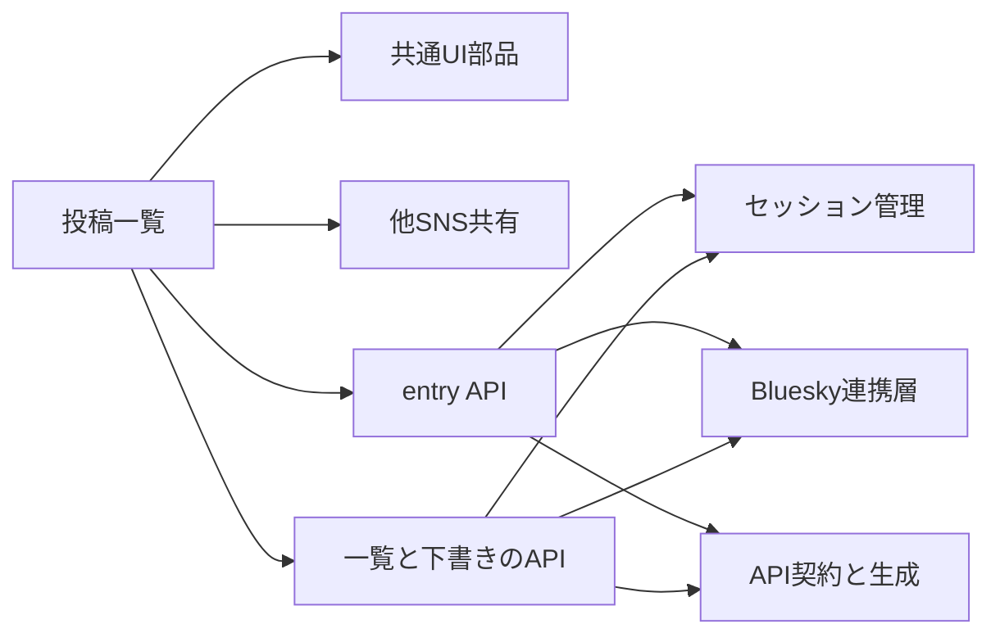
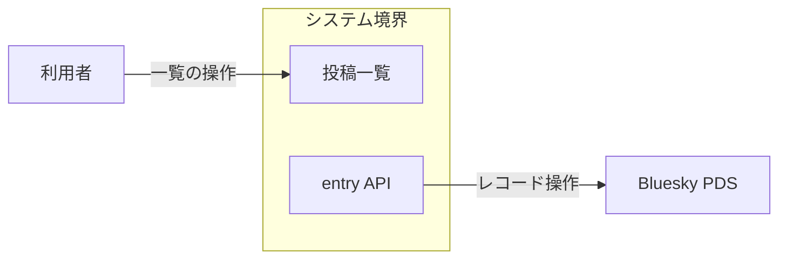
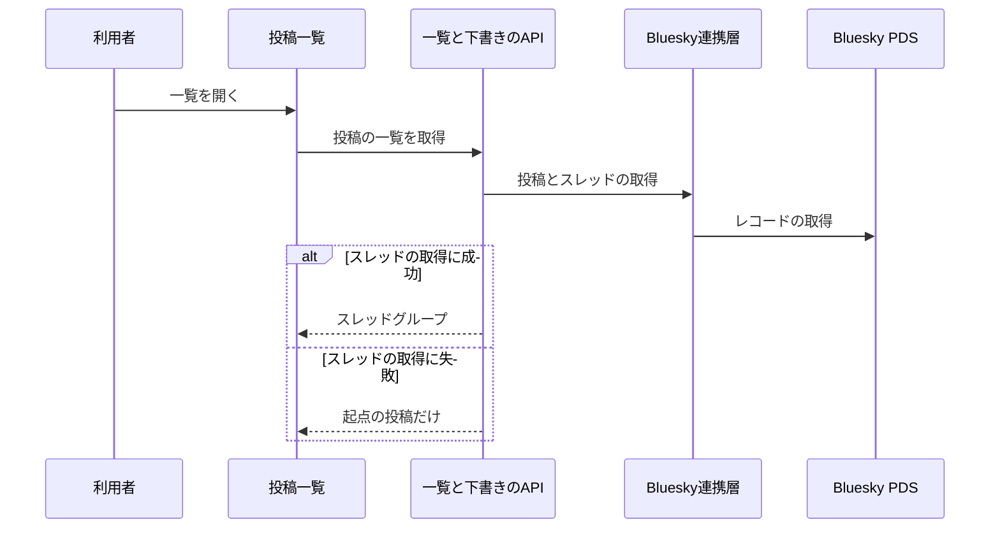
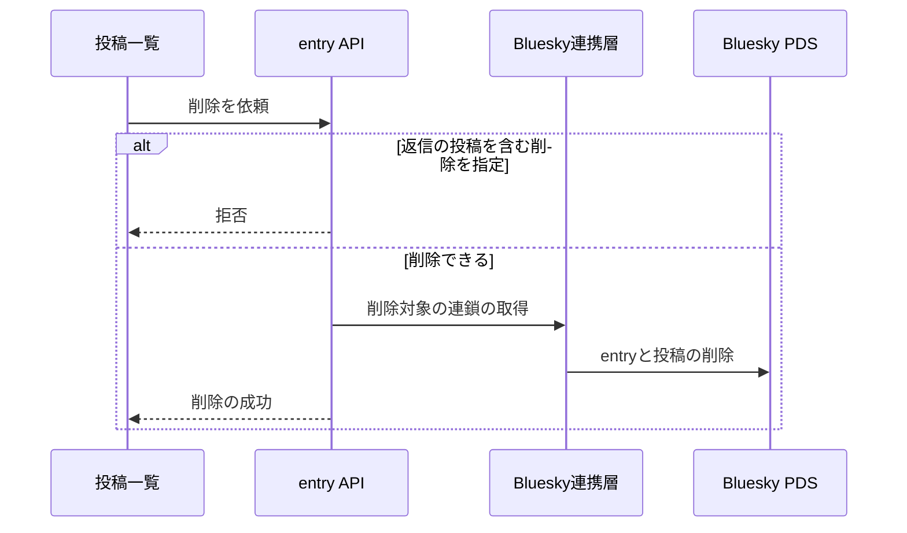

# 投稿の管理 アーキテクチャ

## 1. 目的と範囲

投稿の管理は、投稿をスレッド単位で一覧にし、下書きを出し入れし、entry を所有権つきで保存して削除する。
投稿の組み立てと、ログインやセッションの保持は、別の機能のくくりの対象である。

## 2. 構成要素

| 構成要素          | 種別   | 責務                                                                         | 実装spec                                                 |
| ----------------- | ------ | ---------------------------------------------------------------------------- | -------------------------------------------------------- |
| 利用者            | 外部   | 一覧を開き、entry の編集と削除を操作する                                     | -                                                        |
| Bluesky PDS       | 外部   | 利用者の投稿とレコードを保管する                                             | -                                                        |
| 投稿一覧          | 内部   | スレッド単位で投稿を並べ、entry の作成と編集と削除を受ける                   | timeline、entry-list、entry-delete-dialog、image-gallery |
| entry API         | 内部   | 投稿と entry の作成・編集・削除を所有権つきで行う                            | entry-api、entry-url                                     |
| 一覧と下書きのAPI | 内部   | 投稿の一覧と下書きの出し入れと画像 blob の取得を CORS の制約なく中継して行う | timeline-api、draft-api、bsky-images-api                 |
| 共通UI部品        | 他機能 | プルダウンと選択肢の見た目・操作・絞り込みを共通にする                       | -                                                        |
| 他SNS共有         | 他機能 | 共有先の選択・共有文の組み立てを行う                                         | -                                                        |
| セッション管理    | 他機能 | セッションを cookie に保持し、API ごとに再開と更新を行う                     | -                                                        |
| Bluesky連携層     | 他機能 | atproto の操作と投稿レコードの組み立てを担う                                 | -                                                        |
| API契約と生成     | 他機能 | API の入出力の定義からクライアントを生成して提供する                         | -                                                        |

## 3. システム構成

投稿一覧は、2つの API を呼び、API は基盤のセッション管理と連携層と契約に依存する。

## 4. 外部インターフェース

| IF           | 方向 | 外部の要素  | 内部の要素 | 方式                               | 認証                         |
| ------------ | ---- | ----------- | ---------- | ---------------------------------- | ---------------------------- |
| 一覧の操作   | 提供 | 利用者      | 投稿一覧   | HTTPS の画面（HTML と JavaScript） | セッション cookie            |
| レコード操作 | 利用 | Bluesky PDS | entry API  | HTTPS（XRPC）                      | 利用者のセッションのトークン |

投稿の管理の外部との出入りは、利用者の操作と PDS への書き込みである。

## 5. 機能

### 投稿一覧の取得

- 関与: 利用者, 投稿一覧, 一覧と下書きのAPI, Bluesky連携層, Bluesky PDS

投稿一覧の取得は、スレッドの取得の成否で返す単位が分岐する。

### entryの削除

- 関与: 投稿一覧, entry API, Bluesky連携層, Bluesky PDS

entry の削除は、派生元が返信の投稿かどうかで拒否と実行が分岐する。

## 6. データ

| データ           | 保管場所             | 書き込み主体      |
| ---------------- | -------------------- | ----------------- |
| Bluesky の投稿   | 利用者の Bluesky PDS | entry API         |
| entry のレコード | 利用者の Bluesky PDS | entry API         |
| 下書き           | Bluesky の下書き機能 | 一覧と下書きのAPI |

## 7. 信頼と検証

| 対象                   | 信頼する前提                                    | 検証手段                               | 根拠            |
| ---------------------- | ----------------------------------------------- | -------------------------------------- | --------------- |
| 他人のレコードへの操作 | クライアントが送る URI は本人のものとは限らない | コレクションと所有者を確認してから使う | entry-api       |
| 画像 blob の取得       | 取得を依頼する側がログイン済みとは限らない      | ログインを確認し、未認証なら拒否する   | bsky-images-api |

## 8. 技術基盤

- なし

## 9. 横断的制約

| 制約                   | 値     | 根拠                 |
| ---------------------- | ------ | -------------------- |
| スレッドの投稿数の上限 | 100 件 | entry-api、draft-api |
