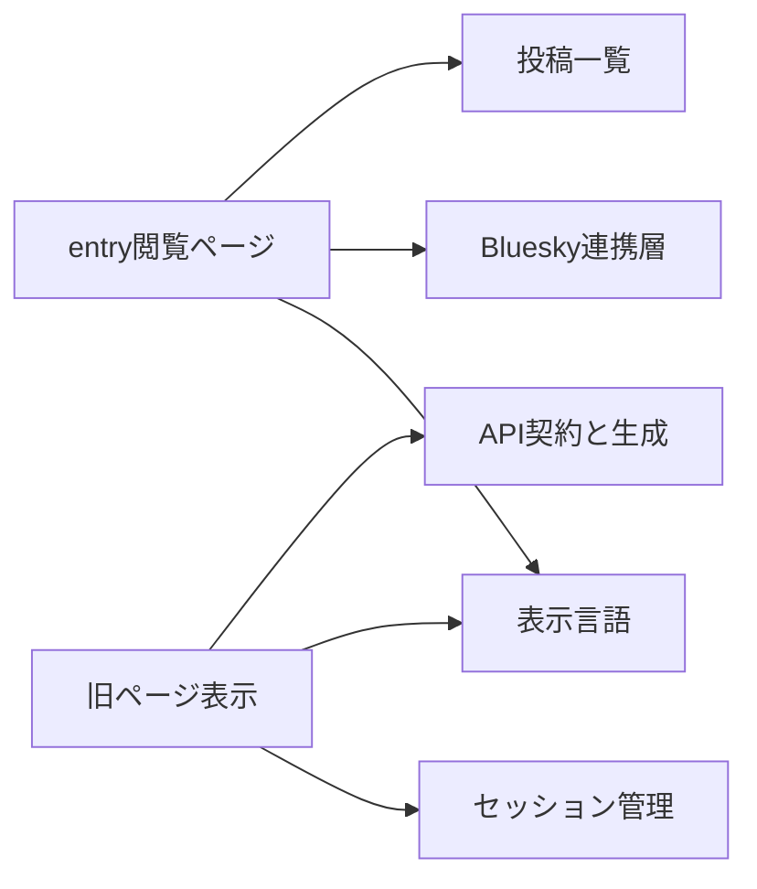
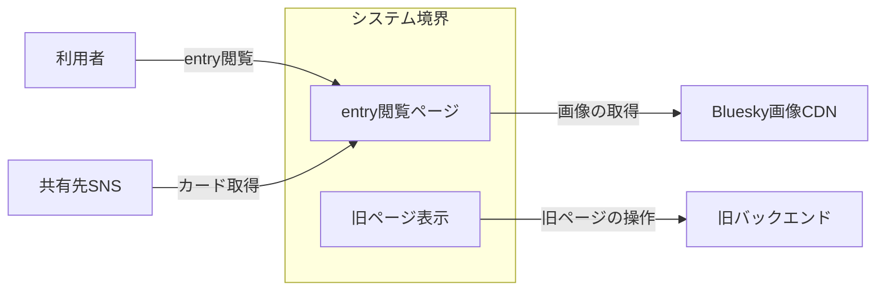
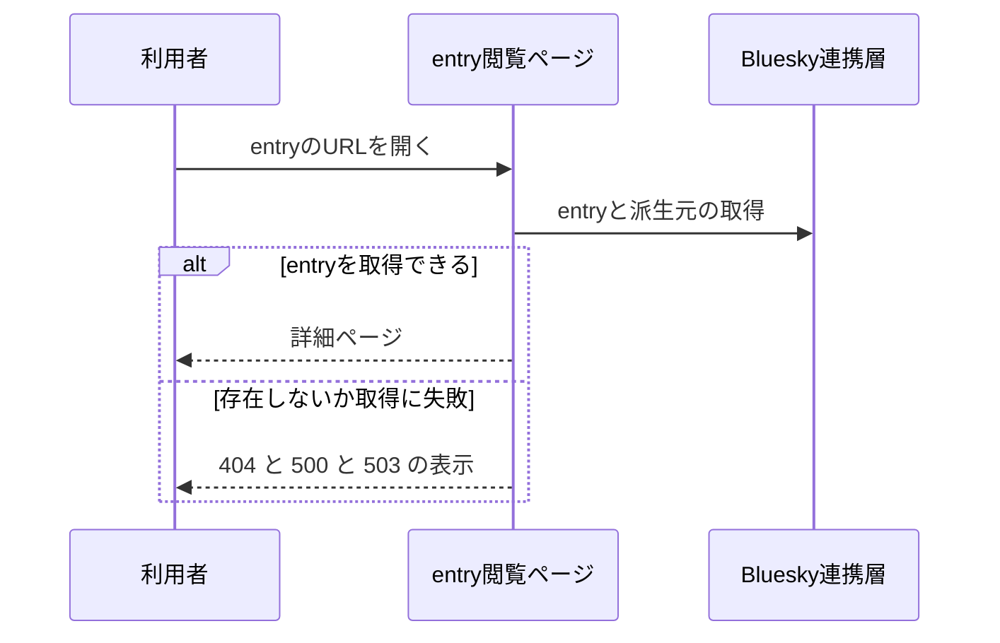
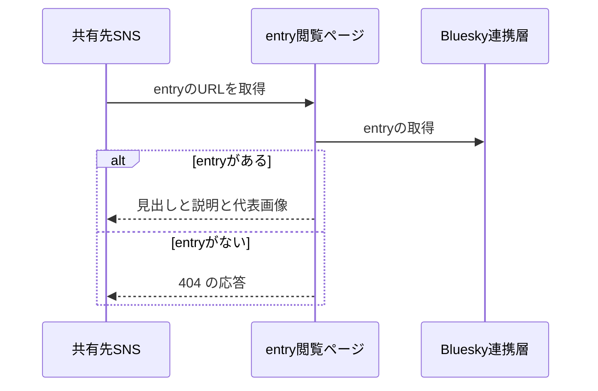
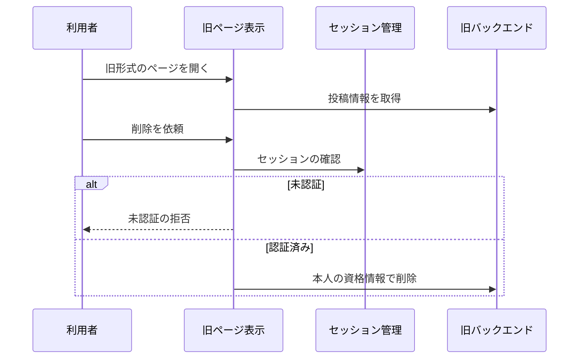

# 公開ページの表示 アーキテクチャ

## 1. 目的と範囲

公開ページの表示は、entry と旧形式の投稿ページを表示し、共有先 SNS へカードのメタ情報を返す。
投稿の作成と管理は、別の機能のくくりの対象である。

## 2. 構成要素

| 構成要素        | 種別   | 責務                                                     | 実装spec                   |
| --------------- | ------ | -------------------------------------------------------- | -------------------------- |
| 利用者          | 外部   | entry や旧形式のページをブラウザで開く                   | -                          |
| 共有先SNS       | 外部   | entry の URL を取得し、共有カードを生成する              | -                          |
| 旧バックエンド  | 外部   | 旧形式の投稿ページを保管して返す                         | -                          |
| Bluesky画像CDN  | 外部   | 投稿の画像を配信する                                     | -                          |
| entry閲覧ページ | 内部   | entry と派生元の投稿を、動画の再生を含めて表示する       | entry-detail、video-player |
| 旧ページ表示    | 内部   | 旧バックエンドの投稿ページを表示し、本人の削除を中継する | legacy-page                |
| 表示言語        | 他機能 | 表示言語を選び、日本語と英語の文言を切り替える           | -                          |
| セッション管理  | 他機能 | セッションを cookie に保持し、API ごとに再開と更新を行う | -                          |
| Bluesky連携層   | 他機能 | atproto の操作と投稿レコードの組み立てを担う             | -                          |
| API契約と生成   | 他機能 | API の入出力の定義からクライアントを生成して提供する     | -                          |
| 投稿一覧        | 他機能 | 投稿カードの表示部を、スレッド単位の一覧と共用する       | -                          |

## 3. システム構成

公開ページの表示は、基盤の言語と連携とセッションと契約に依存する。

## 4. 外部インターフェース

| IF             | 方向 | 外部の要素     | 内部の要素      | 方式                            | 認証             |
| -------------- | ---- | -------------- | --------------- | ------------------------------- | ---------------- |
| entry閲覧      | 提供 | 利用者         | entry閲覧ページ | HTTPS の画面（HTML）            | なし             |
| カード取得     | 提供 | 共有先SNS      | entry閲覧ページ | HTTPS の画面（HTML のメタ情報） | なし             |
| 旧ページの操作 | 利用 | 旧バックエンド | 旧ページ表示    | HTTPS（JSON）                   | 利用者の資格情報 |
| 画像の取得     | 利用 | Bluesky画像CDN | entry閲覧ページ | HTTPS（画像）                   | なし             |

公開ページの表示の外部との出入りは、閲覧の入口と旧バックエンドへの通信である。

## 5. 機能

### entry詳細の閲覧

- 関与: 利用者, entry閲覧ページ, Bluesky連携層

entry 詳細の閲覧は、entry の取得の成否で表示が分岐する。

### 共有カードの生成

- 関与: 共有先SNS, entry閲覧ページ, Bluesky連携層

共有カードの生成は、entry の有無で応答するメタ情報が分岐する。

### 旧ページの閲覧と削除

- 関与: 利用者, 旧ページ表示, セッション管理, 旧バックエンド

旧ページの閲覧と削除は、削除のときだけ本人の確認が分岐する。

## 6. データ

| データ       | 保管場所       | 書き込み主体   |
| ------------ | -------------- | -------------- |
| 旧形式の投稿 | 旧バックエンド | 旧バックエンド |

## 7. 信頼と検証

| 対象                       | 信頼する前提                           | 検証手段                                         | 根拠        |
| -------------------------- | -------------------------------------- | ------------------------------------------------ | ----------- |
| 旧バックエンドへの削除依頼 | 識別子は不正な形式で渡されることがある | 形式を確認し、不正なら旧バックエンドへ依頼しない | legacy-page |

## 8. 技術基盤

| 領域 | 採用           | 理由                                                  | 根拠         |
| ---- | -------------- | ----------------------------------------------------- | ------------ |
| 画面 | Astro と React | JavaScript が動かなくても投稿カードと画像を表示できる | entry-detail |

## 9. 横断的制約

- なし
