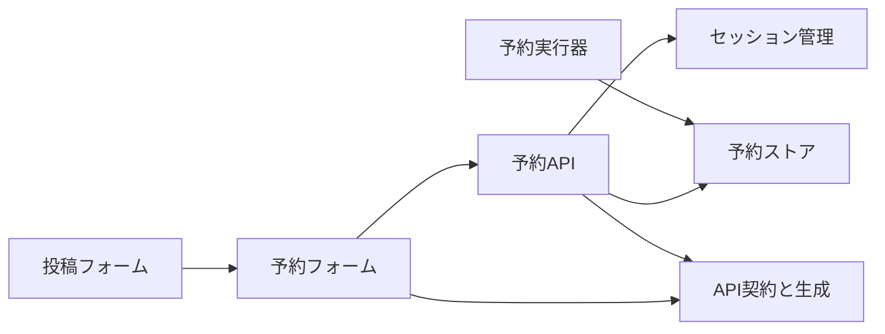
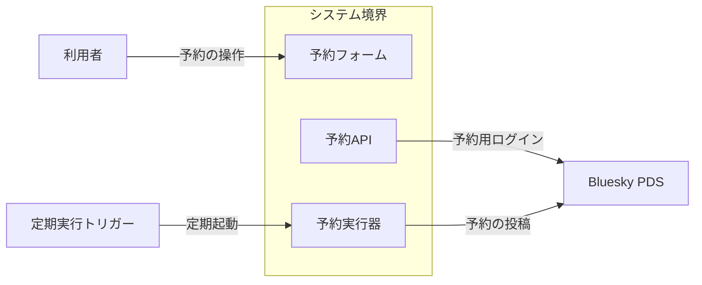
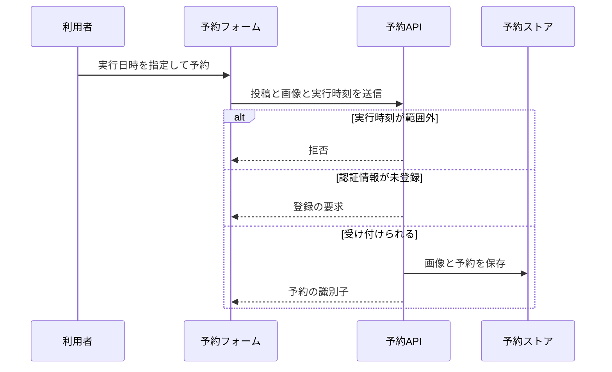
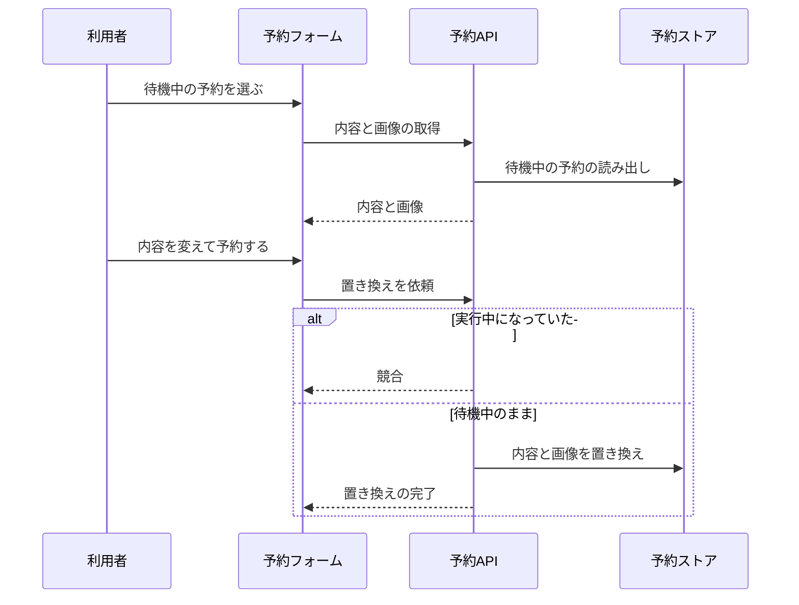
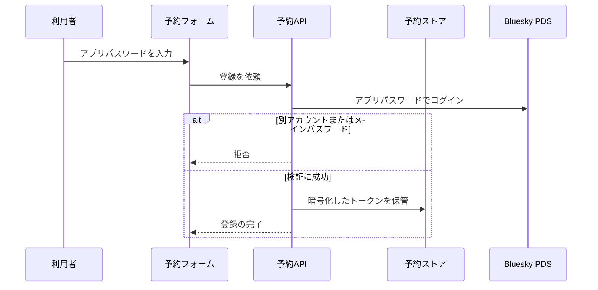
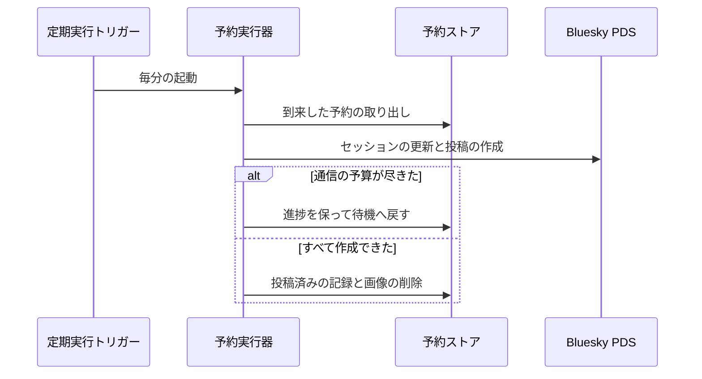

# 予約投稿 アーキテクチャ

## 1. 目的と範囲

予約投稿は、投稿に実行日時を指定して予約し、時刻が来ると利用者の Bluesky へ自動で投稿する。
予約の内容と実行に必要な認証情報の保管と、予約の一覧での編集と取消も扱う。
投稿フォームの入力部品と、ログインやセッションの保持は、別の機能のくくりの対象である。

## 2. 構成要素

| 構成要素         | 種別   | 責務                                                                     | 実装spec        |
| ---------------- | ------ | ------------------------------------------------------------------------ | --------------- |
| 利用者           | 外部   | 予約の日時を指定し、予約の一覧で編集や取消や確認を行う                   | -               |
| 定期実行トリガー | 外部   | 1分ごとに予約の実行を起動する                                            | -               |
| Bluesky PDS      | 外部   | 予約用のログインを受け付け、予約された投稿とレコードを保管する           | -               |
| 予約フォーム     | 内部   | 予約投稿の有効化と実行日時の指定を受け、予約の一覧で編集と取消を行わせる | schedule-form   |
| 予約API          | 内部   | 予約と認証情報の登録を検証して受け付け、自分の予約だけを返して置き換える | schedule-api    |
| 予約ストア       | 内部   | 予約と進捗と暗号化した認証情報と添付画像を保管し、到来した予約を取り出す | schedule-store  |
| 予約実行器       | 内部   | 到来した予約を通信の予算内で順に投稿し、中断しても続きから完了させる     | schedule-runner |
| 投稿フォーム     | 他機能 | 投稿の内容を組み立て、予約の操作を開く                                   | -               |
| セッション管理   | 他機能 | セッションを cookie に保持し、API ごとに再開と更新を行う                 | -               |
| API契約と生成    | 他機能 | API の入出力の定義からクライアントを生成して提供する                     | -               |

## 3. システム構成

呼び出しの依存は、画面から保管の基盤へ一方向に進む。

## 4. 外部インターフェース

| IF             | 方向 | 外部の要素       | 内部の要素   | 方式                                  | 認証                       |
| -------------- | ---- | ---------------- | ------------ | ------------------------------------- | -------------------------- |
| 予約の操作     | 提供 | 利用者           | 予約フォーム | HTTPS の画面（HTML と JavaScript）    | セッション cookie          |
| 定期起動       | 提供 | 定期実行トリガー | 予約実行器   | Cloudflare の Cron Trigger（1分間隔） | プラットフォームによる起動 |
| 予約用ログイン | 利用 | Bluesky PDS      | 予約API      | HTTPS（XRPC）                         | 利用者のアプリパスワード   |
| 予約の投稿     | 利用 | Bluesky PDS      | 予約実行器   | HTTPS（XRPC）                         | 予約用の認証情報のトークン |

予約投稿の外部との出入りは、利用者の操作と定期起動と PDS への 2 つの通信である。

## 5. 機能

### 予約の作成

- 関与: 利用者, 予約フォーム, 予約API, 予約ストア

予約の作成は、実行時刻の範囲と認証情報の登録の有無で、保存と拒否に分岐する。

### 予約の編集

- 関与: 利用者, 予約フォーム, 予約API, 予約ストア

予約の編集は、書き戻した内容を置き換えるときに、予約が実行中になっていないかで分岐する。

### 予約用認証の登録

- 関与: 利用者, 予約フォーム, 予約API, 予約ストア, Bluesky PDS

予約用認証の登録は、ログインの結果と種別の検証で保管と拒否に分岐する。

### 予約の自動投稿

- 関与: 定期実行トリガー, 予約実行器, 予約ストア, Bluesky PDS

予約の自動投稿は、通信の予算が尽きたときに進捗を保って次回へ持ち越す。

## 6. データ

| データ                     | 保管場所              | 書き込み主体        |
| -------------------------- | --------------------- | ------------------- |
| 予約の内容と実行の進捗     | D1 の予約テーブル     | 予約API、予約実行器 |
| 暗号化した予約用のトークン | D1 の認証情報テーブル | 予約API、予約実行器 |
| 予約に添付した画像         | R2 のバケット         | 予約API             |

## 7. 信頼と検証

| 対象                         | 信頼する前提                                       | 検証手段                                                              | 根拠                         |
| ---------------------------- | -------------------------------------------------- | --------------------------------------------------------------------- | ---------------------------- |
| 予約用のトークン             | D1 の内容が外部へ漏れうる                          | Worker のシークレットの鍵で暗号化し、アカウントを認証データに束縛する | schedule-store               |
| 登録時に入力されるパスワード | メインパスワードが入力されうる                     | アプリパスワードのセッションだけを受け付け、パスワードを保管しない    | schedule-api                 |
| 予約の所有者                 | クライアントが指定する識別子は本人のものと限らない | すべての問い合わせにセッションのアカウントを条件に含める              | schedule-store、schedule-api |
| 定期起動の呼び出し           | 外部から実行を起動されうる                         | 定期実行のハンドラを HTTP の経路から到達させない                      | schedule-runner              |

## 8. 技術基盤

| 領域             | 採用                     | 理由                                                            | 根拠            |
| ---------------- | ------------------------ | --------------------------------------------------------------- | --------------- |
| 予約の保管       | Cloudflare D1            | 無料枠で、実行時刻と状態による検索と条件つきの更新ができる      | schedule-store  |
| 画像の一時保管   | Cloudflare R2            | 無料枠で、保管した画像をライフサイクルで自動削除できる          | schedule-store  |
| 認証情報の暗号化 | Web Crypto の AES-GCM    | 標準の機能だけで、追加のパッケージなしに暗号化できる            | schedule-store  |
| 定期実行         | Cloudflare Cron Trigger  | 無料枠で、1分間隔の起動ができる                                 | schedule-runner |
| 投稿の通信       | 標準の fetch による XRPC | 無料枠の CPU 時間を守るため、atproto のライブラリを読み込まない | schedule-runner |

## 9. 横断的制約

| 制約                            | 値                 | 根拠            |
| ------------------------------- | ------------------ | --------------- |
| アカウントごとの待機中の予約    | 5 件               | schedule-api    |
| 予約できる実行時刻              | 5 分後から 14 日後 | schedule-api    |
| 1回の定期実行で取り出す予約     | 5 件               | schedule-store  |
| 1予約が保管する画像の合計       | 10 メガバイト      | schedule-store  |
| 終了した予約の保持期間          | 7 日               | schedule-store  |
| 使われない認証情報の保持期間    | 30 日              | schedule-store  |
| 削除漏れの画像の保持期間        | 15 日              | schedule-store  |
| 1回の定期実行で行う外部への通信 | 40 回              | schedule-runner |
