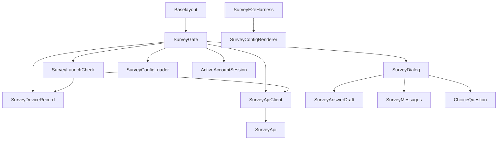
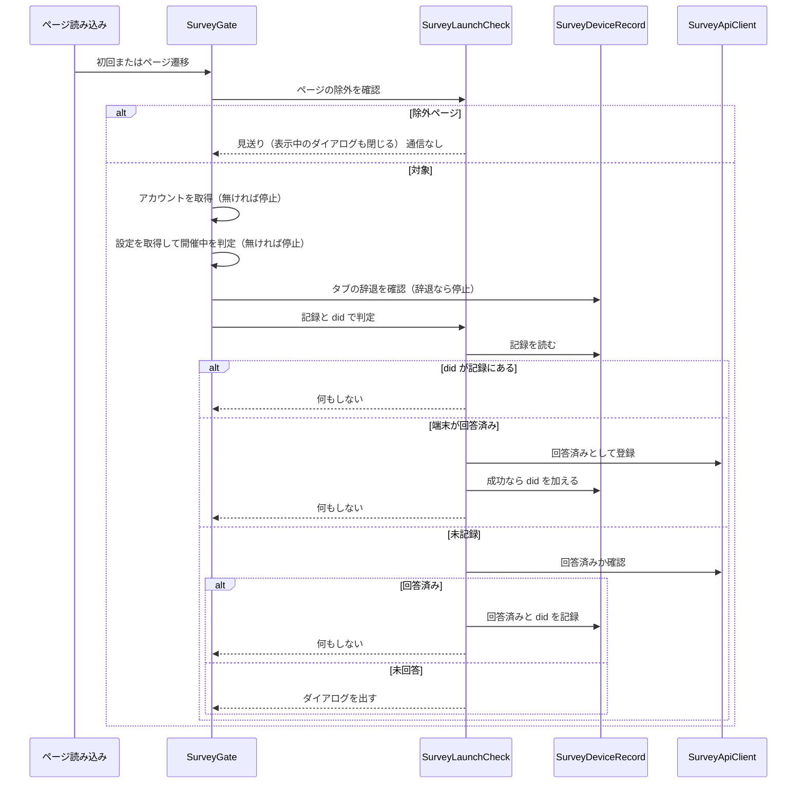
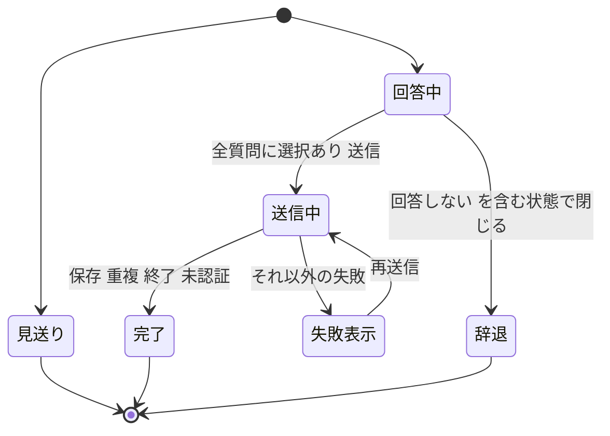

# Design Document

## Overview

**Purpose**: アプリの起動時に、アクティブなアカウントが開催中のアンケートに未回答なら、回答必須のダイアログで一度だけ聞く。回答済みの利用者には端末の記録だけで済ませ、通常の利用ではサーバーに一切アクセスしない。
**Users**: ログインした利用者（複数アカウントを含む）が回答する。開発者は、検証用の環境で開催中のアンケートを再現し、実ブラウザで確認する。
**Impact**: 全ページ共通のアイランドを 1 つ足し、画面の文言（日本語・英語）と、E2E の実行に検証用の設定を供給する手順を加える。既存のアカウント・ダイアログ・多言語の仕組みと、survey-definition・survey-api・choice-question の契約は変えずに使う。

### Goals

- 端末の記録を最初に見て、回答済みなら通信せずに終える。通信が要るときも、辞退したタブでは止める。
- 未回答なら、選択式のダイアログで回答必須にする。「回答しない」は送らず、そのタブの間は再表示せず、次の起動で再度聞く。
- 取得・登録・確認の失敗では何も表示せず続行する（fail-open）。
- 検証用の環境で、開催中のアンケートを実ブラウザの確認に使えるようにする。

### Non-Goals

- 設定の形式・検証・期間の判定・配信用の設定の生成（survey-definition）。
- 回答の検証・保存・重複の防止・削除（survey-api）。選択式の描画部品そのもの（choice-question）。
- ゲストへの表示。プライバシーポリシーの更新。運営の手順。
- 回答の取り消し・訂正、複数のアンケートの同時の表示。

## Boundary Commitments

### This Spec Owns

- 起動時の判定の規則（ページの除外・設定・タブの辞退・アカウント・端末の記録・サーバーへの確認の順序と結果）。
- 端末の記録の形と読み書き（回答済みの旗・記録済みのアカウント・タブごとの辞退）。
- 回答必須のダイアログ（質問の表示・選択状態の補正・送信・失敗の扱い・辞退）。
- アンケートの画面の固定の文言（日本語・英語）。
- E2E で使う検証用の設定と、その供給の手順、実ブラウザの確認。

### Out of Boundary

- 設定のスキーマ・検証・`currentSurvey`・`fetchSurveyConfig` の実装、生成処理（survey-definition）。本 spec は呼び出すだけで、生成処理の入力に検証用の設定を与える。
- 回答済みの確認・登録・回答の保存の契約と検証（survey-api）。本 spec は契約に従って呼ぶだけで、回答の正しさの最終判断はサーバーに任せる。
- `ChoiceQuestion` の外観と挙動（choice-question）。
- アカウントの確定・セッションの取得（既存の `getActiveAccountInfo`）。ゲスト表示の判定の定義（既存の `guestMode`）。
- プライバシーポリシーの本文。運営者の手順と変数の登録。

### Allowed Dependencies

- survey-definition: `Survey`・`SurveyQuestion`・`localize`・`currentSurvey`・`fetchSurveyConfig`（名前と形を変えずに使う）。生成処理（`hack/render-survey-config.ts`）を E2E の供給で呼ぶ。
- survey-api: 3 つの操作（`GET`・`PUT /v2/surveys/{surveyId}/respondent/`、`POST /v2/surveys/{surveyId}/answers/`）の生成済みクライアント。
- choice-question: `ChoiceQuestion`（props 契約）。
- 既存: `getActiveAccountInfo`（`src/lib/account/activeAccountSession.ts`）、`GUEST_MODE_QUERY_KEY`、`Overlay`、共通 UI スタイル（`ui.module.css`）、`useT`・`useLocale`、`Baselayout.astro`、`hack/run-e2e.mjs`、`tests/e2e/fixtures.ts`。
- 依存してはならないもの: `@atproto/*`（画面側でも不要）、D1 などサーバー側のバインディング、survey-api の内部（ハッシュ・保管）。

### Revalidation Triggers

- survey-definition のスキーマ・`currentSurvey`・`fetchSurveyConfig`・生成処理の入力の形の変更（描画と検証用の設定を再確認する）。
- survey-api の状態コードの意味・パス・本文の形の変更（`SurveyApiClient` の分類を再確認する）。
- choice-question の props・通知の形の変更（`SurveyDialog` の補正を再確認する）。
- 端末の記録のキー・形の変更（既存の端末の記録との互換と、プライバシーポリシーの記載を再確認する）。
- 共通アイランドの置き場所（`Baselayout`）や `transition:persist` の変更。`getActiveAccountInfo` の確定のタイミングの変更。

## Architecture

### Existing Architecture Analysis

- アカウントの確定は `getSessionOnce` の共有キャッシュに集約され、未ログインは追加の通信なしで判明する。ログイン・切り替えは全体遷移で終わるため、起動時のページ読み込みが判定の唯一の契機になる。
- `Baselayout.astro` は全ページ共通のアイランド（`AuthorizationReturn`）を持つ。`Sidebar` などが `transition:persist` を使う前例がある。
- ダイアログは `Overlay` を土台に、`ChoiceDialog`・`ConfirmDialog` が `ui["base-card"]`・`ui["dialog-card"]` を重ねる流儀である。多言語は `useT`・`useLocale` と `src/lib/i18n/messages/{ja,en}/` のドメイン別辞書である。
- `src/middleware.ts` から静的に辿れる範囲に `@atproto/*` を持ち込まない制約があるが、本 spec の部品は画面側だけで、サーバーには触れない。

### Architecture Pattern & Boundary Map



**Architecture Integration**:

- Selected pattern: 純粋な判定・補正・記録の関数を内側に置き、I/O（サーバー・Storage・セッション）の呼び出しと React を外側の `SurveyGate`・`SurveyDialog` に置く。
- Dependency direction: `SurveyDeviceRecord`・`SurveyAnswerDraft`・`SurveyMessages`（内側）→ `SurveyApiClient`・`SurveyLaunchCheck` → `SurveyDialog` → `SurveyGate` → `Baselayout`。内側は外側を import しない。`SurveyE2eHarness` は本番のコードに依存されない。
- Domain/feature boundaries: 記録（Storage）、サーバー通信、判定の順序、回答の状態の補正、画面は変更の理由が別なので別の部品にする。
- Existing patterns preserved: 共通アイランド、`Overlay` を土台にしたダイアログ、`useT` による多言語、生成済みクライアントの呼び出し、`page.route` によるサーバーのモック。
- Steering compliance: `tech.md` の無料枠（通常の利用で通信しない）、`coding-conventions.md` の React・CSS・コメントの規約、`structure.md` の `lib/<責務>/`・`components/<機能>/`、`DEVELOP.md` の UI の検証。

### Technology Stack

| Layer            | Choice / Version                            | Role in Feature                  | Notes                                   |
| ---------------- | ------------------------------------------- | -------------------------------- | --------------------------------------- |
| Frontend         | React（既存）+ Astro アイランド             | 判定の常駐とダイアログの描画     | `client:load` + `transition:persist`    |
| 共有ロジック     | TypeScript（既存）                          | 記録・判定・回答の補正           | 外部依存の追加なし                      |
| API クライアント | orval 生成のクライアント（既存）            | 回答済みの確認・登録・回答の送信 | survey-api の契約から `npm run codegen` |
| 端末の記録       | Web Storage（localStorage・sessionStorage） | 回答済み・アカウント・タブの辞退 | 例外は外へ出さない                      |
| 検証             | Playwright（既存）+ vitest                  | 実ブラウザの確認と単体テスト     | `tests/e2e/survey.spec.ts`              |

## File Structure Plan

### Directory Structure

```
src/lib/survey/
├── deviceRecord.ts       # SurveyDeviceRecord: 端末の記録とタブの辞退の読み書き
├── answerDraft.ts        # SurveyAnswerDraft: 選択状態の補正・完了の判定・送信本文の組み立て
├── client.ts             # SurveyApiClient: 生成済みクライアントの呼び出しを分類へ正規化
└── launchCheck.ts        # SurveyLaunchCheck: ページの除外と、記録→登録または確認の判定
src/components/survey/
├── SurveyGate/
│   └── index.tsx         # SurveyGate: 常駐するアイランド。判定・ダイアログの開閉・送信
└── SurveyDialog/
    ├── index.tsx         # SurveyDialog: 回答必須のダイアログの描画と入力
    └── index.module.css
src/lib/i18n/messages/
├── ja/survey.ts          # SurveyMessages: 日本語（正本）
└── en/survey.ts          # SurveyMessages: 英語
tests/fixtures/survey/
└── e2e-open.json         # SurveyE2eHarness: 検証用の開催中の設定
tests/lib/survey/         # 4 つの lib の単体テストと検証用の設定の検証
tests/components/survey/  # SurveyDialog の単体テスト
tests/e2e/survey.spec.ts  # SurveyE2eHarness: 実ブラウザの確認
```

### Modified Files

- `src/layout/Baselayout.astro` — SurveyGate: 全ページ共通のアイランドとして `client:load` と `transition:persist` で置く。
- `src/lib/i18n/messages/ja/index.ts`・`en/index.ts` — SurveyMessages: 辞書を結合に加える。
- `hack/run-e2e.mjs` — SurveyE2eHarness: 自分で dev サーバーを起動するとき、起動の前に検証用の設定を生成し、終了後に元の状態へ戻す。
- `tests/e2e/fixtures.ts` — SurveyE2eHarness: 回答済みの確認への既定応答（回答済み）を、すべての spec のページに登録する。
- `src/client/openapi/`（生成物）— survey-api の契約から更新される。手で編集しない。

## System Flows



- 失敗（通信・状態コードの想定外）と 404 は、記録せず「何もしない」を返す。登録・確認の失敗は次の起動で再度判定される。
- 辞退したタブでは、設定を取得したあとのタブの辞退の確認で見送り、起動時の判定に進まない。そのため、アンケートの API（確認・登録）は通信しない（要件 5.7）。設定（静的ファイル）の取得は、辞退の印がアンケートの識別子で保存されるため避けられず、要件 5.7 の対象はアンケートの API の通信として扱う。



## Requirements Traceability

| Requirement | Summary                                            | Components                                | Interfaces                                     | Flows      |
| ----------- | -------------------------------------------------- | ----------------------------------------- | ---------------------------------------------- | ---------- |
| 1.1         | 確定したアカウントで開催中なら判定                 | SurveyGate, SurveyLaunchCheck             | `decideLaunch`                                 | 判定の流れ |
| 1.2         | ログイン直後と起動時はアカウントの確定を待つ       | SurveyGate                                | `getActiveAccountInfo`                         | 判定の流れ |
| 1.3         | 未ログイン・ゲストでは表示せず通信しない           | SurveyLaunchCheck, SurveyGate             | `isSurveyPageExcluded`, `getActiveAccountInfo` | 判定の流れ |
| 1.4         | プライバシーポリシーのページでは表示せず通信しない | SurveyLaunchCheck                         | `isSurveyPageExcluded`                         | 判定の流れ |
| 1.5         | ポリシーから移動したらそのページで判定             | SurveyGate                                | ページ遷移の購読                               | 判定の流れ |
| 1.6         | 開催中なし・設定の失敗では表示しない               | SurveyGate                                | `fetchSurveyConfig`, `currentSurvey`           | 判定の流れ |
| 1.7         | 同じ画面の間は繰り返さない                         | SurveyGate                                | 判定済みの旗                                   | 判定の流れ |
| 2.1         | 記録にあれば通信せず何もしない                     | SurveyLaunchCheck, SurveyDeviceRecord     | `decideLaunch`, `readDeviceRecord`             | 判定の流れ |
| 2.2         | 端末が回答済みなら登録して did を加える            | SurveyLaunchCheck, SurveyApiClient        | `registerAnswered`, `rememberAnswered`         | 判定の流れ |
| 2.3         | 記録が無ければサーバーに確認                       | SurveyLaunchCheck, SurveyApiClient        | `checkAnswered`                                | 判定の流れ |
| 2.4         | 回答済みなら記録して表示しない                     | SurveyLaunchCheck, SurveyDeviceRecord     | `rememberAnswered`                             | 判定の流れ |
| 2.5         | 未回答ならダイアログ                               | SurveyLaunchCheck, SurveyGate             | `LaunchOutcome`                                | 判定の流れ |
| 2.6         | 終了または無い（404）は記録せず続行                | SurveyApiClient, SurveyLaunchCheck        | `AnsweredCheck`, `RegisterResult`              | 判定の流れ |
| 2.7         | 失敗は記録せず続行して次の起動で再判定             | SurveyApiClient, SurveyLaunchCheck        | `AnsweredCheck`, `RegisterResult`              | 判定の流れ |
| 2.8         | 記録が壊れていれば無いものとして扱う               | SurveyDeviceRecord                        | `readDeviceRecord`                             | —          |
| 2.9         | 書き込めなくても妨げない                           | SurveyDeviceRecord                        | `rememberAnswered`, `markDeclinedInTab`        | —          |
| 2.10        | 旗と did だけを記録                                | SurveyDeviceRecord                        | `SurveyDeviceRecord`                           | —          |
| 3.1         | タイトル・説明・全質問を表示                       | SurveyDialog                              | `SurveyDialogProps`                            | 回答の状態 |
| 3.2         | 現在の表示言語の文言                               | SurveyDialog                              | `localize`, `useLocale`                        | —          |
| 3.3         | 言語切り替えで選択を保つ                           | SurveyDialog                              | `useLocale`                                    | —          |
| 3.4         | 単一は 1 つ、複数は上限の範囲                      | SurveyDialog, SurveyAnswerDraft           | `ChoiceQuestion`, `changeSelection`            | 回答の状態 |
| 3.5         | 背景と Esc で閉じない                              | SurveyDialog                              | `Overlay` の `onClose`                         | 回答の状態 |
| 3.6         | 未選択の質問があれば送信不可                       | SurveyAnswerDraft, SurveyDialog           | `isDraftComplete`                              | 回答の状態 |
| 3.7         | キーボード操作と支援技術への名前                   | SurveyDialog                              | `role="dialog"`                                | —          |
| 3.8         | 内容のスクロール                                   | SurveyDialog                              | スタイル                                       | —          |
| 3.9         | 取り消せない旨を送信の前に示す                     | SurveyDialog, SurveyMessages              | `survey.irreversible`                          | —          |
| 4.1         | すべて答えたら送る                                 | SurveyDialog, SurveyGate, SurveyApiClient | `toAnswers`, `submitAnswers`                   | 回答の状態 |
| 4.2         | 送信中は操作不可で二重送信しない                   | SurveyDialog, SurveyGate                  | `busy`                                         | 回答の状態 |
| 4.3         | 保存成功で記録して閉じる                           | SurveyGate, SurveyDeviceRecord            | `rememberAnswered`                             | 回答の状態 |
| 4.4         | 重複は回答済みとして閉じる                         | SurveyGate, SurveyApiClient               | `SubmitResult`                                 | 回答の状態 |
| 4.5         | 終了は記録せず閉じる                               | SurveyGate, SurveyApiClient               | `SubmitResult`                                 | 回答の状態 |
| 4.6         | 未認証は記録せず閉じる                             | SurveyGate, SurveyApiClient               | `SubmitResult`                                 | 回答の状態 |
| 4.7         | それ以外の失敗は文言を示し再送信できる             | SurveyGate, SurveyDialog                  | `failed`                                       | 回答の状態 |
| 4.8         | 送信に did や時刻を含めない                        | SurveyAnswerDraft, SurveyApiClient        | `toAnswers`                                    | —          |
| 5.1         | 回答しないも他と同様に選べる                       | SurveyDialog                              | `ChoiceQuestion`                               | 回答の状態 |
| 5.2         | 複数選択で回答しないは他と同時にならない           | SurveyAnswerDraft                         | `changeSelection`                              | 回答の状態 |
| 5.3         | 回答しない中は閉じる操作として示す                 | SurveyAnswerDraft, SurveyDialog           | `draftHasDecline`                              | 回答の状態 |
| 5.4         | 閉じても送らず記録しない                           | SurveyGate, SurveyDialog                  | `onDecline`                                    | 回答の状態 |
| 5.5         | 同じタブでは再表示しない                           | SurveyDeviceRecord, SurveyGate            | `markDeclinedInTab`, `isDeclinedInTab`         | 判定の流れ |
| 5.6         | 新しいタブ・起動で再判定                           | SurveyDeviceRecord                        | `isDeclinedInTab`（タブ単位の保存）            | 判定の流れ |
| 5.7         | 辞退したタブで通信しない                           | SurveyGate                                | `isDeclinedInTab`                              | 判定の流れ |
| 6.1         | 固定の文言を全言語で用意                           | SurveyMessages                            | 辞書                                           | —          |
| 6.2         | アンケートの文言は設定の言語で                     | SurveyDialog                              | `localize`                                     | —          |
| 6.3         | 既存と同じ仕組みで多言語化                         | SurveyMessages                            | 辞書の結合                                     | —          |
| 7.1         | リポジトリ変数に依存せず開催中を取得できる         | SurveyE2eHarness                          | 検証用の設定の供給                             | E2E の供給 |
| 7.2         | 終了しない開催中の設定で 3 種を含む                | SurveyE2eHarness                          | `e2e-open.json`                                | —          |
| 7.3         | 実行後に通常の状態へ戻す                           | SurveyE2eHarness                          | `run-e2e.mjs`                                  | E2E の供給 |
| 7.4         | 起動済みの dev では理由を示して見送る              | SurveyE2eHarness                          | spec の事前確認                                | E2E の供給 |
| 7.5         | 検証用の設定が検証を通ることを検出                 | SurveyE2eHarness                          | 単体テスト                                     | —          |
| 7.6         | 既存の画面の確認に影響しない                       | SurveyE2eHarness                          | `fixtures.ts` の既定応答                       | E2E の供給 |
| 8.1         | 主な経路を実ブラウザで確認                         | SurveyE2eHarness                          | `survey.spec.ts`                               | —          |
| 8.2         | ポリシーとゲストで出ないことを確認                 | SurveyE2eHarness                          | `survey.spec.ts`                               | —          |
| 8.3         | 英語の文言を確認                                   | SurveyE2eHarness                          | `survey.spec.ts`                               | —          |

## Components and Interfaces

| Component          | Domain/Layer | Intent                                         | Req Coverage                                                                   | Key Dependencies (P0/P1)                                               | Contracts      |
| ------------------ | ------------ | ---------------------------------------------- | ------------------------------------------------------------------------------ | ---------------------------------------------------------------------- | -------------- |
| SurveyDeviceRecord | 共有ロジック | 端末の記録とタブの辞退の読み書き               | 2.1, 2.8, 2.9, 2.10, 4.3, 5.5, 5.6                                             | Web Storage（P0）                                                      | Service, State |
| SurveyAnswerDraft  | 共有ロジック | 選択状態の補正・完了の判定・送信本文の組み立て | 3.4, 3.6, 4.1, 4.8, 5.2, 5.3                                                   | SurveyDefinition の型（P0）                                            | Service        |
| SurveyApiClient    | 通信         | 3 つの操作を分類へ正規化                       | 2.2, 2.3, 2.6, 2.7, 4.1, 4.4, 4.5, 4.6, 4.7, 4.8                               | 生成済みクライアント（P0）                                             | Service, API   |
| SurveyLaunchCheck  | 共有ロジック | ページの除外と、記録→登録または確認の判定      | 1.1, 1.3, 1.4, 2.1, 2.2, 2.3, 2.4, 2.5, 2.6, 2.7                               | SurveyDeviceRecord（P0）, SurveyApiClient（P0）                        | Service        |
| SurveyMessages     | 文言         | 画面の固定の文言（日本語・英語）               | 3.9, 6.1, 6.3                                                                  | 既存の辞書の仕組み（P0）                                               | State          |
| SurveyDialog       | 画面         | 回答必須のダイアログの描画と入力               | 3.1, 3.2, 3.3, 3.4, 3.5, 3.6, 3.7, 3.8, 3.9, 4.1, 4.2, 4.7, 5.1, 5.3, 5.4, 6.2 | ChoiceQuestion（P0）, Overlay（P0）, SurveyAnswerDraft（P0）           | State          |
| SurveyGate         | 画面         | 常駐して判定・開閉・送信を束ねる               | 1.1, 1.2, 1.3, 1.4, 1.5, 1.6, 1.7, 2.5, 4.3, 4.4, 4.5, 4.6, 4.7, 5.4, 5.5, 5.7 | 上記すべて（P0）, SurveyConfigLoader（P0）, ActiveAccountSession（P0） | State          |
| SurveyE2eHarness   | 検証         | 検証用の設定の供給と実ブラウザの確認           | 7.1, 7.2, 7.3, 7.4, 7.5, 7.6, 8.1, 8.2, 8.3                                    | SurveyConfigRenderer（P0）, Playwright（P0）                           | Batch          |

### 共有ロジック

#### SurveyDeviceRecord

| Field        | Detail                                                               |
| ------------ | -------------------------------------------------------------------- |
| Intent       | 端末の記録（回答済みの旗とアカウント）とタブごとの辞退を読み書きする |
| Requirements | 2.1, 2.8, 2.9, 2.10, 4.3, 5.5, 5.6                                   |

**Responsibilities & Constraints**

- 端末の記録はキー `skyshare.survey.<surveyId>`（localStorage）に `{ answered: boolean, dids: string[] }` を JSON で持つ。タブの辞退は sessionStorage の `skyshare.survey.<surveyId>.declined` に持つ（値は固定の印）。
- 読み出しは、未保存・解析の失敗・形の不一致・Storage の使用不可のすべてを「`answered: false`・`dids: []`」にする。書き込みの失敗は例外にしない。
- 保存するのは回答済みの旗と did だけ。回答の内容と時刻は保存しない。
- Storage を引数で差し替えられる（既定はブラウザの Storage。SSR では使用不可として扱う）。

**Dependencies**

- Inbound: SurveyLaunchCheck, SurveyGate — 読み書き（P0）
- External: Web Storage — 保存先（P0）

**Contracts**: Service [x] / State [x]

##### Service Interface

```ts
export type SurveyDeviceRecord = {
  answered: boolean
  dids: string[]
}

/** 記録が無い・壊れている・使えないときは { answered: false, dids: [] } */
export const readDeviceRecord: (
  surveyId: string,
  storage?: Storage,
) => SurveyDeviceRecord

/** 回答済みの旗を立て、did を重複なく加える。失敗しても投げない */
export const rememberAnswered: (
  surveyId: string,
  did: string,
  storage?: Storage,
) => void

export const isDeclinedInTab: (surveyId: string, storage?: Storage) => boolean
export const markDeclinedInTab: (surveyId: string, storage?: Storage) => void
```

- Preconditions: `surveyId` は survey-definition の識別子の形式。
- Postconditions: `rememberAnswered` の後、書き込みに成功していれば `readDeviceRecord` の `answered` が真で `dids` に did が含まれる。
- Invariants: どの関数も例外を外へ出さない。

##### State Management

- 永続化: 回答済みの旗と did は localStorage（端末）。辞退は sessionStorage（タブ）。
- 競合: 複数のタブが同時に追記しても、読み取り→追加→書き込みの最後の勝ちとし、失われた did は次の起動で再度登録される（冪等）。

**Implementation Notes**

- Integration: 既定の Storage は呼び出し時に `window` から取得し、取得時の例外を握りつぶす（プライベートモード対策）。
- Validation: 解析結果は `answered` が真偽、`dids` が文字列の配列であることを確かめる。
- Risks: 端末の記録が増え続けない。アカウントの数は利用者の端末で高々数件。

#### SurveyAnswerDraft

| Field        | Detail                                                         |
| ------------ | -------------------------------------------------------------- |
| Intent       | ダイアログの選択状態を補正し、完了の判定と送信本文を組み立てる |
| Requirements | 3.4, 3.6, 4.1, 4.8, 5.2, 5.3                                   |

**Responsibilities & Constraints**

- 選択状態は質問 ID から選択肢 ID の配列への写像。`ChoiceQuestion` の `onChange` の値を、次の規則で補正して保持する。
- 補正: 複数選択で「回答しない」が新たに含まれたら、その 1 件だけにする。「回答しない」を保持した状態で他が選ばれたら、「回答しない」を外す。単一選択は部品の値をそのまま採る。
- 完了: すべての質問が 1 件以上の選択を持つ。
- 送信本文: 単一は選択肢 ID の文字列、複数は配列（選択肢の並び順）。did・時刻を含めない。
- 純粋関数のみで、React に依存しない。

**Dependencies**

- Inbound: SurveyDialog — 補正と判定（P0）
- Outbound: survey-definition の `Survey`・`SurveyQuestion` — 型（P0）

**Contracts**: Service [x]

##### Service Interface

```ts
import type { Survey, SurveyQuestion } from "@/lib/survey/definition"

/** 質問 ID → 選択中の選択肢 ID（選択肢の並び順） */
export type SurveyDraft = Record<string, string[]>

export const emptyDraft: (survey: Survey) => SurveyDraft

/** 部品から受けた次の選択を、質問の規則（回答しないの排他）で補正して返す */
export const changeSelection: (
  question: SurveyQuestion,
  current: readonly string[],
  next: readonly string[],
) => string[]

export const isDraftComplete: (survey: Survey, draft: SurveyDraft) => boolean

/** どの質問でも「回答しない」が選ばれているか */
export const draftHasDecline: (survey: Survey, draft: SurveyDraft) => boolean

/** 送信本文。単一は文字列、複数は配列。全質問に選択がある前提 */
export const toAnswers: (
  survey: Survey,
  draft: SurveyDraft,
) => Record<string, string | string[]>
```

- Preconditions: `draft` のキーは `survey` の質問 ID。
- Postconditions: `toAnswers` の結果は `draftHasDecline` が偽のときだけ送信に使う。

**Implementation Notes**

- Integration: 「回答しない」の判定は設定の `decline` の印だけで行う（選択肢 ID の文字列には依存しない）。
- Validation: 単体テストで、単一・複数、上限ちょうど、回答しないからの切り替えと他からの切り替えを確認する。
- Risks: 補正で `ChoiceQuestion` の表示と食い違うと選択が戻って見える。`selectedIds` に補正後の値を渡し続けることで防ぐ。

#### SurveyLaunchCheck

| Field        | Detail                                                                           |
| ------------ | -------------------------------------------------------------------------------- |
| Intent       | ページの除外を判断し、端末の記録とサーバーへの確認から、聞くか聞かないかを決める |
| Requirements | 1.1, 1.3, 1.4, 2.1, 2.2, 2.3, 2.4, 2.5, 2.6, 2.7                                 |

**Responsibilities & Constraints**

- `decideLaunch` は直線の手順: 記録に did があれば `none`（通信なし）→ `answered` が真なら登録（成功で did を加える）→ 偽なら確認（回答済みなら記録）。未回答のときだけ `ask`。
- 通信の失敗と「終了または無い」は、記録を変えずに `none`（fail-open）。
- ページの除外: パスがプライバシーポリシー（末尾のスラッシュの有無を問わない）、またはクエリにゲスト表示の印があれば除外。
- アンケートの内容や表示には触れない。

**Dependencies**

- Inbound: SurveyGate — 判定の呼び出し（P0）
- Outbound: SurveyDeviceRecord（P0）, SurveyApiClient（P0）
- External: `GUEST_MODE_QUERY_KEY`（`src/lib/guestMode.ts`）（P1）

**Contracts**: Service [x]

##### Service Interface

```ts
import type { SurveyApi } from "@/lib/survey/client"

export type LaunchOutcome = "none" | "ask"

export const decideLaunch: (input: {
  surveyId: string
  did: string
  api: Pick<SurveyApi, "checkAnswered" | "registerAnswered">
  storage?: Storage
}) => Promise<LaunchOutcome>

/** プライバシーポリシーのページ、またはゲスト表示のときは true */
export const isSurveyPageExcluded: (pathname: string, search: string) => boolean
```

- Preconditions: `did` は空でない。
- Postconditions: `ask` を返すのは、サーバーが未回答と明示したときだけ。例外を投げない。
- Invariants: 記録に did がある場合、`api` を呼ばない。

**Implementation Notes**

- Integration: 判定の結果の記録は `rememberAnswered` で行う。
- Validation: 単体テストで、記録にあり・端末が回答済み・未記録の 3 経路と、登録・確認それぞれの 回答済み／未回答／終了／失敗を確認する。
- Risks: 競合する別タブが先に記録した場合は、サーバー側が冪等（PUT）または重複（POST の 409）で吸収する。

### 通信

#### SurveyApiClient

| Field        | Detail                                                                 |
| ------------ | ---------------------------------------------------------------------- |
| Intent       | survey-api の 3 つの操作を呼び、状態コードを画面が扱う分類に正規化する |
| Requirements | 2.2, 2.3, 2.6, 2.7, 4.1, 4.4, 4.5, 4.6, 4.7, 4.8                       |

**Responsibilities & Constraints**

- 生成済みクライアントを呼び、ネットワークの例外を含めて例外を外へ出さず、分類を返す。
- 分類: 確認は 200 の真偽→`answered`/`unanswered`、404→`gone`、それ以外→`failed`。登録は 204→`registered`、404→`gone`、それ以外→`failed`。送信は 201→`saved`、409→`duplicate`、404→`gone`、401→`unauthenticated`、それ以外（400・422・5xx・通信失敗）→`failed`。
- 送信の本文は `{ answers }` だけで、did・時刻を含めない。

**Dependencies**

- Inbound: SurveyLaunchCheck, SurveyGate — 呼び出し（P0）
- External: survey-api の 3 つの操作の生成済みクライアント（P0）

**Contracts**: Service [x] / API [x]

##### Service Interface

```ts
export type AnsweredCheck = "answered" | "unanswered" | "gone" | "failed"
export type RegisterResult = "registered" | "gone" | "failed"
export type SubmitResult =
  "saved" | "duplicate" | "gone" | "unauthenticated" | "failed"

export type SurveyApi = {
  checkAnswered: (surveyId: string) => Promise<AnsweredCheck>
  registerAnswered: (surveyId: string) => Promise<RegisterResult>
  submitAnswers: (
    surveyId: string,
    answers: Record<string, string | string[]>,
  ) => Promise<SubmitResult>
}

export const surveyApi: SurveyApi
```

##### API Contract

| Method | Endpoint                             | Request       | Response                    | Errors                  |
| ------ | ------------------------------------ | ------------- | --------------------------- | ----------------------- |
| GET    | `/v2/surveys/{surveyId}/respondent/` | なし          | 200 `{ answered: boolean }` | 401, 404, その他は失敗  |
| PUT    | `/v2/surveys/{surveyId}/respondent/` | なし          | 204                         | 401, 404, その他は失敗  |
| POST   | `/v2/surveys/{surveyId}/answers/`    | `{ answers }` | 201                         | 401, 404, 409, 422, 5xx |

- 契約は survey-api が所有する。本 spec は呼ぶだけで、契約を変更しない。

**Implementation Notes**

- Integration: 生成済みクライアントの関数名は survey-api の `npm run codegen` の結果に従う（このファイルだけが名前を知る）。
- Validation: 生成済みクライアントをモックした単体テストで、状態コードごとの分類を確認する。
- Risks: 契約の変更は Revalidation Triggers に記載。

### 文言

#### SurveyMessages

| Field        | Detail                                     |
| ------------ | ------------------------------------------ |
| Intent       | 画面の固定の文言を日本語・英語の辞書に持つ |
| Requirements | 3.9, 6.1, 6.3                              |

**Responsibilities & Constraints**

- 日本語の辞書が正本で、英語は同じキー集合を型で強制される。キーは `survey.` で始め、既存の辞書の結合に加える。
- アンケートの質問・選択肢・タイトル・説明の文言は持たない（設定が持つ）。

##### キー（日本語の正本の要点）

| キー                  | 用途                                                               |
| --------------------- | ------------------------------------------------------------------ |
| `survey.submit`       | 送信の操作                                                         |
| `survey.close`        | 「回答しない」を含む状態の閉じる操作                               |
| `survey.irreversible` | 回答は匿名で保存され、送信後に取り消し・訂正できない旨             |
| `survey.incomplete`   | すべての質問に答えると送信できる旨（送信できない間の案内）         |
| `survey.declineHint`  | 「回答しない」を選んで閉じると送信されず、次の起動でもう一度聞く旨 |
| `survey.submitFailed` | 送信に失敗した旨と再送信の案内                                     |

**Implementation Notes**

- Integration: `ja/index.ts`・`en/index.ts` に辞書を結合する。ダイアログの名前はアンケートのタイトル（設定の文言）から付けるため、名前用のキーは持たない。
- Validation: 辞書のキー集合が日本語と英語で一致することを既存の型・テストが検査する。
- Risks: なし。

### 画面

#### SurveyDialog

| Field        | Detail                                                                         |
| ------------ | ------------------------------------------------------------------------------ |
| Intent       | 回答必須のダイアログを描画し、選択を補正して送信・辞退を通知する               |
| Requirements | 3.1, 3.2, 3.3, 3.4, 3.5, 3.6, 3.7, 3.8, 3.9, 4.1, 4.2, 4.7, 5.1, 5.3, 5.4, 6.2 |

**Responsibilities & Constraints**

- `Overlay`（`open` 固定、`onClose` は何もしない）の上に、`ui["base-card"]`・`ui["dialog-card"]` を重ねた `role="dialog"`・`aria-modal`・`aria-labelledby`（タイトル）のカードを置く。
- タイトル・説明・質問の文言は `localize(text, locale)`。質問ごとに `ChoiceQuestion` を置き、`selectedIds` は補正後の値、`maxSelect` は「回答しない」が選ばれていないときだけ渡す。選択状態は `SurveyDraft` を内部の状態として持つ（言語を切り替えても再マウントしない）。
- 「取り消せない旨」は送信の操作の直前に、「送信できない間の案内」と「回答しない中の案内」は状態に応じて同じ位置に示す。
- 送信の操作は、未完了の間は押せず、「回答しない」を含む間は「閉じる」の文言になり `onDecline` を呼び、それ以外は `onSubmit(answers)` を呼ぶ。送信中は質問と操作を無効にする。
- 内容の高さが画面を超えるときは、カードの内側をスクロールさせる（CSS モジュール、`@layer` は宣言しない）。

**Dependencies**

- Inbound: SurveyGate — 開いている間の描画（P0）
- Outbound: SurveyAnswerDraft（P0）, SurveyMessages（P0）, `ChoiceQuestion`（P0）, `Overlay`（P0）, `localize`・`useLocale`（P0）

**Contracts**: State [x]

##### State Management

```ts
import type { Survey } from "@/lib/survey/definition"

export type SurveyDialogProps = {
  survey: Survey
  /** 送信中。質問と操作を押せなくする */
  busy: boolean
  /** 直近の送信が失敗したか。真なら失敗の文言を示す */
  failed: boolean
  onSubmit: (answers: Record<string, string | string[]>) => void
  /** 「回答しない」を含む状態の閉じる操作 */
  onDecline: () => void
}
```

- 状態: 選択状態（`SurveyDraft`）。親から受ける `busy`・`failed` は表示のみ。
- 送信の失敗後も選択は保たれる（再マウントしない）。

**Implementation Notes**

- Integration: 既存の `ConfirmDialog` と同じく `Overlay`・`ui` のクラスを使い、見た目を揃える。
- Validation: 単体テストで、完了しない間の送信不可、回答しないの排他、上限、閉じる操作の文言、背景・Esc で閉じないことを確認する。実ブラウザは E2E で確認する。
- Risks: 質問が多いとスクロールが必要になる（要件 3.8）。E2E で小さな画面でも最後まで到達できることを確認する。

#### SurveyGate

| Field        | Detail                                                                         |
| ------------ | ------------------------------------------------------------------------------ |
| Intent       | 全ページに常駐し、判定・ダイアログの開閉・送信の結果の処理を束ねる             |
| Requirements | 1.1, 1.2, 1.3, 1.4, 1.5, 1.6, 1.7, 2.5, 4.3, 4.4, 4.5, 4.6, 4.7, 5.4, 5.5, 5.7 |

**Responsibilities & Constraints**

- 判定の順序は、ページの除外（通信なし）→ アクティブなアカウントの取得（無ければ停止し、設定は取得しない。要件 1.3）→ 設定の取得と開催中の判定（無ければ停止）→ タブの辞退の確認（辞退なら停止）→ `decideLaunch`。辞退の印はアンケートの識別子で保存するため、辞退の確認は設定の取得の後に置く。
- 初回の表示と `astro:page-load` のたびに判定を試みるが、除外ページで見送った場合は「判定済み」にせず、次のページで判定する。除外ページに移ったときは、表示中のダイアログも閉じる（要件 1.4。記録は無いため、次の除外でないページで改めて判定される）。除外でないページで一度判定を始めたら、同じ画面（パスと検索）の間は繰り返さない。
- 判定の途中の失敗（設定・アカウント・例外）は、何も表示せず握りつぶして終える。
- `ask` なら `SurveyDialog` を描画する。送信は `submitAnswers` の分類で、`saved`・`duplicate` は `rememberAnswered` して閉じ、`gone`・`unauthenticated` は記録せず閉じ、`failed` は `failed` を立てて開き続ける。`onDecline` は `markDeclinedInTab` して閉じる（送信も記録もしない）。
- 描画は `pending` が無い間は何も出さない。

**Dependencies**

- Inbound: `Baselayout.astro` — 常駐（P0）
- Outbound: SurveyLaunchCheck, SurveyDeviceRecord, SurveyApiClient, SurveyDialog（P0）
- External: `fetchSurveyConfig`・`currentSurvey`（survey-definition）（P0）, `getActiveAccountInfo`（P0）

**Contracts**: State [x]

##### State Management

- 状態: `pending`（アンケートと did、または無し）、`busy`、`failed`。判定済みの旗（判定したパスと検索の組）は reducer の状態に持ち、描画には使わない。同期的に読む必要がある箇所は、同じ値を `stateRef` に写して参照する。
- 並行: 判定の実行中に次のページへ移ったときは、世代番号で古い判定の結果だけを捨てる（移動先の判定を落とさないため）。アンマウント後の状態更新は、アンマウントの判定に使う参照で避ける。

**Implementation Notes**

- Integration: `Baselayout.astro` に `<SurveyGate client:load transition:persist="survey-gate" />` を置く。ログイン・切り替えは全体遷移のため、新しい文書で改めて判定される。
- Validation: E2E でクライアント遷移（プライバシーポリシー→他のページ）の判定と、ダイアログが遷移で消えないことを確認する。
- Risks: 永続化したアイランドが水和・言語切り替えで再生成されないか — E2E で確認する。

### 検証

#### SurveyE2eHarness

| Field        | Detail                                                       |
| ------------ | ------------------------------------------------------------ |
| Intent       | 検証用の開催中の設定を供給し、実ブラウザで主な経路を確認する |
| Requirements | 7.1, 7.2, 7.3, 7.4, 7.5, 7.6, 8.1, 8.2, 8.3                  |

**Responsibilities & Constraints**

- 検証用の設定 `tests/fixtures/survey/e2e-open.json`: アンケート 1 件（識別子 `e2e-open`、開始は過去、終了は遠い将来）。質問は 2 つ — 単一選択（「回答しない」を含む）と複数選択（上限 2、「回答しない」を含む）。全対応言語の文言を持ち、スキーマの検証を通る。
- `hack/run-e2e.mjs` は、自分で dev サーバーを起動する場合に限り、起動の前に survey-definition の生成処理を、環境変数 `SURVEY_CONFIG` に検証用の設定を与えて実行する。終了後（成功・失敗とも）、実行前の環境変数で生成し直して、通常の状態に戻す。
- dev サーバーが起動済みの場合は生成しない。spec は実行前に配信用の設定の URL が取得できるかを確かめ、取得できなければ理由を示して確認を見送る。
- `tests/e2e/fixtures.ts` の `page` に、回答済みの確認への既定応答（`{ answered: true }`）を登録し、他の spec に影響させない。アンケートの spec は同じ URL のルートを後から登録して上書きする。
- `tests/e2e/survey.spec.ts`: セッション（`/v2/bsky/session`）と survey-api の 3 つの操作を `page.route` で差し替え、操作後の表示と、送信本文・呼び出し回数・端末の記録を検証する。

**Dependencies**

- Inbound: `npm run test:e2e`（P0）
- Outbound: survey-definition の生成処理（P0）, `fixtures.ts`（P0）
- External: Playwright（P0）

**Contracts**: Batch [x]

##### Batch / Job Contract

- Trigger: `npm run test:e2e`（`run-e2e.mjs`）。
- Input / validation: 検証用の設定の JSON（`parseSurveyConfig` を通ること）。元の `SURVEY_CONFIG`（環境変数。未設定を含む）。
- Output / destination: 生成された配信用の設定（Git 管理外）。実行後は元の環境変数での生成結果に戻る。
- Idempotency & recovery: 生成は冪等。実行後の復元は成功・失敗の両方で行う。

**Implementation Notes**

- Integration: 生成処理の入口と環境変数名は survey-definition の契約（`SURVEY_CONFIG`）に従う。
- Validation: 単体テストで、検証用の設定が `parseSurveyConfig` を通ること、現在時刻で `currentSurvey` が返ること、単一・複数・上限・回答しないを含むことを検査する。
- Risks: 起動済みの dev サーバーでは旗が変わらない — 事前確認で見送る。console のエラーを検査する既存の spec — 既定応答で未モックの 401 を出さない。

## Data Models

### Logical Data Model

- 端末の記録: アンケートごとに `{ answered, dids }`（localStorage）。タブの辞退: アンケートごとの印（sessionStorage）。いずれも回答の内容を持たない。
- サーバー側のデータは survey-api が所有する。本 spec は新しい永続データをサーバーに持たない。

## Error Handling

### Error Strategy

- 判定の段階の失敗（設定・アカウント・登録・確認・記録）は利用者に見せず、記録を変えずに続行する。次の起動で再度判定される。
- 送信の段階の失敗だけが利用者に見える。選択を保ってダイアログを開き続け、再送信できる。

### Error Categories and Responses

- **User Errors**: 未選択の質問がある（送信の操作を押せない）。「回答しない」を選んだ（送らずに閉じる）。
- **System Errors**: 通信の失敗・5xx・想定外の状態コード（判定の段階は fail-open、送信の段階は失敗の文言）。
- **状態コードによる分岐**: 404（終了または無い）と 401（未認証）は静かに閉じる。409 は回答済みとして記録して閉じる。

### Monitoring

- 利用者に見せない失敗は `console` に回答や did を含めずに記録するか、記録しない。回答の内容・did をログに出さない。

## Testing Strategy

### Unit Tests

- SurveyDeviceRecord: 未保存・壊れた JSON・形の不一致・Storage の例外が「記録なし」になる（2.8）。書き込みの例外が外へ出ない（2.9）。`rememberAnswered` が旗と did を重複なく保存し、回答の内容や時刻を保存しない（2.10）。タブの辞退の読み書き（5.5, 5.6）。
- SurveyAnswerDraft: 回答しないの排他（複数選択で新たに選ぶ・他を選んで外す）、単一、完了の判定、`toAnswers` の形（単一は文字列、複数は配列、did・時刻を含まない）（3.4, 3.6, 4.8, 5.2, 5.3）。
- SurveyApiClient: 状態コードごとの分類と、通信の例外が `failed` になる（2.6, 2.7, 4.4, 4.5, 4.6, 4.7）。
- SurveyLaunchCheck: 記録にありで通信なし、端末が回答済みで登録して did を加える、未記録で確認→回答済み／未回答、404・失敗で記録を変えない（2.1, 2.2, 2.3, 2.4, 2.5, 2.6, 2.7）。ページの除外（プライバシーポリシーの末尾スラッシュの有無・ゲストの印）（1.3, 1.4）。
- SurveyDialog: 完了しない間の送信不可、回答しないを含む間の「閉じる」の文言、閉じる操作の通知、上限、背景・Esc で閉じない、言語切り替えで選択が保たれる、質問と選択肢が設定の言語で出る（3.1, 3.2, 3.3, 3.4, 3.5, 3.6, 5.1, 5.3, 6.2）。
- 検証用の設定: `parseSurveyConfig` を通り、`currentSurvey` で返り、3 種の質問を含む（7.2, 7.5）。

### Integration Tests

- 辞書: 日本語と英語のキー集合が一致する（既存の検査）（6.1, 6.3）。

### E2E/UI Tests（実ブラウザ）

- 未回答で起動 → 確認が未回答 → ダイアログが出る → 未選択の間は送信できず、すべて選ぶと送信できる → 送信本文が期待どおり → ダイアログが閉じ、端末の記録に旗と did が入る → 再読み込みで確認も表示も起きない（1.1, 2.3, 2.5, 3.1, 3.4, 3.6, 4.1, 4.3, 2.1）。
- 端末の記録に did がある → 通信もダイアログも無い（2.1）。端末が回答済みで did が無い → 登録が 1 回呼ばれ、ダイアログは無く did が加わる（2.2）。確認が回答済み → ダイアログは無く記録される（2.4）。
- 確認が 404・失敗 → ダイアログは出ず記録も変わらない（2.6, 2.7）。送信が 409 → エラー無しで閉じ回答済みが記録される（4.4）。送信が 404・401 → 記録されず閉じる（4.5, 4.6）。送信が 500 → 失敗の文言を示し選択が保たれ再送信できる（4.7）。
- 背景のクリックと Esc でダイアログが閉じない（3.5）。上限を超える選択ができない（3.4）。小さな画面でも最後の質問と送信の操作まで到達できる（3.8）。取り消せない旨が送信の操作の近くで読める（3.9）。
- 「回答しない」を選ぶ → 操作が「閉じる」になる → 送信されず閉じる → 同じタブの再読み込みで出ず、通信も無い → 新しいコンテキストでは再び確認されて出る（5.1, 5.2, 5.3, 5.4, 5.5, 5.6, 5.7）。複数選択で「回答しない」と他が同時に選ばれない（5.2）。
- プライバシーポリシーのページとゲスト表示で、ダイアログも通信も無い。プライバシーポリシーから他のページへのクライアント遷移で判定される（1.3, 1.4, 1.5, 1.7）。
- 英語の表示言語でダイアログの固定の文言と設定の英語の文言が出る。言語を切り替えても選択が保たれる（3.2, 3.3, 6.1, 6.2）。
- 起動済みの dev サーバーで配信用の設定が無いとき、理由を示して見送る（7.4）。

### 手動の確認

- 実アカウントでのログイン直後の表示（OAuth の戻り）は自動化できないため、プレビュー環境で、実際にログインして初回のダイアログが出ることと、アカウントを追加しても再度聞かれないことを手順書に従って確認する（1.2, 2.2）。

## Security Considerations

- 端末に残るのは回答済みの旗と did だけで、回答の内容・時刻は残さない。did を回答と結びつけるのはサーバー側で行わない（survey-api の責務）。
- 送信本文に did・時刻を含めない。サーバーはセッションから did を得る。
- 回答や did をログに出さない。

## Performance & Scalability

- 通常の利用（回答済みの端末）では、設定の取得（静的ファイル。旗が偽なら通信なし）と端末の記録の参照だけで、サーバーのアンケートの操作は 0 回。
- 未記録の端末の初回は確認 1 回、回答済みと申告された端末の新しいアカウントは登録 1 回、回答時は送信 1 回。辞退したタブでは 0 回。
- 判定は同じ文書で一度だけ。永続化したアイランドで、ページ遷移のたびの再判定を避ける。
