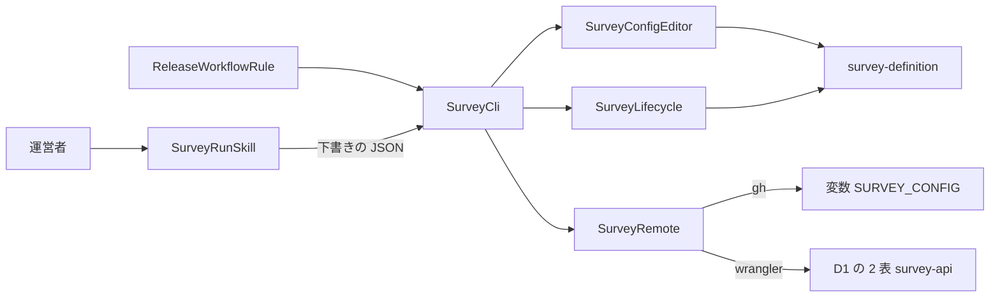
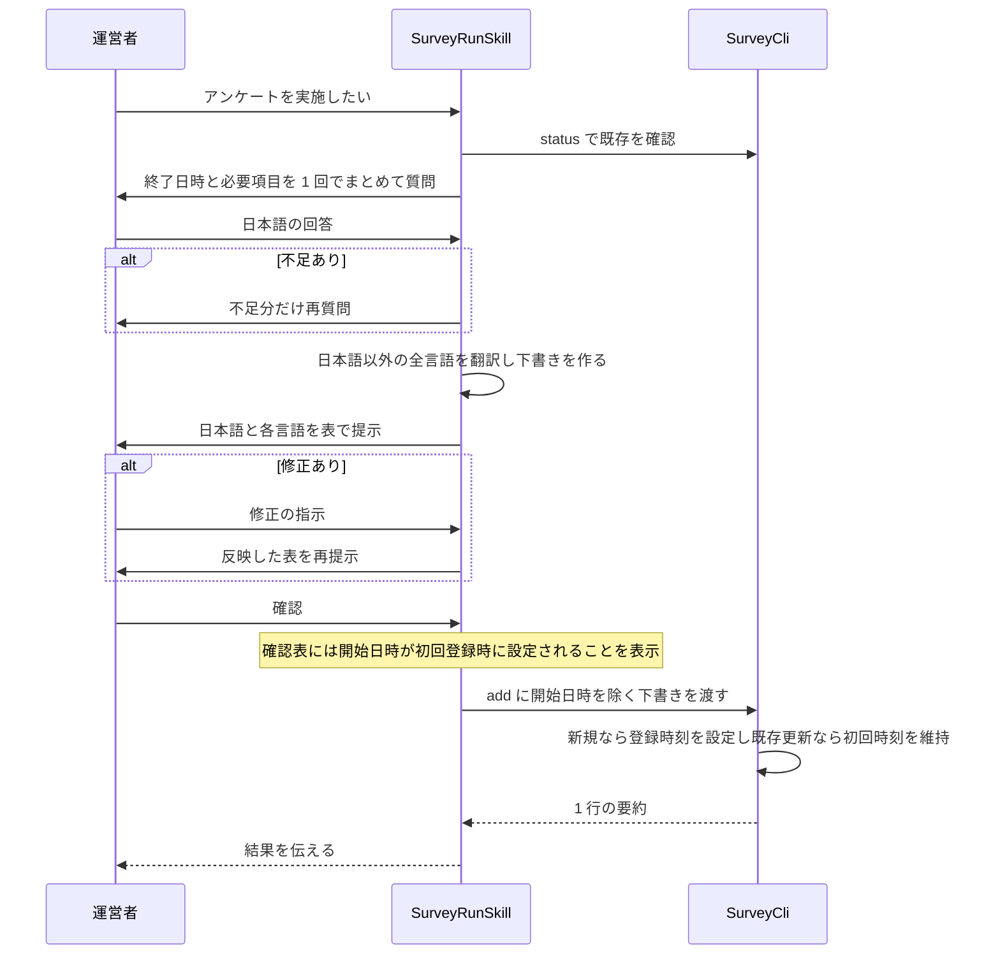
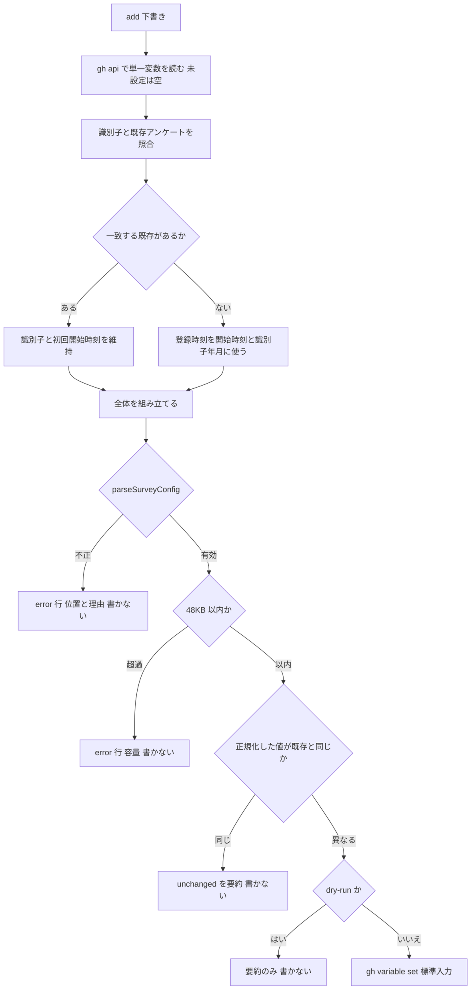
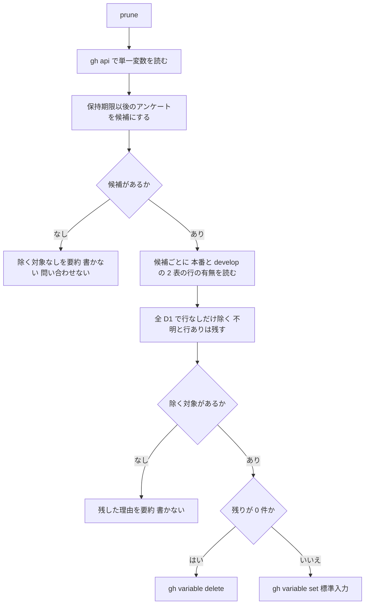

# Design Document

## Overview

**Purpose**: 運営者がアンケートを実施するときの聞き取り・翻訳・検証・登録と、回答データの削除が終わった期限切れのアンケートの除去を、再現できる手順と決定的な道具にする。
**Users**: アンケートを実施する運営者（Claude または Codex を使って運用手順を進める）。画面や API の利用者には現れない。
**Impact**: `hack/survey/` にコマンドラインの道具を足し、`.claude/skills/survey-run/` と `.agents/skills/survey-run/` に Claude・Codex 用の定型スキルを置き、`DEVELOP.md` に main へ取り込む前の定型工程を足す。実行時のアプリのコード・D1・CI のワークフローは変えない。

### Goals

- 追加・状態・除去を、判断を持たない決定的なコマンドにし、繰り返しても結果が変わらないようにする。
- 運営者が指定するのは終了日時と質問内容だけにし、開始日時は初回登録時に設定して更新時も維持する。
- 聞き取りと翻訳は定型のスキルにし、運営者の入力は日本語のみ、確認は表 1 つにする。
- 期限切れの除去を、main へ取り込む前の定型工程として、指示なしに走らせる。
- 出力を 1 行の要約に固定し、会話の消費を抑える。

### Non-Goals

- 設定の形式と検証、保持期限の算出（survey-definition）。
- 回答データの削除の実行（survey-api の日次の枠）。
- 回答の集計と閲覧。
- CI からの変数の書き込み、自動マージ、プラグイン（branch-release-workflow）の変更。

## Boundary Commitments

### This Spec Owns

- 設定の元 `SURVEY_CONFIG` の値を書き換える唯一の経路（`add` と `prune`）と、その冪等な規則（正規化・比較・容量の確認・0 件のときの削除）。
- アンケートの初回開始日時の設定・更新時の維持、および識別子の決め方（初回登録時刻の年月（日本標準時）と連番）。
- 除去の判定（保持期限以後かつ本番と開発の D1 に行が無い）と、確認不能なときに除かない規則。
- 出力の契約（成功は stdout に 1 行、失敗は stderr に 1 行と終了コード 1）。
- 聞き取り項目・翻訳・確認の手順（プロジェクトスキル `survey-run`）。
- main へ取り込む前の定型工程（`DEVELOP.md` の規則）。

### Out of Boundary

- 設定のスキーマ・検証・期間と保持期限の判定（survey-definition。ここでは呼び出すだけ）。
- D1 の表の定義・回答の保存・日次の削除（survey-api。ここでは行の有無を読むだけ）。
- ビルドでの静的ファイルの生成（survey-definition の `SurveyConfigRenderer`）。
- `SURVEY_HASH_KEY` の登録と生成（survey-api）。
- プライバシーポリシーの記載。

### Allowed Dependencies

- survey-definition の `parseSurveyConfig`・`retentionExpired`・`SurveyConfig`・`Survey`、`src/lib/i18n/locale.ts` の `LOCALES`（型・定数のみ。`@atproto/*` に依存しない）。
- `hack/sync-deploy-env.mjs` の `repositoryFromRemote`・`parseDeployEnv`（読み取りのみ）、`wrangler.template.jsonc` の D1 の名前（読み取りのみ）。
- 手元で認証済みの `gh` と `wrangler`、`tsx`（既存の devDependency）、`node:util` の `parseArgs`。
- 依存してはならないもの: CI のワークフローでの実行、`GITHUB_TOKEN`、Worker のコード、D1 への書き込み・削除の文。

### Revalidation Triggers

- survey-definition のスキーマ・識別子の規則・保持期限の判定（`retentionExpired`）の変更（追加の検証と除去の判定を再確認する）。
- survey-api の表名・`survey_id` 列・D1 の名前の規則の変更（`SurveyRemote` の問い合わせを再確認する）。
- 設定の元の名前 `SURVEY_CONFIG`、変数の容量の上限の変更。
- `gh api` の単一変数 GET 応答、`gh variable`、`wrangler d1 execute` の出力形式の変更。
- `DEVELOP.md` の main への取り込みの手順の変更、branch-release-workflow の流れの変更。

## Architecture

### Existing Architecture Analysis

- `hack/` の配備用スクリプトは、値を標準入力で渡し、画面に出さず、冪等に動く。同じ流儀を保つ。
- `tsx` は既存で、`@/` のパスエイリアスは `tsconfig.json` の `paths` で解決される。TypeScript のスキーマを共有する道具は、`hack/build-openapi-document.ts` と同じく TypeScript で書く。
- 現行の `hack/survey/config.ts` と `survey-run/SKILL.md` は下書きに開始日時を含め、運営者に開始日時も尋ねている。今回の要件変更に合わせ、下書きの契約から `opensAt` を除外し、CLI が登録時刻を設定するよう変更する。
- プロジェクトの作業手順の正本は `DEVELOP.md`。ブランチの運用は外部プラグインに任せ、リポジトリ内の規則は steering に書く。

### Architecture Pattern & Boundary Map



**Architecture Integration**:

- Selected pattern: 純粋な規則（`SurveyConfigEditor`・`SurveyLifecycle`）と入出力（`SurveyRemote`）を分け、`SurveyCli` が「読む→変換→正規化→比較→書く」の流れで束ねる。
- Dependency direction: `SurveyDefinition`（上流）→ `SurveyConfigEditor`・`SurveyLifecycle` → `SurveyCli` ← `SurveyRemote`。純粋な部品は `SurveyRemote` を import しない。`SurveyCli` だけが両方を知る。スキルと規則は `SurveyCli` の外側から呼ぶだけで、逆向きの import は無い。
- Domain/feature boundaries: 規則（識別子・正規化・判定）は変わる理由が運営の方針、入出力は `gh`・`wrangler` の仕様、手順は運営の作法で、変更の理由が別なので分ける。
- Existing patterns preserved: 標準入力での値の受け渡し、`repositoryFromRemote`・`parseDeployEnv` の再利用、`hack/` 配下の日本語の責務コメント。
- Steering compliance: `tech.md` の方針、`coding-conventions.md` のコメント規約、`DEVELOP.md` の乖離を作らない規則。

### Technology Stack

| Layer                    | Choice / Version                        | Role in Feature                       | Notes                         |
| ------------------------ | --------------------------------------- | ------------------------------------- | ----------------------------- |
| Frontend / CLI           | TypeScript、`tsx`（既存）、`parseArgs`  | 追加・状態・除去のコマンド            | `npm run survey` から実行する |
| Backend / Services       | `gh`（手元で認証済み）                  | 変数の取得・設定・削除                | 値は標準入力で渡す            |
| Data / Storage           | `wrangler d1 execute`（手元で認証済み） | 回答データの有無を読む（SELECT のみ） | 本番と develop の 2 つの D1   |
| Messaging / Events       | なし                                    | —                                     | —                             |
| Infrastructure / Runtime | 運営者の手元の Node.js                  | すべての操作                          | CI では実行しない             |

## File Structure Plan

### Directory Structure

```
hack/survey/
├── config.ts      # SurveyConfigEditor: 登録時刻・初回時刻の維持、追加・除去、識別子、正規化、容量（純粋）
├── lifecycle.ts   # SurveyLifecycle: アンケートの段階の判定、除去の候補と判定（純粋）
├── remote.ts      # SurveyRemote: gh と wrangler の呼び出し。失敗の分類
└── cli.ts         # SurveyCli: 引数、適用の流れ、1 行の要約、終了コード
.claude/skills/survey-run/
└── SKILL.md       # Claude 用の SurveyRunSkill エントリポイントと運用手順
.agents/skills/survey-run/
└── SKILL.md       # Codex 用の SurveyRunSkill エントリポイントと同一の運用手順
tests/hack/survey/
├── config.test.ts       # SurveyConfigEditor の単体テスト
├── lifecycle.test.ts    # SurveyLifecycle の単体テスト
├── remote.test.ts       # SurveyRemote（固定の出力例による分類）
├── cli.test.ts          # SurveyCli（偽の SurveyRemote による統合）
└── skillAndRule.test.ts # 両スキルが Git 管理され手順と workflow の参照が一致すること
tests/fixtures/survey-operation/    # 下書き・既存の設定・gh と wrangler の固定の出力例
```

### Modified Files

- `hack/survey/config.ts` — SurveyConfigEditor: `DraftSurvey` から `opensAt` を除き、既存初回時刻の再利用と新規登録時刻の設定を行う。
- `hack/survey/cli.ts` — SurveyCli: 追加実行で時刻を一度取得して `SurveyConfigEditor` に渡す。
- `.claude/skills/survey-run/SKILL.md`・`.agents/skills/survey-run/SKILL.md` — SurveyRunSkill: Claude と Codex のネイティブ配置に同じ起動条件・手順・確認表・CLI 契約を置く。
- `tests/hack/survey/config.test.ts`・`tests/hack/survey/cli.test.ts` — 初回時刻の設定・維持・冪等性を検証する。
- `tests/hack/survey/skillAndRule.test.ts` — 両スキルが Git 管理対象であり、同じ運用手順を持ち、`DEVELOP.md` から両方へ到達できることを検査する。
- `tests/fixtures/survey-operation/drafts/with-id.json`・`without-id.json` — 下書きが開始日時の手入力を求めない契約に追随する。
- `package.json` — SurveyCli: スクリプト `survey`（`tsx hack/survey/cli.ts`）を足す。
- `DEVELOP.md` — ReleaseWorkflowRule: 「main への取り込み」の節を足し、除去を取り込み前の定型工程にする。
- `deploy.env.template` — SurveyCli: `SURVEY_CONFIG` は運営の道具が管理するため `[github.variables]` に書かない旨のコメントを足す。

> `.gitignore` は変更しない。両スキルの配置は `.gitignore` の対象外であり、`skillAndRule.test.ts` が両方を検査する。

## System Flows

### 聞き取りのフロー



確認の前は `add` を呼ばず、設定の元に触れない。運営者には終了日時だけを尋ね、確認表では「開始日時は初回登録時に自動設定、更新時は維持」と示す。下書きに開始日時を含めない。修正は識別子を指定して同じ流れで更新する。

### 追加のフロー



### 除去のフロー



- 候補が無ければ D1 に一切問い合わせない（要件 5.10）。
- `--dry-run` は書き込み・削除の直前で止め、実行した場合の要約を出す。
- マージの定型工程では、`prune` が失敗しても取り込みを止めず、運営者に報告する（要件 6.3）。

## Requirements Traceability

| Requirement | Summary                                                              | Components                                    | Interfaces                                        | Flows                      |
| ----------- | -------------------------------------------------------------------- | --------------------------------------------- | ------------------------------------------------- | -------------------------- |
| 1.1         | 終了日時と質問項目を一度に聞き開始日時は聞かない                     | SurveyRunSkill                                | 聞き取りの手順                                    | 聞き取りのフロー           |
| 1.2         | 運営者から受けるのは日本語のみ                                       | SurveyRunSkill                                | 聞き取りの手順                                    | 聞き取りのフロー           |
| 1.3         | 不足の項目だけ再度尋ねる                                             | SurveyRunSkill                                | 聞き取りの手順                                    | 聞き取りのフロー           |
| 1.4         | 自由記述を受け付けない                                               | SurveyRunSkill, SurveyConfigEditor            | 聞き取りの手順、`addSurvey`（スキーマの検証）     | 聞き取りのフロー           |
| 1.5         | 既存の修正は対象を特定し初回開始時刻を維持して更新                   | SurveyRunSkill, SurveyCli, SurveyConfigEditor | `status`、`add`（識別子つき）                     | 聞き取りのフロー           |
| 2.1         | 日本語以外の全言語を翻訳                                             | SurveyRunSkill                                | 翻訳の手順（`LOCALES` を読む）                    | 聞き取りのフロー           |
| 2.2         | 開始時刻の自動設定と終了日時を表で示し確認を求める                   | SurveyRunSkill, SurveyCli                     | 確認の表                                          | 聞き取りのフロー           |
| 2.3         | 修正を反映して再確認                                                 | SurveyRunSkill                                | 確認の表                                          | 聞き取りのフロー           |
| 2.4         | 確認前は書き換えない                                                 | SurveyRunSkill                                | 確認後にだけ下書きを渡す手順                      | 聞き取りのフロー           |
| 2.5         | 言語が増えたら翻訳も増える                                           | SurveyRunSkill, SurveyConfigEditor            | `LOCALES` の参照、`addSurvey`（全言語必須の検証） | 聞き取りのフロー           |
| 3.1         | 初回登録時刻を開始時刻にして全体を検証後登録                         | SurveyConfigEditor, SurveyCli                 | `addSurvey`、適用の流れ                           | 追加のフロー               |
| 3.2         | 検証失敗は書かず位置と理由を示す                                     | SurveyConfigEditor, SurveyCli                 | `AddOutcome` の invalid、`error:` 行              | 追加のフロー               |
| 3.3         | 同じ識別子は初回開始時刻を維持して置き換える                         | SurveyConfigEditor                            | `addSurvey`                                       | 追加のフロー               |
| 3.4         | 同じ内容なら書かない                                                 | SurveyConfigEditor, SurveyCli                 | `AddOutcome` の unchanged、比較                   | 追加のフロー               |
| 3.5         | 同じ内容と終了日時は識別子と初回時刻を再利用し新規は登録時刻から採番 | SurveyConfigEditor                            | `addSurvey`（識別子の規則）                       | 追加のフロー               |
| 3.6         | 他のアンケートを変えない                                             | SurveyConfigEditor                            | `addSurvey`                                       | 追加のフロー               |
| 3.7         | 48KB を超えたら書かない                                              | SurveyConfigEditor                            | `AddOutcome` の too-large                         | 追加のフロー               |
| 3.8         | 未設定は空から始める                                                 | SurveyRemote, SurveyCli                       | `readConfigValue` の undefined                    | 追加のフロー               |
| 3.9         | 登録時刻順で正規化し同じ運営者入力の再登録で値を変えない             | SurveyConfigEditor                            | `serializeConfig`                                 | 追加のフロー               |
| 4.1         | 識別子と段階を示す                                                   | SurveyLifecycle, SurveyCli                    | `surveyPhase`、`status`                           | —                          |
| 4.2         | 使用量を上限との対比で示す                                           | SurveyConfigEditor, SurveyCli                 | `VARIABLE_LIMIT_BYTES`、`status`                  | —                          |
| 4.3         | 未設定は無いことを示す                                               | SurveyCli                                     | `status`                                          | —                          |
| 4.4         | 書き換えず回答データにも触れない                                     | SurveyCli                                     | `status`（`readConfigValue` のみ）                | —                          |
| 5.1         | 保持期限以後かつ行なしを除く                                         | SurveyLifecycle, SurveyConfigEditor           | `pruneCandidates`、`decidePrune`、`removeSurveys` | 除去のフロー               |
| 5.2         | 保持期限前は除かない                                                 | SurveyLifecycle                               | `pruneCandidates`                                 | 除去のフロー               |
| 5.3         | 行が残れば除かない                                                   | SurveyLifecycle                               | `decidePrune`                                     | 除去のフロー               |
| 5.4         | 確認不能は除かず示す                                                 | SurveyRemote, SurveyLifecycle                 | `RowPresence` の unknown、`decidePrune`           | 除去のフロー               |
| 5.5         | 本番と開発の両方を対象にする                                         | SurveyRemote                                  | `databaseNames`、`hasRows`                        | 除去のフロー               |
| 5.6         | 削除せず読むだけ                                                     | SurveyRemote                                  | `hasRows`（SELECT のみ）                          | 除去のフロー               |
| 5.7         | 対象なしは書き換えず示す                                             | SurveyCli                                     | `prune`、適用の流れの比較                         | 除去のフロー               |
| 5.8         | 全件除いたら未設定にする                                             | SurveyCli, SurveyRemote                       | `deleteConfigValue`                               | 除去のフロー               |
| 5.9         | 繰り返しても結果が変わらない                                         | SurveyLifecycle, SurveyCli                    | `decidePrune`、適用の流れの比較                   | 除去のフロー               |
| 5.10        | 保持期限前は問い合わせない                                           | SurveyLifecycle, SurveyCli                    | `pruneCandidates` の結果だけを `hasRows` に渡す   | 除去のフロー               |
| 6.1         | マージの前に除去を実行                                               | ReleaseWorkflowRule                           | workflow.md の「main への取り込み」の節           | 除去のフロー               |
| 6.2         | 配備が読む前に反映                                                   | ReleaseWorkflowRule                           | マージの前という順序                              | 除去のフロー               |
| 6.3         | 失敗は報告しつつ手順を続けられる                                     | ReleaseWorkflowRule, SurveyCli                | 終了コードと `error:` 行                          | 除去のフロー               |
| 6.4         | 追加の指示を求めない                                                 | ReleaseWorkflowRule                           | 定型工程の規則                                    | 除去のフロー               |
| 6.5         | 作業手順に明記                                                       | ReleaseWorkflowRule                           | workflow.md の節                                  | —                          |
| 7.1         | 手元の認証済みの道具だけを使う                                       | SurveyRemote                                  | `gh`・`wrangler` の呼び出し                       | —                          |
| 7.2         | 認証情報を残さない                                                   | SurveyRemote, SurveyCli                       | 標準入力での受け渡し、固定の失敗理由              | —                          |
| 7.3         | 認証がなければ示して異常終了                                         | SurveyRemote, SurveyCli                       | `RemoteError` の auth                             | —                          |
| 7.4         | 設定の元は内容のみ                                                   | SurveyConfigEditor, SurveyRunSkill            | strict スキーマの検証、聞き取り項目               | 追加のフロー               |
| 8.1         | 成功は 1 行の要約                                                    | SurveyCli                                     | `summarize*`                                      | —                          |
| 8.2         | 失敗は理由 1 行で異常終了                                            | SurveyCli                                     | `error:` 行、終了コード 1                         | —                          |
| 8.3         | 要約に全文・回答・認証情報を含めない                                 | SurveyCli                                     | `summarize*` の固定の項目                         | —                          |
| 8.4         | dry-run で書かずに要約を示す                                         | SurveyCli                                     | `--dry-run`                                       | 追加のフロー、除去のフロー |

## Components and Interfaces

| Component           | Domain/Layer | Intent                                                 | Req Coverage                                                                                             | Key Dependencies (P0/P1)                                                     | Contracts      |
| ------------------- | ------------ | ------------------------------------------------------ | -------------------------------------------------------------------------------------------------------- | ---------------------------------------------------------------------------- | -------------- |
| SurveyConfigEditor  | 規則（純粋） | 開始時刻の設定・維持、追加・除去、識別子、正規化、容量 | 1.4, 1.5, 2.5, 3.1, 3.2, 3.3, 3.4, 3.5, 3.6, 3.7, 3.9, 4.2, 5.1, 7.4                                     | survey-definition（P0）、`LOCALES`（P0）                                     | Service        |
| SurveyLifecycle     | 規則（純粋） | 段階の判定と、除去の候補・判定                         | 4.1, 5.1, 5.2, 5.3, 5.4, 5.5, 5.9, 5.10                                                                  | survey-definition の `retentionExpired`（P0）                                | Service        |
| SurveyRemote        | 入出力       | `gh`・`wrangler` の呼び出しと失敗の分類                | 3.8, 5.4, 5.5, 5.6, 5.8, 7.1, 7.2, 7.3                                                                   | `gh`（P0）、`wrangler`（P0）、`repositoryFromRemote`・`parseDeployEnv`（P1） | Service, Batch |
| SurveyCli           | 統合         | 引数・登録時刻の受け渡し・適用・1 行の要約・終了コード | 1.5, 2.2, 3.1, 3.2, 3.4, 3.8, 4.1, 4.2, 4.3, 4.4, 5.7, 5.8, 5.9, 5.10, 6.3, 7.2, 7.3, 8.1, 8.2, 8.3, 8.4 | 上の 3 部品（P0）                                                            | Batch          |
| SurveyRunSkill      | 手順         | Claude・Codex の同一手順を持つネイティブスキル         | 1.1, 1.2, 1.3, 1.4, 1.5, 2.1, 2.2, 2.3, 2.4, 2.5, 7.4                                                    | SurveyCli（P0）                                                              | —              |
| ReleaseWorkflowRule | 手順         | main へ取り込む前に除去を行う規則                      | 6.1, 6.2, 6.3, 6.4, 6.5                                                                                  | SurveyCli（P0）、SurveyRunSkill（P1）                                        | —              |

### 規則

#### SurveyConfigEditor

| Field        | Detail                                                               |
| ------------ | -------------------------------------------------------------------- |
| Intent       | 設定への追加・除去を純粋関数にし、正規化した値と結果の種別を返す     |
| Requirements | 1.4, 1.5, 2.5, 3.1, 3.2, 3.3, 3.4, 3.5, 3.6, 3.7, 3.9, 4.2, 5.1, 7.4 |

**Responsibilities & Constraints**

- 入出力に副作用を持たない（変数・ファイル・時刻に触れない）。
- 検証は常に `parseSurveyConfig` を、追加後の全体に対して行う。独自の検証規則を足さない。
- 下書きに `opensAt` を含めず、初回登録時刻を `SurveyCli` から渡す。識別子が既存ならその設定の `opensAt` を維持する。識別子が省略されている場合は、開始時刻を除いた運営者確認済み内容と終了日時が同じ既存アンケートを先に探し、その識別子と初回開始時刻を再利用する。一致しなければ登録時刻を `opensAt` とする。
- 正規化は、アンケートを `opensAt` の順に並べ、検証を通した内容をスキーマの順で JSON にする。同じ内容なら同じ文字列になる。
- 識別子: 下書きに `id` があればそれを使い、同じ識別子の既存を置き換えて `opensAt` を維持する。無ければ、`opensAt` と `id` を除く運営者確認済み内容および `closesAt` が既存と一致するアンケートの識別子と `opensAt` を再利用する。一致しなければ初回登録時刻を `opensAt` とし、`YYYY-MM-N`（`YYYY-MM` は初回登録時刻を日本標準時に直した年月、`N` は同じ年月の識別子と衝突しない最小の 1 以上の整数）を割り当てる。識別子の規則（英小文字・数字・ハイフン、40 文字以内）を満たす。
- 容量: 正規化した値の UTF-8 のバイト数が 48KB（49152 バイト）を超えたら `too-large`。

**Dependencies**

- Inbound: SurveyCli — 追加・除去の変換と正規化（P0）
- Outbound: survey-definition の `parseSurveyConfig`・`Survey`・`SurveyConfig`（P0）
- External: `LOCALES`（P0。スキルが翻訳対象の言語を知るために参照する。この部品は直接は使わず、検証が全言語を要求する）

**Contracts**: Service [x]

##### Service Interface

```ts
import type { Survey, SurveyConfig } from "@/lib/survey/definition"

/** 変数の容量の上限（GitHub の変数は 48KB まで） */
export const VARIABLE_LIMIT_BYTES: number

/** 聞き取りの結果。識別子は省略できる */
export type DraftSurvey = Omit<Survey, "id" | "opensAt"> & {
  id?: string
}

export type AddOutcome =
  | {
      status: "created" | "updated" | "unchanged"
      id: string
      config: SurveyConfig
      value: string
    }
  | { status: "invalid"; issues: string[] } // 各要素は「位置: 理由」。入力の値を含めない
  | { status: "too-large"; bytes: number }

/** current は変数の現在の設定（未設定は空の設定）。draft は開始時刻を含まない未検証の入力。registeredAt は CLI が取得した初回登録候補時刻。 */
export const addSurvey: (
  current: SurveyConfig,
  draft: unknown,
  registeredAt: Date,
) => AddOutcome
export const removeSurveys: (
  config: SurveyConfig,
  ids: readonly string[],
) => SurveyConfig
export const serializeConfig: (config: SurveyConfig) => string
export const byteLength: (value: string) => number
```

- Preconditions: `current` は検証済みの設定。`draft` は開始日時を持たない任意の値。`registeredAt` は有限の日時である。
- Postconditions: `created`/`updated`/`unchanged` のとき `config` は `parseSurveyConfig` を通り、`value` は 48KB 以内の `serializeConfig(config)`。新規の `opensAt` は `registeredAt.toISOString()`、既存更新または同一入力の再登録では初回 `opensAt` を保持する。`unchanged` は `serializeConfig(current)` と `value` が等しいときだけ。他のアンケートの内容は変わらない。
- Invariants: `issues` に入力の値を含めない（`parseSurveyConfig` の契約を引き継ぐ）。

**Implementation Notes**

- Integration: 下書きから識別子を除いて正規化する際は、仮の識別子（`draft`）を与えた 1 件の設定として `parseSurveyConfig` に通し、出力の順序をそろえて比較する。
- Validation: `registeredAt` は有限の日時であることを CLI 境界で保証し、設定全体を `parseSurveyConfig` に通して、開始時刻より後の終了日時など上流の制約を検証する。
- Risks: 終了日時が登録時刻以前なら上流検証で拒否される。スキルは更新対象の識別子を `status` で確定して渡し、意図しない新規 ID の発行を防ぐ。

#### SurveyLifecycle

| Field        | Detail                                                         |
| ------------ | -------------------------------------------------------------- |
| Intent       | アンケートの段階を判定し、除去の候補と最終判定を純粋関数で返す |
| Requirements | 4.1, 5.1, 5.2, 5.3, 5.4, 5.5, 5.9, 5.10                        |

**Responsibilities & Constraints**

- 保持期限の判定は survey-definition の `retentionExpired` を使い、独自に日付を計算しない。
- 段階: `upcoming`（`now < opensAt`）、`active`（`opensAt <= now < closesAt`）、`retained`（`closesAt <= now` かつ回答の保持期限の前）、`expired`（回答の保持期限以後）。
- 候補は `expired` のアンケートだけ。候補以外は D1 への問い合わせの対象にしない。
- 判定: 候補ごとに、すべての D1 の 2 表で「行なし」であるものだけを除く。1 つでも「行あり」か「不明」があれば残し、理由を `rows` か `unknown` で返す（`rows` は `unknown` より優先して報告する）。

**Dependencies**

- Inbound: SurveyCli（P0）
- Outbound: survey-definition の `retentionExpired`・`Survey`（P0）

**Contracts**: Service [x]

##### Service Interface

```ts
import type { Survey, SurveyConfig } from "@/lib/survey/definition"

export type SurveyPhase = "upcoming" | "active" | "retained" | "expired"
export type RowPresence = "none" | "present" | "unknown"

export type PruneDecision = {
  remove: string[] // 除くアンケートの識別子
  kept: { id: string; reason: "rows" | "unknown" }[] // 候補だったが残すもの
}

export const surveyPhase: (survey: Survey, now: Date) => SurveyPhase
export const pruneCandidates: (config: SurveyConfig, now: Date) => Survey[]
/** presence は候補の識別子ごとの、各 D1 の判定結果の配列（D1 ごとに 2 表を合算した結果） */
export const decidePrune: (
  candidates: readonly Survey[],
  presence: Readonly<Record<string, readonly RowPresence[]>>,
) => PruneDecision
```

- Preconditions: `presence` は候補すべての識別子を持つ。
- Postconditions: `remove` の各要素は候補で、その `presence` がすべて `none`。
- Invariants: 同じ入力から同じ結果。時刻は引数だけで決まる。

#### SurveyRemote

| Field        | Detail                                                               |
| ------------ | -------------------------------------------------------------------- |
| Intent       | 手元の認証済みの `gh`・`wrangler` を呼び、失敗を固定の分類にして返す |
| Requirements | 3.8, 5.4, 5.5, 5.6, 5.8, 7.1, 7.2, 7.3                               |

**Responsibilities & Constraints**

- 変数の取得は `gh api repos/<owner>/<repo>/actions/variables/SURVEY_CONFIG` で単一変数だけを読む。設定・削除は `gh variable set|delete SURVEY_CONFIG -R <owner/repo>` を使い、設定の値は標準入力で渡す。値を引数・ログ・要約に出さない。
- 変数が未設定のときは `undefined` を返す。「見つからない」旨の失敗だけを未設定とみなし、認証切れなどは区別する。
- 回答データの有無: D1 の名前（`wrangler.template.jsonc` の `database_name` と、その末尾に `-develop` を付けた名前）ごとに、`wrangler d1 execute <名前> --remote --json --command` で SELECT のみを発行する。1 回の問い合わせで 2 表の `EXISTS` を同時に読む。識別子が規則に合わないときは問い合わせず `unknown` にする。
- 失敗は `RemoteError` の分類（`auth`・`unavailable`・`parse`）に固定し、`gh`・`wrangler` の標準エラーの文言は返さない（認証情報や値が混ざりうるため）。
- 認証情報: シェルの環境変数を優先し、無ければ `deploy.env` の `CLOUDFLARE_API_TOKEN`・`CLOUDFLARE_ACCOUNT_ID` があれば `wrangler` の環境に渡す（`sync-deploy-env.mjs` と同じ規則）。どちらも無ければ、手元のログイン状態に任せる。
- 書き込みの文（INSERT・UPDATE・DELETE・DDL）を発行しない。

**Dependencies**

- Inbound: SurveyCli（P0）
- External: `gh`（P0）、`wrangler`（P0）、`repositoryFromRemote`・`parseDeployEnv`（P1）

**Contracts**: Service [x] / Batch [x]

##### Service Interface

```ts
export type RemoteErrorKind = "auth" | "unavailable" | "parse"
export class RemoteError extends Error {
  constructor(public kind: RemoteErrorKind) // 固定の文言のみ
}

export type SurveyRemote = {
  /** 変数の値。未設定は undefined */
  readConfigValue(): Promise<string | undefined>
  writeConfigValue(value: string): Promise<void>
  deleteConfigValue(): Promise<void>
  /** 識別子のアンケートの行の有無。D1 ごとの判定（2 表の和）の配列。失敗は unknown */
  hasRows(surveyId: string): Promise<RowPresence[]>
}

export const createSurveyRemote: (options?: {
  run?: (command: string, args: string[], input?: string) => { status: number | null; stdout: string; stderr: string }
  repo?: string
}) => SurveyRemote
```

- Preconditions: `gh`・`wrangler` が手元で認証済み。
- Postconditions: `hasRows` は例外を投げず、問い合わせや解析の失敗は `unknown` にする。`read/write/delete` の失敗は `RemoteError`。
- Invariants: 秘密の値・変数の値を、ログ・例外のメッセージ・戻り値に含めない。

##### Batch / Job Contract

- Trigger: `SurveyCli` の呼び出し（運営者の手元の実行のみ）。
- Input / validation: 識別子は survey-definition の規則に合うものだけを埋め込む。
- Output / destination: 変数 `SURVEY_CONFIG`、読み取りのみの D1。
- Idempotency & recovery: 書き込みは同じ値なら上位で呼ばれない。失敗しても変数は変わらないか、直前の値のまま（`gh` の 1 回の呼び出しが単位）。

**Implementation Notes**

- Integration: `run` を注入できるようにして、テストでは固定の出力を返す。単一変数 GET API の 404 による「見つからない」の判定と `wrangler d1 execute --json` の出力の形（結果の配列の 1 行目の `EXISTS` の列）は、固定の出力例を `tests/fixtures/survey-operation/` に置いてテストに使う。実装時に実機の出力で例を確かめる。
- Validation: D1 の名前は、テンプレートに複数の D1 がある場合に備え、`database_name` が複数あっても `binding` が `DB` のものを使う。
- Risks: `wrangler` の標準出力に進捗の行が混ざることがある。`--json` の出力から JSON の部分だけを取り出す。取り出せなければ `unknown`。

### 統合

#### SurveyCli

| Field        | Detail                                                                                                   |
| ------------ | -------------------------------------------------------------------------------------------------------- |
| Intent       | 引数を解釈し、適用の流れで部品を束ね、1 行の要約と終了コードを返す                                       |
| Requirements | 1.5, 2.2, 3.1, 3.2, 3.4, 3.8, 4.1, 4.2, 4.3, 4.4, 5.7, 5.8, 5.9, 5.10, 6.3, 7.2, 7.3, 8.1, 8.2, 8.3, 8.4 |

**Responsibilities & Constraints**

- サブコマンド `add --file <パス> [--dry-run]`、`status`、`prune [--dry-run]`。共通で `--repo <owner/repo>`（既定は `repositoryFromRemote` で判定）。
- 適用の流れ: 読む → 検証済みの設定にする（既存の値が不正なら `error:`）→ `registeredAt` を一度取得 → 変換（既存の初回 `opensAt` を優先）→ 正規化 → 比較 → 書く／削除する／何もしない。同じ値なら書かない。0 件になるなら削除する。`--dry-run` は書く直前で止める。
- `status` は変数を読むだけで、D1 にも触れない。`add` は D1 に触れない。`prune` だけが D1 を読む。
- 出力は stdout に 1 行（成功）、stderr に 1 行（失敗）。内容は固定の項目の組み合わせで、設定の本文・回答・認証情報・外部コマンドの標準エラーを含めない。`--dry-run` の要約は先頭に `[dry-run] ` を付ける。
- 終了コード: 成功 0、失敗（検証・容量・認証・入出力）1。`prune` で「残した理由」があるだけなら 0。

要約の形（1 行）:

| 操作        | 形式の例                                                                                                                            |
| ----------- | ----------------------------------------------------------------------------------------------------------------------------------- |
| add（成功） | `add: created 2026-11-1 (surveys 2, 3.1/48 KB)`（`created` / `updated` / `unchanged`）                                              |
| status      | `status: surveys 3 [2026-09-1 expired, 2026-10-1 retained, 2026-11-1 active] 3.1/48 KB`、なしは `status: no surveys`                |
| prune       | `prune: removed 2026-09-1 (surveys 3 -> 2)`、残しがあれば `; kept 2026-10-1(rows)`、対象なしは `prune: nothing to remove`           |
| 失敗        | `error: invalid: surveys.0.opensAt: ... (+2 more)`、`error: too-large: 49300 bytes`、`error: auth: gh または wrangler の認証が必要` |

**Dependencies**

- Outbound: SurveyConfigEditor（P0）、SurveyLifecycle（P0）、SurveyRemote（P0）、survey-definition の `parseSurveyConfig`（P0）

**Contracts**: Batch [x]

##### Batch / Job Contract

- Trigger: `npm run survey -- <サブコマンド>`（スキルと `DEVELOP.md` の規則から呼ぶ）。
- Input / validation: `add` の下書きは `opensAt` を含まない JSON ファイル 1 つ（`DraftSurvey`）。CLI が取得した `registeredAt` と既存設定を合わせて開始日時を構成する。解釈できなければ `error: invalid`。
- Output / destination: 変数 `SURVEY_CONFIG` と、1 行の要約。
- Idempotency & recovery: 同じ入力・同じ状態で繰り返しても、2 回目以降は書き込みが起きない。途中で失敗しても変数は変わらない。

```ts
export const run: (
  argv: readonly string[],
  deps?: {
    remote?: SurveyRemote
    now?: () => Date
    readFile?: (path: string) => string
  },
) => Promise<{ code: 0 | 1; line: string }>

`now` は `add` 操作の登録時刻を決定論的に注入する。
```

**Implementation Notes**

- Integration: `run` は標準出力へ書かず `line` を返す。実行ファイルとしての入口だけが出力する（テストしやすくするため）。
- Validation: `add` の下書きは `unknown` として扱い、`SurveyConfigEditor.addSurvey` に渡す。
- Risks: 変数の現在の値が不正（手で壊れた）なら、書き込まずに `error: invalid` で止める。運営者が内容を直してから再実行する。

### 手順

#### SurveyRunSkill

| Field        | Detail                                                                     |
| ------------ | -------------------------------------------------------------------------- |
| Intent       | 運営者の依頼から、聞き取り・翻訳・確認・登録・除去までを定型の手順で進める |
| Requirements | 1.1, 1.2, 1.3, 1.4, 1.5, 2.1, 2.2, 2.3, 2.4, 2.5, 7.4                      |

**Responsibilities & Constraints**

- ネイティブのスキルファイルを `.claude/skills/survey-run/SKILL.md` と `.agents/skills/survey-run/SKILL.md` に 1 つずつ置く。どちらも `name: survey-run` と同じ trigger description・本文を持ち、実行環境のスキル探索規約に従う。
- 聞き取りは 1 回の依頼で、終了日時（日本標準時の暦で聞き、オフセットつきの日時に直す）・タイトル・説明（任意）・質問（種別、選択肢、複数選択の上限）・「回答しない」の有無をまとめて尋ねる。受ける文言は日本語のみ。不足は不足分だけ再度尋ねる。自由記述の質問は受けない。
- 翻訳は `src/lib/i18n/locale.ts` の `LOCALES` から日本語以外のすべての言語について作る。言語を決め打ちしない。
- 確認は、日本語と各言語の文言・「開始日時は初回登録時に自動設定され、更新時は維持」の説明・運営者指定の終了日時・複数選択の上限・「回答しない」の有無を 1 つの表にして示す。運営者が確認するまで下書きを `add` に渡さない。修正は反映して表を示し直す。
- 既存の修正は、先に `status` で対象の識別子を特定し、下書きに識別子を指定して同じ流れで更新する。
- 設定の本文に載せるのはアンケートの内容だけ（質問・選択肢・期間・文言）。秘密情報・回答者の情報・個人名を載せない。
- 下書きは作業用の一時ファイル（リポジトリの外）に書き、登録後に消す。設定の元を `gh` で直接書き換えない。アンケートを設定から手で消さない（日次の削除が対象を失う）。
- 除去は `DEVELOP.md` の規則で自動に走る。スキルには、手動で実行する場合の手順（`prune --dry-run` の後に `prune`）と、結果の読み方を書く。

**Contracts**: （手順書のため該当なし）

**Implementation Notes**

- Integration / Validation / Risks: Claude と Codex はそれぞれのネイティブな配置先から `survey-run` を選び、両方が同一 CLI だけを操作する。起動語を含む同一の `description`・本文を使い、`skillAndRule.test.ts` が両パスの存在・Git 管理対象・メタデータ・本文一致を検査する。二重管理による差分と CLI の契約ずれを防ぐため、引数・要約を変えるときは両方を同時に更新する。

#### ReleaseWorkflowRule

| Field        | Detail                                                              |
| ------------ | ------------------------------------------------------------------- |
| Intent       | main へ取り込む前に、期限切れのアンケートの除去を定型工程として行う |
| Requirements | 6.1, 6.2, 6.3, 6.4, 6.5                                             |

**Responsibilities & Constraints**

- 置き場所は `DEVELOP.md` の「ブランチとプレビュー」の下に足す節「main への取り込み」。branch-release-workflow はリポジトリ外のプラグインのため変更しない。
- 規則: `develop` から `main` へ取り込む（PR の作成または保護ブランチへのマージの依頼を受けた）とき、取り込みの前に `npm run survey -- prune` を実行し、1 行の結果を運営者に報告する。運営者の追加の指示を待たない。
- 順序: 除去は取り込みの前。本番の配備は実行時に変数を読むため、取り込みより前に済ませると、そのリリースが除去後の設定でビルドされる。
- 失敗・確認不能のとき: 理由を報告し、変数を変えないまま取り込みを続ける。除去は次のリリースで再び試される。
- 認証: 手元の `gh`・`wrangler` を使う。CI に書き込み権限を預けない。

**Contracts**: （規則のため該当なし）

**Implementation Notes**

- Integration / Validation / Risks: `DEVELOP.md` は Claude・Codex 両方の `survey-run` スキルを案内し、共通の `npm run survey -- prune` を呼ぶ。`skillAndRule.test.ts` が規則・CLI コマンド・両スキルパスを検査する。どちらのエージェントも規則を見落とさないよう、両スキルの `description` に「main への取り込み前」を含める。

### Decision: Claude と Codex にネイティブな同名スキルを提供する

- **Context**: 既存の運用手順は `.claude/skills/` にだけあり、Codex から同じアンケート運用を直接起動できない。
- **Alternatives Considered**:
  1. Claude スキルのみを残し、Codex から Claude 固有ファイルを参照する
  2. `.claude/skills/survey-run/SKILL.md` と `.agents/skills/survey-run/SKILL.md` に同じ内容のネイティブスキルを置く
- **Selected Approach**: 2。両方で Agent Skills の `name`・`description`・`SKILL.md` 構造と同じ発火条件・本文を使い、Codex は `.agents/skills/`、Claude は `.claude/skills/` から発見する。いずれも同じ CLI と `SURVEY_CONFIG` 契約を使う。
- **Rationale**: 各エージェントがネイティブな探索先から起動でき、実処理を共有 CLI に集約したまま手順差を持たない。OpenAI の資料は `.claude/skills/*/SKILL.md` から `.agents/skills/*/SKILL.md` への対応を示し、repo-local Codex skills の場所を `.agents/skills/` としている。
- **Trade-offs**: 同じ内容を 2 つのファイルに置くため更新時の同期が必要。`skillAndRule.test.ts` で本文の一致、両方の存在・Git 管理、workflow の参照を確認する。
- **Follow-up**: skill の説明・確認フロー・CLI 呼び出しを両ファイルで一致させる。

## Data Models

### Domain Model

- 設定の元 `SURVEY_CONFIG` の値: survey-definition の `SurveyConfig` の JSON。この spec は形式を定めず、正規化（`opensAt` 順、スキーマの順のキー、余計な空白なし）の規則だけを持つ。
- 下書き `DraftSurvey`: `Survey` から `id` と `opensAt` を除き、`id` のみ任意で指定可能にした運営者入力・確認済みの内容。作業用の一時ファイルの JSON。
- 初回登録時刻: `SurveyCli` が追加操作の実行時に一度だけ取得する UTC 時刻。新規アンケートの `opensAt` に保存し、既存アンケートでは保存済みの値を優先する。
- アンケートの段階 `SurveyPhase`: `upcoming`・`active`・`retained`・`expired`。保存せず、時刻から毎回求める。
- 永続する状態: 設定の元と D1 のみ。この spec は新しい永続状態を持たない。

### Data Contracts & Integration

- 変数の容量: 48KB（49152 バイト、UTF-8）。
- D1 の読み取り: `SELECT EXISTS(SELECT 1 FROM survey_respondents WHERE survey_id = '<id>') AS r, EXISTS(SELECT 1 FROM survey_answers WHERE survey_id = '<id>') AS a`。表名と列名は survey-api の定義に従う。

## Error Handling

### Error Strategy

失敗はすべて固定の分類の 1 行（`error: <分類>: <固定の理由>`）にする。外部コマンドの標準エラーは出さない。変数を書き換える前に失敗が判明するように、検証・容量・比較を書き込みの前に済ませる。

### Error Categories and Responses

- 入力の誤り（下書きの検証失敗・解釈不能）: `error: invalid`。位置と理由を最大 3 件、超えた分は `(+N more)`。変数は変えない。
- 容量超過: `error: too-large`。変数は変えない。
- 認証: `error: auth`。手元でログインが要る旨。変数は変えない。
- 外部の失敗・解析不能: `error: unavailable`／`parse`。`prune` の D1 の確認だけは例外にせず「不明」として残す。
- 既存の値が不正: `error: invalid`（既存の値の位置と理由）。書き込まない。

### Monitoring

要約の 1 行が唯一の記録。実行履歴やログのファイルは持たない。

## Testing Strategy

### Unit Tests

- SurveyConfigEditor: 開始日時を含まない下書きで新規登録すると注入した登録時刻が `opensAt` になり、識別子年月もその時刻から採番する。明示 ID の更新と、ID なしで同じ運営者指定内容・終了日時の再登録は、既存 ID と初回 `opensAt` を維持する（1.5, 3.1, 3.3, 3.5, 3.9）。
- SurveyConfigEditor: 全体の検証失敗（言語の欠落・期間の重複・自由記述に相当する未定義の項目）が `invalid` になり、`issues` に入力の値が含まれない（1.4, 2.5, 3.2, 7.4）。
- SurveyConfigEditor: 正規化が入力のキー順・アンケートの順に依らず同じ値になり、同じ運営者入力と終了日時は初回 `opensAt` を保って `unchanged` となる（3.4, 3.9）。48KB を超えると `too-large`（3.7）。
- SurveyLifecycle: 時刻を動かして、保持期限の直前は `retained`、期限ちょうどで `expired` になり、候補は `expired` だけ（5.1, 5.2, 4.1）。
- SurveyLifecycle: 判定で、全 D1 が `none` のときだけ除かれ、`present`・`unknown` の混在では残る（5.3, 5.4, 5.5）。

### Integration Tests

- SurveyCli と偽の SurveyRemote: 固定した `now` を用いて新規追加・同一入力の再実行・明示 ID 更新を行い、初回 `opensAt` と変更有無が期待どおりで、書き込み回数が 1 回・0 回・更新時 1 回となる。`--dry-run` は 0 回（1.5, 3.1, 3.3, 3.4, 3.5, 3.9, 8.4）。未設定からの追加（3.8）。
- SurveyCli: `prune` で候補なしのとき `hasRows` が呼ばれず書き込みが 0 回（5.7, 5.10）。本番だけ 0 件・develop に行あり・確認不能のそれぞれで除かれない（5.3, 5.4, 5.5）。除いて残りがあれば書き込み、0 件なら削除（5.8）。繰り返しで 2 回目は書き込みなし（5.9）。
- SurveyCli: 成功の出力が 1 行で本文・認証情報を含まず、失敗が `error:` の 1 行で終了コード 1（8.1, 8.2, 8.3, 7.2）。`status` が書き込みと D1 への問い合わせをしない（4.4）。
- SurveyRemote: 固定の出力例から、変数が未設定の判別・認証切れの判別・D1 の JSON の解析（進捗行の混入を含む）・`wrangler` の失敗が `unknown` になること（3.8, 5.4, 7.3）。
- スキルと規則: Claude・Codex の `survey-run/SKILL.md` が存在し Git 管理対象で、本文が一致すること、`DEVELOP.md` が両方を参照し取り込み前の `prune` 規則を持つこと（6.1, 6.5）。

### E2E/UI Tests

- 該当なし（画面を持たない）。実機の `gh`・`wrangler` を使う確認は、検証用のリポジトリで `status`・`add --dry-run`・`prune --dry-run` を実行し、1 行の出力と変数の不変を確かめる手動の確認とする。

### Performance/Load

- `prune` の D1 への問い合わせは、保持期限以後のアンケート 1 件につき D1 の数（2）回で、各 2 表の主キーの先頭の参照 1 回ずつ。候補が無ければ 0 回。

## Security Considerations

- 設定の元への書き込み権限を CI に預けない。書き込みは手元の認証済みの `gh` に限る（7.1）。
- 値と認証情報は標準入力か環境変数で渡し、引数・ログ・要約・例外に出さない（7.2）。
- `wrangler d1 execute` には読み取りの文だけを渡す。埋め込む識別子は規則に合う検証済みの値に限る（SQL の組み立てに外部入力を直接使わない）。
- 設定の本文は公開の静的ファイルとして配信される（survey-definition）。聞き取りの項目は内容のみで、秘密・回答者の情報を含めない（7.4）。
