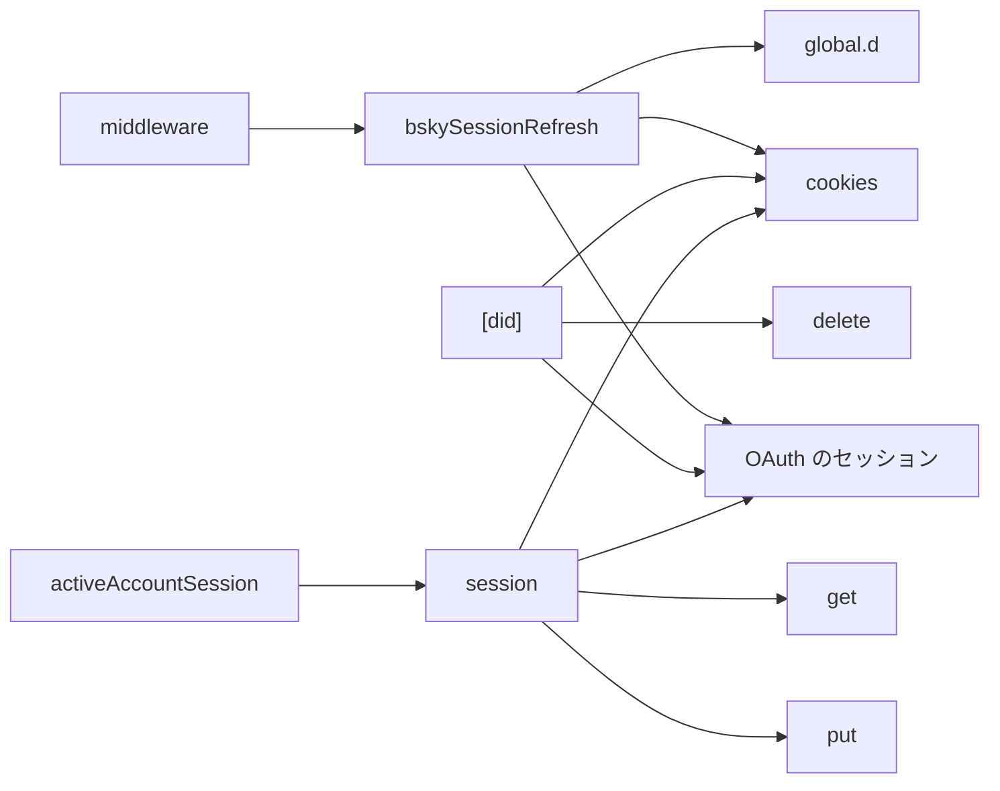
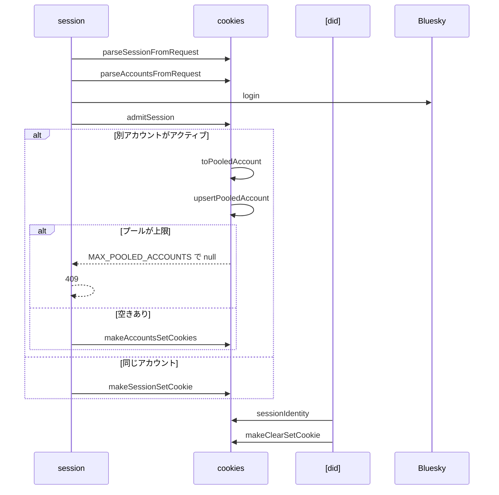
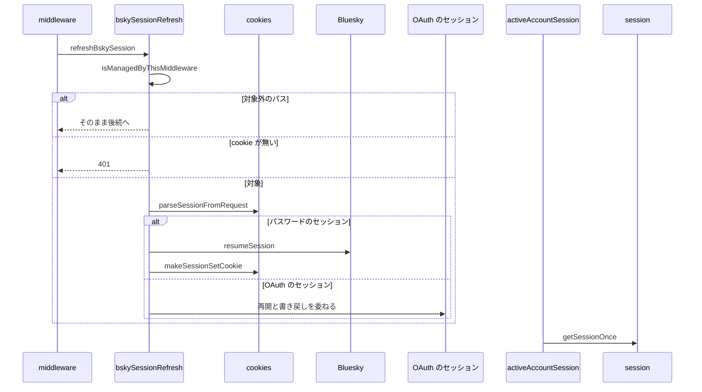

# アカウントセッション管理 設計書

## 1. 構成

| パス                                                | 責務                                     |
| --------------------------------------------------- | ---------------------------------------- |
| `src/lib/session/cookies.ts`                        | cookie の符号化・復号とプールの操作      |
| `src/lib/session/bskySessionRefresh.ts`             | セッションの自動再開とトークンの書き戻し |
| `src/middleware.ts`                                 | ミドルウェアの合成                       |
| `src/pages/v2/bsky/session.ts`                      | 一覧・追加ログイン・切り替えのハンドラ   |
| `src/pages/v2/bsky/session/[did].ts`                | ログアウトのハンドラ                     |
| `src/lib/api/schema/v2/bsky/session/get.ts`         | 一覧の応答のスキーマ                     |
| `src/lib/api/schema/v2/bsky/session/put.ts`         | 切り替えの入力のスキーマ                 |
| `src/lib/api/schema/v2/bsky/session/_did/delete.ts` | ログアウトのパスのスキーマ               |
| `src/lib/account/activeAccountSession.ts`           | アクティブアカウント情報の共有取得       |
| `src/global.d.ts`                                   | 認証済みのリクエストの locals の型       |

## 2. 関係図・ワークフロー

セッション操作と自動再開の依存方向を示す。



追加ログインと切り替えにおけるプールの更新と、上限超過時の分岐を示す。



リクエストごとの自動再開と、失敗時の分岐を示す。



## 3. 設計項目

### D-1: cookie の形式とプール (FR-1, FR-5, FR-6, FR-7, NFR-1)

```ts
export const MAX_POOLED_ACCOUNTS = 4
export type PasswordSession = { kind: "password"; session: AtpSessionData; service: string }
export type OAuthTokens = {
  accessToken: string
  expiresAt: number // UNIX 秒
  refreshToken: string
  dpopJwk: EcPrivateJwk
  issuer: string
  tokenEndpoint: string
  revocationEndpoint?: string
  clientId: string
}
export type OAuthSession = { kind: "oauth"; did: string; handle: string; pds: string; oauth: OAuthTokens }
export type StoredSession = PasswordSession | OAuthSession
export type PooledAccount = StoredSession & { addedAt: string }
export const sessionIdentity = (s: StoredSession): { did: string; handle: string }
export const parseSessionFromRequest = (request: Request): StoredSession | undefined // 無い・形が違えば undefined。壊れた値は例外
// Path=/ Max-Age=7日 HttpOnly SameSite=Strict、本番のみ Secure
export const makeSessionSetCookie = (s: StoredSession, opts?: { maxAge?: number; path?: string }): string
export const parseAccountsFromRequest = (request: Request): PooledAccount[] // 枠の番号順。壊れた枠は飛ばす
export const makeAccountsSetCookies = (accounts: PooledAccount[], opts?): string[] // 4枠すべて。空いた枠は失効
export const makeClearSetCookie = (name: string, path = "/"): string // Max-Age=0
export const toPooledAccount = (s: StoredSession): PooledAccount
export const upsertPooledAccount = (pool: PooledAccount[], account: PooledAccount): PooledAccount[] // 同一 did は末尾へ置き換える
// 新しいセッションをアクティブにしたときのプール。別アカウントの退避で上限を超えるなら null
export const admitSession = (current: StoredSession | undefined, pool: PooledAccount[], incoming: StoredSession): PooledAccount[] | null
```

| cookie                            | 値                                                  |
| --------------------------------- | --------------------------------------------------- |
| `atp_session`                     | アクティブの `StoredSession` の JSON の base64      |
| `atp_account_0` … `atp_account_3` | プールの1件ずつの `PooledAccount` の JSON の base64 |

- `kind` の無い値は `{ session, service }` のパスワードのセッションとして読む。
- プールを1件ずつ別の cookie に置くのは、DPoP の鍵とアクセストークンを持つ OAuth のセッションが1件で約1.6キロバイトになり、1つの cookie の上限（約4キロバイト）に複数件が収まらないためである。
- `admitSession` は、アクティブと同じ did のセッションなら退避せず、プールにある同じ did の枠を除く。別の did がアクティブなら、プールが上限のとき null を、そうでなければ退避後のプールを返す。
- 補助として `encodeBase64Utf8`・`decodeBase64Utf8`・`parseCookies` を持つ。`Buffer` が無い実行環境では `TextEncoder` と `btoa` で変換する。
- セッション操作のすべての応答に `Cache-Control: no-store` を付ける。

### D-2: 一覧・追加・切り替え・ログアウト (FR-2, FR-3, FR-4, FR-8, FR-9, FR-10)

| メソッド | 入力                                 | 処理                                                                                      | 失敗時                                                 |
| -------- | ------------------------------------ | ----------------------------------------------------------------------------------------- | ------------------------------------------------------ |
| GET      | cookie                               | アクティブを先頭にプールを続け、各 did の公開プロフィールを取得して `{ accounts }` を返す | cookie 無し・アクティブもプールも無し → 401            |
| POST     | `{ identifier, password, service? }` | `login` し、`admitSession` で得たプールとともに cookie を更新する                         | 検証 → 400、認証失敗 → 401、頻度制限 → 429、上限 → 409 |
| PUT      | `{ did }`                            | プールの対象を再開し、更新後のセッションをアクティブにして現在をプールへ戻す              | 検証 → 400、対象無し → 404、失効 → 401                 |
| DELETE   | パスの `did`                         | アクティブなら `makeClearSetCookie`、プール中なら `makeAccountsSetCookies` で除去する     | `did` 無し → 400、どちらにも無い → 404                 |

- プロフィールの取得は認証せず公開の AppView へ行い、失敗は握りつぶして空のメタ情報にする。トークンの更新を起こさないため。
- 切り替えの再開は、パスワードのセッションなら `resumeSession` で行い、OAuth のセッションなら期限の前の更新を OAuth のセッションの処理に委ねる。ログアウトでは、OAuth のセッションの更新用トークンの取消を同じ処理に委ねる。
- 例外は `resolveXrpcStatus` で変換し、想定外は 500 とする。

### D-3: 自動再開と書き戻し (FR-11)

```ts
export const isManagedByThisMiddleware = (pathname: string): boolean =>
  pathname.startsWith("/v2/") &&
  pathname !== "/v2/bsky/session" &&
  !pathname.startsWith("/v2/bsky/session/")
// locals.agent / session / service を供給し、応答へ更新後のセッションを書き戻す
export const refreshBskySession: MiddlewareHandler
```

- 対象外のパスは `next()` をそのまま返す。
- 対象のパスは `parseSessionFromRequest` で得たセッションを再開し、cookie が無ければ 401 とする。
- パスワードのセッションは `resumeSession` で再開し、失敗は `resolveXrpcStatus` のステータスで拒否する。再開は必ずトークンをローテーションするため、成功時は `agent.session` を `makeSessionSetCookie` で応答へ追加する。
- OAuth のセッションは、再開・期限の前の更新・応答への書き戻しを OAuth のセッションの処理に委ねる。
- `locals.agent` は `@atproto/api` の `Agent`、`locals.session` は `{ did, handle, didDoc? }` とし、ハンドラはセッションの種類を区別しない。

### D-4: クライアントの共有取得 (FR-12)

```ts
export const getSessionOnce = (): Promise<getSessionResponse>
```

- 補助として `isSessionKnownUnauthenticated`・`clearKnownUnauthenticated`・`getActiveAccountInfo`・`resetActiveAccountInfoCache` を持つ。
- 進行中のリクエストを1つの Promise に共有する。401 を受けたら `sessionStorage` に記録し、以降は合成した 401 を返す。200 を受けたら記録を消す。

## 4. エラー処理

| 事象                        | 処理                                          |
| --------------------------- | --------------------------------------------- |
| cookie の値が壊れている     | プールは空として扱い、セッションは 500 とする |
| `sessionStorage` が使えない | 記録を諦め、毎回リクエストする                |
| プロフィールの取得の失敗    | 空のメタ情報で一覧に含める                    |
