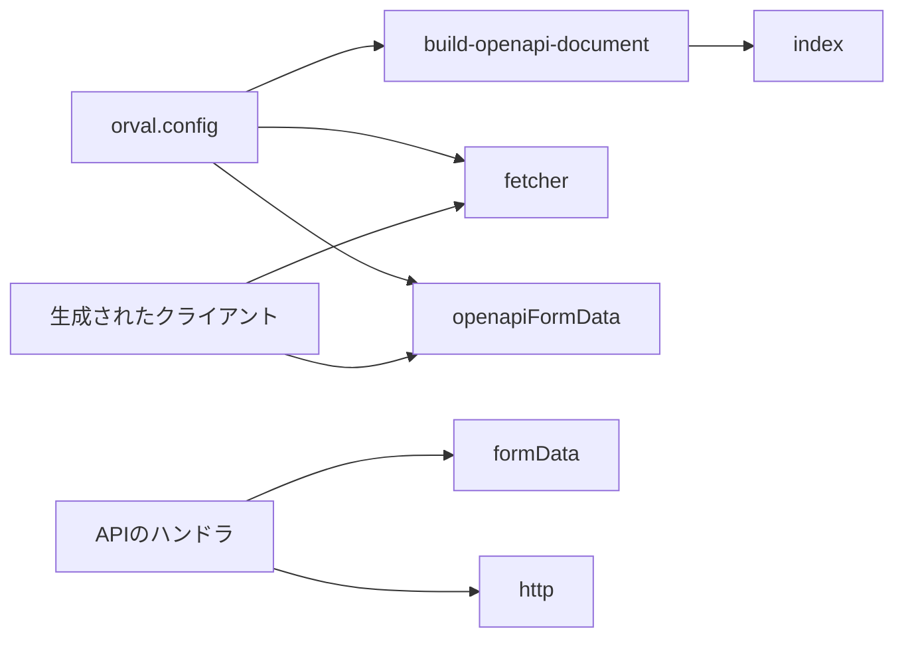
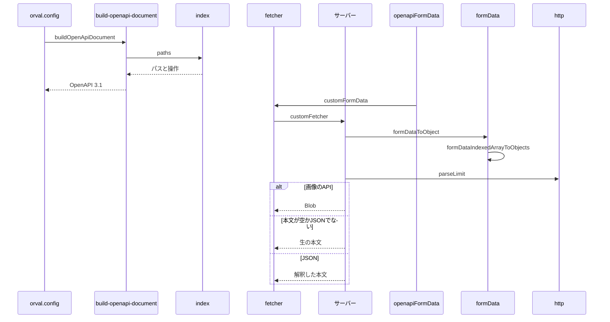

# APIスキーマとクライアントの生成 設計書

## 1. 構成

| パス                                 | 責務                                           |
| ------------------------------------ | ---------------------------------------------- |
| `src/lib/api/schema/index.ts`        | APIのパスと操作の登録                          |
| `hack/build-openapi-document.ts`     | OpenAPIドキュメントの組み立て                  |
| `orval.config.ts`                    | クライアントの生成の設定                       |
| `src/lib/codegen/fetcher.ts`         | 生成したクライアントの取得処理                 |
| `src/lib/codegen/openapiFormData.ts` | 生成したクライアントのフォームデータの組み立て |
| `src/util/formData.ts`               | サーバー側のフォームデータの復元               |
| `src/util/http.ts`                   | リクエストの補助処理                           |

## 2. 関係図・ワークフロー

生成とその実行時の部品の依存方向を示す。



生成から通信までの流れと、取得処理の分岐を示す。



## 3. 設計項目

### D-1: ドキュメントの組み立て (FR-1, FR-2)

```ts
// "/v2/entry/": { post, put, delete } のように、パスごとに操作を登録する
export const paths: ZodOpenApiPathsObject
export const buildOpenApiDocument = () =>
  createDocument({
    openapi: "3.1.0",
    info: { title, version, description },
    paths,
  })
```

- 各操作は、スキーマのファイルが公開する `operation`（`operationId`・要求・応答）を持つ。
- ドキュメントはファイルへ書き出さず、`orval.config.ts` から直接渡す。確認用に `npm run apigen:doc` で `openapi/generated.json` へ書き出せる。
- クライアントは単一のファイルとモデルへ生成し、取得処理に `customFetcher`、フォームデータに `customFormData` を使う。

### D-2: クライアントの取得処理とフォームデータ (FR-3, FR-4, FR-5, FR-6)

```ts
export const customFetcher = async <T>(url: string, options: RequestInit): Promise<T>
export const customFormData = <T extends Record<string, unknown>>(body: T): FormData
```

| 入力                           | 出力                                                                                                  |
| ------------------------------ | ----------------------------------------------------------------------------------------------------- |
| `/v1/extract` で始まる URL     | `<抽出サービス>` + 末尾のスラッシュを外したパス                                                       |
| `/v1/page` で始まる URL        | `<旧バックエンド>` + `/v1` を除いて末尾のスラッシュを外したパス                                       |
| `/v2/bsky/images` で始まる URL | `{ data: Blob, status, headers }`                                                                     |
| その他                         | 本文を文字列で読み、JSON として解釈できる場合は解釈した値、できない場合は生の値（空なら `undefined`） |
| `string` のフィールド          | `JSON.stringify` した文字列                                                                           |
| Blob / Blob の配列             | そのまま積む / 同名のフィールドへ展開する                                                             |
| `posts`（オブジェクトの配列）  | `posts[i][key]` の添字付きフィールド名へ展開し、Blob 以外は JSON 文字列にする                         |

### D-3: サーバー側の復元と補助 (FR-7, FR-8, FR-9)

```ts
export type FormDataFieldKind = "text" | "texts" | "file" | "files" | "json" | { kind: "items"; fields: Record<string, FormDataFieldKind> }
export const formDataToObject = (formData: FormData, kinds: Record<string, FormDataFieldKind>): Record<string, unknown>
export const formDataIndexedArrayToObjects = (formData: FormData, name: string, kinds: Record<string, FormDataFieldKind>): Record<string, unknown>[]
export const parseLimit = (value: string | null): number | null | undefined
```

| 関数                  | 内容                                                                     |
| --------------------- | ------------------------------------------------------------------------ |
| `parseLimit`          | 未指定と空文字は `undefined`、1〜100 の整数はその数値、それ以外は `null` |
| `hasCookieHeader`     | `cookie` ヘッダがあれば真                                                |
| `isMultipartFormData` | 内容種別に `multipart/form-data` を含めば真                              |
| `convertHeaderToObj`  | `Headers` をプレーンなオブジェクトへ変換する                             |

- `json` 種別の値は JSON として解釈し、失敗したときは生の文字列を残す。添字が飛んでいるときは、欠けた添字を空のオブジェクトで埋める。

## 4. エラー処理

| 事象                        | 処理                                     |
| --------------------------- | ---------------------------------------- |
| 応答の本文が JSON でない    | 生の文字列をデータとして返す             |
| JSON フィールドの解釈の失敗 | 生の値を残し、スキーマの検証で拒否させる |
