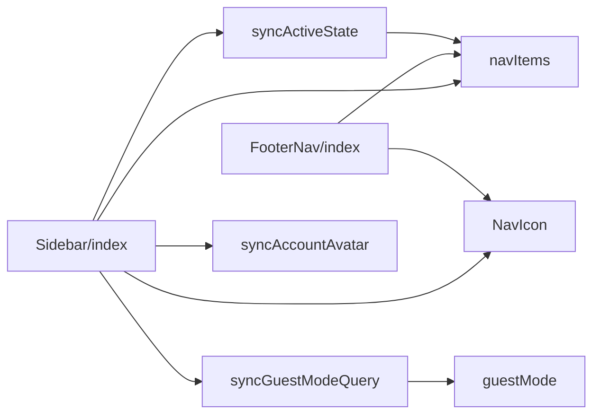
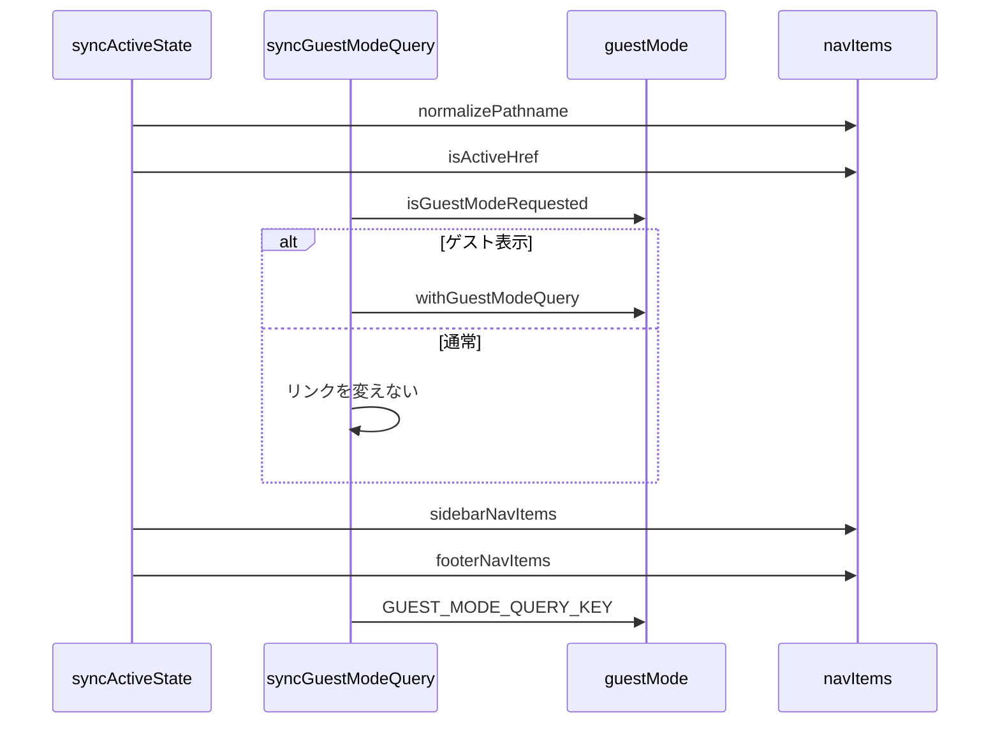

# 画面遷移のナビゲーション 設計書

## 1. 構成

| パス                                              | 責務                                 |
| ------------------------------------------------- | ------------------------------------ |
| `src/lib/guestMode.ts`                            | ゲスト表示の判定とリンクへの引き継ぎ |
| `src/components/layout/nav/navItems.ts`           | 項目の定義と現在地の判定             |
| `src/components/layout/nav/syncActiveState.ts`    | 現在地を示す印の再計算               |
| `src/components/layout/nav/syncGuestModeQuery.ts` | リンクへのゲスト表示のクエリの同期   |
| `src/components/layout/nav/syncAccountAvatar.ts`  | アカウントのアイコンの補完           |
| `src/components/layout/nav/NavIcon.astro`         | 項目のアイコンの描画                 |
| `src/components/layout/Sidebar/index.astro`       | デスクトップ幅のナビゲーション       |
| `src/components/layout/FooterNav/index.astro`     | モバイル幅のナビゲーション           |

## 2. 関係図・ワークフロー

ナビゲーションの構成要素の依存方向を示す。



ページの読み込みごとの同期と、ゲスト表示による分岐を示す。



## 3. 設計項目

### D-1: ゲスト表示の判定 (FR-1, FR-2)

```ts
export const GUEST_MODE_QUERY_KEY = "guest"
// window が無ければ false。URLのクエリに guest があれば true
export const isGuestModeRequested = (): boolean
// guestModeActive が偽なら href のまま。真なら ? か & で guest=1 を付ける
export const withGuestModeQuery = (href: string, guestModeActive: boolean): string
```

### D-2: 項目と現在地 (FR-3, FR-4, FR-6)

```ts
type NavItem = { href: string; labelKey: PlainMessageKey; ariaLabelKey: PlainMessageKey; key: "entries" | "post" | "accounts" | "settings" }
export const sidebarNavItems: NavItem[] // accounts, post, entries, settings
export const footerNavItems: NavItem[] // entries, post, settings, accounts
export const normalizePathname = (pathname: string): string // "/" 以外の末尾のスラッシュを除く
export const isActiveHref = (href: string, currentPathname: string): boolean
```

- `isActiveHref` は、ルート（`/`）のときだけ完全一致、それ以外は完全一致か配下（`<href>/` で始まる）のとき真とする。
- 現在地の印は、サーバー側で計算したものを `transition:persist` で保たれた DOM に対してクライアントが再計算する。

### D-3: 表示と同期 (FR-5, FR-7, FR-8)

| 要素                 | 内容                                                                                                     |
| -------------------- | -------------------------------------------------------------------------------------------------------- |
| サイドバー           | 640px 以上で表示する。640〜847px はアイコンだけ、848px 以上はアイコンとラベル。`data-nav="sidebar"`      |
| フッター             | 640px 未満で表示する。画面の下端に固定する。`data-nav="footer"`                                          |
| 現在地の同期         | ページの読み込みと遷移（`astro:page-load`）のたびに、`[data-nav] a[href]` の `aria-current` を再計算する |
| ゲスト表示の同期     | 同じ契機で、リンクのクエリを取り除いたうえで `withGuestModeQuery` を適用する                             |
| アカウントのアイコン | 同じ契機でアクティブなアカウントの画像を取得し、`[data-account-avatar-img]` の `src` に設定して表示する  |

アイコンの色の切り替え（`opacity` のクロスフェード）やラベルの表示のように見た目の要素を出し入れする `:hover` は、`@media (hover: hover)` の中にだけ書く。iOS Safari はタップで `:hover` を適用し、それで要素の表示が変わると1回目のタップをホバーとして扱い、リンクへ遷移しないため。

## 4. エラー処理

| 事象                   | 処理                                                 |
| ---------------------- | ---------------------------------------------------- |
| アカウントの取得の失敗 | コンソールへ記録し、プレースホルダの画像のままにする |
| 未ログイン             | アイコンを差し替えない                               |
