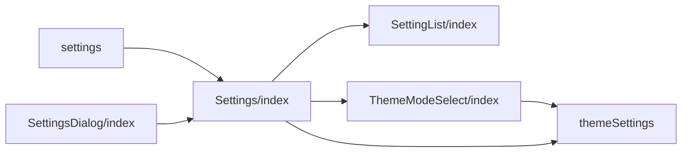
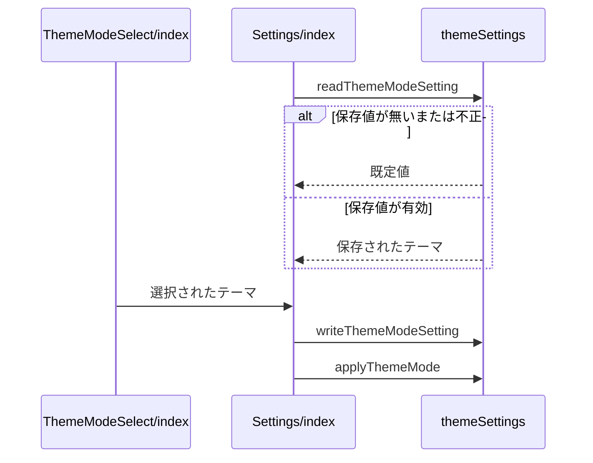

# 設定ページと表示テーマ 設計書

## 1. 構成

| パス                                               | 責務                     |
| -------------------------------------------------- | ------------------------ |
| `src/lib/settings/themeSettings.ts`                | 表示テーマの保存と適用   |
| `src/components/settings/SettingList/index.tsx`    | 設定項目の一覧の描画     |
| `src/components/settings/Settings/index.tsx`       | 設定のグループの組み立て |
| `src/components/settings/SettingsDialog/index.tsx` | 設定のダイアログ表示     |
| `src/components/common/ThemeModeSelect/index.tsx`  | 表示テーマの選択欄       |
| `src/pages/settings.astro`                         | 設定ページ               |

## 2. 関係図・ワークフロー

設定ページの構成要素の依存方向を示す。



テーマの選択から適用までの流れと、保存値が不正な場合の分岐を示す。



## 3. 設計項目

### D-1: 表示テーマ (FR-1, FR-2, FR-7)

```ts
export type ThemeMode = "system" | "light" | "dark"
// 保存キーは themeMode。window が無い・保存値が無い・不正な値・例外のときは defaultValue
export const readThemeModeSetting = (defaultValue: ThemeMode): ThemeMode
export const writeThemeModeSetting = (value: ThemeMode): void // 例外は握りつぶす
// system は documentElement の data-theme を取り除く。light と dark は dataset.theme に設定する
export const applyThemeMode = (mode: ThemeMode): void
```

- 初回描画前のインラインスクリプトが、保存値が `light` か `dark` のときだけ `data-theme` を設定し、ちらつきを防ぐ。
- 選択欄は `system`・`light`・`dark` の3つの選択肢を持ち、共通のプルダウンを使う。

### D-2: 設定項目の一覧 (FR-3, FR-4, FR-5, FR-6, FR-9)

```ts
type SettingListItem = {
  key: string // 行の識別子。コントロールの id は setting-<key>
  label: React.ReactNode
  description?: React.ReactNode
  checked?: boolean
  disabled?: boolean
  onCheckedChange?: (next: boolean) => void
  renderControl?: (ctx: {
    id: string
    ariaLabel?: string
    disabled?: boolean
  }) => React.ReactNode
  textInput?: boolean
  textInputValue?: string
  onTextInputChange?: (next: string) => void
  textInputValidate?: (value: string) => boolean
  textInputErrorMessage?: string
}
```

| 条件                             | 表示                    |
| -------------------------------- | ----------------------- |
| `renderControl` が無い           | スイッチ                |
| `renderControl` がある           | 独自のコントロール      |
| 文字入力が空でなく検証を通る     | 確認の印                |
| 文字入力が空でなく検証を通らない | `textInputErrorMessage` |

ラベルと説明文は `<label>` にせず `<div>` に置き、押してもコントロールに伝えない。スイッチのアクセシブルネームは、ラベルが文字列なら `aria-label`、文字列でなければラベルの要素（id は `setting-<key>-label`）を指す `aria-labelledby` で与える。

### D-3: ページとダイアログ (FR-7, FR-8)

```tsx
// 設定ページ（prerender）と SettingsDialog の双方が同じ Settings を描画する
type SettingsDialogProps = { open: boolean; onClose: () => void }
```

- ページは静的に生成し、`Settings` を `client:load` で描画する。ダイアログは `Overlay` の中に同じ `Settings` を置く。
- 設定値は `localStorage` に保存し、アカウントに依存しない。ページ遷移のたびに保存値を読み直す。
- 各設定の初期値はサーバー描画と同じ既定値とし、保存値はマウント後に反映する。初回描画で保存値を読むと、スイッチの状態がサーバー描画のまま補正されず、保存値と食い違う。

## 4. エラー処理

| 事象                     | 処理                           |
| ------------------------ | ------------------------------ |
| 保存領域の読み取りの例外 | 既定値を使う                   |
| 保存領域の書き込みの例外 | 書き込みを諦め、表示は維持する |
