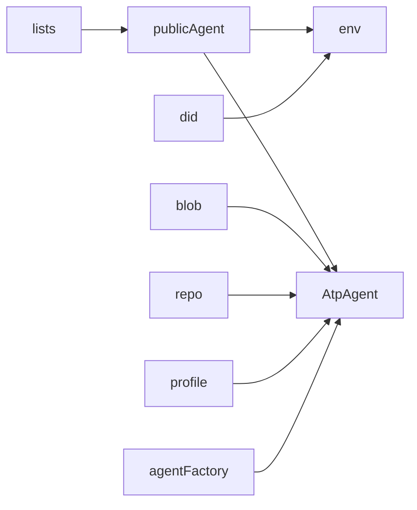
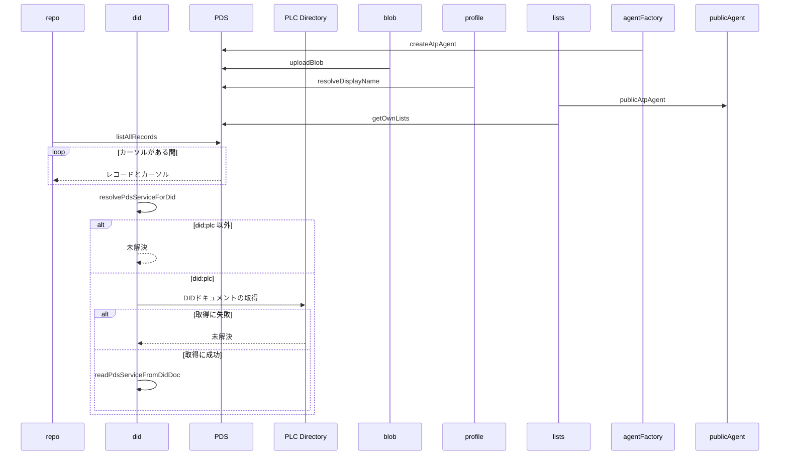

# atprotoデータ取得の共通処理 設計書

## 1. 構成

| パス                              | 責務                                     |
| --------------------------------- | ---------------------------------------- |
| `src/lib/atproto/agentFactory.ts` | 指定サービスに接続するエージェントの生成 |
| `src/lib/atproto/publicAgent.ts`  | 認証不要の公開エージェントの共有         |
| `src/lib/atproto/blob.ts`         | blobのアップロード                       |
| `src/lib/atproto/repo.ts`         | コレクション内のレコードの全件取得       |
| `src/lib/atproto/profile.ts`      | 表示名の取得                             |
| `src/lib/atproto/lists.ts`        | 自分が所有するリストの取得               |
| `src/lib/atproto/did.ts`          | DIDドキュメントからのPDSの取り出しと解決 |

## 2. 関係図・ワークフロー

共通処理のあいだの依存方向を示す。



レコードの全件取得と、PDSの解決の分岐を示す。



## 3. 設計項目

### D-1: エージェントとblob (FR-1)

```ts
export const createAtpAgent = (service: string): AtpAgent =>
  new AtpAgent({ service })
// 認証不要の公開 AppView 用。セッションの cookie は扱わない
export const publicAtpAgent = new AtpAgent({ service: atpService })
export const uploadBlob = async (
  agent: Pick<AtpAgent, "uploadBlob">,
  blob: Blob,
) => {
  const mime = blob.type || "application/octet-stream"
  const res = await agent.uploadBlob(new Uint8Array(await blob.arrayBuffer()), {
    encoding: mime,
  })
  return res.data.blob
}
```

エージェントの生成を関数に分けるのは、テストでモジュールを差し替えて偽のエージェントを注入できるようにするためである。

### D-2: 全件取得と参照 (FR-2, FR-3, FR-4, FR-5)

```ts
export const listAllRecords = async (agent, params: { repo: string; collection: string }) =>
  // limit 100 でカーソルを最後まで辿り、records を結合する。records が無いページは空として扱う
export const resolveDisplayName = async (agent, did: string, fallbackHandle: string): Promise<string> =>
  (await agent.getProfile({ actor: did })).data.displayName || fallbackHandle
export type OwnedList = { uri: string; name: string }
// purpose が app.bsky.graph.defs#curatelist のものだけを { uri, name } にする。limit は 100
export const getOwnLists = async (did: string): Promise<OwnedList[]>
```

### D-3: PDSの解決 (FR-6, FR-7)

```ts
// id が #atproto_pds、type が AtprotoPersonalDataServer、serviceEndpoint が空でない文字列の最初のサービス
export const readPdsServiceFromDidDoc = (didDoc: unknown): string | undefined
// did:plc: で始まらなければ undefined。PLC Directory へ GET し、ok でなければ undefined
export const resolvePdsServiceForDid = async (did: string): Promise<string | undefined>
```

## 4. エラー処理

| 事象                        | 処理                     |
| --------------------------- | ------------------------ |
| リストの取得の失敗          | 例外を呼び出し元へ伝える |
| PLC Directory の応答が失敗  | 未解決として扱う         |
| DIDドキュメントの形式が不正 | 未解決として扱う         |
