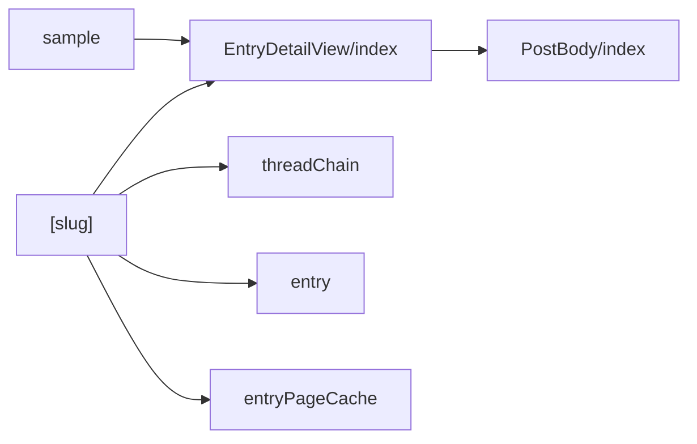
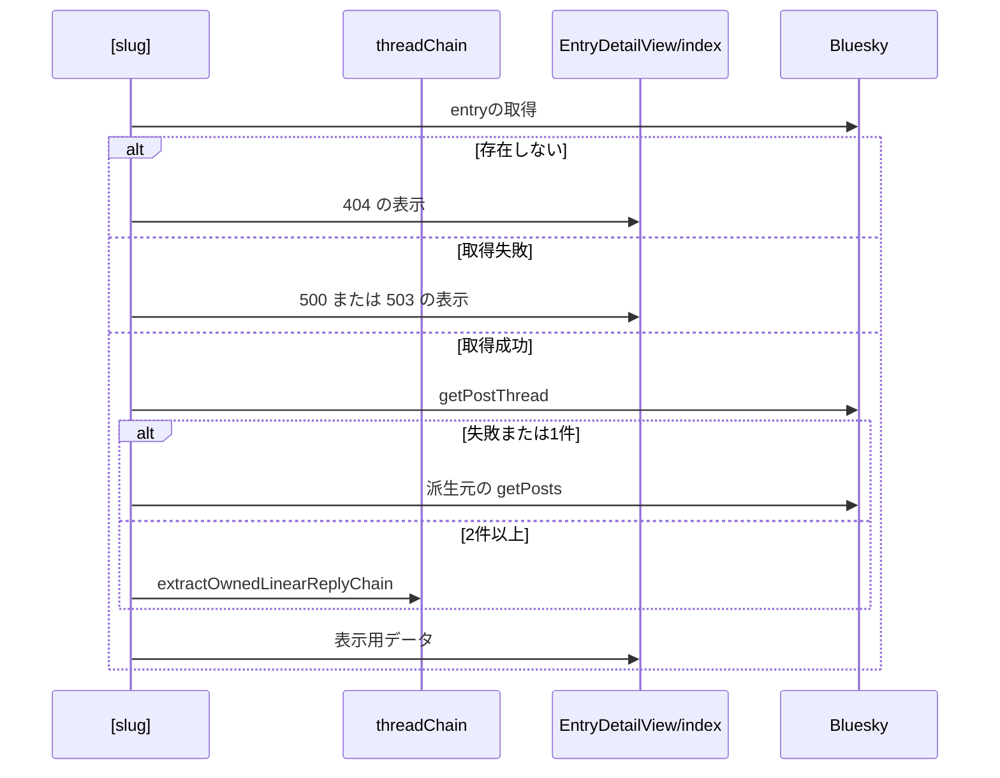

# entry詳細ページ 設計書

## 1. 構成

| パス                                               | 責務                                               |
| -------------------------------------------------- | -------------------------------------------------- |
| `src/pages/entries/[slug].astro`                   | entryとスレッドの取得、表示用データの組み立て      |
| `src/components/entry/EntryDetailView/index.astro` | ヘッダーカード・投稿カードの並び・エラー表示・余白 |
| `src/components/post/PostBody/index.tsx`           | 投稿カードの表示部（タイムラインと共用）           |
| `src/lib/atproto/threadChain.ts`                   | 自分の投稿の直線的な連鎖の抽出                     |
| `src/lib/entry/entry.ts`                           | 投稿の画像の抽出                                   |
| `src/lib/entry/entryPageCache.ts`                  | 詳細ページのSSR結果の保存と再利用                  |
| `src/pages/entries/sample.astro`                   | 表示確認用のサンプルページ                         |

## 2. 関係図・ワークフロー

詳細ページの表示に関わる依存方向を示す。



スレッド取得とフォールバックの流れを示す。



## 3. 設計項目

### D-1: 表示用データ (FR-4, FR-5, FR-7, FR-8)

```ts
export type EntryPostView = {
  webUrl: string
  author: { handle: string; displayName?: string; avatar?: string }
  createdAt: string
  text: string
  images: SourceImage[]
  engagement: {
    likeCount: number
    repostCount: number
    replyCount: number
    quoteCount: number
  } // 数値でなければ0
}
```

| 状況                            | `posts`                                                          |
| ------------------------------- | ---------------------------------------------------------------- |
| スレッドの抽出結果が2件以上     | `chain.map(...)`（各投稿の作者・作成日時・画像・自身のカウント） |
| 抽出結果が1件、または抽出の失敗 | 派生元の `getPosts` の1件                                        |
| 派生元が削除済み                | 空配列                                                           |

- `getPostThread({ uri: source.uri, depth: MAX_THREAD_POST_COUNT })` の結果に `extractOwnedLinearReplyChain(thread, ownerDid, MAX_THREAD_POST_COUNT)` を適用する。直前の投稿への自分の返信を次とし、複数ある場合は `createdAt` の差が最小のものを選ぶ。第三者の返信の先はたどらない。
- 画像は `extractSourceImages` で抽出し、`aspectRatio` が正の有限数のときだけ保持する。

### D-2: ページの構成 (FR-1, FR-2, FR-3, FR-6, FR-9, FR-10)

```
<article>
  <section class="header-card">代表画像（拡大なし） / caption / 作成日時 / 派生元削除時の案内文</section>
  <ol class="post-list">
    {posts.map(post => <li><div class="post-card">
      <PostBody client:load postUrl={post.webUrl} engagement={post.engagement} ... />
    </div></li>)}
  </ol>
</article>
<footer class="page-footer" aria-hidden="true"></footer>
```

- `manifestCaption` は entry自身の caption だけとし、メタ情報の説明文は `manifestCaption || sourceText.slice(0, 280)` を別に渡す。
- 連結線: `li:not(:last-child)::after { position: absolute; left: calc(var(--space-2) + var(--size-avatar-md) / 2 - 1px); top: 100%; width: 2px; height: var(--space-3) }`。
- `statusCode !== 200` のときは状態ごとのエラー表示を描画する。`page-footer` は状態によらず最後に描画し、`height: calc(6rem + env(safe-area-inset-bottom, 0px)); flex-shrink: 0` とする。
- `PostBody` は日時を `postUrl` へのリンク（`target="_blank"`）にし、`engagement` があるときだけ画像の下に `PostEngagementStats` を出す。

### D-3: サーバー描画 (NFR-1, NFR-2)

| 項目           | 内容                                                                         |
| -------------- | ---------------------------------------------------------------------------- |
| 描画           | Cloudflare Workers 上でSSRし、`PostBody` を `client:load` でハイドレートする |
| JavaScript依存 | 画像の拡大表示だけ                                                           |
| 横幅           | 横スクロールは画像5枚以上の帯の内部だけで発生させる                          |

### D-4: SSR結果の再利用 (NFR-3)

| 項目         | 内容                                                                                         |
| ------------ | -------------------------------------------------------------------------------------------- |
| 保存先       | Cloudflare の Cache API（`caches.default`）。データセンターごとに保存される                  |
| キー         | 末尾スラッシュ付きのパスと表示言語（`locals.locale`）。クエリ文字列は含めない                |
| 保存対象     | 200 の HTML のみ。404・500・Cookie を設定する応答は保存しない                                |
| 保存期間     | 300秒。entryの更新・削除は、最大でこの時間は保存済みのページに反映されない                   |
| 保存の流れ   | 未保存なら通常どおり描画し、`waitUntil` で保存する。保存済みなら後続の処理を呼ばずに返す     |
| 応答ヘッダー | `x-skyshare-cache` に `HIT` か `MISS` を入れる                                               |
| 対象外       | GET以外、事前描画のページ、Cache API が使えない環境（`workers.dev`）では保存も再利用もしない |
| 失敗時       | Cache API の失敗は握りつぶし、通常の描画にフォールバックする                                 |

## 4. エラー処理

| 事象                 | 処理                                |
| -------------------- | ----------------------------------- |
| entryが存在しない    | 404のエラー表示                     |
| entryの取得の失敗    | 500または503のエラー表示            |
| スレッドの取得の失敗 | 派生元1件の表示にフォールバックする |
